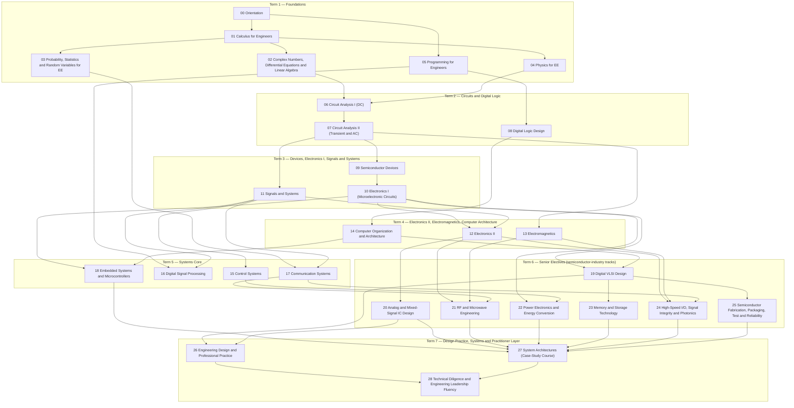

# Curriculum

<!-- BEGIN GENERATED (tools/build_curriculum.py) — edit tools/data/curriculum.yml, not this block -->

The complete map of the Self-Taught BSEE: every course and chapter, with university equivalents, textbook alignment, prerequisites, learning objectives and estimated study hours. For the week-by-week schedule see [STUDY_PLAN.md](STUDY_PLAN.md). For build status see [PROGRESS.md](PROGRESS.md).

**At a glance:** 29 courses · 307 chapters · 7 terms · 4 capstones · ≈ 2760 study hours in total (courses 2542 h, capstones 160 h, term checkpoints 56 h).

> **About the hour estimates.** Hours cover reading, working the examples, the full problem set and the lab for each chapter, for a strong learner meeting the material for the first time. At 10–12 hours per week, the full curriculum is a multi-year undertaking; see [STUDY_PLAN.md](STUDY_PLAN.md) for the calendar and the shorter practitioner fast track.

## Course map

| Course | Term | Chapters | Hours | Typical university equivalent |
|---|---|---|---|---|
| [00 · Orientation](#course-00) | 1 | 5 | 17 | Freshman 'Introduction to Electrical Engineering' seminar |
| [01 · Calculus for Engineers](#course-01) | 1 | 10 | 122 | Calculus I–III (single variable + multivariable) |
| [02 · Complex Numbers, Differential Equations and Linear Algebra](#course-02) | 1 | 10 | 110 | Differential Equations + Linear Algebra (sophomore math) |
| [03 · Probability, Statistics and Random Variables for EE](#course-03) | 1 | 6 | 43 | Probability and Random Processes for EE (junior) |
| [04 · Physics for EE](#course-04) | 1 | 11 | 106 | University Physics II (E&M) + Modern Physics |
| [05 · Programming for Engineers](#course-05) | 1 | 9 | 80 | Intro to Programming (Python) + Programming in C for Engineers |
| [06 · Circuit Analysis I (DC)](#course-06) | 2 | 11 | 86 | Circuits I (sophomore) |
| [07 · Circuit Analysis II (Transient and AC)](#course-07) | 2 | 11 | 103 | Circuits II (sophomore/junior) |
| [08 · Digital Logic Design](#course-08) | 2 | 12 | 106 | Digital Design / Digital Logic (sophomore) |
| [09 · Semiconductor Devices](#course-09) | 3 | 14 | 116 | Solid-State / Semiconductor Devices (junior) |
| [10 · Electronics I (Microelectronic Circuits)](#course-10) | 3 | 10 | 99 | Electronics I / Microelectronic Circuits I (junior) |
| [11 · Signals and Systems](#course-11) | 3 | 11 | 106 | Signals and Systems (junior) |
| [12 · Electronics II](#course-12) | 4 | 10 | 104 | Electronics II / Microelectronic Circuits II (junior/senior) |
| [13 · Electromagnetics](#course-13) | 4 | 11 | 106 | Electromagnetics I–II (junior) |
| [14 · Computer Organization and Architecture](#course-14) | 4 | 15 | 122 | Computer Organization + Computer Architecture (junior/senior) |
| [15 · Control Systems](#course-15) | 5 | 12 | 89 | Feedback Control Systems (junior/senior) |
| [16 · Digital Signal Processing](#course-16) | 5 | 11 | 83 | Digital Signal Processing (senior) |
| [17 · Communication Systems](#course-17) | 5 | 13 | 103 | Communication Systems / Digital Communications (senior) |
| [18 · Embedded Systems and Microcontrollers](#course-18) | 5 | 11 | 83 | Embedded Systems / Microcontrollers (junior/senior) |
| [19 · Digital VLSI Design](#course-19) | 6 | 13 | 112 | Digital VLSI / Digital Integrated Circuits (senior) |
| [20 · Analog and Mixed-Signal IC Design](#course-20) | 6 | 12 | 104 | Analog IC Design + Data Converters (senior/first-year graduate) |
| [21 · RF and Microwave Engineering](#course-21) | 6 | 12 | 91 | RF/Microwave Engineering + RF IC Design (senior/first-year graduate) |
| [22 · Power Electronics and Energy Conversion](#course-22) | 6 | 12 | 92 | Power Electronics (senior) + Electric Machines and Power Systems (intro) |
| [23 · Memory and Storage Technology](#course-23) | 6 | 9 | 53 | Memory Systems / Semiconductor Memory (senior elective) |
| [24 · High-Speed I/O, Signal Integrity and Photonics](#course-24) | 6 | 9 | 59 | High-Speed Digital Design / Signal Integrity + Optoelectronics (senior/graduate elective) |
| [25 · Semiconductor Fabrication, Packaging, Test and Reliability](#course-25) | 6 | 12 | 83 | Microfabrication / IC Process Technology + Packaging and Reliability (senior elective) |
| [26 · Engineering Design and Professional Practice](#course-26) | 7 | 7 | 42 | Senior Design / Engineering Professional Practice + Engineering Economics |
| [27 · System Architectures (Case-Study Course)](#course-27) | 7 | 8 | 60 | Systems-design case-study capstone seminar |
| [28 · Technical Diligence and Engineering Leadership Fluency](#course-28) | 7 | 10 | 62 | No university equivalent. Draws on industry diligence practice. |

## Prerequisite graph

Arrows point from a prerequisite to the course that needs it. Implied edges are omitted (if A → B → C, the edge A → C is not drawn).

## FE Electrical & Computer coverage

The NCEES FE Electrical and Computer exam (spec effective July 2020, 110 questions, checked Nov 2026; see [reference/research-log.md](reference/research-log.md#r-001--ncees-fe-electrical-and-computer-specification)) has 17 knowledge areas. Each maps onto the courses below, and each term checkpoint in [checkpoints/](checkpoints/README.md) samples the areas covered so far.

| FE knowledge area | Exam questions | Primary courses |
|---|---|---|
| Mathematics | 11–17 | [01](#course-01), [02](#course-02) |
| Probability and Statistics | 4–6 | [03](#course-03) |
| Ethics and Professional Practice | 4–6 | [25](#course-25), [26](#course-26) |
| Engineering Economics | 5–8 | [26](#course-26) |
| Properties of Electrical Materials | 4–6 | [04](#course-04), [09](#course-09), [23](#course-23), [25](#course-25) |
| Circuit Analysis (DC and AC Steady State) | 11–17 | [06](#course-06), [07](#course-07) |
| Linear Systems | 5–8 | [02](#course-02), [07](#course-07), [11](#course-11) |
| Signal Processing | 5–8 | [11](#course-11), [16](#course-16) |
| Electronics | 7–11 | [09](#course-09), [10](#course-10), [12](#course-12), [19](#course-19), [20](#course-20), [21](#course-21), [22](#course-22) |
| Power Systems | 8–12 | [07](#course-07), [22](#course-22) |
| Electromagnetics | 4–6 | [04](#course-04), [13](#course-13), [21](#course-21), [24](#course-24) |
| Control Systems | 6–9 | [12](#course-12), [15](#course-15) |
| Communications | 5–8 | [17](#course-17), [21](#course-21), [24](#course-24) |
| Computer Networks | 4–6 | [17](#course-17) |
| Digital Systems | 8–12 | [08](#course-08), [14](#course-14), [18](#course-18), [19](#course-19), [24](#course-24) |
| Computer Systems | 5–8 | [05](#course-05), [08](#course-08), [14](#course-14), [18](#course-18), [23](#course-23) |
| Software Engineering | 4–6 | [05](#course-05), [18](#course-18) |

## Term 1 — Foundations

The mathematics, physics and programming that every later course assumes. *Term total: ≈ 478 hours + checkpoint (8 h).*

### 00 · Orientation

A map of electrical engineering and of this curriculum: the subdisciplines, the abstraction stack from physics to software, how to study without an instructor, the toolchain, and how chip companies organize their engineering teams.

- **Course page:** [courses/00-orientation/](courses/00-orientation/README.md)
- **University equivalents:** Freshman 'Introduction to Electrical Engineering' seminar
- **Textbook alignment:** No required text. Optional: Hambley, *Electrical Engineering: Principles and Applications* (survey chapters)
- **Free courses:** MIT OCW 6.002 (Circuits and Electronics), lecture 1, for the abstraction idea
- **Prerequisites:** none
- **FE areas served:** —
- **Study hours:** ≈ 17 (14.5 chapter hours + 2.5 review/exam)

**Learning objectives.** By the end of the course you can:

1. Name the major EE subdisciplines and place each on the abstraction stack.
2. Explain what each level of the stack (device, circuit, block, chip, package, board, system, software) optimizes and hands to the next.
3. Install and smoke-test the curriculum toolchain (Python, Jupyter, ngspice, Icarus Verilog).
4. Describe the main engineering functions in a chip company and how a product moves from spec to production.

| Chapter | Hours | Key topics |
|---|---|---|
| [00-01 · The Map of Electrical Engineering](courses/00-orientation/chapters/00-01-map-of-electrical-engineering.md) | 3 | Subdisciplines (circuits, devices, signals, communications, controls, power, EM/RF, computer engineering); how they connect; where the semiconductor industry sits |
| [00-02 · The Abstraction Stack: Physics to Software](courses/00-orientation/chapters/00-02-the-abstraction-stack.md) | 3.5 | Physics → device → circuit → block → chip → package → board → system → software; what each layer hides; where abstractions leak |
| [00-03 · How to Study This Curriculum](courses/00-orientation/chapters/00-03-how-to-study-this-curriculum.md) | 2 | Study loop, problem-solving protocol, spaced repetition with Anki, using verify scripts and labs, when to move on |
| [00-04 · Toolchain Setup Walkthrough](courses/00-orientation/chapters/00-04-toolchain-walkthrough.md) | 3.5 | Python env, Jupyter, ngspice, Icarus Verilog/Verilator, GTKWave, Yosys; running the repo's checks; optional hardware kit |
| [00-05 · How Chip Companies' Engineering Organizations Work](courses/00-orientation/chapters/00-05-how-chip-companies-are-organized.md) | 2.5 | Architecture, design, verification, physical design, DFT, analog/RF, software, product/test engineering, ops; spec-to-production lifecycle; headcount ratios |

### 01 · Calculus for Engineers

Single- and multivariable calculus taught through electrical examples: charge and current, energy and power, RC decay, RMS values and fields. Starts at refresher level and ends at what circuits, devices and electromagnetics require.

- **Course page:** [courses/01-calculus-for-engineers/](courses/01-calculus-for-engineers/README.md)
- **University equivalents:** Calculus I–III (single variable + multivariable); MIT 18.01 / 18.02
- **Textbook alignment:** Stewart, *Calculus: Early Transcendentals*; Strang, *Calculus* (free, MIT OpenCourseWare); Kreyszig, *Advanced Engineering Mathematics* (multivariable / vector chapters)
- **Free courses:** MIT OCW 18.01SC Single Variable Calculus; MIT OCW 18.02SC Multivariable Calculus
- **Prerequisites:** [00 · Orientation](#course-00)
- **FE areas served:** Mathematics
- **Study hours:** ≈ 122 (116 chapter hours + 6 review/exam)

**Learning objectives.** By the end of the course you can:

1. Differentiate and integrate the functions that appear in EE (polynomials, exponentials, logarithms, sinusoids, rational functions).
2. Use derivatives for rates of change, optimization and linearization (the idea behind small-signal models).
3. Use integrals for accumulation (charge from current, energy from power), averages and RMS values.
4. Build and use Taylor expansions, and bound their error.
5. Compute partial derivatives and gradients, and interpret line and surface integrals as work, flux and circulation.

| Chapter | Hours | Key topics |
|---|---|---|
| [01-01 · Functions, Models and Units](courses/01-calculus-for-engineers/chapters/01-01-functions-models-and-units.md) | 8 | Functions as signals; exponentials and logarithms refresher; decibels; trigonometric functions and radians; dimensional analysis |
| [01-02 · Limits and Continuity](courses/01-calculus-for-engineers/chapters/01-02-limits-and-continuity.md) | 8 | Limits, one-sided limits, continuity, limits at infinity, asymptotic behavior, L'Hôpital preview |
| [01-03 · Derivatives: Rates of Change in Circuits](courses/01-calculus-for-engineers/chapters/01-03-derivatives.md) | 13 | Definition, rules (product, quotient, chain), derivatives of exp/log/trig, implicit differentiation, i = C dv/dt and v = L di/dt |
| [01-04 · Applications of Derivatives](courses/01-calculus-for-engineers/chapters/01-04-applications-of-derivatives.md) | 12 | Optimization (max power transfer), linearization and the small-signal idea, Newton's method, related rates, L'Hôpital's rule |
| [01-05 · Integrals: Accumulating Charge and Energy](courses/01-calculus-for-engineers/chapters/01-05-integrals.md) | 12 | Riemann sums, definite integrals, fundamental theorem of calculus, antiderivatives, q = ∫i dt, w = ∫p dt |
| [01-06 · Techniques of Integration](courses/01-calculus-for-engineers/chapters/01-06-techniques-of-integration.md) | 13 | Substitution, integration by parts, partial fractions, trigonometric integrals, improper integrals, numerical integration |
| [01-07 · Applications of Integration](courses/01-calculus-for-engineers/chapters/01-07-applications-of-integration.md) | 12 | Average value, RMS of periodic waveforms, energy in capacitors and inductors, work, probability densities, areas, volumes, arc length, centroids |
| [01-08 · Sequences, Series and Taylor Expansions](courses/01-calculus-for-engineers/chapters/01-08-sequences-series-and-taylor.md) | 13 | Convergence, geometric series, power series, Taylor/Maclaurin series of exp, sin, cos, ln(1+x); remainder bounds; approximations engineers use |
| [01-09 · Multivariable Calculus I: Partial Derivatives and Gradients](courses/01-calculus-for-engineers/chapters/01-09-multivariable-calculus-1.md) | 12 | Functions of several variables, partial derivatives, gradient, directional derivative, chain rule, multivariable optimization, Lagrange multipliers |
| [01-10 · Multivariable Calculus II: Multiple, Line and Surface Integrals](courses/01-calculus-for-engineers/chapters/01-10-multivariable-calculus-2.md) | 13 | Double/triple integrals, polar/cylindrical/spherical coordinates, line integrals (work), surface integrals (flux), intuition for divergence and curl |

### 02 · Complex Numbers, Differential Equations and Linear Algebra

The three mathematical workhorses of EE. Complex numbers and phasors turn sinusoids into algebra; linear ODEs describe every circuit with memory; linear algebra solves large circuits and underpins state-space, signal processing and machine learning hardware.

- **Course page:** [courses/02-complex-numbers-des-and-linear-algebra/](courses/02-complex-numbers-des-and-linear-algebra/README.md)
- **University equivalents:** Differential Equations + Linear Algebra (sophomore math); MIT 18.03 / 18.06; Berkeley EE16A/B (linear-algebra and ODE content)
- **Textbook alignment:** Boyce & DiPrima, *Elementary Differential Equations and Boundary Value Problems*; Strang, *Introduction to Linear Algebra*; Kreyszig, *Advanced Engineering Mathematics* (complex numbers, ODE and linear-algebra parts)
- **Free courses:** MIT OCW 18.03SC Differential Equations; MIT OCW 18.06SC Linear Algebra; Berkeley EE16A/EE16B course notes
- **Prerequisites:** [01 · Calculus for Engineers](#course-01)
- **FE areas served:** Mathematics, Linear Systems
- **Study hours:** ≈ 110 (104 chapter hours + 6 review/exam)

**Learning objectives.** By the end of the course you can:

1. Work fluently with complex numbers in rectangular, polar and exponential form, and represent sinusoids as phasors.
2. Solve first- and second-order linear constant-coefficient ODEs (homogeneous and forced) and interpret the characteristic roots physically.
3. Use the Laplace transform to solve linear ODEs with initial conditions.
4. Solve linear systems by elimination; compute determinants, inverses and rank; reason about solution existence and uniqueness.
5. Compute eigenvalues and eigenvectors and use them to decouple systems of ODEs.
6. Apply basic numerical methods (Newton, Euler/Runge–Kutta, numerical linear algebra) and recognize ill-conditioning.

| Chapter | Hours | Key topics |
|---|---|---|
| [02-01 · Complex Numbers, Euler's Formula and Phasors](courses/02-complex-numbers-des-and-linear-algebra/chapters/02-01-complex-numbers-euler-and-phasors.md) | 10 | Rectangular/polar/exponential forms, arithmetic, roots of unity, Euler's formula (derived), sinusoids, phasors, d/dt ↔ jω, sinusoidal steady state of ODEs, impedance preview |
| [02-02 · First-Order Linear ODEs](courses/02-complex-numbers-des-and-linear-algebra/chapters/02-02-first-order-linear-odes.md) | 10 | Separation of variables, integrating factor, homogeneous + particular solutions, time constant, initial-value problems, existence/uniqueness |
| [02-03 · Second-Order Linear ODEs and the Characteristic Equation](courses/02-complex-numbers-des-and-linear-algebra/chapters/02-03-second-order-linear-odes.md) | 12 | Characteristic equation, overdamped/critically damped/underdamped cases, damping ratio and natural frequency, initial conditions |
| [02-04 · Forced Response and Resonance](courses/02-complex-numbers-des-and-linear-algebra/chapters/02-04-forced-response-and-resonance.md) | 10 | Undetermined coefficients, superposition of forcing terms, sinusoidal forcing via phasors, resonance, quality factor |
| [02-05 · The Laplace Transform for ODEs](courses/02-complex-numbers-des-and-linear-algebra/chapters/02-05-laplace-transform-for-odes.md) | 10 | Definition, table, properties, partial-fraction inversion, initial/final value theorems, solving IVPs, transfer-function preview |
| [02-06 · Vectors, Matrices and Linear Systems](courses/02-complex-numbers-des-and-linear-algebra/chapters/02-06-vectors-matrices-and-linear-systems.md) | 12 | Vectors, matrix algebra, Gaussian elimination, LU, nodal analysis as Ax = b |
| [02-07 · Determinants, Inverses, Rank and Vector Spaces](courses/02-complex-numbers-des-and-linear-algebra/chapters/02-07-determinants-inverses-and-vector-spaces.md) | 10 | Determinants, Cramer's rule, inverses, rank, null space, column space, linear independence, basis |
| [02-08 · Eigenvalues and Eigenvectors](courses/02-complex-numbers-des-and-linear-algebra/chapters/02-08-eigenvalues-and-eigenvectors.md) | 12 | Characteristic polynomial, diagonalization, symmetric matrices, complex eigenvalues, SVD intuition |
| [02-09 · Systems of Linear ODEs and the Matrix Exponential](courses/02-complex-numbers-des-and-linear-algebra/chapters/02-09-systems-of-odes-and-matrix-exponential.md) | 10 | State-variable form x' = Ax + Bu, eigen-decomposition solutions, matrix exponential, stability from eigenvalues |
| [02-10 · Numerical Methods for Engineers](courses/02-complex-numbers-des-and-linear-algebra/chapters/02-10-numerical-methods.md) | 8 | Newton–Raphson, Euler and Runge–Kutta, stiffness, numerical linear algebra, conditioning, floating-point error (how SPICE solves circuits) |

### 03 · Probability, Statistics and Random Variables for EE

An accelerated course for a learner who already knows probability and statistics from finance: the same mathematics restated in EE language (bit errors, yield, noise, measurement) and extended to the Gaussian Q-function and random-process ideas that noise and communications courses need.

- **Course page:** [courses/03-probability-statistics-and-random-variables/](courses/03-probability-statistics-and-random-variables/README.md)
- **University equivalents:** Probability and Random Processes for EE (junior); MIT 6.041 / 6.431
- **Textbook alignment:** Leon-Garcia, *Probability, Statistics, and Random Processes for Electrical Engineering*; Bertsekas & Tsitsiklis, *Introduction to Probability*
- **Free courses:** MIT OCW 6.041SC Probabilistic Systems Analysis and Applied Probability
- **Prerequisites:** [01 · Calculus for Engineers](#course-01)
- **FE areas served:** Probability and Statistics
- **Study hours:** ≈ 43 (40 chapter hours + 3 review/exam)

**Learning objectives.** By the end of the course you can:

1. Model engineering events (bit errors, defects, failures) with the appropriate discrete or continuous distribution.
2. Compute expectations, variances, covariances and correlation coefficients, including for sums and functions of random variables.
3. Use the Gaussian distribution and the Q-function to compute error and yield probabilities.
4. Apply estimation, confidence intervals and hypothesis tests to measurement and yield data.
5. Explain autocorrelation, stationarity and white noise as the bridge to noise analysis and communications.

| Chapter | Hours | Key topics |
|---|---|---|
| [03-01 · Probability in EE Language](courses/03-probability-statistics-and-random-variables/chapters/03-01-probability-in-ee-language.md) | 6 | Axioms, conditional probability, Bayes, independence, applied to bit errors, defects and test escapes |
| [03-02 · Random Variables and Distributions](courses/03-probability-statistics-and-random-variables/chapters/03-02-random-variables-and-distributions.md) | 8 | Bernoulli, binomial, Poisson, geometric, uniform, exponential, Gaussian, Q-function, CDF/PDF/PMF |
| [03-03 · Expectation, Variance and Functions of Random Variables](courses/03-probability-statistics-and-random-variables/chapters/03-03-expectation-and-functions-of-rvs.md) | 6 | Moments, transformation of variables, power of a random signal, RMS |
| [03-04 · Joint Distributions, Correlation and the CLT](courses/03-probability-statistics-and-random-variables/chapters/03-04-joint-distributions-and-clt.md) | 8 | Joint/marginal/conditional, covariance, correlation, sums of RVs, convolution of densities, central limit theorem, jointly Gaussian |
| [03-05 · Estimation and Hypothesis Testing for Engineers](courses/03-probability-statistics-and-random-variables/chapters/03-05-estimation-and-hypothesis-testing.md) | 6 | Sample statistics, confidence intervals, hypothesis tests, process capability (Cpk), yield and reliability statistics (Weibull preview) |
| [03-06 · Random Processes Preview: Noise](courses/03-probability-statistics-and-random-variables/chapters/03-06-random-processes-preview.md) | 6 | Random processes, autocorrelation, stationarity, ergodicity, white noise, power spectral density intuition |

### 04 · Physics for EE

Calculus-based electricity and magnetism with the mechanics, waves and modern physics that EE depends on, ending with an introduction to quantum mechanics and solid-state physics so that semiconductor devices make sense.

- **Course page:** [courses/04-physics-for-ee/](courses/04-physics-for-ee/README.md)
- **University equivalents:** University Physics II (E&M) + Modern Physics; MIT 8.02 / 8.04 (intro)
- **Textbook alignment:** Halliday, Resnick & Walker, *Fundamentals of Physics*; Purcell & Morin, *Electricity and Magnetism*; Griffiths, *Introduction to Quantum Mechanics* (first chapters, optional)
- **Free courses:** MIT OCW 8.02 Physics II: Electricity and Magnetism; MIT OCW 8.04 Quantum Physics I (first lectures)
- **Prerequisites:** [01 · Calculus for Engineers](#course-01)
- **FE areas served:** Electromagnetics, Properties of Electrical Materials
- **Deeper:** see companion repo(s): quantum computing
- **Study hours:** ≈ 106 (100 chapter hours + 6 review/exam)

**Learning objectives.** By the end of the course you can:

1. Compute electric fields, potentials and capacitance for simple charge distributions using Coulomb's and Gauss's laws.
2. Compute magnetic fields of simple current distributions and the EMF induced by changing flux (Faraday/Lenz), and derive inductance.
3. Relate microscopic conduction (drift, mobility) to Ohm's law and resistivity.
4. Describe wave propagation (speed, wavelength, impedance, interference) and basic optics.
5. Explain quantization, tunneling and energy bands, and why semiconductors differ from metals and insulators.

| Chapter | Hours | Key topics |
|---|---|---|
| [04-01 · Mechanics Essentials for EE](courses/04-physics-for-ee/chapters/04-01-mechanics-essentials.md) | 8 | SI units, force, work, energy, power, momentum, simple harmonic oscillator (the mechanical LC) |
| [04-02 · Charge, Coulomb's Law and Electric Fields](courses/04-physics-for-ee/chapters/04-02-charge-coulomb-and-electric-fields.md) | 10 | Charge, Coulomb's law, superposition, field lines, continuous distributions, dipoles |
| [04-03 · Gauss's Law](courses/04-physics-for-ee/chapters/04-03-gauss-law.md) | 8 | Flux, Gauss's law, symmetric distributions, conductors in equilibrium |
| [04-04 · Electric Potential, Capacitance and Dielectrics](courses/04-physics-for-ee/chapters/04-04-potential-capacitance-and-dielectrics.md) | 10 | Potential, equipotentials, capacitance, parallel-plate capacitor, dielectrics and permittivity, stored energy |
| [04-05 · Current, Resistance and Conduction](courses/04-physics-for-ee/chapters/04-05-current-resistance-and-conduction.md) | 8 | Current density, drift velocity, mobility, resistivity, Drude model, temperature dependence, Joule heating |
| [04-06 · Magnetic Fields and Forces](courses/04-physics-for-ee/chapters/04-06-magnetic-fields-and-forces.md) | 10 | Lorentz force, Biot–Savart, Ampère's law, solenoids, magnetic materials, Hall effect |
| [04-07 · Faraday's Law, Lenz's Law and Inductance](courses/04-physics-for-ee/chapters/04-07-faraday-lenz-and-inductance.md) | 10 | Induced EMF, Lenz's law, self- and mutual inductance, energy in magnetic fields, transformers and generators (physics) |
| [04-08 · Energy in Fields and Maxwell's Equations (Preview)](courses/04-physics-for-ee/chapters/04-08-maxwell-preview.md) | 6 | Displacement current, Maxwell's equations in integral form, electromagnetic waves, Poynting vector |
| [04-09 · Waves and Optics Basics](courses/04-physics-for-ee/chapters/04-09-waves-and-optics.md) | 10 | Wave equation, speed/wavelength/frequency, superposition, interference, diffraction, reflection/refraction, polarization, the EM spectrum |
| [04-10 · Introduction to Quantum Mechanics](courses/04-physics-for-ee/chapters/04-10-intro-quantum-mechanics.md) | 10 | Photons, photoelectric effect, wave–particle duality, Schrödinger equation, particle in a box, tunneling, uncertainty |
| [04-11 · Introduction to Solid-State Physics](courses/04-physics-for-ee/chapters/04-11-intro-solid-state-physics.md) | 10 | Crystal lattices, electrons in a periodic potential, energy bands, metals vs semiconductors vs insulators, effective mass, holes |

### 05 · Programming for Engineers

Python for engineering computation and C for hardware-adjacent programming, plus the data structures, algorithms and software-engineering practices that embedded systems, verification and the FE exam assume.

- **Course page:** [courses/05-programming-for-engineers/](courses/05-programming-for-engineers/README.md)
- **University equivalents:** Intro to Programming (Python) + Programming in C for Engineers; MIT 6.0001 (Python); CS50 (C portions)
- **Textbook alignment:** Downey, *Think Python* (free); Kernighan & Ritchie, *The C Programming Language*; VanderPlas, *Python Data Science Handbook* (free, NumPy/Matplotlib chapters)
- **Free courses:** MIT OCW 6.0001 Introduction to Computer Science and Programming in Python; Harvard CS50 (C weeks)
- **Prerequisites:** [00 · Orientation](#course-00)
- **FE areas served:** Software Engineering, Computer Systems
- **Study hours:** ≈ 80 (76 chapter hours + 4 review/exam)

**Learning objectives.** By the end of the course you can:

1. Write, test and debug Python programs that solve engineering problems with NumPy, SciPy, SymPy and Matplotlib.
2. Write C programs that use pointers, arrays, structs and dynamic memory correctly.
3. Manipulate bits, masks and fixed-width integers the way firmware manipulates hardware registers.
4. Choose appropriate data structures (arrays, ring buffers, linked lists, hash tables, trees) and reason about algorithmic complexity.
5. {'Apply basic software-engineering practice': 'version control, testing, requirements and design methods.'}

| Chapter | Hours | Key topics |
|---|---|---|
| [05-01 · Python Fundamentals for Engineers](courses/05-programming-for-engineers/chapters/05-01-python-fundamentals.md) | 8 | Types, control flow, functions, modules, files, exceptions, virtual environments |
| [05-02 · NumPy, Vectorization and Numerical Computing](courses/05-programming-for-engineers/chapters/05-02-numpy-and-vectorization.md) | 8 | Arrays, broadcasting, vectorization, complex arrays, floating point |
| [05-03 · SciPy, SymPy and Matplotlib](courses/05-programming-for-engineers/chapters/05-03-scipy-sympy-matplotlib.md) | 8 | Solving equations and ODEs, symbolic algebra, plotting conventions for engineering figures |
| [05-04 · Jupyter, Testing and Reproducible Workflows](courses/05-programming-for-engineers/chapters/05-04-reproducible-workflows.md) | 6 | Notebooks, git basics, pytest, assertions, how this repo's verify scripts work |
| [05-05 · C Fundamentals](courses/05-programming-for-engineers/chapters/05-05-c-fundamentals.md) | 10 | Compilation model, types, operators, control flow, functions, headers, the preprocessor |
| [05-06 · C Pointers, Arrays and Memory](courses/05-programming-for-engineers/chapters/05-06-c-pointers-and-memory.md) | 10 | Pointers, arrays, strings, structs, stack vs heap, malloc/free, common memory bugs |
| [05-07 · Bit Manipulation and Fixed-Width Integers](courses/05-programming-for-engineers/chapters/05-07-bit-manipulation.md) | 8 | Two's complement, masks, shifts, stdint.h, endianness, register access, fixed-point arithmetic |
| [05-08 · Data Structures and Algorithms You Will Need](courses/05-programming-for-engineers/chapters/05-08-data-structures-and-algorithms.md) | 12 | Arrays, ring buffers, linked lists, stacks/queues, hash tables, trees, sorting/searching, Big-O |
| [05-09 · Software Engineering Practices](courses/05-programming-for-engineers/chapters/05-09-software-engineering-practices.md) | 6 | Requirements, design methods (waterfall, V-model, agile), testing levels, version control, code review, (FE Software Engineering topics) |

## Term 2 — Circuits and Digital Logic

The two core abstractions of EE, linear circuits and Boolean logic. *Term total: ≈ 295 hours + checkpoint (8 h).*

### 06 · Circuit Analysis I (DC)

The foundation of circuit theory: elements, Kirchhoff's laws, systematic nodal and mesh analysis, network theorems, and the ideal op-amp, all with DC sources so that the methods are learned before time and frequency enter.

- **Course page:** [courses/06-circuit-analysis-1-dc/](courses/06-circuit-analysis-1-dc/README.md)
- **University equivalents:** Circuits I (sophomore); MIT 6.002 (first half); Berkeley EE16A (circuits portion)
- **Textbook alignment:** Nilsson & Riedel, *Electric Circuits*; Alexander & Sadiku, *Fundamentals of Electric Circuits*; Agarwal & Lang, *Foundations of Analog and Digital Electronic Circuits* (MIT 6.002 text)
- **Free courses:** MIT OCW 6.002 Circuits and Electronics; Berkeley EE16A
- **Prerequisites:** [01 · Calculus for Engineers](#course-01), [02 · Complex Numbers, Differential Equations and Linear Algebra](#course-02), [04 · Physics for EE](#course-04)
- **FE areas served:** Circuit Analysis (DC and AC Steady State)
- **Study hours:** ≈ 86 (80 chapter hours + 6 review/exam)

**Learning objectives.** By the end of the course you can:

1. Apply KVL, KCL and element laws with the passive sign convention to any lumped circuit.
2. Solve circuits with independent and dependent sources by nodal and mesh analysis, setting them up as matrix equations.
3. Use superposition, source transformation and Thevenin/Norton equivalents to simplify circuits.
4. Find the load that receives maximum power, and the efficiency at that point.
5. Analyze ideal op-amp circuits (inverting, non-inverting, summing, difference, buffer).

| Chapter | Hours | Key topics |
|---|---|---|
| [06-01 · Charge, Current, Voltage, Power and the Lumped Circuit Abstraction](courses/06-circuit-analysis-1-dc/chapters/06-01-charge-current-voltage-power.md) | 6 | Lumped-matter discipline, reference directions, passive sign convention, power and energy |
| [06-02 · Circuit Elements and Ohm's Law](courses/06-circuit-analysis-1-dc/chapters/06-02-circuit-elements-and-ohms-law.md) | 6 | Resistors, independent sources, open/short circuits, conductance, resistor technology |
| [06-03 · Kirchhoff's Laws, Series/Parallel and Dividers](courses/06-circuit-analysis-1-dc/chapters/06-03-kirchhoffs-laws.md) | 8 | KCL, KVL, series and parallel combination, voltage and current dividers, Wheatstone bridge, delta–wye |
| [06-04 · Nodal Analysis](courses/06-circuit-analysis-1-dc/chapters/06-04-nodal-analysis.md) | 10 | Node voltages, supernodes, matrix formulation G·v = i, by-inspection method, modified nodal analysis (how SPICE does it) |
| [06-05 · Mesh Analysis](courses/06-circuit-analysis-1-dc/chapters/06-05-mesh-analysis.md) | 8 | Mesh currents, supermeshes, matrix formulation, choosing nodal vs mesh |
| [06-06 · Dependent Sources](courses/06-circuit-analysis-1-dc/chapters/06-06-dependent-sources.md) | 8 | VCVS, VCCS, CCVS, CCCS; modeling transistors and amplifiers; analysis with dependent sources |
| [06-07 · Linearity and Superposition](courses/06-circuit-analysis-1-dc/chapters/06-07-linearity-and-superposition.md) | 6 | Linearity, superposition with independent sources, limitations (power is not linear) |
| [06-08 · Thevenin and Norton Equivalents](courses/06-circuit-analysis-1-dc/chapters/06-08-thevenin-and-norton.md) | 10 | Source transformation, Thevenin/Norton theorems, test-source method, equivalents with dependent sources |
| [06-09 · Maximum Power Transfer](courses/06-circuit-analysis-1-dc/chapters/06-09-maximum-power-transfer.md) | 4 | Derivation, efficiency at maximum power, when engineers do and do not want matching |
| [06-10 · The Ideal Op-Amp](courses/06-circuit-analysis-1-dc/chapters/06-10-ideal-op-amp.md) | 10 | Op-amp model, negative feedback, virtual short, inverting/non-inverting/summing/difference amplifiers, buffers, comparators |
| [06-11 · Practical DC Circuits and Measurement](courses/06-circuit-analysis-1-dc/chapters/06-11-practical-dc-circuits-and-measurement.md) | 4 | Meter loading, source resistance, wire resistance, tolerance and worst-case analysis, Kelvin sensing |

### 07 · Circuit Analysis II (Transient and AC)

Circuits with memory. Capacitors and inductors, first- and second-order transients, Laplace-domain analysis, sinusoidal steady state with phasors and impedance, AC power, frequency response and filters, transformers, two-port networks and three-phase power.

- **Course page:** [courses/07-circuit-analysis-2-transient-and-ac/](courses/07-circuit-analysis-2-transient-and-ac/README.md)
- **University equivalents:** Circuits II (sophomore/junior); MIT 6.002 (second half); Berkeley EE16B (circuits/transients portion)
- **Textbook alignment:** Nilsson & Riedel, *Electric Circuits*; Alexander & Sadiku, *Fundamentals of Electric Circuits*
- **Free courses:** MIT OCW 6.002 Circuits and Electronics; Berkeley EE16B
- **Prerequisites:** [02 · Complex Numbers, Differential Equations and Linear Algebra](#course-02), [06 · Circuit Analysis I (DC)](#course-06)
- **FE areas served:** Circuit Analysis (DC and AC Steady State), Linear Systems, Power Systems
- **Study hours:** ≈ 103 (97 chapter hours + 6 review/exam)

**Learning objectives.** By the end of the course you can:

1. Analyze first- and second-order transients from initial conditions, final values and characteristic roots.
2. Analyze circuits in the s-domain, including initial conditions, and extract transfer functions, poles and zeros.
3. Solve sinusoidal steady-state circuits with phasors and impedance, and compute real, reactive, apparent and complex power.
4. Sketch Bode plots, design simple passive and active filters, and characterize resonance by ω0, Q and bandwidth.
5. Analyze magnetically coupled circuits, ideal transformers, two-port networks and balanced three-phase systems.

| Chapter | Hours | Key topics |
|---|---|---|
| [07-01 · Capacitors and Inductors](courses/07-circuit-analysis-2-transient-and-ac/chapters/07-01-capacitors-and-inductors.md) | 7 | Element laws, energy storage, continuity of v_C and i_L, series/parallel combinations, real capacitors and inductors |
| [07-02 · First-Order RC and RL Transients](courses/07-circuit-analysis-2-transient-and-ac/chapters/07-02-first-order-rc-rl-transients.md) | 10 | Natural and step responses, initial–final–τ method, sequential switching, pulse trains, settling and rise time, the ½CV² charging loss, inductive kick, op-amp integrators |
| [07-03 · Second-Order RLC Transients](courses/07-circuit-analysis-2-transient-and-ac/chapters/07-03-second-order-rlc-transients.md) | 10 | Series/parallel RLC, characteristic equation, overdamped/critically damped/underdamped, ζ and ω0, step response, ringing |
| [07-04 · Laplace-Domain Circuit Analysis](courses/07-circuit-analysis-2-transient-and-ac/chapters/07-04-laplace-domain-circuit-analysis.md) | 12 | s-domain element models with initial conditions, transfer functions, poles and zeros, impulse and step response, stability |
| [07-05 · Sinusoidal Steady State, Phasors and Impedance](courses/07-circuit-analysis-2-transient-and-ac/chapters/07-05-sinusoidal-steady-state-and-impedance.md) | 10 | Impedance and admittance, phasor KVL/KCL, nodal/mesh/Thevenin in the phasor domain, phasor diagrams |
| [07-06 · AC Power and Power Factor](courses/07-circuit-analysis-2-transient-and-ac/chapters/07-06-ac-power-and-power-factor.md) | 8 | Instantaneous and average power, RMS, complex power, power factor and its correction, maximum average power transfer |
| [07-07 · Frequency Response and Bode Plots](courses/07-circuit-analysis-2-transient-and-ac/chapters/07-07-frequency-response-and-bode-plots.md) | 10 | H(jω), decibels, asymptotic Bode plots, poles/zeros to magnitude and phase, bandwidth |
| [07-08 · Filters and Resonance](courses/07-circuit-analysis-2-transient-and-ac/chapters/07-08-filters-and-resonance.md) | 10 | Passive and active filters, series/parallel resonance, Q and bandwidth, Butterworth intro, Sallen–Key |
| [07-09 · Mutual Inductance and Transformers](courses/07-circuit-analysis-2-transient-and-ac/chapters/07-09-mutual-inductance-and-transformers.md) | 8 | Coupled inductors, dot convention, coupling coefficient, ideal and linear transformers, impedance reflection |
| [07-10 · Two-Port Networks](courses/07-circuit-analysis-2-transient-and-ac/chapters/07-10-two-port-networks.md) | 7 | z, y, h, ABCD parameters; conversions; interconnection; reciprocity (bridge to S-parameters) |
| [07-11 · Three-Phase Circuits](courses/07-circuit-analysis-2-transient-and-ac/chapters/07-11-three-phase-circuits.md) | 5 | Balanced Y and Δ, line vs phase quantities, per-phase analysis, three-phase power and measurement |

### 08 · Digital Logic Design

From number systems and Boolean algebra to finite state machines, timing and FPGA implementation, written in Verilog/SystemVerilog with self-checking testbenches, the way digital design is actually done.

- **Course page:** [courses/08-digital-logic-design/](courses/08-digital-logic-design/README.md)
- **University equivalents:** Digital Design / Digital Logic (sophomore); MIT 6.004 (first half), MIT 6.111; Berkeley CS61C (logic portion), EECS 151 (intro)
- **Textbook alignment:** Harris & Harris, *Digital Design and Computer Architecture* (RISC-V Edition); Mano & Ciletti, *Digital Design*
- **Free courses:** MIT OCW 6.004 Computation Structures; MIT OCW 6.111 Introductory Digital Systems Laboratory
- **Prerequisites:** [05 · Programming for Engineers](#course-05)
- **FE areas served:** Digital Systems, Computer Systems
- **Study hours:** ≈ 106 (100 chapter hours + 6 review/exam)

**Learning objectives.** By the end of the course you can:

1. Convert between number systems and perform two's-complement and fixed-point arithmetic.
2. Simplify Boolean functions algebraically and with K-maps, and implement them with gates and standard combinational blocks.
3. Design synchronous sequential circuits and FSMs (Moore and Mealy) from a specification.
4. Write synthesizable Verilog/SystemVerilog and self-checking testbenches, and simulate them.
5. Analyze timing (propagation and contamination delay, setup/hold, maximum clock frequency) and explain metastability and clock-domain crossing.
6. Take a design through an open-source FPGA flow.

| Chapter | Hours | Key topics |
|---|---|---|
| [08-01 · Number Systems and Codes](courses/08-digital-logic-design/chapters/08-01-number-systems-and-codes.md) | 7 | Binary, hex, two's complement, overflow, fixed-point, Gray code, BCD, ASCII, error-detecting codes |
| [08-02 · Boolean Algebra and Logic Gates](courses/08-digital-logic-design/chapters/08-02-boolean-algebra-and-gates.md) | 8 | Axioms and theorems, De Morgan, SOP/POS, canonical forms, gates, universal gates |
| [08-03 · Logic Minimization: K-Maps and Beyond](courses/08-digital-logic-design/chapters/08-03-logic-minimization.md) | 8 | K-maps, don't cares, prime implicants, Quine–McCluskey idea, how synthesis tools minimize |
| [08-04 · Combinational Building Blocks](courses/08-digital-logic-design/chapters/08-04-combinational-building-blocks.md) | 10 | Mux, decoder, encoder, priority encoder, adders, subtractors, comparators, ALU, hazards |
| [08-05 · Introduction to Verilog/SystemVerilog and Testbenches](courses/08-digital-logic-design/chapters/08-05-verilog-and-testbenches.md) | 12 | Modules, assign/always, blocking vs non-blocking, synthesizable subset, self-checking testbenches, Icarus/Verilator/GTKWave |
| [08-06 · Latches, Flip-Flops and Sequential Timing](courses/08-digital-logic-design/chapters/08-06-latches-and-flip-flops.md) | 8 | SR/D latches, D flip-flops, enable/reset, setup/hold/clock-to-Q, synchronous design discipline |
| [08-07 · Registers, Counters and Shift Registers](courses/08-digital-logic-design/chapters/08-07-registers-counters-shift-registers.md) | 7 | Registers, binary/BCD/ring/Johnson counters, shift registers, LFSRs |
| [08-08 · Finite State Machines](courses/08-digital-logic-design/chapters/08-08-finite-state-machines.md) | 12 | Moore vs Mealy, state diagrams, state encoding, FSM design flow, FSMs in Verilog |
| [08-09 · Arithmetic Circuits](courses/08-digital-logic-design/chapters/08-09-arithmetic-circuits.md) | 8 | Ripple, carry-lookahead and prefix adders, multipliers, shifters, fixed-point datapaths |
| [08-10 · Timing, Metastability and Clock-Domain Crossing](courses/08-digital-logic-design/chapters/08-10-timing-metastability-cdc.md) | 10 | Critical path, max frequency, hold violations, clock skew, metastability and MTBF, synchronizers, CDC FIFOs |
| [08-11 · Memories and Programmable Logic](courses/08-digital-logic-design/chapters/08-11-memories-and-programmable-logic.md) | 5 | ROM/RAM arrays, register files, PLAs, FPGA architecture (LUTs, BRAM, DSP slices) |
| [08-12 · FPGA Implementation Flow](courses/08-digital-logic-design/chapters/08-12-fpga-implementation-flow.md) | 5 | Synthesis, place and route, timing reports, constraints, open-source Yosys/nextpnr on iCE40 |

## Term 3 — Devices, Electronics I, Signals and Systems

How transistors work, how to build amplifiers from them, and the mathematics of signals. *Term total: ≈ 321 hours + checkpoint (8 h).*

### 09 · Semiconductor Devices

The physics of the transistor, from crystals and energy bands through PN junctions, BJTs and MOSFETs to the scaling story (Moore, Dennard and their limits), today's FinFET/GAA/CFET devices, backside power, and compound-semiconductor and optoelectronic devices.

- **Course page:** [courses/09-semiconductor-devices/](courses/09-semiconductor-devices/README.md)
- **University equivalents:** Solid-State / Semiconductor Devices (junior); MIT 6.012; Berkeley EE130; Stanford EE216
- **Textbook alignment:** Pierret, *Semiconductor Device Fundamentals*; Streetman & Banerjee, *Solid State Electronic Devices*; Hu, *Modern Semiconductor Devices for Integrated Circuits* (free online); Sze & Ng, *Physics of Semiconductor Devices* (reference)
- **Free courses:** MIT OCW 6.012 Microelectronic Devices and Circuits; MIT OCW 6.720J Integrated Microelectronic Devices; NPTEL semiconductor devices courses
- **Prerequisites:** [04 · Physics for EE](#course-04), [07 · Circuit Analysis II (Transient and AC)](#course-07)
- **FE areas served:** Properties of Electrical Materials, Electronics
- **Deeper:** see companion repo(s): semiconductor capital equipment
- **Study hours:** ≈ 116 (110 chapter hours + 6 review/exam)

**Learning objectives.** By the end of the course you can:

1. Compute carrier concentrations, Fermi-level position and conductivity for doped semiconductors.
2. Derive drift and diffusion currents and use the continuity equation for minority carriers.
3. Derive PN-junction electrostatics, the ideal-diode equation and junction capacitance.
4. Explain BJT operation and derive its terminal characteristics.
5. Derive MOS-capacitor behavior and long-channel MOSFET I–V characteristics, and explain short-channel effects and leakage.
6. Explain the scaling roadmap (Dennard, FinFET, GAA, CFET, backside power) and where compound semiconductors and optoelectronic devices fit.

| Chapter | Hours | Key topics |
|---|---|---|
| [09-01 · Crystals, Energy Bands and the Semiconductor](courses/09-semiconductor-devices/chapters/09-01-crystals-and-energy-bands.md) | 8 | Crystal structure, Miller indices, band diagrams, bandgap, direct vs indirect, effective mass |
| [09-02 · Carriers, Doping and the Fermi Level](courses/09-semiconductor-devices/chapters/09-02-carriers-doping-fermi-level.md) | 9 | Density of states, Fermi–Dirac statistics, intrinsic carriers, donors/acceptors, n·p = n_i², temperature dependence |
| [09-03 · Carrier Transport: Drift and Diffusion](courses/09-semiconductor-devices/chapters/09-03-drift-and-diffusion.md) | 8 | Mobility, scattering, velocity saturation, resistivity, diffusion, Einstein relation, band bending |
| [09-04 · Generation, Recombination and the Continuity Equation](courses/09-semiconductor-devices/chapters/09-04-generation-recombination-continuity.md) | 7 | SRH/radiative/Auger recombination, lifetime, quasi-Fermi levels, continuity equation, diffusion length |
| [09-05 · PN Junction Electrostatics](courses/09-semiconductor-devices/chapters/09-05-pn-junction-electrostatics.md) | 8 | Built-in potential, depletion approximation, field and potential profiles, depletion width |
| [09-06 · PN Junction I–V, Capacitance and Breakdown](courses/09-semiconductor-devices/chapters/09-06-pn-junction-iv-and-capacitance.md) | 9 | Ideal diode equation (derived), non-idealities, junction and diffusion capacitance, avalanche and Zener breakdown, Schottky diodes |
| [09-07 · The Bipolar Junction Transistor](courses/09-semiconductor-devices/chapters/09-07-bipolar-junction-transistor.md) | 9 | Operation, current gain, Ebers–Moll, Early effect, high-level injection, HBTs |
| [09-08 · The MOS Capacitor](courses/09-semiconductor-devices/chapters/09-08-mos-capacitor.md) | 9 | Accumulation/depletion/inversion, threshold voltage derivation, C–V curves, oxide charges, high-k/metal gate |
| [09-09 · The Long-Channel MOSFET](courses/09-semiconductor-devices/chapters/09-09-long-channel-mosfet.md) | 10 | Gradual-channel derivation of I–V, saturation, body effect, channel-length modulation, subthreshold conduction, square law |
| [09-10 · Short-Channel Effects and Leakage](courses/09-semiconductor-devices/chapters/09-10-short-channel-effects-and-leakage.md) | 8 | Velocity saturation, DIBL, Vt roll-off, subthreshold slope limit, gate leakage, GIDL, variability |
| [09-11 · CMOS and Scaling: Moore, Dennard and Beyond](courses/09-semiconductor-devices/chapters/09-11-cmos-and-scaling.md) | 6 | CMOS inverter preview, Moore's law, Dennard scaling and its end, power density, node naming vs physical dimensions |
| [09-12 · Advanced Transistors: FinFET, GAA, CFET and Backside Power](courses/09-semiconductor-devices/chapters/09-12-finfet-gaa-cfet-backside-power.md) | 6 | Electrostatic control, FinFET, nanosheet GAA, forksheet, CFET, backside power delivery, 2D-material channels (outlook) |
| [09-13 · Compound and Wide-Bandgap Semiconductors](courses/09-semiconductor-devices/chapters/09-13-compound-and-wide-bandgap-semiconductors.md) | 6 | GaAs, InP, GaN, SiC; HEMTs and HBTs; why RF and power use them; substrates and cost |
| [09-14 · Optoelectronic Devices](courses/09-semiconductor-devices/chapters/09-14-optoelectronic-devices.md) | 7 | LEDs, laser diodes, photodiodes, APDs/SPADs, CMOS image sensors, solar cells |

### 10 · Electronics I (Microelectronic Circuits)

Turning devices into circuits: diode circuits, transistor biasing, small-signal models, single-stage MOS and BJT amplifiers, current mirrors, and the non-idealities of real op-amps.

- **Course page:** [courses/10-electronics-1/](courses/10-electronics-1/README.md)
- **University equivalents:** Electronics I / Microelectronic Circuits I (junior); MIT 6.012 (circuits half); Berkeley EE105
- **Textbook alignment:** Sedra & Smith, *Microelectronic Circuits* (first half); Razavi, *Fundamentals of Microelectronics*
- **Free courses:** MIT OCW 6.012 Microelectronic Devices and Circuits; MIT OCW 6.002 (amplifier lectures)
- **Prerequisites:** [07 · Circuit Analysis II (Transient and AC)](#course-07), [09 · Semiconductor Devices](#course-09)
- **FE areas served:** Electronics
- **Study hours:** ≈ 99 (93 chapter hours + 6 review/exam)

**Learning objectives.** By the end of the course you can:

1. Analyze diode circuits (rectifiers, clippers, regulators) with appropriate diode models.
2. DC-bias MOSFET and BJT circuits and verify the operating region.
3. Derive small-signal models (g_m, r_o, r_π) from large-signal equations and use them to compute gain and input/output resistance.
4. Analyze and compare all single-stage MOS and BJT amplifier configurations.
5. Design current sources and mirrors and analyze their output resistance.
6. Quantify op-amp non-idealities (finite gain, GBW, slew rate, offset, bias current, CMRR, PSRR) and their effect on circuits.

| Chapter | Hours | Key topics |
|---|---|---|
| [10-01 · Diodes and Diode Circuits](courses/10-electronics-1/chapters/10-01-diodes-and-diode-circuits.md) | 10 | Diode models (ideal, constant-drop, exponential, small-signal), rectifiers, ripple, clippers/clampers, Zener regulators |
| [10-02 · MOSFET DC Operation and Biasing](courses/10-electronics-1/chapters/10-02-mosfet-dc-operation-and-biasing.md) | 10 | Regions of operation, square law, DC analysis, biasing schemes, PMOS, the MOSFET as a switch |
| [10-03 · BJT DC Operation and Biasing](courses/10-electronics-1/chapters/10-03-bjt-dc-operation-and-biasing.md) | 9 | Active/saturation/cutoff, β, DC analysis, bias stability, BJT as a switch |
| [10-04 · Small-Signal Models](courses/10-electronics-1/chapters/10-04-small-signal-models.md) | 10 | Linearization, g_m, r_o, r_π, hybrid-π and T models, body effect, validity limits |
| [10-05 · Amplifier Fundamentals](courses/10-electronics-1/chapters/10-05-amplifier-fundamentals.md) | 6 | Voltage/current/transconductance/transresistance amplifiers, input/output resistance, cascading, decibels, power efficiency |
| [10-06 · MOS Single-Stage Amplifiers](courses/10-electronics-1/chapters/10-06-mos-single-stage-amplifiers.md) | 12 | Common-source (with/without degeneration), common-gate, common-drain; gain, R_in, R_out; intrinsic gain |
| [10-07 · BJT Single-Stage Amplifiers](courses/10-electronics-1/chapters/10-07-bjt-single-stage-amplifiers.md) | 10 | Common-emitter, common-base, common-collector; emitter degeneration; MOS vs BJT comparison |
| [10-08 · Current Sources and Current Mirrors](courses/10-electronics-1/chapters/10-08-current-sources-and-mirrors.md) | 8 | Basic mirror, output resistance, cascode mirror, Wilson mirror, mismatch, biasing ICs |
| [10-09 · Real Op-Amps: Non-Idealities](courses/10-electronics-1/chapters/10-09-real-op-amps-nonidealities.md) | 10 | Finite gain, GBW, slew rate, offset, bias currents, CMRR, PSRR, output swing, datasheet reading |
| [10-10 · Op-Amp Application Circuits](courses/10-electronics-1/chapters/10-10-op-amp-application-circuits.md) | 8 | Instrumentation amplifier, active filters, precision rectifier, comparators and Schmitt triggers, transimpedance amplifier |

### 11 · Signals and Systems

The mathematics of signals and linear time-invariant systems in continuous and discrete time: convolution, Fourier series and transforms, Laplace and z-transforms, and sampling. This is the language of DSP, communications, control and circuits alike.

- **Course page:** [courses/11-signals-and-systems/](courses/11-signals-and-systems/README.md)
- **University equivalents:** Signals and Systems (junior); MIT 6.003; Berkeley EE120; Stanford EE102A
- **Textbook alignment:** Oppenheim & Willsky, *Signals and Systems*; Lathi, *Linear Systems and Signals*
- **Free courses:** MIT OCW 6.003 Signals and Systems; Berkeley EE16B (frequency-domain content)
- **Prerequisites:** [02 · Complex Numbers, Differential Equations and Linear Algebra](#course-02), [07 · Circuit Analysis II (Transient and AC)](#course-07)
- **FE areas served:** Linear Systems, Signal Processing
- **Study hours:** ≈ 106 (100 chapter hours + 6 review/exam)

**Learning objectives.** By the end of the course you can:

1. Classify signals and systems (linearity, time invariance, causality, stability) and compute convolutions in continuous and discrete time.
2. Compute Fourier series and Fourier transforms and use their properties to analyze LTI systems in frequency.
3. Use the Laplace and z-transforms, including regions of convergence, to analyze stability and system functions.
4. Apply the sampling theorem, explain aliasing and design anti-aliasing and reconstruction filters.
5. Relate time-domain, frequency-domain and pole-zero descriptions of the same system.

| Chapter | Hours | Key topics |
|---|---|---|
| [11-01 · Signals: Classification and Operations](courses/11-signals-and-systems/chapters/11-01-signals-classification-and-operations.md) | 8 | CT/DT, periodic, energy/power, even/odd, time shift/scale/reversal, impulse, step, complex exponentials |
| [11-02 · Systems and Their Properties](courses/11-signals-and-systems/chapters/11-02-system-properties.md) | 7 | Linearity, time invariance, causality, stability (BIBO), memory, invertibility |
| [11-03 · Convolution](courses/11-signals-and-systems/chapters/11-03-convolution.md) | 10 | Impulse response, convolution sum and integral, graphical convolution, properties |
| [11-04 · LTI Systems and Differential/Difference Equations](courses/11-signals-and-systems/chapters/11-04-lti-systems-and-differential-equations.md) | 8 | LTI properties from h(t), differential and difference equations, block diagrams, eigenfunctions |
| [11-05 · Fourier Series](courses/11-signals-and-systems/chapters/11-05-fourier-series.md) | 10 | Exponential and trigonometric forms, convergence, Gibbs phenomenon, Parseval, LTI response to periodic inputs |
| [11-06 · The Continuous-Time Fourier Transform](courses/11-signals-and-systems/chapters/11-06-continuous-time-fourier-transform.md) | 12 | Definition, properties, transform pairs, convolution/multiplication duality, frequency response, energy spectra |
| [11-07 · The Discrete-Time Fourier Transform](courses/11-signals-and-systems/chapters/11-07-discrete-time-fourier-transform.md) | 8 | DTFT, periodicity in ω, properties, DT frequency response |
| [11-08 · The Laplace Transform and System Functions](courses/11-signals-and-systems/chapters/11-08-laplace-transform-and-system-functions.md) | 10 | Bilateral/unilateral, ROC, poles and zeros, stability and causality, system functions, geometric evaluation of frequency response |
| [11-09 · The z-Transform](courses/11-signals-and-systems/chapters/11-09-z-transform.md) | 10 | Definition, ROC, properties, inverse z-transform, system functions, stability in the z-plane |
| [11-10 · Sampling, Aliasing and Reconstruction](courses/11-signals-and-systems/chapters/11-10-sampling-aliasing-reconstruction.md) | 10 | Sampling theorem, aliasing, anti-aliasing filters, ideal and ZOH reconstruction, bandpass sampling |
| [11-11 · Modulation and Filtering Applications](courses/11-signals-and-systems/chapters/11-11-modulation-and-filtering-applications.md) | 7 | AM, frequency shifting, ideal vs practical filters, introduction to communication systems |

## Term 4 — Electronics II, Electromagnetics, Computer Architecture

Real amplifiers and feedback, fields and waves, and how processors are built. *Term total: ≈ 332 hours + checkpoint (8 h).*

### 12 · Electronics II

Real amplifiers: differential pairs, cascodes and multistage amplifiers, high-frequency response, feedback, stability and compensation, output stages, op-amp internals, oscillators and noise. This is the bridge to analog IC design.

- **Course page:** [courses/12-electronics-2/](courses/12-electronics-2/README.md)
- **University equivalents:** Electronics II / Microelectronic Circuits II (junior/senior); Berkeley EE140 (intro); Stanford EE114; MIT 6.301
- **Textbook alignment:** Sedra & Smith, *Microelectronic Circuits* (second half); Razavi, *Design of Analog CMOS Integrated Circuits* (early chapters); Gray, Hurst, Lewis & Meyer, *Analysis and Design of Analog Integrated Circuits* (reference)
- **Free courses:** MIT OCW 6.301 Solid-State Circuits; MIT OCW 6.012 (frequency response and feedback lectures)
- **Prerequisites:** [10 · Electronics I (Microelectronic Circuits)](#course-10), [11 · Signals and Systems](#course-11)
- **FE areas served:** Electronics, Control Systems
- **Study hours:** ≈ 104 (98 chapter hours + 6 review/exam)

**Learning objectives.** By the end of the course you can:

1. Analyze differential pairs (differential/common-mode gain, CMRR) and multistage amplifiers with active loads and cascodes.
2. Compute amplifier frequency response using device capacitances, the Miller approximation and time-constant methods.
3. Analyze the four feedback topologies and their effect on gain, bandwidth and impedances.
4. Assess stability with loop gain, phase margin and gain margin, and apply frequency compensation.
5. Analyze output stages, two-stage op-amp internals and oscillator conditions.
6. Compute input-referred noise from thermal, shot and flicker sources.

| Chapter | Hours | Key topics |
|---|---|---|
| [12-01 · Differential Pairs](courses/12-electronics-2/chapters/12-01-differential-pairs.md) | 10 | MOS and BJT pairs, large-signal behavior, differential and common-mode gain, CMRR, mismatch and offset |
| [12-02 · Active Loads, Cascodes and Multistage Amplifiers](courses/12-electronics-2/chapters/12-02-active-loads-cascodes-multistage.md) | 10 | Active loads, cascode amplifiers, telescopic gain, multistage analysis, DC coupling and level shifting |
| [12-03 · Frequency Response: Device Capacitances, Miller Effect, Poles and Zeros](courses/12-electronics-2/chapters/12-03-frequency-response-miller-poles-zeros.md) | 12 | MOSFET/BJT capacitances, f_T, Miller theorem, dominant pole, CS/CG/CD high-frequency response |
| [12-04 · High-Frequency Analysis Methods](courses/12-electronics-2/chapters/12-04-high-frequency-analysis-methods.md) | 8 | Open-circuit time constants, zero-value time constants, short-circuit time constants, pole splitting |
| [12-05 · Feedback: Theory and the Four Topologies](courses/12-electronics-2/chapters/12-05-feedback-topologies.md) | 12 | Loop gain, desensitivity, bandwidth extension, series/shunt topologies, effect on impedances, return-ratio analysis |
| [12-06 · Stability and Frequency Compensation](courses/12-electronics-2/chapters/12-06-stability-and-compensation.md) | 10 | Phase and gain margin, Bode stability, dominant-pole and Miller compensation, right-half-plane zero, nulling resistor |
| [12-07 · Output Stages and Power Amplifiers](courses/12-electronics-2/chapters/12-07-output-stages.md) | 8 | Class A, B, AB; efficiency; crossover distortion; thermal considerations; class D preview |
| [12-08 · Op-Amp Internals](courses/12-electronics-2/chapters/12-08-op-amp-internals.md) | 10 | Two-stage CMOS op-amp, folded cascode, slew rate origin, CMFB, rail-to-rail stages |
| [12-09 · Oscillators](courses/12-electronics-2/chapters/12-09-oscillators.md) | 8 | Barkhausen criterion, RC/Wien, LC, crystal, ring oscillators, amplitude stabilization |
| [12-10 · Noise in Circuits](courses/12-electronics-2/chapters/12-10-noise-in-circuits.md) | 10 | Thermal, shot, flicker noise; noise spectral density; input-referred noise; noise in amplifiers; kT/C; noise figure preview |

### 13 · Electromagnetics

Maxwell's equations and their engineering consequences: waves, reflection, transmission lines and the Smith chart, waveguides and antennas. The basis for RF, signal integrity and photonics.

- **Course page:** [courses/13-electromagnetics/](courses/13-electromagnetics/README.md)
- **University equivalents:** Electromagnetics I–II (junior); MIT 6.013; Berkeley EE117
- **Textbook alignment:** Ulaby & Ravaioli, *Fundamentals of Applied Electromagnetics*; Cheng, *Field and Wave Electromagnetics*; Griffiths, *Introduction to Electrodynamics* (physics perspective)
- **Free courses:** MIT OCW 6.013 Electromagnetics and Applications; NPTEL electromagnetic theory courses
- **Prerequisites:** [01 · Calculus for Engineers](#course-01), [04 · Physics for EE](#course-04), [07 · Circuit Analysis II (Transient and AC)](#course-07)
- **FE areas served:** Electromagnetics
- **Study hours:** ≈ 106 (100 chapter hours + 6 review/exam)

**Learning objectives.** By the end of the course you can:

1. Use vector calculus (gradient, divergence, curl and the integral theorems) in Cartesian, cylindrical and spherical coordinates.
2. Solve electrostatic and magnetostatic boundary-value problems and compute capacitance and inductance of structures.
3. Derive plane-wave solutions from Maxwell's equations and compute propagation, attenuation, skin depth and power flow.
4. Analyze transmission lines in time and frequency domain, including reflections, standing waves and input impedance.
5. Use the Smith chart for impedance matching.
6. Explain waveguide modes and antenna fundamentals (radiation patterns, gain, effective aperture).

| Chapter | Hours | Key topics |
|---|---|---|
| [13-01 · Vector Calculus Refresher](courses/13-electromagnetics/chapters/13-01-vector-calculus-refresher.md) | 10 | Coordinate systems, gradient, divergence, curl, Laplacian, divergence and Stokes theorems |
| [13-02 · Electrostatics: Boundary Conditions and Boundary-Value Problems](courses/13-electromagnetics/chapters/13-02-electrostatics-boundary-value-problems.md) | 10 | Boundary conditions, Poisson/Laplace equations, method of images, capacitance of real structures |
| [13-03 · Magnetostatics and Inductance](courses/13-electromagnetics/chapters/13-03-magnetostatics-and-inductance.md) | 8 | Vector potential, inductance of structures, magnetic materials, boundary conditions |
| [13-04 · Maxwell's Equations and Time-Varying Fields](courses/13-electromagnetics/chapters/13-04-maxwells-equations.md) | 10 | Differential and integral forms, displacement current, time-harmonic (phasor) fields, Poynting theorem |
| [13-05 · Plane Waves in Lossless and Lossy Media](courses/13-electromagnetics/chapters/13-05-plane-waves.md) | 10 | Wave equation, intrinsic impedance, polarization, lossy media, skin depth, good conductors |
| [13-06 · Reflection and Transmission of Waves](courses/13-electromagnetics/chapters/13-06-reflection-and-transmission.md) | 8 | Normal and oblique incidence, Snell's law, Fresnel coefficients, total internal reflection, Brewster angle |
| [13-07 · Transmission Lines: Time Domain](courses/13-electromagnetics/chapters/13-07-transmission-lines-time-domain.md) | 10 | Telegrapher's equations, characteristic impedance, reflections, bounce diagrams, TDR |
| [13-08 · Transmission Lines: Sinusoidal Steady State](courses/13-electromagnetics/chapters/13-08-transmission-lines-sinusoidal-steady-state.md) | 10 | Propagation constant, input impedance, VSWR, quarter-wave transformer, lossy lines |
| [13-09 · The Smith Chart and Impedance Matching](courses/13-electromagnetics/chapters/13-09-smith-chart-and-matching.md) | 10 | Smith chart construction, single-stub and lumped matching, bandwidth of matching |
| [13-10 · Waveguides and Resonators](courses/13-electromagnetics/chapters/13-10-waveguides-and-resonators.md) | 6 | Rectangular waveguide modes, cutoff, cavity resonators, dielectric waveguides (optical fiber preview) |
| [13-11 · Radiation and Antenna Fundamentals](courses/13-electromagnetics/chapters/13-11-radiation-and-antennas.md) | 8 | Hertzian dipole, radiation patterns, directivity, gain, effective aperture, Friis equation, arrays preview |

### 14 · Computer Organization and Architecture

How processors and accelerators are built and why they perform the way they do: ISAs (RISC-V primary, with Arm and x86 and their licensing models), pipelines, speculation, out-of-order execution, memory hierarchy, multicore, GPUs and AI accelerators, roofline analysis, and how benchmarks are gamed.

- **Course page:** [courses/14-computer-organization-and-architecture/](courses/14-computer-organization-and-architecture/README.md)
- **University equivalents:** Computer Organization + Computer Architecture (junior/senior); MIT 6.004 / 6.823; Berkeley CS61C / CS152; Stanford EE282
- **Textbook alignment:** Patterson & Hennessy, *Computer Organization and Design* (RISC-V Edition); Hennessy & Patterson, *Computer Architecture: A Quantitative Approach*; Harris & Harris, *Digital Design and Computer Architecture* (RISC-V Edition)
- **Free courses:** MIT OCW 6.004 Computation Structures; MIT OCW 6.823 Computer System Architecture; Berkeley CS61C (public lecture materials)
- **Prerequisites:** [05 · Programming for Engineers](#course-05), [08 · Digital Logic Design](#course-08)
- **FE areas served:** Computer Systems, Digital Systems
- **Deeper:** see companion repo(s): LLM inference engineering; datacenter networking
- **Study hours:** ≈ 122 (116 chapter hours + 6 review/exam)

**Learning objectives.** By the end of the course you can:

1. Use the iron law of performance and Amdahl's law to reason about speedups.
2. Read and write RISC-V assembly, and contrast RISC-V, Arm and x86 ISAs and their business models.
3. Design single-cycle and pipelined datapaths and resolve data and control hazards.
4. Analyze caches, virtual memory and multicore coherence quantitatively.
5. Explain GPU (SIMT) and AI-accelerator (systolic, dataflow, low-precision) architectures and analyze them with the roofline model.
6. Critically evaluate benchmark and TOPS claims.

| Chapter | Hours | Key topics |
|---|---|---|
| [14-01 · Performance, Power and the Iron Law](courses/14-computer-organization-and-architecture/chapters/14-01-performance-power-iron-law.md) | 7 | CPI, clock rate, iron law, Amdahl's law, power and energy, performance per watt |
| [14-02 · Instruction Set Architecture: RISC-V, Arm and x86](courses/14-computer-organization-and-architecture/chapters/14-02-isa-risc-v-arm-x86.md) | 10 | ISA design principles, RISC-V base and extensions, Arm and x86 contrast, licensing models (open, architecture license, core license) |
| [14-03 · Assembly and the Compilation Stack](courses/14-computer-organization-and-architecture/chapters/14-03-assembly-and-the-compilation-stack.md) | 8 | RISC-V assembly, calling conventions, compilation, linking, loading, ABIs |
| [14-04 · Computer Arithmetic and Number Formats](courses/14-computer-organization-and-architecture/chapters/14-04-computer-arithmetic-and-number-formats.md) | 7 | Integer arithmetic, IEEE 754, bfloat16, FP8/MX formats, integer quantization |
| [14-05 · Single-Cycle Datapath and Control](courses/14-computer-organization-and-architecture/chapters/14-05-single-cycle-datapath.md) | 8 | Datapath elements, control unit, executing instructions, CPI = 1 and its cost |
| [14-06 · Pipelining and Hazards](courses/14-computer-organization-and-architecture/chapters/14-06-pipelining-and-hazards.md) | 10 | Five-stage pipeline, data hazards, forwarding, stalls, control hazards, pipeline performance |
| [14-07 · Branch Prediction and Speculation](courses/14-computer-organization-and-architecture/chapters/14-07-branch-prediction-and-speculation.md) | 7 | Static/dynamic predictors, BTB, return stack, speculation, Spectre-class side channels |
| [14-08 · Out-of-Order and Superscalar Execution](courses/14-computer-organization-and-architecture/chapters/14-08-out-of-order-and-superscalar.md) | 9 | ILP, register renaming, Tomasulo, reorder buffer, superscalar width, limits of ILP |
| [14-09 · Memory Hierarchy and Caches](courses/14-computer-organization-and-architecture/chapters/14-09-memory-hierarchy-and-caches.md) | 10 | Locality, cache organization, AMAT, replacement and write policies, multilevel caches, prefetching |
| [14-10 · Virtual Memory, TLBs and the OS Interface](courses/14-computer-organization-and-architecture/chapters/14-10-virtual-memory.md) | 7 | Paging, page tables, TLBs, protection, exceptions and interrupts |
| [14-11 · I/O, Buses and Interconnect](courses/14-computer-organization-and-architecture/chapters/14-11-io-buses-and-interconnect.md) | 5 | Memory-mapped I/O, interrupts, DMA, on-chip buses (AXI), PCIe preview, NoCs |
| [14-12 · Multicore, Coherence and Memory Consistency](courses/14-computer-organization-and-architecture/chapters/14-12-multicore-coherence-consistency.md) | 8 | Thread-level parallelism, snooping and directory coherence, MESI, consistency models, synchronization |
| [14-13 · GPUs and SIMT](courses/14-computer-organization-and-architecture/chapters/14-13-gpus-and-simt.md) | 7 | SIMD vs SIMT, warps, occupancy, memory coalescing, tensor cores |
| [14-14 · AI Accelerators: Systolic Arrays, Dataflow and Low Precision](courses/14-computer-organization-and-architecture/chapters/14-14-ai-accelerators.md) | 9 | Matrix-multiply engines, systolic arrays, dataflow taxonomies, on-chip SRAM vs HBM, sparsity, low precision |
| [14-15 · The Roofline Model, Benchmarks and How They Are Gamed](courses/14-computer-organization-and-architecture/chapters/14-15-roofline-and-benchmarks.md) | 4 | Roofline, arithmetic intensity, SPEC, MLPerf, Geekbench, TOPS vs delivered throughput, benchmark gaming |

## Term 5 — Systems Core

Control, DSP, communications and embedded systems, the system-level toolkits. *Term total: ≈ 358 hours + checkpoint (8 h).*

### 15 · Control Systems

Feedback control from modeling to design: transfer functions, time response, root locus, Bode/Nyquist stability, PID and lead/lag compensation, state space and digital control, applied to PLLs, voltage regulators and thermal management.

- **Course page:** [courses/15-control-systems/](courses/15-control-systems/README.md)
- **University equivalents:** Feedback Control Systems (junior/senior); MIT 6.302; Berkeley EE C128
- **Textbook alignment:** Franklin, Powell & Emami-Naeini, *Feedback Control of Dynamic Systems*; Ogata, *Modern Control Engineering*; Åström & Murray, *Feedback Systems* (free online)
- **Free courses:** MIT OCW 6.302 Feedback Systems; MIT OCW 2.04A Systems and Controls
- **Prerequisites:** [07 · Circuit Analysis II (Transient and AC)](#course-07), [11 · Signals and Systems](#course-11)
- **FE areas served:** Control Systems
- **Study hours:** ≈ 89 (84 chapter hours + 5 review/exam)

**Learning objectives.** By the end of the course you can:

1. Model electrical, mechanical and thermal systems as transfer functions and block diagrams.
2. Relate pole locations to time-response specifications and compute steady-state error.
3. Design controllers with root locus and with Bode/Nyquist methods (phase margin, gain margin).
4. Tune PID and design lead/lag compensators to meet specifications.
5. Formulate state-space models, test controllability/observability and place poles.
6. Discretize controllers and analyze PLLs and regulators as feedback systems.

| Chapter | Hours | Key topics |
|---|---|---|
| [15-01 · Modeling Dynamic Systems](courses/15-control-systems/chapters/15-01-modeling-dynamic-systems.md) | 8 | Electrical, mechanical, thermal analogs; linearization about an operating point |
| [15-02 · Transfer Functions and Block Diagrams](courses/15-control-systems/chapters/15-02-transfer-functions-and-block-diagrams.md) | 7 | Transfer functions, block-diagram algebra, signal-flow graphs, Mason's rule |
| [15-03 · Time Response and Specifications](courses/15-control-systems/chapters/15-03-time-response.md) | 7 | First/second-order response, rise time, overshoot, settling time, dominant poles |
| [15-04 · Feedback Properties and Steady-State Error](courses/15-control-systems/chapters/15-04-feedback-and-steady-state-error.md) | 7 | Sensitivity, disturbance rejection, system type, error constants |
| [15-05 · Stability and the Routh–Hurwitz Criterion](courses/15-control-systems/chapters/15-05-stability-routh-hurwitz.md) | 5 | BIBO stability, Routh array, special cases, stability ranges for gain |
| [15-06 · Root Locus](courses/15-control-systems/chapters/15-06-root-locus.md) | 8 | Root-locus rules, design with root locus, effect of added poles and zeros |
| [15-07 · Frequency-Domain Design: Bode, Nyquist and Margins](courses/15-control-systems/chapters/15-07-frequency-domain-design.md) | 10 | Nyquist criterion, gain and phase margin, relation to damping and overshoot |
| [15-08 · PID Control](courses/15-control-systems/chapters/15-08-pid-control.md) | 6 | P, PI, PD, PID actions; tuning methods; integrator windup; derivative filtering |
| [15-09 · Lead and Lag Compensation](courses/15-control-systems/chapters/15-09-lead-lag-compensation.md) | 7 | Lead/lag design in frequency domain and root locus |
| [15-10 · State-Space Introduction](courses/15-control-systems/chapters/15-10-state-space-introduction.md) | 8 | State equations, solution, controllability, observability, pole placement, observers |
| [15-11 · Digital Control](courses/15-control-systems/chapters/15-11-digital-control.md) | 5 | Sampling, ZOH, discretization (Tustin), discrete-time stability, controller implementation |
| [15-12 · Applications: PLLs, Voltage Regulators and Thermal Management](courses/15-control-systems/chapters/15-12-control-applications-pll-regulators-thermal.md) | 6 | PLL as a control loop, regulator loop compensation, DVFS and thermal throttling loops |

### 16 · Digital Signal Processing

Discrete-time signal processing for engineers who will build or buy DSP hardware: DTFT, DFT/FFT, spectral analysis, FIR and IIR design, multirate systems, quantization and fixed-point effects, and DSP hardware architectures.

- **Course page:** [courses/16-digital-signal-processing/](courses/16-digital-signal-processing/README.md)
- **University equivalents:** Digital Signal Processing (senior); MIT 6.341; Berkeley EE123
- **Textbook alignment:** Oppenheim & Schafer, *Discrete-Time Signal Processing*; Lyons, *Understanding Digital Signal Processing*
- **Free courses:** MIT OCW 6.341 Discrete-Time Signal Processing; NPTEL digital signal processing courses
- **Prerequisites:** [11 · Signals and Systems](#course-11), [05 · Programming for Engineers](#course-05)
- **FE areas served:** Signal Processing
- **Study hours:** ≈ 83 (78 chapter hours + 5 review/exam)

**Learning objectives.** By the end of the course you can:

1. Compute and interpret the DTFT, DFT and FFT, including leakage, windowing and resolution.
2. Design FIR filters (window method, Parks–McClellan) and IIR filters (bilinear transform) to specifications.
3. Design decimators and interpolators, including polyphase implementations.
4. Quantify quantization noise and fixed-point effects (coefficient quantization, overflow, limit cycles).
5. Map DSP algorithms onto hardware (MAC units, pipelining, CORDIC) and estimate their cost.

| Chapter | Hours | Key topics |
|---|---|---|
| [16-01 · Discrete-Time Signals and Systems Review](courses/16-digital-signal-processing/chapters/16-01-discrete-time-systems-review.md) | 5 | Difference equations, impulse response, stability, DSP system view |
| [16-02 · DTFT and z-Transform for DSP](courses/16-digital-signal-processing/chapters/16-02-dtft-and-z-transform-for-dsp.md) | 6 | Frequency response, pole-zero design intuition, minimum phase, all-pass |
| [16-03 · The DFT and Its Properties](courses/16-digital-signal-processing/chapters/16-03-the-dft.md) | 8 | DFT as sampled DTFT, circular convolution, zero-padding, linear convolution via DFT |
| [16-04 · The FFT Algorithm](courses/16-digital-signal-processing/chapters/16-04-the-fft.md) | 7 | Radix-2 DIT/DIF, butterflies, operation counts, FFT hardware |
| [16-05 · Spectral Analysis and Windowing](courses/16-digital-signal-processing/chapters/16-05-spectral-analysis-and-windowing.md) | 7 | Leakage, windows and their tradeoffs, resolution, periodogram, ADC testing with FFTs |
| [16-06 · FIR Filter Design](courses/16-digital-signal-processing/chapters/16-06-fir-filter-design.md) | 9 | Linear phase, window method, frequency sampling, Parks–McClellan, filter order estimates |
| [16-07 · IIR Filter Design](courses/16-digital-signal-processing/chapters/16-07-iir-filter-design.md) | 8 | Butterworth/Chebyshev/elliptic, bilinear transform, prewarping, FIR vs IIR tradeoffs |
| [16-08 · Filter Structures and Implementation](courses/16-digital-signal-processing/chapters/16-08-filter-structures.md) | 6 | Direct forms, transposed, cascade of biquads, lattice, sensitivity |
| [16-09 · Multirate DSP: Decimation, Interpolation and Polyphase](courses/16-digital-signal-processing/chapters/16-09-multirate-dsp.md) | 8 | Downsampling, upsampling, polyphase filters, CIC filters, sample-rate conversion |
| [16-10 · Quantization and Fixed-Point Effects](courses/16-digital-signal-processing/chapters/16-10-quantization-and-fixed-point.md) | 7 | Quantization noise model, SQNR = 6.02N + 1.76 dB, coefficient quantization, overflow, scaling, limit cycles |
| [16-11 · DSP Hardware Architectures](courses/16-digital-signal-processing/chapters/16-11-dsp-hardware-architectures.md) | 7 | MAC units, DSP cores, SIMD/VLIW, FPGA DSP slices, ASIC datapaths, CORDIC, power/area tradeoffs |

### 17 · Communication Systems

How information moves over noisy channels: random processes and noise, analog and digital modulation, matched filtering and BER, information theory and Shannon capacity, channel coding, wireless channels, OFDM, MIMO and multiple access, how 4G/5G and Wi-Fi apply them, and the computer-networking layer above.

- **Course page:** [courses/17-communication-systems/](courses/17-communication-systems/README.md)
- **University equivalents:** Communication Systems / Digital Communications (senior); MIT 6.450; Berkeley EE121
- **Textbook alignment:** Lathi & Ding, *Modern Digital and Analog Communication Systems*; Proakis & Salehi, *Communication Systems Engineering*; Tse & Viswanath, *Fundamentals of Wireless Communication* (free online); Kurose & Ross, *Computer Networking: A Top-Down Approach* (networking chapter)
- **Free courses:** MIT OCW 6.450 Principles of Digital Communication I; MIT OCW 6.02 Introduction to EECS II: Digital Communication Systems
- **Prerequisites:** [03 · Probability, Statistics and Random Variables for EE](#course-03), [11 · Signals and Systems](#course-11)
- **FE areas served:** Communications, Computer Networks
- **Deeper:** see companion repo(s): datacenter networking
- **Study hours:** ≈ 103 (98 chapter hours + 5 review/exam)

**Learning objectives.** By the end of the course you can:

1. Characterize random processes by autocorrelation and PSD and compute noise power and SNR through systems.
2. Analyze baseband and bandpass digital modulation (PAM, PSK, QAM) including pulse shaping and ISI.
3. Derive the matched filter and compute bit-error rates in AWGN.
4. Apply Shannon capacity and explain how channel codes approach it.
5. Explain OFDM, MIMO and multiple-access schemes and map them onto 4G/5G and Wi-Fi.
6. Describe layered network models, addressing and routing at FE level.

| Chapter | Hours | Key topics |
|---|---|---|
| [17-01 · Random Processes and Power Spectral Density](courses/17-communication-systems/chapters/17-01-random-processes-and-psd.md) | 9 | Stationarity, autocorrelation, Wiener–Khinchin, PSD through LTI systems, Gaussian processes |
| [17-02 · Noise and SNR in Communication Systems](courses/17-communication-systems/chapters/17-02-noise-and-snr.md) | 6 | Thermal noise kTB, AWGN model, noise bandwidth, SNR, Eb/N0 |
| [17-03 · Analog Modulation (Brief)](courses/17-communication-systems/chapters/17-03-analog-modulation.md) | 5 | AM, DSB-SC, SSB, FM, Carson's rule, superheterodyne receiver |
| [17-04 · Baseband Digital Transmission](courses/17-communication-systems/chapters/17-04-baseband-digital-transmission.md) | 8 | PAM, line codes, pulse shaping, ISI, Nyquist criterion, raised cosine, eye diagrams |
| [17-05 · Matched Filters and Optimal Detection](courses/17-communication-systems/chapters/17-05-matched-filters-and-detection.md) | 8 | Matched filter derivation, correlation receiver, signal space, ML/MAP detection |
| [17-06 · Bandpass Digital Modulation and BER](courses/17-communication-systems/chapters/17-06-bandpass-digital-modulation.md) | 10 | I/Q representation, BPSK, QPSK, M-PSK, M-QAM, FSK, constellations, BER/SER, EVM, spectral efficiency |
| [17-07 · Information Theory and Shannon Capacity](courses/17-communication-systems/chapters/17-07-information-theory-and-shannon.md) | 8 | Entropy, mutual information, channel capacity, Shannon–Hartley, the Shannon limit |
| [17-08 · Channel Coding](courses/17-communication-systems/chapters/17-08-channel-coding.md) | 9 | Block codes, Hamming, CRC, convolutional codes and Viterbi, LDPC and polar intuition, coding gain |
| [17-09 · Wireless Channels: Fading and Multipath](courses/17-communication-systems/chapters/17-09-wireless-channels.md) | 6 | Path loss, shadowing, multipath, delay spread, coherence bandwidth/time, Doppler, Rayleigh fading |
| [17-10 · OFDM](courses/17-communication-systems/chapters/17-10-ofdm.md) | 7 | Orthogonal subcarriers, FFT implementation, cyclic prefix, PAPR, OFDMA |
| [17-11 · MIMO and Beamforming Basics](courses/17-communication-systems/chapters/17-11-mimo-and-beamforming.md) | 6 | Diversity, spatial multiplexing, capacity scaling, beamforming |
| [17-12 · Multiple Access, Cellular and Wi-Fi Systems](courses/17-communication-systems/chapters/17-12-multiple-access-and-cellular-wifi.md) | 8 | TDMA/FDMA/CDMA/OFDMA, CSMA/CA, cellular architecture, how 4G/5G and Wi-Fi apply the course |
| [17-13 · Computer Networks Fundamentals](courses/17-communication-systems/chapters/17-13-computer-networks-fundamentals.md) | 8 | OSI and TCP/IP models, Ethernet, IP addressing and subnetting, routing and switching, TCP/UDP, network security basics (FE Computer Networks) |

### 18 · Embedded Systems and Microcontrollers

Building products around microcontrollers: MCU architecture (Arm Cortex-M, RISC-V), bare-metal C, interrupts, timers and DMA, serial buses and analog interfaces, RTOS concepts, boot and firmware update, ultra-low-power design, sensors and hardware security.

- **Course page:** [courses/18-embedded-systems-and-microcontrollers/](courses/18-embedded-systems-and-microcontrollers/README.md)
- **University equivalents:** Embedded Systems / Microcontrollers (junior/senior); Berkeley EECS149; UT Austin EE319K
- **Textbook alignment:** Valvano, *Embedded Systems* series (Cortex-M); Yiu, *The Definitive Guide to Arm Cortex-M3 and Cortex-M4 Processors*; White, *Making Embedded Systems*; Lee & Seshia, *Introduction to Embedded Systems* (free online)
- **Free courses:** Berkeley EECS149 (Lee & Seshia materials); UT Austin 'Embedded Systems — Shape the World' (edX)
- **Prerequisites:** [05 · Programming for Engineers](#course-05), [08 · Digital Logic Design](#course-08), [10 · Electronics I (Microelectronic Circuits)](#course-10), [14 · Computer Organization and Architecture](#course-14)
- **FE areas served:** Computer Systems, Digital Systems, Software Engineering
- **Study hours:** ≈ 83 (78 chapter hours + 5 review/exam)

**Learning objectives.** By the end of the course you can:

1. Describe MCU architectures (core, bus matrix, memory map, peripherals) and choose an MCU for a requirement.
2. Write bare-metal C that configures peripherals through registers, with correct use of volatile and interrupts.
3. Use timers, DMA and serial buses (UART, SPI, I²C) and analog interfaces (ADC, DAC, PWM).
4. Explain RTOS scheduling, synchronization and priority inversion.
5. Compute power budgets and battery life for duty-cycled sensor nodes.
6. Explain secure boot, roots of trust, TEEs and side-channel threats.

| Chapter | Hours | Key topics |
|---|---|---|
| [18-01 · Microcontroller Architecture](courses/18-embedded-systems-and-microcontrollers/chapters/18-01-microcontroller-architecture.md) | 7 | Cortex-M and RISC-V MCU cores, memory map, buses, flash/SRAM, clocks and resets, MCU selection |
| [18-02 · Bare-Metal C and the Build Toolchain](courses/18-embedded-systems-and-microcontrollers/chapters/18-02-bare-metal-c-and-toolchain.md) | 8 | Startup code, vector table, linker scripts, volatile, register access, HALs vs bare metal |
| [18-03 · Interrupts, Exceptions and Timers](courses/18-embedded-systems-and-microcontrollers/chapters/18-03-interrupts-exceptions-timers.md) | 8 | NVIC, priorities, latency, ISR design, timers, capture/compare, PWM generation, watchdogs |
| [18-04 · DMA and Data Movement](courses/18-embedded-systems-and-microcontrollers/chapters/18-04-dma-and-data-movement.md) | 5 | DMA controllers, double buffering, peripheral-to-memory streaming, bus contention |
| [18-05 · Peripherals and Serial Buses: GPIO, UART, SPI, I²C](courses/18-embedded-systems-and-microcontrollers/chapters/18-05-gpio-uart-spi-i2c.md) | 8 | GPIO electrical characteristics, UART framing, SPI modes, I²C protocol and addressing, I3C preview |
| [18-06 · Analog Interfaces: ADC, DAC and PWM](courses/18-embedded-systems-and-microcontrollers/chapters/18-06-adc-dac-pwm.md) | 6 | MCU ADC specs, sampling and reference, oversampling, DAC, PWM as a DAC |
| [18-07 · RTOS Concepts](courses/18-embedded-systems-and-microcontrollers/chapters/18-07-rtos-concepts.md) | 8 | Tasks, scheduling (rate-monotonic), semaphores, mutexes, queues, priority inversion, FreeRTOS/Zephyr |
| [18-08 · Boot, Bootloaders and Firmware Update](courses/18-embedded-systems-and-microcontrollers/chapters/18-08-boot-and-firmware-update.md) | 5 | Boot sequence, bootloaders, OTA/DFU, A/B images, rollback |
| [18-09 · Ultra-Low-Power Design](courses/18-embedded-systems-and-microcontrollers/chapters/18-09-ultra-low-power-design.md) | 9 | Power modes, duty cycling, always-on domains, sensor hubs, energy per operation, battery-life budgets |
| [18-10 · Sensors: IMU, PPG, MEMS and Audio](courses/18-embedded-systems-and-microcontrollers/chapters/18-10-sensors.md) | 7 | MEMS accelerometers/gyros, PPG optical front ends, MEMS microphones, environmental sensors, sensor fusion |
| [18-11 · Hardware Security](courses/18-embedded-systems-and-microcontrollers/chapters/18-11-hardware-security.md) | 7 | Root of trust, secure boot, TEE/TrustZone, key storage, PUFs, side-channel and fault attacks, certifications |

## Term 6 — Senior Electives (semiconductor-industry tracks)

VLSI, analog/mixed-signal, RF, power, memory, high-speed I/O and the fab-to-package chain. *Term total: ≈ 594 hours + checkpoint (8 h).*

### 19 · Digital VLSI Design

Designing digital chips: the CMOS inverter, logic families, sizing and logical effort, interconnect, power, SRAM, timing and clocking, and the full ASIC flow (synthesis, place and route, static timing, signoff) using open-source Yosys/OpenROAD/OpenLane on the SkyWater 130 nm PDK, plus design-for-test and verification.

- **Course page:** [courses/19-digital-vlsi-design/](courses/19-digital-vlsi-design/README.md)
- **University equivalents:** Digital VLSI / Digital Integrated Circuits (senior); MIT 6.374; Berkeley EECS151/251A; Stanford EE271
- **Textbook alignment:** Weste & Harris, *CMOS VLSI Design: A Circuits and Systems Perspective*; Rabaey, Chandrakasan & Nikolić, *Digital Integrated Circuits: A Design Perspective*; Sutherland, Sproull & Harris, *Logical Effort*
- **Free courses:** MIT OCW 6.374 Analysis and Design of Digital Integrated Circuits; Berkeley EECS151 (public lecture materials)
- **Prerequisites:** [08 · Digital Logic Design](#course-08), [09 · Semiconductor Devices](#course-09), [10 · Electronics I (Microelectronic Circuits)](#course-10), [14 · Computer Organization and Architecture](#course-14)
- **FE areas served:** Digital Systems, Electronics
- **Study hours:** ≈ 112 (106 chapter hours + 6 review/exam)

**Learning objectives.** By the end of the course you can:

1. Analyze the static and dynamic behavior of the CMOS inverter and of static CMOS gates.
2. Size logic paths with logical effort and estimate interconnect delay with Elmore models and repeaters.
3. Estimate and reduce dynamic and leakage power.
4. Analyze sequential timing (setup/hold, skew, jitter) and SRAM cell stability.
5. Run an RTL-to-GDS flow with open-source tools and interpret synthesis, timing and power reports.
6. Explain scan-based DFT, BIST and ATPG, and modern verification methods (UVM, formal, emulation).

| Chapter | Hours | Key topics |
|---|---|---|
| [19-01 · The CMOS Inverter: Static Characteristics](courses/19-digital-vlsi-design/chapters/19-01-cmos-inverter-static.md) | 8 | VTC, switching threshold, noise margins, sizing for symmetry |
| [19-02 · The CMOS Inverter: Dynamic Behavior and Delay](courses/19-digital-vlsi-design/chapters/19-02-cmos-inverter-dynamic.md) | 8 | Load capacitance, RC delay model, propagation delay, rise/fall, FO4 |
| [19-03 · Combinational Logic Families](courses/19-digital-vlsi-design/chapters/19-03-logic-families.md) | 8 | Static CMOS, ratioed logic, pass-transistor and transmission gates, dynamic and domino logic |
| [19-04 · Transistor Sizing and Logical Effort](courses/19-digital-vlsi-design/chapters/19-04-sizing-and-logical-effort.md) | 9 | Logical/electrical/branching effort, optimal stage count, path optimization |
| [19-05 · Interconnect](courses/19-digital-vlsi-design/chapters/19-05-interconnect.md) | 8 | Wire R and C, Elmore delay, distributed RC, repeaters, crosstalk, scaling of wires |
| [19-06 · Power and Low-Power Design](courses/19-digital-vlsi-design/chapters/19-06-power-and-low-power-design.md) | 9 | P = αCV²f, short-circuit and leakage power, DVFS, clock gating, power gating, multi-Vt, energy-delay tradeoffs |
| [19-07 · Sequential Circuits, Timing and Clocking](courses/19-digital-vlsi-design/chapters/19-07-sequential-timing-and-clocking.md) | 9 | Flip-flop and latch timing, setup/hold, skew and jitter, clock distribution, time borrowing |
| [19-08 · SRAM Design](courses/19-digital-vlsi-design/chapters/19-08-sram-design.md) | 8 | 6T cell, read/write stability, sense amplifiers, array organization, assist techniques, register files |
| [19-09 · Layout, Design Rules and Standard Cells](courses/19-digital-vlsi-design/chapters/19-09-layout-and-standard-cells.md) | 6 | Layers, design rules, stick diagrams, standard-cell libraries, DRC/LVS |
| [19-10 · The ASIC Flow I: Synthesis and Static Timing Analysis](courses/19-digital-vlsi-design/chapters/19-10-synthesis-and-sta.md) | 9 | Logic synthesis, constraints (SDC), STA, timing corners, OCV, Yosys/OpenSTA |
| [19-11 · The ASIC Flow II: Floorplan, Place and Route, Signoff](courses/19-digital-vlsi-design/chapters/19-11-place-route-signoff.md) | 10 | Floorplanning, placement, CTS, routing, parasitic extraction, signoff, OpenLane/OpenROAD on Sky130 |
| [19-12 · Design for Test: Scan, BIST and ATPG](courses/19-digital-vlsi-design/chapters/19-12-design-for-test.md) | 6 | Fault models, scan chains, ATPG, MBIST/LBIST, test compression, JTAG |
| [19-13 · Verification: Simulation, UVM, Formal and Emulation](courses/19-digital-vlsi-design/chapters/19-13-verification-methods.md) | 8 | Verification planning, coverage, UVM concepts, assertions, formal equivalence and property checking, emulation and prototyping |

### 20 · Analog and Mixed-Signal IC Design

Designing analog and mixed-signal blocks in CMOS: gm/ID methodology, two-stage op-amps, bandgap references, LDOs, comparators, data converters (SAR, pipeline, sigma-delta, flash, DACs), PLLs and jitter, layout and matching, and why analog does not scale like digital.

- **Course page:** [courses/20-analog-and-mixed-signal-ic-design/](courses/20-analog-and-mixed-signal-ic-design/README.md)
- **University equivalents:** Analog IC Design + Data Converters (senior/first-year graduate); Berkeley EE140/240A; Stanford EE214A
- **Textbook alignment:** Razavi, *Design of Analog CMOS Integrated Circuits*; Carusone, Johns & Martin, *Analog Integrated Circuit Design*; Pelgrom, *Analog-to-Digital Conversion*
- **Free courses:** Razavi's analog design lectures (UCLA, public video); NPTEL analog IC design courses
- **Prerequisites:** [12 · Electronics II](#course-12), [09 · Semiconductor Devices](#course-09)
- **FE areas served:** Electronics
- **Study hours:** ≈ 104 (98 chapter hours + 6 review/exam)

**Learning objectives.** By the end of the course you can:

1. Size transistors with the gm/ID methodology to meet gain, bandwidth and power targets.
2. Design and compensate a two-stage op-amp to a specification and verify it in simulation.
3. Analyze bandgap references, LDOs and comparators.
4. Explain data-converter specifications and compare SAR, pipeline, sigma-delta and flash ADCs and DAC architectures.
5. Analyze PLL loop dynamics and jitter.
6. Explain matching, PVT variation and layout techniques, and why analog area and power do not shrink with digital scaling.

| Chapter | Hours | Key topics |
|---|---|---|
| [20-01 · Analog Design Fundamentals in Nanometer CMOS](courses/20-analog-and-mixed-signal-ic-design/chapters/20-01-analog-design-fundamentals-gm-id.md) | 8 | gm/ID methodology, intrinsic gain, f_T, design space exploration, corners |
| [20-02 · Two-Stage Op-Amp Design](courses/20-analog-and-mixed-signal-ic-design/chapters/20-02-two-stage-op-amp-design.md) | 12 | Specifications, topology, Miller compensation design, slew, CMRR/PSRR, design procedure, simulation verification |
| [20-03 · Bandgap and Voltage References](courses/20-analog-and-mixed-signal-ic-design/chapters/20-03-bandgap-references.md) | 8 | PTAT/CTAT, bandgap derivation, curvature, sub-1V references, startup |
| [20-04 · Low-Dropout Regulators](courses/20-analog-and-mixed-signal-ic-design/chapters/20-04-ldo-regulators.md) | 8 | LDO architecture, dropout, load/line regulation, PSRR, stability, capless LDOs |
| [20-05 · Comparators and Sample-and-Hold Circuits](courses/20-analog-and-mixed-signal-ic-design/chapters/20-05-comparators-and-sample-and-hold.md) | 8 | Latched comparators, offset, kickback, metastability, bootstrapped switches, kT/C |
| [20-06 · Data Converter Fundamentals](courses/20-analog-and-mixed-signal-ic-design/chapters/20-06-data-converter-fundamentals.md) | 7 | Quantization, INL/DNL, SNR/SNDR/SFDR/ENOB, figures of merit (Walden, Schreier) |
| [20-07 · Nyquist ADCs: Flash, SAR and Pipeline](courses/20-analog-and-mixed-signal-ic-design/chapters/20-07-nyquist-adcs.md) | 10 | Flash, SAR (capacitive DAC), pipeline, time-interleaving, calibration |
| [20-08 · Oversampling and Sigma-Delta Converters](courses/20-analog-and-mixed-signal-ic-design/chapters/20-08-sigma-delta-converters.md) | 9 | Oversampling, noise shaping, loop order, continuous-time ΣΔ, decimation filters |
| [20-09 · DACs](courses/20-analog-and-mixed-signal-ic-design/chapters/20-09-dacs.md) | 6 | Resistor, current-steering and capacitive DACs, segmentation, dynamic errors |
| [20-10 · PLLs and Jitter](courses/20-analog-and-mixed-signal-ic-design/chapters/20-10-plls-and-jitter.md) | 10 | Charge-pump PLL, loop dynamics, phase noise and jitter, fractional-N, all-digital PLLs |
| [20-11 · Layout, Matching and PVT Variation](courses/20-analog-and-mixed-signal-ic-design/chapters/20-11-layout-matching-pvt.md) | 7 | Pelgrom mismatch, common-centroid, guard rings, parasitics, Monte Carlo, corners |
| [20-12 · Why Analog Does Not Scale Like Digital](courses/20-analog-and-mixed-signal-ic-design/chapters/20-12-why-analog-does-not-scale.md) | 5 | Headroom, intrinsic gain, matching vs area, kT/C, digitally assisted analog |

### 21 · RF and Microwave Engineering

Radio hardware from S-parameters to standards: matching, noise figure and linearity, LNAs, mixers, VCOs and power amplifiers, transceiver architectures, the RF front end, antennas and beamforming, link budgets, modem baseband architecture and today's wireless standards.

- **Course page:** [courses/21-rf-and-microwave-engineering/](courses/21-rf-and-microwave-engineering/README.md)
- **University equivalents:** RF/Microwave Engineering + RF IC Design (senior/first-year graduate); Berkeley EE142; Stanford EE314A; MIT 6.776
- **Textbook alignment:** Pozar, *Microwave Engineering*; Razavi, *RF Microelectronics*; Lee, *The Design of CMOS Radio-Frequency Integrated Circuits*
- **Free courses:** MIT OCW 6.776 High Speed Communication Circuits; Berkeley EE142 (public materials)
- **Prerequisites:** [12 · Electronics II](#course-12), [13 · Electromagnetics](#course-13), [17 · Communication Systems](#course-17)
- **FE areas served:** Electromagnetics, Communications, Electronics
- **Study hours:** ≈ 91 (86 chapter hours + 5 review/exam)

**Learning objectives.** By the end of the course you can:

1. Use S-parameters and design lumped and distributed matching networks.
2. Compute cascaded noise figure, P1dB, IP3 and dynamic range of a receiver chain.
3. Analyze LNAs, mixers, VCOs and PAs and the efficiency–linearity tradeoff (including envelope tracking and DPD).
4. Compare transceiver architectures and front-end components (filters, switches, duplexers).
5. Compute link budgets and explain antenna arrays, beamforming and mmWave constraints.
6. Map modem architecture and wireless standards (cellular, Wi-Fi, BLE, UWB, GNSS, NTN) to the underlying RF and comms concepts.

| Chapter | Hours | Key topics |
|---|---|---|
| [21-01 · S-Parameters and Network Analysis](courses/21-rf-and-microwave-engineering/chapters/21-01-s-parameters.md) | 8 | Wave variables, S-parameters, conversions, VNA measurement, de-embedding, stability circles |
| [21-02 · Impedance Matching Networks](courses/21-rf-and-microwave-engineering/chapters/21-02-impedance-matching-networks.md) | 7 | L, π and T networks, Q and bandwidth, distributed matching, broadband matching limits |
| [21-03 · Noise Figure and Linearity](courses/21-rf-and-microwave-engineering/chapters/21-03-noise-figure-and-linearity.md) | 8 | Noise figure, Friis cascade, P1dB, IP2/IP3, intermodulation, dynamic range, blocking |
| [21-04 · Low-Noise Amplifiers](courses/21-rf-and-microwave-engineering/chapters/21-04-low-noise-amplifiers.md) | 7 | Inductively degenerated CS LNA, noise matching, gain/NF/linearity tradeoffs |
| [21-05 · Mixers](courses/21-rf-and-microwave-engineering/chapters/21-05-mixers.md) | 6 | Active/passive mixers, conversion gain, image problem, LO leakage, harmonic mixing |
| [21-06 · Oscillators and VCOs](courses/21-rf-and-microwave-engineering/chapters/21-06-oscillators-and-vcos.md) | 6 | LC VCOs, phase noise (Leeson), tuning range, quadrature generation |
| [21-07 · Power Amplifiers](courses/21-rf-and-microwave-engineering/chapters/21-07-power-amplifiers.md) | 9 | Classes A–F, efficiency vs linearity, PAPR, back-off, Doherty, envelope tracking, DPD |
| [21-08 · Transceiver Architectures](courses/21-rf-and-microwave-engineering/chapters/21-08-transceiver-architectures.md) | 7 | Superheterodyne, zero-IF, low-IF, direct RF sampling, software-defined radio |
| [21-09 · The RF Front End: Filters, Switches and Modules](courses/21-rf-and-microwave-engineering/chapters/21-09-rf-front-end.md) | 6 | SAW/BAW filters, duplexers, switches, tuners, front-end modules, carrier aggregation complexity |
| [21-10 · Antennas, Arrays, Beamforming and mmWave](courses/21-rf-and-microwave-engineering/chapters/21-10-antennas-arrays-mmwave.md) | 8 | Antenna parameters, phased arrays, analog/digital/hybrid beamforming, mmWave path loss and packaging |
| [21-11 · Link Budgets](courses/21-rf-and-microwave-engineering/chapters/21-11-link-budgets.md) | 5 | Friis, sensitivity, fade margin, BLE/Wi-Fi/cellular link budgets |
| [21-12 · Modem Baseband Architecture and Wireless Standards](courses/21-rf-and-microwave-engineering/chapters/21-12-modem-baseband-and-standards.md) | 9 | Modem datapath, cellular (4G/5G/NTN), Wi-Fi generations, BLE/LE Audio, UWB, GNSS |

### 22 · Power Electronics and Energy Conversion

Converting and delivering power efficiently, from wearables to AI racks: switching converters and magnetics, converter control, LDO vs switcher tradeoffs, PMICs, batteries, datacenter power delivery, wide-bandgap devices, plus the machines and power-system fundamentals the FE exam expects.

- **Course page:** [courses/22-power-electronics-and-energy-conversion/](courses/22-power-electronics-and-energy-conversion/README.md)
- **University equivalents:** Power Electronics (senior) + Electric Machines and Power Systems (intro); MIT 6.334; Berkeley EE113; Berkeley EE137A
- **Textbook alignment:** Erickson & Maksimović, *Fundamentals of Power Electronics*; Mohan, Undeland & Robbins, *Power Electronics: Converters, Applications, and Design*; Glover, Overbye & Sarma, *Power System Analysis and Design* (power-systems chapters); Chapman, *Electric Machinery Fundamentals* (machines chapter)
- **Free courses:** MIT OCW 6.334 Power Electronics; University of Colorado Boulder power electronics specialization (Coursera, Erickson)
- **Prerequisites:** [07 · Circuit Analysis II (Transient and AC)](#course-07), [10 · Electronics I (Microelectronic Circuits)](#course-10), [15 · Control Systems](#course-15)
- **FE areas served:** Power Systems, Electronics
- **Study hours:** ≈ 92 (87 chapter hours + 5 review/exam)

**Learning objectives.** By the end of the course you can:

1. Analyze buck, boost, buck-boost and flyback converters in steady state with volt-second and charge balance.
2. Design inductors and transformers for converters and estimate losses.
3. Model converter dynamics and design voltage- and current-mode control loops.
4. Compare LDOs and switching regulators, and explain PMIC, battery-charging and fuel-gauge architecture.
5. Analyze datacenter power delivery (48 V distribution, VRMs, PDN impedance, IR drop) and the role of GaN and SiC.
6. Solve FE-level machines and power-systems problems (three-phase, per-unit, transformers, transmission, power flow, faults).

| Chapter | Hours | Key topics |
|---|---|---|
| [22-01 · Power Conversion Principles](courses/22-power-electronics-and-energy-conversion/chapters/22-01-power-conversion-principles.md) | 6 | Efficiency, linear vs switching conversion, LDO vs switcher, energy flow, power density |
| [22-02 · Steady-State Analysis and the Buck Converter](courses/22-power-electronics-and-energy-conversion/chapters/22-02-buck-converter-steady-state.md) | 9 | Volt-second balance, charge balance, small-ripple approximation, CCM/DCM, buck design |
| [22-03 · Boost, Buck-Boost and Other Topologies](courses/22-power-electronics-and-energy-conversion/chapters/22-03-boost-buck-boost-topologies.md) | 7 | Boost, buck-boost, Ćuk/SEPIC, conversion ratios, non-idealities |
| [22-04 · Isolated Converters: Flyback and Forward](courses/22-power-electronics-and-energy-conversion/chapters/22-04-isolated-converters.md) | 6 | Transformer models, flyback, forward, bridge converters, isolation requirements |
| [22-05 · Magnetics Design](courses/22-power-electronics-and-energy-conversion/chapters/22-05-magnetics-design.md) | 7 | Magnetic circuits, core loss, saturation, inductor and transformer design, integrated magnetics |
| [22-06 · Converter Losses and Wide-Bandgap Switches](courses/22-power-electronics-and-energy-conversion/chapters/22-06-converter-losses-and-wide-bandgap.md) | 7 | Conduction and switching losses, Si vs GaN vs SiC, figures of merit, soft switching |
| [22-07 · Converter Dynamics and Control](courses/22-power-electronics-and-energy-conversion/chapters/22-07-converter-dynamics-and-control.md) | 9 | Averaged models, small-signal transfer functions, voltage-mode and current-mode control, compensation |
| [22-08 · PMICs and Power Management for SoCs](courses/22-power-electronics-and-energy-conversion/chapters/22-08-pmics.md) | 6 | Multi-rail PMIC architecture, sequencing, DVFS support, power domains, efficiency at light load |
| [22-09 · Batteries, Charging and Fuel Gauging](courses/22-power-electronics-and-energy-conversion/chapters/22-09-batteries-charging-fuel-gauging.md) | 8 | Li-ion chemistry basics, CC/CV charging, fuel gauging, wearable battery-life engineering |
| [22-10 · Datacenter Power Delivery](courses/22-power-electronics-and-energy-conversion/chapters/22-10-datacenter-power-delivery.md) | 8 | Grid to chip, 48 V distribution, VRMs, vertical/integrated power delivery, PDN impedance, IR drop |
| [22-11 · Electric Machines and Drives](courses/22-power-electronics-and-energy-conversion/chapters/22-11-electric-machines.md) | 6 | DC machines, induction and synchronous machines, torque–speed, inverters and motor drives (FE level) |
| [22-12 · Power Systems Fundamentals](courses/22-power-electronics-and-energy-conversion/chapters/22-12-power-systems-fundamentals.md) | 8 | Per-unit system, transformers in power systems, transmission-line models, power flow basics, faults and protection, grid integration of renewables and storage |

### 23 · Memory and Storage Technology

The technologies that hold data: SRAM, DRAM and its interfaces (DDR, LPDDR, GDDR), HBM in depth, NAND flash and SSD controllers, emerging memories, compute-in-memory, and the memory wall that shapes AI system design.

- **Course page:** [courses/23-memory-and-storage-technology/](courses/23-memory-and-storage-technology/README.md)
- **University equivalents:** Memory Systems / Semiconductor Memory (senior elective)
- **Textbook alignment:** Jacob, Ng & Wang, *Memory Systems: Cache, DRAM, Disk*; Weste & Harris, *CMOS VLSI Design* (SRAM/DRAM chapters); JEDEC standards (public summaries) for DDR/LPDDR/HBM
- **Free courses:** ETH Zürich Computer Architecture lectures (Mutlu) — memory systems lectures
- **Prerequisites:** [14 · Computer Organization and Architecture](#course-14), [19 · Digital VLSI Design](#course-19)
- **FE areas served:** Computer Systems, Properties of Electrical Materials
- **Deeper:** see companion repo(s): LLM inference engineering
- **Study hours:** ≈ 53 (50 chapter hours + 3 review/exam)

**Learning objectives.** By the end of the course you can:

1. Quantify the memory wall with bandwidth, latency and energy-per-bit numbers.
2. Explain DRAM cell, array and refresh operation and the DDR/LPDDR/GDDR/HBM interface tradeoffs.
3. Explain HBM architecture (stacking, TSVs, base die, interposer) and its cost and supply constraints.
4. Explain NAND flash cells, 3D NAND scaling and SSD controller functions.
5. Evaluate emerging memories and compute-in-memory claims against their physics.

| Chapter | Hours | Key topics |
|---|---|---|
| [23-01 · The Memory Hierarchy and the Memory Wall](courses/23-memory-and-storage-technology/chapters/23-01-memory-hierarchy-and-memory-wall.md) | 4 | Bandwidth, latency, energy per bit across the hierarchy, why AI is memory-bound |
| [23-02 · SRAM Technology](courses/23-memory-and-storage-technology/chapters/23-02-sram-technology.md) | 4 | Bitcell scaling, density trends, assist circuits, SRAM in advanced nodes |
| [23-03 · DRAM Cells, Arrays and Refresh](courses/23-memory-and-storage-technology/chapters/23-03-dram-cells-arrays-refresh.md) | 7 | 1T1C cell, sense amplifiers, banks, refresh, timing parameters, row hammer, DRAM scaling |
| [23-04 · DRAM Interfaces: DDR, LPDDR and GDDR](courses/23-memory-and-storage-technology/chapters/23-04-dram-interfaces.md) | 6 | Interface evolution, prefetch, signaling, power tradeoffs, where each is used |
| [23-05 · HBM in Depth](courses/23-memory-and-storage-technology/chapters/23-05-hbm-in-depth.md) | 7 | Stacked dies, TSVs, base die, wide interface, interposers, generations, cost, yield and supply |
| [23-06 · NAND Flash and 3D NAND](courses/23-memory-and-storage-technology/chapters/23-06-nand-flash-and-3d-nand.md) | 7 | Floating gate vs charge trap, SLC/MLC/TLC/QLC, 3D stacking, endurance and retention |
| [23-07 · SSD Controllers and Storage Systems](courses/23-memory-and-storage-technology/chapters/23-07-ssd-controllers.md) | 5 | FTL, wear leveling, ECC (LDPC), NVMe, write amplification |
| [23-08 · Emerging Memories: MRAM, ReRAM, PCM, FeRAM](courses/23-memory-and-storage-technology/chapters/23-08-emerging-memories.md) | 5 | Physics, embedded NVM, density/endurance/speed tradeoffs, adoption status |
| [23-09 · Compute-in-Memory and Near-Memory Computing](courses/23-memory-and-storage-technology/chapters/23-09-compute-in-memory.md) | 5 | Analog and digital CIM, processing-in-memory, claims vs reality |

### 24 · High-Speed I/O, Signal Integrity and Photonics

Moving bits between chips at hundreds of gigabits per second: loss, reflection and crosstalk; eye diagrams and jitter; SerDes architecture and equalization; PCIe, CXL, Ethernet, UCIe and NVLink/UALink; and the photonics (lasers, modulators, silicon photonics, linear-drive and co-packaged optics) that take over when copper runs out.

- **Course page:** [courses/24-high-speed-io-signal-integrity-and-photonics/](courses/24-high-speed-io-signal-integrity-and-photonics/README.md)
- **University equivalents:** High-Speed Digital Design / Signal Integrity + Optoelectronics (senior/graduate elective); Stanford EE273 (historical); Berkeley EE290 high-speed links
- **Textbook alignment:** Bogatin, *Signal and Power Integrity — Simplified*; Hall & Heck, *Advanced Signal Integrity for High-Speed Digital Designs*; Dally & Poulton, *Digital Systems Engineering*; Saleh & Teich, *Fundamentals of Photonics*
- **Free courses:** MIT OCW 6.776 (links material); Texas A&M ECEN 720 High-Speed Links (public lecture notes, Palermo)
- **Prerequisites:** [13 · Electromagnetics](#course-13), [17 · Communication Systems](#course-17), [12 · Electronics II](#course-12)
- **FE areas served:** Electromagnetics, Communications, Digital Systems
- **Deeper:** see companion repo(s): datacenter networking
- **Study hours:** ≈ 59 (56 chapter hours + 3 review/exam)

**Learning objectives.** By the end of the course you can:

1. Compute channel loss, reflections and crosstalk and read eye diagrams and BER bathtubs.
2. Explain SerDes architecture (NRZ/PAM4, CTLE/FFE/DFE equalization, CDR, DSP-based receivers, FEC).
3. Compare interconnect standards (PCIe, CXL, Ethernet, UCIe, NVLink/UALink) by reach, bandwidth, latency and energy per bit.
4. Explain photonic components (lasers, modulators, photodetectors, fiber) and silicon photonics.
5. Evaluate linear-drive and co-packaged optics against pluggable optics.

| Chapter | Hours | Key topics |
|---|---|---|
| [24-01 · Signal Integrity Fundamentals](courses/24-high-speed-io-signal-integrity-and-photonics/chapters/24-01-signal-integrity-fundamentals.md) | 7 | Insertion loss, skin effect and dielectric loss, reflections, crosstalk, return paths, power integrity link |
| [24-02 · Eye Diagrams, Jitter and BER](courses/24-high-speed-io-signal-integrity-and-photonics/chapters/24-02-eye-diagrams-jitter-ber.md) | 6 | Eye diagrams, jitter decomposition, bathtub curves, BER targets |
| [24-03 · SerDes Architecture and Equalization](courses/24-high-speed-io-signal-integrity-and-photonics/chapters/24-03-serdes-architecture.md) | 8 | NRZ vs PAM4, TX FFE, CTLE, DFE, CDR, PLL/clocking, energy per bit |
| [24-04 · DSP-Based SerDes and FEC](courses/24-high-speed-io-signal-integrity-and-photonics/chapters/24-04-dsp-serdes-and-fec.md) | 5 | ADC-based receivers, digital equalization, FEC and latency, MLSD |
| [24-05 · Interconnect Standards: PCIe, CXL and Ethernet](courses/24-high-speed-io-signal-integrity-and-photonics/chapters/24-05-pcie-cxl-ethernet.md) | 6 | Generations, rates, encodings, reach, CXL memory semantics, Ethernet SerDes lanes |
| [24-06 · Die-to-Die Links, Memory PHYs and Scale-Up Fabrics](courses/24-high-speed-io-signal-integrity-and-photonics/chapters/24-06-d2d-memory-phys-scale-up.md) | 6 | UCIe, BoW, memory PHYs, NVLink and UALink, energy/bit and bandwidth density |
| [24-07 · Photonics Fundamentals](courses/24-high-speed-io-signal-integrity-and-photonics/chapters/24-07-photonics-fundamentals.md) | 8 | Lasers, modulators (EML, MZM, ring), photodetectors, fiber, WDM, link budgets |
| [24-08 · Silicon Photonics and Optical Transceivers](courses/24-high-speed-io-signal-integrity-and-photonics/chapters/24-08-silicon-photonics.md) | 6 | Si photonics platforms, integration, pluggable transceivers, DSP in optics |
| [24-09 · Linear-Drive and Co-Packaged Optics](courses/24-high-speed-io-signal-integrity-and-photonics/chapters/24-09-lpo-and-cpo.md) | 4 | LPO/LRO, CPO, power and reliability tradeoffs, ecosystem status |

### 25 · Semiconductor Fabrication, Packaging, Test and Reliability

How chips are made, packaged, tested and qualified: process flow, lithography through High-NA EUV, deposition/etch/CMP/implant/metrology, yield and die cost, foundries and PDKs, advanced packaging and chiplets, thermal engineering, reliability physics, qualification standards, test and post-silicon validation.

- **Course page:** [courses/25-fabrication-packaging-test-and-reliability/](courses/25-fabrication-packaging-test-and-reliability/README.md)
- **University equivalents:** Microfabrication / IC Process Technology + Packaging and Reliability (senior elective); Berkeley EE143; MIT 6.152J
- **Textbook alignment:** Plummer, Deal & Griffin, *Silicon VLSI Technology*; May & Spanos, *Fundamentals of Semiconductor Manufacturing and Process Control*; Tummala, *Fundamentals of Microsystems Packaging*; Bushnell & Agrawal, *Essentials of Electronic Testing*
- **Free courses:** MIT OCW 6.152J Micro/Nano Processing Technology; Berkeley EE143 (public materials)
- **Prerequisites:** [09 · Semiconductor Devices](#course-09), [19 · Digital VLSI Design](#course-19)
- **FE areas served:** Properties of Electrical Materials, Ethics and Professional Practice
- **Deeper:** see companion repo(s): semiconductor capital equipment
- **Study hours:** ≈ 83 (78 chapter hours + 5 review/exam)

**Learning objectives.** By the end of the course you can:

1. Describe a CMOS process flow (FEOL, MOL, BEOL) and the role of each unit process.
2. Explain lithography resolution limits and the economics of multipatterning, EUV and High-NA EUV.
3. Compute die cost from wafer cost, die area and yield models.
4. Compare packaging options (flip-chip, 2.5D, 3D, hybrid bonding, chiplets) and their thermal and cost implications.
5. Explain reliability mechanisms (EM, TDDB, BTI, HCI, ESD, latch-up) and qualification standards.
6. Describe the test flow (wafer sort, final test, burn-in, binning) and post-silicon validation.

| Chapter | Hours | Key topics |
|---|---|---|
| [25-01 · Process Flow Overview: FEOL, MOL and BEOL](courses/25-fabrication-packaging-test-and-reliability/chapters/25-01-process-flow-overview.md) | 7 | Wafer start to finished wafer, CMOS process modules, interconnect stacks |
| [25-02 · Lithography: DUV, Multipatterning, EUV and High-NA](courses/25-fabrication-packaging-test-and-reliability/chapters/25-02-lithography.md) | 8 | Rayleigh criterion, immersion, multipatterning, EUV sources and masks, High-NA, OPC, cost per layer |
| [25-03 · Deposition, Etch, CMP, Implant and Metrology](courses/25-fabrication-packaging-test-and-reliability/chapters/25-03-deposition-etch-cmp-implant-metrology.md) | 8 | CVD/ALD/PVD, epitaxy, plasma etch, ALE, CMP, ion implantation, anneal, metrology and inspection |
| [25-04 · Yield Models and Die Cost](courses/25-fabrication-packaging-test-and-reliability/chapters/25-04-yield-and-die-cost.md) | 7 | Defect density, Poisson/Murphy/negative-binomial yield, die per wafer, die cost, cost per transistor trends |
| [25-05 · Foundries, PDKs and Specialty Processes](courses/25-fabrication-packaging-test-and-reliability/chapters/25-05-foundries-pdks-specialty-processes.md) | 6 | Foundry model, PDK contents, MPW shuttles, RF-SOI, BCD, FD-SOI, embedded NVM |
| [25-06 · Packaging I: Wire Bond, Flip-Chip, Substrates, SiP and PoP](courses/25-fabrication-packaging-test-and-reliability/chapters/25-06-packaging-fundamentals.md) | 6 | Package functions, wire bond, flip-chip bumps, substrates, fan-out, SiP, PoP |
| [25-07 · Packaging II: 2.5D, 3D, Hybrid Bonding and Chiplets](courses/25-fabrication-packaging-test-and-reliability/chapters/25-07-advanced-packaging-and-chiplets.md) | 7 | Silicon interposers, bridges, TSVs, hybrid bonding, chiplet economics, known-good die |
| [25-08 · Thermal Engineering](courses/25-fabrication-packaging-test-and-reliability/chapters/25-08-thermal-engineering.md) | 6 | Thermal resistance networks, junction temperature, heat spreading, cooling (air, liquid, immersion), hotspots |
| [25-09 · Reliability Physics](courses/25-fabrication-packaging-test-and-reliability/chapters/25-09-reliability-physics.md) | 8 | Electromigration, TDDB, BTI, HCI, ESD, latch-up, acceleration models, FIT and MTTF |
| [25-10 · Qualification and Functional Safety](courses/25-fabrication-packaging-test-and-reliability/chapters/25-10-qualification-and-functional-safety.md) | 5 | JEDEC qualification, AEC-Q100, ISO 26262 and ASIL, safety mechanisms |
| [25-11 · Test: ATE, Wafer Sort, Burn-In and Binning](courses/25-fabrication-packaging-test-and-reliability/chapters/25-11-test-ate-sort-burn-in.md) | 6 | Test flow, ATE, probe cards, test time and cost, burn-in, speed binning, yield learning |
| [25-12 · Post-Silicon Validation and Bring-Up](courses/25-fabrication-packaging-test-and-reliability/chapters/25-12-post-silicon-validation.md) | 4 | First silicon, bring-up, debug infrastructure, characterization, respin decisions |

## Term 7 — Design Practice, Systems and Practitioner Layer

Engineering economics, end-to-end system case studies and technical diligence. *Term total: ≈ 164 hours + checkpoint (8 h).*

### 26 · Engineering Design and Professional Practice

How engineering decisions are made and paid for: requirements and specifications, design reviews and standards bodies, engineering economics from NRE to gross margin, build vs buy vs license, schedule and respin risk, team structures, and engineering ethics.

- **Course page:** [courses/26-engineering-design-and-professional-practice/](courses/26-engineering-design-and-professional-practice/README.md)
- **University equivalents:** Senior Design / Engineering Professional Practice + Engineering Economics
- **Textbook alignment:** Ulrich & Eppinger, *Product Design and Development*; Newnan, Eschenbach & Lavelle, *Engineering Economic Analysis* (FE economics review); NSPE Code of Ethics for Engineers (free)
- **Free courses:** MIT OCW 2.009 / 6.UAP project-course materials (design process)
- **Prerequisites:** [19 · Digital VLSI Design](#course-19), [20 · Analog and Mixed-Signal IC Design](#course-20)
- **FE areas served:** Ethics and Professional Practice, Engineering Economics
- **Study hours:** ≈ 42 (40 chapter hours + 2 review/exam)

**Learning objectives.** By the end of the course you can:

1. Write measurable requirements and specifications and run a design review.
2. Build a chip business case from NRE, die cost, ASP, volume and gross margin.
3. Analyze build vs buy vs license, node selection, monolithic vs chiplet and ASIC vs merchant-silicon decisions.
4. Identify schedule and respin risks and their mitigations.
5. Apply engineering-ethics frameworks and FE engineering-economics methods.

| Chapter | Hours | Key topics |
|---|---|---|
| [26-01 · Requirements, Specifications and the Design Process](courses/26-engineering-design-and-professional-practice/chapters/26-01-requirements-and-specifications.md) | 5 | Market requirements to product specs, traceability, design process models |
| [26-02 · Design Reviews, Documentation and Standards Bodies](courses/26-engineering-design-and-professional-practice/chapters/26-02-design-reviews-and-standards.md) | 4 | Review gates, documentation, IEEE/JEDEC/3GPP/PCI-SIG processes, standards essential patents |
| [26-03 · Engineering Economics I: NRE, Die Cost, ASP and Gross Margin](courses/26-engineering-design-and-professional-practice/chapters/26-03-engineering-economics-1.md) | 7 | Cost stack, NRE amortization, mask costs, gross margin, FE time-value-of-money review |
| [26-04 · Engineering Economics II: Build, Buy or License; Node; Chiplets; ASIC vs Merchant](courses/26-engineering-design-and-professional-practice/chapters/26-04-engineering-economics-2.md) | 8 | IP licensing models, node selection, monolithic vs chiplet, custom ASIC vs merchant silicon |
| [26-05 · Schedule and Risk: Why Respins Happen](courses/26-engineering-design-and-professional-practice/chapters/26-05-schedule-and-respin-risk.md) | 6 | Tapeout schedules, respin causes, risk registers, mitigation (emulation, margins, ECO metal layers) |
| [26-06 · Engineering Team Structures and Sizing](courses/26-engineering-design-and-professional-practice/chapters/26-06-team-structures-and-sizing.md) | 5 | Org structures, team sizing for chip projects, outsourcing, design services |
| [26-07 · Engineering Ethics and Professional Responsibility](courses/26-engineering-design-and-professional-practice/chapters/26-07-engineering-ethics.md) | 5 | Codes of ethics, licensure, safety, IP and export control awareness, case studies |

### 27 · System Architectures (Case-Study Course)

End-to-end analyses of real product classes (smartphone SoC, wearables, PC SoC, automotive E/E and ADAS compute, the AI datacenter server and rack, edge AI/IoT), each decomposed with the tools of the earlier courses into power, thermal, area, cost and performance budgets.

- **Course page:** [courses/27-system-architectures/](courses/27-system-architectures/README.md)
- **University equivalents:** Systems-design case-study capstone seminar
- **Textbook alignment:** Selected public sources (Hot Chips, ISSCC, teardown reports, company technical docs) cited per chapter
- **Free courses:** Hot Chips symposium presentations (public)
- **Prerequisites:** [18 · Embedded Systems and Microcontrollers](#course-18), [19 · Digital VLSI Design](#course-19), [20 · Analog and Mixed-Signal IC Design](#course-20), [21 · RF and Microwave Engineering](#course-21), [22 · Power Electronics and Energy Conversion](#course-22), [23 · Memory and Storage Technology](#course-23), [24 · High-Speed I/O, Signal Integrity and Photonics](#course-24), [25 · Semiconductor Fabrication, Packaging, Test and Reliability](#course-25)
- **FE areas served:** —
- **Deeper:** see companion repo(s): datacenter networking; LLM inference engineering
- **Study hours:** ≈ 60 (58 chapter hours + 2 review/exam)

**Learning objectives.** By the end of the course you can:

1. Decompose a product into subsystems with power, thermal, area, BOM and performance budgets.
2. Explain the architecture of each case-study system and the tradeoffs that shaped it.
3. Trace a system-level requirement down to device- and circuit-level consequences.
4. Identify where value and margin accrue in each system's silicon content.

| Chapter | Hours | Key topics |
|---|---|---|
| [27-01 · Method: Analyzing a System End to End](courses/27-system-architectures/chapters/27-01-system-analysis-method.md) | 4 | Budgets (power, thermal, area, cost, BOM), block diagrams, bottleneck analysis |
| [27-02 · The Smartphone SoC](courses/27-system-architectures/chapters/27-02-smartphone-soc.md) | 8 | CPU/GPU/NPU/ISP/modem integration, memory, power and thermal envelope, process node choices |
| [27-03 · Wearables I: The Smartwatch](courses/27-system-architectures/chapters/27-03-wearables-smartwatch.md) | 7 | Always-on domains, sensor hubs, PMIC, battery life, display power, radios |
| [27-04 · Wearables II: Earbuds and Smart Glasses / XR](courses/27-system-architectures/chapters/27-04-wearables-earbuds-and-glasses.md) | 8 | Audio SoCs, LE Audio, tiny batteries, XR compute/thermal/display constraints, split rendering |
| [27-05 · The PC SoC](courses/27-system-architectures/chapters/27-05-pc-soc.md) | 6 | CPU/GPU/NPU, unified memory, chiplet vs monolithic, power states |
| [27-06 · Automotive E/E Architecture and ADAS Compute](courses/27-system-architectures/chapters/27-06-automotive-ee-architecture.md) | 9 | Domain vs zonal, in-vehicle networks, ADAS/AD compute, functional safety, software-defined vehicle |
| [27-07 · The AI Datacenter Server and Rack](courses/27-system-architectures/chapters/27-07-ai-datacenter-server-and-rack.md) | 10 | Accelerators, HBM, scale-up and scale-out fabrics, power delivery, liquid cooling, rack-scale design |
| [27-08 · Edge AI and IoT](courses/27-system-architectures/chapters/27-08-edge-ai-and-iot.md) | 6 | MCU/NPU edge inference, connectivity choices, energy harvesting, security |

### 28 · Technical Diligence and Engineering Leadership Fluency

The practitioner's course: a framework for evaluating a chip company's technology, validating claims, silicon maturity scales, domain question banks, red and green flags, evaluating engineering teams, integration risk, a business↔engineering translation table, and 25+ realistic conversation scenarios with annotated debriefs.

- **Course page:** [courses/28-technical-diligence-and-leadership-fluency/](courses/28-technical-diligence-and-leadership-fluency/README.md)
- **University equivalents:** No university equivalent. Draws on industry diligence practice.
- **Textbook alignment:** Curriculum courses 09–27 (this repo); Public company filings, conference papers and technical documentation (cited per chapter)
- **Prerequisites:** [26 · Engineering Design and Professional Practice](#course-26), [27 · System Architectures (Case-Study Course)](#course-27)
- **FE areas served:** —
- **Deeper:** see companion repo(s): semiconductor capital equipment; datacenter networking; LLM inference engineering; quantum computing
- **Study hours:** ≈ 62 (60 chapter hours + 2 review/exam)

**Learning objectives.** By the end of the course you can:

1. Apply a structured framework to evaluate a chip company's technology and roadmap.
2. Validate performance, efficiency and maturity claims using first-principles checks.
3. Ask domain-specific diagnostic questions and distinguish strong from evasive answers.
4. Assess engineering-team quality and post-acquisition integration risk.
5. Translate between business metrics and engineering metrics in conversation.

| Chapter | Hours | Key topics |
|---|---|---|
| [28-01 · A Framework for Evaluating a Chip Company's Technology](courses/28-technical-diligence-and-leadership-fluency/chapters/28-01-technology-evaluation-framework.md) | 6 | Architecture, implementation, IP position, team, roadmap, ecosystem, manufacturing |
| [28-02 · Validating Claims: TOPS/W, Benchmarks, Tapeout Status](courses/28-technical-diligence-and-leadership-fluency/chapters/28-02-validating-claims.md) | 6 | Peak vs delivered, test conditions, MPW vs production silicon, sanity checks from first principles |
| [28-03 · Maturity Scales for Silicon](courses/28-technical-diligence-and-leadership-fluency/chapters/28-03-silicon-maturity-scales.md) | 4 | Concept to production, steppings, ES/QS/production, qualification status, software maturity |
| [28-04 · Domain Question Banks I: Digital/CPU, AI Accelerators, Memory, Interconnect and Optics](courses/28-technical-diligence-and-leadership-fluency/chapters/28-04-question-banks-digital-ai-memory-interconnect.md) | 6 | Diagnostic questions with strong/evasive answer patterns |
| [28-05 · Domain Question Banks II: Analog/Mixed-Signal, RF, Power, Packaging, Embedded](courses/28-technical-diligence-and-leadership-fluency/chapters/28-05-question-banks-analog-rf-power-packaging-embedded.md) | 6 | Diagnostic questions with strong/evasive answer patterns |
| [28-06 · Red Flags and Green Flags](courses/28-technical-diligence-and-leadership-fluency/chapters/28-06-red-and-green-flags.md) | 4 | Technical, organizational and commercial signals |
| [28-07 · Evaluating Engineering Teams](courses/28-technical-diligence-and-leadership-fluency/chapters/28-07-evaluating-engineering-teams.md) | 5 | Team composition, track record, tapeout history, tooling, culture, key-person risk |
| [28-08 · Post-Acquisition Integration Risk](courses/28-technical-diligence-and-leadership-fluency/chapters/28-08-integration-risk.md) | 5 | Tool/flow/process migration, roadmap overlap, retention, IP and licensing issues |
| [28-09 · The Business ↔ Engineering Translation Table](courses/28-technical-diligence-and-leadership-fluency/chapters/28-09-business-engineering-translation.md) | 3 | Mapping margin, cost, schedule and risk to engineering metrics and back |
| [28-10 · Conversation Scenarios](courses/28-technical-diligence-and-leadership-fluency/chapters/28-10-conversation-scenarios.md) | 15 | 25+ dialogues with VPs of Engineering and chief architects, with annotated debriefs |

## Capstones and checkpoints

| Item | Hours | Prerequisites |
|---|---|---|
| Capstone C1: Analog: two-stage op-amp or buck converter in ngspice | 40 | [20](#course-20), [22](#course-22) |
| Capstone C2: Digital: RTL to layout (OpenLane/Sky130) or Verilator + synthesis | 50 | [19](#course-19) |
| Capstone C3: Embedded/system: wearable sensor node design | 35 | [18](#course-18), [21](#course-21), [22](#course-22) |
| Capstone C4: Practitioner: technical diligence memo on a public chip product | 35 | [28](#course-28) |
| Term 1 checkpoint (FE-style, 40–60 questions) | 8 | Term 1 courses |
| Term 2 checkpoint (FE-style, 40–60 questions) | 8 | Term 2 courses |
| Term 3 checkpoint (FE-style, 40–60 questions) | 8 | Term 3 courses |
| Term 4 checkpoint (FE-style, 40–60 questions) | 8 | Term 4 courses |
| Term 5 checkpoint (FE-style, 40–60 questions) | 8 | Term 5 courses |
| Term 6 checkpoint (FE-style, 40–60 questions) | 8 | Term 6 courses |
| Term 7 checkpoint (FE-style, 40–60 questions) | 8 | Term 7 courses |

## Changes to the original plan

Chapter splits that differ from the original build brief are logged in [PROGRESS.md](PROGRESS.md#change-log).

<!-- END GENERATED -->
