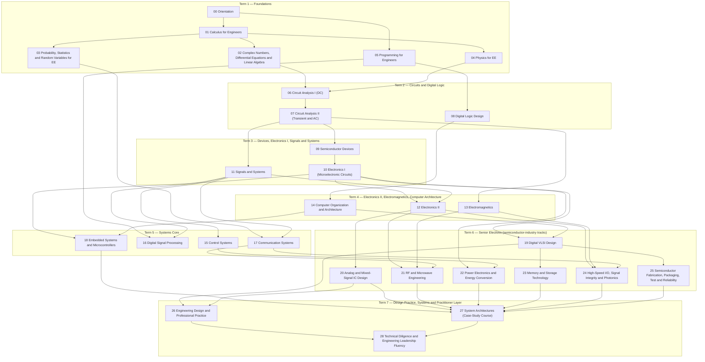

# Self-Taught BSEE

A complete, rigorous, self-study curriculum equivalent to a strong four-year ABET-accredited **Bachelor of Science in Electrical Engineering**, with emphasis on the tracks that matter most to the semiconductor industry: devices, analog/mixed-signal, RF, digital VLSI, computer architecture, power, memory, high-speed I/O and packaging.

Every chapter derives its results from first principles, works its examples in full, and ends with a graded problem set with fully worked solutions and a simulation lab. **Every published number is checked by a script, and every simulatable circuit by ngspice.** CI runs all of it on every push.

> **Build status:** the curriculum is being written course by course. See [PROGRESS.md](PROGRESS.md) for what is finished and verified.

## Who this is for

This curriculum is written for one learner: a corporate-development (M&A and venture) professional in the semiconductor industry. He has a strong quantitative, financial and legal background but no engineering coursework, and studies part-time (10–12 hours/week) without an instructor. That means:

- **The math is taught here.** Calculus, differential equations, linear algebra and complex analysis start at refresher level and reach what BSEE coursework requires.
- **Nothing is "left as an exercise".** Core derivations are complete, and every problem has a worked solution.
- **Analogies come from finance and business** where they help, and each one states where it breaks down.
- **Every chapter ends with a practitioner lens:** what industry is doing now (dated and sourced), why it matters commercially, how claims get inflated, and what to ask engineering leaders.

## What "done" looks like

The learner has succeeded when he can:

1. solve problems at the level of each equivalent university course's final exam;
2. pass practice exams covering the **NCEES FE Electrical & Computer** topic areas;
3. derive the key results of each course from first principles and explain them intuitively;
4. complete the four capstones: an analog design in ngspice, an RTL-to-layout digital block, an embedded wearable-node design, and a technical diligence memo;
5. hold a fluent conversation with a VP of Engineering or chief architect: understand what they optimize, name the real tradeoffs, ask the sharp next question, and spot hand-waving.

## How to use this repository

1. **Set up the toolchain** with [SETUP.md](SETUP.md). You need Python + Jupyter and ngspice. Icarus Verilog arrives in Term 2.
2. **Follow the schedule** in [STUDY_PLAN.md](STUDY_PLAN.md), or pick a learning path below.
3. **For each chapter, run this study loop:**
   1. Read the chapter actively. Re-derive each derivation on paper before reading the next step.
   2. Cover the worked examples' solutions and attempt them first.
   3. Run the lab. Every lab has "predict, then run" exercises; write your prediction down before running.
   4. Do the concept check.
   5. Do the problem set (all [A] and [B] problems; [C] when you want depth), then compare with the worked solutions.
   6. Add the chapter's flashcards to Anki ([flashcards/](flashcards/README.md)).
4. **At the end of each course,** take the course final exam under timed conditions. At the end of each term, take the FE-style [checkpoint](checkpoints/README.md).
5. **Look up as you go:** the [glossary](reference/glossary.md), the [notation guide](reference/notation.md) and the per-course equation sheets in [reference/](reference/README.md).

## Learning paths

| Path | For | Content | Approx. hours |
|---|---|---|---|
| **Full BSEE** | The complete goal | All 29 courses in order (Terms 1–7), all checkpoints and all 4 capstones | ≈ 2,700 |
| **FE preparation** | Passing the FE Electrical & Computer exam | Terms 1–5 plus the power-systems, materials, economics and ethics chapters ([details](STUDY_PLAN.md#fe-preparation-path); FE area map in [CURRICULUM.md](CURRICULUM.md#fe-electrical--computer-coverage)) and checkpoints 1–5 | ≈ 1,860 |
| **Practitioner fast track** | Conversation fluency with engineering leaders as early as possible | A curated subset of chapters plus Courses 26–28; see [STUDY_PLAN.md](STUDY_PLAN.md#practitioner-fast-track) | ≈ 470 |

The full path is a multi-year commitment at 10–12 hours per week; [STUDY_PLAN.md](STUDY_PLAN.md) lays out the calendar honestly.

## Curriculum at a glance

The full map, with university equivalents, textbook alignment, objectives and chapter lists, is in **[CURRICULUM.md](CURRICULUM.md)**.

<!-- BEGIN GENERATED (tools/build_curriculum.py) — edit tools/data/curriculum.yml, not this block -->

### Course map

| Term | Course | Chapters | Hours | Written |
|---|---|---|---|---|
| 1 | [00 · Orientation](courses/00-orientation/README.md) | 5 | 17 | 5/5 |
| 1 | [01 · Calculus for Engineers](courses/01-calculus-for-engineers/README.md) | 10 | 116 | 5/10 |
| 1 | [02 · Complex Numbers, Differential Equations and Linear Algebra](courses/02-complex-numbers-des-and-linear-algebra/README.md) | 10 | 110 | 1/10 |
| 1 | [03 · Probability, Statistics and Random Variables for EE](courses/03-probability-statistics-and-random-variables/README.md) | 6 | 43 | 0/6 |
| 1 | [04 · Physics for EE](courses/04-physics-for-ee/README.md) | 11 | 106 | 0/11 |
| 1 | [05 · Programming for Engineers](courses/05-programming-for-engineers/README.md) | 9 | 80 | 0/9 |
| 2 | [06 · Circuit Analysis I (DC)](courses/06-circuit-analysis-1-dc/README.md) | 11 | 86 | 0/11 |
| 2 | [07 · Circuit Analysis II (Transient and AC)](courses/07-circuit-analysis-2-transient-and-ac/README.md) | 11 | 103 | 1/11 |
| 2 | [08 · Digital Logic Design](courses/08-digital-logic-design/README.md) | 12 | 106 | 0/12 |
| 3 | [09 · Semiconductor Devices](courses/09-semiconductor-devices/README.md) | 14 | 116 | 0/14 |
| 3 | [10 · Electronics I (Microelectronic Circuits)](courses/10-electronics-1/README.md) | 10 | 99 | 0/10 |
| 3 | [11 · Signals and Systems](courses/11-signals-and-systems/README.md) | 11 | 106 | 0/11 |
| 4 | [12 · Electronics II](courses/12-electronics-2/README.md) | 10 | 104 | 0/10 |
| 4 | [13 · Electromagnetics](courses/13-electromagnetics/README.md) | 11 | 106 | 0/11 |
| 4 | [14 · Computer Organization and Architecture](courses/14-computer-organization-and-architecture/README.md) | 15 | 122 | 0/15 |
| 5 | [15 · Control Systems](courses/15-control-systems/README.md) | 12 | 89 | 0/12 |
| 5 | [16 · Digital Signal Processing](courses/16-digital-signal-processing/README.md) | 11 | 83 | 0/11 |
| 5 | [17 · Communication Systems](courses/17-communication-systems/README.md) | 13 | 103 | 0/13 |
| 5 | [18 · Embedded Systems and Microcontrollers](courses/18-embedded-systems-and-microcontrollers/README.md) | 11 | 83 | 0/11 |
| 6 | [19 · Digital VLSI Design](courses/19-digital-vlsi-design/README.md) | 13 | 112 | 0/13 |
| 6 | [20 · Analog and Mixed-Signal IC Design](courses/20-analog-and-mixed-signal-ic-design/README.md) | 12 | 104 | 0/12 |
| 6 | [21 · RF and Microwave Engineering](courses/21-rf-and-microwave-engineering/README.md) | 12 | 91 | 0/12 |
| 6 | [22 · Power Electronics and Energy Conversion](courses/22-power-electronics-and-energy-conversion/README.md) | 12 | 92 | 0/12 |
| 6 | [23 · Memory and Storage Technology](courses/23-memory-and-storage-technology/README.md) | 9 | 53 | 0/9 |
| 6 | [24 · High-Speed I/O, Signal Integrity and Photonics](courses/24-high-speed-io-signal-integrity-and-photonics/README.md) | 9 | 59 | 0/9 |
| 6 | [25 · Semiconductor Fabrication, Packaging, Test and Reliability](courses/25-fabrication-packaging-test-and-reliability/README.md) | 12 | 83 | 0/12 |
| 7 | [26 · Engineering Design and Professional Practice](courses/26-engineering-design-and-professional-practice/README.md) | 7 | 42 | 0/7 |
| 7 | [27 · System Architectures (Case-Study Course)](courses/27-system-architectures/README.md) | 8 | 60 | 0/8 |
| 7 | [28 · Technical Diligence and Engineering Leadership Fluency](courses/28-technical-diligence-and-leadership-fluency/README.md) | 10 | 62 | 0/10 |

### Prerequisite graph

Arrows point from a prerequisite to the course that depends on it (implied edges omitted).



<!-- END GENERATED -->

## Repository layout

```text
README.md            this file
CLAUDE.md            build rules: learner profile, principles, templates, verification and accuracy rules
PROGRESS.md          build tracker: status, counts, open issues, exact next step
CURRICULUM.md        all courses and chapters (generated from tools/data/curriculum.yml)
STUDY_PLAN.md        term-by-term schedule, review cadence, practitioner fast track
SETUP.md             toolchain installation (macOS / Linux / Windows-WSL)
courses/NN-name/     README, chapters/, problems/, solutions/, labs/, exam/, verify/
checkpoints/         end-of-term FE-style exams with explanations
capstones/           project briefs, milestones, rubrics, reference solutions
practitioner/        diligence playbooks, question banks, case studies, conversation scenarios
reference/           glossary, notation, equation sheets, numbers to know, research log, timeline, reading list
tools/               verification helpers, runners, generators, plotting style
assets/figures/      generated figures (and the scripts that generate them)
flashcards/          Anki-importable CSV decks, one per course
```

## Why you can trust the numbers

- **Answer keys are checked by script.** Every numerical answer is listed in a machine-readable answer key. Each course's `verify/` script recomputes every answer independently and checks it at the precision it is published, and it fails if any published number goes unchecked.
- **Circuits are simulated.** Circuit results are confirmed in **ngspice**, with each netlist linked to the published answer it checks.
- **Labs and HDL run clean.** Every lab notebook runs top to bottom, and every Verilog design has a self-checking testbench.
- **Industry facts are dated and sourced.** Perishable facts (process nodes, standards, product specs) carry an "as of" date and a source, logged in [reference/research-log.md](reference/research-log.md). Practitioner claims are tagged **[Established]**, **[Industry estimate]** or **[Contested]**.
- **Every course gets an independent audit.** Each course is checked for correctness and difficulty calibration before it is marked complete.

Run every check locally with `make check`; see [SETUP.md](SETUP.md).

## Reading as a website

The repository renders directly on GitHub (math, Mermaid diagrams and collapsible answers all work). To browse it as a searchable website instead:

```bash
pip install -r requirements.txt
mkdocs serve
```

Then open <http://127.0.0.1:8000>. On Windows, use WSL; the site uses symbolic links in `docs/`.

## Content policy

- **Original content.** All text, examples and problems are original. Textbooks and free courses are cited for alignment and further study; no textbook text or problems are reproduced.
- **Public information only.** Industry content uses public sources only.
