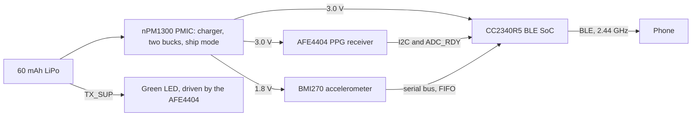
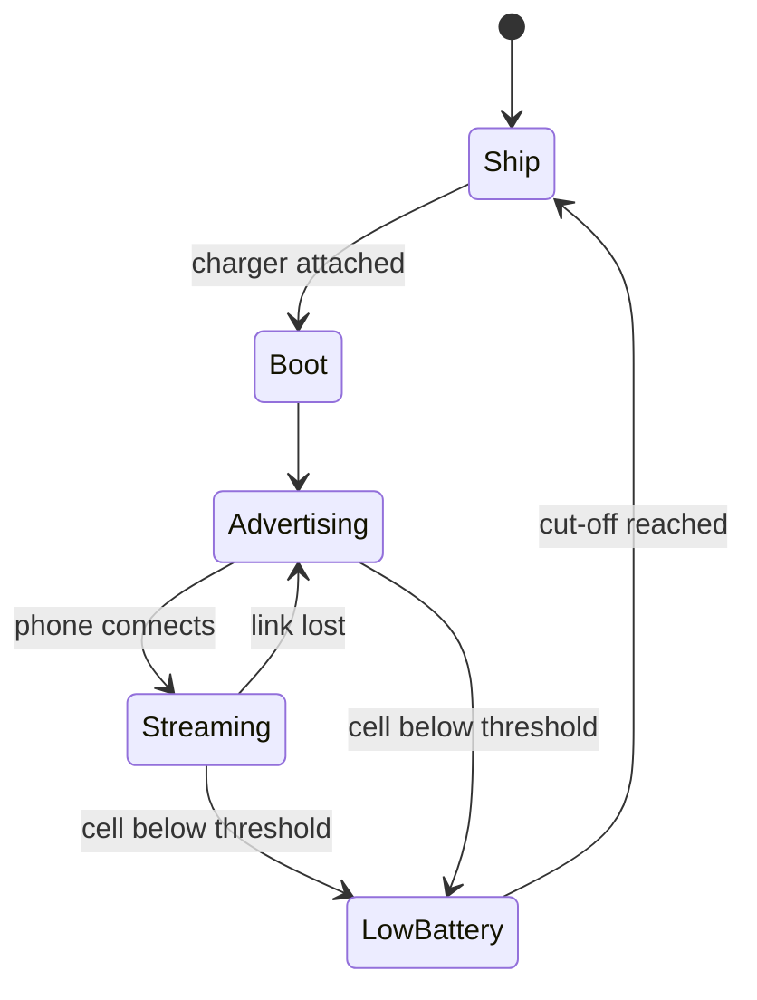

# C3 Reference · Design Report: a Wearable Heart-Rate and Activity Patch

This is the reference solution to [Capstone C3](../README.md). The power budget and link budget are computed by [budget.py](budget.py), checked event by event by [energy_sim.py](energy_sim.py), and every number in this report is recomputed by [verify_c3.py](verify_c3.py). The firmware modules in [firmware/](firmware/) are built and tested on the host by `tools/run_c.py`.

**Prerequisites used:** [18-03](../../../courses/18-embedded-systems-and-microcontrollers/chapters/18-03-interrupts-exceptions-timers.md) and [18-04](../../../courses/18-embedded-systems-and-microcontrollers/chapters/18-04-dma-and-data-movement.md) (interrupts and DMA), [18-09](../../../courses/18-embedded-systems-and-microcontrollers/chapters/18-09-ultra-low-power-design.md) (low-power design), [21-11](../../../courses/21-rf-and-microwave-engineering/chapters/21-11-link-budgets.md) (link budgets), [22-08](../../../courses/22-power-electronics-and-energy-conversion/chapters/22-08-pmics.md) and [22-09](../../../courses/22-power-electronics-and-energy-conversion/chapters/22-09-batteries-charging-fuel-gauging.md) (PMICs and batteries), and [27-03](../../../courses/27-system-architectures/chapters/27-03-wearables-smartwatch.md) (BLE connection-event energy).

**The headline.** The design meets the link, latency and buffering requirements with margin. It does **not** meet the 7-day life on a 60 mAh cell: the budget gives **5.31** days. The shortfall has a single cause, the PPG front end's receiver current. At its data-sheet value, that one load draws more than the whole 7-day allowance. The report therefore ends in a change request (§3.5), not in a tuned assumption that makes the number pass.

---

## 1. Requirements and architecture (M1)

The requirements are the brief's R1 to R6. Two of them needed a sharper definition before they could be tested:

- **R2** is read as follows: each PPG sample is reflected in a notification sent no more than 2 s after the sample was taken.
- **R3** counts 80% of the rated capacity as usable. The other 20% is a reserve for aging, cold, and the cut-off voltage.

**Partitioning.** Each function goes where it costs least:

| Function | Where | Why |
|---|---|---|
| LED pulsing, photodiode sampling, ambient subtraction | AFE4404 | Analog timing at the microsecond level; the SoC only reads results |
| Accelerometer sampling and buffering | BMI270 (2 KB FIFO) | The SoC wakes once per second, not 25 times |
| PPG sample collection | SoC interrupt, I²C by DMA | The AFE4404 as logged has no FIFO, so each sample must be fetched |
| Heart rate, steps, packing | SoC, once per second | Sending raw samples would cost far more radio time than computing on the patch |
| Link layer | SoC radio | One connection event per second |
| Charging, rails, ship mode | nPM1300 | One part does all three |

## 2. Part selection (M2)

**The radio SoC.** The radio's own currents matter little in this product, as §3 will show. So the comparison should weigh the radio least. What matters more is the sleep current, the CPU's energy per cycle, a DMA that can move I²C data while the CPU sleeps, and the transmit power available for the link margin.

| SoC (logged values) | RX (mA) | TX at 0 dBm (mA) | 1M sensitivity (dBm) | Charge per event at 0 dBm (µC) |
|---|---|---|---|---|
| TI CC2340R5 [R-702] | 5.3 | 5.1 (10.7 at +8 dBm) | −96.5 | **3.79** |
| Silicon Labs EFR32FG22 [R-406] | 3.6 | 4.1 | −98.9 | **3.07** |
| Nordic nRF52840 [R-406] | not logged | 6.40 | −95 | — |

The charge column applies the same event model (§3.1) to each part, with the same assumed wake-up charge. The EFR32FG22 saves **0.72** µC per event. At one event per second that is 0.72 µA on a 347.9 µA rail, or **0.21**%. Radio current cannot decide this choice.

Two caveats apply to the other parts. The FG22 is Silicon Labs' proprietary-protocol variant; a Bluetooth product would use the EFR32BG22 sibling, whose values were not logged. The EFR32FG22's measurement voltage was not logged either.

The **CC2340R5** is chosen for three reasons:

1. Its data sheet gives every current used here under one stated condition: VDDS = 3.0 V with the internal DC/DC on.
2. It offers +8 dBm of transmit power.
3. Its CPU runs CoreMark at 53 µA/MHz, and it can stay idle at 0.8 mA while DMA runs [R-702].

That stated condition sets the power tree. The SoC gets a 3.0 V rail, so the data-sheet currents apply as written.

**Sensors.**

- **PPG front end: TI AFE4404.** It has a programmable LED driver up to 50 mA and ambient subtraction [R-311]. It needs RX_SUP between 2.0 and 3.6 V, so it cannot share a 1.8 V rail; it goes on the 3.0 V rail, which is also the voltage its currents are specified at. Its LED supply, TX_SUP, must be at least 3.0 V, or 0.5 V above the LED's drop, whichever is greater [R-702]. TX_SUP is therefore taken straight from the cell, at 3.0 to 4.2 V.
- **Accelerometer: Bosch BMI270.** In accelerometer-only low-power mode at 25 Hz it draws 10 µA at 1.8 V, and it has a 2 KB FIFO [R-311].

**PMIC: Nordic nPM1300** [R-435]. It has two 200 mA bucks, which supply the 3.0 V and 1.8 V rails. Its charger is set between 32 and 800 mA, so a 1C charge of **60** mA fits. Ship mode draws 370 nA, and both bucks in auto mode draw 1.1 µA of quiescent current.

**Why two rails?** The second buck costs **0.30** µA more quiescent current than one. It runs the IMU at 1.8 V, where its current is specified. If the IMU drew the same 10 µA from the 3.0 V rail, it would cost **9.01** µA from the cell instead of 5.41 µA, **3.60** µA more. So the second rail saves a net **3.30** µA.

That assumes the IMU's current does not depend on its supply voltage; check this before deleting a rail. One interface item is still open: the IMU's I/O must match the SoC's 3.0 V I/O. The BMI270's interface-supply range was not logged.

## 3. Power budget and battery life (M3)

### 3.1 The BLE connection event

The event model is from [27-03](../../../courses/27-system-architectures/chapters/27-03-wearables-smartwatch.md).

**Air times.** The notification value is 20 octets, the most a default 23-octet ATT MTU allows. Seven octets of L2CAP and ATT headers make the link-layer payload 27 octets. With the encryption MIC, the packet takes **328** µs on the 1M PHY. The central's empty packet takes **80** µs.

**Charge per event.** The event has three parts:

- a wake-up of 3 mA for 300 µs (an assumption);
- receiving the empty packet and the turnaround;
- transmitting at +8 dBm.

Together they give

$$
Q_{ev} = 3\ \text{mA} \times 300\ \mu\text{s} + 5.3\ \text{mA} \times (80 + 150)\ \mu\text{s} + 10.7\ \text{mA} \times 328\ \mu\text{s} = 5.63\ \mu\text{C}.
$$

**Average current.** At one event per second this is **5.63** µA. Window widening adds $I_{rx}s$ = **0.53** µA, with 100 ppm of combined sleep-clock error from crystals at both ends.

### 3.2 The budget

**The 3.0 V rail.** The rail averages **347.9** µA:

| Load | Basis | Average (µA) |
|---|---|---|
| SoC standby, 32 kHz crystal | Data sheet [R-702] | 0.74 |
| BLE connection events | §3.1 | **5.63** |
| BLE window widening | §3.1 | **0.53** |
| CPU: heart rate, steps, IMU FIFO read, packing | 200 000 cycles/s at 48 MHz, 2.6 mA active | **10.83** |
| CPU: wake and interrupt per PPG sample | 25/s × (43 + 30) µs at 2.6 mA | **4.745** |
| I²C read per PPG sample | 25/s × **270** µs at 0.8 mA (CPU idle, DMA) | **5.40** |
| PPG receiver, AFE4404 RX_SUP | Data sheet, dynamic power-down [R-702] | 300 |
| PPG interface, AFE4404 IO_SUP | Data sheet [R-702] | 20 |

**The I²C read.** Each sample reads two 24-bit values, the green-LED phase and the ambient phase. Each value costs 6 bytes of 9 clocks at 400 kHz, so a sample takes 270 µs on the bus.

**Current from the cell.** A buck at efficiency $\eta$ draws $I_{cell} = I_{rail} V_{rail}/(\eta V_{bat})$. With $\eta$ = 0.90 and $V_{bat}$ = 3.7 V, both assumptions, the 3.0 V rail costs **0.901** A per ampere and the 1.8 V rail **0.541**.

| From the cell | Average (µA) | Share |
|---|---|---|
| 3.0 V rail through its buck | **313.4** | |
| 1.8 V rail (IMU) through its buck | **5.41** | |
| PPG LED pulses: 20 mA × 100 µs × 25/s (TX_SUP) | **50.0** | |
| PPG LED driver quiescent (TX_SUP) [R-702] | 5 | |
| PMIC quiescent [R-435] | 1.1 | |
| Board leakage (assumption) | 2 | |
| **Total** | **376.9** | |
| of which the PPG chain (receiver, interface, LED, driver) | | **91.1**% |
| of which the AFE4404 receiver and interface alone | | **76.5**% |
| of which the CPU | | **5.0**% |
| of which the radio (events and widening) | | **1.5**% |

**Battery life.** The usable charge is 0.8 × 60 mAh = 48 mAh. Dividing by the total gives **127.4** h, or **5.31** days.

### 3.3 Checking the budget two other ways

**Event-level simulation.** [energy_sim.py](energy_sim.py) adds up the charge of every sample, connection event and processing run in an hour, rail by rail. With no packet loss it gives **376.9** µA, the same as the budget to floating-point precision. With 10% packet loss, each lost notification is resent at the next event. The hour then has **355** retransmissions and the current rises by only **0.42** µA. Radio retries do not threaten the life.

**Discharge with a falling cell voltage.** A simple model lets the open-circuit voltage fall linearly from 4.2 V to 3.0 V. The bucks deliver constant power, so they draw more current as the cell empties. The life comes out at **127.8** h. The 3.7 V nominal is close to this model's average over the usable 80%, **3.72** V, so the simple estimate stands.

### 3.4 What dominates, and what would change it

The 7-day allowance is 48 mAh / 168 h = **285.7** µA. The AFE4404's receiver and interface alone cost **288.3** µA from the cell. That is more than the allowance before the LED, the radio or the CPU draws anything. No firmware cleverness closes this gap.

Each row below changes one input:

| Scenario | Life (days) |
|---|---|
| Baseline | **5.31** |
| AFE receiver always on (620 µA) | **3.01** |
| AFE receiver at the feature list's "less than 200 µA" (taken as 200 µA) | **6.97** |
| AFE receiver at an estimated **273.3** µA for 25 Hz (see below) | **5.67** |
| LED current halved to 10 mA | **5.68** |
| PPG at 12.5 Hz | **5.76** |
| An AFE with a FIFO: one wake per second, not 25 | **5.36** |
| Connection interval 0.5 s | **5.24** |
| Buck efficiency 80% | **4.80** |
| Heart-rate algorithm at 1 million cycles per second | **4.81** |
| Transmit at 0 dBm, not +8 dBm | **5.33** |
| 80 mAh cell | **7.08** |
| 100 mAh cell | **8.84** |

**The estimate at 25 Hz.** The data sheet's 300 µA is measured at a 100 Hz pulse repetition frequency, with the receiver active for 10% of the period. A slower rate should help. The data sheet's two receiver rows allow an estimate. If the receiver draws $I_{pd}$ when powered down and 620 µA when active, then $0.9I_{pd} + 0.1 \times 620$ = 300 µA gives $I_{pd}$ = **264.4** µA. Keeping the same **1** ms active window at 25 Hz leaves the receiver active **2.5**% of the time, which gives **273.3** µA.

This is an inference from two rows, not a data-sheet value. The data sheet plots receiver current against repetition rate, and that plot, or a bench measurement, should replace the estimate. Either way the inference says that a lower rate alone will not close the gap.

**Marketing vs Reality.** The feature list promises an average below 200 µA "for PPG signal acquisition" without stating conditions [R-702]. The electrical table gives 300 µA under stated conditions. The requirement closes only if the receiver is at or below **198.8** µA, with everything else unchanged. So the design hinges on the gap between those two numbers.

Even taken at face value, the headline gives 6.97 days, still short. A design built on the feature list would have failed at the first bench measurement.

### 3.5 Change request

R3 cannot be met by a 60 mAh cell with this front end at its specified current. The gap is **1.69** days. Meeting 7 days at the computed current needs **79.2** mAh. In order of preference:

1. **Measure the AFE4404 receiver at 25 Hz** in its intended timing. Do this before anything else, because every other decision depends on it.
2. **If the enclosure allows, take a 100 mAh cell**, giving 8.84 days. An 80 mAh cell gives 7.08 days, too little margin for an estimate whose largest term has not been measured.
3. **Otherwise requalify the PPG front end** against a measured receiver current of at most 199 µA at 3.0 V and 25 Hz.
4. **Or relax R1 with the product owner.** Sampling PPG continuously only when the wearer is still, or at a lower rate during sleep, are product decisions, not engineering ones.

## 4. Link budget (M4)

The uplink, at 5 m and 2.44 GHz:

| Item | Value |
|---|---|
| Transmit power | +8 dBm |
| Tag antenna gain (assumption, within the −10 to +10 dBi the SIG cites [R-406]) | −10 dBi |
| Free-space path loss at 5 m | **54.17** dB |
| Body loss (assumption) | 10 dB |
| Phone antenna gain (assumption) | 0 dBi |
| Received power | **−66.2** dBm |

The margin depends on which phone is at the other end:

| Phone receiver | Sensitivity | Uplink margin at 5 m | Range at a 10 dB margin |
|---|---|---|---|
| Assumed in R4 | −90 dBm | **23.8** dB | **24.6** m |
| A good phone radio (nRF52840 figure as a stand-in) [R-406] | −95 dBm | **28.8** dB | |
| Minimum the Bluetooth specification requires [R-406] | −70 dBm | **3.8** dB | **2.46** m |

**R4 is met with 13.8 dB to spare.** It would still be met at 0 dBm, where the margin is **15.8** dB. Transmitting at +8 dBm costs **1.65** µA, **0.44**% of the battery current. For that cost it buys 8 dB, which is **2.5** times the range in free space. Each further 6.02 dB halves or doubles the range. Here the extra margin is worth having.

**The downlink.** The phone transmits at 0 dBm (assumption) to the SoC's −96.5 dBm sensitivity, a margin of **22.3** dB. Both directions are within **1.5** dB of each other, so neither limits the link.

**The real risk is the assumptions, not the arithmetic.** Against a phone that only just meets the specification, the margin is 3.8 dB at 5 m. Indoors, the path-loss slope is steeper than free space ([21-11](../../../courses/21-rf-and-microwave-engineering/chapters/21-11-link-budgets.md)). The body loss on a wrist varies with posture. These three uncertainties, not the transmitter, are what an antenna and body-loss measurement must settle.

## 5. Firmware architecture (M5)

**States.**

The budget covers the Streaming state. Advertising while disconnected costs a different, unbudgeted amount (risk 5).

**Timing.**

| Activity | Rate | Context | Time |
|---|---|---|---|
| AFE ADC_RDY interrupt: start a DMA I²C read of two values | 25 Hz | Interrupt | 43 µs wake + 30 µs active, then 270 µs idle |
| DMA complete: push the ambient-corrected sample into the ring | 25 Hz | Interrupt (included above) | — |
| Processing: drain the ring, read the IMU FIFO, heart rate and steps, pack the notification | 1 Hz, started 10 ms before the connection anchor (assumption) | Task | **4.17** ms |
| Connection event | 1 Hz | Radio and link layer | **0.86** ms (wake, receive, turnaround, transmit) |

The CPU is active **0.60**% of the time.

The processing task starts 10 ms before the anchor, **2.4** times the 4.17 ms it needs. If the link layer shares the CPU and takes priority, a connection event can delay the PPG interrupt by at most 0.86 ms. That is far less than the **40** ms before the AFE overwrites its result registers [R-702].

**Latency (R2).** A sample that arrives just after the processing task has drained the ring waits for the next run. That run is one interval later, and the anchor follows 10 ms after it. The worst case from sample to first transmission is therefore **1.01** s, inside the 2 s limit.

If that notification is lost, the link layer resends it at the next event, and delivery takes **2.01** s. R2 as written concerns when a notification is sent, so it is met. If the product owner means delivered, a single retransmission breaks it by **10** ms. A shorter connection interval would fix it.

**Buffering (R5).** The PPG ring ([ring.h](firmware/ring.h)) holds 64 slots of 32 bits, **256** bytes. One slot stays empty so that full and empty can be told apart. That leaves **63** samples, **2.52** s at 25 Hz.

Each run drains about 25 samples, so the ring survives one missed run (**50** samples). A second missed run in a row would lose **12** samples. These are counted, and the next notification sets its overflow flag and reports the count. The IMU needs no ring: at 6 bytes per accelerometer sample, its 2 KB FIFO holds **13.7** s.

**The notification ([notify.h](firmware/notify.h)).** Twenty little-endian octets carry:

- a version and a sequence number;
- the heart rate in 0.1 bpm, with its confidence;
- flags (skin contact, motion, low battery, PPG overflow);
- the step count;
- the cell voltage;
- the skin temperature;
- the activity counts;
- the count of dropped PPG samples;
- two reserved octets.

`notify_pack` saturates out-of-range values instead of wrapping them. `notify_unpack` rejects a short buffer, a wrong version or non-zero reserved octets.

**The host test.** [fw_test.c](firmware/fw_test.c) checks the byte layout, saturation and every rejection path. It also checks the ring's fill, overflow count and wrap-around, then runs a day of 25 Hz samples drained once per second without a single drop. It prints `TEST PASSED` under `tools/run_c.py`, built with the address and undefined-behavior sanitizers.

## 6. Results against the requirements

| # | Requirement | Result | Status |
|---|---|---|---|
| R1 | PPG and accelerometer at 25 Hz | AFE4404 at 25 Hz with an interrupt per sample; BMI270 low-power mode at 25 Hz | Met |
| R2 | Sample reflected in a notification sent within 2 s | 1.01 s worst case (2.01 s if one retransmission counts) | Met as written |
| R3 | 7 days on 60 mAh, 80% usable | **5.31** days | **Not met**; change request §3.5 |
| R4 | 10 dB uplink margin at 5 m to a −90 dBm phone | **23.8** dB | Met |
| R5 | No PPG loss with 1 s processing; losses counted | Ring survives one missed run; losses counted and reported; host test passes | Met |
| R6 | Charging and ship mode | nPM1300 charger (1C = 60 mA within its range); ship mode 370 nA | Met |

## 7. Risks

These are ranked by consequence times likelihood.

1. **The PPG receiver current.** It decides R3 by itself (§3.4). *Mitigation:* bench-measure it at 25 Hz before committing the cell or the enclosure. *Test:* current at RX_SUP with the production timing.
2. **LED headroom at a low cell voltage.** TX_SUP must exceed the LED's drop by 0.5 V [R-702]. A green LED drops at least **2.34** V from its photon energy alone ($1239.8\ \text{eV·nm}/530\ \text{nm}$), and more in practice. Suppose the chosen LED drops 3.0 V at 20 mA; that figure is an assumption to check in its data sheet. TX_SUP would then need **3.5** V, which the linear cell model reaches at **41.7**% state of charge. The LED current would then fall out of regulation for the last **27**% of the usable charge. *Mitigation:* a small boost or charge pump for TX_SUP, or a LED with a lower drop. *Test:* PPG amplitude as the cell sweeps from 4.2 V down to 3.24 V.
3. **The link in real conditions.** Against a specification-minimum phone, the margin at 5 m is only 3.8 dB (§4). *Mitigation:* measure body loss and antenna gain on a worn prototype. *Test:* packet error rate against distance and posture with several phones.
4. **The end of the usable charge.** The linear model puts the cell at **3.24** V at the 80% point, close to where a buck making 3.0 V runs out of headroom. *Mitigation:* fix the cut-off with the PMIC's dropout data, and let the fuel gauge, not a fixed percentage, end operation. *Test:* rail voltage and current during a discharge to cut-off.
5. **Unbudgeted states.** Advertising while disconnected, charging, and over-the-air updates are not in the budget. *Mitigation:* budget each state and cap how long the device may spend in it. *Test:* a week-long log of time in each state from beta users.

**Shelf storage is not a risk worth spending on.** Ship mode at 370 nA would empty 48 mAh in **14.8** years. Lithium-ion self-discharge, quoted at 1 to 2% per month [R-310] **[Contested]**, is equivalent to **0.82** to **1.64** µA on this cell. Self-discharge, not the PMIC, sets the shelf life.

## 8. Tradeoffs

| Knob | Improves | Costs | Typical decision owner |
|---|---|---|---|
| Larger cell (60 → 100 mAh) | Life: 5.31 → 8.84 days | Size, weight, charge time | Product and industrial design |
| Lower PPG rate or LED current | Life (to 5.76 or 5.68 days) | Signal quality, heart-rate accuracy in motion | Algorithm lead |
| +8 dBm instead of 0 dBm | 8 dB of margin | 1.65 µA (0.44%) | RF lead |
| 32 kHz crystal instead of the internal oscillator | Window widening: 0.53 µA instead of **2.92** µA (500 ppm plus the phone's 50 ppm [R-676]) | A part and its board area; life is only 5.31 against **5.28** days without it | Hardware lead |
| DMA instead of a polled I²C read | Life: 5.31 against **5.16** days polled | Driver complexity | Firmware lead |
| Second buck rail for the IMU | 3.30 µA net | A second inductor | Power lead |

**What this exercise teaches.** On this wearable, the radio is about 1.5% of the energy, which runs against the usual intuition. The optical front end is about 91%. The engineering that matters is therefore in the PPG chain: its receiver duty cycle, its LED drive, and the measured rather than advertised current of the chosen part.

---

<!-- answer-key -->

| ID | Quantity | Value | Unit |
|---|---|---|---|
| S.qcc | charge per event at 0 dBm, CC2340R5 | 3.79 | µC |
| S.qefr | charge per event at 0 dBm, EFR32FG22 | 3.07 | µC |
| S.dq | event-charge difference | 0.72 | µC |
| S.dqpct | difference as a share of the 3.0 V rail | 0.21 | % |
| P.chg | 1C charge current | 60 | mA |
| P.pmic2 | extra quiescent current of the second buck | 0.30 | µA |
| P.imu3 | IMU cell current if on the 3.0 V rail | 9.01 | µA |
| P.save | cell current saved by the 1.8 V rail | 3.60 | µA |
| P.net | net saving of the second rail | 3.30 | µA |
| B.tx | notification packet air time | 328 | µs |
| B.rx | empty packet air time | 80 | µs |
| B.qev | charge per connection event at +8 dBm | 5.63 | µC |
| B.ble | BLE event current | 5.63 | µA |
| B.wid | window-widening current | 0.53 | µA |
| B.hr | heart-rate processing current | 10.83 | µA |
| B.wake | per-sample wake and interrupt current | 4.745 | µA |
| B.ti2c | I2C transfer per sample | 270 | µs |
| B.i2c | I2C read current | 5.40 | µA |
| B.rail | 3.0 V rail current | 347.9 | µA |
| B.f3 | cell amperes per rail ampere, 3.0 V rail | 0.901 | — |
| B.f18 | cell amperes per rail ampere, 1.8 V rail | 0.541 | — |
| B.cell3 | 3.0 V rail from the cell | 313.4 | µA |
| B.imu | IMU from the cell | 5.41 | µA |
| B.led | LED pulses from the cell | 50.0 | µA |
| B.ibat | battery current | 376.9 | µA |
| B.ppgpct | PPG chain share | 91.1 | % |
| B.afepct | AFE receiver and interface share | 76.5 | % |
| B.cpupct | CPU share | 5.0 | % |
| B.blepct | radio share | 1.5 | % |
| B.life | battery life | 127.4 | h |
| B.days | battery life | 5.31 | days |
| E.sim0 | simulated current, no packet loss | 376.9 | µA |
| E.retx | retransmissions in an hour at 10% loss | 355 | — |
| E.dper | current added by 10% packet loss | 0.42 | µA |
| E.dis | life with a falling cell voltage | 127.8 | h |
| E.vavg | average cell voltage over the usable charge | 3.72 | V |
| B.allow | 7-day current allowance | 285.7 | µA |
| B.afecell | AFE receiver and interface from the cell | 288.3 | µA |
| Z.base | life, baseline | 5.31 | days |
| Z.afeon | life, receiver always on | 3.01 | days |
| Z.afe200 | life, receiver at 200 µA | 6.97 | days |
| Z.afepd | inferred powered-down receiver current | 264.4 | µA |
| Z.win | active window at 100 Hz | 1 | ms |
| Z.duty25 | active fraction at 25 Hz | 2.5 | % |
| Z.afe25i | inferred receiver current at 25 Hz | 273.3 | µA |
| Z.afe25 | life, receiver at the 25 Hz estimate | 5.67 | days |
| Z.led10 | life, LED at 10 mA | 5.68 | days |
| Z.fs12 | life, PPG at 12.5 Hz | 5.76 | days |
| Z.fifo | life, one wake per second | 5.36 | days |
| Z.tci05 | life, 0.5 s connection interval | 5.24 | days |
| Z.eta80 | life, 80% buck efficiency | 4.80 | days |
| Z.hr1m | life, 1 million cycles per second | 4.81 | days |
| Z.tx0 | life, 0 dBm transmit | 5.33 | days |
| Z.cap80 | life, 80 mAh cell | 7.08 | days |
| Z.cap100 | life, 100 mAh cell | 8.84 | days |
| B.afemax | receiver current that meets 7 days | 198.8 | µA |
| B.gap | shortfall against 7 days | 1.69 | days |
| B.capneed | capacity for 7 days | 79.2 | mAh |
| L.fspl | free-space path loss at 5 m | 54.17 | dB |
| L.prx | received power at the phone | -66.2 | dBm |
| L.m90 | uplink margin, −90 dBm phone | 23.8 | dB |
| L.r10 | range at a 10 dB margin, −90 dBm phone | 24.6 | m |
| L.m95 | uplink margin, −95 dBm phone | 28.8 | dB |
| L.m70 | uplink margin, −70 dBm phone | 3.8 | dB |
| L.r10s | range at a 10 dB margin, −70 dBm phone | 2.46 | m |
| L.m90tx0 | uplink margin at 0 dBm, −90 dBm phone | 15.8 | dB |
| Z.txcost | current cost of +8 dBm | 1.65 | µA |
| Z.txpct | cost of +8 dBm as a share | 0.44 | % |
| L.half | margin that halves the free-space range | 6.02 | dB |
| L.down | downlink margin | 22.3 | dB |
| L.bal | uplink minus downlink margin | 1.5 | dB |
| L.spare | margin beyond R4 | 13.8 | dB |
| L.x8 | range factor bought by 8 dB | 2.5 | — |
| F.tproc | processing time per second | 4.17 | ms |
| F.evt | connection event duration | 0.86 | ms |
| F.lead | lead time over processing time | 2.4 | — |
| F.per | PPG sample period | 40 | ms |
| F.over | delivery overrun with one retransmission | 10 | ms |
| F.two | samples after one missed run | 50 | — |
| F.duty | CPU active fraction | 0.60 | % |
| F.lat | worst sample-to-transmission latency | 1.01 | s |
| F.latr | latency with one retransmission | 2.01 | s |
| F.mem | PPG ring memory | 256 | bytes |
| F.slots | usable ring slots | 63 | — |
| F.span | ring span at 25 Hz | 2.52 | s |
| F.drop2 | samples lost after two missed runs | 12 | — |
| F.imufifo | IMU FIFO span | 13.7 | s |
| R.vph | green photon energy | 2.34 | V |
| R.txs | TX_SUP needed for a 3.0 V LED | 3.5 | V |
| R.soc35 | state of charge at 3.5 V | 41.7 | % |
| R.frac | usable charge below 3.5 V | 27 | % |
| R.vend | cell voltage at the 80% point | 3.24 | V |
| F.shelf | ship-mode shelf life | 14.8 | years |
| F.sd1 | self-discharge equivalent at 1% per month | 0.82 | µA |
| F.sd2 | self-discharge equivalent at 2% per month | 1.64 | µA |
| Z.widlf | window widening with the internal oscillator | 2.92 | µA |
| Z.lfosc | life with the internal oscillator | 5.28 | days |
| Z.polled | life with a polled I2C read | 5.16 | days |
