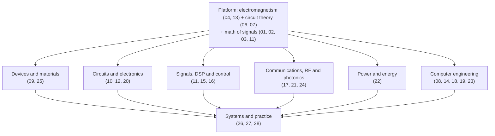
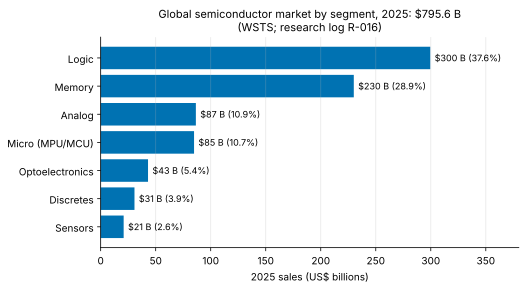

<!-- status: verified -->
# 00-01 · The Map of Electrical Engineering

| | |
|---|---|
| **Course** | [00 · Orientation](../README.md) |
| **University equivalent** | A freshman "Introduction to Electrical and Computer Engineering" seminar: the survey of subdisciplines and career paths that opens most BSEE programs |
| **Prerequisites** | None. Algebra and the idea of a logarithm. |
| **Estimated study hours** | 2 |
| **Last verified** | 2026-11-12 |

**Learning objectives.** After this chapter you can:

1. Name the major subdisciplines of electrical engineering and the central question each one answers.
2. Distinguish EE's two purposes, moving *energy* and moving or processing *information*, and compute energy, power, data rate and energy per bit with correct units.
3. Trace a real product through the subdisciplines it depends on, and place each course of this curriculum on the map.
4. Describe the size and segment structure of the semiconductor industry from dated, sourced data.
5. State the five ideas that unify EE: linearity, the frequency domain, feedback, abstraction and tradeoffs.

## 1. Big picture

Electrical engineering is the discipline of using electricity and electromagnetism for two purposes: **moving and converting energy**, and **sensing, moving, storing and processing information**. The first built the power grid, motors and batteries; the second built radio, computing and the internet. Today the two are inseparable. An AI datacenter is an information machine whose limits are set by power delivery and cooling. A smartwatch is an information device whose design is dominated by its battery. The semiconductor chip sits at the center of both, which is why this curriculum is weighted toward it.

- **The subdisciplines are lenses, not silos.** A single product, such as a phone, draws on almost all of them at once (§3.6).
- **Five ideas recur everywhere:** linearity, frequency, feedback, abstraction and tradeoffs (§3.3). They are the reason a BSEE is one degree rather than ten.
- **The industry is large and concentrated.** Global chip sales were about US\$796 billion in 2025, and logic and memory chips were about two-thirds of it (§3.5).
- **Energy per bit** is the single number that connects the two halves of EE, and it is a recurring diligence metric (Example 00-01.2).

## 2. Intuition first

### Energy and information

Electricity carries two very different payloads:

- **Energy.** The interesting quantities are watts and joules. A 1% efficiency gain in a 100 MW datacenter is worth a megawatt.
- **Information.** The interesting quantities are bits, bits per second and errors. A 1% error rate makes a link useless.

The same electrons do both, and the same circuit laws govern both. What differs is what the engineer optimizes.

### An analogy from business: a conglomerate with a shared platform

Think of EE as a conglomerate with several operating divisions: power, communications, computing, controls, devices. They share one technology platform: Maxwell's equations, circuit theory and the mathematics of signals. Each division has its own customers, metrics and jargon, yet an engineer can move between divisions because the platform is common. A strong BSEE is fluent in the platform and conversant in every division.

*Where the analogy breaks:* conglomerate divisions are usually independent businesses. EE's subdisciplines are tightly coupled inside every modern product. A phone's radio performance depends on its power supply's noise, its processor's speed depends on its thermal design, and its battery life depends on everything. Engineering value increasingly lies in the *interfaces* between divisions.

### The map

*Figure 1. The subdisciplines of EE as branches of one shared platform. Numbers are this curriculum's courses.*

## 3. Theory

### 3.1 The core quantities

All of EE is built on a handful of quantities. You will meet them formally in [06-01](../../06-circuit-analysis-1-dc/chapters/06-01-charge-current-voltage-power.md); here is the map:

| Quantity | Symbol | Unit | Meaning |
|---|---|---|---|
| Charge | $q$ | coulomb (C) | Amount of electricity; an electron carries $1.602\times10^{-19}$ C |
| Current | $i$ | ampere (A) = C/s | Rate of charge flow |
| Voltage | $v$ | volt (V) = J/C | Energy per unit charge (electrical "pressure") |
| Power | $p$ | watt (W) = J/s | Rate of energy transfer, $p = vi$ |
| Energy | $w$ | joule (J) | Power accumulated over time; 1 Wh = 3600 J |
| Data rate | $R_b$ | bit/s | Rate of information transfer |
| Energy per bit | $E_b$ | J/bit (pJ/bit) | Energy cost of moving or processing one bit; power $= E_bR_b$ |

Battery capacity is quoted in milliampere-hours (mAh), which is a *charge*: 1 mAh = 3.6 C. Multiplying by the battery's nominal voltage converts it to energy in watt-hours (Example 00-01.1).

### 3.2 The subdisciplines and their questions

| Subdiscipline | Central question | Typical products | Courses |
|---|---|---|---|
| **Devices and materials** | How do transistors, diodes, lasers and sensors work, and how do they scale? | Transistors, LEDs, image sensors, power devices | [04](../../04-physics-for-ee/README.md), [09](../../09-semiconductor-devices/README.md), [25](../../25-fabrication-packaging-test-and-reliability/README.md) |
| **Circuits and electronics** | How do we build functions (amplify, filter, convert, regulate) from components? | Amplifiers, filters, ADCs, PLLs, regulators | [06](../../06-circuit-analysis-1-dc/README.md), [07](../../07-circuit-analysis-2-transient-and-ac/README.md), [10](../../10-electronics-1/README.md), [12](../../12-electronics-2/README.md), [20](../../20-analog-and-mixed-signal-ic-design/README.md) |
| **Signals and systems, DSP** | How do we represent, transform and filter signals? | Audio processing, image pipelines, modems | [11](../../11-signals-and-systems/README.md), [16](../../16-digital-signal-processing/README.md) |
| **Control** | How do we make a system behave as intended despite disturbances and uncertainty? | Voltage regulators, motor drives, PLLs, thermal management | [15](../../15-control-systems/README.md) |
| **Communications and networking** | How do we move information reliably over noisy channels? | Wi-Fi, cellular, Ethernet, satellite links | [17](../../17-communication-systems/README.md) |
| **Electromagnetics, RF and photonics** | How do fields propagate, radiate and guide signals and light? | Antennas, RF front ends, high-speed links, optical transceivers | [13](../../13-electromagnetics/README.md), [21](../../21-rf-and-microwave-engineering/README.md), [24](../../24-high-speed-io-signal-integrity-and-photonics/README.md) |
| **Power and energy** | How do we convert, deliver and store energy efficiently? | Chargers, voltage regulators, inverters, the grid | [22](../../22-power-electronics-and-energy-conversion/README.md) |
| **Computer engineering** | How do we build machines that compute, store and control? | Processors, accelerators, memories, microcontrollers | [08](../../08-digital-logic-design/README.md), [14](../../14-computer-organization-and-architecture/README.md), [18](../../18-embedded-systems-and-microcontrollers/README.md), [19](../../19-digital-vlsi-design/README.md), [23](../../23-memory-and-storage-technology/README.md) |
| **Systems and practice** | How do the pieces combine into products, and how are they paid for and judged? | Phones, cars, datacenters | [26](../../26-engineering-design-and-professional-practice/README.md), [27](../../27-system-architectures/README.md), [28](../../28-technical-diligence-and-leadership-fluency/README.md) |

### 3.3 Five ideas that unify EE

1. **Linearity and superposition.** Many systems respond to a sum of inputs with the sum of the individual responses. That lets complicated problems be split into simple ones ([06-07](../../06-circuit-analysis-1-dc/chapters/06-07-linearity-and-superposition.md)). Much of EE is the art of making systems linear enough, or linear around an operating point ([10-04](../../10-electronics-1/chapters/10-04-small-signal-models.md)).
2. **The frequency domain.** Any signal can be viewed as a sum of sinusoids, and linear systems treat each sinusoid independently ([02-01](../../02-complex-numbers-des-and-linear-algebra/chapters/02-01-complex-numbers-euler-and-phasors.md), [11-06](../../11-signals-and-systems/chapters/11-06-continuous-time-fourier-transform.md)). Filters, radios, bandwidth and stability are all frequency-domain ideas.
3. **Feedback.** Measuring an output and correcting the input makes systems precise, robust and stable, or, done badly, unstable ([12-05](../../12-electronics-2/chapters/12-05-feedback-topologies.md), [15](../../15-control-systems/README.md)). Feedback is everywhere, from op-amps to the grid.
4. **Abstraction.** Layered contracts let teams build systems of staggering complexity ([00-02](00-02-the-abstraction-stack.md)).
5. **Tradeoffs.** Every design trades **performance, power and area (PPA)** against **cost** and **schedule**. Engineering judgment is choosing the right point. Every chapter of this curriculum has a tradeoffs table, because this is what engineers argue about in design reviews.

### 3.4 Energy versus information: two limits

Physics sets floors under both halves of EE:

- **Energy to process information.** Landauer's principle states that erasing one bit of information dissipates at least $kT\ln 2$ of energy, where $k$ is Boltzmann's constant and $T$ the temperature in kelvin. At room temperature (300 K) that is $2.87\times10^{-21}$ J. A logic gate switching about a femtojoule ($10^{-15}$ J) uses hundreds of thousands of times more (Example 00-01.3). There is enormous theoretical room left, but practical limits (noise, speed, reliability) bind long before Landauer's.
- **Information through a noisy channel.** Shannon showed that a channel of bandwidth $B$ (Hz) with signal-to-noise power ratio SNR can carry at most $C = B\log_2(1 + \text{SNR})$ bits per second without error ([17-07](../../17-communication-systems/chapters/17-07-information-theory-and-shannon.md)). Modern Wi-Fi and cellular systems operate within a few decibels of this limit.

### 3.5 The semiconductor industry in numbers (as of Nov 2026)

The **World Semiconductor Trade Statistics** (WSTS) organization reported global semiconductor sales of **US\$795.6 billion in 2025, up 26.2%** ([R-016](../../../reference/research-log.md#r-016--global-semiconductor-market-wsts--sia)) **[Established]**. By product segment:

*Figure 2. Logic (processors, accelerators, SoCs) and memory (DRAM, NAND) are about two-thirds of the market. Analog, micro, optoelectronics, discretes and sensors make up the rest.*

The industry's **value chain** spans:

- **chip designers:** integrated device manufacturers (IDMs) that design and fabricate, and fabless companies that design only;
- **EDA software and IP licensors**, who sell design tools and reusable blocks;
- **foundries** that manufacture chips designed by others;
- **outsourced assembly and test (OSAT)** firms;
- **equipment and materials suppliers.**

> **Deeper:** see companion repo *Semiconductor Capital Equipment* for the equipment and materials layer.

Chip companies are among the most R&D-intensive businesses in the economy. In their latest annual reports ([R-017](../../../reference/research-log.md#r-017--rd-intensity-latest-fiscal-year-10-k--annual-reports)), R&D spending ranged from about 9% of revenue (NVIDIA, FY2026, on a very large revenue base) to about 26% (Intel, FY2025) **[Established]**.

### 3.6 Tracing a product: a smartwatch

| Function | Subdiscipline | Course |
|---|---|---|
| Accelerometer and gyroscope (MEMS), optical heart-rate sensor (LED + photodiode) | Devices, sensors | [09](../../09-semiconductor-devices/README.md), [18-10](../../18-embedded-systems-and-microcontrollers/chapters/18-10-sensors.md) |
| Amplify and filter tiny sensor signals; convert to digital | Analog and mixed-signal | [10](../../10-electronics-1/README.md), [20](../../20-analog-and-mixed-signal-ic-design/README.md) |
| Filter and analyze the heart-rate waveform | DSP | [16](../../16-digital-signal-processing/README.md) |
| Run the software; manage sleep states | Computer engineering, embedded | [14](../../14-computer-organization-and-architecture/README.md), [18](../../18-embedded-systems-and-microcontrollers/README.md) |
| Bluetooth link to the phone | Communications, RF | [17](../../17-communication-systems/README.md), [21](../../21-rf-and-microwave-engineering/README.md) |
| Tiny antenna squeezed into the case | Electromagnetics | [13](../../13-electromagnetics/README.md) |
| Battery, charger, voltage regulators | Power | [22](../../22-power-electronics-and-energy-conversion/README.md) |
| Keep everything stable and low-noise | Control, circuits | [15](../../15-control-systems/README.md) |
| Package it all in a few cubic centimeters and keep it cool | Packaging, thermal | [25](../../25-fabrication-packaging-test-and-reliability/README.md) |

[27-03](../../27-system-architectures/chapters/27-03-wearables-smartwatch.md) returns to this product at the end of the curriculum, when you can analyze every row quantitatively.

## 4. Worked examples

### Example 00-01.1 — From mAh to joules (tier A)

**Setup.** A phone battery is rated 4,000 mAh at a nominal 3.85 V (illustrative values). Find its energy in Wh and in kJ, and the average power it can supply for exactly 24 hours.

**Solution.**

- Charge: $4.000\text{ Ah}$. Energy $= 4.000\text{ Ah} \times 3.85\text{ V} = 15.4$ Wh.
- In joules: $15.4 \times 3600 = 55\,440$ J $= 55.4$ kJ.
- Average power over 24 h: $15.4\text{ Wh}/24\text{ h} = 0.642$ W.

**Units check.** A·h × V = W·h ✓; W·h × 3600 s/h = J ✓.
**Sanity check.** A day's use at about 0.6 W average is consistent with a phone that lasts a day. The *peak* power while gaming is several watts; the average is low because the phone is mostly idle. Average versus peak is a recurring theme in power engineering ([22-09](../../22-power-electronics-and-energy-conversion/chapters/22-09-batteries-charging-fuel-gauging.md)).

### Example 00-01.2 — Energy per bit (tier A)

**Setup.** A chip-to-chip link carries 112 Gb/s and consumes 5 pJ/bit (illustrative values). What power does one link consume? What about 64 links?

**Solution.**

- One link: $P = E_bR_b = 5\times10^{-12}\text{ J/bit} \times 112\times10^9\text{ bit/s} = 0.560$ W.
- 64 links: $64 \times 0.560 = 35.8$ W.

**Units check.** J/bit × bit/s = J/s = W ✓.
**Interpretation.** 36 W just to move data off a chip is a large share of a power budget. That is why I/O energy per bit is a headline metric for AI systems, and why cutting it (shorter reach, co-packaged optics) attracts so much investment ([24](../../24-high-speed-io-signal-integrity-and-photonics/README.md)).

### Example 00-01.3 — How far from the physical limit? (tier B)

**Setup.** Compute Landauer's limit $kT\ln 2$ at 300 K, and compare it with a logic operation that dissipates about 1 fJ (an illustrative order of magnitude).

**Solution.** $kT\ln 2 = 1.381\times10^{-23} \times 300 \times 0.6931 = 2.87\times10^{-21}$ J. The ratio is $10^{-15}/2.87\times10^{-21} = 3.48\times10^5$.

**Interpretation.** Today's logic uses about $10^5$–$10^6$ times the thermodynamic minimum. Progress in computing efficiency is far from any fundamental wall. The practical walls are elsewhere: thermal noise at low voltages, leakage, and the energy of moving data rather than computing on it.

### Example 00-01.4 — Reading the market data like an analyst (tier B)

**Setup.** Using WSTS 2025 data ([R-016](../../../reference/research-log.md#r-016--global-semiconductor-market-wsts--sia)): total \$795.6 B; logic \$299.5 B (up 38.8% from 2024); memory \$230.0 B. Find (a) memory's share of the market, (b) the combined share of logic and memory, and (c) logic sales in 2024.

**Solution.**

(a) $230.0/795.6 = 28.9\%$.
(b) $(299.5 + 230.0)/795.6 = 66.6\%$.
(c) $299.5/1.388 = \$215.8$ B.

**Interpretation.** Two segments, both driven heavily by AI datacenter demand, account for two-thirds of the market. Analog (10.9%) and microcontrollers (10.7%) are smaller but structurally different businesses: long product lives, thousands of customers and less dependence on leading-edge fabs ([26-03](../../26-engineering-design-and-professional-practice/chapters/26-03-engineering-economics-1.md)).

### Example 00-01.5 — Shannon's limit for a Wi-Fi channel (tier C)

**Setup.** A 20 MHz Wi-Fi channel has a signal-to-noise ratio of 30 dB. What is the maximum error-free data rate?

**Solution.**

- Convert decibels to a power ratio: $\text{SNR} = 10^{30/10} = 1000$.
- Then $C = B\log_2(1 + \text{SNR}) = 20\times10^6 \times \log_2(1001) = 20\times10^6 \times 9.967 = 199.3$ Mb/s.

**Interpretation.** Doubling the bandwidth doubles capacity. Doubling the SNR adds only about $B$ bits/s (one extra bit per hertz). That asymmetry explains why every Wi-Fi generation has pushed toward wider channels, up to 320 MHz in Wi-Fi 7 ([R-002](../../../reference/research-log.md#r-002--ieee-80211-evm-requirements)).

<!-- answer-key -->
| ID | Quantity | Value | Unit |
|---|---|---|---|
| Ex 00-01.1a | battery energy | 15.4 | Wh |
| Ex 00-01.1b | battery energy | 55.4 | kJ |
| Ex 00-01.1c | average power over 24 h | 0.642 | W |
| Ex 00-01.2a | power of one link | 0.560 | W |
| Ex 00-01.2b | power of 64 links | 35.8 | W |
| Ex 00-01.3a | Landauer limit at 300 K | 2.87×10^-21 | J |
| Ex 00-01.3b | ratio of 1 fJ to Landauer limit | 3.48×10^5 | — |
| Ex 00-01.4a | memory share of 2025 market | 28.9 | % |
| Ex 00-01.4b | logic + memory share | 66.6 | % |
| Ex 00-01.4c | logic sales in 2024 | 215.8 | US$ B |
| Ex 00-01.5a | Shannon capacity, 20 MHz at 30 dB | 199.3 | Mb/s |

*Recomputed by [verify_00_01.py](../verify/verify_00_01.py).*

## 5. Simulate it

The lab ([labs/00-01-lab/](../labs/00-01-lab/README.md)) is a set of small calculators you will reuse:

1. a battery and energy converter (mAh, Wh, J);
2. an energy-per-bit explorer for links and memories;
3. a Shannon-capacity plotter comparing 20, 80, 160 and 320 MHz channels across SNR;
4. a dated chart of the semiconductor market by segment, with a note on how to update it when new WSTS data appear.

**Predict, then run.** In the Shannon cell, before plotting, predict which gives more capacity at 20 dB SNR: an 80 MHz channel, or a 20 MHz channel at 40 dB SNR.

## 6. Engineering tradeoffs

| Knob | Improves | Costs | Typical decision owner |
|---|---|---|---|
| Higher performance (clock rate, parallelism) | Speed, throughput | Power and area; often schedule risk | Chip architect |
| Lower power (lower voltage, gating, specialization) | Battery life, thermal headroom, operating cost | Performance; design complexity | Power architect; product manager |
| Smaller area (and cheaper die) | Cost per unit, yield | Performance or features | Product line / finance with the architect |
| More bandwidth (wider channels, faster links) | Data rate (linearly in $B$) | Spectrum or interconnect cost; power | System architect; standards strategy |
| Specialize (accelerator) vs generalize (CPU) | Energy efficiency, performance per watt on the target workload | Flexibility; software effort; market risk if workloads shift | CTO / VP Engineering |

## 7. Numbers to know

| Quantity | Value | As of / source |
|---|---|---|
| Elementary charge | $1.602\times10^{-19}$ C | constant |
| 1 mAh | 3.6 C | definition |
| 1 Wh | 3600 J | definition |
| Landauer limit at 300 K | $2.87\times10^{-21}$ J per bit erased | physics |
| Global semiconductor sales, 2025 | US\$795.6 B (+26.2%) | Nov 2026, [R-016](../../../reference/research-log.md#r-016--global-semiconductor-market-wsts--sia) |
| Logic and memory share of 2025 market | 37.6% and 28.9% | Nov 2026, [R-016](../../../reference/research-log.md#r-016--global-semiconductor-market-wsts--sia) |
| R&D intensity of large chip companies | about 9% to 26% of revenue | Nov 2026, [R-017](../../../reference/research-log.md#r-017--rd-intensity-latest-fiscal-year-10-k--annual-reports) |

## 8. Common mistakes

1. **Treating mAh as energy.** It is charge; multiply by voltage to get Wh.
2. **Confusing power and energy.** W is a rate; J (or Wh) is an amount. "A 5 W charger" says nothing about how much energy it delivered.
3. **Adding dB as if they were ratios.** Decibels are logarithms; convert to ratios before multiplying or applying Shannon's formula.
4. **Thinking the subdisciplines are separate careers forever.** Most hard problems sit between them.
5. **Quoting market numbers without a date or source.** Industry data go stale within a year. This curriculum dates every one.

## 9. Practitioner lens

### State of the market (as of Nov 2026)

- **AI is reshaping the industry's mix.** In 2025 logic grew 38.8% and memory sales reached \$230 B ([R-016](../../../reference/research-log.md#r-016--global-semiconductor-market-wsts--sia)) **[Established]**. WSTS's Spring 2026 forecast projected 2026 sales of about \$1.51 trillion (+89.9%), driven by memory (+249%) **[Industry estimate]**. Forecasts in a boom are volatile: WSTS's own August 2026 update reported a first half that ran even hotter, and its next official forecast is due in December 2026.
- **R&D intensity differs by business model.** A company with very large revenue can spend the most absolute R&D at the lowest percentage. In the latest filings, NVIDIA spent about \$18.5 B (8.6% of revenue) against Intel's \$13.8 B (26.1%) ([R-017](../../../reference/research-log.md#r-017--rd-intensity-latest-fiscal-year-10-k--annual-reports)) **[Established]**. Neither percentage alone says which company is investing more effectively.

### Why it matters commercially

- **Engineering subdisciplines map onto business models.** Analog and power businesses rely on deep, slowly accumulated circuit expertise and long product lives. Leading-edge logic relies on scale, process access and software ecosystems. RF depends on standards and on customer relationships with handset makers. Knowing which subdiscipline drives a company's moat is the first step of technical diligence ([28-01](../../28-technical-diligence-and-leadership-fluency/chapters/28-01-technology-evaluation-framework.md)).
- **Energy per bit and performance per watt are increasingly the binding constraints.** In both datacenters and wearables, the winning product is often the most efficient one, not the fastest.

### Marketing vs Reality

**"Our addressable market is \$X billion."** Total addressable market (TAM) figures often add up whole industry segments that a single product could never serve. **Sanity check:** rebuild the number bottom-up: units × attach rate × realistic price, for the segments the product's specifications actually qualify for. Compare it with the WSTS segment size: a TAM larger than the whole segment is a red flag.

**"Ten times more efficient."** Ask "at what?" Efficiency is energy per *specified* operation (per inference, per bit, per conversion) under stated conditions. Without the operation, the workload and the comparison baseline, the multiplier is meaningless.

### Questions to ask engineering leaders

1. **"Which engineering disciplines are core to your differentiation, and which do you buy or license?"**
   *Strong answer:* a clear make/buy map with reasons. *Evasive:* "We do everything in-house."
2. **"What is your product's energy per [operation, bit or conversion], measured how, against which competitor baseline?"**
   *Strong:* a defined metric, conditions and measured silicon data. *Evasive:* only peak or "up to" figures.
3. **"Where are the hardest cross-disciplinary problems in your product?"**
   *Strong:* specific interfaces (power integrity versus RF sensitivity, thermal versus performance) and how the teams coordinate. *Evasive:* none named.

## 10. Concept check

**Q1.** What are EE's two broad purposes?

Answer

Moving and converting energy; and sensing, moving, storing and processing information.

**Q2.** A battery is rated 1,000 mAh at 3.7 V. How much energy does it store?

Answer

$1.000\text{ Ah} \times 3.7\text{ V} = 3.7$ Wh $= 13.3$ kJ.

**Q3.** A link moves 10 Gb/s at 2 pJ/bit. What power does it consume?

Answer

$2\times10^{-12} \times 10^{10} = 0.02$ W $= 20$ mW.

**Q4.** Name the five ideas that unify EE.

Answer

Linearity and superposition, the frequency domain, feedback, abstraction, and tradeoffs (PPA, cost and schedule).

**Q5.** Which two segments made up about two-thirds of the 2025 semiconductor market?

Answer

Logic (about 37.6%) and memory (about 28.9%), per WSTS.

**Q6.** According to Shannon's formula, which raises capacity more: doubling bandwidth or doubling SNR (at high SNR)?

Answer

Doubling bandwidth doubles capacity. Doubling SNR adds only about one bit per second per hertz.

Now work the problem set: [00-01 problems](../problems/00-01-problems.md) (solutions in [00-01 solutions](../solutions/00-01-solutions.md)).

## 11. Key terms

[Electrical engineering](../../../reference/glossary.md#electrical-engineering) ·
[Energy per bit](../../../reference/glossary.md#energy-per-bit) ·
[Watt-hour](../../../reference/glossary.md#watt-hour) ·
[Performance, power, area (PPA)](../../../reference/glossary.md#performance-power-area-ppa) ·
[Landauer limit](../../../reference/glossary.md#landauer-limit) ·
[Shannon capacity](../../../reference/glossary.md#shannon-capacity) ·
[Decibel](../../../reference/glossary.md#decibel) ·
[Fabless](../../../reference/glossary.md#fabless) ·
[Foundry](../../../reference/glossary.md#foundry) ·
[Integrated device manufacturer (IDM)](../../../reference/glossary.md#integrated-device-manufacturer-idm) ·
[OSAT](../../../reference/glossary.md#osat) ·
[Total addressable market (TAM)](../../../reference/glossary.md#total-addressable-market-tam)

## 12. Connections

- **Next:** [00-02 The Abstraction Stack](00-02-the-abstraction-stack.md).
- **Where each idea is developed:**
  - charge, current, voltage and power in [06-01](../../06-circuit-analysis-1-dc/chapters/06-01-charge-current-voltage-power.md);
  - the frequency domain in [02-01](../../02-complex-numbers-des-and-linear-algebra/chapters/02-01-complex-numbers-euler-and-phasors.md) and [11](../../11-signals-and-systems/README.md);
  - feedback in [12-05](../../12-electronics-2/chapters/12-05-feedback-topologies.md) and [15](../../15-control-systems/README.md);
  - Shannon capacity in [17-07](../../17-communication-systems/chapters/17-07-information-theory-and-shannon.md);
  - the industry's economics in [26](../../26-engineering-design-and-professional-practice/README.md);
  - product case studies in [27](../../27-system-architectures/README.md).

## 13. Further study

- **Hambley, *Electrical Engineering: Principles and Applications*,** chapter 1: a survey of EE's subfields from a standard introductory text.
- **IEEE Spectrum** (spectrum.ieee.org): the IEEE's general-audience magazine, the best way to watch all the subdisciplines evolve.
- **WSTS and SIA press releases:** the primary sources for market data; check them each spring and autumn.

## 14. Sources

1. Research log [R-016](../../../reference/research-log.md#r-016--global-semiconductor-market-wsts--sia): WSTS and SIA market data, 2025 actuals and 2026 forecasts.
2. Research log [R-017](../../../reference/research-log.md#r-017--rd-intensity-latest-fiscal-year-10-k--annual-reports): R&D intensity from company 10-K filings.
3. Research log [R-002](../../../reference/research-log.md#r-002--ieee-80211-evm-requirements): Wi-Fi 7 channel width.
4. Landauer's principle: R. Landauer, "Irreversibility and Heat Generation in the Computing Process," *IBM Journal of Research and Development*, 1961. Shannon capacity: C. E. Shannon, "A Mathematical Theory of Communication," *Bell System Technical Journal*, 1948.
5. All text, examples and problems are original.
