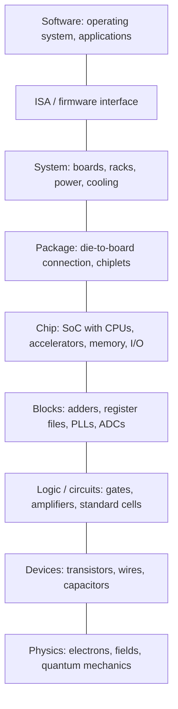
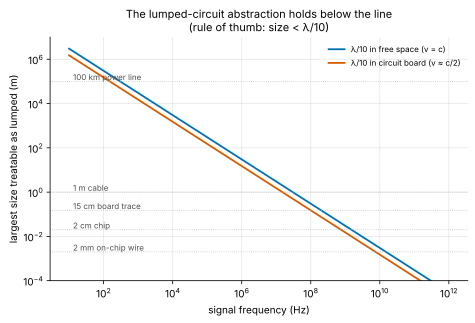
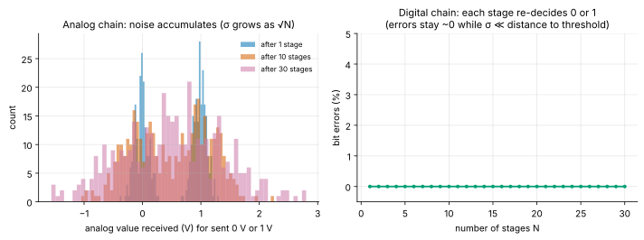
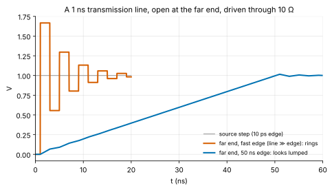

<!-- status: reviewed -->
# 00-02 · The Abstraction Stack: Physics to Software

| | |
|---|---|
| **Course** | [00 · Orientation](../README.md) |
| **University equivalent** | The opening abstraction lectures of MIT 6.002 (the lumped-matter and digital abstractions; Agarwal & Lang, ch. 1) and the "great ideas" chapter of a computer-organization course (Patterson & Hennessy, ch. 1) |
| **Prerequisites** | [00-01 The Map of Electrical Engineering](00-01-map-of-electrical-engineering.md). Algebra only; one normal-distribution calculation uses the Q-function, which is defined where it is used. |
| **Estimated study hours** | 3.5 |
| **Last verified** | 2026-11-12 |

**Learning objectives.** After this chapter you can:

1. Name the levels of the abstraction stack (physics, device, circuit, logic block, chip, package, board, system, software) and state what each level hides from the one above it.
2. State the lumped-circuit abstraction's key condition and decide, from wavelength or edge rate, whether a wire can be treated as lumped.
3. Compute noise margins from logic-level thresholds and decide whether two logic families can talk to each other.
4. Explain, with a calculation, why a chain of digital stages regenerates signals while a chain of analog stages accumulates noise.
5. Identify where abstractions leak (timing, power, noise, heat, security) and which engineering role owns each boundary.

## 1. Big picture

A modern processor has tens of billions of transistors. No human, and no computer program, can reason about all of them at once in terms of electrons and fields. Engineering works anyway because each level of the system is described to the level above by a simple **contract**: what goes in, what comes out, and what the user may assume. Everything else is hidden. This layering is the **abstraction stack**, and it is the most important organizing idea in electrical and computer engineering. It is also the source of the most expensive failures, because abstractions *leak*: physics from a lower level sometimes breaks the contract.

- **Maxwell's equations → circuits.** The lumped-circuit abstraction replaces fields with voltages and currents obeying Kirchhoff's laws. It fails when wires get long compared with the signal's wavelength (§3.2).
- **Voltages → bits.** The digital abstraction maps analog voltages onto 0 and 1, with margins for noise (§3.3). It is why digital systems can be enormous and still work.
- **Hardware → software.** The instruction-set architecture (ISA) is the contract that lets software run on any compatible processor ([14-02](../../14-computer-organization-and-architecture/chapters/14-02-isa-risc-v-arm-x86.md)).
- **Fab → designer.** The process design kit (PDK) and standard-cell library let a design team use a factory's process without knowing its recipes ([25-05](../../25-fabrication-packaging-test-and-reliability/chapters/25-05-foundries-pdks-specialty-processes.md)).
- **Chip → chip.** Interface standards (PCIe, USB, DDR, UCIe) let parts from different companies work together ([24-05](../../24-high-speed-io-signal-integrity-and-photonics/chapters/24-05-pcie-cxl-ethernet.md)).

## 2. Intuition first

### The stack

*Figure 1. The abstraction stack. Each level presents a simplified contract to the level above it.*

### An analogy from finance: financial statements

A company's financial statements are an abstraction of its operations. An investor reads revenue, margins and cash flow without seeing a single invoice. Accounting standards are the contract that makes the summary trustworthy, and auditors check the boundary. The abstraction leaks when material reality escapes the statements: off-balance-sheet liabilities, aggressive revenue recognition, a contingent liability buried in a footnote. A good analyst knows exactly where those leaks hide and asks about them.

Engineering abstractions work the same way, and this curriculum aims to make you that analyst for chips. *Where the analogy breaks:* accounting conventions are negotiated and can be gamed. Physical abstractions fail by physics, at hard, calculable limits. The lumped-circuit abstraction does not break when a regulator changes a rule; it breaks when a wire becomes a significant fraction of a wavelength. That makes engineering leaks *predictable*, if you know the physics.

## 3. Theory

### 3.1 The levels and their contracts

| Level | You work with | What is hidden | Typical tools | Curriculum |
|---|---|---|---|---|
| Physics | Electrons, holes, fields, quantum states | (nothing below) | Device physics, field solvers | [04](../../04-physics-for-ee/README.md), [09](../../09-semiconductor-devices/README.md), [13](../../13-electromagnetics/README.md) |
| Device | Transistor I–V curves, capacitances, wire R and C | Band structure, doping profiles, process recipes | Compact models (BSIM), PDK | [09](../../09-semiconductor-devices/README.md), [25](../../25-fabrication-packaging-test-and-reliability/README.md) |
| Circuit | Voltages, currents, gain, delay | Fields (lumped abstraction), device physics | SPICE (ngspice) | [06](../../06-circuit-analysis-1-dc/README.md), [07](../../07-circuit-analysis-2-transient-and-ac/README.md), [10](../../10-electronics-1/README.md), [12](../../12-electronics-2/README.md) |
| Logic / block | Gates, flip-flops, adders, ADCs, PLLs | Transistor-level behavior (digital abstraction) | RTL (Verilog), behavioral models | [08](../../08-digital-logic-design/README.md), [19](../../19-digital-vlsi-design/README.md), [20](../../20-analog-and-mixed-signal-ic-design/README.md) |
| Chip | CPUs, accelerators, memories, interconnect | Gate-level detail | Synthesis, place-and-route, static timing | [14](../../14-computer-organization-and-architecture/README.md), [19](../../19-digital-vlsi-design/README.md) |
| Package | Bumps, substrates, interposers, chiplets | On-die detail | Package design and signal-integrity tools | [25](../../25-fabrication-packaging-test-and-reliability/README.md) |
| Board / system | Power delivery, high-speed links, thermal design | Package internals | PCB tools, SI/PI simulation | [22](../../22-power-electronics-and-energy-conversion/README.md), [24](../../24-high-speed-io-signal-integrity-and-photonics/README.md), [27](../../27-system-architectures/README.md) |
| Software | Programs, operating systems, ML models | All hardware detail beyond the ISA and drivers | Compilers, debuggers | [05](../../05-programming-for-engineers/README.md), [14](../../14-computer-organization-and-architecture/README.md), [18](../../18-embedded-systems-and-microcontrollers/README.md) |

The contracts are what make division of labor possible. A verification engineer checks RTL against a specification without simulating electrons, and a software team ships code before the chip is manufactured. The cost is that **every contract is an approximation**, valid only within stated conditions. Sections 3.2–3.5 examine the three most important contracts and where each one fails.

### 3.2 The lumped-circuit abstraction

Circuit theory, the subject of Courses 06 and 07, treats a circuit as **lumped elements** (resistors, capacitors, inductors, sources) connected by ideal wires. Only the voltages across elements and the currents through them matter, and they obey Kirchhoff's voltage and current laws (KVL, KCL). This throws away the electric and magnetic fields, which is what Maxwell's equations actually describe. The simplification is valid under three conditions, which MIT's 6.002 calls the **lumped-matter discipline**:

1. no changing magnetic flux links the loops *outside* the elements (so KVL holds around any loop);
2. no net charge accumulates *inside* an element (so the current entering it equals the current leaving it, and KCL holds);
3. signals change slowly compared with the time electromagnetic waves take to cross the circuit.

The third condition is the one that fails in practice. A wave travels at speed $v$ (in m/s; in this chapter $v$ without a subscript is a speed, not a voltage): $c = 3.00\times10^8$ m/s in vacuum and roughly $c/\sqrt{\varepsilon_r}$ in a material with relative permittivity $\varepsilon_r$. Common circuit-board laminate (FR-4) has $\varepsilon_r \approx 4$, so on a board $v \approx c/2$, about 15 cm per nanosecond. A sinusoid of frequency $f$ has **wavelength**

$$
\lambda = \frac{v}{f}\qquad(\text{m} = \text{m/s} \div \text{1/s}).
$$

If a circuit's largest dimension $\ell$ is small compared with $\lambda$, every point on a wire sees essentially the same voltage at the same instant, and the lumped abstraction holds. A common rule of thumb is $\ell < \lambda/10$; cautious designers use $\lambda/20$. When the condition fails, wires must be modeled as **transmission lines**: signals travel along them as waves and can reflect at their ends ([13-07](../../13-electromagnetics/chapters/13-07-transmission-lines-time-domain.md)).

**Digital signals.** A digital signal is not one frequency. What matters is how fast its edges are. A widely used rule from signal-integrity practice is to treat a wire as a transmission line once its one-way delay exceeds about **one-sixth of the signal's rise time**. A related approach plugs the edge's effective bandwidth $f \approx 0.35/t_r$ ([07-02](../../07-circuit-analysis-2-transient-and-ac/chapters/07-02-first-order-rc-rl-transients.md)) into the wavelength test. With $\ell < \lambda/10$ that allows a delay of up to $t_r/3.5$, looser than the one-sixth rule; with the cautious $\lambda/20$ it allows $t_r/7$, close to it. Rules of thumb from different authors range from about $t_r/3$ to $t_r/10$; they agree on the order of magnitude, which is all a rule of thumb should be trusted for. Figure 2 shows the lumped regime for common structures.

*Figure 2. Below the line, Kirchhoff's laws work. A 100 km power line at 60 Hz is lumped; a 15 cm board trace at a few gigahertz is not.*

> **Going deeper — where KVL and KCL come from.** Faraday's law states $\oint \vec{E}\cdot d\vec{l} = -\frac{d\Phi_B}{dt}$. If no changing magnetic flux links a loop, the line integral of the field around it is zero, so the voltages around the loop sum to zero: KVL. Charge conservation states that the current leaving a closed surface equals the rate of decrease of the charge inside. If no charge accumulates at a node, the currents into it sum to zero: KCL. Inductors and capacitors are where we deliberately *confine* the changing flux and the stored charge, inside the element, so that the rules still hold outside. Course 13 develops this in full.

### 3.3 The digital abstraction and noise margins

Digital design maps a continuous voltage onto two values. A naïve version picks one threshold, say half the supply: above it is a 1, below it a 0. That fails as soon as noise pushes a voltage near the threshold across it. The real digital abstraction, called the **static discipline**, uses *four* voltages to leave room for noise:

- a valid **output** 0 is at most $V_{OL}$ and a valid output 1 is at least $V_{OH}$;
- a valid **input** is read as 0 if it is at most $V_{IL}$, and as 1 if it is at least $V_{IH}$;
- the thresholds are ordered $V_{OL} < V_{IL} < V_{IH} < V_{OH}$, and inputs between $V_{IL}$ and $V_{IH}$ are a forbidden zone.

The gaps between what outputs guarantee and what inputs require are the **noise margins**:

$$
NM_L = V_{IL} - V_{OL}, \qquad NM_H = V_{OH} - V_{IH}.
$$

Any noise smaller than the noise margin is absorbed: the receiving gate still sees a valid level. Because the stricter output levels are produced fresh by every gate, the noise does **not accumulate** from stage to stage. To satisfy the static discipline, a gate must have *gain* greater than 1 in magnitude in its transition region: it must turn an input that is merely valid into an output that is strongly valid. For a non-inverting buffer, an input just below $V_{IL}$ must produce an output below $V_{OL}$; for an inverter, the most common CMOS gate, the same input must produce an output above $V_{OH}$. Either way the output swings over a wider range than the input. That is why digital logic is built from amplifying devices (transistors), never from passive parts alone ([19-01](../../19-digital-vlsi-design/chapters/19-01-cmos-inverter-static.md)).

### 3.4 Why digital wins at scale: regeneration

Consider a signal passing through $N$ stages, each of which adds independent random noise with standard deviation $\sigma$ (in volts). The noise is Gaussian with zero mean.

**Analog chain.** Each stage passes the signal and the accumulated noise along, and adds its own. Variances of independent noise add, so after $N$ stages the noise variance is $N\sigma^2$ and its standard deviation is $\sigma\sqrt{N}$. The signal-to-noise ratio falls by a factor of $N$ in power, which is $10\log_{10}N$ dB. A hundred stages cost 20 dB.

**Digital chain.** Each stage receives the clean output of the previous stage plus *its own* noise only, then decides 0 or 1 and outputs a clean level. An error happens at a stage only if that stage's noise alone pushes the signal across the decision threshold, which lies a distance $d$ away (half the swing, for a threshold in the middle). The probability is

$$
p = P(\text{noise} > d) = Q\!\left(\frac{d}{\sigma}\right),
$$

where $Q(x)$ is the probability that a standard normal variable exceeds $x$, the familiar upper-tail probability from statistics ([03-02](../../03-probability-statistics-and-random-variables/chapters/03-02-random-variables-and-distributions.md)). For $N$ stages the probability that *any* stage errs is $1 - (1 - p)^N \approx Np$ when $p$ is small.

The Q-function falls off extraordinarily fast. At $d/\sigma = 10$, $p \approx 7.6\times10^{-24}$, so a billion stages would still essentially never err. At $d/\sigma = 10/3 \approx 3.33$ it is about $4.3\times10^{-4}$, which is unusable. Digital design therefore lives on a **cliff**: comfortably far from it, errors are effectively impossible; near it, they arrive in a rush. This is why digital systems can contain billions of gates and run for years without a logic error, while an analog signal chain degrades with every stage it passes through.

*Figure 3. Left: an analog signal (sent as 0 V or 1 V) after 1, 10 and 30 noisy stages; the two levels blur together. Right: the same noise through regenerating digital stages produces no errors.*

### 3.5 Where abstractions leak

Every abstraction is valid only within its assumptions. Here are the leaks that matter most, and who in a chip company is responsible for catching them ([00-05](00-05-how-chip-companies-are-organized.md)):

| Abstraction | Assumes | Leaks when | Who catches it |
|---|---|---|---|
| Lumped circuit | Signals travel instantly | Wires approach a wavelength or an edge's length: reflections, ringing (Example 00-02.5) | Signal-integrity and package engineers |
| Digital logic | Voltages are 0 or 1 | Noise approaches the noise margin: crosstalk, supply droop, ground bounce | Circuit designers, power-integrity engineers |
| Synchronous timing | Everything settles within one clock period | Wire and gate delays add up; clocks arrive at different times (skew) | Static-timing and physical-design engineers |
| "Power is free" (RTL view) | Logic only computes | Every 0→1 transition draws $CV^2$ from the supply, half stored and half burned, and the 1→0 transition burns the stored half; on average that is $\tfrac{1}{2}CV^2$ per transition (§3.8 of [07-02](../../07-circuit-analysis-2-transient-and-ac/chapters/07-02-first-order-rc-rl-transients.md)). Heat must leave the package | Power and thermal engineers |
| ISA | Software sees only architectural state | Timing and power depend on data, leaking secrets (side channels such as Spectre-class attacks) | Security architects |
| Reliability | Devices behave identically for the product's life | Transistors age (BTI, HCI); wires electromigrate ([25-09](../../25-fabrication-packaging-test-and-reliability/chapters/25-09-reliability-physics.md)) | Reliability engineers |

A recurring theme of this curriculum, and of good technical diligence, is to ask of any claim: **which abstraction is this number computed under, and is it valid here?**

### 3.6 The stack in numbers

Length scales span about twelve orders of magnitude, from atoms to datacenters:

- atoms are spaced about 0.2–0.3 nm apart;
- the smallest transistor features are a few tens of atoms across;
- a standard logic cell is under a micrometer to a few micrometers wide;
- a large die is a couple of centimeters on a side. A single die cannot exceed the lithography exposure field, **26 mm × 33 mm ≈ 858 mm²**, without stitching. High-NA EUV halves that field to 26 mm × 16.5 mm ([R-015](../../../reference/research-log.md#r-015--lithography-exposure-field-the-reticle-limit)). This "reticle limit" is a major reason the industry is moving to chiplets ([25-07](../../25-fabrication-packaging-test-and-reliability/chapters/25-07-advanced-packaging-and-chiplets.md));
- a package spans centimeters, a board tens of centimeters, a rack about 2 m, and a datacenter hundreds of meters.

Time scales span a similar range: a gate switches in picoseconds, a clock cycle is a fraction of a nanosecond, and software tasks take milliseconds to hours. Each level of the stack has its own natural scale, and a large part of system design is managing the boundaries between scales.

## 4. Worked examples

### Example 00-02.1 — Lumped or not? (tier A)

**Setup.** Decide whether each structure can be treated as lumped, using $\ell < \lambda/10$.

(a) A 100 km power line at 60 Hz (wave speed ≈ $c$).
(b) A 15 cm board trace carrying a 2.5 GHz signal ($v = 1.5\times10^8$ m/s).
(c) A 2 mm on-chip wire at 3 GHz, in silicon dioxide with $\varepsilon_r = 3.9$.

**Solution.**

(a) $\lambda = c/f = 2.998\times10^8/60 = 4.997\times10^6$ m, i.e. 4997 km. The line is $100/4997 = 0.0200$ wavelengths long, far below 0.1. **Lumped.** Note that a 1000 km line would not be: long-distance transmission lines are a transmission-line problem even at 60 Hz ([22-12](../../22-power-electronics-and-energy-conversion/chapters/22-12-power-systems-fundamentals.md)).

(b) $\lambda = 1.5\times10^8/2.5\times10^9 = 0.0600$ m $= 6.00$ cm. The trace is $15/6 = 2.50$ wavelengths long. **Not lumped:** it must be designed as a transmission line with controlled impedance.

(c) $v = c/\sqrt{3.9} = 2.998\times10^8/1.975 = 1.518\times10^8$ m/s, so $\lambda = 1.518\times10^8/3\times10^9 = 0.0506$ m $= 5.06$ cm. The wire is $0.2/5.06 = 0.0395$ wavelengths long. **Lumped** by this test. (On-chip wires are usually limited by their resistance, not by wave effects: they behave as distributed RC lines, [19-05](../../19-digital-vlsi-design/chapters/19-05-interconnect.md).)

**Units check.** m/s ÷ Hz = m ✓.
**Sanity check.** The 60 Hz wavelength is thousands of kilometers, and a few gigahertz is a few centimeters. Both are worth remembering.

### Example 00-02.2 — Noise margins and interfacing two logic families (tier B)

**Setup.** Two illustrative logic families have these levels:

| | $V_{OL}$ | $V_{OH}$ | $V_{IL}$ | $V_{IH}$ |
|---|---|---|---|---|
| Family A (3.3 V) | 0.4 V | 2.4 V | 0.8 V | 2.0 V |
| Family B (1.8 V) | 0.2 V | 1.6 V | 0.6 V | 1.2 V |

(a) Find the noise margins within each family. (b) Can an A output drive a B input? (c) Can a B output drive an A input?

**Solution.**

(a) A → A: $NM_L = 0.8 - 0.4 = 0.4$ V and $NM_H = 2.4 - 2.0 = 0.4$ V. B → B: $NM_L = 0.6 - 0.2 = 0.4$ V and $NM_H = 1.6 - 1.2 = 0.4$ V.

(b) A output → B input: $NM_L = V_{IL,B} - V_{OL,A} = 0.6 - 0.4 = 0.2$ V and $NM_H = V_{OH,A} - V_{IH,B} = 2.4 - 1.2 = 1.2$ V. Both are positive, so logically it works. But a 3.3 V output can apply up to 3.3 V to a 1.8 V input, which may exceed that input's absolute maximum rating and damage it. Margins are not the only contract.

(c) B output → A input: $NM_L = 0.8 - 0.2 = 0.6$ V, but $NM_H = V_{OH,B} - V_{IH,A} = 1.6 - 2.0 = -0.4$ V. **Negative.** A valid 1 from family B can land in family A's forbidden zone. The connection needs a **level shifter**.

**Sanity check.** Negative noise margin means "fails even with zero noise", which matches intuition: 1.6 V cannot be relied on to look like a 1 to a gate that needs 2.0 V.

### Example 00-02.3 — Regeneration versus accumulation (tier B)

**Setup.** A signal swings between 0 V and 1 V and passes through $N = 100$ stages. Each stage adds independent Gaussian noise with $\sigma = 50$ mV.

(a) Analog chain: what is the total noise standard deviation at the end?
(b) Digital chain with a mid-swing threshold: what is the error probability per stage, and over all 100 stages?
(c) Repeat (b) with $\sigma = 150$ mV.

**Solution.**

(a) $\sigma_{tot} = \sigma\sqrt{N} = 0.05 \times 10 = 0.500$ V. That is half the swing; the signal is badly corrupted.

(b) $d = 0.5$ V, so $d/\sigma = 10$ and $p = Q(10) = 7.62\times10^{-24}$. Over 100 stages: $\approx 100p = 7.6\times10^{-22}$, which is negligible.

(c) $d/\sigma = 0.5/0.15 = 10/3$ and $p = Q(10/3) = 4.29\times10^{-4}$. Over 100 stages: $1 - (1 - p)^{100} = 0.0420$, a 4.20% chance of at least one error. Tripling the noise moved the system from impossible errors to frequent ones. That is the cliff.

**Sanity check.** In (c), $Np = 0.0429$ is close to the exact 0.0420, because $p$ is small ✓.

### Example 00-02.4 — The speed of light inside a chip (tier B)

**Setup.** A signal must cross a 20 mm die. Even as an ideal wave, it cannot travel faster than about $v = 1.5\times10^8$ m/s in a silicon-dioxide insulator ($\varepsilon_r \approx 3.9$). (Low-k insulators, with $\varepsilon_r \approx 2.5$–3, allow about $1.7$–$1.9\times10^8$ m/s.) How long does the crossing take, and what fraction of a 3 GHz clock period is that?

**Solution.** $t = \ell/v = 0.020/1.5\times10^8 = 1.33\times10^{-10}$ s $= 133$ ps. The clock period is $1/3\times10^9 = 333$ ps, so the crossing takes $133/333 = 40.0\%$ of a cycle, *before* any gate delay or the much slower RC delay of real on-chip wires.

**Interpretation.** The synchronous abstraction ("everything settles within one clock cycle") cannot hold for signals that cross a large chip. Architects pipeline long wires across several cycles and distribute clocks carefully, which is one reason large chips are organized as tiles and networks-on-chip ([14-11](../../14-computer-organization-and-architecture/chapters/14-11-io-buses-and-interconnect.md)).

### Example 00-02.5 — When the lumped abstraction fails: reflections (tier C)

**Setup.** A 1 V step from a source with internal resistance $R_s = 10\ \Omega$ drives a $Z_0 = 50\ \Omega$ transmission line with a one-way delay of 1 ns, open at the far end. A transmission line's **characteristic impedance** $Z_0$ is the ratio of voltage to current in a wave traveling along it ([13-07](../../13-electromagnetics/chapters/13-07-transmission-lines-time-domain.md)). Find (a) the voltage wave launched into the line, (b)–(d) the far-end voltage after the first three arrivals, and (e) compare with a slow, 50 ns edge.

**Solution.** Only two facts about transmission lines are needed.

- When the step starts, the source sees the line as a $Z_0$ resistor, so it launches a wave of amplitude $V\frac{Z_0}{R_s + Z_0}$.
- When a wave reaches an end with resistance $R$, it reflects with **reflection coefficient** $\Gamma = \frac{R - Z_0}{R + Z_0}$. At an open end ($R \to \infty$), $\Gamma = +1$, so the voltage there is incident + reflected = **twice** the incident wave.

(a) Launched wave: $1 \times \frac{50}{60} = 0.833$ V. The source reflection coefficient is $\Gamma_s = \frac{10 - 50}{60} = -0.667$.

(b) At $t = 1$ ns the wave reaches the open end, where the voltage jumps to $2 \times 0.833 = 1.667$ V. **A 1 V source has produced 1.667 V.**

(c) The reflected 0.833 V wave returns to the source, reflects with $\Gamma_s$ (giving −0.556 V), and arrives back at the far end at $t = 3$ ns, adding $2 \times (-0.556)$: the far end drops to $1.667 - 1.111 = 0.556$ V.

(d) The next round trip contributes $2 \times (-0.556)(-0.667) = +0.741$ V, giving 1.296 V at $t = 5$ ns. The ringing decays by a factor of $\Gamma_s = -0.667$ per round trip toward the lumped answer of 1 V.

(e) With a 50 ns edge, 25 times longer than the 2 ns round trip, the reflections blur together and the far end follows the source closely. Its maximum is only 1.016 V, a 1.6% overshoot instead of 67%. **The same wire is "lumped" or "a transmission line" depending on the edge speed.**

*Figure 4. The far end of the line for a fast edge (ringing) and a slow edge (lumped behavior). Confirmed by the ngspice netlist in the lab.*

**Sanity check.** The final value is 1 V in both cases: with an open far end no DC current flows, so there is no DC drop across $R_s$ ✓. The overshoot of a real logic signal like this can exceed a receiver's absolute-maximum voltage, which is why high-speed links are **terminated** (matched) at one or both ends.

<!-- answer-key -->
| ID | Quantity | Value | Unit |
|---|---|---|---|
| Ex 00-02.1a | λ at 60 Hz | 4997 | km |
| Ex 00-02.1b | 100 km line length in wavelengths | 0.0200 | — |
| Ex 00-02.1c | λ on board at 2.5 GHz | 6.00 | cm |
| Ex 00-02.1d | 15 cm trace length in wavelengths | 2.50 | — |
| Ex 00-02.1e | wave speed in SiO₂ | 1.518×10^8 | m/s |
| Ex 00-02.1f | λ on chip at 3 GHz | 5.06 | cm |
| Ex 00-02.1g | 2 mm wire length in wavelengths | 0.0395 | — |
| Ex 00-02.2a | $NM_L$, A → B | 0.2 | V |
| Ex 00-02.2b | $NM_H$, A → B | 1.2 | V |
| Ex 00-02.2c | $NM_L$, B → A | 0.6 | V |
| Ex 00-02.2d | $NM_H$, B → A | −0.4 | V |
| Ex 00-02.3a | analog noise after 100 stages | 0.500 | V |
| Ex 00-02.3b | $Q(10)$ | 7.62×10^-24 | — |
| Ex 00-02.3c | $Q(10/3)$ | 4.29×10^-4 | — |
| Ex 00-02.3d | error probability, 100 stages, σ = 150 mV | 4.20 | % |
| Ex 00-02.4a | time of flight across 20 mm | 133 | ps |
| Ex 00-02.4b | fraction of a 3 GHz cycle | 40.0 | % |
| Ex 00-02.5a | launched wave | 0.833 | V |
| Ex 00-02.5b | far end, first arrival | 1.667 | V |
| Ex 00-02.5c | far end, second arrival | 0.556 | V |
| Ex 00-02.5d | far end, third arrival | 1.296 | V |
| Ex 00-02.5e | maximum far-end voltage, 50 ns edge | 1.016 | V |
| Ex 00-02.5f | source reflection coefficient | −0.667 | — |

*All values are recomputed by [verify_00_02.py](../verify/verify_00_02.py). Example 00-02.5 is also confirmed in ngspice ([tline_reflections.cir](../labs/00-02-lab/tline_reflections.cir)).*

## 5. Simulate it

The lab in [labs/00-02-lab/](../labs/00-02-lab/README.md) has three parts:

1. **Lumped or not.** A notebook calculator: enter a frequency and a size and get the verdict, and see where everyday structures fall in Figure 2.
2. **Regeneration.** A Monte Carlo simulation of a million bits through analog and digital chains. Turn the per-stage noise σ up and watch the digital error rate fall off the cliff.
3. **Reflections.** An ngspice transmission-line netlist (Example 00-02.5 and Problem 00-02.10), plus a Python lattice calculation that reproduces it.

**Predict, then run.** In Part 2, before you run it, predict the digital error rate per stage for σ = 0.2 V (threshold distance 0.5 V). Then predict how many of the million simulated bits will be wrong at least once in 10 stages. Use $Q(2.5) \approx 0.0062$.

## 6. Engineering tradeoffs

| Knob | Improves | Costs | Typical decision owner |
|---|---|---|---|
| Larger logic swing (higher supply voltage) | Bigger noise margins, more robust logic | Dynamic power grows as $V^2$; reliability stress on thin oxides | Process/technology team; SoC power architect |
| Terminate high-speed lines (matched impedance) | Eliminates reflections and ringing | Burns DC power in termination resistors; needs impedance-controlled boards | Signal-integrity / board engineer |
| Pipeline long on-chip wires (add flip-flops) | Keeps the one-cycle timing abstraction valid at high clock rates | Extra latency (cycles), area and clock power | Microarchitect; physical-design lead |
| Process signals digitally instead of in analog | Regeneration: arbitrary length chains, exact repeatability, programmability | Needs ADCs/DACs; consumes more power for simple functions; quantization noise | System architect |
| Stronger abstraction boundaries (strict interfaces, chiplets) | Parallel teams, reuse, faster schedules | Loss of cross-boundary optimization; interface overhead in power, latency and area | Chief architect / VP Engineering |

## 7. Numbers to know

| Quantity | Value | Note |
|---|---|---|
| Speed of light in vacuum | $3.00\times10^8$ m/s = 30 cm/ns | |
| Signal speed on FR-4 circuit board | ≈ 15 cm/ns ($\varepsilon_r \approx 4$) | Rule of thumb |
| Wavelength at 60 Hz / 1 GHz / 10 GHz (free space) | 5000 km / 30 cm / 3 cm | $\lambda = c/f$ |
| Lumped rule of thumb | size < λ/10, or line delay < $t_r/6$ | Authors vary between $t_r/4$ and $t_r/10$ |
| Reticle limit (max single-exposure die) | 26 mm × 33 mm ≈ 858 mm²; High-NA EUV: 26 mm × 16.5 mm | [R-015](../../../reference/research-log.md#r-015--lithography-exposure-field-the-reticle-limit) |
| $Q(3)$, $Q(6)$, $Q(10)$ | $1.35\times10^{-3}$, $9.87\times10^{-10}$, $7.62\times10^{-24}$ | How fast the Gaussian tail falls |

<!-- answer-key -->
| ID | Quantity | Value | Unit |
|---|---|---|---|
| N 00-02.a | λ at 1 GHz, free space | 30.0 | cm |
| N 00-02.b | reticle field area | 858 | mm² |
| N 00-02.c | High-NA field area | 429 | mm² |
| N 00-02.d | $Q(3)$ | 1.35×10^-3 | — |
| N 00-02.e | $Q(6)$ | 9.87×10^-10 | — |

## 8. Common mistakes

1. **Treating abstractions as facts.** "This gate's output is 1" is a statement inside an abstraction; at the physical level it is a voltage with noise. When something "impossible" happens, look one level down.
2. **Using a single threshold to define digital levels.** Without separate input and output thresholds there are no noise margins and no regeneration.
3. **Judging lumped versus distributed by clock frequency alone.** Edge rate matters: a 10 MHz clock with 100 ps edges behaves like a multi-gigahertz signal at its edges.
4. **Forgetting absolute-maximum ratings when interfacing.** Positive noise margins do not mean an input can survive the voltage applied to it (Example 00-02.2b).
5. **Assuming noise adds linearly.** Independent noise adds in *power* (variance), so its standard deviation grows as $\sqrt{N}$, not $N$.

## 9. Practitioner lens

### State of the art (as of Nov 2026)

- **The reticle limit has become an architecture driver.** The largest AI processor dies are built close to the 858 mm² single-exposure limit: NVIDIA's H100 die, for example, is widely reported at about 814 mm² ([R-015](../../../reference/research-log.md#r-015--lithography-exposure-field-the-reticle-limit)) **[Industry estimate]**. Beyond the limit, designs are split into multiple dies connected inside one package (chiplets, 2.5D/3D integration). High-NA EUV's halved field makes the boundary even more prominent ([R-015](../../../reference/research-log.md#r-015--lithography-exposure-field-the-reticle-limit)) **[Established for the field sizes]**. Packaging, once a back-end afterthought, is now a first-class abstraction boundary ([25-07](../../25-fabrication-packaging-test-and-reliability/chapters/25-07-advanced-packaging-and-chiplets.md)).
- **Interface standards are abstraction contracts with commercial stakes.** Die-to-die standards such as UCIe aim to let chiplets from different vendors interoperate, much as PCIe did for boards. Whether that mix-and-match market materializes at scale is still **[Contested]**; [24-06](../../24-high-speed-io-signal-integrity-and-photonics/chapters/24-06-d2d-memory-phys-scale-up.md) covers its status.

### Why it matters commercially

- **Abstractions define markets.** A company that *owns* an abstraction boundary can create an ecosystem around it, and switching costs keep customers. Examples are an ISA (x86, Arm, RISC-V), a software platform (a GPU programming model) and an interface standard.
- **Value moves to where abstractions leak.** Performance and power problems increasingly sit at boundaries: memory bandwidth, die-to-die links, power delivery and cooling. Companies that solve cross-boundary problems capture value. This is a recurring diligence theme in Courses 27–28.

### Marketing vs Reality

**"Our design is portable to any process node."** RTL is portable in the sense that it can be re-synthesized. But timing, power, analog blocks, memories and I/O are tied to a specific process's physics. Porting analog and mixed-signal IP is a redesign, not a recompile ([20-12](../../20-analog-and-mixed-signal-ic-design/chapters/20-12-why-analog-does-not-scale.md)). **Sanity check:** ask which blocks are hard-coded to the current process and what fraction of the die they occupy.

**"Chiplets let you mix and match the best die from any vendor."** Only if both sides implement the same interface, verified together, with compatible packaging, test and thermal assumptions. Each one is an abstraction that can leak. **Sanity check:** ask which partner chiplets have actually been integrated *in silicon*, not just announced.

### Questions to ask engineering leaders

1. **"Where do your abstractions leak? Which problems found late in your last project crossed a team boundary?"**
   *Strong answer:* concrete examples (a power-integrity issue found at bring-up, a timing problem between a block and its I/O) and the process change made afterwards. *Evasive:* "Our flow catches everything."
2. **"How much of your design is process-specific, and what would porting it to another node or foundry cost?"**
   *Strong:* separates portable RTL from analog, memory and I/O IP, and gives effort in person-months. *Evasive:* "It's all portable."
3. **"What interface contracts does your product depend on, and who controls them?"**
   *Strong:* names the standards, its participation in the standards bodies, and its dependency risks. *Evasive:* hasn't considered it.
4. **"For your largest die, how close are you to the reticle limit, and what is your plan beyond it?"**
   *Strong:* knows the die area and has a chiplet or packaging roadmap with yield and cost reasoning. *Evasive:* "We'll go to the next node."

## 10. Concept check

**Q1.** What does the lumped-circuit abstraction throw away, and when is that safe?

Answer

It replaces electric and magnetic fields with voltages and currents in idealized elements connected by ideal wires. That is safe when the circuit is small compared with the signal's wavelength, roughly under λ/10, or when the line delay is short compared with the edge rise time.

**Q2.** Why does a digital gate need gain?

Answer

It must turn a merely valid input (anywhere up to $V_{IL}$) into a strongly valid output (at most $V_{OL}$, which is less than $V_{IL}$). That restores the noise margin at every stage, and it requires an amplifying device.

**Q3.** A 1 V signal passes 25 noisy analog stages, each adding σ = 20 mV. What is the total noise?

Answer

$\sigma\sqrt{N} = 20\text{ mV} \times 5 = 100$ mV rms.

**Q4.** Why can a 1 V source produce 1.67 V at the end of a transmission line?

Answer

At an open end the wave reflects with Γ = +1, so the voltage there is incident + reflected, twice the launched wave. Here the launched wave is 0.833 V. The extra voltage is a temporary effect of energy stored in the line's wave, not a violation of energy conservation.

**Q5.** What is the reticle limit, and why does it matter for AI chips?

Answer

The maximum area one lithography exposure can print: 26 mm × 33 mm ≈ 858 mm² on today's standard scanners. AI processors want more silicon than that, so they are split into chiplets connected in the package.

**Q6.** Give one example of an abstraction leak caused by power.

Answer

Examples include supply droop when many gates switch at once (logic sees reduced margins), heat limiting clock speed, and side-channel attacks that read secrets from data-dependent power consumption.

Now work the problem set: [00-02 problems](../problems/00-02-problems.md) (solutions in [00-02 solutions](../solutions/00-02-solutions.md)).

## 11. Key terms

[Abstraction](../../../reference/glossary.md#abstraction) ·
[Lumped-matter discipline](../../../reference/glossary.md#lumped-matter-discipline) ·
[Wavelength](../../../reference/glossary.md#wavelength) ·
[Transmission line](../../../reference/glossary.md#transmission-line) ·
[Characteristic impedance](../../../reference/glossary.md#characteristic-impedance) ·
[Reflection coefficient](../../../reference/glossary.md#reflection-coefficient) ·
[Static discipline](../../../reference/glossary.md#static-discipline) ·
[Noise margin](../../../reference/glossary.md#noise-margin) ·
[Regeneration](../../../reference/glossary.md#regeneration) ·
[Q-function](../../../reference/glossary.md#q-function) ·
[Level shifter](../../../reference/glossary.md#level-shifter) ·
[Instruction-set architecture (ISA)](../../../reference/glossary.md#instruction-set-architecture-isa) ·
[Process design kit (PDK)](../../../reference/glossary.md#process-design-kit-pdk) ·
[Reticle limit](../../../reference/glossary.md#reticle-limit) ·
[Chiplet](../../../reference/glossary.md#chiplet) ·
[Side channel](../../../reference/glossary.md#side-channel)

## 12. Connections

- **Builds on:** [00-01 The Map of Electrical Engineering](00-01-map-of-electrical-engineering.md).
- **Next:** [00-03 How to Study This Curriculum](00-03-how-to-study-this-curriculum.md).
- **Developed later in:**
  - [06-01](../../06-circuit-analysis-1-dc/chapters/06-01-charge-current-voltage-power.md): the lumped abstraction, formally.
  - [08-02](../../08-digital-logic-design/chapters/08-02-boolean-algebra-and-gates.md) and [19-01](../../19-digital-vlsi-design/chapters/19-01-cmos-inverter-static.md): digital abstraction and noise margins.
  - [13-07](../../13-electromagnetics/chapters/13-07-transmission-lines-time-domain.md): transmission lines.
  - [14-02](../../14-computer-organization-and-architecture/chapters/14-02-isa-risc-v-arm-x86.md): the ISA contract.
  - [17-06](../../17-communication-systems/chapters/17-06-bandpass-digital-modulation.md): error probability with Q-functions.
  - [25-07](../../25-fabrication-packaging-test-and-reliability/chapters/25-07-advanced-packaging-and-chiplets.md): chiplets.

## 13. Further study

- **Agarwal & Lang, *Foundations of Analog and Digital Electronic Circuits*,** chapter 1 (the lumped-matter discipline) and chapter 5 (the digital abstraction and noise margins). This is the textbook of MIT 6.002, which this chapter follows most closely.
- **MIT OpenCourseWare 6.002, lectures 1 and 4:** the abstraction lectures, online with video.
- **Patterson & Hennessy, *Computer Organization and Design*,** chapter 1: abstraction as one of the "great ideas" of computer architecture.
- **Bogatin, *Signal and Power Integrity — Simplified*:** a readable account of when interconnects stop being "just wires".

## 14. Sources

1. Research log [R-015](../../../reference/research-log.md#r-015--lithography-exposure-field-the-reticle-limit): lithography exposure field (IEEE Spectrum; Tom's Hardware), checked Nov 2026.
2. Agarwal & Lang (MIT 6.002 text): the lumped-matter discipline and static discipline as framed here.
3. The rise-time rule of thumb for transmission-line behavior ($t_r/6$, with $t_r/4$–$t_r/10$ variants) is standard signal-integrity practice. See Bogatin, and H. Johnson & M. Graham, *High-Speed Digital Design* (1993).
4. All text, examples and problems in this chapter are original.
