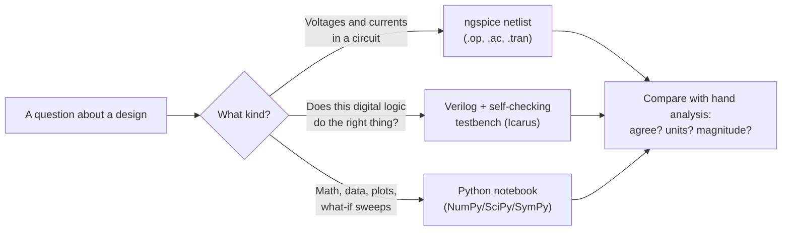

<!-- status: verified -->
# 00-04 · Toolchain Setup Walkthrough

| | |
|---|---|
| **Course** | [00 · Orientation](../README.md) |
| **University equivalent** | The first lab session of a circuits or digital-design course (SPICE and HDL simulator introduction), plus the numerical-computing introduction of an engineering-computation course |
| **Prerequisites** | [00-02 The Abstraction Stack](00-02-the-abstraction-stack.md). Installation steps are in [SETUP.md](../../../SETUP.md). |
| **Estimated study hours** | 2.5 |
| **Last verified** | 2026-11-12 |

**Learning objectives.** After this chapter you can:

1. Install the curriculum toolchain and confirm it works by running the repository's smoke tests and checks.
2. Write, run and read a SPICE netlist for DC operating-point and AC analyses, including SPICE's unit suffixes.
3. Run a self-checking Verilog testbench and explain why exhaustive testing becomes impossible as inputs grow.
4. Recognize floating-point limits (machine epsilon, cancellation) and compare numbers with tolerances rather than equality.
5. Explain how a circuit simulator solves nonlinear circuits (Newton–Raphson) and why that can fail to converge.

## 1. Big picture

An engineer's toolchain is their laboratory. Long before a chip exists, it lives as code and netlists in simulators, and almost every engineering decision in a chip company is checked in simulation first. This curriculum follows the same practice: every major concept has a simulation, and every published number is checked by a script. This chapter gets your tools working and teaches the handful of skills you need to read and trust their output.

- **Circuit simulation (SPICE):** the industry's workhorse for analog, RF, power and cell-level digital design since the 1970s. You will use the open-source ngspice ([06-04](../../06-circuit-analysis-1-dc/chapters/06-04-nodal-analysis.md) explains the mathematics inside).
- **Hardware description languages (Verilog/SystemVerilog):** how digital chips are written and verified ([08-05](../../08-digital-logic-design/chapters/08-05-verilog-and-testbenches.md)).
- **Numerical Python (NumPy, SciPy, SymPy, Matplotlib):** the general-purpose engineering calculator, plotter and symbolic algebra system ([05-02](../../05-programming-for-engineers/chapters/05-02-numpy-and-vectorization.md)).
- **The repository's own checks:** `make check` runs every verification the curriculum relies on. Learning to read its output teaches you to *audit* numbers, a core diligence skill.

## 2. Intuition first

### What each tool is for



*Figure 1. Choosing a tool. Every result goes through the same final step: compare it with an independent estimate.*

### An analogy from finance: models and spreadsheets

A SPICE simulation is to a circuit what a discounted-cash-flow spreadsheet is to an acquisition. It is a faithful calculator of the consequences of its inputs and assumptions, and it is exactly as good as those inputs. You would never accept a DCF output without checking the discount rate, the terminal-value assumption and a sanity range. Treat every simulation the same way:

- check the **model** (which device models, which corner);
- check the **inputs** (component values and units);
- check the **result** against a back-of-the-envelope estimate.

*Where the analogy breaks:* a spreadsheet's arithmetic is exact, but a simulator's is not. It solves equations numerically, with tolerances, time steps and convergence criteria, so it can produce a wrong answer from correct inputs (§3.4). And unlike financial projections, a well-modeled circuit simulation usually matches reality to within a few percent. The physics really is that predictable.

## 3. Theory

### 3.1 SPICE in one page

**SPICE** (Simulation Program with Integrated Circuit Emphasis) reads a text **netlist**. Each line describes one element and the **nodes** it connects to. Node `0` is ground, the reference for all voltages. For example:

```text
* A voltage divider                      <- first line: the title (always ignored as a circuit line)
V1  in   0   DC 5                        <- voltage source from node "in" to ground, 5 V
R1  in   out 3k                          <- 3 kΩ resistor between "in" and "out"
R2  out  0   2k                          <- 2 kΩ resistor from "out" to ground
.op                                      <- analysis: DC operating point
.end
```

The first letter of each element name sets its type: R (resistor), C (capacitor), L (inductor), V and I (sources), D (diode), M (MOSFET), Q (BJT), E/G/F/H (dependent sources), T (transmission line). The most common **analyses** are:

| Analysis | What it computes | Used in |
|---|---|---|
| `.op` | DC operating point: all node voltages and branch currents with capacitors open and inductors shorted | Courses 06, 10 |
| `.dc` | The operating point swept over a source value (e.g., an I–V curve) | Courses 09, 10 |
| `.ac` | Small-signal sinusoidal response versus frequency, using phasors ([02-01](../../02-complex-numbers-des-and-linear-algebra/chapters/02-01-complex-numbers-euler-and-phasors.md)) | Courses 07, 12 |
| `.tran` | Time-domain response to any input waveform | Courses 07, 22 |
| `.meas` | Extract a number from results, e.g. "the frequency where the gain falls 3 dB" | Everywhere in this repo |

**Unit suffixes, and the trap.** SPICE numbers take scale suffixes, and **case does not matter**:

| Suffix | f | p | n | u | m | k | meg | g | t |
|---|---|---|---|---|---|---|---|---|---|
| Multiplier | 10⁻¹⁵ | 10⁻¹² | 10⁻⁹ | 10⁻⁶ | **10⁻³** | 10³ | **10⁶** | 10⁹ | 10¹² |

Because case is ignored, `M` and `m` both mean **milli**. A "1M" resistor is 1 mΩ, not 1 MΩ. Mega is `meg`. This is the most common SPICE beginner error, and it produces results that look plausible (Example 00-04.2).

### 3.2 How SPICE solves a circuit

For a circuit of resistors and sources, SPICE writes KCL at every node: the sum of currents leaving each node through its connected elements is zero. That gives a system of linear equations $\mathbf{G}\mathbf{v} = \mathbf{i}$, where $\mathbf{v}$ is the vector of unknown node voltages. Voltage sources add a few extra equations, a scheme called **modified nodal analysis**. Solving this linear system is pure linear algebra ([02-06](../../02-complex-numbers-des-and-linear-algebra/chapters/02-06-vectors-matrices-and-linear-systems.md), [06-04](../../06-circuit-analysis-1-dc/chapters/06-04-nodal-analysis.md)).

Real circuits contain **nonlinear** devices: a diode's current depends exponentially on its voltage. SPICE solves the nonlinear equations with **Newton–Raphson iteration**:

1. Guess the node voltages.
2. Replace each nonlinear device by its *tangent-line* (linearized) model at the guess.
3. Solve the resulting linear system to get a new guess.
4. Repeat until the change is below a tolerance.

In one variable: to solve $g(V) = 0$, iterate

$$
V_{k+1} = V_k - \frac{g(V_k)}{g'(V_k)} .
$$

Near the solution Newton converges extremely fast: the number of correct digits roughly doubles each step. Far from it, the exponential can make it overshoot wildly. That is why SPICE adds safeguards (step limiting, source stepping), and why "convergence failures" are a familiar annoyance (Problem 00-04.9).

For **transient** analysis SPICE repeats this at every time step, approximating the derivatives in $i = C\,dv/dt$ and $v = L\,di/dt$ by finite differences. The **time step** trades accuracy for run time. SPICE chooses it adaptively to keep a local error estimate within a relative tolerance, by default 0.1% (`reltol = 1e-3`). For **AC** analysis, SPICE linearizes the circuit at its DC operating point and solves one complex (phasor) linear system per frequency.

> **Going deeper.** Numerical integration of stiff circuit equations, convergence aids and the choice between the trapezoidal and Gear methods are covered in [02-10 Numerical Methods](../../02-complex-numbers-des-and-linear-algebra/chapters/02-10-numerical-methods.md).

### 3.3 Verilog and self-checking testbenches

A Verilog **module** describes hardware: inputs, outputs and the logic between them. A **testbench** is a second module, never built into hardware, that instantiates the design, drives inputs and checks outputs. The testbench is the specification made executable. This curriculum requires every testbench to be **self-checking**: it compares each output with an independently computed expected value and prints `TEST PASSED` or `TEST FAILED`. Waveform viewing (`.vcd` files in GTKWave) is a debugging aid, not a test.

**Exhaustive testing does not scale.** A combinational block with $n$ input bits has $2^n$ input combinations. A 2:1 multiplexer has 3 inputs, so 8 tests check it completely. A 32-bit adder has 64 input bits: $2^{64} \approx 1.8\times10^{19}$ combinations, which at a billion tests per second takes about 585 years. Real verification therefore combines **directed tests** (hand-picked corner cases), **constrained-random tests** with **coverage** measurement, and **formal verification**, which proves properties mathematically ([19-13](../../19-digital-vlsi-design/chapters/19-13-verification-methods.md)). This is why verification consumes about half of chip-project effort ([00-05](00-05-how-chip-companies-are-organized.md)).

### 3.4 Floating-point numbers: why `==` is dangerous

Computers store real numbers in **binary floating point** (IEEE 754 double precision): 53 significant bits, about 16 decimal digits. Most decimal fractions, such as 0.1, have no exact binary representation, so they are rounded. Two consequences matter every day:

1. **Equality tests fail.** In Python, `0.1 + 0.2 == 0.3` is `False`: the sum is 0.30000000000000004. Always compare with a tolerance, e.g. `math.isclose(a, b, rel_tol=1e-9)`. The repository's verify scripts compare each published value with a tolerance of half a unit in its last digit, which tests exactly what a reader can see.
2. **Cancellation destroys accuracy.** Subtracting two nearly equal numbers leaves only their few differing digits. For tiny $x$, `1 - math.cos(x)` returns 0, because $\cos x$ rounds to exactly 1. The mathematically identical $2\sin^2(x/2)$ gives the right answer. When results look suspicious, look for a subtraction of near-equal quantities.

The **machine epsilon**, $\varepsilon = 2^{-52} \approx 2.22\times10^{-16}$, is the gap between 1 and the next representable number, and so the relative precision of a double.

### 3.5 The repository's checks, from the inside

`make check` runs, in order:

1. **Generated-file checks:** that generated files (curriculum map, glossary, stats) are up to date.
2. **Internal links and anchors:** every relative link in every Markdown file resolves.
3. **Template structure:** every written chapter follows the mandatory template.
4. **Markdown lint.**
5. **Unit tests** for the verification toolkit.
6. **Verify scripts:** every course's `verify/` script recomputes each published number.
7. **ngspice netlists:** each netlist's `* EXPECT` lines match the published answers.
8. **Verilog testbenches:** each prints `TEST PASSED`.
9. **Notebooks:** every lab notebook executes top to bottom.

When you change a value in a chapter (or make a typo), step 6 fails and names the value. That is the protection that lets you trust the numbers when no instructor is checking them.

## 4. Worked examples

### Example 00-04.1 — Your first netlist: a voltage divider (tier A)

**Setup.** Simulate the divider of §3.1 (5 V, $R_1 = 3$ kΩ, $R_2 = 2$ kΩ). Predict, then confirm, $V_{out}$, the source current and the power in $R_1$.

**Solution (hand analysis first).** The resistors are in series: $I = 5/(3 + 2)\text{ kΩ} = 1.000$ mA. Then $V_{out} = IR_2 = 2.000$ V, and the power in $R_1$ is $P_{R1} = I^2R_1 = (10^{-3})^2(3000) = 3.000$ mW. The netlist `divider.cir` in the lab reports $v(out) = 2$ and $i(V1) = -0.001$.

**Why the minus sign?** SPICE reports the current through a voltage source as flowing *into* its positive terminal. A source delivering power has current flowing *out* of its positive terminal, so SPICE shows it as negative. This is the passive sign convention ([06-01](../../06-circuit-analysis-1-dc/chapters/06-01-charge-current-voltage-power.md)) applied to the source.

**Sanity check.** $V_{out}$ lies between 0 and 5 V and closer to 0 V, because $R_2$ is the smaller resistor ✓. The total power, $5\text{ V} \times 1\text{ mA} = 5$ mW, equals $3 + 2$ mW ✓.

### Example 00-04.2 — The "M" trap (tier A)

**Setup.** A student intends a divider with two 1 MΩ resistors from 5 V, expecting 2.5 V, and writes `R3 in2 out2 1M` and `R4 out2 0 1MEG`. What does SPICE compute?

**Solution.** `1M` is 1 mΩ; `1MEG` is 1 MΩ. So $V_{out} = 5 \times \frac{10^6}{10^6 + 10^{-3}} = 5.000$ V, not 2.500 V. The simulator ran without complaint; only the human check (expected 2.5 V, got 5 V) catches it.

**Lesson.** Always predict the answer before you simulate. A simulator that disagrees with a sound estimate is the most valuable thing it can show you: either your understanding or your netlist is wrong, and you learn something either way.

### Example 00-04.3 — Floating point in practice (tier B)

**Setup.** In Python, compute (a) machine epsilon, (b) the error in `0.1 + 0.2 - 0.3`, and (c) $1 - \cos(10^{-8})$, both naïvely and stably.

**Solution.**

(a) `numpy.finfo(float).eps` $= 2^{-52} = 2.22\times10^{-16}$.

(b) `0.1 + 0.2 - 0.3` returns $5.55\times10^{-17}$, not 0. The error is a fraction of one unit in the last place of 0.3, harmless if you compare with a tolerance and wrong if you test equality.

(c) `1 - math.cos(1e-8)` returns **0.0**. The Taylor series ([01-08](../../01-calculus-for-engineers/chapters/01-08-sequences-series-and-taylor.md)) gives $1 - \cos x \approx x^2/2 = 5.00\times10^{-17}$. But $\cos(10^{-8}) = 1 - 5\times10^{-17}$, and that difference is below half of machine epsilon, so it rounds to exactly 1. The stable form `2*math.sin(x/2)**2` returns $5.00\times10^{-17}$.

**Sanity check.** Whenever an expression is a difference of nearly equal terms, rewrite it algebraically or with a series before trusting it.

### Example 00-04.4 — Exhaustively testing a multiplexer (tier B)

**Setup.** A 2:1 multiplexer outputs $y = a$ when the select $s = 0$, and $y = b$ when $s = 1$. Write it in Verilog and test it completely.

**Solution.** The design is one line, `assign y = s ? b : a;` (lab file `mux2.v`). The testbench `mux2_tb.v` loops over all $2^3 = 8$ combinations of $(s, b, a)$. It compares $y$ with an *independent* reference, the Boolean form $y = \bar{s}a + sb$, rather than re-using the design's own expression. It prints `TEST PASSED` only if all 8 agree, and `python tools/run_hdl.py` runs it.

**Why an independent reference?** A testbench that copies the design's logic will pass even if that logic is wrong. Independence between design and check is the same principle as this repository's verify scripts, and the reason verification teams are kept separate from design teams ([00-05](00-05-how-chip-companies-are-organized.md)).

### Example 00-04.5 — An AC sweep (tier B)

**Setup.** Find the −3 dB frequency of an RC low-pass with $R = 1$ kΩ and $C = 1$ µF, by hand and with ngspice's `.ac` analysis.

**Solution.** By hand ([02-01](../../02-complex-numbers-des-and-linear-algebra/chapters/02-01-complex-numbers-euler-and-phasors.md) §3.11): $f_c = \frac{1}{2\pi RC} = \frac{1}{2\pi(10^3)(10^{-6})} = 159.2$ Hz. The netlist `rc_ac.cir` sweeps 1 Hz–1 MHz with an AC source of amplitude 1, and measures where $20\log_{10}\lvert v(out)\rvert = -3.0103$ dB: 159.2 Hz.

**Sanity check.** The −3 dB point is where $\lvert H\rvert = 1/\sqrt{2}$ ✓, and the netlist confirms the hand answer to six digits.

<!-- answer-key -->
| ID | Quantity | Value | Unit |
|---|---|---|---|
| Ex 00-04.1a | $V_{out}$ | 2.000 | V |
| Ex 00-04.1b | source current | 1.000 | mA |
| Ex 00-04.1c | power in $R_1$ | 3.000 | mW |
| Ex 00-04.2a | intended output | 2.500 | V |
| Ex 00-04.2b | simulated output with the "1M" typo | 5.000 | V |
| Ex 00-04.3a | machine epsilon | 2.22×10^-16 | — |
| Ex 00-04.3b | `0.1 + 0.2 - 0.3` | 5.55×10^-17 | — |
| Ex 00-04.3c | $1 - \cos(10^{-8})$, stable form | 5.00×10^-17 | — |
| Ex 00-04.4a | test vectors for a 2:1 mux | 8 | — |
| Ex 00-04.4b | years to test a 32-bit adder exhaustively at 10⁹/s | 585 | years |
| Ex 00-04.5a | −3 dB frequency, 1 kΩ / 1 µF | 159.2 | Hz |

*Recomputed by [verify_00_04.py](../verify/verify_00_04.py); Examples 1, 2 and 5 are also checked by ngspice and Example 4 by Icarus Verilog.*

## 5. Simulate it

Everything in this chapter is runnable. The lab ([labs/00-04-lab/](../labs/00-04-lab/README.md)) walks through:

1. the smoke tests from [SETUP.md](../../../SETUP.md);
2. the two netlists (`divider.cir`, `rc_ac.cir`), run both from the command line and from Python;
3. the multiplexer testbench, opened in GTKWave if you have it;
4. a notebook of floating-point experiments and a Newton–Raphson solver for a diode circuit;
5. deliberately breaking a published answer, to watch the repository's verification catch it.

**Predict, then run.** Before running `divider.cir`, predict all four of its measurements, including the sign of `isrc`. Before running the Newton cell, predict how many iterations a start at 0.70 V needs to converge to 1 nV.

## 6. Engineering tradeoffs

| Knob | Improves | Costs | Typical decision owner |
|---|---|---|---|
| Tighter simulator tolerances (`reltol`, smaller time step) | Accuracy, especially for precision analog and long transients | Run time (often several times longer); occasional convergence trouble | Circuit designer; simulation-methodology team |
| Transistor-level SPICE instead of behavioral or digital simulation | Physical accuracy: real delays, analog effects, power | Orders of magnitude slower; impractical for whole chips | Verification and circuit leads (mixed-signal strategy) |
| More simulation corners (process, voltage, temperature, Monte Carlo) | Confidence that silicon works across conditions | Compute cost and license cost grow with corner count | Design lead; CAD/IT budget owner |
| Exhaustive or formal verification instead of random tests | Proof of correctness for the property checked | Scales poorly (state explosion); needs specialist skills | Verification lead |
| Open-source tools instead of commercial EDA | No license cost, transparency, learnability | Fewer foundry-certified flows, less support and lower capacity for leading-edge designs | Engineering management; CAD team |

## 7. Numbers to know

| Quantity | Value | Note |
|---|---|---|
| SPICE suffixes | f p n u m k meg g t = 10⁻¹⁵ … 10¹² | `m` = milli; `meg` = mega |
| Default SPICE relative tolerance | 10⁻³ (0.1%) | `reltol` |
| Double-precision machine epsilon | $2.22\times10^{-16}$ | about 16 significant digits |
| Test vectors for an $n$-input block | $2^n$ | 64 inputs → about 585 years at 10⁹ tests/s |
| Newton–Raphson near the solution | correct digits roughly double each step | quadratic convergence |

## 8. Common mistakes

1. **Writing `M` for mega in SPICE.** It is milli; use `meg`.
2. **Forgetting node 0.** Every SPICE circuit needs a ground reference; nodes with no DC path to ground cause "singular matrix" errors.
3. **Simulating without predicting.** You lose the only independent check on your netlist.
4. **Testing floating-point results with `==`.** Use a tolerance.
5. **Trusting a notebook run out of order.** Jupyter keeps variables between cells. Before believing a result, restart the kernel and run all cells top to bottom (the repo's CI does exactly this).
6. **Copying the design's logic into its own testbench.** The test then cannot catch the bug.
7. **Misreading SPICE source currents.** They are reported flowing into the + terminal, so a source delivering power shows a negative current.

## 9. Practitioner lens

### State of the art (as of Nov 2026)

- **Three EDA vendors dominate commercial chip-design software:** Synopsys, Cadence and Siemens EDA **[Established]**. Their simulators, synthesis and place-and-route tools, and their foundry-certified sign-off flows, are deeply embedded in every chip company's workflow. EDA licenses are a significant line in a chip company's R&D budget, and access to sign-off-certified flows for a given foundry node is a practical prerequisite for taping out there.
- **Verification dominates the effort.** In the 2026 Wilson Research Group / Siemens EDA study, IC/ASIC teams reported spending a mean of **49%** of project time on verification. About three in four projects missed schedule, and only **5%** reported first-silicon success. That last figure is down from 14% in 2024, though the study's recruitment method changed ([R-018](../../../reference/research-log.md#r-018--functional-verification-study-wilson-research-group--siemens-eda)) **[Established as reported; methodology caveats apply]**.
- **Open-source flows** (ngspice, Icarus/Verilator, Yosys, OpenROAD) are mature enough for education, research and some older-node production designs. They are not the norm at the leading edge **[Established]**.

### Why it matters commercially

- **Simulation capacity is a competitive input.** A team that can run more corners, more random tests and more emulation cycles finds bugs earlier. Compute farms, emulators and EDA licenses are capital-like investments that a diligence review should ask about.
- **A respin is expensive in both dollars and calendar time.** Every bug that escapes simulation costs a new mask set and months of delay ([26-05](../../26-engineering-design-and-professional-practice/chapters/26-05-schedule-and-respin-risk.md)). The value of verification is the respin it prevents.

### Marketing vs Reality

**"Fully verified in simulation."** Verified against what, and at which corners? A simulation proves only what its testbench checks, under the models and conditions it ran. **Sanity check:** ask for coverage metrics, the list of corners and Monte Carlo runs, and how model-to-silicon correlation was established for the process.

**"Silicon-proven IP."** It has worked in *some* silicon. Ask in *which* process, at *what* conditions, at what volume, and whether the IP was modified since.

### Questions to ask engineering leaders

1. **"What is your verification-to-design engineer ratio, and how do you measure verification completeness?"**
   *Strong answer:* gives a ratio and functional- and code-coverage targets, explains how coverage closure is decided, and names the formal or emulation resources used. *Evasive:* "We run a lot of tests."
2. **"How many process corners and Monte Carlo runs does an analog block see before tapeout?"**
   *Strong:* specific counts and the sign-off criteria. *Evasive:* "Typical corner looks good."
3. **"What was your first-silicon success rate over the last few tapeouts, and what escaped?"**
   *Strong:* honest numbers and root-cause categories, with process changes made afterwards. *Evasive:* "We never respin."
4. **"Which EDA vendors and flows are you certified on for your target node, and what are your license constraints?"**
   *Strong:* knows the vendors and flows, the foundry certification status and the compute and license budget. *Evasive:* hand-waves about tools.

## 10. Concept check

**Q1.** What does `R1 a b 2M` mean in SPICE?

<details>
<summary>Answer</summary>

A 2 milliohm resistor. Mega is written `2meg`.

</details>

**Q2.** Why does SPICE report $i(V1) = -1$ mA for a source that delivers 1 mA?

<details>
<summary>Answer</summary>

SPICE reports source current as flowing into the + terminal. A delivering source has current flowing out of +, which is negative by that convention.

</details>

**Q3.** How many test vectors check a 6-input combinational block exhaustively?

<details>
<summary>Answer</summary>

$2^6 = 64$.

</details>

**Q4.** Why does `1 - math.cos(1e-8)` return 0?

<details>
<summary>Answer</summary>

$\cos(10^{-8}) = 1 - 5\times10^{-17}$, which rounds to exactly 1.0 in double precision (the gap below 1 is about $1.1\times10^{-16}$), so the subtraction gives 0. This is catastrophic cancellation.

</details>

**Q5.** What does Newton–Raphson do at each iteration inside SPICE?

<details>
<summary>Answer</summary>

It replaces each nonlinear device by its tangent-line model at the current guess, solves the resulting linear circuit, and uses that solution as the next guess, repeating until the change is tiny.

</details>

**Q6.** Why must a testbench's expected values be computed independently of the design?

<details>
<summary>Answer</summary>

Because a check that copies the design's logic reproduces the design's bugs and passes anyway.

</details>

Now work the problem set: [00-04 problems](../problems/00-04-problems.md) (solutions in [00-04 solutions](../solutions/00-04-solutions.md)).

## 11. Key terms

[SPICE](../../../reference/glossary.md#spice) ·
[Netlist](../../../reference/glossary.md#netlist) ·
[Operating point](../../../reference/glossary.md#operating-point) ·
[AC analysis](../../../reference/glossary.md#ac-analysis) ·
[Transient analysis](../../../reference/glossary.md#transient-analysis) ·
[Modified nodal analysis](../../../reference/glossary.md#modified-nodal-analysis) ·
[Newton–Raphson method](../../../reference/glossary.md#newton-raphson-method) ·
[Hardware description language (HDL)](../../../reference/glossary.md#hardware-description-language-hdl) ·
[Testbench](../../../reference/glossary.md#testbench) ·
[Self-checking testbench](../../../reference/glossary.md#self-checking-testbench) ·
[Functional coverage](../../../reference/glossary.md#functional-coverage) ·
[Formal verification](../../../reference/glossary.md#formal-verification) ·
[Machine epsilon](../../../reference/glossary.md#machine-epsilon) ·
[Catastrophic cancellation](../../../reference/glossary.md#catastrophic-cancellation) ·
[Electronic design automation (EDA)](../../../reference/glossary.md#electronic-design-automation-eda)

## 12. Connections

- **Builds on:** [00-02](00-02-the-abstraction-stack.md) (each tool works at one level of the abstraction stack).
- **Next:** [00-05 How Chip Companies' Engineering Organizations Work](00-05-how-chip-companies-are-organized.md).
- **Developed later in:**
  - [02-10](../../02-complex-numbers-des-and-linear-algebra/chapters/02-10-numerical-methods.md): Newton's method and numerical integration.
  - [05-04](../../05-programming-for-engineers/chapters/05-04-reproducible-workflows.md): Jupyter, testing and git.
  - [06-04](../../06-circuit-analysis-1-dc/chapters/06-04-nodal-analysis.md): nodal analysis, which is what SPICE solves.
  - [08-05](../../08-digital-logic-design/chapters/08-05-verilog-and-testbenches.md): Verilog in depth.
  - [19-13](../../19-digital-vlsi-design/chapters/19-13-verification-methods.md): industrial verification.

## 13. Further study

- **ngspice User's Manual** (free, on the ngspice website): the chapters on circuit description, analyses and the `.meas` statement.
- **Harris & Harris, *Digital Design and Computer Architecture*:** the HDL chapter and its testbench section.
- **D. Goldberg, "What Every Computer Scientist Should Know About Floating-Point Arithmetic,"** *ACM Computing Surveys*, 1991: the classic, readable reference.
- **Agarwal & Lang:** the appendix on SPICE.

## 14. Sources

1. Research log [R-018](../../../reference/research-log.md#r-018--functional-verification-study-wilson-research-group--siemens-eda): Wilson Research Group / Siemens EDA functional verification studies (2022, 2024, 2026).
2. IEEE 754 double-precision format and machine epsilon $2^{-52}$: standard numerical analysis (Goldberg 1991).
3. ngspice syntax and default `reltol` = 10⁻³: ngspice User's Manual.
4. All text, examples and problems in this chapter are original.
