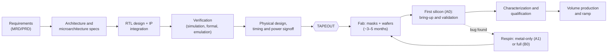
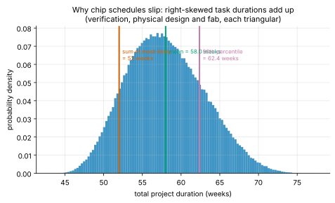

<!-- status: verified -->
# 00-05 · How Chip Companies' Engineering Organizations Work

| | |
|---|---|
| **Course** | [00 · Orientation](../README.md) |
| **University equivalent** | No direct course; covers the industry-practice material of a senior design or engineering-management seminar, built from public industry data |
| **Prerequisites** | [00-01](00-01-map-of-electrical-engineering.md), [00-02](00-02-the-abstraction-stack.md), [00-04](00-04-toolchain-walkthrough.md). Basic probability (independent events, expected value). |
| **Estimated study hours** | 2 |
| **Last verified** | 2026-11-12 |

**Learning objectives.** After this chapter you can:

1. Name the main engineering functions in a chip company and the deliverable each owns.
2. Lay out the product lifecycle from requirements to volume production, including its decision gates and silicon steppings.
3. Estimate fab cycle time and team size from stated assumptions, and explain why published design-cost estimates are contested.
4. Use simple probability to explain why first-silicon success rates are low and why schedules slip.
5. Ask informed questions about an engineering organization's structure, maturity and risk.

## 1. Big picture

A chip is the product of dozens of specialist functions working against an unforgiving deadline: the **tapeout**, when the design is sent to the fab to make masks. After tapeout, fixing a mistake means new masks and months of delay, so the whole organization is structured to catch errors before that moment. Understanding how a chip company's engineering is organized is what lets you read its roadmap, judge its execution risk and ask the questions that separate a well-run team from a hopeful one.

- **Specialization is extreme:** architecture, RTL design, verification, physical design, DFT, analog, software and test are distinct careers with distinct tools.
- **Verification dominates the effort:** roughly half of project time ([R-018](../../../reference/research-log.md#r-018--functional-verification-study-wilson-research-group--siemens-eda)).
- **The fab is a fixed-latency pipeline:** months from tapeout to first silicon ([R-020](../../../reference/research-log.md#r-020--fab-cycle-time-and-maskeuv-layer-counts)).
- **First-silicon success is the exception, not the rule:** in the latest industry study, only 5% of IC/ASIC projects reported it (§3.4).
- **Schedule risk is asymmetric:** tasks overrun far more than they underrun, which is why plans built from "most likely" estimates are usually late (§3.6).

## 2. Intuition first

### An analogy from finance: a deal team and closing

A chip project is like a large M&A transaction with a hard closing date.

- **Architecture** plays the deal thesis.
- **Design teams** play the workstreams.
- **Verification** plays diligence.
- **Signoff** plays the closing checklist.
- **Tapeout** plays signing and closing: after it, renegotiation (a respin) is possible but expensive, slow and visible to customers.

As in a deal, the most dangerous risks are the ones nobody owns, at the boundaries between workstreams.

*Where the analogy breaks:* a deal can sometimes be fixed after closing with side letters and adjustments. A silicon bug often cannot be fixed at all without new masks, though firmware workarounds and spare "ECO" gates help. And unlike most deals, a chip project's success is tested against physics, so it either works or it does not.

### The lifecycle at a glance

*Figure 1. A chip product lifecycle. The dotted loop, the respin, is what the whole organization is designed to avoid.*

## 3. Theory

### 3.1 The engineering functions

| Function | Owns | Typical tools / outputs | Curriculum |
|---|---|---|---|
| **Product definition / marketing** | What to build and why: requirements, target price, schedule | MRD/PRD, customer engagements | [26-01](../../26-engineering-design-and-professional-practice/chapters/26-01-requirements-and-specifications.md) |
| **Architecture** | Block diagram, performance/power/area targets, hardware–software split | Architecture specs, performance models | [14](../../14-computer-organization-and-architecture/README.md), [27](../../27-system-architectures/README.md) |
| **RTL design** | Digital logic in Verilog/SystemVerilog; IP integration | RTL, microarchitecture specs | [08](../../08-digital-logic-design/README.md), [19](../../19-digital-vlsi-design/README.md) |
| **Design verification (DV)** | Proof that the RTL meets the spec before tapeout | Testbenches, coverage, formal proofs, emulation | [19-13](../../19-digital-vlsi-design/chapters/19-13-verification-methods.md) |
| **Design for test (DFT)** | Making manufactured chips testable | Scan chains, BIST, test patterns | [19-12](../../19-digital-vlsi-design/chapters/19-12-design-for-test.md) |
| **Physical design (PD)** | RTL to layout: floorplan, placement, clock tree, routing, timing closure | GDS layout, timing/power signoff | [19-10](../../19-digital-vlsi-design/chapters/19-10-synthesis-and-sta.md), [19-11](../../19-digital-vlsi-design/chapters/19-11-place-route-signoff.md) |
| **Analog / mixed-signal / RF design** | ADCs, PLLs, SerDes, regulators, radios: transistor-level design and layout | Schematics, layouts, SPICE corners | [20](../../20-analog-and-mixed-signal-ic-design/README.md), [21](../../21-rf-and-microwave-engineering/README.md) |
| **Package, signal and power integrity** | Package design, die-to-board interfaces, power delivery | Package layout, SI/PI simulations | [24](../../24-high-speed-io-signal-integrity-and-photonics/README.md), [25](../../25-fabrication-packaging-test-and-reliability/README.md) |
| **CAD / methodology** | Design flows, tools, compute infrastructure | Scripts, flows, license and compute management | [00-04](00-04-toolchain-walkthrough.md) |
| **Firmware and software** | Boot code, drivers, SDKs, compilers, reference software | Software stacks | [18](../../18-embedded-systems-and-microcontrollers/README.md) |
| **Post-silicon validation** | Bring-up of first silicon; finding bugs that escaped | Lab boards, debug infrastructure | [25-12](../../25-fabrication-packaging-test-and-reliability/chapters/25-12-post-silicon-validation.md) |
| **Product and test engineering** | Production test programs, yield, binning | ATE programs, yield analysis | [25-11](../../25-fabrication-packaging-test-and-reliability/chapters/25-11-test-ate-sort-burn-in.md) |
| **Quality and reliability** | Qualification, failure analysis | Qualification reports (JEDEC, AEC-Q100) | [25-10](../../25-fabrication-packaging-test-and-reliability/chapters/25-10-qualification-and-functional-safety.md) |
| **Operations / supply chain** | Foundry, packaging and test capacity; cost | Supply agreements, wafer starts | [26](../../26-engineering-design-and-professional-practice/README.md) |
| **Applications / field engineering** | Helping customers design the chip in | Reference designs, application notes | [28](../../28-technical-diligence-and-leadership-fluency/README.md) |

### 3.2 Gates and steppings

Well-run companies manage projects through **decision gates**. A gate is a formal review at which leadership decides whether to commit the next tranche of money and people:

1. **Concept / business case.**
2. **Architecture freeze:** the specs are frozen and changes go through change control.
3. **RTL freeze:** the logic is complete; from here only bug fixes are made.
4. **Tapeout readiness:** verification coverage closed, timing and power signed off, DFT complete.
5. **Production release:** after validation, characterization and qualification.

Silicon versions are called **steppings**. A common convention, though it varies by company, is:

- the letter changes for a full-layer revision (A0 → B0);
- the number changes for a **metal-only** revision (A0 → A1).

A metal-only fix rewires spare logic gates placed in the design for exactly this purpose (an "ECO", engineering change order). It changes only the upper interconnect masks, so it is cheaper and faster. Fabs often hold ("park") some wafers from the first run just before the metal layers, so a metal fix can restart from there (Example 00-05.1).

### 3.3 The fab is a pipeline with long latency

A wafer passes through hundreds of process steps; industry surveys cite **400–1,400**. Fabs average roughly **1 to 1.5 days per mask layer**, and leading-edge processes use roughly **80 or more mask layers** ([R-020](../../../reference/research-log.md#r-020--fab-cycle-time-and-maskeuv-layer-counts)) **[Industry estimate]**. Average wafer cycle time is about 12 weeks, and **14–20 weeks for advanced processes**. Mask making, packaging and testing add more time. Faster-than-normal processing is available at a premium ("hot lots"), but the physics of each step sets a floor.

### 3.4 Verification statistics and what they mean

The longest-running public study of chip verification practice, the Wilson Research Group / Siemens EDA functional verification study ([R-018](../../../reference/research-log.md#r-018--functional-verification-study-wilson-research-group--siemens-eda)), reports:

- **First-silicon success** for IC/ASIC projects was **14% in 2024** and **5% in 2026**. The 2026 study changed its recruitment method, which limits comparison. Through 2010–2020 it was about 30%.
- **Time spent on verification:** about **49%** of project time (2026), down slightly from the mid-50s in earlier studies.
- **Schedule:** about **three in four** projects finished behind schedule.
- **Root causes:** "logic or functional flaws" remain the number-one cause of respins.

**[Established as reported by the study.]** These are survey statistics, not audited figures. Respondents self-select, and definitions of "success" vary. Treat them as direction and magnitude, not precision.

Why is success so rare? Simple probability explains much of it. A modern SoC integrates dozens of complex blocks. If each block has an independent probability $p$ of being bug-free, the chance that *all* $n$ are bug-free is $p^n$, which falls quickly with $n$ (Example 00-05.4). Success on a large chip demands near-perfection from every block, plus their interactions, which are where the hardest bugs live.

### 3.5 What chip projects cost: a contested number

Published estimates of the cost to design a leading-edge chip come mainly from one firm, International Business Strategies (IBS). Its figures have been widely quoted: for example, about \$217–249 million at 7 nm and about \$725 million at 2 nm ([R-019](../../../reference/research-log.md#r-019--advanced-node-design-and-mask-cost-estimates-contested)). **They are contested.** They assume a design built from scratch with no IP reuse, and about 71% of the 2 nm figure is software, verification and IP qualification rather than chip design proper. Industry critics have argued that real-world costs run substantially lower. Use such figures as orders of magnitude, and always ask: **cost of what, under which assumptions?** [Course 26](../../26-engineering-design-and-professional-practice/README.md) builds the cost stack bottom-up.

### 3.6 Why schedules slip: skewed task durations

Each project phase has a most-likely duration, but overruns are much more likely and much larger than underruns: a verification phase can find a bug that adds months, but rarely finishes months early. Model each phase with a **triangular distribution** (minimum, most likely, maximum). The mean of a triangular distribution is

$$
\mu = \frac{a + m + b}{3},
$$

where $a$, $m$ and $b$ are the minimum, mode and maximum. When $b - m > m - a$ (right skew), the mean exceeds the mode. Means add across sequential phases, so a plan built by adding most-likely values understates the expected duration. The probability of meeting it is low (Example 00-05.5). A CFO would recognize this immediately: it is the difference between a base case and an expected value under skewed risk.

*Figure 2. Three right-skewed phases. The sum of the most-likely durations (52 weeks) sits far to the left of the mean (58 weeks); only about 11% of outcomes finish by it.*

### 3.7 How organizations are structured

- **Functional versus product-line (matrix).** In a functional organization, experts report into discipline leaders (all verification engineers in one org) and are assigned to projects. In a product-line organization, each business unit owns its full stack. Most large companies run a **matrix** of the two, trading deep expertise and shared methods against project focus.
- **Central versus embedded verification.** Keeping verification independent of design improves objectivity, for the same reason an audit is independent. That has to be weighed against the tight collaboration needed to understand the design.
- **Global design centers and design services.** Large companies spread teams across sites and time zones, and smaller ones often contract physical design or verification to design-services firms.
- **R&D headcount is the core asset.** NVIDIA reports about 31,000 of its roughly 42,000 employees in R&D. ADI reports about 13,000 engineering roles among roughly 24,500 employees ([R-017](../../../reference/research-log.md#r-017--rd-intensity-latest-fiscal-year-10-k--annual-reports)) **[Industry estimate for headcount splits]**.

## 4. Worked examples

### Example 00-05.1 — Fab cycle time and the metal-only respin (tier A)

**Setup.** A leading-edge process has 80 mask layers, and the fab processes at 1.25 days per layer. (a) Estimate the wafer cycle time. (b) A bug is fixed by changing only the top 12 metal and via layers, and wafers were parked before those layers. Estimate the cycle time of the fix.

**Solution.** (a) $80 \times 1.25 = 100$ days $= 14.3$ weeks, consistent with the 14–20 weeks cited for advanced processes ([R-020](../../../reference/research-log.md#r-020--fab-cycle-time-and-maskeuv-layer-counts)). (b) $12 \times 1.25 = 15.0$ days of wafer processing, plus mask making and post-fab packaging and test.

**Interpretation.** Metal-only fixes are a major reason designers sprinkle spare gates across a chip.

### Example 00-05.2 — The cost of a slip (tier B)

**Setup.** A product expected to generate \$500 M of annual revenue at a 60% gross margin slips by three months. Assume the slip loses (rather than defers) three months of sales, for example because a competitor wins those design sockets. (These are illustrative numbers.) Estimate the lost gross profit.

**Solution.** Lost revenue $= 500 \times \frac{3}{12} = \$125$ M, so lost gross profit $= 125 \times 0.60 = \$75.0$ M.

**Interpretation.** That is often larger than the direct engineering cost of the respin that caused the slip. Time-to-market is usually the dominant economic term in chip projects ([26-05](../../26-engineering-design-and-professional-practice/chapters/26-05-schedule-and-respin-risk.md)).

### Example 00-05.3 — A Fermi estimate of team size (tier B)

**Setup.** Take a design cost of \$250 M (a 7 nm-class estimate, [R-019](../../../reference/research-log.md#r-019--advanced-node-design-and-mask-cost-estimates-contested)). Assume 50% of it is engineering labor, a fully loaded cost of \$300 k per engineer-year, and 2.5 years of development. All are illustrative assumptions. Estimate the average team size.

**Solution.** Labor $= 0.5 \times 250 = \$125$ M. Engineer-years $= 125\text{ M}/0.3\text{ M} = 417$. Over 2.5 years that is an average of $417/2.5 = 167$ engineers.

**Interpretation.** It is an order-of-magnitude estimate: a team of one to a few hundred engineers. The value lies in the structure of the reasoning. Change any assumption and you can see how the answer moves, which is exactly how to stress-test a startup's claim that it can tape out a leading-edge chip with 40 engineers.

### Example 00-05.4 — Why first-silicon success is rare (tier B)

**Setup.** Treat a chip as $n$ blocks, each independently bug-free with probability $p$. (a) Find P(all bug-free) for $p = 0.98$ with $n = 10$ and with $n = 50$. (b) What $p$ is needed for 95% overall success with $n = 50$?

**Solution.**

(a) $0.98^{10} = 0.817$, i.e. **81.7%**, and $0.98^{50} = 0.364$, i.e. **36.4%**.
(b) $p = 0.95^{1/50} = 0.99897$. Each block must be about **99.9%** bug-free.

**Interpretation.** Integration multiplies risk. This simple model is optimistic, since bugs also arise *between* blocks. It shows why verification effort scales with integration, and why reuse of silicon-proven blocks is so valuable.

### Example 00-05.5 — A skewed schedule (tier C)

**Setup.** Three sequential phases have triangular durations (min, most likely, max) in weeks: verification (20, 26, 40), physical design (10, 12, 20) and fab (12, 14, 20). (a) What is the "most likely plan" (the sum of modes)? (b) What is the expected total duration? (c) What is the probability of finishing within the most-likely plan? (d) What duration gives 80% confidence?

**Solution.**

(a) $26 + 12 + 14 = 52$ weeks.
(b) The phase means are $(20 + 26 + 40)/3 = 28.67$, $(10 + 12 + 20)/3 = 14.00$ and $(12 + 14 + 20)/3 = 15.33$, so the expected total is **58.0** weeks.
(c) The distribution of a sum is the *convolution* of the phase distributions ([11-03](../../11-signals-and-systems/chapters/11-03-convolution.md)). Computing it numerically (lab) gives $P(T \le 52) = 0.114$, i.e. **11.4%**.
(d) The 80th percentile is **62.4** weeks.

**Interpretation.** The plan everyone "agreed is realistic" has about a 1-in-9 chance of being met. Committing to customers at the 80% point needs 10 more weeks. This is why experienced program managers hold explicit schedule reserve, and why "we have no buffer" is a red flag.

<!-- answer-key -->
| ID | Quantity | Value | Unit |
|---|---|---|---|
| Ex 00-05.1a | wafer cycle time | 100 | days |
| Ex 00-05.1b | wafer cycle time | 14.3 | weeks |
| Ex 00-05.1c | metal-only fix processing | 15.0 | days |
| Ex 00-05.2 | lost gross profit | 75.0 | US$ M |
| Ex 00-05.3a | engineer-years | 417 | — |
| Ex 00-05.3b | average team size | 167 | engineers |
| Ex 00-05.4a | P(success), n = 10 | 81.7 | % |
| Ex 00-05.4b | P(success), n = 50 | 36.4 | % |
| Ex 00-05.4c | required per-block p | 0.99897 | — |
| Ex 00-05.5a | most-likely plan | 52 | weeks |
| Ex 00-05.5b | expected duration | 58.0 | weeks |
| Ex 00-05.5c | P(finish within plan) | 11.4 | % |
| Ex 00-05.5d | 80th-percentile duration | 62.4 | weeks |

*Recomputed by [verify_00_05.py](../verify/verify_00_05.py), with numerical convolution cross-checked by Monte Carlo.*

## 5. Simulate it

The lab ([labs/00-05-lab/](../labs/00-05-lab/README.md)) is a schedule-risk simulator.

1. Enter phase estimates (min, most likely, max) and get the distribution of total duration, its mean and percentiles.
2. Add a respin branch: with probability $q$, add a metal-only fix (e.g., 6–10 weeks) or a full respin (e.g., 16–24 weeks), and watch the 80th percentile move.
3. Plot first-silicon success probability versus number of blocks, and per-block quality.

**Predict, then run.** Before adding a 30% chance of a 6–10-week metal fix, predict the change in the expected duration. A hint: $0.3 \times 8$.

## 6. Engineering tradeoffs

| Knob | Improves | Costs | Typical decision owner |
|---|---|---|---|
| More verification before tapeout (coverage, formal, emulation) | Probability of first-silicon success | Schedule time, compute and license spend, headcount | VP Engineering; verification lead |
| Earlier tapeout with planned metal-fix stepping | Time to first samples, customer engagement | Higher chance of a known respin; more spare-gate area | Product line + engineering leadership |
| Reuse silicon-proven IP instead of new design | Risk, schedule | Less differentiation; licensing fees; IP may not fit perfectly | Architect; business development |
| Functional (centralized) versus product-line organization | Deep expertise and shared methods / project focus and speed | Coordination overhead / duplicated effort | CTO; COO |
| Hold explicit schedule reserve | Credibility of commitments; fewer fire drills | Later committed dates; perceived conservatism | Program management; sales leadership |

## 7. Numbers to know

| Quantity | Value | As of / source |
|---|---|---|
| Fab processing time per mask layer | about 1–1.5 days | [R-020](../../../reference/research-log.md#r-020--fab-cycle-time-and-maskeuv-layer-counts) [Industry estimate] |
| Wafer cycle time, advanced processes | about 14–20 weeks | [R-020](../../../reference/research-log.md#r-020--fab-cycle-time-and-maskeuv-layer-counts) |
| IC/ASIC first-silicon success | 14% (2024), 5% (2026; method changed) | Nov 2026, [R-018](../../../reference/research-log.md#r-018--functional-verification-study-wilson-research-group--siemens-eda) |
| Share of project time in verification | about 49% (2026) | [R-018](../../../reference/research-log.md#r-018--functional-verification-study-wilson-research-group--siemens-eda) |
| Projects behind schedule | about 75% | [R-018](../../../reference/research-log.md#r-018--functional-verification-study-wilson-research-group--siemens-eda) |
| Leading-edge design-cost estimates | hundreds of millions of US$ (e.g., about \$725 M quoted for 2 nm, from scratch) | [Contested], [R-019](../../../reference/research-log.md#r-019--advanced-node-design-and-mask-cost-estimates-contested) |

## 8. Common mistakes

1. **Treating tapeout as the finish line.** First silicon arrives months later and must be validated, characterized and qualified before revenue.
2. **Adding most-likely estimates to make a plan.** With skewed risks, that plan is usually met only a minority of the time (Example 00-05.5).
3. **Quoting design-cost figures without assumptions.** "\$725 M for 2 nm" assumes a from-scratch design and includes software. A derivative design costs far less.
4. **Assuming verification and design are the same job.** Independence is the point.
5. **Reading survey percentages as precise.** They show direction and magnitude, not exact values.

## 9. Practitioner lens

### State of practice (as of Nov 2026)

- **Verification is the bottleneck, and getting harder.** In the latest Wilson Research Group / Siemens EDA study, first-silicon success fell to a reported 5%, three in four projects missed schedule, and functional flaws remained the top respin cause. Firmware, security, power and clock issues are growing contributors ([R-018](../../../reference/research-log.md#r-018--functional-verification-study-wilson-research-group--siemens-eda)) **[Established as reported; methodology caveats]**.
- **Fab latency is structural.** Advanced wafers take 14–20 weeks ([R-020](../../../reference/research-log.md#r-020--fab-cycle-time-and-maskeuv-layer-counts)), so every respin costs a calendar quarter or more. That latency is why emulation and FPGA prototyping, which let software run on the design before tapeout, are now standard at large companies.
- **Engineering talent is the scarce input.** In US projections, roughly 67,000 semiconductor jobs created by 2030 risk going unfilled ([R-023](../../../reference/research-log.md#r-023--us-semiconductor-workforce)) **[Industry estimate]**. Retaining key engineers is a central post-acquisition risk ([28-08](../../28-technical-diligence-and-leadership-fluency/chapters/28-08-integration-risk.md)).

### Why it matters commercially

- **Execution quality is a moat.** Two companies with the same architecture idea can have very different outcomes because of verification discipline, IP reuse and schedule realism. Track records are visible: the number of respins and slips over the last few products.
- **Org structure predicts integration risk.** Acquiring a team that uses a different design flow, verification methodology or foundry creates migration cost and attrition risk that rarely appears in deal models.

### Marketing vs Reality

**"Tapeout next quarter, production by year-end."** Add the fab cycle (3–5 months), packaging and test, validation, qualification and a realistic respin probability. **Sanity check:** "production by year-end" from a tapeout next quarter implies first-silicon success. Given the industry statistics, ask what happens if A0 needs a fix.

**"Silicon-proven" / "first-pass silicon success."** Ask: proven at *which* stepping, at what conditions and volume, and was "success" defined as functional samples or as production-qualified parts?

**"A small, elite team will tape out a leading-edge SoC."** Run the Example 00-05.3 Fermi estimate with their numbers. If the claimed team is several times smaller than the estimate, ask what they are buying (IP, design services) and how much reuse they assume.

### Questions to ask engineering leaders

1. **"What was your first-silicon outcome on the last three tapeouts, and what escaped?"**
   *Strong answer:* specific steppings, root causes and what changed afterwards. *Evasive:* "Everything worked," with no detail.
2. **"How do you decide you're ready to tape out?"**
   *Strong:* defined criteria (coverage closure, formal sign-off, timing and power at all corners, independent review). *Evasive:* "When the schedule says so."
3. **"What schedule reserve do you hold, and at what confidence level is the committed date?"**
   *Strong:* explicit buffers and a probabilistic view. *Evasive:* "No buffer; the team is committed."
4. **"How is verification organized relative to design, and what is the verification-to-design headcount ratio?"**
   *Strong:* independent verification with a clear ratio and tooling. *Evasive:* "Designers verify their own blocks."
5. **"Which blocks are new this generation and which are reused silicon-proven IP?"**
   *Strong:* a clear inventory with risk ratings. *Evasive:* "It's mostly new and better."

## 10. Concept check

**Q1.** What is a tapeout, and why is it such an important milestone?

Answer

Tapeout is sending the final design database to manufacturing to make masks. After it, any fix requires new masks and another fab cycle of months, so the organization concentrates its checks before tapeout.

**Q2.** Why are metal-only fixes faster and cheaper than full respins?

Answer

They change only the upper interconnect masks, can restart from wafers parked before metal processing, and reuse spare gates already placed in the design.

**Q3.** Ten independent blocks are each 99% bug-free. What is the chance that all are?

Answer

$0.99^{10} = 0.904$, about 90%.

**Q4.** Why does a plan built from most-likely task durations usually run late?

Answer

Task durations are right-skewed: overruns are larger and more likely than underruns. The expected duration therefore exceeds the sum of the most-likely values, and the plan is met less than half the time.

**Q5.** Why should verification be independent of design?

Answer

For the same reason audits are independent: a check written by the designer tends to share the designer's misunderstandings of the spec and misses the same bugs.

**Q6.** What two caveats apply to the first-silicon-success statistics?

Answer

They come from a self-selected industry survey, not audited data, and the 2026 study changed its recruitment method, which limits comparison with earlier years.

Now work the problem set: [00-05 problems](../problems/00-05-problems.md) (solutions in [00-05 solutions](../solutions/00-05-solutions.md)).

## 11. Key terms

[Tapeout](../../../reference/glossary.md#tapeout) ·
[RTL](../../../reference/glossary.md#rtl) ·
[Design verification](../../../reference/glossary.md#design-verification) ·
[Physical design](../../../reference/glossary.md#physical-design) ·
[Design for test (DFT)](../../../reference/glossary.md#design-for-test-dft) ·
[Stepping](../../../reference/glossary.md#stepping) ·
[Respin](../../../reference/glossary.md#respin) ·
[Engineering change order (ECO)](../../../reference/glossary.md#engineering-change-order-eco) ·
[First-silicon success](../../../reference/glossary.md#first-silicon-success) ·
[Wafer cycle time](../../../reference/glossary.md#wafer-cycle-time) ·
[Non-recurring engineering (NRE)](../../../reference/glossary.md#non-recurring-engineering-nre) ·
[Emulation](../../../reference/glossary.md#emulation) ·
[Triangular distribution](../../../reference/glossary.md#triangular-distribution)

## 12. Connections

- **Builds on:** [00-02](00-02-the-abstraction-stack.md) (each function owns an abstraction boundary), [00-04](00-04-toolchain-walkthrough.md) (the tools these teams use).
- **Next:** Course [01 · Calculus for Engineers](../../01-calculus-for-engineers/README.md).
- **Developed later in:**
  - [19-12](../../19-digital-vlsi-design/chapters/19-12-design-for-test.md) and [19-13](../../19-digital-vlsi-design/chapters/19-13-verification-methods.md): DFT and verification.
  - [25-11](../../25-fabrication-packaging-test-and-reliability/chapters/25-11-test-ate-sort-burn-in.md) and [25-12](../../25-fabrication-packaging-test-and-reliability/chapters/25-12-post-silicon-validation.md): test and bring-up.
  - [26-05](../../26-engineering-design-and-professional-practice/chapters/26-05-schedule-and-respin-risk.md) and [26-06](../../26-engineering-design-and-professional-practice/chapters/26-06-team-structures-and-sizing.md): schedule, risk and team structure.
  - [28-07](../../28-technical-diligence-and-leadership-fluency/chapters/28-07-evaluating-engineering-teams.md): evaluating engineering teams.

## 13. Further study

- **The Wilson Research Group / Siemens EDA functional verification study:** the executive summary and blog series on Siemens' *Verification Horizons* blog ([R-018](../../../reference/research-log.md#r-018--functional-verification-study-wilson-research-group--siemens-eda) links them).
- **Weste & Harris, *CMOS VLSI Design*,** the chapter on design methodology and the chip design flow.
- **Hennessy & Patterson, *Computer Architecture: A Quantitative Approach*,** chapter 1 on cost and the design process.

## 14. Sources

1. Research log [R-017](../../../reference/research-log.md#r-017--rd-intensity-latest-fiscal-year-10-k--annual-reports): company R&D and headcount (10-K filings).
2. Research log [R-018](../../../reference/research-log.md#r-018--functional-verification-study-wilson-research-group--siemens-eda): Wilson Research Group / Siemens EDA functional verification studies (2022–2026).
3. Research log [R-019](../../../reference/research-log.md#r-019--advanced-node-design-and-mask-cost-estimates-contested): IBS design-cost estimates via Arm's 2023 F-1 prospectus, with critiques [Contested].
4. Research log [R-020](../../../reference/research-log.md#r-020--fab-cycle-time-and-maskeuv-layer-counts): fab cycle time (SemiEngineering 2017; BCG × SIA 2021).
5. Research log [R-023](../../../reference/research-log.md#r-023--us-semiconductor-workforce): SIA / Oxford Economics workforce projections.
6. Stepping naming conventions vary by company; the convention described is common but not universal. All text, examples and problems are original.
