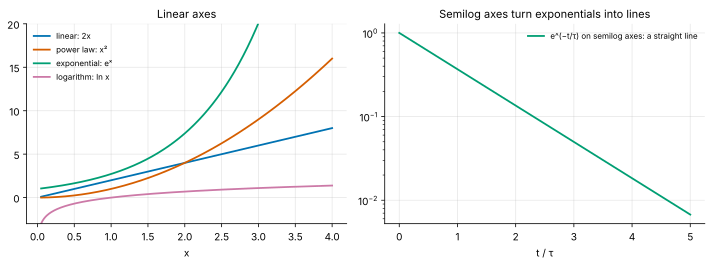
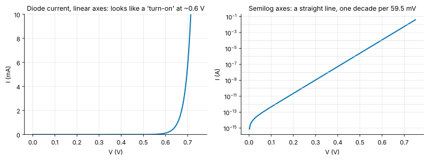
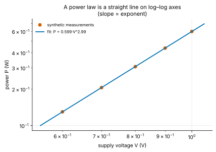

<!-- status: reviewed -->
# 01-01 · Functions, Models and Units

| | |
|---|---|
| **Course** | [01 · Calculus for Engineers](../README.md) |
| **University equivalent** | The precalculus review that opens Calculus I (Stewart, ch. 1: functions, exponentials, logarithms, trigonometric functions), plus the decibel and log-scale material taught early in circuits and communications courses |
| **Prerequisites** | Algebra; [00-03](../../00-orientation/chapters/00-03-how-to-study-this-curriculum.md) (dimensional analysis). |
| **Estimated study hours** | 8 |
| **Last verified** | 2026-11-12 |

**Learning objectives.** After this chapter you can:

1. Describe a physical quantity as a function, stating its domain, range and units, and recognize linear, power-law, exponential, logarithmic and periodic behavior.
2. Manipulate exponentials and logarithms (laws, change of base, solving for time or rate) with natural and base-10 logs.
3. Convert between ratios and decibels for power and amplitude, including absolute units such as dBm.
4. Use sinusoids in radian form: amplitude, angular frequency, frequency, period and phase.
5. Fit exponential and power-law models to data by linearizing them on semilog or log–log axes.

## 1. Big picture

Engineering is the practice of describing the world with functions and then reasoning about them. A capacitor's voltage *is* a function of time; a diode's current *is* a function of its voltage; an amplifier's gain *is* a function of frequency. A handful of function families do almost all the work: **linear** relations (Ohm's law), **power laws** ($P = V^2/R$, dynamic power $\propto V^2f$), **exponentials** (charging, decay, transistor currents), **logarithms** (decibels, Bode plots, information) and **sinusoids** (AC power, radio, clocks). This chapter makes you fluent with all five before calculus starts asking how they change.

- **Exponentials** describe every first-order circuit ([07-02](../../07-circuit-analysis-2-transient-and-ac/chapters/07-02-first-order-rc-rl-transients.md)) and the current in diodes, in bipolar transistors in forward-active operation, and in MOSFETs in their subthreshold region ([09-06](../../09-semiconductor-devices/chapters/09-06-pn-junction-iv-and-capacitance.md)).
- **Logarithms and decibels** are the native language of RF, audio and communications specifications.
- **Power laws** express scaling: how power, delay and cost change when a design parameter changes.
- **Sinusoids** are the basis of AC analysis and Fourier methods ([02-01](../../02-complex-numbers-des-and-linear-algebra/chapters/02-01-complex-numbers-euler-and-phasors.md)).

## 2. Intuition first

### Functions as machines (and as data)

A function $f$ takes an input and returns exactly one output. In engineering, both carry **units**. The function $v_C(t) = 5e^{-t/(2\text{ ms})}$ volts takes a time in seconds and returns a voltage. Think of it as a rule, a graph or a lookup table; all three describe the same object. The **domain** is the set of allowed inputs (here $t \ge 0$), and the **range** is the set of possible outputs (here $0 < v_C \le 5$ V).

### An analogy from finance: log returns

You already use the key ideas of this chapter:

- **Exponentials:** continuous compounding is $B(t) = B_0e^{rt}$.
- **Logarithms:** the log return $\ln(P_1/P_0)$ adds across periods, while simple returns do not.
- **Semilog charts:** a stock that grows at a constant percentage rate plots as a straight line on a semilog chart.

Decibels are log returns for signals: a chain of gains multiplies, so its decibels add. A circuit that decays exponentially is a "negative compounding" process with rate $1/\tau$.

*Where the analogy breaks:* financial quantities are pure numbers (or currency), but physical quantities have **dimensions**. You cannot take the logarithm of 5 volts. You can only take the log of a dimensionless *ratio*, such as 5 V relative to 1 V. That is why engineers write "dBV" or "dBm": the letters name the reference.

### The function families at a glance

*Figure 1. Left: the four basic families on linear axes. Right: on a semilog plot (logarithmic vertical axis), an exponential decay is a straight line. That is why engineers use log scales.*

## 3. Theory

### 3.1 Functions, domain, range, inverses

A function $y = f(x)$ assigns one output to each input in its domain. Two operations recur constantly:

- **Composition:** $f(g(x))$ applies $g$ first, then $f$. For example, a temperature sensor's voltage as a function of temperature, fed into an ADC's code as a function of voltage, gives code as a function of temperature.
- **Inverse:** if $f$ is one-to-one, $f^{-1}$ undoes it, so that $x = f^{-1}(y)$. The natural log is the inverse of the exponential, and the arcsine is the inverse of the sine (on a restricted domain). Solving an equation "for $t$" means applying an inverse function.

### 3.2 Linear and affine functions

A **linear** function is $y = mx$; an **affine** function is $y = mx + b$, though engineers usually call both "linear". The slope $m$ carries units: in Ohm's law $v = Ri$, the slope $R$ is in volts per ampere, i.e. ohms. Linearity means doubling the input doubles the output. Course 06 builds an entire theory on it ([06-07](../../06-circuit-analysis-1-dc/chapters/06-07-linearity-and-superposition.md)).

### 3.3 Power laws

A **power law** is $y = kx^n$ for a constant $k$ and exponent $n$, which need not be an integer. Doubling $x$ multiplies $y$ by $2^n$, regardless of where you start, a scale-free property. Examples:

- **Resistive power:** $P = V^2/R$, so $n = 2$ in $V$.
- **Dynamic power:** $P = \alpha CV^2f$ ([07-02](../../07-circuit-analysis-2-transient-and-ac/chapters/07-02-first-order-rc-rl-transients.md)). Under dynamic voltage and frequency scaling, where $f$ is roughly proportional to $V$, $P \propto V^3$.
- **Free-space path loss** grows as distance squared, so received power falls as $d^{-2}$ ([21-11](../../21-rf-and-microwave-engineering/chapters/21-11-link-budgets.md)).

Taking logarithms of both sides gives

$$
\ln y = \ln k + n\ln x .
$$

On **log–log axes** a power law is a straight line whose **slope is the exponent** $n$. This is the standard way to discover or check a scaling law from data (§3.8).

### 3.4 Exponentials

The exponential function $e^x$, with $e = 2.71828\ldots$, has three properties that make it central:

1. **Laws of exponents:** $e^{a}e^{b} = e^{a+b}$, $(e^a)^b = e^{ab}$, $e^{-a} = 1/e^a$, $e^0 = 1$.
2. **It is always positive,** and it grows (or decays) faster than any power of $x$.
3. **Its rate of change is proportional to itself:** the slope of $e^x$ at any point equals $e^x$. Chapter [01-03](01-03-derivatives.md) proves this, and it is why exponentials solve every equation of the form "rate ∝ amount".

**Growth and decay with a time constant.** Physical exponentials are written

$$
y(t) = y_0\,e^{-t/\tau}\quad(\text{decay}) \qquad\text{or}\qquad y(t) = y_0\,e^{t/\tau}\quad(\text{growth}),
$$

where $\tau$ (seconds) is the **time constant**. The exponent must be dimensionless, which is why time always appears divided by a time constant (or multiplied by a rate in 1/s). Equal time steps multiply $y$ by equal factors. Two derived numbers are worth memorizing:

- **Half-life (decay)** or **doubling time (growth):** $t_{1/2} = \tau\ln 2 \approx 0.693\tau$.
- **Time to fall to 10%:** $\tau\ln 10 \approx 2.303\tau$.

**Other bases.** Any base converts to base $e$: $a^x = e^{x\ln a}$. For example $2^x = e^{0.6931x}$, and $10^x = e^{2.3026x}$.

**Hyperbolic functions.** Two combinations of exponentials appear so often that they have names:

$$
\cosh x = \frac{e^x + e^{-x}}{2}, \qquad \sinh x = \frac{e^x - e^{-x}}{2}, \qquad \tanh x = \frac{\sinh x}{\cosh x}.
$$

They obey $\cosh^2x - \sinh^2x = 1$ (expand both squares: the cross terms give $\tfrac{2}{4} + \tfrac{2}{4} = 1$), the hyperbolic twin of $\cos^2 + \sin^2 = 1$. $\cosh$ is even with minimum 1 at $x = 0$; $\sinh$ is odd; $\tanh$ rises from −1 to +1 and is close to $\pm1$ once $\lvert x\rvert$ exceeds about 3, since $\tanh x = 1 - 2e^{-2x} + \cdots$ for large $x$. They describe a hanging cable (a catenary is a cosh curve), the overdamped response of an RLC circuit ([02-03](../../02-complex-numbers-des-and-linear-algebra/chapters/02-03-second-order-linear-odes.md)), and the input impedance of a transmission line, which involves $\tanh$ of the line's electrical length ([13-08](../../13-electromagnetics/chapters/13-08-transmission-lines-sinusoidal-steady-state.md)). The neuron activation function tanh in machine-learning accelerators is the same function.

### 3.5 Logarithms

The **natural logarithm** $\ln y$ is the inverse of $e^x$: $\ln y = x$ exactly when $e^x = y$, for $y > 0$. Its laws are the exponent laws read backward:

$$
\ln(ab) = \ln a + \ln b, \qquad \ln(a/b) = \ln a - \ln b, \qquad \ln(a^n) = n\ln a, \qquad \ln 1 = 0, \qquad \ln e = 1 .
$$

Other bases: $\log_{10}y = \ln y/\ln 10$ and $\log_2 y = \ln y/\ln 2$ (the **change-of-base** rule). This curriculum never writes a bare "log": it is always $\ln$, $\log_{10}$ or $\log_2$ ([notation](../../../reference/notation.md)).

**Solving for time.** To find when a decaying quantity reaches a value $y_1$, take logs:

$$
y_1 = y_0e^{-t/\tau} \;\Longrightarrow\; \frac{y_1}{y_0} = e^{-t/\tau} \;\Longrightarrow\; t = \tau\ln\frac{y_0}{y_1} .
$$

**Why logs matter in EE.** Logs turn multiplication into addition. Gains of cascaded stages multiply, so their logs add; that is the decibel. Frequency responses spanning many decades become readable on log axes; that is the Bode plot ([07-07](../../07-circuit-analysis-2-transient-and-ac/chapters/07-07-frequency-response-and-bode-plots.md)). Information content is a logarithm, the bit being $\log_2$ of a number of possibilities ([17-07](../../17-communication-systems/chapters/17-07-information-theory-and-shannon.md)).

### 3.6 Decibels

A **decibel** (dB) expresses a **power ratio** logarithmically:

$$
G_{\text{dB}} = 10\log_{10}\frac{P_2}{P_1} .
$$

Because power into a fixed resistance is $P = V^2/R$, a **voltage (amplitude) ratio** across equal impedances is

$$
10\log_{10}\frac{V_2^2/R}{V_1^2/R} = 20\log_{10}\frac{V_2}{V_1}.
$$

The rule "10 log for power, 20 log for amplitude" is therefore not a convention but a consequence of power going as amplitude squared. Landmarks to memorize:

| dB | Power ratio | Amplitude ratio |
|---|---|---|
| 0 | 1 | 1 |
| 3 | ≈ 2 | ≈ 1.414 |
| 6 | ≈ 4 | ≈ 2 |
| 10 | 10 | ≈ 3.16 |
| 20 | 100 | 10 |
| −3 | ≈ 0.5 | ≈ 0.707 |

**Absolute decibel units** attach a reference to the ratio:

- **dBm** is power relative to 1 mW: $P_{\text{dBm}} = 10\log_{10}(P/1\text{ mW})$. So 0 dBm = 1 mW, 30 dBm = 1 W and −30 dBm = 1 µW.
- **dBV** is voltage relative to 1 V rms.
- **dBc** is power relative to a carrier.
- **dBFS** is relative to an ADC's full scale.

Gains in dB add to powers in dBm: $P_{out,\text{dBm}} = P_{in,\text{dBm}} + G_{\text{dB}}$. You never add two dBm values, since that would multiply two powers, which is meaningless.

### 3.7 Trigonometric functions and radians

An angle in **radians** is the arc length it subtends on a circle divided by the radius. It is dimensionless (meters per meter), with $2\pi$ rad = 360°, so 1 rad = 57.30°. Calculus uses radians exclusively: the derivative formulas of [01-03](01-03-derivatives.md) hold only in radians.

On the unit circle, $\cos\theta$ and $\sin\theta$ are the horizontal and vertical coordinates of the point at angle $\theta$. They are **periodic** with period $2\pi$. A **sinusoidal signal** is

$$
v(t) = V_m\cos(\omega t + \phi),
$$

with amplitude $V_m$, angular frequency $\omega$ (rad/s), frequency $f = \omega/(2\pi)$ (Hz), period $T = 1/f$ and phase $\phi$ (rad). Its RMS value is $V_m/\sqrt{2}$ ([02-01](../../02-complex-numbers-des-and-linear-algebra/chapters/02-01-complex-numbers-euler-and-phasors.md) derives this and develops phasors).

**Small-angle approximations.** For $\lvert\theta\rvert \ll 1$ rad: $\sin\theta \approx \theta$, $\tan\theta \approx \theta$ and $\cos\theta \approx 1 - \theta^2/2$. At 0.1 rad (5.7°) the error in $\sin\theta \approx \theta$ is about 0.17%. [01-08](01-08-sequences-series-and-taylor.md) explains why, via Taylor series.

### 3.8 Building models from data

Engineers routinely fit simple models to measurements. Linearize the model, then fit a straight line by least squares, which is exactly the linear regression you know from finance:

| Suspected model | Plot | Becomes a line | Slope | Intercept |
|---|---|---|---|---|
| $y = y_0e^{-t/\tau}$ | $\ln y$ vs $t$ (semilog) | $\ln y = \ln y_0 - t/\tau$ | $-1/\tau$ | $\ln y_0$ |
| $y = kx^n$ | $\ln y$ vs $\ln x$ (log–log) | $\ln y = \ln k + n\ln x$ | $n$ | $\ln k$ |

The linearized fit weights relative errors equally, which is usually what you want when data span decades. **Caution:** a straight line on log–log axes over a narrow range does not prove a power law. Physics should justify the model, and the fit should be checked outside the range of the data.

### 3.9 Units inside functions

Three rules prevent most modeling errors:

1. Both sides of an equation have the same units.
2. Arguments of $\exp$, $\ln$, $\sin$ and $\cos$ are **dimensionless**. These functions are infinite series ([01-08](01-08-sequences-series-and-taylor.md)), and adding $x$ to $x^2$ is only meaningful if $x$ has no units. So write $e^{-t/\tau}$, $\ln(I/I_s)$, $\cos(\omega t)$.
3. In a power law $y = kx^n$, the coefficient $k$ carries whatever units make the equation balance.

## 4. Worked examples

### Example 01-01.1 — Exponential decay: half-life and the 10% point (tier A)

**Setup.** A capacitor voltage decays as $v(t) = V_0e^{-t/\tau}$ with $\tau = 2$ ms. How long until it falls to half its initial value? To 10%?

**Solution.** Half: $t = \tau\ln 2 = 2 \times 0.6931 = 1.386$ ms. To 10%: $t = \tau\ln(1/0.1) = \tau\ln 10 = 2 \times 2.3026 = 4.605$ ms.

**Sanity check.** Going from 50% to 10% takes $4.605 - 1.386 = 3.22$ ms, more than the first halving, because each halving takes the same time and reaching 10% needs about 3.3 halvings ($\log_2 10 = 3.32$) ✓.

### Example 01-01.2 — A gain chain in decibels (tier A)

**Setup.** A receiver chain has an amplifier (+20 dB), a cable (−3 dB) and a second amplifier (+15 dB). The input power is −40 dBm. Find the total gain in dB and as a power ratio, the output power in dBm and mW, and the equivalent voltage gain (assume equal impedances).

**Solution.**

- Total gain: $20 - 3 + 15 = 32$ dB, which as a power ratio is $10^{32/10} = 10^{3.2} = 1585$.
- Output power: $-40 + 32 = -8$ dBm, i.e. $10^{-8/10}$ mW $= 0.1585$ mW.
- Voltage gain: $10^{32/20} = 39.81$.

**Sanity check.** 30 dB is 1000× in power, so 32 dB should be about 1.6×1000 ✓. Voltage gain is the square root of the power gain: $\sqrt{1585} = 39.8$ ✓.

### Example 01-01.3 — The diode's exponential law and "60 mV per decade" (tier B)

**Setup.** A diode's current is $I = I_s\left(e^{V/V_T} - 1\right)$ with $I_s = 10^{-14}$ A and thermal voltage $V_T = 25.85$ mV (room temperature; [09-06](../../09-semiconductor-devices/chapters/09-06-pn-junction-iv-and-capacitance.md) derives this law). Find (a) the current at $V = 0.6$ V, (b) the voltage that gives 1 mA, and (c) the voltage change for a tenfold change in current.

**Solution.**

(a) $V/V_T = 0.6/0.02585 = 23.21$, so $I \approx 10^{-14}e^{23.21} = 1.20\times10^{-4}$ A $= 0.120$ mA. The −1 is negligible.

(b) Invert: $V = V_T\ln(I/I_s) = 0.02585\ln(10^{-3}/10^{-14}) = 0.02585 \times 25.33 = 0.6547$ V.

(c) For currents $I_1$ and $10I_1$: $\Delta V = V_T\ln 10 = 25.85\text{ mV} \times 2.303 = 59.5$ mV. **Every decade of current costs about 60 mV**, at any current level. On semilog axes the I–V curve is a straight line (Figure 2).

*Figure 2. The same diode law on linear axes (left) and semilog axes (right). The apparent "turn-on voltage" is an artifact of the linear scale.*

**Sanity check.** Going from 0.12 mA to 1 mA is a factor of 8.3, or 0.92 decades, and should take about $0.92 \times 59.5 = 54.7$ mV. Indeed $0.6547 - 0.6 = 0.0547$ V ✓.

### Example 01-01.4 — Reading a sinusoid (tier A)

**Setup.** The voltage at a wall outlet in North America is modeled as $v(t) = 170\cos(377t + \pi/6)$ V. Find the frequency, period, phase in degrees and RMS value, and the time of the first positive peak after $t = 0$.

**Solution.**

- $\omega = 377$ rad/s, so $f = 377/(2\pi) = 60.0$ Hz and $T = 1/f = 16.67$ ms.
- Phase: $\pi/6$ rad $= 30^\circ$.
- RMS: $170/\sqrt{2} = 120.2$ V, the familiar "120 V".
- Peaks occur where $377t + \pi/6 = 2\pi k$. The first one with $t > 0$ is at $k = 1$: $t = (2\pi - \pi/6)/377 = 15.28$ ms.

**Sanity check.** The peak at $k = 0$ would be at $t = -1.39$ ms, slightly before zero (the signal *leads* by 30°). The next peak comes one period later: $-1.39 + 16.67 = 15.28$ ms ✓.

### Example 01-01.5 — Discovering a power law from data (tier C)

**Setup.** A processor's power is measured at five supply voltages, with frequency scaled in proportion to voltage (this is a synthetic dataset for the exercise):

| $V$ (V) | 0.6 | 0.7 | 0.8 | 0.9 | 1.0 |
|---|---|---|---|---|---|
| $P$ (W) | 0.130 | 0.206 | 0.307 | 0.437 | 0.600 |

Fit $P = kV^n$ and interpret $n$. By how much does a 10% voltage reduction cut power?

**Solution.** Fit a straight line to $\ln P$ versus $\ln V$ by least squares (Figure 3). The slope is $n = 2.99$ and the intercept gives $k = e^{\text{intercept}} = 0.599$ W/Vⁿ. The fitted exponent is about 3, as theory predicts: $P \propto V^2f$ with $f \propto V$. With $n = 2.99$, a 10% voltage cut gives $P_{new}/P = 0.9^{2.99} = 0.730$, a **27.0% power reduction**. (Exactly cubic scaling would give 27.1%.)

*Figure 3. Measurements and the fitted power law on log–log axes.*

**Interpretation.** This cubic leverage is why dynamic voltage and frequency scaling (DVFS) is the most powerful knob in low-power design ([19-06](../../19-digital-vlsi-design/chapters/19-06-power-and-low-power-design.md)). Running 10% slower saves about 27% of power, and with it the energy per operation falls by about 19% ($0.9^2$). A real chip's exponent differs because leakage power scales differently, so you would fit its own data.

<!-- answer-key -->
| ID | Quantity | Value | Unit |
|---|---|---|---|
| Ex 01-01.1a | half-life | 1.386 | ms |
| Ex 01-01.1b | time to 10 % | 4.605 | ms |
| Ex 01-01.2a | total gain | 32 | dB |
| Ex 01-01.2b | power ratio | 1585 | — |
| Ex 01-01.2c | output power | −8 | dBm |
| Ex 01-01.2d | output power | 0.1585 | mW |
| Ex 01-01.2e | voltage gain | 39.81 | — |
| Ex 01-01.3a | diode current at 0.6 V | 0.120 | mA |
| Ex 01-01.3b | voltage for 1 mA | 0.6547 | V |
| Ex 01-01.3c | voltage per decade of current | 59.5 | mV |
| Ex 01-01.4a | frequency | 60.0 | Hz |
| Ex 01-01.4b | period | 16.67 | ms |
| Ex 01-01.4c | RMS value | 120.2 | V |
| Ex 01-01.4d | first positive peak | 15.28 | ms |
| Ex 01-01.5a | fitted exponent n | 2.99 | — |
| Ex 01-01.5b | fitted coefficient k | 0.599 | W/Vⁿ |
| Ex 01-01.5c | power reduction for −10 % V | 27.0 | % |

*Recomputed by [verify_01_01.py](../verify/verify_01_01.py).*

## 5. Simulate it

The lab ([labs/01-01-lab/](../labs/01-01-lab/README.md)) is a notebook with four parts:

1. **Function explorer.** Change parameters of each family and watch the graph on linear, semilog and log–log axes.
2. **Decibel calculator.** Convert between ratios, dB, dBm and watts; cascade a chain of gains.
3. **Diode on semilog axes.** Change $I_s$ and the temperature (which sets $V_T$) and watch the slope change.
4. **Model fitting.** Fit exponential and power-law models to data, including noisy synthetic data, and see how the fitted parameters scatter.

**Predict, then run.** Before changing the temperature in Part 3 from 300 K to 360 K, predict the new millivolts-per-decade. Hint: $V_T = kT/q$.

## 6. Engineering tradeoffs

| Knob | Improves | Costs | Typical decision owner |
|---|---|---|---|
| Plot or specify on log scales (dB, log axes) | Readable across many decades; products become sums | Hides absolute values; easy to misread small linear differences | Datasheet and spec authors; analysts |
| State results in dB rather than linear units | Cascades add; matches how standards are written | Confusion between dB, dBm and dBc if the reference is unstated | RF / communications engineers |
| Fit a simple empirical model (power law) rather than a physics model | Fast, few parameters, easy to communicate | Breaks outside the fitted range; hides mechanisms | Modeling / characterization engineer |
| Fit on transformed (log) data rather than raw data | Equal weight to relative errors; linear least squares | Biases estimates when noise is additive rather than proportional | Data and characterization engineer |

## 7. Numbers to know

| Quantity | Value | Note |
|---|---|---|
| $e$ | 2.71828 | |
| $\ln 2$, $\ln 10$, $\log_{10}2$ | 0.6931, 2.3026, 0.3010 | |
| 3 dB / 10 dB / 20 dB | ≈ 2× / 10× / 100× power | Amplitude: 1.41×, 3.16×, 10× |
| 0 dBm / 30 dBm | 1 mW / 1 W | −30 dBm = 1 µW |
| Thermal voltage $V_T$ at 300 K | 25.85 mV | $kT/q$ |
| Diode/BJT slope at room temperature | ≈ 59.5 mV per decade of current | $V_T\ln 10$ |
| 1 rad | 57.30° | 60 Hz → $\omega$ = 377 rad/s |
| US 6 GHz Wi-Fi limits | 30 dBm (1 W) EIRP low-power indoor; 36 dBm (≈ 4 W) standard power | As of Nov 2026, [R-007](../../../reference/research-log.md#r-007--us-6-ghz-unlicensed-band) |

<!-- answer-key -->
| ID | Quantity | Value | Unit |
|---|---|---|---|
| N 01-01.a | 36 dBm in watts | 3.98 | W |
| N 01-01.b | 30 dBm in watts | 1.00 | W |
| N 01-01.c | 5 dBm/MHz in mW per MHz | 3.16 | mW/MHz |

## 8. Common mistakes

1. **10 log versus 20 log.** Power ratios use 10; amplitude ratios use 20, and only when the impedances are equal.
2. **dB versus dBm.** A gain is in dB; a power level is in dBm. Never add two dBm values.
3. **Taking the log of a dimensional quantity.** Write $\ln(I/I_s)$, not $\ln I$.
4. **Calculator in degree mode.** Calculus and every formula here use radians.
5. **$\ln$ versus $\log_{10}$.** In Python, `math.log` is the natural log; `math.log10` is base 10.
6. **Exponent errors:** $e^{a+b} \ne e^a + e^b$, and $\ln(a + b) \ne \ln a + \ln b$.
7. **Trusting a log–log line outside its data.** Power laws often fail beyond the fitted range.

## 9. Practitioner lens

### Where these functions show up in specs (as of Nov 2026)

- **Regulators and standards bodies write limits in decibels.** The US 6 GHz unlicensed band allows 30 dBm (1 W) EIRP for low-power indoor access points and 36 dBm (about 4 W) for standard-power devices under automated frequency coordination, with power-spectral-density limits of 5 dBm/MHz and 23 dBm/MHz ([R-007](../../../reference/research-log.md#r-007--us-6-ghz-unlicensed-band)) **[Established]**. Wi-Fi 7's 4096-QAM requires transmit EVM of −38 dB, an RMS error of 1.26% ([R-002](../../../reference/research-log.md#r-002--ieee-80211-evm-requirements)) **[Established]**. Reading any radio datasheet requires fluent dB arithmetic.
- **Device physics is exponential.** The ~60 mV/decade diode law (Example 01-01.3) sets a hard floor on how sharply a conventional transistor can turn on at room temperature. That floor is a central reason supply voltages stopped scaling ([09-10](../../09-semiconductor-devices/chapters/09-10-short-channel-effects-and-leakage.md)).

### Why it matters commercially

- **Power scales steeply with voltage** (Example 01-01.5), so a chip that meets its performance target at a lower voltage wins on battery life or datacenter operating cost. Voltage is often the hidden variable behind a competitor's efficiency claim.
- **Logarithmic scales make exponential trends look linear and linear ones look flat.** Investors see both in roadmap slides.

### Marketing vs Reality

**"10× better" on a log-scale chart.** On log axes, equal distances are equal *ratios*. A bar that looks "a bit taller" may be 10× larger, and a "dramatic" gap may be 20%. **Sanity check:** read the axis labels and convert to linear ratios before comparing.

**"+3 dB improvement."** That is a factor of 2 in power but only 1.41 in amplitude and range-related quantities: free-space range scales as the square root of power, so range rises only about 41%. **Sanity check:** ask "3 dB of *what*", and what that does to the metric you care about.

**"Up to X dBm output."** Ask at what supply voltage, temperature, frequency and distortion level. Limits in dB are meaningless without the measurement conditions.

### Questions to ask engineering leaders

1. **"At what supply voltage and temperature were these power and performance numbers measured, and how do they scale with voltage?"**
   *Strong answer:* gives the voltage–frequency–power curve and the fitted scaling. *Evasive:* gives a single best-case point.
2. **"Is that number in dB, dBm, dBc or dBFS, and relative to what?"**
   *Strong:* states the reference and conditions without hesitation. *Evasive:* blurs units.
3. **"Over what range was this scaling relationship measured, and what limits it outside that range?"**
   *Strong:* knows where the model breaks (leakage at low voltage, reliability at high voltage). *Evasive:* extrapolates freely.

## 10. Concept check

**Q1.** Why must the argument of $e^{(\cdot)}$ be dimensionless?

Answer

$e^x$ is the series $1 + x + x^2/2 + \cdots$, and adding $x$ to $x^2$ only makes sense if $x$ has no units.

**Q2.** Convert 23 dB of power gain to a ratio without a calculator.

Answer

20 dB = 100× and 3 dB ≈ 2×, so 23 dB ≈ 200×.

**Q3.** An amplifier's output is 10 dBm. What power is that in mW?

Answer

$10^{10/10} = 10$ mW.

**Q4.** Why is amplitude gain in dB written $20\log_{10}$ rather than $10\log_{10}$?

Answer

Power is proportional to amplitude squared (across equal impedances), and $10\log_{10}(V^2) = 20\log_{10}V$.

**Q5.** On what kind of axes does a power law look like a straight line, and what is the slope?

Answer

On log–log axes, and the slope is the exponent $n$.

**Q6.** A decay has τ = 5 ms. How long until it falls to 1%?

Answer

$\tau\ln 100 = 5 \times 4.605 = 23.0$ ms.

**Q7.** What is the frequency of $\cos(2000\pi t)$?

Answer

$\omega = 2000\pi$ rad/s, so $f = 1000$ Hz.

Now work the problem set: [01-01 problems](../problems/01-01-problems.md) (solutions in [01-01 solutions](../solutions/01-01-solutions.md)).

## 11. Key terms

[Function](../../../reference/glossary.md#function) ·
[Domain and range](../../../reference/glossary.md#domain-and-range) ·
[Inverse function](../../../reference/glossary.md#inverse-function) ·
[Power law](../../../reference/glossary.md#power-law) ·
[Exponential function](../../../reference/glossary.md#exponential-function) ·
[Natural logarithm](../../../reference/glossary.md#natural-logarithm) ·
[Half-life](../../../reference/glossary.md#half-life) ·
[Decibel](../../../reference/glossary.md#decibel) ·
[dBm](../../../reference/glossary.md#dbm) ·
[Radian](../../../reference/glossary.md#radian) ·
[Sinusoid](../../../reference/glossary.md#sinusoid) ·
[Semilog plot](../../../reference/glossary.md#semilog-plot) ·
[Log–log plot](../../../reference/glossary.md#log-log-plot) ·
[Thermal voltage](../../../reference/glossary.md#thermal-voltage) ·
[Dynamic voltage and frequency scaling (DVFS)](../../../reference/glossary.md#dynamic-voltage-and-frequency-scaling-dvfs) ·
[Hyperbolic functions](../../../reference/glossary.md#hyperbolic-functions)

## 12. Connections

- **Builds on:** [00-03](../../00-orientation/chapters/00-03-how-to-study-this-curriculum.md) (dimensional analysis).
- **Next:** [01-02 Limits and Continuity](01-02-limits-and-continuity.md).
- **Used later in:**
  - [01-03](01-03-derivatives.md): derivatives of these functions.
  - [01-08](01-08-sequences-series-and-taylor.md): series behind exp, sin and cos.
  - [02-01](../../02-complex-numbers-des-and-linear-algebra/chapters/02-01-complex-numbers-euler-and-phasors.md): sinusoids and Euler's formula.
  - [07-02](../../07-circuit-analysis-2-transient-and-ac/chapters/07-02-first-order-rc-rl-transients.md): exponential transients.
  - [07-07](../../07-circuit-analysis-2-transient-and-ac/chapters/07-07-frequency-response-and-bode-plots.md): Bode plots in dB.
  - [09-06](../../09-semiconductor-devices/chapters/09-06-pn-junction-iv-and-capacitance.md): the diode law.
  - [21-11](../../21-rf-and-microwave-engineering/chapters/21-11-link-budgets.md): link budgets in dB.

## 13. Further study

- **Stewart, *Calculus: Early Transcendentals*,** chapter 1 (functions, exponentials, inverse functions and logarithms) for more drill.
- **Strang, *Calculus* (free, MIT OpenCourseWare),** chapter 1 and the sections on exponentials and logarithms.
- **MIT OpenCourseWare 18.01SC,** Unit 1 review sessions on exponentials and logarithms.

## 14. Sources

1. Research log [R-007](../../../reference/research-log.md#r-007--us-6-ghz-unlicensed-band): FCC 6 GHz power limits.
2. Research log [R-002](../../../reference/research-log.md#r-002--ieee-80211-evm-requirements): Wi-Fi EVM requirements.
3. The diode equation and thermal voltage are standard device physics (derived in Course 09).
4. The power-vs-voltage dataset in Example 01-01.5 is synthetic, generated for the exercise. All text, examples and problems are original.
