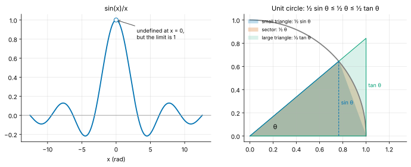
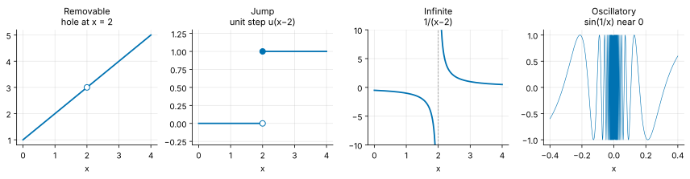
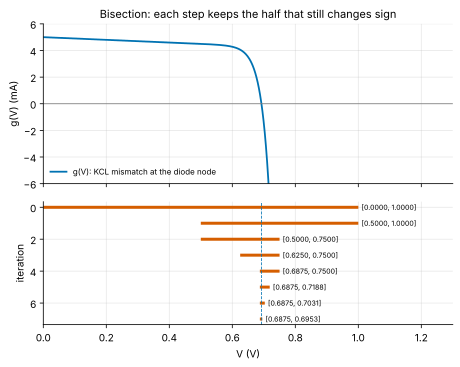
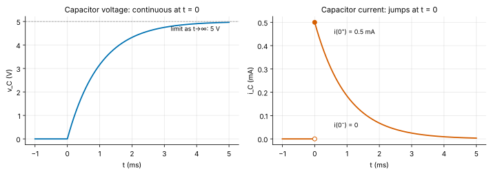
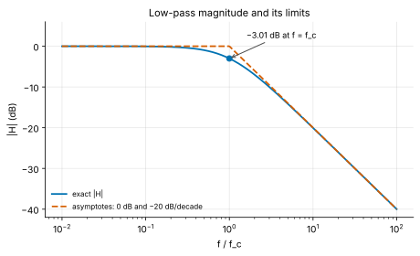

<!-- status: verified -->
# 01-02 · Limits and Continuity

| | |
|---|---|
| **Course** | [01 · Calculus for Engineers](../README.md) |
| **University equivalent** | Calculus I, limits and continuity (Stewart, ch. 2: limits, limit laws, continuity, limits at infinity), with the bisection method from a first numerical-methods course |
| **Prerequisites** | [01-01](01-01-functions-models-and-units.md) (functions, exponentials, logarithms, decibels). |
| **Estimated study hours** | 8 |
| **Last verified** | 2026-11-12 |

**Learning objectives.** After this chapter you can:

1. Evaluate limits numerically, graphically and algebraically, including the standard limits $\sin\theta/\theta \to 1$ and $(e^h - 1)/h \to 1$.
2. Compute one-sided limits and classify discontinuities (removable, jump, infinite, oscillatory), and use $t = 0^-$ and $t = 0^+$ to describe a switching event in a circuit.
3. State the definition of continuity and the intermediate value theorem, and use the bisection method to solve an equation to a required tolerance.
4. Find limits at infinity and asymptotes, and use dominant-term reasoning to describe the low- and high-frequency behavior of a response.
5. Explain how limits underlie the derivative and the number $e$, and recognize when a numerical limit is spoiled by floating-point rounding.

## 1. Big picture

Calculus rests on one idea: what a quantity *approaches* when something else gets very close to a value, or grows without bound. That idea is the **limit**. It turns "the slope between two nearby points" into "the slope at a point" (the derivative, [01-03](01-03-derivatives.md)), and "a sum of thin slices" into "an exact area" (the integral, [01-05](01-05-integrals.md)). Engineers also use limits directly, every day, without calling them that:

- **Switching events.** What is a capacitor's voltage just before and just after a switch closes? The notation $v(0^-)$ and $v(0^+)$ is a pair of one-sided limits ([07-02](../../07-circuit-analysis-2-transient-and-ac/chapters/07-02-first-order-rc-rl-transients.md)).
- **Final values.** Where does a transient settle? That is a limit as $t \to \infty$.
- **Asymptotes.** A Bode plot's straight-line sketch is the low- and high-frequency limits of the response ([07-07](../../07-circuit-analysis-2-transient-and-ac/chapters/07-07-frequency-response-and-bode-plots.md)).
- **Scaling claims.** "Speedup approaches 20× as you add processors" is a limit, and so is every "up to" number on a datasheet.
- **Root finding.** Continuity guarantees that a circuit's operating-point equation has a solution in a bracket, and bisection finds it.

## 2. Intuition first

### Approaching without arriving

Consider $f(x) = \sin x / x$. At $x = 0$ the formula reads $0/0$, which is meaningless, so $f(0)$ is undefined. Yet a table of values near zero tells a clear story:

| $x$ (rad) | 0.5 | 0.1 | 0.01 | 0.001 |
|---|---|---|---|---|
| $\sin x / x$ | 0.958851 | 0.998334 | 0.999983 | 0.9999998 |

The values close in on 1, from either side (the function is even). We write

$$
\lim_{x\to 0}\frac{\sin x}{x} = 1 ,
$$

read "the limit of $\sin x/x$ as $x$ approaches 0 is 1". The limit describes the *trend* near the point, not the value *at* the point. A function can have a limit where it is undefined (here), or a limit that differs from its value (a removable discontinuity, §3.5). This function is the **sinc** function of signal processing, and its limit at zero matters: it is the gain of a sampled-data system at DC ([11-10](../../11-signals-and-systems/chapters/11-10-sampling-aliasing-reconstruction.md)).

*Figure 1. Left: $\sin x/x$ is undefined at 0 (open circle), but it approaches 1. Right: the geometry behind the proof in §3.3.*

### An analogy from finance: compounding more and more often

Invest \$1 at a 100% annual rate. Compounded once, you have \$2 after a year; monthly, \$2.613; daily, \$2.715. Compounding more often helps, but by less and less. The amount approaches a ceiling, the number $e = 2.71828\ldots$ (Example 01-02.2). The limit is "continuous compounding", a process that does not literally exist (no bank compounds infinitely often) yet is the cleanest description of the trend.

*Where the analogy breaks:* in finance the steps really are discrete, and the limit is a convenient idealization. In physics the continuum *is* the model: a capacitor's voltage is not updated at discrete ticks. The limit is not an approximation to something more real; it is the description. When we go the other way and simulate physics on a computer, we replace the limit by small finite steps, and that is where errors enter (§3.9).

### Continuity: drawing without lifting the pen

A function is **continuous** if its graph can be drawn without lifting the pen: small changes in input produce small changes in output. Most physical quantities that store energy behave this way. A capacitor's voltage cannot jump, because that would require an infinite current. But quantities that do *not* store energy can jump: the current into the same capacitor can leap from zero to a finite value at the instant a switch closes (Figure 4). Telling these two kinds of quantity apart is the first step in every transient analysis.

## 3. Theory

### 3.1 The limit, informally and precisely

**Informal definition.** $\lim_{x\to a} f(x) = L$ means: $f(x)$ can be made as close to $L$ as we like by taking $x$ close enough to $a$, but not equal to $a$. The value $f(a)$, if it exists, plays no role.

> **Going deeper — the ε–δ definition.** "As close as we like" is made precise with two tolerances. $\lim_{x\to a} f(x) = L$ means: for every $\varepsilon > 0$ (an output tolerance) there is a $\delta > 0$ (an input tolerance) such that $0 < \lvert x - a\rvert < \delta$ implies $\lvert f(x) - L\rvert < \varepsilon$. It is a challenge–response game: you name the accuracy you want, and I must find how close the input must be to guarantee it. Example: to prove $\lim_{x\to 2}(3x + 1) = 7$, note that $\lvert(3x + 1) - 7\rvert = 3\lvert x - 2\rvert$. Given any $\varepsilon$, choose $\delta = \varepsilon/3$; then $\lvert x - 2\rvert < \delta$ gives $\lvert f(x) - 7\rvert < \varepsilon$. Engineers rarely write such proofs, but the idea is everywhere: a tolerance budget says how tightly a component must be specified (δ) to meet a system specification (ε). (Here ε is a tolerance, unrelated to permittivity.)

**When does a limit fail to exist?** Three ways:

1. The left and right trends disagree (a jump, §3.4).
2. The function grows without bound (an infinite limit, §3.5).
3. The function oscillates without settling, as $\sin(1/x)$ does near 0 (§3.5).

### 3.2 Limit laws and direct substitution

If $\lim_{x\to a} f(x) = L$ and $\lim_{x\to a} g(x) = M$, then

$$
\lim(f \pm g) = L \pm M, \qquad \lim(fg) = LM, \qquad \lim\frac{f}{g} = \frac{L}{M}\ (M \ne 0), \qquad \lim\big(f(x)\big)^n = L^n .
$$

These follow from the ε–δ definition. For the sum, for instance, make each of $f$ and $g$ within $\varepsilon/2$ of its limit; then the sum is within $\varepsilon$.

The practical consequence is **direct substitution**: polynomials, rational functions (where the denominator is nonzero), roots, exponentials, logarithms (on their domains) and the trigonometric functions are all *continuous* (§3.5), so their limits are found by plugging in. For example, $\lim_{x\to 2}(x^2 + 3x) = 4 + 6 = 10$. Limits are interesting only when substitution fails, typically by producing $0/0$, $\infty/\infty$ or $\infty - \infty$. These are called **indeterminate forms**: the form alone does not determine the answer, and algebra must resolve it.

### 3.3 Algebraic techniques and the standard limits

**Factoring.** $\dfrac{x^2 - 4}{x - 2}$ gives $0/0$ at $x = 2$. For $x \ne 2$ it equals $\dfrac{(x - 2)(x + 2)}{x - 2} = x + 2$. Cancelling is legitimate because the limit never looks at $x = 2$ itself. So the limit is $4$ (Example 01-02.1).

**Rationalizing.** $\dfrac{\sqrt{1 + x} - 1}{x}$ gives $0/0$ at 0. Multiply top and bottom by the conjugate $\sqrt{1 + x} + 1$:

$$
\frac{\sqrt{1 + x} - 1}{x}\cdot\frac{\sqrt{1 + x} + 1}{\sqrt{1 + x} + 1} = \frac{(1 + x) - 1}{x\big(\sqrt{1 + x} + 1\big)} = \frac{1}{\sqrt{1 + x} + 1} \;\longrightarrow\; \frac{1}{2}.
$$

**The squeeze theorem.** If $g(x) \le f(x) \le h(x)$ near $a$, and $g$ and $h$ have the same limit $L$, then $f$ is trapped and also tends to $L$. This is how we prove the most important trigonometric limit.

**Derivation: $\sin\theta/\theta \to 1$.** Take $0 < \theta < \pi/2$ on the unit circle (Figure 1, right). Three regions are nested:

- the triangle with vertices at the origin, $(1, 0)$ and $(\cos\theta, \sin\theta)$ has area $\tfrac{1}{2}\sin\theta$;
- the circular sector of angle $\theta$ has area $\tfrac{1}{2}\theta$ (a fraction $\theta/2\pi$ of the circle's area $\pi$; this is where radians matter);
- the right triangle with legs 1 and $\tan\theta$ has area $\tfrac{1}{2}\tan\theta$.

Each region contains the previous one, so

$$
\tfrac{1}{2}\sin\theta \;\le\; \tfrac{1}{2}\theta \;\le\; \tfrac{1}{2}\tan\theta .
$$

Divide by $\tfrac{1}{2}\sin\theta > 0$ to get $1 \le \theta/\sin\theta \le 1/\cos\theta$, and take reciprocals (which reverses the inequalities):

$$
\cos\theta \;\le\; \frac{\sin\theta}{\theta} \;\le\; 1 .
$$

As $\theta \to 0^+$, $\cos\theta \to 1$, so the squeeze gives $\sin\theta/\theta \to 1$. The function is even ($\sin(-\theta)/(-\theta) = \sin\theta/\theta$), so the limit from the left is the same. $\blacksquare$

Two companions follow by algebra:

- $\dfrac{\tan\theta}{\theta} = \dfrac{\sin\theta}{\theta}\cdot\dfrac{1}{\cos\theta} \to 1$;
- $\dfrac{1 - \cos\theta}{\theta^2} = \dfrac{1 - \cos^2\theta}{\theta^2(1 + \cos\theta)} = \left(\dfrac{\sin\theta}{\theta}\right)^2\dfrac{1}{1 + \cos\theta} \to 1 \cdot \dfrac{1}{2} = \dfrac{1}{2}$.

These are the precise statements behind the small-angle approximations $\sin\theta \approx \theta$ and $\cos\theta \approx 1 - \theta^2/2$ of [01-01](01-01-functions-models-and-units.md).

**The exponential limit, and where $e$ comes from.** Consider the slope of $b^x$ at $x = 0$, the limit of the difference quotient $(b^h - 1)/h$ as $h \to 0$. Numerically:

| $h$ | $(2^h - 1)/h$ | $(3^h - 1)/h$ |
|---|---|---|
| 0.1 | 0.7177 | 1.1612 |
| 0.001 | 0.6934 | 1.0992 |
| → 0 | 0.6931 | 1.0986 |

For base 2 the slope at 0 is about 0.693, and for base 3 about 1.099. Somewhere between 2 and 3 there is a base whose slope at 0 is exactly 1. **That base is $e$**, and this is its cleanest definition:

$$
\lim_{h\to 0}\frac{e^h - 1}{h} = 1 .
$$

(The limits in the last row are $\ln 2$ and $\ln 3$. [01-03](01-03-derivatives.md) shows why.)

**The same number from compounding.** Substitute $x = e^h - 1$, so $h = \ln(1 + x)$, and $x \to 0$ exactly when $h \to 0$. The limit above becomes $\lim_{x\to 0} x/\ln(1 + x) = 1$, or equivalently

$$
\lim_{x\to 0}\frac{\ln(1 + x)}{x} = 1 .
$$

Now take $x = 1/n$: $\ln\big((1 + 1/n)^n\big) = n\ln(1 + 1/n) = \ln(1 + x)/x \to 1$ as $n \to \infty$. Since $\exp$ is continuous, $(1 + 1/n)^n \to e^1 = e$. The same steps with $x = r/n$ give

$$
\lim_{n\to\infty}\left(1 + \frac{r}{n}\right)^n = e^{r},
$$

the continuous-compounding formula. The "rate equals slope" property of $e^x$ and the compounding limit are the same fact seen from two sides.

### 3.4 One-sided limits and switching events

The **left-hand limit** $\lim_{x\to a^-} f(x)$ uses only $x < a$; the **right-hand limit** $\lim_{x\to a^+} f(x)$ uses only $x > a$. The two-sided limit exists exactly when both one-sided limits exist and are equal.

The **unit step** $u(t)$, which is 0 for $t < 0$ and 1 for $t \ge 0$ ([notation](../../../reference/notation.md)), has $\lim_{t\to 0^-}u(t) = 0$ and $\lim_{t\to 0^+}u(t) = 1$. No two-sided limit exists at 0. Every switch that closes at $t = 0$ multiplies something by a step.

Circuit analysis writes these one-sided limits compactly:

$$
v(0^-) = \lim_{t\to 0^-} v(t), \qquad v(0^+) = \lim_{t\to 0^+} v(t).
$$

The instant $0^-$ is "just before the switch moves" and $0^+$ is "just after". The value exactly at $t = 0$ is usually irrelevant, and often undefined in an ideal model.

**Why capacitor voltage is continuous.** A capacitor's current is $i = C\,dv/dt$. If $v$ jumped by $\Delta V$ in zero time, $dv/dt$ would be infinite, and so would the current. Equivalently, the stored energy $\tfrac{1}{2}Cv^2$ would change in zero time, which needs infinite power. With finite currents, therefore, $v_C(0^+) = v_C(0^-)$. By the same argument with $v = L\,di/dt$, an inductor's current is continuous: $i_L(0^+) = i_L(0^-)$. Nothing forbids the *capacitor's current* or the *inductor's voltage* from jumping, and they usually do (Example 01-02.3). Problem 01-02.14 shows what happens when an idealized circuit violates this rule.

### 3.5 Continuity

A function $f$ is **continuous at $a$** when three conditions hold:

1. $f(a)$ is defined;
2. $\lim_{x\to a} f(x)$ exists;
3. the two are equal: $\lim_{x\to a} f(x) = f(a)$.

A function is continuous on an interval if it is continuous at every point of it. Sums, products, quotients (with nonzero denominator) and compositions of continuous functions are continuous, so every function built from the families of [01-01](01-01-functions-models-and-units.md) is continuous on its domain.

When continuity fails, the way it fails matters (Figure 2):

| Type | What happens | Example | Engineering instance |
|---|---|---|---|
| **Removable** | Limit exists but $f(a)$ is missing or wrong | $(x^2 - 4)/(x - 2)$ at 2 | sinc at 0; fixed by defining the value as the limit |
| **Jump** | One-sided limits exist but differ | $u(t)$ at 0 | Capacitor current at a switching instant |
| **Infinite** | $f$ grows without bound | $1/(x - 2)$ at 2 | Impedance of an ideal LC tank at resonance |
| **Oscillatory** | No settling at all | $\sin(1/x)$ at 0 | Mostly a mathematical warning; real signals are band-limited |

*Figure 2. Removable, jump, infinite and oscillatory discontinuities.*

### 3.6 The intermediate value theorem and bisection

**Intermediate value theorem (IVT).** If $f$ is continuous on $[a, b]$ and $N$ lies between $f(a)$ and $f(b)$, then $f(c) = N$ for at least one $c$ in $[a, b]$. In particular, **if $f(a)$ and $f(b)$ have opposite signs, $f$ has a root between them.**

The theorem is intuitive, since a continuous graph cannot get from below the axis to above it without crossing. Its proof relies on the completeness of the real numbers and belongs to a real-analysis course. Its engineering value is a *guarantee*: before you search for a solution, you can prove one exists.

**Bisection.** The IVT turns into an algorithm:

1. Start with a bracket $[a, b]$ where $f(a)$ and $f(b)$ have opposite signs.
2. Evaluate $f$ at the midpoint $m = (a + b)/2$.
3. Keep whichever half still has a sign change, either $[a, m]$ or $[m, b]$.
4. Repeat until the bracket is narrower than the tolerance.

Each step halves the bracket, so after $n$ steps its width is $(b - a)/2^n$. To reach a tolerance $\Delta$ you need

$$
n \ge \log_2\frac{b - a}{\Delta}
$$

steps. Every 10 steps gain a factor $2^{10} = 1024$, about three decimal digits. Bisection is slow compared with Newton's method ([01-04](01-04-applications-of-derivatives.md)), which roughly doubles the number of correct digits per step near the root. But bisection *cannot fail* once a bracket is found, which is why robust solvers often combine the two. Example 01-02.4 uses it to find a diode circuit's operating point.

*Figure 3. Top: the KCL mismatch $g(V)$ for the diode circuit of Example 01-02.4 changes sign at the operating point. Bottom: the bracket after each bisection step.*

### 3.7 Limits at infinity and asymptotes

$\lim_{x\to\infty} f(x) = L$ means $f(x)$ approaches $L$ as $x$ grows without bound. The line $y = L$ is then a **horizontal asymptote**. If $f(x) \to \pm\infty$ as $x \to a$, the line $x = a$ is a **vertical asymptote**.

**Rational functions: divide by the dominant power.** As $x \to \infty$, the highest power dominates both numerator and denominator:

$$
\frac{3x^2 + 5}{2x^2 - x} = \frac{3 + 5/x^2}{2 - 1/x} \;\longrightarrow\; \frac{3}{2}.
$$

The general rule: if the numerator's degree is lower, the limit is 0; if the degrees are equal, it is the ratio of the leading coefficients; if the numerator's degree is higher, the function grows without bound.

**The hierarchy of growth.** As $x \to \infty$,

$$
\ln x \;\ll\; x^p \;\ll\; e^{x} \qquad (\text{for any } p > 0),
$$

meaning each ratio tends to zero: $\ln x / x^p \to 0$ and $x^p/e^x \to 0$. Consequently $t^n e^{-t/\tau} \to 0$ for any power $n$: an exponential decay beats any polynomial growth. That is why every stable transient settles, even the "critically damped" response $t\,e^{-t/\tau}$ of [02-03](../../02-complex-numbers-des-and-linear-algebra/chapters/02-03-second-order-linear-odes.md). But "eventually" can be very late. $\ln x$ exceeds $x^{0.1}$ until $x$ is about $3\times10^{15}$ (Problem 01-02.15).

> **Going deeper — why exponentials beat powers.** For $x > 0$, the series $e^x = 1 + x + x^2/2! + \cdots$ ([01-08](01-08-sequences-series-and-taylor.md)) has only positive terms, so $e^x > x^{n+1}/(n + 1)!$. Then $0 < x^n/e^x < (n + 1)!/x \to 0$, and the squeeze theorem finishes the proof.

**Final values.** A first-order step response $v(t) = V_f + (V_0 - V_f)e^{-t/\tau}$ has $\lim_{t\to\infty} v(t) = V_f$, the **final value**. In practice "infinity" means about $5\tau$: $e^{-5} = 0.0067$, so the response is within 0.7% of its final value.

**Asymptotes of a frequency response.** The magnitude of a first-order low-pass filter ([07-07](../../07-circuit-analysis-2-transient-and-ac/chapters/07-07-frequency-response-and-bode-plots.md)) is

$$
\lvert H(f)\rvert = \frac{1}{\sqrt{1 + (f/f_c)^2}},
$$

where $f_c$ is the corner frequency. Two limits sketch the whole curve:

- **Low frequency.** As $f/f_c \to 0$, $\lvert H\rvert \to 1$, which is 0 dB.
- **High frequency.** As $f/f_c \to \infty$, the 1 under the root becomes negligible, and $\lvert H\rvert \approx f_c/f$. In decibels that is $-20\log_{10}(f/f_c)$: a straight line falling 20 dB per decade on log axes.

The **relative** error of the high-frequency approximation tends to zero:

$$
\frac{f_c/f}{\lvert H\rvert} = \frac{\sqrt{1 + (f/f_c)^2}}{f/f_c} = \sqrt{1 + (f_c/f)^2} \to 1.
$$

The approximation is worst at the corner, where the exact value is $-3.01$ dB against the asymptotes' 0 dB (Example 01-02.5, Figure 5).

**Asymptotic notation.** Engineers write $f \sim g$ ("$f$ is asymptotic to $g$") when $f/g \to 1$, as with $\lvert H\rvert \sim f_c/f$ above. Computer scientists write $f = O(g)$ when $f/g$ stays bounded. For example, the discrete Fourier transform takes $O(N^2)$ operations, while the fast Fourier transform takes $O(N\log N)$ ([16-04](../../16-digital-signal-processing/chapters/16-04-the-fft.md)). Both notations describe limits and ignore constant factors, which in practice can matter a great deal.

### 3.8 From limits to derivatives (a preview)

The slope of the straight line (the *secant*) through $(a, f(a))$ and $(a + h, f(a + h))$ is the **difference quotient**

$$
\frac{f(a + h) - f(a)}{h}.
$$

Its limit as $h \to 0$, when it exists, is the slope of the *tangent* line at $a$: the **derivative** $f'(a)$. For $f(x) = x^2$ at $a = 2$, the difference quotient is $\big((2 + h)^2 - 4\big)/h = 4 + h$, which tends to 4 (Example 01-02.1). The limit $(e^h - 1)/h \to 1$ of §3.3 says the derivative of $e^x$ at 0 is 1. [01-03](01-03-derivatives.md) builds all of differentiation on this definition.

Many indeterminate forms $0/0$ are ratios of two quantities that both vanish. **L'Hôpital's rule** ([01-04](01-04-applications-of-derivatives.md)) resolves them by comparing the rates at which they vanish, i.e. their derivatives. Until then, factoring, rationalizing, the squeeze and the standard limits handle everything in this chapter.

### 3.9 Limits on a computer

A computer cannot take a limit. It evaluates at a small $h$ and hopes. Two errors compete:

- **Truncation error** comes from $h$ not being zero. For the difference quotient of $e^x$ at 0 it is about $h/2$.
- **Rounding error** comes from finite precision ([00-04](../../00-orientation/chapters/00-04-toolchain-walkthrough.md)). Computing $e^h - 1$ for tiny $h$ subtracts nearly equal numbers. The result carries an absolute error of about machine epsilon $\epsilon_{\text{mach}} \approx 2.2\times10^{-16}$, and dividing by $h$ magnifies it to about $\epsilon_{\text{mach}}/h$.

Shrinking $h$ reduces the first error and inflates the second. The total is smallest near $h \approx \sqrt{\epsilon_{\text{mach}}} \approx 10^{-8}$, and below that the "limit" gets *worse* (Problem 01-02.13). The same trap makes $(1 - \cos x)/x^2$ return 0 instead of 0.5 at $x = 10^{-8}$ (Problem 01-02.12). The remedy is the same as in 00-04: rewrite the expression algebraically (for example $1 - \cos x = 2\sin^2(x/2)$) or use library functions built for the purpose, such as `math.expm1(h)` for $e^h - 1$.

## 4. Worked examples

### Example 01-02.1 — A removable 0/0 and the first derivative (tier A)

**Setup.** Find $\lim_{x\to 2}\dfrac{x^2 - 4}{x - 2}$ numerically and algebraically. Then find the slope of $y = x^2$ at $x = 2$ as the limit of $\big((2 + h)^2 - 4\big)/h$.

**Solution.** Numerically, the values at $x = 2.1, 2.01, 1.99, 1.9$ are $4.1, 4.01, 3.99, 3.9$, which suggests 4. Algebraically, for $x \ne 2$ the expression equals $x + 2$, so the limit is **4**. For the slope, expand: $\big((2 + h)^2 - 4\big)/h = (4h + h^2)/h = 4 + h$ for $h \ne 0$, which tends to **4**. (The two limits are the same expression in disguise: put $x = 2 + h$.)

**Sanity check.** The tangent to a parabola $x^2$ at $x$ has slope $2x$, which is 4 at $x = 2$. You will prove this rule in 01-03 ✓.

### Example 01-02.2 — Compound interest and the number e (tier A)

**Setup.** \$1 grows at 100% per year, compounded $n$ times. Evaluate $(1 + 1/n)^n$ for $n = 1, 12, 365$ and compare with $e$. Then find the effective annual return of a 6% rate compounded continuously.

**Solution.** $n = 1$: **2**. $n = 12$: $(1 + 1/12)^{12} = $ **2.613**. $n = 365$: $(1 + 1/365)^{365} = $ **2.715**. The limit is $e = $ **2.718** (§3.3). Each increase in $n$ adds less, and the sequence approaches $e$ from below. At 6% continuously compounded, one year multiplies the balance by $e^{0.06} = 1.06184$: an effective annual return of **6.184%**, slightly above 6%.

**Sanity check.** $(1 + 1/n)^n < e$ for every finite $n$, and the gap at $n = 365$ is $2.718 - 2.715 = 0.004$, small but nonzero ✓.

### Example 01-02.3 — One-sided limits at a switch (tier B)

**Setup.** At $t = 0$ a switch connects a 5 V source through $R = 10$ kΩ to an uncharged $C = 100$ nF capacitor. For $t > 0$, $v_C(t) = 5\left(1 - e^{-t/\tau}\right)$ V and $i_C(t) = (5\text{ V}/R)\,e^{-t/\tau}$, with $\tau = RC$ ([07-02](../../07-circuit-analysis-2-transient-and-ac/chapters/07-02-first-order-rc-rl-transients.md) derives these). Find $\tau$; the one-sided limits of $v_C$ and $i_C$ at $t = 0$; and their limits as $t \to \infty$. Which quantity is continuous at the switching instant?

**Solution.** $\tau = 10^4 \times 10^{-7} = 10^{-3}$ s $= $ **1.000 ms**.

- Voltage: $v_C(0^-) = 0$ (uncharged) and $v_C(0^+) = \lim_{t\to0^+}5(1 - e^{-t/\tau}) = 5(1 - 1) = 0$. The voltage is **continuous**.
- Current: $i_C(0^-) = 0$ (no current flows before the switch closes), but $i_C(0^+) = 5/10^4 = $ **0.500 mA**. The current **jumps**.
- As $t \to \infty$, $e^{-t/\tau} \to 0$, so $v_C \to$ **5 V** and $i_C \to 0$.

*Figure 4. The capacitor voltage is continuous at $t = 0$, while the current jumps from 0 to 0.5 mA. Both have limits as $t \to \infty$.*

**Sanity check.** At $0^+$ the capacitor still holds 0 V, so the entire 5 V appears across $R$, and the current is $5/R$ ✓. Energy check: the capacitor's energy $\tfrac{1}{2}Cv^2$ starts at 0 and rises smoothly, never jumping ✓. The lab confirms both one-sided limits in ngspice.

### Example 01-02.4 — Bisection finds a diode operating point (tier B)

**Setup.** A 5 V source drives a diode through 1 kΩ. The diode obeys $I = I_s(e^{V/V_T} - 1)$ with $I_s = 10^{-14}$ A and $V_T = 25.85$ mV. Kirchhoff's current law at the diode node says the resistor current equals the diode current:

$$
g(V) = \frac{5 - V}{1000} - I_s\left(e^{V/V_T} - 1\right) = 0 .
$$

Show that a solution exists in $[0, 1]$ V. How many bisection steps reach a 1 mV bracket? Find the operating point.

**Solution.**

- **Existence.** $g$ is continuous (a sum of continuous functions). At the ends of the bracket, $g(0) = 5$ mA $> 0$ and $g(1) = 0.004 - 10^{-14}(e^{38.68} - 1) \approx -6.3\times10^{2}$ A $< 0$. By the IVT a root lies in $(0, 1)$. It is unique, because $g$ decreases everywhere: the first term falls as $V$ rises and the subtracted exponential rises.
- **Number of steps.** $n \ge \log_2(1\text{ V}/1\text{ mV}) = \log_2 1000 = 9.97$, so **10** steps.
- **The steps (Figure 3).**
  - Step 1: $m = 0.5$, $g > 0$, keep $[0.5, 1]$.
  - Step 2: $m = 0.75$, $g < 0$, keep $[0.5, 0.75]$.
  - Steps 3 to 10 continue the same way.
  - After 10 steps the bracket is $[0.69238, 0.69336]$ V, of width $1/1024$ V $= 0.977$ mV.
- **Operating point.** Iterating further (or using any solver) gives $V = $ **0.6925 V**, and the current is $(5 - 0.6925)/1000 = $ **4.308 mA**.

**Sanity check.** A silicon diode carrying a few milliamps sits near 0.7 V ✓. KCL closes: $10^{-14}e^{0.69249/0.02585} = 4.31\times10^{-3}$ A, matching the resistor current ✓. The lab confirms the result with ngspice's operating-point analysis, which uses Newton's method instead.

### Example 01-02.5 — The asymptotes of a low-pass filter (tier C)

**Setup.** A first-order low-pass filter has $\lvert H(f)\rvert = 1/\sqrt{1 + (f/f_c)^2}$ with $f_c = 1$ kHz. Find the low- and high-frequency limits and the high-frequency asymptote in dB. How large is the error of the straight-line (asymptotic) sketch at $f = f_c$, at $10f_c$ and at $100f_c$?

**Solution.**

- **Limits.** As $f \to 0$, $\lvert H\rvert \to 1$ (0 dB). As $f \to \infty$, $\lvert H\rvert \to 0$, and more precisely $\lvert H\rvert \sim f_c/f$. In dB the asymptote is $-20\log_{10}(f/f_c)$, falling **20 dB per decade**.
- **At the corner** $f = f_c$: exact $20\log_{10}(1/\sqrt{2}) = $ **−3.010 dB**, while both asymptotes give 0 dB. The error is 3.01 dB, the largest anywhere.
- **At $10f_c$** (10 kHz): exact $20\log_{10}(1/\sqrt{101}) = $ **−20.04 dB** against the asymptote's −20 dB, an error of **0.043 dB**.
- **At $100f_c$:** the error is $10\log_{10}(1 + 10^{-4}) = $ **4.3×10^−4 dB**.

The error shrinks by about 100× per decade, because it is $10\log_{10}\big(1 + (f_c/f)^2\big) \approx 4.34\,(f_c/f)^2$ dB, which tends to zero.

*Figure 5. The exact magnitude and the two limiting lines. They differ noticeably only within about a decade of the corner.*

**Sanity check.** A drop of 3 dB is half power, the standard definition of a filter's bandwidth ✓. Bode sketches are trusted precisely because these limits are approached quickly.

<!-- answer-key -->
| ID | Quantity | Value | Unit |
|---|---|---|---|
| Ex 01-02.1a | limit of (x²−4)/(x−2) at 2 | 4 | — |
| Ex 01-02.1b | slope of x² at x = 2 | 4 | — |
| Ex 01-02.1c | quotient at x = 2.01 | 4.01 | — |
| Ex 01-02.2a | (1 + 1/12)^12 | 2.613 | — |
| Ex 01-02.2b | (1 + 1/365)^365 | 2.715 | — |
| Ex 01-02.2c | e | 2.718 | — |
| Ex 01-02.2d | effective annual return at 6 % continuous | 6.184 | % |
| Ex 01-02.3a | τ | 1.000 | ms |
| Ex 01-02.3b | i_C(0⁺) | 0.500 | mA |
| Ex 01-02.3c | final capacitor voltage | 5 | V |
| Ex 01-02.4a | operating-point voltage | 0.6925 | V |
| Ex 01-02.4b | operating-point current | 4.308 | mA |
| Ex 01-02.4c | bisection steps for 1 mV | 10 | — |
| Ex 01-02.4d | bracket width after 10 steps | 0.977 | mV |
| Ex 01-02.4e | bracket lower end after 10 steps | 0.69238 | V |
| Ex 01-02.4f | bracket upper end after 10 steps | 0.69336 | V |
| Ex 01-02.5a | magnitude at f_c | −3.010 | dB |
| Ex 01-02.5b | magnitude at 10 f_c | −20.04 | dB |
| Ex 01-02.5c | asymptote error at 10 f_c | 0.043 | dB |
| Ex 01-02.5d | asymptote error at 100 f_c | 4.3×10^-4 | dB |

*Recomputed by [verify_01_02.py](../verify/verify_01_02.py). Examples 01-02.3 and 01-02.4 are also confirmed in ngspice by the lab netlists.*

## 5. Simulate it

The lab ([labs/01-02-lab/](../labs/01-02-lab/README.md)) has a notebook and two ngspice netlists:

1. **Limit tables.** Tabulate $\sin x/x$ and $(b^h - 1)/h$ for several bases, find the base whose slope at 0 is 1, and watch rounding wreck the table as $h$ shrinks.
2. **Compounding.** Plot $(1 + r/n)^n$ against $n$ and its limit $e^r$.
3. **Bisection.** Implement bisection, solve Example 01-02.4, and count the steps.
4. **Asymptotes.** Plot a low-pass magnitude with its asymptotes and measure the error per decade.
5. **ngspice.** `switch_rc.cir` confirms the one-sided limits of Example 01-02.3. `diode_op.cir` confirms the operating point of Example 01-02.4.

**Predict, then run.** Before running Part 1, predict the value of $(e^h - 1)/h$ computed in double precision at $h = 10^{-12}$. Is it closer to 1 than the value at $h = 10^{-6}$, or farther?

## 6. Engineering tradeoffs

| Knob | Improves | Costs | Typical decision owner |
|---|---|---|---|
| Idealize a fast event as a discontinuity (an ideal switch, a step) | Simple, closed-form analysis; clear $0^-$/$0^+$ bookkeeping | Hides the real transition: ringing, current spikes and energy loss inside the switching interval (Problem 01-02.14) | Circuit designer; power-electronics engineer |
| Sketch with asymptotes (Bode lines) rather than exact curves | Fast, insightful design decisions | Errors up to 3 dB per pole near corners; misleading when corners are close together | Analog and control designers |
| Bisection rather than Newton for root finding | Guaranteed convergence from any valid bracket | Slow: about 3.3 steps per decimal digit | Simulation and firmware engineers |
| Smaller step $h$ in a numerical limit or derivative | Less truncation error | More rounding error below about $10^{-8}$ in double precision | Anyone writing numerical code |
| Quote asymptotic ("in the limit") performance | Clean, comparable headline numbers | Can be far from performance at practical sizes (Problem 01-02.15, Amdahl's law in §9) | Architects; marketing |

## 7. Numbers to know

| Quantity | Value | Note |
|---|---|---|
| $\sin x/x$ at $x = 0.1$ | 0.99833 | Limit 1; error ≈ $x^2/6$ |
| $(1 - \cos x)/x^2$ | → 0.5 | Basis of $\cos x \approx 1 - x^2/2$ |
| $(1 + 1/n)^n$ at $n = 12, 365$ | 2.613, 2.715 | Limit $e = 2.71828$ |
| $e^{-5}$ | 0.0067 | "Settled" after 5τ (within 0.7%) |
| Bisection gain | 10 steps ≈ 1024× ≈ 3 digits | Width $(b - a)/2^n$ |
| First-order filter at corner | −3.01 dB | Asymptote error is largest here |
| High-frequency roll-off per pole | −20 dB/decade | $\lvert H\rvert \sim f_c/f$ |
| Best step for a forward difference in double precision | $h \approx 10^{-8}$ | $\sqrt{\epsilon_{\text{mach}}}$ |
| Amdahl limit with parallel fraction $p$ | $1/(1 - p)$ | $p = 0.95$ → 20× maximum |

## 8. Common mistakes

1. **Confusing the limit with the value.** $\lim_{x\to a}f(x)$ ignores $f(a)$. A function can have a limit where it is undefined.
2. **Treating 0/0 as 0, 1 or undefined.** It is *indeterminate*: resolve it by algebra.
3. **Assuming a two-sided limit exists at a jump.** Check both sides; at a switch, $0^-$ and $0^+$ differ for currents in capacitors and voltages across inductors.
4. **Using degrees in $\sin\theta/\theta$.** The limit is 1 only in radians. In degrees it would be $\pi/180$.
5. **Assuming capacitor *current* is continuous.** Capacitor *voltage* and inductor *current* are continuous; their partners can jump.
6. **Dividing by the wrong power at infinity.** Divide numerator and denominator by the highest power in the *denominator*.
7. **Trusting a numerical limit at tiny $h$.** Rounding error grows as $h$ shrinks (§3.9).
8. **Applying bisection without checking the sign change** (or to a discontinuous function). A sign change across a jump or an infinite discontinuity, such as $1/x$ on $[-1, 1]$, brackets no root at all.

## 9. Practitioner lens

### Limits that bound real systems (as of Nov 2026)

Several of the hard numbers an engineering leader works against are limits in the mathematical sense:

- **Shannon capacity** ([00-01](../../00-orientation/chapters/00-01-map-of-electrical-engineering.md)) is the supremum of error-free data rates. Codes approach it but never exceed it **[Established]**.
- **The reticle limit** of about 858 mm² ([R-015](../../../reference/research-log.md#r-015--lithography-exposure-field-the-reticle-limit)) caps single-die area, so designs at that size must split into chiplets **[Established]**.
- **Regulatory power limits,** such as 36 dBm EIRP for standard-power 6 GHz Wi-Fi ([R-007](../../../reference/research-log.md#r-007--us-6-ghz-unlicensed-band)), are ceilings a product approaches but may not cross **[Established]**.

A leader should know which numbers on a roadmap are physical limits, which are regulatory, and which are merely current practice.

### Amdahl's law: the limit behind every scaling claim

If a fraction $p$ of a workload can be spread perfectly across $N$ processors and the rest is serial, the speedup is

$$
S(N) = \frac{1}{(1 - p) + p/N},
$$

a result due to Gene Amdahl (1967) **[Established]**. As $N \to \infty$, $p/N \to 0$ and $S \to 1/(1 - p)$. With $p = 0.95$ the ceiling is 20×. Eight processors already give 5.93×, 64 give 15.4×, and 1,024 give only 19.6×. The last factor of 16 in hardware buys 27% more speed. AI training clusters fight exactly this limit, which is why communication overhead, the "serial fraction" of distributed training, gets so much engineering attention ([14-01](../../14-computer-organization-and-architecture/chapters/14-01-performance-power-iron-law.md)). Gustafson's law (1988) is the counterpoint: if the problem grows with the machine, the serial fraction shrinks, and scaling continues further **[Established]**.

<!-- answer-key -->
| ID | Quantity | Value | Unit |
|---|---|---|---|
| PL 01-02.a | Amdahl speedup, p = 0.95, N = 8 | 5.93 | — |
| PL 01-02.b | Amdahl speedup, N = 64 | 15.4 | — |
| PL 01-02.c | Amdahl speedup, N = 1024 | 19.6 | — |
| PL 01-02.d | Amdahl limit | 20 | — |

### Why it matters commercially

- **Scaling claims are limit claims.** "Linear scaling to 100,000 accelerators" asserts that the serial and communication fraction is essentially zero. A business case built on that assumption inherits its fragility.
- **Robust algorithms are worth their speed penalty in products.** A charger or a battery gauge that must never fail to converge uses bracketing methods such as bisection, at least as a fallback. Asking how firmware handles non-convergence is a good diligence question.

### Marketing vs Reality

**"Performance scales linearly."** Ask for measured speedup at several scales and fit Amdahl's law to it. A fitted $p$ of 0.99 caps speedup at 100× no matter how much hardware is bought.

**"Asymptotically better."** An $O(N\log N)$ algorithm beats an $O(N^2)$ one only beyond some size, and the constant factors decide where. Ask: at *our* problem size, measured, how much better?

**"Approaches the theoretical limit."** Ask which limit (Shannon? a regulatory cap? a physical one?), how close in dB or percent, and under which conditions.

### Questions to ask engineering leaders

1. **"What is the serial or communication fraction of this workload, and how was it measured?"**
   *Strong answer:* a measured scaling curve with a fitted fraction, and a plan to reduce it. *Evasive:* "it scales linearly".
2. **"Which of your roadmap numbers are physical limits, which are regulatory, and which are current practice?"**
   *Strong:* separates them clearly and knows the margin to each. *Evasive:* treats all as equally fixed, or all as negotiable.
3. **"What happens in the switching interval your models idealize?"** (for power or RF products)
   *Strong:* discusses ringing, current spikes and switching loss with measured data. *Evasive:* "the ideal model matches".
4. **"How does your firmware guarantee convergence of its numerical routines?"**
   *Strong:* bracketing fallbacks, iteration caps and tested failure paths. *Evasive:* "it always converges in testing".

## 10. Concept check

**Q1.** $f(x) = (x^2 - 9)/(x - 3)$ is undefined at 3. Does $\lim_{x\to3}f(x)$ exist? What is it?

Answer

Yes. For $x \ne 3$, $f(x) = x + 3$, so the limit is 6. The discontinuity is removable.

**Q2.** Why must $\theta$ be in radians for $\sin\theta/\theta \to 1$?

Answer

The proof uses the sector area $\tfrac{1}{2}\theta$, which holds only when $\theta$ is measured in radians (arc length over radius). In degrees the limit would be $\pi/180$.

**Q3.** At a switching instant, which of these can jump: capacitor voltage, capacitor current, inductor current, inductor voltage?

Answer

Capacitor current and inductor voltage can jump. Capacitor voltage and inductor current cannot (with finite currents and voltages), because their stored energy cannot change instantly.

**Q4.** $g(1) = 3$ and $g(2) = -1$, with $g$ continuous. What can you conclude? What if $g$ were not continuous?

Answer

By the IVT, $g$ has at least one root in $(1, 2)$. Without continuity there is no guarantee; $g$ could jump over zero.

**Q5.** How many bisection steps shrink a 2 V bracket below 1 µV?

Answer

$\log_2(2/10^{-6}) = \log_2(2\times10^6) \approx 20.9$, so 21 steps.

**Q6.** What is $\lim_{x\to\infty}\dfrac{4x^3 + x}{2x^3 - 7}$? And $\lim_{t\to\infty}t^{10}e^{-t}$?

Answer

2 (equal degrees: ratio of leading coefficients). And 0: exponential decay beats any power.

**Q7.** A program computes $(e^h - 1)/h$ at $h = 10^{-15}$ and gets 1.11. Is the program wrong?

Answer

No; the method is. Rounding error of order $\epsilon_{\text{mach}}/h \approx 0.2$ swamps the result. Use a larger $h$ (about $10^{-8}$) or `expm1`.

**Q8.** With 90% of a workload parallelizable, what is the maximum speedup from adding processors?

Answer

$1/(1 - 0.9) = 10\times$, no matter how many processors.

Now work the problem set: [01-02 problems](../problems/01-02-problems.md) (solutions in [01-02 solutions](../solutions/01-02-solutions.md)).

## 11. Key terms

[Limit](../../../reference/glossary.md#limit) ·
[One-sided limit](../../../reference/glossary.md#one-sided-limit) ·
[Indeterminate form](../../../reference/glossary.md#indeterminate-form) ·
[Squeeze theorem](../../../reference/glossary.md#squeeze-theorem) ·
[Continuity](../../../reference/glossary.md#continuity) ·
[Removable discontinuity](../../../reference/glossary.md#removable-discontinuity) ·
[Jump discontinuity](../../../reference/glossary.md#jump-discontinuity) ·
[Intermediate value theorem](../../../reference/glossary.md#intermediate-value-theorem) ·
[Bisection method](../../../reference/glossary.md#bisection-method) ·
[Asymptote](../../../reference/glossary.md#asymptote) ·
[Difference quotient](../../../reference/glossary.md#difference-quotient) ·
[Unit step function](../../../reference/glossary.md#unit-step-function) ·
[Sinc function](../../../reference/glossary.md#sinc-function) ·
[Amdahl's law](../../../reference/glossary.md#amdahls-law)

## 12. Connections

- **Builds on:** [01-01](01-01-functions-models-and-units.md) (function families, $e$, decibels); [00-04](../../00-orientation/chapters/00-04-toolchain-walkthrough.md) (floating point).
- **Next:** [01-03 Derivatives](01-03-derivatives.md), which turns the difference-quotient limit into a toolkit.
- **Used later in:**
  - [01-04](01-04-applications-of-derivatives.md): L'Hôpital's rule and Newton's method.
  - [01-08](01-08-sequences-series-and-taylor.md): limits of sequences and series.
  - [07-02](../../07-circuit-analysis-2-transient-and-ac/chapters/07-02-first-order-rc-rl-transients.md): $0^-$/$0^+$ analysis and final values.
  - [07-07](../../07-circuit-analysis-2-transient-and-ac/chapters/07-07-frequency-response-and-bode-plots.md): Bode asymptotes.
  - [02-10](../../02-complex-numbers-des-and-linear-algebra/chapters/02-10-numerical-methods.md): root finding and numerical error.
  - [11-10](../../11-signals-and-systems/chapters/11-10-sampling-aliasing-reconstruction.md): the sinc function.

## 13. Further study

- **Stewart, *Calculus: Early Transcendentals*,** chapter 2 (limits, limit laws, continuity, limits at infinity) for more drill.
- **Strang, *Calculus* (free, MIT OpenCourseWare),** chapter 2 (derivatives as limits) and the section on limits and continuity.
- **MIT OpenCourseWare 18.01SC,** Unit 1 sessions on limits and continuity.
- **3Blue1Brown, *Essence of Calculus*** (video series), episodes on limits and on what $e$ is, for geometric intuition.

## 14. Sources

1. G. M. Amdahl, "Validity of the single processor approach to achieving large scale computing capabilities," *AFIPS Conference Proceedings*, vol. 30, 1967, pp. 483–485.
2. J. L. Gustafson, "Reevaluating Amdahl's law," *Communications of the ACM*, vol. 31, no. 5, 1988, pp. 532–533.
3. Research log [R-015](../../../reference/research-log.md#r-015--lithography-exposure-field-the-reticle-limit) (reticle limit) and [R-007](../../../reference/research-log.md#r-007--us-6-ghz-unlicensed-band) (6 GHz power limits).
4. The limit proofs are standard calculus (see Stewart, ch. 2). All text, examples and problems are original.
