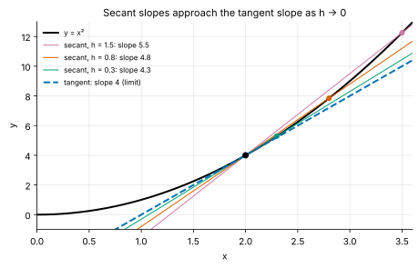
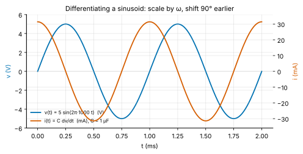
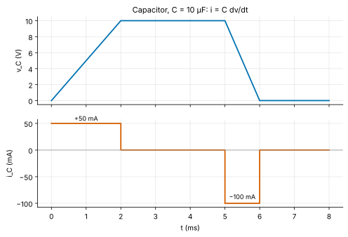
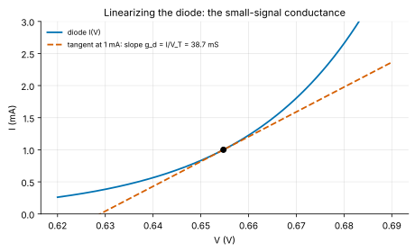
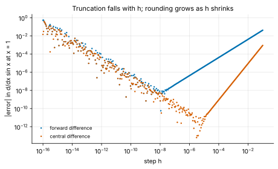

<!-- status: reviewed -->
# 01-03 · Derivatives: Rates of Change in Circuits

| | |
|---|---|
| **Course** | [01 · Calculus for Engineers](../README.md) |
| **University equivalent** | Calculus I, differentiation (Stewart, ch. 3: definition, rules, exponential, logarithmic and trigonometric derivatives, chain rule, implicit differentiation), with the capacitor and inductor laws from a first circuits course |
| **Prerequisites** | [01-01](01-01-functions-models-and-units.md) (function families), [01-02](01-02-limits-and-continuity.md) (limits, the difference quotient, $\sin\theta/\theta \to 1$, $(e^h - 1)/h \to 1$). |
| **Estimated study hours** | 13 |
| **Last verified** | 2026-11-12 |

**Learning objectives.** After this chapter you can:

1. Compute a derivative from the limit definition, and interpret it as a slope or rate with correct units.
2. Derive and apply the power, product, quotient and chain rules.
3. Differentiate exponential, logarithmic, hyperbolic, trigonometric and inverse trigonometric functions, including by implicit and logarithmic differentiation, and explain why differentiating a sinusoid multiplies its amplitude by ω and advances its phase by 90°.
4. Use $i = C\,dv/dt$, $v = L\,di/dt$ and $p = dw/dt$ to compute capacitor and inductor waveforms, and compute a diode's small-signal conductance by differentiating its I–V law.
5. Use logarithmic derivatives (elasticities) to quantify sensitivity, and estimate derivatives numerically with forward and central differences.

## 1. Big picture

A derivative measures how fast one quantity changes when another changes. Electrical engineering is built on rates. Current is the rate at which charge flows. A capacitor's current is proportional to how fast its voltage changes, and an inductor's voltage to how fast its current changes. Power is the rate at which energy moves. A transistor's gain is the slope of its output current against its input voltage. If 01-02 taught the language of limits, this chapter teaches the grammar every later course speaks.

- **Circuit elements are derivatives:** $i = C\,dv/dt$ and $v = L\,di/dt$ define capacitors and inductors ([07-01](../../07-circuit-analysis-2-transient-and-ac/chapters/07-01-capacitors-and-inductors.md)).
- **Amplifiers are slopes:** small-signal models replace a nonlinear device by the slope of its characteristic at the operating point ([10-04](../../10-electronics-1/chapters/10-04-small-signal-models.md)).
- **Specs are rates:** slew rate (V/µs), load-step di/dt (A/µs), temperature coefficients (ppm/K) and sensitivities all are derivatives.
- **Optimization starts with a zero slope:** maximum power transfer, optimal pipeline depth and minimum-energy operating points are found where a derivative vanishes ([01-04](01-04-applications-of-derivatives.md)).

## 2. Intuition first

### The speedometer

A car's odometer records position $x(t)$; its speedometer shows the derivative $dx/dt$. Over a whole trip, average speed is distance divided by time: the slope of a *secant* line on the graph of $x(t)$. The speedometer shows something subtler, the speed *right now*: the average over a vanishingly short interval, the slope of the *tangent* line. That is exactly the limit of the difference quotient from [01-02](01-02-limits-and-continuity.md):

$$
f'(a) = \lim_{h\to 0}\frac{f(a + h) - f(a)}{h} .
$$

*Figure 1. Secant lines through $(2, 4)$ on $y = x^2$. As $h$ shrinks, their slopes 5.5, 4.8, 4.3 approach the tangent slope 4.*

### An analogy from finance: marginal quantities and duration

You already use derivatives under other names:

- **Marginal cost** is $dC/dq$, the cost of one more unit.
- **A bond's modified duration** is $-\frac{1}{P}\frac{dP}{dy}$, the percentage price change per unit change in yield.
- **An option's delta** is $\partial V/\partial S$.

Each is a slope, and each is used the same way an engineer uses one: to predict the effect of a *small* change by a straight-line approximation. The same habit underlies the small-signal transistor model (Example 01-03.5).

*Where the analogy breaks:* financial "derivatives" are contracts, named for being derived from an underlying asset. The name is a coincidence, although an option's delta really is a derivative in the calculus sense. More importantly, market prices are not smooth functions of time. Their paths are rough at every scale, which is why stochastic calculus exists. Circuit voltages, by contrast, are smooth on the time scales we model, so ordinary derivatives apply.

### Units of a derivative

The derivative of $y$ with respect to $x$ has units of $y$ divided by units of $x$. Some examples:

- **$dv/dt$** is in V/s. Op-amp **slew rate** is quoted in V/µs.
- **$dI/dV$** is in A/V = S (siemens), a conductance.
- **$dq/dt$** is in C/s = A. Current *is* a derivative.
- **$dP/dT$** is in W/K, the temperature sensitivity of power.

Checking the units of a derivative is the fastest sanity check in this chapter.

## 3. Theory

### 3.1 The definition, notation and differentiability

The **derivative** of $f$ at $a$ is

$$
f'(a) = \lim_{h\to 0}\frac{f(a + h) - f(a)}{h},
$$

when the limit exists. If it exists, $f$ is **differentiable** at $a$. The derivative function $f'(x)$ gives the slope at every point. Common notations are $f'(x)$, $\dfrac{dy}{dx}$ (Leibniz), $\dfrac{d}{dx}f$, and $\dot{x}$ for a time derivative.

**Differentiable implies continuous.** If $f'(a)$ exists, then

$$
f(a + h) - f(a) = h\cdot\frac{f(a + h) - f(a)}{h} \;\longrightarrow\; 0\cdot f'(a) = 0,
$$

so $f(a + h) \to f(a)$: $f$ is continuous at $a$. The converse fails. $\lvert x\rvert$ is continuous at 0 but has a **corner**: the difference quotient is $-1$ from the left and $+1$ from the right, so no two-sided limit exists. Ideal switches, ideal diodes and the ReLU activation used in neural networks all have such corners (Problem 01-03.14).

### 3.2 Linearity and the power rule

Two rules follow directly from the limit laws:

$$
\frac{d}{dx}\big[af(x) + bg(x)\big] = af'(x) + bg'(x), \qquad \frac{d}{dx}c = 0 .
$$

Differentiation is **linear**: it respects sums and constant multiples. This property is why circuits built from resistors, capacitors and inductors remain *linear* systems ([06-07](../../06-circuit-analysis-1-dc/chapters/06-07-linearity-and-superposition.md)).

**Power rule (positive integers).** By the binomial theorem,

$$
(x + h)^n = x^n + nx^{n-1}h + \binom{n}{2}x^{n-2}h^2 + \cdots + h^n .
$$

Subtract $x^n$ and divide by $h$. Every remaining term except $nx^{n-1}$ still contains a factor $h$ and vanishes in the limit:

$$
\frac{d}{dx}x^n = nx^{n-1}.
$$

We extend this to every real exponent in §3.5.

### 3.3 Product and quotient rules

**Product rule.** Add and subtract $f(x)g(x + h)$ in the numerator:

$$
\frac{f(x + h)g(x + h) - f(x)g(x)}{h} = \frac{f(x + h) - f(x)}{h}\,g(x + h) + f(x)\,\frac{g(x + h) - g(x)}{h}.
$$

As $h \to 0$, $g(x + h) \to g(x)$, because $g$ is differentiable and therefore continuous. So

$$
(fg)' = f'g + fg' .
$$

*Intuition:* a rectangle of sides $f$ and $g$ grows by two strips, $g\,\Delta f$ and $f\,\Delta g$. The corner piece $\Delta f\,\Delta g$ is second-order small and vanishes in the limit. Example: the power in a resistor-capacitor branch is $p = vi$, so $dp/dt = \dot v\,i + v\,\dot i$.

**Reciprocal rule.** Wherever $g \ne 0$, straight from the definition:

$$
\frac{1}{h}\left[\frac{1}{g(x + h)} - \frac{1}{g(x)}\right] = -\frac{g(x + h) - g(x)}{h}\cdot\frac{1}{g(x)\,g(x + h)} \;\xrightarrow{h\to0}\; -\frac{g'(x)}{g(x)^2},
$$

using the continuity of $g$ (differentiable functions are continuous, §3.1) for $g(x + h) \to g(x)$.

**Quotient rule.** Apply the product rule to $f\cdot(1/g)$ with the reciprocal rule. This gives

$$
\left(\frac{f}{g}\right)' = \frac{f'g - fg'}{g^2} .
$$

### 3.4 The chain rule

Most engineering functions are compositions: $\sin(\omega t)$, $e^{-t/\tau}$, $\sqrt{1 + (f/f_c)^2}$. If $y = f(u)$ and $u = g(x)$, then

$$
\frac{dy}{dx} = \frac{dy}{du}\cdot\frac{du}{dx}, \qquad\text{i.e.}\qquad \big(f(g(x))\big)' = f'\big(g(x)\big)\,g'(x).
$$

*Intuition:* rates multiply. If $u$ changes 3 times as fast as $x$, and $y$ changes 2 times as fast as $u$, then $y$ changes 6 times as fast as $x$. A gear train works the same way, as do cascaded amplifier gains.

**Derivation.** Write $\Delta u = g(x + h) - g(x)$. When $\Delta u \ne 0$,

$$
\frac{f(g(x + h)) - f(g(x))}{h} = \frac{f(u + \Delta u) - f(u)}{\Delta u}\cdot\frac{\Delta u}{h} .
$$

As $h \to 0$, $\Delta u \to 0$ (since $g$ is continuous). The first factor tends to $f'(u)$ and the second to $g'(x)$.

> **Going deeper — when Δu = 0.** The argument above divides by $\Delta u$, which can be zero for some $h$ arbitrarily close to 0 (for example, if $g$ is constant near $x$). The rigorous proof avoids the division. Differentiability of $f$ at $u$ means $f(u + k) - f(u) = \big(f'(u) + \varepsilon(k)\big)k$, where $\varepsilon(k) \to 0$ as $k \to 0$ and we set $\varepsilon(0) = 0$. Put $k = \Delta u$ and divide by $h$: $\big(f'(u) + \varepsilon(\Delta u)\big)\Delta u/h \to f'(u)g'(x)$. No division by $\Delta u$ occurs.

**Example.** $\dfrac{d}{dt}e^{-t/\tau}$: the outer function is $e^u$ (derivative $e^u$), the inner is $u = -t/\tau$ (derivative $-1/\tau$). So the result is $-\dfrac{1}{\tau}e^{-t/\tau}$. The units check: 1/s, a rate.

### 3.5 Exponentials and logarithms

**The exponential.** Factor $e^x$ out of the difference quotient and use the defining limit of $e$ from 01-02:

$$
\frac{e^{x + h} - e^x}{h} = e^x\cdot\frac{e^h - 1}{h} \;\longrightarrow\; e^x\cdot 1 .
$$

So $\dfrac{d}{dx}e^x = e^x$: **the exponential is its own derivative**. This is why it solves every "rate proportional to amount" equation. With the chain rule:

$$
\frac{d}{dx}e^{kx} = ke^{kx}, \qquad \frac{d}{dx}a^x = \frac{d}{dx}e^{x\ln a} = (\ln a)\,a^x .
$$

The last formula explains the numerical slopes of 01-02: $\ln 2 = 0.693$ and $\ln 3 = 1.099$.

**The logarithm, by implicit differentiation.** Let $y = \ln x$, so $e^y = x$. Differentiate both sides with respect to $x$, treating $y$ as a function of $x$ (chain rule on the left):

$$
e^y\frac{dy}{dx} = 1 \quad\Longrightarrow\quad \frac{dy}{dx} = \frac{1}{e^y} = \frac{1}{x}.
$$

So $\dfrac{d}{dx}\ln x = \dfrac{1}{x}$ for $x > 0$. This technique, differentiating an equation that defines $y$ implicitly, is **implicit differentiation**.

**The power rule for every real exponent.** For $x > 0$, $x^n = e^{n\ln x}$, so

$$
\frac{d}{dx}x^n = e^{n\ln x}\cdot\frac{n}{x} = x^n\cdot\frac{n}{x} = nx^{n-1}.
$$

For example, $\dfrac{d}{dx}\sqrt{x} = \tfrac{1}{2}x^{-1/2}$.

**Logarithmic derivative and elasticity.** By the chain rule, $\dfrac{d}{dx}\ln f(x) = \dfrac{f'(x)}{f(x)}$: the *relative* rate of change. A related quantity, the **elasticity** (or *relative sensitivity*), compares percentage changes:

$$
S^{y}_{x} = \frac{d\ln y}{d\ln x} = \frac{x}{y}\frac{dy}{dx} \approx \frac{\Delta y/y}{\Delta x/x}.
$$

It is dimensionless. For a power law $y = kx^n$, $S = n$ exactly: dynamic power $P \propto V^2$ has voltage elasticity 2. Engineers call it **sensitivity** and economists **elasticity**. Finance professionals will recognize a close cousin: modified duration, $-\,d\ln P/dy$, is a *semi*-elasticity (a percentage change in price per absolute change in yield). Problem 01-03.11 uses it for tolerance analysis.

### 3.6 Trigonometric functions

**Sine.** Use the addition formula $\sin(x + h) = \sin x\cos h + \cos x\sin h$:

$$
\frac{\sin(x + h) - \sin x}{h} = \sin x\cdot\frac{\cos h - 1}{h} + \cos x\cdot\frac{\sin h}{h}.
$$

From 01-02, $\sin h/h \to 1$. Also $(\cos h - 1)/h = -h\cdot(1 - \cos h)/h^2 \to 0 \cdot \tfrac{1}{2} = 0$. Therefore

$$
\frac{d}{dx}\sin x = \cos x .
$$

The same argument with $\cos(x + h) = \cos x\cos h - \sin x\sin h$ gives $\dfrac{d}{dx}\cos x = -\sin x$. The quotient rule then gives $\dfrac{d}{dx}\tan x = \dfrac{\cos^2 x + \sin^2 x}{\cos^2 x} = \sec^2 x = 1 + \tan^2 x$. (These derivations need radians, because the limit $\sin h/h \to 1$ does.)

**Differentiating a sinusoid.** By the chain rule,

$$
\frac{d}{dt}\big[A\cos(\omega t + \phi)\big] = -A\omega\sin(\omega t + \phi) = A\omega\cos\!\left(\omega t + \phi + \frac{\pi}{2}\right).
$$

Differentiation **multiplies the amplitude by ω and advances the phase by 90°**. In phasor language ([02-01](../../02-complex-numbers-des-and-linear-algebra/chapters/02-01-complex-numbers-euler-and-phasors.md)), $d/dt$ becomes multiplication by $j\omega$, the fact that turns AC circuit analysis into algebra. A capacitor driven by a sine therefore carries a current that *leads* the voltage by 90° (Figure 2, Example 01-03.2).

*Figure 2. $v(t) = 5\sin(2\pi\cdot1000\,t)$ V across 1 µF. The current $C\,dv/dt$ peaks where the voltage crosses zero going up, a quarter period earlier than the voltage peak.*

**Inverse trigonometric functions.** Let $y = \arctan x$, so $\tan y = x$. Implicit differentiation gives $(1 + \tan^2 y)\,y' = 1$, so

$$
\frac{d}{dx}\arctan x = \frac{1}{1 + x^2}.
$$

Similarly, $\dfrac{d}{dx}\arcsin x = \dfrac{1}{\sqrt{1 - x^2}}$ and $\dfrac{d}{dx}\arccos x = -\dfrac{1}{\sqrt{1 - x^2}}$ (since $\arccos x = \pi/2 - \arcsin x$), both for $\lvert x\rvert < 1$. The phase of a first-order filter is $-\arctan(f/f_c)$. Against linear frequency it changes fastest at DC, where $1/(1 + x^2)$ is largest. On the logarithmic frequency axis of a Bode plot, however, the slope is $\dfrac{d(-\arctan x)}{d\ln x} = -\dfrac{x}{1 + x^2}$, which peaks at the corner $x = 1$: −½ rad per unit of $\ln x$, about −66° per decade, steeper than the −45°/decade straight-line sketch.

**Summary table.**

| $f(x)$ | $f'(x)$ | | $f(x)$ | $f'(x)$ |
|---|---|---|---|---|
| $x^n$ | $nx^{n-1}$ | | $\sin x$ | $\cos x$ |
| $e^{kx}$ | $ke^{kx}$ | | $\cos x$ | $-\sin x$ |
| $a^x$ | $a^x\ln a$ | | $\tan x$ | $\sec^2 x$ |
| $\ln x$ | $1/x$ | | $\arctan x$ | $1/(1 + x^2)$ |
| $\log_{10}x$ | $1/(x\ln 10)$ | | $\arcsin x$ | $1/\sqrt{1 - x^2}$ |
| $\sinh x$ | $\cosh x$ | | $\arccos x$ | $-1/\sqrt{1 - x^2}$ |
| $\cosh x$ | $\sinh x$ | | $\tanh x$ | $1 - \tanh^2 x$ |

The hyperbolic rows follow directly from the definitions in [01-01](01-01-functions-models-and-units.md) §3.4: $\frac{d}{dx}\tfrac12(e^x + e^{-x}) = \tfrac12(e^x - e^{-x})$, and the quotient rule with $\cosh^2 - \sinh^2 = 1$ gives $(\tanh x)' = 1/\cosh^2x = 1 - \tanh^2x$. Unlike $\cos$, $\cosh$ has no minus sign in its derivative.

**Logarithmic differentiation.** For a function such as $y = x^x$, with the variable in both base and exponent, neither the power rule nor the exponential rule applies. Take logs first: $\ln y = x\ln x$. Differentiate both sides, using the chain rule on the left: $y'/y = \ln x + 1$. So $y' = x^x(\ln x + 1)$. The same trick simplifies long products and quotients, because the log turns them into sums.

### 3.7 Higher derivatives

The derivative of $f'$ is the **second derivative** $f''$, written $d^2y/dx^2$. It measures how the slope changes, which is the **curvature** of the graph (concave up where $f'' > 0$). For motion, $\ddot{x}$ is acceleration. In circuits, second derivatives appear as soon as a capacitor and an inductor interact: the series RLC equation $L\ddot{q} + R\dot{q} + q/C = v(t)$ ([02-03](../../02-complex-numbers-des-and-linear-algebra/chapters/02-03-second-order-linear-odes.md)). The exponential is its own $n$-th derivative, and $\sin$ returns to itself after four differentiations: $\sin \to \cos \to -\sin \to -\cos \to \sin$.

### 3.8 Derivatives in circuit elements

**Current is a derivative.** Current is the rate of charge flow: $i = dq/dt$ (C/s = A).

**Capacitor.** A capacitor stores charge in proportion to voltage, $q = Cv$. Differentiating, for constant $C$:

$$
i_C = C\,\frac{dv_C}{dt}.
$$

Constant voltage means zero current: a capacitor is an open circuit at DC. A voltage ramp of slope $m$ (V/s) draws constant current $Cm$. A jump in voltage would need infinite current, which is the continuity property of 01-02.

**Inductor.** An inductor's magnetic flux linkage is $\psi = Li$, and Faraday's law says the induced voltage is $d\psi/dt$. So

$$
v_L = L\,\frac{di_L}{dt}.
$$

Constant current means zero voltage: an inductor is a short circuit at DC. Interrupting an inductor's current quickly produces a large voltage, the "inductive kick" (Example 01-03.3).

**Power and energy.** Power is the rate of energy transfer, $p = dw/dt$, and for any two-terminal element $p = vi$ (passive sign convention, [notation](../../../reference/notation.md)). A capacitor stores $w_C = \tfrac{1}{2}Cv^2$. By the chain rule,

$$
\frac{dw_C}{dt} = \frac{1}{2}C\cdot 2v\frac{dv}{dt} = v\cdot C\frac{dv}{dt} = vi,
$$

consistent with $p = vi$ ✓. The same holds for $w_L = \tfrac{1}{2}Li^2$. Energy flows in while $p > 0$ and back out while $p < 0$; an ideal capacitor or inductor dissipates nothing (Problem 01-03.15).

*Figure 3. A trapezoidal voltage across 10 µF (Problem 01-03.7). Each ramp draws a constant current proportional to its slope; flat segments draw none.*

**Small-signal conductance.** A diode carries $I = I_s\left(e^{V/V_T} - 1\right)$. Its slope at the operating point is

$$
g_d = \frac{dI}{dV} = \frac{I_s}{V_T}e^{V/V_T} = \frac{I + I_s}{V_T} \approx \frac{I}{V_T}.
$$

For a small change $\Delta V$ around the operating point, $\Delta I \approx g_d\,\Delta V$: the device *behaves like a resistor* $r_d = 1/g_d = V_T/I$. At 1 mA and room temperature that is about 26 Ω (Figure 4, Example 01-03.5). The same idea, the transconductance $g_m$ of a transistor, is the foundation of all amplifier design ([10-04](../../10-electronics-1/chapters/10-04-small-signal-models.md)).

*Figure 4. Near the operating point, the exponential curve is well approximated by its tangent line. The slope is the small-signal conductance.*

### 3.9 Numerical differentiation

When $f$ is known only as data or as a black-box program, estimate $f'$ with a difference quotient:

- **Forward difference:** $D_+(h) = \dfrac{f(x + h) - f(x)}{h}$. Its truncation error is about $\tfrac{h}{2}\lvert f''(x)\rvert$, first order in $h$.
- **Central difference:** $D_0(h) = \dfrac{f(x + h) - f(x - h)}{2h}$. Its truncation error is about $\tfrac{h^2}{6}\lvert f'''(x)\rvert$, second order in $h$: in the Taylor expansions of $f(x + h)$ and $f(x - h)$, the even powers of $h$ (including the $f''$ term that limits the forward difference) cancel in the subtraction, so the leading error comes from the $h^3$ term. [01-08](01-08-sequences-series-and-taylor.md) derives both error terms with Taylor series.

Rounding error grows like $\epsilon_{\text{mach}}/h$ as in 01-02. For the forward difference the best step is near $10^{-8}$, giving about 8 correct digits. For the central difference it is near $10^{-5}$, giving about 10 (Figure 5, Problem 01-03.13). SPICE's transient solver uses related but *implicit* formulas (backward Euler, the trapezoidal rule and Gear's methods) to replace $C\,dv/dt$ at each time step ([00-04](../../00-orientation/chapters/00-04-toolchain-walkthrough.md), [02-10](../../02-complex-numbers-des-and-linear-algebra/chapters/02-10-numerical-methods.md)).

*Figure 5. Error in the numerical derivative of $\sin x$ at $x = 1$. Truncation error falls as $h$ (forward) or $h^2$ (central); rounding error rises as $1/h$.*

## 4. Worked examples

### Example 01-03.1 — Derivatives from the definition (tier A)

**Setup.** Using only the limit definition, find the derivative of (a) $f(x) = \sqrt{x}$ at $x = 4$ and (b) $g(x) = 1/x$ at $x = 2$.

**Solution.**

(a) Rationalize:

$$
\frac{\sqrt{4 + h} - 2}{h} = \frac{(4 + h) - 4}{h\left(\sqrt{4 + h} + 2\right)} = \frac{1}{\sqrt{4 + h} + 2} \;\to\; \frac{1}{4} = \mathbf{0.25}.
$$

(b) Combine the fractions:

$$
\frac{\frac{1}{2 + h} - \frac{1}{2}}{h} = \frac{2 - (2 + h)}{2h(2 + h)} = \frac{-1}{2(2 + h)} \;\to\; -\frac{1}{4} = \mathbf{-0.25}.
$$

**Sanity check.** The power rule gives $\tfrac{1}{2}x^{-1/2} = \tfrac{1}{2}\cdot\tfrac{1}{2} = 0.25$ at 4, and $-x^{-2} = -0.25$ at 2 ✓. The negative sign makes sense: $1/x$ decreases.

### Example 01-03.2 — Capacitor current from a voltage waveform (tier A)

**Setup.** A 1 µF capacitor has (a) $v(t) = 5\sin(2\pi\cdot1000\,t)$ V across it, and then (b) a voltage ramp from 0 to 5 V in 1 ms. Find the current in each case.

**Solution.**

(a) $i = C\,dv/dt = 10^{-6}\times5\times2\pi\cdot1000\cos(2\pi\cdot1000\,t)$ A. The amplitude is $C\cdot5\cdot\omega = $ **31.42 mA**, and the current leads the voltage by 90° (Figure 2).

(b) The slope is $5\text{ V}/1\text{ ms} = 5000$ V/s, so $i = 10^{-6}\times5000 = $ **5.000 mA**, constant during the ramp.

**Units check.** F·V/s = (C/V)(V/s) = C/s = A ✓.

**Sanity check.** Both voltages reach 5 V, but the sine changes much faster: its maximum slope is $5\omega = 31\,400$ V/s, against 5000 V/s for the ramp. The sine draws about 6.3 times more peak current ✓.

### Example 01-03.3 — The inductive kick (tier B)

**Setup.** A relay coil with $L = 10$ mH carries 100 mA. A transistor switch turns it off, and the current falls linearly to zero in 1 µs. What voltage appears across the coil? What is the instantaneous power?

**Solution.** $di/dt = (0 - 0.1\text{ A})/10^{-6}\text{ s} = -10^5$ A/s. Then $v_L = L\,di/dt = 10^{-2}\times(-10^5) = $ **−1000 V**. At the start of the turn-off, while the current is still 0.1 A, the power is $p = vi = -1000\times0.1 = $ **−100 W**, and it falls linearly to zero with the current. The sign means the coil is *delivering* energy: its stored $\tfrac{1}{2}Li^2 = $ **50 µJ** is dumped in a microsecond (the average of 100 W and 0 W over 1 µs is exactly 50 µJ ✓).

**Interpretation.** A kilovolt spike would destroy the switching transistor. This is why every relay, solenoid and motor winding gets a **flyback diode** that gives the current a path and caps the voltage ([07-02](../../07-circuit-analysis-2-transient-and-ac/chapters/07-02-first-order-rc-rl-transients.md)). The same $L\,di/dt$ shows up inside chips, where fast load current steps through package inductance make the supply voltage droop (§9).

**Sanity check.** Slowing the turn-off by 10× would cut the spike by 10× ✓ ($v \propto di/dt$).

### Example 01-03.4 — Product and chain rules on a damped sinusoid (tier B)

**Setup.** The voltage across a 100 nF capacitor in a ringing circuit is $v(t) = 10e^{-t/\tau}\cos\omega t$ V, with $\tau = 2$ ms and $\omega = 2\pi\cdot500$ rad/s. Find $dv/dt$ and the capacitor current at $t = 0$ and at $t = 0.5$ ms.

**Solution.** Product rule, with the chain rule inside each factor:

$$
\frac{dv}{dt} = 10\left[-\frac{1}{\tau}e^{-t/\tau}\cos\omega t - \omega e^{-t/\tau}\sin\omega t\right] = -10e^{-t/\tau}\left[\frac{\cos\omega t}{\tau} + \omega\sin\omega t\right].
$$

- At $t = 0$: $dv/dt = -10/\tau = -5000$ V/s, so $i = 10^{-7}\times(-5000) = $ **−0.500 mA**.
- At $t = 0.5$ ms: $\omega t = \pi/2$, so $\cos = 0$ and $\sin = 1$. Then $dv/dt = -10e^{-0.25}\omega = -24\,467$ V/s, and $i = $ **−2.447 mA**.

**Interpretation.** At $t = 0.5$ ms the voltage is crossing zero, and that is where the current is large. At $t = 0$ the voltage is at its peak, so its slope comes only from the slow decay. Current is about slope, not level.

**Sanity check.** Units: V/s × F = A ✓. Without damping ($\tau \to \infty$) the slope at $t = 0$ would be zero, as at the crest of an undamped cosine ✓.

### Example 01-03.5 — The diode's small-signal resistance (tier C)

**Setup.** A diode is biased at $I = 1$ mA at room temperature ($V_T = 25.85$ mV). (a) Find its small-signal conductance and resistance. (b) A 1 mV ripple is added to the diode voltage. Estimate the current change from the tangent line, and compare with the exact change. (c) At this point $V = 0.6547$ V (Example 01-01.3). What is the current's elasticity with respect to voltage?

**Solution.**

(a) $g_d = I/V_T = 10^{-3}/0.02585 = $ **38.68 mS**, so $r_d = V_T/I = $ **25.85 Ω**. (The $I_s$ correction is negligible.)

(b) The linear estimate is $\Delta I \approx g_d\Delta V = 38.68\text{ mS}\times1\text{ mV} = $ **38.68 µA**, a 3.868% change. The exact change is $I\left(e^{\Delta V/V_T} - 1\right) = 1\text{ mA}\times\left(e^{1/25.85} - 1\right)$, a **3.944%** change. The tangent underestimates by about 2% of the change itself, because the exponential curves upward.

(c) $S = \dfrac{V}{I}\dfrac{dI}{dV} = \dfrac{V}{V_T} = 0.6547/0.02585 = $ **25.33**. A 1% change in voltage changes the current by about 25%. This extreme sensitivity is why diodes and transistors are biased with current sources, not voltage sources ([10-01](../../10-electronics-1/chapters/10-01-diodes-and-diode-circuits.md)).

**Sanity check.** Doubling the bias current halves $r_d$, since $r_d = V_T/I$. The lab confirms $r_d$ with an ngspice AC analysis.

<!-- answer-key -->
| ID | Quantity | Value | Unit |
|---|---|---|---|
| Ex 01-03.1a | d/dx √x at 4 | 0.25 | — |
| Ex 01-03.1b | d/dx (1/x) at 2 | −0.25 | — |
| Ex 01-03.2a | current amplitude, sine | 31.42 | mA |
| Ex 01-03.2b | current during ramp | 5.000 | mA |
| Ex 01-03.3a | coil voltage | −1000 | V |
| Ex 01-03.3b | instantaneous power | −100 | W |
| Ex 01-03.3c | stored energy | 50 | µJ |
| Ex 01-03.4a | i(0) | −0.500 | mA |
| Ex 01-03.4b | dv/dt at 0.5 ms | −24467 | V/s |
| Ex 01-03.4c | i(0.5 ms) | −2.447 | mA |
| Ex 01-03.5a | g_d | 38.68 | mS |
| Ex 01-03.5b | r_d | 25.85 | Ω |
| Ex 01-03.5c | linear current change | 38.68 | µA |
| Ex 01-03.5d | exact relative change | 3.944 | % |
| Ex 01-03.5e | elasticity of I with respect to V | 25.33 | — |

*Recomputed by [verify_01_03.py](../verify/verify_01_03.py). Examples 01-03.2, 01-03.3 and 01-03.5 are also confirmed in ngspice by the lab netlists.*

## 5. Simulate it

The lab ([labs/01-03-lab/](../labs/01-03-lab/README.md)) has a notebook and two ngspice netlists:

1. **Secant to tangent.** Watch secant slopes converge, and check the rules symbolically with SymPy.
2. **Numerical derivatives.** Compare forward and central differences and find each one's best step size.
3. **Capacitor and inductor waveforms.** Differentiate sampled waveforms numerically and compare with $i = C\,dv/dt$ and $v = L\,di/dt$.
4. **ngspice.** `cap_ind.cir` drives a capacitor with the trapezoidal voltage of Problem 01-03.7 and an inductor with the ramp of Example 01-03.3. `diode_ac.cir` measures a diode's small-signal resistance at 1 mA.

**Predict, then run.** Before running `diode_ac.cir`, predict the small-signal resistance at 1 mA and at 2 mA.

## 6. Engineering tradeoffs

| Knob | Improves | Costs | Typical decision owner |
|---|---|---|---|
| Faster edges (larger dv/dt, di/dt) | Speed, lower switching loss in power converters | Larger capacitive currents and inductive spikes, ringing, EMI; needs snubbers, flyback paths and careful layout | Power-electronics and signal-integrity engineers |
| Higher op-amp slew rate | Full-power bandwidth for large signals | Supply current, cost, sometimes stability | Analog designer |
| Linearize (small-signal model) rather than solve exactly | Closed-form gain and impedance; intuition | Valid only for small swings (Example 01-03.5: 2% error at 1 mV) | Analog designer |
| Bias with current rather than voltage | Stable operating point despite the device's high voltage sensitivity | Extra circuitry (current mirrors, references) | Analog designer |
| Central rather than forward differences | Error falls as $h^2$, not $h$ | Two function evaluations at $x \pm h$ rather than one at $x + h$ | Simulation and numerical-methods engineer |

## 7. Numbers to know

| Quantity | Value | Note |
|---|---|---|
| Capacitor current at 1 µF and 1 V/µs | 1 A | $i = C\,dv/dt$: fast edges on big capacitors draw large currents |
| Inductor voltage at 1 µH and 1 A/µs | 1 V | $v = L\,di/dt$ |
| Diode/BJT small-signal resistance at 1 mA | ≈ 26 Ω | $V_T/I$; halves when current doubles |
| Current change per mV at a forward-biased junction | ≈ 3.9% | $1/V_T$ per volt |
| Full-power bandwidth | $SR/(2\pi V_p)$ | 0.3 V/µs and 10 V peak gives 4.8 kHz |
| LM358 slew rate | 0.3 V/µs typ. (0.5 V/µs for LM358B) | TI datasheet, as of Nov 2026 ([R-025](../../../reference/research-log.md#r-025--op-amp-slew-rate-and-bandwidth-ti-lm358)) |
| Best numerical step (double precision) | ≈ $10^{-8}$ forward, ≈ $10^{-5}$ central | Truncation vs rounding |

<!-- answer-key -->
| ID | Quantity | Value | Unit |
|---|---|---|---|
| N 01-03.a | small-signal resistance at 1 mA | 26 | Ω |
| N 01-03.b | full-power bandwidth, 0.3 V/µs, 10 V peak | 4.8 | kHz |

## 8. Common mistakes

1. **Forgetting the chain rule's inner derivative.** $\dfrac{d}{dt}\sin(\omega t) = \omega\cos(\omega t)$, not $\cos(\omega t)$. Units catch this: the result must be in 1/s.
2. **Writing $(fg)' = f'g'$.** The product rule has two terms.
3. **Sign errors in the quotient rule.** It is $f'g - fg'$, numerator's derivative first.
4. **Differentiating in degrees.** $\dfrac{d}{dx}\sin x = \cos x$ only in radians. In degrees an extra factor $\pi/180$ appears.
5. **Confusing a signal's level with its slope.** A capacitor's current is largest where the voltage changes fastest, often where the voltage is near zero (Example 01-03.4).
6. **Ignoring the sign of power.** Negative $p$ for a passive element means it is returning stored energy, not "negative dissipation".
7. **Using the small-signal model for large swings.** The tangent line is accurate only near the operating point.
8. **Taking numerical derivatives with a tiny step.** Below about $10^{-8}$ (forward) the rounding error dominates.

## 9. Practitioner lens

### Rates in today's specifications (as of Nov 2026)

- **Slew rate limits analog signal chains.** A general-purpose op-amp such as TI's LM358 slews at a typical 0.3 V/µs; the newer LM358B is specified at 0.5 V/µs ([R-025](../../../reference/research-log.md#r-025--op-amp-slew-rate-and-bandwidth-ti-lm358)) **[Established]**. For a sine of peak amplitude $V_p$, the maximum slope is $\omega V_p$. So the largest frequency reproduced at full amplitude is $SR/(2\pi V_p)$: about 4.8 kHz for a 10 V peak at 0.3 V/µs, even though the part's small-signal gain–bandwidth is 0.7 MHz. Two rate specs that look unrelated bound different regimes.
- **di/dt is the hidden constraint in AI accelerator power delivery.** NVIDIA's HGX B200 is rated at 1,000 W per GPU, and the full-specification B200 has been reported at up to 1,200 W ([R-026](../../../reference/research-log.md#r-026--ai-accelerator-power-ratings)) **[Industry estimate]**. At a core supply below 1 V that is well over a thousand amperes. When the workload steps, the current changes by hundreds of amperes in microseconds or less. Every picohenry of inductance between regulator and die then produces a droop of $L\,di/dt$. *Illustrative:* 500 A in 1 µs through 10 pH gives 5 mV, before resistive drops and resonances. This is why power is delivered through dense arrays of package capacitors, why regulators are moving closer to the die, and why "power delivery network" is a senior engineering role ([22-10](../../22-power-electronics-and-energy-conversion/chapters/22-10-datacenter-power-delivery.md)).

### Why it matters commercially

- **Sensitivities drive yield and cost.** A design whose key spec has elasticity 25 with respect to some parameter (like the diode current of Example 01-03.5) must control that parameter 25 times more tightly than one with elasticity 1. Tight control means trimming, calibration or binning, all of which cost money.
- **Rate limits cap product performance.** Slew rate, power-delivery di/dt and thermal time constants often limit a product before its headline "peak" metric does.

### Marketing vs Reality

**"Bandwidth 0.7 MHz."** That is a small-signal figure. With large signals, slew rate limits the response far sooner (4.8 kHz at 10 V peak above). **Sanity check:** compute $SR/(2\pi V_p)$ at the actual signal swing.

**"Peak power 1,000 W."** A power rating, peak or average, says little about how fast the load changes. **Sanity check:** ask for the worst-case load step, its rise time, and the supply droop budget.

**"Ultra-fast switching."** Fast edges cut switching loss but raise dv/dt and di/dt stress, EMI and ringing. **Sanity check:** ask what the edges do to the rest of the system: EMI compliance margin, required snubbers, gate-driver complexity.

### Questions to ask engineering leaders

1. **"What is the worst-case load-step di/dt your power delivery must handle, and what droop does it cause?"**
   *Strong answer:* gives numbers from measurement or simulation, with a droop budget and the mitigation (decoupling, regulator placement, workload smoothing). *Evasive:* quotes only average power.
2. **"Which parameter is your key specification most sensitive to, and how do you control it?"**
   *Strong:* names the sensitivity quantitatively and explains trimming or calibration. *Evasive:* "we have margin".
3. **"Is that bandwidth small-signal or large-signal?"**
   *Strong:* distinguishes them and knows the slew-limited figure at the real swing. *Evasive:* quotes gain–bandwidth for a large-signal application.
4. **"How do your switching edges affect EMI compliance?"**
   *Strong:* has pre-compliance data and design countermeasures. *Evasive:* "we'll fix it in layout".

## 10. Concept check

**Q1.** What are the units of $dv/dt$ for a voltage in volts and time in microseconds? Of $dI/dV$?

Answer

V/µs (slew-rate units); A/V = S (a conductance).

**Q2.** Why is $\lvert x\rvert$ continuous but not differentiable at 0?

Answer

The graph has no break, but it has a corner: the difference quotient is −1 from the left and +1 from the right, so the two-sided limit defining the derivative does not exist.

**Q3.** Differentiate $e^{-t/\tau}$ and $\sin(\omega t + \phi)$.

Answer

$-\frac{1}{\tau}e^{-t/\tau}$ and $\omega\cos(\omega t + \phi)$, both by the chain rule.

**Q4.** A capacitor's voltage is constant. What is its current? An inductor's current is constant. What is its voltage?

Answer

Zero in both cases: a capacitor is an open circuit at DC and an inductor is a short circuit at DC.

**Q5.** Differentiating a sinusoid does what to its amplitude and phase?

Answer

It multiplies the amplitude by ω and advances the phase by 90° (multiplication by jω in phasor form).

**Q6.** What is the small-signal resistance of a diode at 2 mA (room temperature)?

Answer

$V_T/I = 25.85\text{ mV}/2\text{ mA} \approx 12.9$ Ω.

**Q7.** Dynamic power is $P = \alpha CV^2f$. What is its elasticity with respect to $V$ at fixed $f$? Under DVFS with $f \propto V$?

Answer

2 at fixed frequency; 3 when frequency scales with voltage (the exponents add).

**Q8.** Why does the central difference beat the forward difference for the same step $h$?

Answer

In the Taylor expansions of $f(x + h)$ and $f(x - h)$, the even-power terms (including the $f''$ term that dominates the forward difference's error) cancel in the subtraction. Its truncation error therefore falls as $h^2$ instead of $h$.

Now work the problem set: [01-03 problems](../problems/01-03-problems.md) (solutions in [01-03 solutions](../solutions/01-03-solutions.md)).

## 11. Key terms

[Derivative](../../../reference/glossary.md#derivative) ·
[Differentiable](../../../reference/glossary.md#differentiable) ·
[Power rule](../../../reference/glossary.md#power-rule) ·
[Product rule](../../../reference/glossary.md#product-rule) ·
[Quotient rule](../../../reference/glossary.md#quotient-rule) ·
[Chain rule](../../../reference/glossary.md#chain-rule) ·
[Implicit differentiation](../../../reference/glossary.md#implicit-differentiation) ·
[Second derivative](../../../reference/glossary.md#second-derivative) ·
[Elasticity (sensitivity)](../../../reference/glossary.md#elasticity-sensitivity) ·
[Slew rate](../../../reference/glossary.md#slew-rate) ·
[Small-signal conductance](../../../reference/glossary.md#small-signal-conductance) ·
[Inductive kick](../../../reference/glossary.md#inductive-kick) ·
[Central difference](../../../reference/glossary.md#central-difference) ·
[Logarithmic differentiation](../../../reference/glossary.md#logarithmic-differentiation)

## 12. Connections

- **Builds on:** [01-02](01-02-limits-and-continuity.md) (the difference quotient and standard limits), [01-01](01-01-functions-models-and-units.md) (function families).
- **Next:** [01-04 Applications of Derivatives](01-04-applications-of-derivatives.md): optimization, linearization, Newton's method, L'Hôpital's rule.
- **Used later in:**
  - [02-01](../../02-complex-numbers-des-and-linear-algebra/chapters/02-01-complex-numbers-euler-and-phasors.md): $d/dt \to j\omega$.
  - [02-02](../../02-complex-numbers-des-and-linear-algebra/chapters/02-02-first-order-linear-odes.md): differential equations.
  - [07-01](../../07-circuit-analysis-2-transient-and-ac/chapters/07-01-capacitors-and-inductors.md): capacitors and inductors.
  - [10-04](../../10-electronics-1/chapters/10-04-small-signal-models.md): small-signal models.
  - [13](../../13-electromagnetics/README.md): Faraday's law.
  - [22-10](../../22-power-electronics-and-energy-conversion/chapters/22-10-datacenter-power-delivery.md): power delivery and PDN impedance.

## 13. Further study

- **Stewart, *Calculus: Early Transcendentals*,** chapter 3 (differentiation rules) for more drill.
- **Strang, *Calculus* (free, MIT OpenCourseWare),** chapters 2–4.
- **MIT OpenCourseWare 18.01SC,** Unit 1 (differentiation).
- **3Blue1Brown, *Essence of Calculus*,** the episodes on derivative formulas, the chain and product rules, and implicit differentiation.

## 14. Sources

1. Research log [R-025](../../../reference/research-log.md#r-025--op-amp-slew-rate-and-bandwidth-ti-lm358): TI LM358 family slew rate and bandwidth.
2. Research log [R-026](../../../reference/research-log.md#r-026--ai-accelerator-power-ratings): AI accelerator power ratings.
3. The derivative rules are standard calculus (see Stewart, ch. 3). All text, examples and problems are original.
