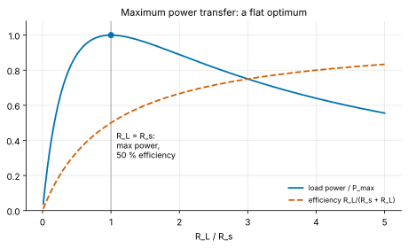
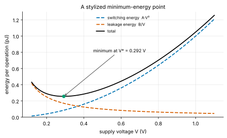
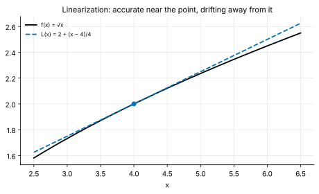
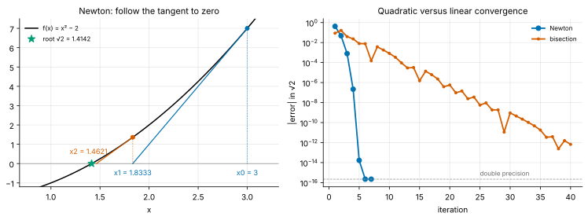
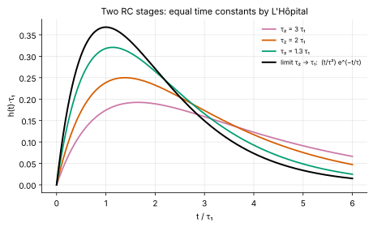

<!-- status: verified -->
# 01-04 · Applications of Derivatives

| | |
|---|---|
| **Course** | [01 · Calculus for Engineers](../README.md) |
| **University equivalent** | Calculus I, applications of differentiation (Stewart, ch. 3–4: related rates, linear approximation and differentials, extrema, the mean value theorem, optimization, L'Hôpital's rule, Newton's method) |
| **Prerequisites** | [01-03](01-03-derivatives.md) (differentiation rules), [01-02](01-02-limits-and-continuity.md) (limits, IVT, bisection). |
| **Estimated study hours** | 12 |
| **Last verified** | 2026-11-12 |

**Learning objectives.** After this chapter you can:

1. Find and classify critical points with the first and second derivative tests, and solve engineering optimization problems such as maximum power transfer and repeater insertion.
2. Linearize a function about an operating point, use differentials to propagate tolerances, and explain the small-signal idea.
3. Derive Newton's method, predict its quadratic convergence, recognize its failure modes, and compare it with bisection.
4. Solve related-rates problems by differentiating relationships with respect to time.
5. Evaluate indeterminate limits with L'Hôpital's rule, and use the mean value theorem to bound changes.

## 1. Big picture

01-03 built the derivative. This chapter puts it to work on the questions engineers actually ask:

- **What is the best value?** Load resistance for maximum power, supply voltage for minimum energy, number of repeaters on a long wire, pipeline depth. Optimal points are where a derivative is zero.
- **How sensitive is the result?** Linearization turns a nonlinear model into a straight line near the operating point. That is the basis of tolerance analysis and of every small-signal amplifier model ([10-04](../../10-electronics-1/chapters/10-04-small-signal-models.md)).
- **How do we solve equations no formula solves?** Newton's method, which SPICE runs millions of times per simulation, is linearization applied repeatedly.
- **How are rates linked?** When one quantity changes, related ones change at rates the chain rule connects. A MEMS microphone turns a diaphragm's velocity into a current this way.
- **What does an indeterminate limit equal?** L'Hôpital's rule settles $0/0$ forms by comparing rates, and explains where the $te^{-t/\tau}$ terms of repeated poles come from.

## 2. Intuition first

### Hilltops are flat

At the top of a smooth hill the ground is level: walk a step either way and your height barely changes. That is Fermat's insight. At an interior maximum or minimum of a differentiable function, the tangent is horizontal, so $f'(x) = 0$. The converse needs care: a flat spot can also be a saddle, as $x^3$ is at 0. So we find the flat spots, then classify them.

The flatness has a practical consequence: **near an optimum, small errors in the design variable cost very little.** If the load resistance is 2× off from the maximum-power value, you still get 89% of the maximum power (Example 01-04.1). Engineers exploit this constantly: an optimum is a *region*, not a knife-edge. A good engineer asks how flat it is before paying for precision.

### An analogy from finance: marginal analysis

A firm maximizes profit where marginal revenue equals marginal cost. Producing one more unit adds as much revenue as cost, so the derivative of profit is zero. Every engineering optimum in this chapter has the same structure: two competing effects whose *marginal* contributions balance at the optimum. Adding repeaters to a wire reduces wire delay at a falling rate while each repeater adds a fixed delay. Lowering the supply voltage reduces switching energy at a falling rate while leakage energy grows.

*Where the analogy breaks:* in engineering, the "prices" are physical laws that do not shift with sentiment, so the optimum is stable and can be calculated in advance. But engineering optima sit on hard constraints more often than economic ones do: a voltage cannot go below the level where logic fails, and a die cannot exceed the reticle. The calculus optimum must always be checked against the boundaries.

### Linear is local

Zoom in far enough on any smooth curve and it looks straight. Linearization uses that straight piece to predict nearby values. It is the engineering equivalent of using a bond's duration to estimate the price change for a small rate move: excellent for small moves, increasingly wrong for large ones. A second-order correction (convexity in finance, curvature in calculus) captures the bend.

## 3. Theory

### 3.1 Critical points and extrema

A function has a **local maximum** at $c$ if $f(c) \ge f(x)$ for all $x$ near $c$, and a **global (absolute) maximum** if this holds over its whole domain. Minimums are defined the same way.

**Fermat's theorem.** If $f$ has a local extremum at an interior point $c$ and $f'(c)$ exists, then $f'(c) = 0$.

*Proof.* Suppose $c$ is a local maximum. For small $h > 0$, $f(c + h) - f(c) \le 0$, so the difference quotient $\big(f(c + h) - f(c)\big)/h \le 0$; letting $h \to 0^+$ gives $f'(c) \le 0$. For small $h < 0$ the quotient is $\ge 0$ (a non-positive number divided by a negative one), so $f'(c) \ge 0$. Both hold only if $f'(c) = 0$. $\blacksquare$

A **critical point** is where $f'(c) = 0$ or $f'(c)$ does not exist. Extrema occur only at critical points or at the ends of the domain.

**Extreme value theorem.** A function continuous on a closed interval $[a, b]$ attains a global maximum and minimum there. To find them: evaluate $f$ at every critical point in $(a, b)$ and at both endpoints, and pick the largest and smallest values (Problem 01-04.1).

### 3.2 Classifying critical points

**First derivative test.** If $f'$ changes from positive to negative at $c$, $f$ rises then falls: a local maximum. From negative to positive: a local minimum. No sign change: neither.

**Second derivative test.** If $f'(c) = 0$ and $f''(c) < 0$, the graph is concave down (curving like ∩), so $c$ is a local maximum. If $f''(c) > 0$, it is concave up (∪): a local minimum. If $f''(c) = 0$, the test is inconclusive. Points where $f''$ changes sign are **inflection points**.

The size of $\lvert f''(c)\rvert$ measures how sharp the optimum is. Near $c$, $f(x) \approx f(c) + \tfrac{1}{2}f''(c)(x - c)^2$ (a result made precise by Taylor's theorem in [01-08](01-08-sequences-series-and-taylor.md)). So the loss from missing the optimum by $\Delta$ is about $\tfrac{1}{2}\lvert f''(c)\rvert\Delta^2$: **second order in the error**. Missing by 10% costs only about 1% of curvature-scaled loss. This is why optima are forgiving.

### 3.3 The mean value theorem

**Rolle's theorem.** If $f$ is continuous on $[a, b]$, differentiable on $(a, b)$, and $f(a) = f(b)$, then $f'(c) = 0$ for some $c$ in $(a, b)$. *Proof:* by the extreme value theorem $f$ has a maximum and a minimum on $[a, b]$. If both occur at the endpoints, $f$ is constant and $f' = 0$ everywhere. Otherwise one is interior, and Fermat's theorem applies. $\blacksquare$

**Mean value theorem (MVT).** If $f$ is continuous on $[a, b]$ and differentiable on $(a, b)$, then for some $c$ in $(a, b)$,

$$
f'(c) = \frac{f(b) - f(a)}{b - a}.
$$

At some instant, the instantaneous rate equals the average rate. A car that covers 120 km in one hour must read exactly 120 km/h at some moment. *Proof:* apply Rolle's theorem to $f(x)$ minus the secant line through its endpoints.

**Consequences engineers use:**

1. **Rate bounds give change bounds.** If $\lvert f'\rvert \le M$ everywhere, then $\lvert f(b) - f(a)\rvert \le M\lvert b - a\rvert$. An op-amp with slew rate 1 V/µs cannot change its output by more than 2 V in 2 µs (Problem 01-04.11).
2. **Zero derivative means constant.** If $f' = 0$ on an interval, $f$ is constant there. This justifies "+ C" in every antiderivative ([01-05](01-05-integrals.md)).
3. **Same derivative means a constant difference.** Two functions with equal derivatives differ by a constant.

### 3.4 Optimization in engineering

**The recipe.**

1. Write the quantity to optimize as a function of *one* design variable, using any constraints to eliminate the others.
2. State the domain (physical limits).
3. Set the derivative to zero and solve.
4. Classify with the second derivative, and compare with the endpoints.
5. Sanity-check: units, limits, and how flat the optimum is.

**Maximum power transfer.** A source with open-circuit voltage $V_s$ and internal resistance $R_s$ drives a load $R_L$ ([06-08](../../06-circuit-analysis-1-dc/chapters/06-08-thevenin-and-norton.md)). The current is $V_s/(R_s + R_L)$, so the load power is

$$
P(R_L) = \frac{V_s^2R_L}{(R_s + R_L)^2}.
$$

By the quotient rule,

$$
\frac{dP}{dR_L} = V_s^2\,\frac{(R_s + R_L)^2 - R_L\cdot2(R_s + R_L)}{(R_s + R_L)^4} = V_s^2\,\frac{R_s - R_L}{(R_s + R_L)^3}.
$$

This is zero at $R_L = R_s$, positive below and negative above: a maximum. The maximum power is

$$
P_{max} = \frac{V_s^2}{4R_s}.
$$

The **efficiency** at that point is only $R_L/(R_s + R_L) = 50\%$: half the power burns inside the source. That is why the rule is used where the *signal* is precious and the source is weak, as in RF receivers, antennas and sensor interfaces (the 50 Ω world of [21](../../21-rf-and-microwave-engineering/README.md)). It is *never* used for power delivery, where efficiency matters and the goal is $R_s \ll R_L$. Figure 1 shows how flat the optimum is.

*Figure 1. Load power (normalized) and efficiency against $R_L/R_s$. Power peaks at $R_L = R_s$, where efficiency is 50%. The peak is flat: a 2× error still delivers 89% of the maximum.*

**The balance principle: minimize $ax + b/x$.** Many tradeoffs have one cost that grows with a design variable and another that shrinks:

$$
g(x) = ax + \frac{b}{x}\quad(a, b, x > 0), \qquad g'(x) = a - \frac{b}{x^2} = 0 \;\Longrightarrow\; x^\ast = \sqrt{\frac{b}{a}}, \qquad g(x^\ast) = 2\sqrt{ab}.
$$

At the optimum the two terms are **equal**: $ax^\ast = b/x^\ast = \sqrt{ab}$. Instances include:

- **Repeater insertion** on long on-chip wires: $n$ repeaters add $n$ fixed delays, while the quadratic RC delay of the wire shrinks as $1/n$ (Problem 01-04.6, [19-05](../../19-digital-vlsi-design/chapters/19-05-interconnect.md));
- **Pipeline depth:** more stages shorten each stage but raise hazard penalties (Problem 01-04.13);
- **Inventory economics:** the economic order quantity has the same form, if you know it from finance or operations.

**A stylized minimum-energy point.** The energy per operation of a digital circuit has two parts. Switching energy scales as $V^2$. Leakage energy is leakage power times the duration of an operation, and the operation slows as the voltage falls. A stylized model captures the shape:

$$
E(V) = AV^2 + \frac{B}{V}.
$$

Here $A$ (pJ/V²) sets the switching energy and $B$ (pJ·V) the leakage. Setting $E'(V) = 2AV - B/V^2 = 0$ gives

$$
V^\ast = \left(\frac{B}{2A}\right)^{1/3},
$$

and $E''(V) = 2A + 2B/V^3 > 0$ confirms a minimum (Figure 2, Example 01-04.2). Real circuits slow down *exponentially* below threshold, so the true model is steeper. But measured minimum-energy points do sit at a few hundred millivolts ([R-027](../../../reference/research-log.md#r-027--subthreshold-and-near-threshold-operation)).

*Figure 2. Switching energy falls with voltage while leakage energy rises, so total energy per operation has a minimum.*

### 3.5 Linearization and differentials

The **linearization** of $f$ at $a$ is its tangent line:

$$
L(x) = f(a) + f'(a)(x - a).
$$

For $x$ near $a$, $f(x) \approx L(x)$ (Figure 3). In **differential** notation, a small change $dx$ produces $dy = f'(x)\,dx$. The error of the approximation is about $\tfrac{1}{2}f''(a)(x - a)^2$, so it shrinks quadratically as $x \to a$ ([01-08](01-08-sequences-series-and-taylor.md) proves this).

*Figure 3. The tangent line to $\sqrt{x}$ at $x = 4$. It is accurate near 4 and drifts away as the distance grows.*

**Error propagation and tolerances.** For a quantity $y = f(x_1, x_2, \ldots)$ of several inputs, each input's small error contributes $\dfrac{\partial y}{\partial x_i}dx_i$. (Partial derivatives, $\partial$, are developed in [01-09](01-09-multivariable-calculus-1.md); here treat each as an ordinary derivative with the other inputs held fixed.) In relative terms, using the elasticities of 01-03:

$$
\frac{dy}{y} = \sum_i S_i\,\frac{dx_i}{x_i}.
$$

Two ways to combine the errors:

- **Worst case:** add the magnitudes, $\sum\lvert S_i\rvert\lvert dx_i/x_i\rvert$. This is guaranteed, but pessimistic.
- **Root sum of squares (RSS):** $\sqrt{\sum(S_i\,dx_i/x_i)^2}$. This is the standard deviation when the errors are independent and random ([03](../../03-probability-statistics-and-random-variables/README.md)), and the usual choice when many parts are involved.

Example 01-04.3 compares the two for an RC filter.

**The small-signal idea.** Split each variable into a fixed operating point and a small deviation: $v = V + v_{small}$. For a nonlinear device $i = f(v)$, linearization gives

$$
i \approx f(V) + f'(V)\,v_{small} = I + g\,v_{small}.
$$

The DC operating point $I$ and the small-signal response $g\,v_{small}$ can then be analyzed separately, the second with ordinary linear circuit theory. This is exactly how every transistor amplifier is designed. The diode's $g_d = I/V_T$ (01-03) and a MOSFET's transconductance $g_m$ ([10-04](../../10-electronics-1/chapters/10-04-small-signal-models.md)) are such slopes. The approximation is good while $v_{small}$ is small compared with the scale on which $f'$ changes. For a diode that scale is $V_T \approx 26$ mV.

### 3.6 Newton's method

To solve $f(x) = 0$, replace $f$ by its linearization at the current guess $x_k$, and solve the *linear* equation instead:

$$
f(x_k) + f'(x_k)(x - x_k) = 0 \quad\Longrightarrow\quad x_{k+1} = x_k - \frac{f(x_k)}{f'(x_k)}.
$$

Geometrically: follow the tangent line down to the axis (Figure 4).

**Quadratic convergence.** Let $r$ be the root and $e_k = x_k - r$. Expanding $f$ about $x_k$ to second order (Taylor, [01-08](01-08-sequences-series-and-taylor.md)),

$$
0 = f(r) = f(x_k) - f'(x_k)e_k + \tfrac{1}{2}f''(\xi)e_k^2
$$

for some $\xi$ between $r$ and $x_k$. Divide by $f'(x_k)$ and use the Newton step $x_{k+1} = x_k - f(x_k)/f'(x_k)$:

$$
e_{k+1} = x_{k+1} - r = \frac{f''(\xi)}{2f'(x_k)}\,e_k^2 .
$$

The new error is proportional to the *square* of the old one. If $e_k = 10^{-3}$, then $e_{k+1} \sim 10^{-6}$ and $e_{k+2} \sim 10^{-12}$: **the number of correct digits roughly doubles each step.** Bisection, by contrast, gains one bit (0.3 digits) per step (Figure 4, right).

*Figure 4. Left: Newton's tangent steps from $x_0 = 3$ toward $\sqrt{2}$. Right: Newton's error falls off a cliff (quadratic convergence), while bisection's falls steadily (linear convergence).*

**Failure modes.** Quadratic convergence is a *local* promise: it holds once you are close to the root. Far away, Newton can:

- **overshoot** when $f'$ is small or rapidly changing, as with the diode's exponential from a low starting voltage ([00-04](../../00-orientation/chapters/00-04-toolchain-walkthrough.md), Problem 9);
- **diverge** when the tangent points away: for $\arctan x$, starting beyond about 1.39 sends the iterates flying outward (Problem 01-04.8);
- **fail outright** where $f'(x_k) = 0$.

**Remedies** are damping (take only a fraction of the step), step limiting (SPICE caps voltage changes per iteration), and hybrid methods that fall back to bisection when a step would leave the bracket.

**Newton in hardware.** Division is slow in silicon. Many floating-point units compute $1/a$ by Newton iteration on $f(x) = 1/x - a$:

$$
x_{k+1} = x_k(2 - ax_k),
$$

which needs only multiplications and subtractions. A table lookup provides a seed accurate to about 8 bits, and each iteration doubles the correct bits: 8 → 16 → 32 → 64. Three iterations reach double precision (Problem 01-04.7). Intel's Itanium architecture famously had no hardware divide instruction and performed division this way in software **[Established]**. The ancient "Babylonian" square-root method, $x_{k+1} = \tfrac{1}{2}(x_k + a/x_k)$, is Newton's method on $x^2 - a$ (Example 01-04.4).

### 3.7 Related rates

When quantities linked by an equation change in time, differentiate the equation with respect to $t$ using the chain rule. The rates are then linked too. The procedure:

1. Write the relationship between the quantities.
2. Differentiate both sides with respect to $t$.
3. Substitute the known values *after* differentiating.

**A capacitive MEMS sensor.** A parallel-plate capacitor has $C = \varepsilon_0A/d$ (permittivity $\varepsilon_0 = 8.854\times10^{-12}$ F/m, plate area $A$, gap $d$). In a condenser microphone or a MEMS accelerometer, the gap $d(t)$ moves. Held at a constant bias $V$, the charge is $q = CV$, so the current is

$$
i = \frac{dq}{dt} = V\frac{dC}{dt} = V\cdot\left(-\frac{\varepsilon_0A}{d^2}\right)\frac{dd}{dt}.
$$

The diaphragm's *velocity* becomes a current (Problem 01-04.9). Note the $1/d^2$: smaller gaps give much more sensitive sensors, which is why MEMS gaps are micrometers.

**Thermal rates.** A chip's temperature rises toward its steady state at a rate set by its thermal time constant. Related rates tell you how long a "turbo" power level can be sustained before a temperature limit is reached (Problem 01-04.15).

### 3.8 L'Hôpital's rule

**Statement.** If $f(x) \to 0$ and $g(x) \to 0$ as $x \to a$ (or both tend to $\pm\infty$), and $\lim f'(x)/g'(x)$ exists, then

$$
\lim_{x\to a}\frac{f(x)}{g(x)} = \lim_{x\to a}\frac{f'(x)}{g'(x)}.
$$

**Why it works (the 0/0 case, intuitively).** If $f(a) = g(a) = 0$, linearize both: $f(x) \approx f'(a)(x - a)$ and $g(x) \approx g'(a)(x - a)$. The common factor $(x - a)$ cancels, leaving $f'(a)/g'(a)$. Two quantities vanishing together have a ratio set by the rates at which they vanish.

> **Going deeper — Cauchy's mean value theorem.** The rigorous proof, which also covers $f'(a)/g'(a)$ undefined and the ∞/∞ case, uses Cauchy's generalization of the MVT: for $f$, $g$ continuous on $[a, x]$ and differentiable inside, there is a $c$ in $(a, x)$ with $\big(f(x) - f(a)\big)g'(c) = \big(g(x) - g(a)\big)f'(c)$. With $f(a) = g(a) = 0$ this gives $f(x)/g(x) = f'(c)/g'(c)$, and as $x \to a$, $c \to a$ as well.

**Examples.**

- $\lim_{x\to0}\dfrac{\sin x}{x} = \lim\dfrac{\cos x}{1} = 1$. (A circular argument, since we used this limit to differentiate $\sin x$. It is a consistency check, not a proof.)
- $\lim_{x\to0}\dfrac{e^x - 1 - x}{x^2} = \lim\dfrac{e^x - 1}{2x} = \lim\dfrac{e^x}{2} = \dfrac{1}{2}$. Apply the rule twice: each application must still be a 0/0 form.
- **Other indeterminate forms** convert to a quotient. $0\cdot\infty$: $x\ln x = \dfrac{\ln x}{1/x} \to \dfrac{1/x}{-1/x^2} = -x \to 0$ as $x \to 0^+$. $1^\infty$ and $\infty^0$: take the logarithm first.

**Caution.** Check the indeterminate form before each application. Applying the rule to $\lim_{x\to0}(x + 1)/(x + 2) = 1/2$ would give the wrong answer, 1.

**Engineering instance: repeated time constants.** Two RC stages in cascade, buffered so they do not load each other, with time constants $\tau_1 \ne \tau_2$, have impulse response ([11-03](../../11-signals-and-systems/chapters/11-03-convolution.md))

$$
h(t) = \frac{e^{-t/\tau_1} - e^{-t/\tau_2}}{\tau_1 - \tau_2}.
$$

When the stages are identical, the formula reads $0/0$. Treat it as a function of $\tau_2$ and let $\tau_2 \to \tau_1 = \tau$. By L'Hôpital, differentiating numerator and denominator with respect to $\tau_2$:

$$
\lim_{\tau_2\to\tau}h = \frac{-\dfrac{t}{\tau^2}e^{-t/\tau}}{-1} = \frac{t}{\tau^2}e^{-t/\tau}.
$$

The factor $t$ in front of the exponential is the signature of a **repeated root**. It reappears in critically damped circuits ([02-03](../../02-complex-numbers-des-and-linear-algebra/chapters/02-03-second-order-linear-odes.md)) and in Laplace transforms with double poles (Example 01-04.5, Figure 5).

*Figure 5. As $\tau_2 \to \tau_1$, the two-exponential response converges smoothly to the L'Hôpital limit $(t/\tau^2)e^{-t/\tau}$.*

## 4. Worked examples

### Example 01-04.1 — Maximum power transfer and the flat optimum (tier A)

**Setup.** A source has $V_s = 10$ V and $R_s = 50\ \Omega$. Find the load that maximizes load power, the maximum power, and the efficiency there. What fraction of the maximum does a 100 Ω load receive?

**Solution.** From §3.4, $R_L = R_s = $ **50 Ω**, and $P_{max} = V_s^2/(4R_s) = 100/200 = $ **0.5 W**. The efficiency is **50%**: another 0.5 W is dissipated in $R_s$. For $R_L = 100\ \Omega$: $P = 100\times100/150^2 = $ **0.4444 W**, or **88.9%** of the maximum, although $R_L$ is 2× off.

**Sanity check.** At $R_L = R_s$ the load voltage is $V_s/2 = 5$ V, and $5^2/50 = 0.5$ W ✓. The lab confirms the optimum with an ngspice resistance sweep.

### Example 01-04.2 — A stylized minimum-energy point (tier B)

**Setup.** A digital block's energy per operation follows $E(V) = AV^2 + B/V$ with $A = 1$ pJ/V² and $B = 0.05$ pJ·V (a stylized model; §3.4). Find the minimum-energy supply voltage $V^\ast$, the minimum energy, and the saving compared with operating at 1.0 V. What is the ratio of leakage to switching energy at the optimum?

**Solution.** $V^\ast = (B/2A)^{1/3} = (0.025)^{1/3} = $ **0.2924 V**. Then $E(V^\ast) = 1\times0.2924^2 + 0.05/0.2924 = 0.0855 + 0.1710 = $ **0.2565 pJ**. At 1.0 V, $E = 1 + 0.05 = 1.05$ pJ, so the optimum saves a factor of **4.09**. At the optimum, $2AV^{\ast 2} = B/V^\ast$, so leakage energy is **2×** switching energy (0.1710 against 0.0855).

**Interpretation.** Below $V^\ast$, leakage acting over ever-longer operations wins; above it, $CV^2$ wins. Energy-harvesting and always-on wearable chips run near this point, trading speed for battery life ([R-027](../../../reference/research-log.md#r-027--subthreshold-and-near-threshold-operation)).

**Sanity check.** $E''(V^\ast) = 2A + 2B/V^{\ast3} = 2 + 4.0 = 6.0 > 0$ ✓, a minimum.

### Example 01-04.3 — Tolerance of an RC filter's corner frequency (tier B)

**Setup.** An RC low-pass filter uses $R = 10$ kΩ ± 1% and $C = 10$ nF ± 5%. Find the nominal corner $f_c = 1/(2\pi RC)$ and its uncertainty by (a) worst-case linear analysis, (b) root sum of squares, and (c) exact worst-case evaluation.

**Solution.** Nominal: $f_c = 1/(2\pi\times10^4\times10^{-8}) = $ **1591.5 Hz**. The elasticities are $S_R = S_C = -1$, so $df_c/f_c = -dR/R - dC/C$.

(a) Worst case: $1\% + 5\% = 6\%$, i.e. ±**95.5 Hz**.

(b) RSS: $\sqrt{1^2 + 5^2}\% = 5.10\%$, i.e. ±**81.2 Hz**.

(c) Exact: both values low gives $1/(0.99\times0.95) - 1 = $ **+6.33%**; both high gives $1/(1.01\times1.05) - 1 = $ **−5.70%**.

**Interpretation.** The capacitor dominates. Tightening the resistor to 0.1% barely helps, while a 1% capacitor would cut the spread about 3.5×. This is the first lesson of tolerance analysis: **find the dominant term before spending money**. The linear worst case is slightly off from the exact range because $1/x$ curves.

**Sanity check.** RSS ≤ worst case, always ✓.

### Example 01-04.4 — Newton's method for √2 (tier B)

**Setup.** Apply Newton's method to $f(x) = x^2 - 2$ from $x_0 = 1$. Tabulate four iterations and their errors.

**Solution.** $x_{k+1} = x_k - (x_k^2 - 2)/(2x_k) = \tfrac{1}{2}(x_k + 2/x_k)$.

| $k$ | $x_k$ | Error $x_k - \sqrt{2}$ |
|---|---|---|
| 1 | 1.5 | $8.58\times10^{-2}$ |
| 2 | 1.416667 | $2.45\times10^{-3}$ |
| 3 | 1.4142157 | $2.12\times10^{-6}$ |
| 4 | 1.41421356237469 | $1.59\times10^{-12}$ |

The number of correct digits goes roughly 1, 2, 5, 11.

**Check the theory.** §3.6 predicts $e_{k+1} \approx \dfrac{f''}{2f'}e_k^2 = \dfrac{1}{2\sqrt{2}}e_k^2 = 0.354\,e_k^2$. From step 3 to 4: $0.354\times(2.12\times10^{-6})^2 = 1.59\times10^{-12}$ ✓.

### Example 01-04.5 — Equal time constants by L'Hôpital (tier C)

**Setup.** Two buffered RC stages have time constants $\tau_1$ and $\tau_2$, with impulse response $h(t) = \big(e^{-t/\tau_1} - e^{-t/\tau_2}\big)/(\tau_1 - \tau_2)$. (a) Find $h$ when $\tau_1 = \tau_2 = \tau$. (b) For $\tau = 1$ ms, find when $h$ peaks and its peak value. (c) Check against the unequal formula with $\tau_2 = 1.001$ ms at $t = 1$ ms.

**Solution.**

(a) By L'Hôpital (§3.8), $h(t) = \dfrac{t}{\tau^2}e^{-t/\tau}$.

(b) Product rule: $h'(t) = \dfrac{1}{\tau^2}e^{-t/\tau}\left(1 - \dfrac{t}{\tau}\right)$, which is zero at $t = \tau = $ **1 ms**. The sign changes from + to −, so it is a maximum. The peak value is $h(\tau) = \dfrac{1}{e\tau} = $ **367.9 s⁻¹**.

(c) $\big(e^{-1} - e^{-1/1.001}\big)/(-10^{-6}\text{ s}) = $ **367.7 s⁻¹**, within 0.05% of the limit, and approaching it as $\tau_2 \to \tau_1$.

**Units check.** An impulse response has units of 1/s (output per unit area of input impulse): $t/\tau^2$ is s/s² ✓.

<!-- answer-key -->
| ID | Quantity | Value | Unit |
|---|---|---|---|
| Ex 01-04.1a | optimal load | 50 | Ω |
| Ex 01-04.1b | maximum power | 0.5 | W |
| Ex 01-04.1c | efficiency at maximum | 50 | % |
| Ex 01-04.1d | power into 100 Ω | 0.4444 | W |
| Ex 01-04.1e | fraction of maximum | 88.9 | % |
| Ex 01-04.2a | minimum-energy voltage | 0.2924 | V |
| Ex 01-04.2b | minimum energy | 0.2565 | pJ |
| Ex 01-04.2c | saving factor vs 1.0 V | 4.09 | — |
| Ex 01-04.2d | leakage/switching ratio at optimum | 2 | — |
| Ex 01-04.3a | nominal corner | 1591.5 | Hz |
| Ex 01-04.3b | worst-case linear spread | 95.5 | Hz |
| Ex 01-04.3c | RSS spread | 81.2 | Hz |
| Ex 01-04.3d | exact high-side change | 6.33 | % |
| Ex 01-04.3e | exact low-side change | −5.70 | % |
| Ex 01-04.4a | x after 3 iterations | 1.4142157 | — |
| Ex 01-04.4b | error after 3 iterations | 2.12×10^-6 | — |
| Ex 01-04.4c | error after 4 iterations | 1.59×10^-12 | — |
| Ex 01-04.5a | peak time | 1 | ms |
| Ex 01-04.5b | peak value | 367.9 | 1/s |
| Ex 01-04.5c | unequal-τ check at 1 ms | 367.7 | 1/s |

*Recomputed by [verify_01_04.py](../verify/verify_01_04.py). Example 01-04.1 is also confirmed by an ngspice resistance sweep in the lab.*

## 5. Simulate it

The lab ([labs/01-04-lab/](../labs/01-04-lab/README.md)) has a notebook and one ngspice netlist:

1. **Optimization explorer.** Sweep the load for maximum power transfer, the repeater count for a long wire, and the supply voltage for the stylized minimum-energy point. Watch how flat each optimum is.
2. **Tolerance analysis.** Compare worst case, RSS and a 100,000-sample Monte Carlo for the RC corner of Example 01-04.3.
3. **Newton versus bisection.** Count digits per iteration, then map where Newton converges for $\arctan x$.
4. **L'Hôpital numerically.** Evaluate the two-time-constant response as $\tau_2 \to \tau_1$, and watch floating-point cancellation spoil it when they get *too* close.
5. **ngspice.** `max_power.cir` sweeps the load resistance and measures the power maximum.

**Predict, then run.** Before Part 2, predict whether the Monte Carlo standard deviation will be closer to the worst-case or the RSS figure.

## 6. Engineering tradeoffs

| Knob | Improves | Costs | Typical decision owner |
|---|---|---|---|
| Match load to source ($R_L = R_s$) | Maximum delivered signal power | 50% efficiency; only sensible for weak signals (RF, sensors) | RF and sensor-interface designers |
| Operate near the minimum-energy voltage | Energy per operation, battery life | Speed falls steeply; more sensitive to process and temperature variation | SoC architect, low-power design team |
| More repeaters or pipeline stages | Shorter delay per segment or stage | Area, power, latency; overhead per added stage | Physical-design and micro-architecture teams |
| Tighter component tolerances | Smaller spread in the output | Cost; wasted if not on the dominant term | Circuit designer with purchasing |
| Newton's method rather than bisection | Quadratic convergence (fast) | Can diverge without a good start; needs the derivative | Simulation and firmware engineers |
| Worst-case rather than RSS tolerance analysis | Guaranteed margins | Over-design and cost for many-part systems | Reliability and quality teams |

## 7. Numbers to know

| Quantity | Value | Note |
|---|---|---|
| Maximum power transfer | $R_L = R_s$, $P_{max} = V_s^2/(4R_s)$, 50% efficiency | Signal, not power, delivery |
| Load error 2× from optimum | 89% of $P_{max}$ | Optima are flat |
| Minimum of $ax + b/x$ | at $\sqrt{b/a}$, value $2\sqrt{ab}$ | The two terms are equal there |
| Newton convergence | digits roughly double per step | Bisection: about 3.3 steps per digit |
| Newton reciprocal from an 8-bit seed to double precision | 3 iterations | 8 → 16 → 32 → 64 bits |
| Small-signal validity for a diode or BJT | swings ≪ $V_T$ ≈ 26 mV | 10% error at about 5 mV |
| Minimum-energy supply in subthreshold CMOS | a few hundred mV | Published studies ([R-027](../../../reference/research-log.md#r-027--subthreshold-and-near-threshold-operation)) |

## 8. Common mistakes

1. **Stopping at $f'(c) = 0$.** A critical point can be a maximum, a minimum or neither. Classify it, and compare with the endpoints.
2. **Optimizing the wrong variable.** Maximum power transfer chooses $R_L$ for a *given* $R_s$. If you can choose $R_s$, make it as small as possible.
3. **Confusing maximum power with maximum efficiency.** They occur at different loads.
4. **Linearizing too far from the operating point.** The error grows as the square of the distance.
5. **Adding tolerances worst-case for many independent parts.** The result is unrealistically pessimistic; use RSS or Monte Carlo, and keep worst case for safety-critical margins.
6. **Starting Newton anywhere.** It converges only near the root. Bracket first, or damp the steps.
7. **Applying L'Hôpital to a non-indeterminate form,** or differentiating the quotient $f/g$ instead of $f$ and $g$ separately.
8. **Substituting values before differentiating** in related-rates problems. Differentiate the general relationship first.

## 9. Practitioner lens

### Optimization in today's chips (as of Nov 2026)

- **Energy-optimal operation is a product category.** The minimum-energy point of subthreshold CMOS was characterized in the research literature two decades ago ([R-027](../../../reference/research-log.md#r-027--subthreshold-and-near-threshold-operation)) **[Established]**. Companies have since commercialized very-low-voltage logic for wearables and IoT. Ambiq's SPOT platform runs below 0.5 V, and the company claims 5–10× lower energy than competing microcontrollers **[vendor claim; Contested]**. The calculus of Example 01-04.2 explains *why* such a point exists. Diligence must establish *where* a given product actually operates, and at what speed.
- **Newton's method is everywhere in the toolchain.** Circuit simulators, timing engines and many floating-point units use Newton iterations **[Established]** (§3.6). Convergence failures are a familiar engineering cost, which is why tool robustness matters in EDA selection.

### Why it matters commercially

- **Optima are flat, so precision is often cheap to skip and expensive to buy.** A design team that knows the second derivative of its key tradeoffs can relax specifications where the optimum is flat and spend only where it is sharp.
- **Tolerance analysis drives bill-of-materials cost.** Example 01-04.3 shows that spending on the non-dominant component buys nothing. The same logic applies to process control in a fab: control the parameters the yield is most sensitive to.

### Marketing vs Reality

**"Optimized for efficiency."** Ask: efficiency at which operating point, and at what speed? Energy per operation is minimized at low voltage, but so is throughput. Claims that mix a best-case energy figure with a best-case speed figure are describing two different operating points.

**"Maximum power transfer" in power products.** Matching is the wrong goal for power delivery. A pitch that conflates the two signals a weak grasp of fundamentals.

**"Our solver always converges."** Newton converges only near a solution. Ask how the tool or firmware handles non-convergence, and how often it falls back.

### Questions to ask engineering leaders

1. **"Where is your design's optimum, and how flat is it?"**
   *Strong answer:* knows the curve, the margin and which variables matter most. *Evasive:* a single point with no sensitivity.
2. **"What dominates your tolerance stack, and what does tightening it cost?"**
   *Strong:* names the dominant term quantitatively, with an RSS and a worst-case budget. *Evasive:* "everything is tight".
3. **"At what voltage and frequency is your energy-per-operation figure measured, and what is the throughput there?"**
   *Strong:* gives the full voltage–frequency–energy curve. *Evasive:* quotes a single best-case pair.
4. **"How do your numerical routines (simulation, calibration, gauging) behave when they fail to converge?"**
   *Strong:* describes bracketing fallbacks, iteration limits and tested failure handling. *Evasive:* "it doesn't happen".

## 10. Concept check

**Q1.** $f'(c) = 0$ and $f''(c) = 0$. What can you conclude about $c$?

Answer

Nothing yet: the second derivative test is inconclusive. Use the first derivative test (sign change of $f'$). Compare $x^3$ (no extremum at 0), $x^4$ (minimum) and $-x^4$ (maximum).

**Q2.** Why is the maximum-power-transfer load a bad choice for a phone charger?

Answer

Its efficiency is only 50%: as much power is wasted in the source as is delivered. Power delivery wants $R_s \ll R_L$ for high efficiency.

**Q3.** Minimize $g(x) = 4x + 9/x$ for $x > 0$.

Answer

$x^\ast = \sqrt{9/4} = 1.5$, and $g = 2\sqrt{36} = 12$. At the optimum, both terms equal 6.

**Q4.** Use linearization to estimate $\sqrt{9.2}$.

Answer

$3 + 0.2/(2\times3) = 3.0333$. (Exact: 3.0332.)

**Q5.** Newton's method has error $10^{-3}$ at some step, near the root. Roughly what error two steps later?

Answer

About $10^{-12}$, since each step roughly squares the error (times a constant of order 1).

**Q6.** Two resistors in series, each 1 kΩ ± 1%, independent. What is the RSS tolerance of the total, in percent?

Answer

Each contributes ±10 Ω, so the total is $2000 \pm \sqrt{10^2 + 10^2} = 2000 \pm 14.1$ Ω, i.e. ±0.71%. RSS averaging *improves* the relative tolerance.

**Q7.** Evaluate $\lim_{x\to0}\dfrac{1 - \cos x}{x^2}$ by L'Hôpital's rule.

Answer

$\lim\dfrac{\sin x}{2x} = \lim\dfrac{\cos x}{2} = \dfrac{1}{2}$, applying the rule twice.

**Q8.** An op-amp slews at 0.5 V/µs. Can its output change by 3 V in 5 µs?

Answer

No. By the mean value theorem the change is at most $0.5\times5 = 2.5$ V.

Now work the problem set: [01-04 problems](../problems/01-04-problems.md) (solutions in [01-04 solutions](../solutions/01-04-solutions.md)).

## 11. Key terms

[Critical point](../../../reference/glossary.md#critical-point) ·
[Second derivative test](../../../reference/glossary.md#second-derivative-test) ·
[Mean value theorem](../../../reference/glossary.md#mean-value-theorem) ·
[Maximum power transfer](../../../reference/glossary.md#maximum-power-transfer) ·
[Linearization](../../../reference/glossary.md#linearization) ·
[Small-signal model](../../../reference/glossary.md#small-signal-model) ·
[Root sum of squares (RSS)](../../../reference/glossary.md#root-sum-of-squares-rss) ·
[Newton's method](../../../reference/glossary.md#newtons-method) ·
[Quadratic convergence](../../../reference/glossary.md#quadratic-convergence) ·
[Related rates](../../../reference/glossary.md#related-rates) ·
[L'Hôpital's rule](../../../reference/glossary.md#lhopitals-rule) ·
[Minimum-energy point](../../../reference/glossary.md#minimum-energy-point)

## 12. Connections

- **Builds on:** [01-03](01-03-derivatives.md) (derivatives), [01-02](01-02-limits-and-continuity.md) (limits and bisection).
- **Next:** [01-05 Integrals](01-05-integrals.md).
- **Used later in:**
  - [01-08](01-08-sequences-series-and-taylor.md): Taylor series, the error terms of linearization and Newton.
  - [01-09](01-09-multivariable-calculus-1.md): optimization with several variables and constraints.
  - [06-08](../../06-circuit-analysis-1-dc/chapters/06-08-thevenin-and-norton.md): Thévenin and maximum power transfer.
  - [10-04](../../10-electronics-1/chapters/10-04-small-signal-models.md): small-signal models.
  - [02-10](../../02-complex-numbers-des-and-linear-algebra/chapters/02-10-numerical-methods.md): Newton's method in several variables.
  - [19-06](../../19-digital-vlsi-design/chapters/19-06-power-and-low-power-design.md): energy-optimal operation.
  - [19-05](../../19-digital-vlsi-design/chapters/19-05-interconnect.md): repeater insertion.

## 13. Further study

- **Stewart, *Calculus: Early Transcendentals*,** sections on related rates, linear approximation, the mean value theorem, optimization, L'Hôpital's rule and Newton's method (chapters 3–4).
- **Strang, *Calculus* (free, MIT OpenCourseWare),** chapter 3 (applications of the derivative).
- **MIT OpenCourseWare 18.01SC,** Unit 2 (applications of differentiation).
- **B. Razavi, *Design of Analog CMOS Integrated Circuits*,** the opening chapters, for how the small-signal idea is used in practice (preview for Course 10).

## 14. Sources

1. Research log [R-027](../../../reference/research-log.md#r-027--subthreshold-and-near-threshold-operation): minimum-energy operation and commercial subthreshold MCUs.
2. Intel, *Intel Itanium Architecture Software Developer's Manual*, vol. 1, on division and square root by Newton–Raphson using the `frcpa` and `frsqrta` approximation instructions (documented since the architecture's introduction).
3. The theorems of this chapter are standard calculus (Stewart, ch. 3–4). All text, examples and problems are original.
