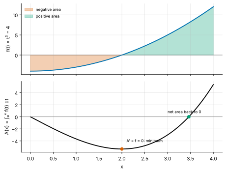
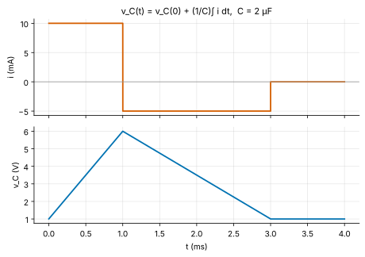
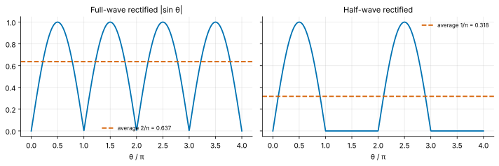
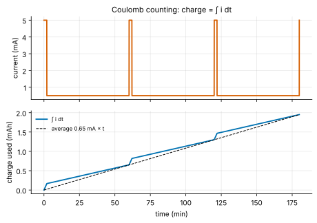

<!-- status: verified -->
# 01-05 · Integrals: Accumulating Charge and Energy

| | |
|---|---|
| **Course** | [01 · Calculus for Engineers](../README.md) |
| **University equivalent** | Calculus I, integration (Stewart, ch. 5: area and distance, the definite integral, the fundamental theorem of calculus, indefinite integrals, net change, simple substitution), with charge and energy from a first circuits course |
| **Prerequisites** | [01-03](01-03-derivatives.md) (derivatives), [01-04](01-04-applications-of-derivatives.md) (mean value theorem). |
| **Estimated study hours** | 12 |
| **Last verified** | 2026-11-12 |

**Learning objectives.** After this chapter you can:

1. Approximate an accumulated quantity with Riemann sums (left, right, midpoint, trapezoid), and interpret the definite integral as their limit and as signed area, with units.
2. State and prove both parts of the fundamental theorem of calculus, and evaluate definite integrals with antiderivatives.
3. Find basic antiderivatives (powers, exponentials, $1/x$, trigonometric functions, linear substitution) and check them by differentiation.
4. Compute charge, capacitor voltage, inductor current and energy as integrals of currents, voltages and power.
5. Compute average values of waveforms, and use integrals as running totals in measurement systems such as battery gauges, energy meters and integrating ADCs.

## 1. Big picture

Differentiation asks how fast something changes. Integration asks the reverse: given the rate, how much has accumulated? Given a current, how much charge has flowed? Given power, how much energy has been used? Given a battery's drain over a day, how long until it is empty? Integration answers by adding up many small pieces, rate × time, and taking the limit as the pieces shrink. The **fundamental theorem of calculus** then reveals that this adding-up is the exact inverse of differentiation, which turns an infinite sum into a short calculation.

- **Charge and energy are integrals:** $q = \int i\,dt$ and $w = \int p\,dt$. A battery's mAh rating, an electricity bill's kWh and a capacitor's stored energy are all integrals.
- **Capacitors and inductors integrate:** $v_C = \tfrac{1}{C}\int i\,dt$ and $i_L = \tfrac{1}{L}\int v\,dt$, which is why they store energy and smooth signals.
- **Measurement is integration:** battery fuel gauges count coulombs, energy meters accumulate $v\cdot i$, and integrating ADCs average away noise.
- **Averages are integrals:** DC values, average power and the efficiency of a rectifier all come from integrals over a period.

## 2. Intuition first

### The bank balance

A bank balance is the integral of cash flow. Deposits (positive flow) raise it and withdrawals (negative flow) lower it. The balance on any day equals the opening balance plus the sum of all flows since. The *rate* at which the balance changes on a given day *is* that day's net flow. Those two statements are the two halves of the fundamental theorem of calculus:

1. The balance accumulates the flows: $B(t) = B(0) + \int_0^t \text{flow}$.
2. The rate of change of the balance is the flow: $B'(t) = \text{flow}(t)$.

A capacitor is exactly such an account, with charge as the balance and current as the flow. $v_C = q/C$ just converts the balance to volts.

*Where the analogy breaks:* bank flows are discrete transactions, so the balance changes in jumps. Physical flows are continuous, so the accumulation is smooth. Integration is the tool for the continuous case; summation (Σ) handles the discrete one. The two meet in a digital system, which samples a continuous signal and sums the samples: a Riemann sum (§3.1, Problem 01-05.15).

### Area under a curve

If a current is constant at 2 mA for 5 ms, the charge is the rectangle $2\text{ mA}\times5\text{ ms} = 10$ µC. If the current varies, chop time into thin slices. In each slice the current is nearly constant, so the charge is nearly current × slice width. Add the slices. As the slices get thinner the sum converges to the **area under the current-versus-time curve**. That area has units of (vertical units) × (horizontal units): here mA × ms = µC. Areas below the axis count as negative, since negative current removes charge.

## 3. Theory

### 3.1 Riemann sums and the definite integral

Divide $[a, b]$ into $n$ subintervals of width $\Delta x = (b - a)/n$, with endpoints $x_k = a + k\Delta x$. Pick a sample point $x_k^\ast$ in each subinterval and form the **Riemann sum**

$$
S_n = \sum_{k=1}^{n} f(x_k^\ast)\,\Delta x .
$$

The common choices of sample point give the **left**, **right** and **midpoint** rules. The **trapezoid** rule averages left and right, joining the samples with straight lines instead of flat tops (Figure 1). The **definite integral** is the limit

$$
\int_a^b f(x)\,dx = \lim_{n\to\infty}\sum_{k=1}^{n} f(x_k^\ast)\,\Delta x ,
$$

which exists, and does not depend on how the sample points are chosen, for every continuous function, and for piecewise continuous ones with finitely many jumps such as square waves and switched currents. The notation is Leibniz's: the elongated S is a "sum", and $dx$ the infinitesimal width. $f$ is the **integrand**; $a$ and $b$ are the **limits of integration**.

![Left, right, midpoint and trapezoid sums for x² on [0, 2]](../../../assets/figures/01-05/riemann-sums.svg)

*Figure 1. Four Riemann-type approximations of $\int_0^2 x^2\,dx = 8/3$ with $n = 4$. Midpoint and trapezoid are far more accurate than left and right.*

**How fast do the approximations converge?** For smooth $f$:

- left and right sums have error proportional to $\Delta x$ (first order);
- midpoint and trapezoid have error proportional to $\Delta x^2$ (second order), with the midpoint error about half the trapezoid error and of opposite sign. Combining them as $(2M + T)/3$ gives **Simpson's rule**, of fourth order.

Halving the step quarters a second-order error (Problem 01-05.10). SPICE's default transient method is the trapezoidal rule, applied to integrate each capacitor's and inductor's equation step by step ([00-04](../../00-orientation/chapters/00-04-toolchain-walkthrough.md)).

> **Going deeper — when does the limit exist?** The limit exists (the function is *Riemann integrable*) exactly when $f$ is bounded and its points of discontinuity are "negligible" (of measure zero). That covers every function an engineer will meet. Functions that are discontinuous everywhere, like the indicator of the rationals, are not Riemann integrable. The more general Lebesgue integral of real analysis handles them, and it underlies modern probability theory.

### 3.2 Properties of the definite integral

All follow from the corresponding properties of sums:

- **Linearity:** $\displaystyle\int_a^b \big(\alpha f + \beta g\big)\,dx = \alpha\int_a^b f\,dx + \beta\int_a^b g\,dx$.
- **Additivity over intervals:** $\displaystyle\int_a^b f\,dx + \int_b^c f\,dx = \int_a^c f\,dx$. A piecewise current is integrated piece by piece.
- **Orientation:** $\displaystyle\int_b^a f\,dx = -\int_a^b f\,dx$, and $\displaystyle\int_a^a f\,dx = 0$.
- **Comparison:** if $f \le g$ on $[a, b]$, then $\displaystyle\int_a^b f \le \int_a^b g$. In particular, if $m \le f \le M$, then $m(b - a) \le \displaystyle\int_a^b f \le M(b - a)$.
- **Symmetry:** for an odd function ($f(-x) = -f(x)$), $\displaystyle\int_{-a}^{a}f = 0$. For an even function, $\displaystyle\int_{-a}^{a}f = 2\int_0^a f$. Over a whole period, a sinusoid integrates to zero.
- **Units:** the integral carries the units of $f$ times the units of $x$: A × s = C, W × s = J, V × s = Wb (flux linkage).

### 3.3 The fundamental theorem of calculus

Define the **accumulation function** $A(x) = \displaystyle\int_a^x f(t)\,dt$, the area from $a$ up to a moving right edge $x$ (Figure 2). The variable $t$ inside is a *dummy variable*: any letter would do.

**FTC, part 1.** If $f$ is continuous on $[a, b]$, then $A$ is differentiable and

$$
\frac{d}{dx}\int_a^x f(t)\,dt = f(x).
$$

*Proof.* By additivity, $A(x + h) - A(x) = \int_x^{x+h} f(t)\,dt$. On the small interval $[x, x + h]$, $f$ has a minimum $m_h$ and a maximum $M_h$ (extreme value theorem), so the comparison property gives $m_h h \le A(x + h) - A(x) \le M_h h$. Divide by $h > 0$:

$$
m_h \le \frac{A(x + h) - A(x)}{h} \le M_h .
$$

As $h \to 0$, both $m_h$ and $M_h$ tend to $f(x)$ by continuity, so the squeeze gives $A'(x) = f(x)$. ($h < 0$ is handled the same way.) $\blacksquare$

In words: **the rate at which area accumulates equals the height of the curve at the moving edge.** Integration followed by differentiation returns the original function.

*Figure 2. Top: $f(t) = t^2 - 4$. Bottom: its accumulation function $A(x) = \int_0^x f$. $A$ decreases while $f < 0$, bottoms out where $f = 0$, and returns to zero when the positive area cancels the negative.*

**Antiderivatives.** $F$ is an **antiderivative** of $f$ if $F' = f$. By 01-04's corollary of the mean value theorem, two antiderivatives of the same function differ by a constant. So the general antiderivative is $F(x) + C$, written as the **indefinite integral** $\int f(x)\,dx = F(x) + C$.

**FTC, part 2.** If $f$ is continuous on $[a, b]$ and $F$ is any antiderivative of $f$, then

$$
\int_a^b f(x)\,dx = F(b) - F(a) \equiv \Big[F(x)\Big]_a^b .
$$

*Proof.* By part 1, $A(x) = \int_a^x f$ is an antiderivative, so $A(x) = F(x) + C$ for some constant $C$. At $x = a$, $0 = A(a) = F(a) + C$, so $C = -F(a)$. At $x = b$, $\int_a^b f = A(b) = F(b) - F(a)$. $\blacksquare$

Part 2 is the great shortcut: an area defined as a limit of sums is evaluated by subtracting two values of an antiderivative. Example: $\int_0^2 x^2\,dx = \big[x^3/3\big]_0^2 = 8/3$, the exact value the Riemann sums of Figure 1 were approaching.

**Net change.** Since $F$ is an antiderivative of $F'$, part 2 can be read as

$$
F(b) - F(a) = \int_a^b F'(x)\,dx :
$$

**the total change is the integral of the rate of change.** Charge gained is the integral of current; distance travelled is the integral of speed; energy used is the integral of power.

### 3.4 Antiderivatives

Each entry is a derivative from 01-03 read backwards. Verify any entry by differentiating the right-hand side.

| $f(x)$ | $\int f(x)\,dx$ | | $f(x)$ | $\int f(x)\,dx$ |
|---|---|---|---|---|
| $x^n$ ($n \ne -1$) | $\dfrac{x^{n+1}}{n + 1} + C$ | | $\sin x$ | $-\cos x + C$ |
| $1/x$ | $\ln\lvert x\rvert + C$ | | $\cos x$ | $\sin x + C$ |
| $e^{kx}$ | $\dfrac{1}{k}e^{kx} + C$ | | $\sec^2 x$ | $\tan x + C$ |
| $a^x$ | $\dfrac{a^x}{\ln a} + C$ | | $\dfrac{1}{1 + x^2}$ | $\arctan x + C$ |

**The $\ln\lvert x\rvert$ entry.** For $x > 0$, $(\ln x)' = 1/x$. For $x < 0$, $(\ln(-x))' = \frac{-1}{-x} = 1/x$ as well. The absolute value covers both. The power rule fails for $n = -1$, since it would divide by zero, and the logarithm fills exactly that gap.

**Linear substitution.** If $F' = f$, then by the chain rule $\dfrac{d}{dx}F(ax + b) = aF'(ax + b)$, so

$$
\int f(ax + b)\,dx = \frac{1}{a}F(ax + b) + C .
$$

For example, $\int e^{-t/\tau}\,dt = -\tau e^{-t/\tau} + C$ and $\int\cos(\omega t + \phi)\,dt = \dfrac{1}{\omega}\sin(\omega t + \phi) + C$. Integrating a sinusoid *divides* its amplitude by ω and *delays* its phase by 90°, the mirror image of differentiation in 01-03 (in phasor terms, division by $j\omega$). General substitution, integration by parts and the other techniques follow in [01-06](01-06-techniques-of-integration.md).

### 3.5 Integrals in circuits

**Charge.** Since $i = dq/dt$, the net change theorem gives

$$
q(t) = q(t_0) + \int_{t_0}^{t} i(\tau)\,d\tau .
$$

(Here $\tau$ is a dummy time variable, not a time constant.) The common battery unit, the **ampere-hour** (Ah), is a charge: 1 Ah = 1 A × 3600 s = 3600 C.

**Capacitor voltage.** Since $q = Cv$,

$$
v_C(t) = v_C(t_0) + \frac{1}{C}\int_{t_0}^{t} i_C\,d\tau .
$$

A capacitor *integrates* its current. Constant current gives a linear ramp; a current pulse gives a step in voltage of $(\text{pulse area})/C$ (Figure 3). Because an integral of a bounded function cannot jump, this formula is another proof that capacitor voltage is continuous (01-02).

*Figure 3. The capacitor voltage is the running integral of the current, divided by C (Problem 01-05.5). Positive current ramps it up, negative current ramps it down, and zero current holds it.*

**Inductor current.** Likewise, from $v = L\,di/dt$,

$$
i_L(t) = i_L(t_0) + \frac{1}{L}\int_{t_0}^{t} v_L\,d\tau .
$$

An inductor integrates its voltage. This is the principle of every switching power converter: a constant voltage across an inductor ramps its current linearly ([22-02](../../22-power-electronics-and-energy-conversion/chapters/22-02-buck-converter-steady-state.md)).

**Energy.** Energy is the integral of power, $w = \int p\,dt = \int vi\,dt$. For a capacitor, substitute $i = C\,dv/dt$:

$$
w_C = \int_{0}^{t} v\,C\frac{dv}{d\tau}\,d\tau = \int_{0}^{V} Cv\,dv = \frac{1}{2}CV^2 ,
$$

starting from an uncharged capacitor. The middle step changes the variable of integration from time to voltage: as $\tau$ runs from 0 to $t$, $v$ runs from 0 to $V$. This is a substitution, justified in [01-06](01-06-techniques-of-integration.md). The result depends only on the final voltage, not on how fast the capacitor was charged. In the same way, an inductor stores $w_L = \tfrac{1}{2}LI^2$.

**Where the source's energy goes.** Charging a capacitor from 0 to $V$ through a resistor from a fixed source $V$ draws total charge $CV$ from the source, which therefore delivers energy $V\cdot CV = CV^2$. Only half, $\tfrac{1}{2}CV^2$, ends up stored. The other half is dissipated in the resistor, *whatever its value* (Example 01-05.3). This resolves the two-capacitor puzzle of [01-02](01-02-limits-and-continuity.md), Problem 14.

### 3.6 Average values

The **average value** of $f$ on $[a, b]$ is

$$
f_{avg} = \frac{1}{b - a}\int_a^b f(x)\,dx ,
$$

the height of the rectangle with the same area. The **mean value theorem for integrals** says that a continuous $f$ actually attains its average somewhere in $[a, b]$. (Apply the MVT of 01-04 to the accumulation function.)

For a periodic signal of period $T$, the average over one period is its **DC value**. A sinusoid's DC value is zero. Rectification changes that:

- **Full-wave rectified sine** $\lvert V_m\sin\omega t\rvert$: average $\dfrac{1}{\pi}\displaystyle\int_0^\pi V_m\sin\theta\,d\theta = \dfrac{V_m}{\pi}\big[-\cos\theta\big]_0^\pi = \dfrac{2V_m}{\pi} \approx 0.637V_m$.
- **Half-wave rectified sine:** average $V_m/\pi \approx 0.318V_m$.

These numbers set the DC output of an unfiltered rectifier ([10-01](../../10-electronics-1/chapters/10-01-diodes-and-diode-circuits.md); Figure 4).

*Figure 4. The average of a rectified sine is $2/\pi$ (full-wave) or $1/\pi$ (half-wave) of its peak.*

**Average power.** For a resistor carrying $i = I_m\sin\omega t$, $p = I_m^2R\sin^2\omega t$. Using $\sin^2\theta = \tfrac{1}{2}(1 - \cos 2\theta)$, the $\cos 2\theta$ term averages to zero over a period, so

$$
P_{avg} = \tfrac{1}{2}I_m^2R .
$$

That factor $\tfrac{1}{2}$ is why AC ratings use RMS values, $I_{rms} = I_m/\sqrt{2}$, defined so that $P_{avg} = I_{rms}^2R$. [01-07](01-07-applications-of-integration.md) develops RMS in general.

### 3.7 Integrators in electronics

Circuits and systems often compute integrals on purpose:

- **Op-amp integrator.** An op-amp with a capacitor in its feedback path outputs $v_{out}(t) = -\dfrac{1}{RC}\displaystyle\int v_{in}\,dt$ ([12](../../12-electronics-2/README.md)). It is used in filters, PID controllers and waveform generators. A square wave in gives a triangle wave out (Problem 01-05.11).
- **Integrating (dual-slope) ADC.** It integrates the unknown input for a fixed time, then measures how long a known reference takes to integrate back to zero. Integrating over exactly one mains period cancels mains interference, because a sinusoid integrates to zero over its period (Problem 01-05.12). Precision multimeters have long used this architecture.
- **Digital accumulators.** A processor sums samples: $y[n] = y[n - 1] + x[n]\,T$. That is a Riemann sum, the discrete twin of the integral. Sigma-delta converters, battery fuel gauges and electricity meters all run such accumulators.

## 4. Worked examples

### Example 01-05.1 — Riemann sums converging to an integral (tier A)

**Setup.** Approximate $\int_0^2 x^2\,dx$ with $n = 4$ using left, right, midpoint and trapezoid sums. Then evaluate the integral exactly.

**Solution.** $\Delta x = 0.5$; the grid points are 0, 0.5, 1, 1.5, 2.

- Left: $0.5(0 + 0.25 + 1 + 2.25) = $ **1.75**.
- Right: $0.5(0.25 + 1 + 2.25 + 4) = $ **3.75**.
- Midpoint, at 0.25, 0.75, 1.25, 1.75: $0.5(0.0625 + 0.5625 + 1.5625 + 3.0625) = $ **2.625**.
- Trapezoid: $(1.75 + 3.75)/2 = $ **2.75**.

Exactly, $\big[x^3/3\big]_0^2 = $ **2.667** (8/3).

**Sanity check.** $x^2$ is increasing, so the left sum underestimates and the right sum overestimates ✓. The function is concave up, so the trapezoid's straight chords lie above the curve (overestimate) and the midpoint underestimates ✓. Their errors, +0.083 and −0.042, are in the predicted ratio of about −2 : 1.

### Example 01-05.2 — Charge and capacitor voltage from current (tier A)

**Setup.** (a) A constant 2 mA charges an uncharged 1 µF capacitor for 5 ms. Find the charge delivered and the final voltage. (b) A decaying current $i(t) = 5e^{-t/\tau}$ mA with $\tau = 2$ ms flows from $t = 0$ to ∞. Find the total charge.

**Solution.**

(a) $q = \int_0^{5\text{ ms}}2\text{ mA}\,dt = 2\times10^{-3}\times5\times10^{-3} = $ **10.0 µC**, and $v = q/C = 10^{-5}/10^{-6} = $ **10.0 V**.

(b) $q = \int_0^\infty 5e^{-t/\tau}\,dt\text{ mA} = 5\big[-\tau e^{-t/\tau}\big]_0^\infty\text{ mA} = 5\tau\text{ mA} = 5\times2 = $ **10.0 µC** (mA × ms = µC).

**Interpretation.** The same 10 µC can arrive as a steady trickle or a decaying burst. A capacitor cares only about the total. In (b), the total equals the initial current times τ: the area under a decaying exponential is its initial height times its time constant, the "equivalent rectangle".

**Sanity check.** (b) is an improper integral, with an infinite upper limit. It converges because the exponential decays; [01-06](01-06-techniques-of-integration.md) treats such integrals carefully.

### Example 01-05.3 — Energy bookkeeping when charging a capacitor (tier B)

**Setup.** A 5 V source charges an uncharged 100 µF capacitor through a resistor $R$. The current is $i(t) = (5/R)e^{-t/\tau}$ with $\tau = RC$. Find the energy stored, the energy delivered by the source, and the energy dissipated in $R$, by integration.

**Solution.**

- **Stored:** $\tfrac{1}{2}CV^2 = \tfrac{1}{2}\times10^{-4}\times25 = $ **1.25 mJ** (§3.5).
- **Delivered by the source:** the source voltage is constant, so $w_s = \int_0^\infty 5\,i\,dt = 5\,q_{total} = 5\times CV = 5\times5\times10^{-4} = $ **2.50 mJ**, i.e. $CV^2$.
- **Dissipated in $R$:**

$$
w_R = \int_0^\infty i^2R\,dt = \frac{25}{R^2}R\int_0^\infty e^{-2t/\tau}\,dt = \frac{25}{R}\cdot\frac{\tau}{2} = \frac{25}{R}\cdot\frac{RC}{2} = \frac{1}{2}C\cdot25 = \mathbf{1.25\ mJ}.
$$

$R$ cancels: the loss is $\tfrac{1}{2}CV^2$ for any resistance.

**Sanity check.** Energy balance: $2.50 = 1.25 + 1.25$ mJ ✓. A smaller $R$ charges faster but with a proportionally higher peak current, and the $i^2R$ loss comes out the same. The lab measures $\int i^2R\,dt$ in ngspice to confirm.

**Interpretation.** Hard-charging a capacitor from a fixed voltage always wastes 50%. Adiabatic logic and soft-charging switched-capacitor converters avoid this by ramping the source voltage slowly instead of stepping it.

### Example 01-05.4 — Rectifier averages and average power (tier B)

**Setup.** (a) The 120 V (rms) mains has peak $V_m = 170$ V. Find the average of its full-wave and half-wave rectified versions. (b) A sinusoidal current of 2 A peak flows in a 10 Ω resistor. Find the average power.

**Solution.**

(a) Full-wave: $2V_m/\pi = 2\times170/\pi = $ **108.2 V**. Half-wave: $V_m/\pi = $ **54.11 V**.

(b) $P_{avg} = \tfrac{1}{2}I_m^2R = \tfrac{1}{2}\times4\times10 = $ **20 W**. The peak instantaneous power is 40 W, at the current peaks.

**Sanity check.** The full-wave average is twice the half-wave average, since half-wave keeps every other hump ✓. Both averages lie between 0 and the peak ✓.

### Example 01-05.5 — Coulomb counting for a wearable (tier C)

**Setup.** A fitness band draws 5 mA for 2 minutes each hour (a radio sync) and 0.5 mA for the other 58 minutes. Its battery holds 300 mAh. (a) Find the average current. (b) Estimate the battery life. (c) The fuel gauge measures current with a 10 µA offset error. What relative error does that cause in the gauge's estimate of charge used?

**Solution.**

(a) Charge per hour: $\int_0^{60\text{ min}}i\,dt = 5\text{ mA}\times2\text{ min} + 0.5\text{ mA}\times58\text{ min} = 10 + 29 = 39$ mA·min. The average is $39/60 = $ **0.650 mA** (Figure 5).

(b) Life $= 300\text{ mAh}/0.650\text{ mA} = $ **461.5 h**, about **19.2 days** (ignoring self-discharge, temperature and aging).

(c) An offset adds $10\text{ µA}\times t$ to the integral, against true consumption of $650\text{ µA}\times t$. The relative error is $10/650 = $ **1.54%**, and it never averages out, because integration accumulates it. Over a week of standby the gauge drifts by about 1.7 mAh. That is why gauges recalibrate whenever the battery reaches a known state (full charge, or a rested open-circuit voltage).

*Figure 5. The integral of the current staircase (solid) tracks the average-current line (dashed). Bursts dominate the short term, but the average sets the battery life.*

**Sanity check.** Bursts are only 3.3% of the time but use $10/39 = 26\%$ of the charge. A design team optimizing only the idle current would miss a quarter of the budget ✓.

<!-- answer-key -->
| ID | Quantity | Value | Unit |
|---|---|---|---|
| Ex 01-05.1a | left sum | 1.75 | — |
| Ex 01-05.1b | right sum | 3.75 | — |
| Ex 01-05.1c | midpoint sum | 2.625 | — |
| Ex 01-05.1d | trapezoid sum | 2.75 | — |
| Ex 01-05.1e | exact integral | 2.667 | — |
| Ex 01-05.2a | charge delivered | 10.0 | µC |
| Ex 01-05.2b | final voltage | 10.0 | V |
| Ex 01-05.2c | total charge of decaying current | 10.0 | µC |
| Ex 01-05.3a | energy stored | 1.25 | mJ |
| Ex 01-05.3b | energy from source | 2.50 | mJ |
| Ex 01-05.3c | energy dissipated in R | 1.25 | mJ |
| Ex 01-05.4a | full-wave average | 108.2 | V |
| Ex 01-05.4b | half-wave average | 54.11 | V |
| Ex 01-05.4c | average resistor power | 20 | W |
| Ex 01-05.5a | average current | 0.650 | mA |
| Ex 01-05.5b | battery life | 461.5 | h |
| Ex 01-05.5c | battery life | 19.2 | days |
| Ex 01-05.5d | relative error from 10 µA offset | 1.54 | % |
| Ex 01-05.5e | share of charge used in bursts | 26 | % |

*Recomputed by [verify_01_05.py](../verify/verify_01_05.py). Example 01-05.3 and Problems 01-05.5 and 01-05.11 are also confirmed in ngspice by the lab netlists.*

## 5. Simulate it

The lab ([labs/01-05-lab/](../labs/01-05-lab/README.md)) has a notebook and two ngspice netlists:

1. **Riemann sums.** Watch left, right, midpoint, trapezoid and Simpson converge, and measure their orders on a log–log plot.
2. **Accumulation.** Integrate sampled currents into charge and voltage, and simulate a fuel gauge with gain and offset errors.
3. **Energy meter.** Sample voltage and current, sum $v\cdot i$, and find the minimum number of samples per cycle that gives the exact average power.
4. **ngspice.** `cap_charge.cir` integrates current pulses into a capacitor and measures the energy dissipated while an RC circuit charges. `integrator.cir` builds an op-amp integrator and drives it with a step and a square wave.

**Predict, then run.** Before running `cap_charge.cir`, predict the energy dissipated in the resistor when the resistance is changed from 1 kΩ to 100 Ω.

## 6. Engineering tradeoffs

| Knob | Improves | Costs | Typical decision owner |
|---|---|---|---|
| Finer time step or sampling rate in numerical integration | Accuracy (error ∝ step² for trapezoid) | Compute time, memory, power in embedded gauges | Simulation and firmware engineers |
| Higher-order rules (Simpson) rather than trapezoid | Far smaller error for smooth signals | Worse behavior at discontinuities; more bookkeeping | Numerical-methods engineer |
| Coulomb counting rather than voltage-based fuel gauging | Accurate short-term tracking of charge | Drift from offset errors accumulates; needs recalibration | Battery-management and firmware team |
| Longer integration time in an integrating ADC | Noise and interference rejection (exact for whole mains periods) | Slower conversion rate | Instrumentation designer |
| Hard-switching a capacitor to a fixed voltage | Simple and fast | Always loses ½CV² per charge | Power-electronics and low-power designers |

## 7. Numbers to know

| Quantity | Value | Note |
|---|---|---|
| 1 Ah | 3600 C | 1 mAh = 3.6 C |
| 1 kWh | 3.6 MJ | Electricity billing unit |
| Capacitor energy | ½CV² | 100 µF at 5 V = 1.25 mJ |
| Energy lost charging C from a fixed source | ½CV², any R | Half the source's CV² |
| Area under $Ae^{-t/\tau}$ from 0 to ∞ | $A\tau$ | The "equivalent rectangle" |
| Average of full-wave / half-wave rectified sine | $0.637V_m$ / $0.318V_m$ | $2/\pi$ and $1/\pi$ |
| Average of $\sin^2$ over a period | ½ | Why $P = \tfrac{1}{2}I_m^2R$ and RMS uses √2 |
| Trapezoid / Simpson error order | $h^2$ / $h^4$ | Halving h: ¼ / 1/16 of the error |
| Mains period (60 / 50 Hz) | 16.67 / 20 ms | Integration windows that reject hum |

## 8. Common mistakes

1. **Forgetting the constant of integration** in an indefinite integral, or the initial condition $v_C(t_0)$ in a circuit.
2. **Dropping units.** The integral of mA over ms is µC; of W over h is Wh.
3. **Treating area below the axis as positive.** The definite integral is *signed* area; negative current removes charge.
4. **Using $x^{n+1}/(n + 1)$ for $n = -1$.** The antiderivative of $1/x$ is $\ln\lvert x\rvert$.
5. **Forgetting the $1/a$ in linear substitution:** $\int e^{-t/\tau}\,dt = -\tau e^{-t/\tau}$, not $-e^{-t/\tau}$.
6. **Thinking a smaller charging resistor saves energy.** The ½CV² loss is independent of R.
7. **Averaging a waveform over a non-integer number of periods** and calling it the DC value.
8. **Ignoring that integration accumulates offsets.** Small sensor offsets grow without bound in a running integral.

## 9. Practitioner lens

### Integration inside products (as of Nov 2026)

- **Battery fuel gauges** in phones and wearables combine coulomb counting (an integral of measured current) with voltage-based battery models. Pure integration drifts because of sensor offset (Example 01-05.5), and pure voltage readings are unreliable under load, so gauges blend the two and recalibrate at known states **[Established]**. Gauge accuracy directly shapes the user experience of "battery percentage", and gauging algorithms are a differentiator for battery-management IC suppliers ([18](../../18-embedded-systems-and-microcontrollers/README.md)).
- **Electricity meters** compute energy as $\int v\,i\,dt$ from sampled voltage and current. International standards define accuracy classes for static meters, for example class 1 (1%) for ordinary active-energy meters under IEC 62053-21 **[Established]**. Problem 01-05.15 shows why the sampling must be fast enough to capture the product $v\cdot i$, which oscillates at twice the line frequency.
- **Integrating ADCs** remain the basis of high-resolution, low-speed measurement, such as digital multimeters and weigh scales, because integrating over whole mains periods rejects hum exactly **[Established]**.

### Why it matters commercially

- **Battery life is an integral, and the average hides the peaks.** In Example 01-05.5, bursts that occupy 3% of the time consume 26% of the charge. Product teams that specify only the idle current misjudge battery life, and a diligence review should ask for the full current profile, not a single number.
- **Energy, not power, is what users pay for.** Datacenter operators pay for kWh, and wearable users experience mAh. A chip that is "low power" at peak but stays awake longer can use *more* energy (01-01 Problem 12).

### Marketing vs Reality

**"Up to X days of battery life."** The claim integrates an assumed usage profile. **Sanity check:** ask for the profile, meaning the duty cycle of each mode, and recompute: life = capacity / average current.

**"Average power only Y mW."** Averaged over what window, and with what peaks? Peaks set battery chemistry stress, regulator sizing and thermal design.

**"Our gauge is 1% accurate."** At what point of the discharge curve, after how long without recalibration, and across which temperatures?

### Questions to ask engineering leaders

1. **"What is your device's current profile over a typical day, and which mode dominates the integral?"**
   *Strong answer:* a measured profile with the charge broken down by mode. *Evasive:* a single sleep-current figure.
2. **"How does your fuel gauge bound drift, and how often does it recalibrate?"**
   *Strong:* describes the offset budget and the recalibration triggers. *Evasive:* "it uses coulomb counting".
3. **"How is energy measured in your power-management or metering path, and to what accuracy class?"**
   *Strong:* names the sampling rate, the bandwidth and the standard class. *Evasive:* quotes only resolution.

## 10. Concept check

**Q1.** What are the units of $\int i\,dt$ for $i$ in mA and $t$ in hours?

Answer

mAh, a unit of charge (1 mAh = 3.6 C).

**Q2.** State the fundamental theorem of calculus in one sentence for each part.

Answer

Part 1: the derivative of the accumulated area $\int_a^x f$ is $f(x)$. Part 2: $\int_a^b f = F(b) - F(a)$ for any antiderivative $F$.

**Q3.** Evaluate $\int_0^\pi\sin x\,dx$ and $\int_0^{2\pi}\sin x\,dx$. Why do they differ?

Answer

2 and 0. Over a full period the positive and negative lobes cancel.

**Q4.** A 10 µF capacitor at 3 V receives a constant 1 mA for 2 ms. What is its new voltage?

Answer

$3 + (10^{-3}\times2\times10^{-3})/10^{-5} = 3 + 0.2 = 3.2$ V.

**Q5.** What is $\int_0^\infty 3e^{-t/(4\text{ ms})}\,dt$ in mA·ms, if the 3 is in mA?

Answer

$3\times4 = 12$ mA·ms = 12 µC.

**Q6.** Why is the average of a sinusoid over one period zero, but the average of its square ½ (relative to the square of the amplitude)?

Answer

The positive and negative halves cancel, but the square is never negative: $\sin^2 = \tfrac{1}{2}(1 - \cos 2\theta)$, and the cosine term averages to zero, leaving ½.

**Q7.** Does a smaller series resistor reduce the energy lost when charging a capacitor from a fixed voltage?

Answer

No. The loss is ½CV² for any resistor. A smaller resistor gives a shorter but more intense current pulse.

**Q8.** Which converges faster as the step shrinks: the left Riemann sum or the trapezoid rule?

Answer

The trapezoid rule: its error falls as $h^2$, while the left sum's falls as $h$.

Now work the problem set: [01-05 problems](../problems/01-05-problems.md) (solutions in [01-05 solutions](../solutions/01-05-solutions.md)).

## 11. Key terms

[Riemann sum](../../../reference/glossary.md#riemann-sum) ·
[Definite integral](../../../reference/glossary.md#definite-integral) ·
[Antiderivative](../../../reference/glossary.md#antiderivative) ·
[Fundamental theorem of calculus](../../../reference/glossary.md#fundamental-theorem-of-calculus) ·
[Accumulation function](../../../reference/glossary.md#accumulation-function) ·
[Average value](../../../reference/glossary.md#average-value) ·
[Trapezoidal rule](../../../reference/glossary.md#trapezoidal-rule) ·
[Ampere-hour](../../../reference/glossary.md#ampere-hour) ·
[Coulomb counting](../../../reference/glossary.md#coulomb-counting) ·
[Integrator](../../../reference/glossary.md#integrator) ·
[Dual-slope ADC](../../../reference/glossary.md#dual-slope-adc)

## 12. Connections

- **Builds on:** [01-03](01-03-derivatives.md) (derivatives, read backwards), [01-04](01-04-applications-of-derivatives.md) (mean value theorem).
- **Next:** [01-06 Techniques of Integration](01-06-techniques-of-integration.md).
- **Used later in:**
  - [01-07](01-07-applications-of-integration.md): RMS, energy, probability.
  - [02-02](../../02-complex-numbers-des-and-linear-algebra/chapters/02-02-first-order-linear-odes.md): solving ODEs by integration.
  - [07-01](../../07-circuit-analysis-2-transient-and-ac/chapters/07-01-capacitors-and-inductors.md): capacitor and inductor integral laws.
  - [11-03](../../11-signals-and-systems/chapters/11-03-convolution.md): convolution integrals.
  - [20](../../20-analog-and-mixed-signal-ic-design/README.md): integrating and sigma-delta ADCs.
  - [22-02](../../22-power-electronics-and-energy-conversion/chapters/22-02-buck-converter-steady-state.md): inductor current ramps.

## 13. Further study

- **Stewart, *Calculus: Early Transcendentals*,** chapter 5 (integrals) for more drill.
- **Strang, *Calculus* (free, MIT OpenCourseWare),** chapter 5 (integrals).
- **MIT OpenCourseWare 18.01SC,** Unit 3 (the definite integral and its applications).
- **3Blue1Brown, *Essence of Calculus*,** episodes on integration and the fundamental theorem.

## 14. Sources

1. IEC 62053-21, *Electricity metering equipment — Particular requirements — Static meters for AC active energy (classes 0.5, 1 and 2)*, International Electrotechnical Commission (accuracy classes of static energy meters).
2. The theorems of this chapter are standard calculus (Stewart, ch. 5). All text, examples and problems are original.
