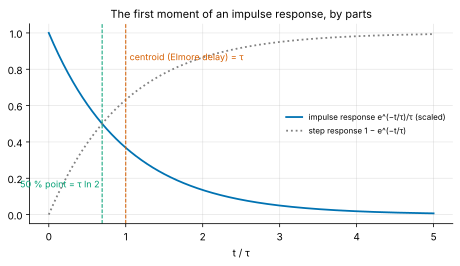
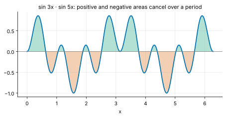
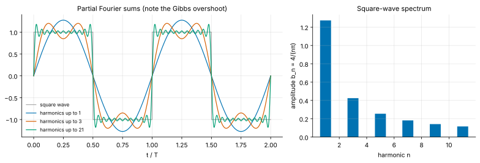
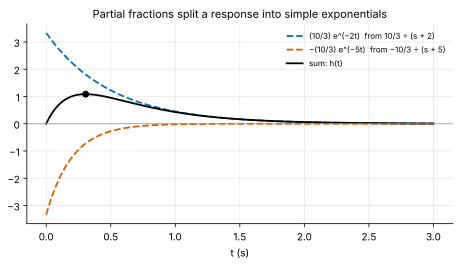
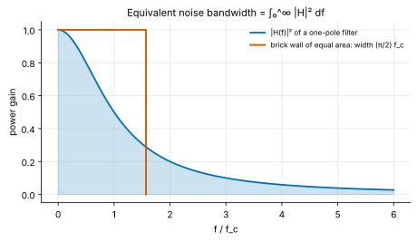

<!-- status: verified -->
# 01-06 · Techniques of Integration

| | |
|---|---|
| **Course** | [01 · Calculus for Engineers](../README.md) |
| **University equivalent** | Calculus II, techniques of integration (Stewart, ch. 7: substitution, integration by parts, trigonometric integrals and substitution, partial fractions, approximate integration, improper integrals) |
| **Prerequisites** | [01-05](01-05-integrals.md) (the definite integral and the fundamental theorem), [01-03](01-03-derivatives.md) (chain and product rules). |
| **Estimated study hours** | 12 |
| **Last verified** | 2026-11-12 |

**Learning objectives.** After this chapter you can:

1. Evaluate integrals by substitution, changing the limits of definite integrals, and recognize substitutions hidden in physical integrals.
2. Integrate by parts, including repeated, tabular and "loop" applications, and use it to compute moments such as the Elmore delay.
3. Decompose rational functions into partial fractions and integrate them, and explain how this anticipates the inverse Laplace transform.
4. Evaluate trigonometric integrals with identities, and use the orthogonality of sinusoids to compute Fourier coefficients and harmonic power.
5. Evaluate and test improper integrals, compute noise bandwidths, and choose and apply numerical integration when no antiderivative exists.

## 1. Big picture

01-05 showed that integrals measure accumulated charge, energy and averages, and that antiderivatives evaluate them. The catch is that differentiation is mechanical, but integration is not: $\int xe^x\,dx$ and $\int\frac{dx}{x^2 - 1}$ do not yield to the basic table. This chapter supplies the standard toolkit. Each technique is a derivative rule run in reverse: **substitution** reverses the chain rule, and **integration by parts** reverses the product rule. Other tools are algebraic rewrites: **partial fractions** split rational functions, and **trigonometric identities** tame powers and products of sines.

Each technique has a direct EE payoff:

- **Partial fractions** are the inverse Laplace transform in disguise: they split a circuit's response into its natural modes ([07-04](../../07-circuit-analysis-2-transient-and-ac/chapters/07-04-laplace-domain-circuit-analysis.md)).
- **Orthogonality of sinusoids** is the foundation of Fourier analysis: spectra, harmonic distortion, and every frequency-domain specification ([11-05](../../11-signals-and-systems/chapters/11-05-fourier-series.md)).
- **Integration by parts** gives moments of responses, such as the Elmore delay that timing tools use to estimate wire delay ([19-05](../../19-digital-vlsi-design/chapters/19-05-interconnect.md)).
- **Improper integrals** define total energy, noise bandwidth and the Laplace transform itself.
- **Numerical integration** handles everything else, from Gaussian probabilities to nonlinear device charge.

## 2. Intuition first

### Each technique reverses a rule you already know

| Differentiation rule | Integration technique |
|---|---|
| Chain rule: $\big(F(g(x))\big)' = F'(g(x))g'(x)$ | Substitution: spot $g'(x)\,dx$ and rename $u = g(x)$ |
| Product rule: $(uv)' = u'v + uv'$ | Integration by parts: trade $\int u\,dv$ for $\int v\,du$ |
| Algebra (common denominators) | Partial fractions: undo the common denominator |
| Trigonometric identities | Rewrite powers and products as sums |

When you face an integral, ask which rule might have produced it. That question is the skill this chapter builds.

### An analogy from finance: decomposing a cash flow

A complicated structured product can often be valued by decomposing it into simpler instruments (bonds, options) whose values you know, then adding. Partial fractions do exactly this for rational functions: a complicated ratio becomes a sum of terms like $A/(x + a)$, each of which integrates to a logarithm. Fourier analysis decomposes a periodic signal into sinusoids the same way. Orthogonality guarantees that the pieces do not interfere, much as uncorrelated assets have additive variances.

*Where the analogy breaks:* financial decompositions are often approximate, and replication can fail under stress. A mathematical decomposition is exact, provided its conditions hold: a proper rational function, and a periodic signal with finite energy per period. Another difference: in finance the components are chosen for convenience, while in a circuit they are dictated by physics, since each partial fraction corresponds to a natural mode of the circuit.

## 3. Theory

### 3.1 Substitution

**The rule.** If $u = g(x)$, then $du = g'(x)\,dx$, and

$$
\int f\big(g(x)\big)g'(x)\,dx = \int f(u)\,du .
$$

*Justification:* if $F' = f$, the chain rule gives $\dfrac{d}{dx}F(g(x)) = f(g(x))g'(x)$. So $F(g(x))$ is an antiderivative of the left side, and $F(u)$ is one of the right side. They agree when $u = g(x)$.

**Definite integrals: change the limits.** When $x$ runs from $a$ to $b$, $u$ runs from $g(a)$ to $g(b)$:

$$
\int_a^b f\big(g(x)\big)g'(x)\,dx = \int_{g(a)}^{g(b)} f(u)\,du .
$$

Changing the limits saves converting back to $x$ at the end.

**Spotting the substitution.** Look for a function *and its derivative* (up to a constant factor):

- $\displaystyle\int\frac{2x}{1 + x^2}\,dx$: put $u = 1 + x^2$, so $du = 2x\,dx$, giving $\displaystyle\int\frac{du}{u} = \ln(1 + x^2) + C$.
- $\displaystyle\int\tan x\,dx = \int\frac{\sin x}{\cos x}\,dx$: put $u = \cos x$, so $du = -\sin x\,dx$, giving $-\ln\lvert\cos x\rvert + C$.
- $\displaystyle\int\frac{\ln x}{x}\,dx$: put $u = \ln x$, so $du = dx/x$, giving $\tfrac{1}{2}(\ln x)^2 + C$.

**Substitution in physics: changing the variable of integration.** In 01-05 we computed a capacitor's stored energy as $\int vi\,dt = \int Cv\,\frac{dv}{dt}\,dt$ and then wrote it as $\int Cv\,dv$. That step *is* a substitution, $u = v(t)$ with $du = \frac{dv}{dt}dt$, and the limits change from times to voltages. It explains why the result depends only on the end voltages, not on the charging history. The same move appears whenever an energy, charge or work integral is rewritten in terms of the state variable instead of time (Problem 01-06.14).

### 3.2 Integration by parts

**The rule.** Integrate the product rule $(uv)' = u'v + uv'$ and rearrange:

$$
\int u\,dv = uv - \int v\,du, \qquad \int_a^b u\,dv = \Big[uv\Big]_a^b - \int_a^b v\,du .
$$

Choose $u$ to become simpler when differentiated, and $dv$ to stay manageable when integrated. A common heuristic for $u$ is **LIATE**: Logarithmic, Inverse trig, Algebraic (powers), Trigonometric, Exponential. Pick the earliest type present.

**Examples.**

- $\displaystyle\int xe^x\,dx$: take $u = x$, $dv = e^x\,dx$, so $du = dx$ and $v = e^x$. The result is $xe^x - \displaystyle\int e^x\,dx = (x - 1)e^x + C$.
- $\displaystyle\int\ln x\,dx$: take $u = \ln x$, $dv = dx$, so $du = dx/x$ and $v = x$. The result is $x\ln x - \displaystyle\int dx = x\ln x - x + C$. (A "1" is hiding in the integrand.)

**Repeated and tabular integration.** For $\int x^ne^{ax}\,dx$, each application lowers the power by one. A table organizes the work: differentiate $u$ down to zero in one column, integrate $dv$ repeatedly in the other, and multiply along the diagonals with alternating signs. For example,

$$
\int x^2e^x\,dx = e^x\big(x^2 - 2x + 2\big) + C .
$$

**The loop trick.** For $I = \int e^{ax}\cos bx\,dx$, integrating by parts twice returns a multiple of $I$ itself:

$$
I = \frac{e^{ax}\cos bx}{a} + \frac{b}{a}\int e^{ax}\sin bx\,dx = \frac{e^{ax}\cos bx}{a} + \frac{b}{a}\left[\frac{e^{ax}\sin bx}{a} - \frac{b}{a}I\right].
$$

Solve for $I$:

$$
\int e^{ax}\cos bx\,dx = \frac{e^{ax}\big(a\cos bx + b\sin bx\big)}{a^2 + b^2} + C ,
$$

and similarly $\int e^{ax}\sin bx\,dx = \dfrac{e^{ax}(a\sin bx - b\cos bx)}{a^2 + b^2} + C$. These two formulas give the energy of every ringing (damped sinusoidal) response (Problem 01-06.7). With complex exponentials ([02-01](../../02-complex-numbers-des-and-linear-algebra/chapters/02-01-complex-numbers-euler-and-phasors.md)) the same result takes one line: $\int e^{(a + jb)x}dx = e^{(a + jb)x}/(a + jb)$, then take the real part.

**Moments and the Elmore delay.** The **first moment** of an impulse response $h(t)$ is its centroid in time:

$$
\bar{t} = \frac{\int_0^\infty t\,h(t)\,dt}{\int_0^\infty h(t)\,dt}.
$$

For a single RC stage, $h \propto e^{-t/\tau}$. By parts, $\int_0^\infty te^{-t/\tau}\,dt = \tau^2$, while $\int_0^\infty e^{-t/\tau}\,dt = \tau$. So $\bar{t} = \tau$ (Figure 1). For an RC *tree*, the first moment is easy to compute from the resistances and capacitances alone, without solving the circuit. It is called the **Elmore delay** (W. C. Elmore, 1948). Because it is cheap and well behaved, it has long been used to estimate interconnect delay during chip placement and routing ([19-05](../../19-digital-vlsi-design/chapters/19-05-interconnect.md)) **[Established]**. For a single pole it overestimates the 50% delay, $\tau\ln 2$, by a factor $1/\ln 2 = 1.44$.

*Figure 1. For a single RC stage, the centroid of the impulse response (the Elmore delay) is τ, later than the 50% point of the step response at τ ln 2.*

### 3.3 Trigonometric integrals and orthogonality

**Powers via identities.** The double-angle identities turn powers into first powers:

$$
\sin^2x = \frac{1 - \cos 2x}{2}, \qquad \cos^2x = \frac{1 + \cos 2x}{2}.
$$

So $\int_0^\pi\sin^2x\,dx = \pi/2$. Odd powers peel off one factor for a substitution. For example, $\int\sin^3x\,dx = \int(1 - \cos^2x)\sin x\,dx$, and $u = \cos x$ finishes it.

**Products via product-to-sum.**

$$
\sin mx\,\sin nx = \tfrac{1}{2}\big[\cos(m - n)x - \cos(m + n)x\big],
$$

and similarly for $\cos\cdot\cos$ and $\sin\cdot\cos$.

**Orthogonality.** For positive integers $m$ and $n$, integrating these products over a full period gives

$$
\int_0^{2\pi}\sin mx\,\sin nx\,dx = \begin{cases}\pi & m = n\\ 0 & m \ne n\end{cases}, \qquad \int_0^{2\pi}\sin mx\,\cos nx\,dx = 0,
$$

and likewise for $\cos\cdot\cos$. Each $\cos kx$ term with $k \ne 0$ integrates to zero over a whole period. Only the $\cos 0 = 1$ term survives, and only when $m = n$ (Figure 2). Sinusoids of different integer frequencies are **orthogonal**: their product averages to zero.

*Figure 2. $\sin 3x\,\sin 5x$ over one period: the positive and negative areas cancel exactly.*

**Fourier coefficients.** A periodic signal of period $T$ (with $\omega = 2\pi/T$) can be written as a sum of harmonics, $x(t) = a_0 + \sum_{n\ge1}\big(a_n\cos n\omega t + b_n\sin n\omega t\big)$. Multiply both sides by $\sin m\omega t$ and integrate over a period. By orthogonality every term vanishes except the $m$-th:

$$
b_m = \frac{2}{T}\int_0^T x(t)\sin m\omega t\,dt, \qquad a_m = \frac{2}{T}\int_0^T x(t)\cos m\omega t\,dt, \qquad a_0 = \frac{1}{T}\int_0^Tx(t)\,dt .
$$

A spectrum analyzer, an FFT and a lock-in amplifier all compute such integrals. For a ±1 square wave, $b_n = 4/(n\pi)$ for odd $n$ and 0 for even $n$ (Example 01-06.4, Figure 3).

*Figure 3. Left: sums of the first few odd harmonics approach the square wave, with a persistent 9% overshoot near the edges (the Gibbs phenomenon, Problem 01-06.11). Right: the harmonic amplitudes fall as 1/n.*

**Power adds across harmonics (Parseval).** Squaring a Fourier series and averaging over a period, orthogonality kills every cross term:

$$
\overline{x^2} = a_0^2 + \frac{1}{2}\sum_{n\ge1}\big(a_n^2 + b_n^2\big).
$$

Each harmonic contributes its own power, independently. This is why **total harmonic distortion (THD)** is defined as $\sqrt{\sum_{n\ge2}(\text{harmonic amplitude})^2}$ divided by the fundamental, and why an amplifier's distortion can be specified harmonic by harmonic (Problem 01-06.12).

### 3.4 Partial fractions

A **rational function** $P(x)/Q(x)$ is **proper** if the degree of $P$ is less than the degree of $Q$. An improper one is first reduced by polynomial long division. Factor $Q$ into linear and irreducible quadratic factors. Then $P/Q$ is a sum of simple pieces, one per factor:

| Factor in $Q$ | Terms in the decomposition | Integrates to |
|---|---|---|
| $(x - r)$ | $\dfrac{A}{x - r}$ | $A\ln\lvert x - r\rvert$ |
| $(x - r)^k$ | $\dfrac{A_1}{x - r} + \dfrac{A_2}{(x - r)^2} + \cdots + \dfrac{A_k}{(x - r)^k}$ | logs and negative powers |
| $x^2 + px + q$ (no real roots) | $\dfrac{Bx + C}{x^2 + px + q}$ | log and arctan, after completing the square |

**The cover-up method** for distinct linear factors: to find $A$ for the factor $(x - r)$, multiply both sides by $(x - r)$ and set $x = r$. Every other term vanishes. For example,

$$
\frac{1}{(x + 1)(x + 2)} = \frac{A}{x + 1} + \frac{B}{x + 2}, \qquad A = \frac{1}{(x + 2)}\bigg|_{x=-1} = 1, \quad B = \frac{1}{(x + 1)}\bigg|_{x=-2} = -1 .
$$

Oliver Heaviside used the same trick to solve circuit equations, which is why engineers often call it **Heaviside's method**. For repeated factors, cover-up gives the highest power's coefficient; find the rest by differentiating or by comparing coefficients.

**Why EEs care: modes of a circuit.** In [07-04](../../07-circuit-analysis-2-transient-and-ac/chapters/07-04-laplace-domain-circuit-analysis.md) a circuit's response appears as a rational function of a complex frequency $s$, for example $H(s) = \dfrac{10}{(s + 2)(s + 5)}$. Partial fractions split it into $\dfrac{10/3}{s + 2} - \dfrac{10/3}{s + 5}$. Each simple term corresponds to one decaying exponential in time ($e^{-2t}$ and $e^{-5t}$): a **natural mode** of the circuit, with the denominator's roots (the **poles**) setting the decay rates (Figure 4, Problem 01-06.9). A repeated factor $(s + a)^2$ produces $te^{-at}$, the repeated-root signature found with L'Hôpital's rule in [01-04](01-04-applications-of-derivatives.md). Irreducible quadratics produce damped sinusoids.

*Figure 4. The response $h(t) = \tfrac{10}{3}(e^{-2t} - e^{-5t})$ is the sum of the two modes that partial fractions reveal.*

### 3.5 Trigonometric substitution

Integrands containing $a^2 + x^2$ or $\sqrt{a^2 - x^2}$ simplify when $x$ is a trigonometric function of a new variable:

- $x = a\tan\theta$: $\displaystyle\int\frac{dx}{a^2 + x^2} = \frac{1}{a}\arctan\frac{x}{a} + C$, since $dx = a\sec^2\theta\,d\theta$ and $a^2 + x^2 = a^2\sec^2\theta$;
- $x = a\sin\theta$: $\displaystyle\int\frac{dx}{\sqrt{a^2 - x^2}} = \arcsin\frac{x}{a} + C$.

The first is the integral behind the noise bandwidth of a filter (§3.6) and the arctangent phase of first-order systems.

### 3.6 Improper integrals

An integral is **improper** if an interval is infinite or the integrand is unbounded. It is defined as a limit:

$$
\int_a^\infty f(x)\,dx = \lim_{b\to\infty}\int_a^b f(x)\,dx, \qquad \int_0^1 f(x)\,dx = \lim_{\epsilon\to0^+}\int_\epsilon^1 f(x)\,dx\ \ (f\text{ unbounded at }0).
$$

It **converges** if the limit exists and is finite, and **diverges** otherwise.

**The p-integrals,** the benchmarks for comparison:

$$
\int_1^\infty\frac{dx}{x^p}\ \text{converges iff } p > 1, \qquad \int_0^1\frac{dx}{x^p}\ \text{converges iff } p < 1 .
$$

For example, $\int_1^\infty x^{-2}dx = 1$, but $\int_1^\infty x^{-1}dx = \lim\ln b = \infty$. The borderline $p = 1$ diverges at *both* ends, only logarithmically slowly.

**Comparison test.** If $0 \le f \le g$ and $\int g$ converges, so does $\int f$. If $\int f$ diverges, so does $\int g$. Exponential decay beats every power (01-02), so integrals like $\int_0^\infty t^ne^{-t}\,dt$ converge. By repeated parts, $\int_0^\infty t^ne^{-t}\,dt = n!$.

**Engineering improper integrals.**

- **Total energy of a transient:** $\int_0^\infty i^2R\,dt$ (01-05, Example 3).
- **The Laplace transform** $F(s) = \int_0^\infty f(t)e^{-st}\,dt$, an improper integral that converges for $s$ large enough (Problem 01-06.15; [07-04](../../07-circuit-analysis-2-transient-and-ac/chapters/07-04-laplace-domain-circuit-analysis.md)).
- **Equivalent noise bandwidth (ENBW).** White noise of density $S$ (V²/Hz) passed through a filter of power gain $\lvert H(f)\rvert^2$ has total power $S\int_0^\infty\lvert H\rvert^2\,df$. The integral, divided by the passband gain, is the width of the ideal "brick-wall" filter that would pass the same noise. For one pole, $\lvert H\rvert^2 = 1/\big(1 + (f/f_c)^2\big)$, and with the substitution of §3.5,

$$
\text{ENBW} = \int_0^\infty\frac{df}{1 + (f/f_c)^2} = f_c\Big[\arctan\frac{f}{f_c}\Big]_0^\infty = \frac{\pi}{2}f_c \approx 1.571f_c .
$$

A one-pole filter lets through 57% more noise than its −3 dB bandwidth suggests (Figure 5, Example 01-06.5). Applied to the thermal noise of a resistor, $4kTR$ V²/Hz, behind an RC filter, the same integral gives the famous **kT/C noise**, whose total is independent of $R$ (Problem 01-06.10).

*Figure 5. The area under $\lvert H\rvert^2$ equals that of a brick-wall filter of width $(\pi/2)f_c$.*

- **Flicker (1/f) noise** has density $K/f$. Its power from $f_1$ to $f_2$ is $K\ln(f_2/f_1)$: the same power in every decade. The improper integral diverges at both ends, only logarithmically, so in practice the observation time and the bandwidth set the limits (Problem 01-06.13).

### 3.7 Numerical integration

Many integrals have no elementary antiderivative: $\int e^{-x^2}dx$ (Gaussian probabilities), $\int\frac{\sin x}{x}dx$ (the sine integral), and most integrals of measured data or nonlinear device models. Then integrate numerically.

**Simpson's rule** fits parabolas through triples of points:

$$
\int_a^b f\,dx \approx \frac{h}{3}\Big[f_0 + 4f_1 + 2f_2 + 4f_3 + \cdots + 4f_{n-1} + f_n\Big]\qquad(n\text{ even}),
$$

with error proportional to $h^4$. It is exactly the $(2M + T)/3$ combination of 01-05. Two further methods are standard:

- **Adaptive quadrature** (for example SciPy's `quad`) refines the grid where the integrand varies quickly, and reports an error estimate.
- **Gaussian quadrature** chooses both sample points and weights optimally, and is exact for polynomials of degree $2n - 1$ with only $n$ points. It is used inside circuit and electromagnetic field solvers.

The rules of thumb:

- check convergence by halving the step;
- treat endpoint singularities by substitution before integrating;
- never trust a numerical integral of an oscillating or discontinuous function without looking at the integrand.

## 4. Worked examples

### Example 01-06.1 — Substitution, with limits changed (tier A)

**Setup.** Evaluate (a) $\displaystyle\int_0^1\frac{2x}{1 + x^2}\,dx$ and (b) $\displaystyle\int_0^{\pi/2}\sin^2x\cos x\,dx$.

**Solution.**

(a) $u = 1 + x^2$, $du = 2x\,dx$. The limits $x: 0 \to 1$ become $u: 1 \to 2$, so the integral is $\displaystyle\int_1^2\frac{du}{u} = \ln 2 = $ **0.6931**.

(b) $u = \sin x$, $du = \cos x\,dx$. The limits become $u: 0 \to 1$, so the integral is $\displaystyle\int_0^1u^2\,du = $ **0.3333** (1/3).

**Sanity check.** In (a) the integrand is at most 1 (at $x = 1$), so the integral over a unit interval must be below 1 ✓. In (b) the integrand is non-negative and at most about 0.38, so a result of 1/3 over an interval of length 1.57 is plausible ✓.

### Example 01-06.2 — By parts: a moment and the Elmore delay (tier B)

**Setup.** (a) Evaluate $\int_0^1xe^x\,dx$. (b) Show that the centroid of $h(t) = e^{-t/\tau}$ on $[0, \infty)$ is $\tau$. (c) For $\tau = 50$ ps, compare the Elmore delay with the 50% delay of the step response.

**Solution.**

(a) $\big[(x - 1)e^x\big]_0^1 = 0 - (-1) = $ **1**.

(b) By parts with $u = t$, $dv = e^{-t/\tau}dt$, $v = -\tau e^{-t/\tau}$:

$$
\int_0^\infty te^{-t/\tau}\,dt = \Big[-\tau te^{-t/\tau}\Big]_0^\infty + \tau\int_0^\infty e^{-t/\tau}\,dt = 0 + \tau\cdot\tau = \tau^2 .
$$

(The boundary term vanishes at ∞ because exponentials beat powers.) Divide by $\int_0^\infty e^{-t/\tau}dt = \tau$ to get $\bar{t} = \tau$.

(c) Elmore delay: **50 ps**. 50% delay: $\tau\ln 2 = $ **34.66 ps**. The Elmore estimate is pessimistic by a factor **1.443**, a known bias that timing tools correct for.

**Sanity check.** Units: $\int t\,e^{-t/\tau}\,dt$ has units s² ✓, and dividing by $\int e^{-t/\tau}dt$ (units s) leaves s ✓.

### Example 01-06.3 — Partial fractions (tier B)

**Setup.** Evaluate $\displaystyle\int_0^1\frac{dx}{(x + 1)(x + 2)}$.

**Solution.** By cover-up (§3.4), $\dfrac{1}{(x + 1)(x + 2)} = \dfrac{1}{x + 1} - \dfrac{1}{x + 2}$. So

$$
\int_0^1 = \Big[\ln(x + 1) - \ln(x + 2)\Big]_0^1 = (\ln 2 - \ln 3) - (0 - \ln 2) = \ln\frac{4}{3} = \mathbf{0.2877}.
$$

**Interpretation.** With $x$ replaced by the complex frequency $s$, the same decomposition says that the system $1/\big((s + 1)(s + 2)\big)$ responds to an impulse as $e^{-t} - e^{-2t}$: two modes, one per pole (§3.4).

**Sanity check.** The integrand falls from 0.5 at $x = 0$ to 0.167 at $x = 1$. The trapezoid estimate $(0.5 + 0.167)/2 = 0.333$ is slightly above 0.288, as expected for a convex integrand ✓.

### Example 01-06.4 — The spectrum of a square wave (tier B)

**Setup.** A square wave $x(t)$ equals +1 for $0 < t < T/2$ and −1 for $T/2 < t < T$. (a) Find its Fourier coefficients $b_n$. (b) What fraction of its power is in the fundamental?

**Solution.**

(a) The wave is odd about $t = 0$ (when extended periodically), so all $a_n = 0$. With $\theta = n\omega t$ (a substitution),

$$
b_n = \frac{2}{T}\left[\int_0^{T/2}\sin n\omega t\,dt - \int_{T/2}^{T}\sin n\omega t\,dt\right] = \frac{1}{n\pi}\Big[(1 - \cos n\pi) - (\cos n\pi - 1)\Big] = \frac{2}{n\pi}\big(1 - \cos n\pi\big).
$$

$\cos n\pi = (-1)^n$, so $b_n = 4/(n\pi)$ for odd $n$ and 0 for even $n$: $b_1 = $ **1.273**, $b_3 = $ **0.4244**, $b_5 = $ **0.2546**.

(b) The mean square of a ±1 square wave is 1. The fundamental's power is $b_1^2/2 = 8/\pi^2 = $ **0.8106**, i.e. **81.06%**. The rest sits in the odd harmonics.

**Sanity check.** The fundamental's amplitude, 1.273, *exceeds* the square wave's amplitude of 1: the best-fitting sine must overshoot to match the square wave's area ✓. By Parseval, the harmonics' powers must sum to 1. They do, since $\sum_{n\text{ odd}}8/(n^2\pi^2) = (8/\pi^2)(\pi^2/8) = 1$ ✓.

### Example 01-06.5 — Noise bandwidth and the noise of a filtered resistor (tier C)

**Setup.** A 10 kΩ resistor at 300 K has thermal noise density $\sqrt{4kTR}$ ([07-02](../../07-circuit-analysis-2-transient-and-ac/chapters/07-02-first-order-rc-rl-transients.md)). It is followed by an ideal one-pole low-pass filter with $f_c = 10$ kHz. Find (a) the noise density, (b) the equivalent noise bandwidth, and (c) the total RMS noise at the filter output.

**Solution.**

(a) $\sqrt{4kTR} = \sqrt{4\times1.380649\times10^{-23}\times300\times10^4} = $ **12.87 nV/√Hz**.

(b) ENBW $= (\pi/2)f_c = $ **15.71 kHz** (§3.6).

(c) Total power $= 4kTR\times\text{ENBW}$, so $v_{rms} = 12.87\text{ nV/√Hz}\times\sqrt{15\,708\text{ Hz}} = $ **1.613 µV**.

**Interpretation.** A designer who multiplied the density by the −3 dB bandwidth (10 kHz) would get 1.287 µV, underestimating the noise by 20% in voltage (57% in power). Datasheets quote noise densities so that you can perform exactly this integral for your own filter.

**Sanity check.** The lab's ngspice `.noise` analysis integrates the same output spectrum numerically, and agrees ✓.

<!-- answer-key -->
| ID | Quantity | Value | Unit |
|---|---|---|---|
| Ex 01-06.1a | (a) | 0.6931 | — |
| Ex 01-06.1b | (b) | 0.3333 | — |
| Ex 01-06.2a | ∫ x e^x over [0, 1] | 1 | — |
| Ex 01-06.2b | Elmore delay | 50 | ps |
| Ex 01-06.2c | 50 % delay | 34.66 | ps |
| Ex 01-06.2d | Elmore / 50 % ratio | 1.443 | — |
| Ex 01-06.3a | integral | 0.2877 | — |
| Ex 01-06.4a | b1 | 1.273 | — |
| Ex 01-06.4b | b3 | 0.4244 | — |
| Ex 01-06.4c | b5 | 0.2546 | — |
| Ex 01-06.4d | power fraction in fundamental | 81.06 | % |
| Ex 01-06.5a | noise density | 12.87 | nV/√Hz |
| Ex 01-06.5b | noise bandwidth | 15.71 | kHz |
| Ex 01-06.5c | output noise | 1.613 | µV |

*Recomputed by [verify_01_06.py](../verify/verify_01_06.py). Examples 01-06.4 and 01-06.5 and Problem 01-06.10 are also confirmed in ngspice by the lab netlists.*

## 5. Simulate it

The lab ([labs/01-06-lab/](../labs/01-06-lab/README.md)) has a notebook and two ngspice netlists:

1. **Symbolic integration.** Use SymPy to check substitutions, parts and partial fractions (`sympy.apart`), and see where it fails (no elementary antiderivative).
2. **Fourier series.** Compute the coefficients of square, triangle and sawtooth waves numerically, reconstruct the waves, and measure the Gibbs overshoot.
3. **Numerical quadrature.** Compare Simpson's rule with adaptive `quad` on smooth, oscillating and singular integrands.
4. **ngspice.** `fourier_coeffs.cir` computes a square wave's Fourier coefficients by integrating $x(t)\sin n\omega t$ with `.meas INTEG`. `noise_bw.cir` runs a `.noise` analysis, confirming the ENBW result and kT/C.

**Predict, then run.** Before running `noise_bw.cir`, predict the total noise on a 1 pF capacitor behind a 1 kΩ resistor, and behind a 1 MΩ resistor.

## 6. Engineering tradeoffs

| Knob | Improves | Costs | Typical decision owner |
|---|---|---|---|
| Closed-form integration rather than numerical | Insight: dependence on parameters is visible; exact | Often impossible; time-consuming | Analyst, architect |
| Numerical integration rather than closed form | Works for any integrand, including measured data | No formula for how the answer scales; accuracy must be checked | Simulation engineer |
| First-moment (Elmore) delay estimates rather than full simulation | Fast; usable inside optimization loops | Pessimistic for single poles; inaccurate for some network shapes | Physical-design and timing tools |
| Narrower filter bandwidth | Lower integrated noise (∝ √ENBW) | Slower response; more settling time | Analog and sensor designers |
| Larger sampling capacitor | Lower kT/C noise | Larger area; more drive current and power | ADC designer |

## 7. Numbers to know

| Quantity | Value | Note |
|---|---|---|
| $\int_0^\infty t^ne^{-t}\,dt$ | $n!$ | $\int_0^\infty te^{-t/\tau}dt = \tau^2$ |
| Elmore delay / 50% delay, single pole | 1.443 | $1/\ln 2$ |
| One-pole noise bandwidth | $(\pi/2)f_c$ ≈ 1.571 $f_c$ | 57% more noise power than $f_c$ suggests |
| Thermal noise density, 1 kΩ at 300 K | 4.07 nV/√Hz | $\sqrt{4kTR}$; scales as √R |
| kT/C noise at 1 pF, 300 K | 64.3 µV rms | Independent of R |
| Square-wave fundamental | $4/\pi$ ≈ 1.273 × amplitude; 81% of power | Harmonics $4/(n\pi)$, odd n |
| Gibbs overshoot | ≈ 9% of the jump | Does not shrink with more harmonics |
| p-integrals | $\int_1^\infty x^{-p}$ converges iff $p > 1$ | $1/f$: equal power per decade |

## 8. Common mistakes

1. **Forgetting to change the limits** after a substitution, or changing them and then also back-substituting.
2. **Missing the derivative factor:** $\int\cos(x^2)\,dx$ cannot be done by $u = x^2$, because there is no $x\,dx$ to absorb $du$. (It has no elementary antiderivative at all.)
3. **Choosing $u$ and $dv$ backwards** in integration by parts, so the new integral is harder than the old one.
4. **Applying partial fractions to an improper rational function** without long division first.
5. **Treating orthogonality as holding over any interval.** It needs a whole common period.
6. **Calling a divergent improper integral "infinity" and moving on.** In physics a divergence means the model is missing something: a cutoff, a loss, a finite observation time.
7. **Using the −3 dB bandwidth as the noise bandwidth.**
8. **Trusting a numerical integral of an oscillating or singular integrand** without checking convergence.

## 9. Practitioner lens

### Where these integrals appear in today's design practice (as of Nov 2026)

- **Noise specifications are densities to be integrated.** ADC, op-amp and sensor datasheets quote noise in nV/√Hz or µg/√Hz precisely so that the designer can integrate over the actual system bandwidth, including the filter's ENBW factor of π/2 for one pole and smaller factors for sharper filters **[Established]**. The kT/C limit sets the minimum sampling-capacitor size in switched-capacitor ADCs, and through that the area and power of high-resolution converters ([20](../../20-analog-and-mixed-signal-ic-design/README.md)) **[Established]**.
- **Moment-based delay estimates are still in the loop.** Elmore-type first-moment delays remain a standard fast estimate inside placement and routing optimization, with higher-moment or simulation-based methods used for sign-off **[Established]**.
- **Harmonic content is specified through Fourier integrals.** Audio codecs specify THD+N, power supplies and motor drives specify current harmonics against grid standards, and RF transmitters specify spectral masks. All are integrals of the signal against sinusoids **[Established]**.

### Why it matters commercially

- **Noise integrals drive silicon area and power.** Halving the noise voltage requires 4× the capacitance (kT/C) or a quarter of the bandwidth. That quadratic cost is why precision analog blocks are large, and why a competitor's "2× lower noise" claim implies a 4× area or power cost unless the architecture changed.
- **Spectral purity is a regulatory gate.** Harmonic and emission limits must be met before a product can ship, and the Fourier integral is how compliance is measured.

### Marketing vs Reality

**"Noise 5 nV/√Hz."** Density alone is not noise. Ask: integrated over what bandwidth, with what filter, and does it include 1/f noise below the corner frequency?

**"Bandwidth 10 kHz" in a noise calculation.** The −3 dB bandwidth understates a one-pole filter's noise by 57% in power. Ask for the ENBW.

**"THD below 0.01%."** At what amplitude, frequency and load, and over how many harmonics? THD typically worsens near full scale and at high frequency.

### Questions to ask engineering leaders

1. **"What is the integrated noise of this signal chain over the system bandwidth, and which stage dominates?"**
   *Strong answer:* gives a noise budget, stage by stage, with ENBW factors and the 1/f corner. *Evasive:* quotes only one component's density.
2. **"What limits your sampling-capacitor size, and what would halving the noise cost?"**
   *Strong:* explains the kT/C tradeoff in area and power, and the alternatives (oversampling, chopping). *Evasive:* "we use a better process".
3. **"How do you estimate wire delay early in design, and how far are those estimates from sign-off?"**
   *Strong:* knows the model's bias (Elmore pessimism) and the correlation data. *Evasive:* "the tools handle it".

## 10. Concept check

**Q1.** Which substitution evaluates $\int x\cos(x^2)\,dx$, and what is the result?

Answer

$u = x^2$, $du = 2x\,dx$: $\tfrac{1}{2}\sin(x^2) + C$.

**Q2.** In $\int x\ln x\,dx$, which factor should be $u$?

Answer

$u = \ln x$ (L before A in LIATE). Then $dv = x\,dx$, $v = x^2/2$, and the result is $\tfrac{x^2}{2}\ln x - \tfrac{x^2}{4} + C$.

**Q3.** Decompose $\dfrac{1}{x(x - 1)}$.

Answer

$\dfrac{-1}{x} + \dfrac{1}{x - 1}$ (cover-up: at $x = 0$, $A = 1/(0 - 1) = -1$; at $x = 1$, $B = 1$).

**Q4.** What is $\int_0^{2\pi}\cos 2x\cos 7x\,dx$? And $\int_0^{2\pi}\cos^27x\,dx$?

Answer

0 (orthogonal harmonics) and π.

**Q5.** Does $\int_1^\infty\frac{dx}{x^{1.01}}$ converge? Does $\int_1^\infty\frac{dx}{x^{0.99}}$?

Answer

The first converges (to 100); the second diverges. The boundary is $p = 1$.

**Q6.** What is the noise bandwidth of a one-pole filter with a 1 kHz corner?

Answer

$(\pi/2)\times1\text{ kHz} \approx 1.571$ kHz.

**Q7.** Why is the total kT/C noise independent of R?

Answer

A larger R has more noise density (∝ R) but forms a narrower filter (bandwidth ∝ 1/R). The product, density × ENBW, cancels R and leaves kT/C.

**Q8.** A circuit's response is $\dfrac{3}{(s + 1)(s + 4)}$. What exponentials appear in its impulse response?

Answer

$e^{-t}$ and $e^{-4t}$, one per pole. Partial fractions give $1/(s + 1) - 1/(s + 4)$, i.e. $h(t) = e^{-t} - e^{-4t}$.

Now work the problem set: [01-06 problems](../problems/01-06-problems.md) (solutions in [01-06 solutions](../solutions/01-06-solutions.md)).

## 11. Key terms

[Substitution (integration)](../../../reference/glossary.md#substitution-integration) ·
[Integration by parts](../../../reference/glossary.md#integration-by-parts) ·
[Partial fractions](../../../reference/glossary.md#partial-fractions) ·
[Orthogonality](../../../reference/glossary.md#orthogonality) ·
[Fourier coefficient](../../../reference/glossary.md#fourier-coefficient) ·
[Total harmonic distortion (THD)](../../../reference/glossary.md#total-harmonic-distortion-thd) ·
[Improper integral](../../../reference/glossary.md#improper-integral) ·
[Equivalent noise bandwidth (ENBW)](../../../reference/glossary.md#equivalent-noise-bandwidth-enbw) ·
[Elmore delay](../../../reference/glossary.md#elmore-delay) ·
[Simpson's rule](../../../reference/glossary.md#simpsons-rule) ·
[Gibbs phenomenon](../../../reference/glossary.md#gibbs-phenomenon) ·
[Flicker (1/f) noise](../../../reference/glossary.md#flicker-1-f-noise)

## 12. Connections

- **Builds on:** [01-05](01-05-integrals.md) (integrals and the FTC), [01-03](01-03-derivatives.md) (chain and product rules).
- **Next:** [01-07 Applications of Integration](01-07-applications-of-integration.md).
- **Used later in:**
  - [02-02](../../02-complex-numbers-des-and-linear-algebra/chapters/02-02-first-order-linear-odes.md): integrating factors.
  - [07-04](../../07-circuit-analysis-2-transient-and-ac/chapters/07-04-laplace-domain-circuit-analysis.md): Laplace transforms and partial fractions.
  - [11-05](../../11-signals-and-systems/chapters/11-05-fourier-series.md): Fourier series.
  - [12](../../12-electronics-2/README.md): noise in amplifiers.
  - [19-05](../../19-digital-vlsi-design/chapters/19-05-interconnect.md): Elmore delay.
  - [20](../../20-analog-and-mixed-signal-ic-design/README.md): kT/C noise in data converters.

## 13. Further study

- **Stewart, *Calculus: Early Transcendentals*,** chapter 7 (techniques of integration) for more drill.
- **Strang, *Calculus* (free, MIT OpenCourseWare),** chapter 7 (techniques of integration).
- **MIT OpenCourseWare 18.01SC,** Unit 4 (techniques of integration).
- **W. C. Elmore, "The transient response of damped linear networks with particular regard to wideband amplifiers,"** *Journal of Applied Physics*, vol. 19, 1948, pp. 55–63: the origin of the Elmore delay.

## 14. Sources

1. W. C. Elmore, *J. Appl. Phys.* 19, 55 (1948): first-moment delay of linear networks.
2. Thermal noise $4kTR$ (Johnson–Nyquist) and kT/C noise are standard results (see [07-02](../../07-circuit-analysis-2-transient-and-ac/chapters/07-02-first-order-rc-rl-transients.md) and Course 12).
3. The techniques of this chapter are standard calculus (Stewart, ch. 7). All text, examples and problems are original.
