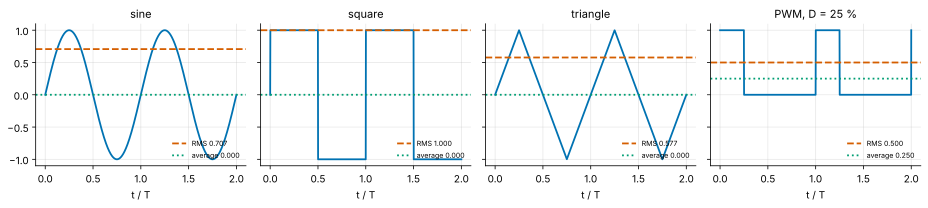
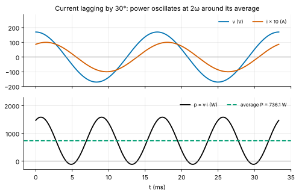
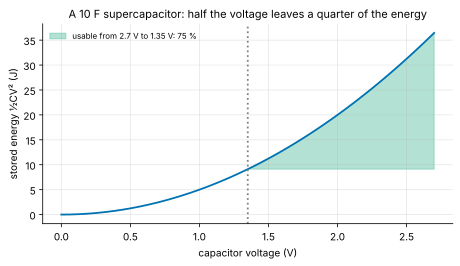
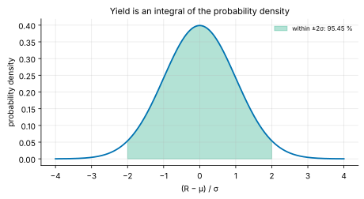
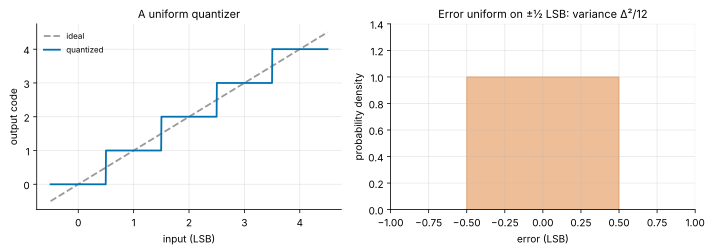

<!-- status: reviewed -->
# 01-07 · Applications of Integration

| | |
|---|---|
| **Course** | [01 · Calculus for Engineers](../README.md) |
| **University equivalent** | Calculus II, applications of integration (Stewart, ch. 6 and 8: areas between curves, volumes, arc length, centroids, average value, work, probability), with RMS values and average AC power from a first circuits course and probability densities from an engineering-statistics course |
| **Prerequisites** | [01-05](01-05-integrals.md), [01-06](01-06-techniques-of-integration.md) (integration techniques, orthogonality). |
| **Estimated study hours** | 12 |
| **Last verified** | 2026-11-12 |

**Learning objectives.** After this chapter you can:

1. Compute the average and RMS values of periodic waveforms, explain why RMS determines heating and ratings, and compute crest and form factors.
2. Derive average AC power $P = V_{rms}I_{rms}\cos\phi$ from the integral of $v\cdot i$, and compute RMS currents and conduction losses for non-sinusoidal waveforms.
3. Compute energy stored in capacitors and inductors, usable energy between voltage limits, and work done by variable forces and fields.
4. Use probability density functions to compute probabilities, means and variances: uniform (quantization noise), exponential (lifetimes, MTBF) and Gaussian (tolerances, noise).
5. Derive the ideal ADC signal-to-noise ratio $6.02N + 1.76$ dB, and use it to interpret effective number of bits.
6. Compute areas between curves, volumes of solids of revolution, arc lengths and centroids, and recognize the centroid in the Elmore delay and the mean of a density.

## 1. Big picture

Integration turns local information into totals and averages. Engineers use that one move constantly, in at least four guises:

- **RMS values** answer "how much heating does this waveform cause?". Every AC voltage rating, every conduction-loss calculation and every fuse is specified through an integral of the square of a signal.
- **Average power** answers "how much energy actually flows, per second?". It is what an electricity meter bills and what a thermal design must remove ([07-06](../../07-circuit-analysis-2-transient-and-ac/chapters/07-06-ac-power-and-power-factor.md)).
- **Energy and work** answer "how much is stored, and how much can I use?", for batteries, supercapacitors and MEMS actuators.
- **Probability densities** answer "how likely?": the chance a resistor is in tolerance, a server fails this month, or a noise spike crosses a threshold. Each is an area under a curve.

The ideal ADC's 6.02 dB per bit, which this chapter derives from a single integral, is one of the most quoted numbers in mixed-signal engineering.

## 2. Intuition first

### RMS: the "equivalent DC" for heating

Feed a resistor with a pulsed or alternating current and ask: what steady DC current would heat it equally? Heating power is $i^2R$, so average heating is $R\cdot\overline{i^2}$. The DC current with the same heating satisfies $I_{dc}^2 = \overline{i^2}$. So

$$
I_{rms} = \sqrt{\overline{i^2}} = \sqrt{\frac{1}{T}\int_0^Ti^2\,dt},
$$

the **root of the mean of the square**: root-mean-square. The "120 V" or "230 V" of the mains is an RMS value. Its peak is $\sqrt{2}$ times larger.

### An analogy from finance: volatility

RMS is a standard deviation in disguise. For a signal with zero average, the RMS *is* its standard deviation over time. Squaring before averaging gives large excursions extra weight, just as variance does for large returns. Volatility measures the typical size of fluctuations regardless of sign, and RMS measures the typical size of a signal regardless of sign. Both are then scaled back to the original units by the square root.

*Where the analogy breaks:* in finance, volatility describes uncertainty about the future. RMS describes a known, often deterministic waveform, and its physical meaning (heating) is exact, not statistical. When a signal *is* random, such as noise, the two meanings coincide, and this chapter uses probability densities to compute them.

### Probability as area

A probability density function (pdf) $f(x)$ spreads one unit of probability along the $x$ axis. The probability that $X$ lands in $[a, b]$ is the area $\int_a^bf(x)\,dx$. The density itself is not a probability. It has units of 1/(units of $x$), and it can exceed 1. Only areas are probabilities. Every yield calculation, bit-error rate and reliability estimate in EE is such an area.

## 3. Theory

### 3.1 Average and RMS of periodic waveforms

For a signal of period $T$:

$$
X_{avg} = \frac{1}{T}\int_0^Tx\,dt, \qquad X_{rms} = \sqrt{\frac{1}{T}\int_0^Tx^2\,dt}.
$$

**Derivations for standard waveforms (peak value $X_p$; for voltages and currents this chapter also writes $V_m$ and $I_m$, as in 01-05):**

- **Sine.** $\overline{\sin^2} = \tfrac{1}{2}$ (01-05), so $X_{rms} = X_p/\sqrt{2} \approx 0.707X_p$.
- **Square (±$X_p$).** $x^2 = X_p^2$ always, so $X_{rms} = X_p$.
- **Triangle or sawtooth (symmetric about 0, peak $X_p$).** On one linear segment $x = X_p\cdot u$ with $u$ uniform in $[-1, 1]$, so $\overline{x^2} = X_p^2\cdot\tfrac{1}{2}\int_{-1}^1u^2\,du = X_p^2/3$, and $X_{rms} = X_p/\sqrt{3} \approx 0.577X_p$.
- **Pulse/PWM** (height $X_p$ for a fraction $D$ of the period, 0 otherwise): $X_{avg} = DX_p$ and $X_{rms} = \sqrt{D}\,X_p$.
- **Rectified sine.** Squaring removes the sign, so full-wave rectification leaves the RMS at $X_p/\sqrt{2}$. Half-wave keeps half the energy: $X_p/2$.

*Figure 1. RMS (dashed) and average (dotted) of a sine, square, triangle and 25% PWM wave, each of peak 1. RMS is never below the magnitude of the average, and equals it only for constant signals.*

**Crest factor** is peak/RMS: $\sqrt{2}$ for a sine, 1 for a square, $\sqrt{3}$ for a triangle, $1/\sqrt{D}$ for PWM. **Form factor** is RMS/(average of $\lvert x\rvert$): $\pi/(2\sqrt{2}) \approx 1.111$ for a sine. Both matter for instruments (§9).

**RMS of sums: orthogonal components add in quadrature.** If $x = x_1 + x_2$, then $\overline{x^2} = \overline{x_1^2} + 2\overline{x_1x_2} + \overline{x_2^2}$. When the cross term averages to zero, as for a DC level plus an AC ripple, or for different harmonics (orthogonality, [01-06](01-06-techniques-of-integration.md)), the squares add:

$$
X_{rms} = \sqrt{X_{1,rms}^2 + X_{2,rms}^2 + \cdots}.
$$

A 5 V supply with 0.2 V peak ripple has RMS $\sqrt{25 + 0.02} = 5.002$ V (Example 01-07.2). A current with harmonics has RMS $\sqrt{\sum I_{n,rms}^2}$, so harmonics add heating without adding useful power (Problem 01-07.5).

### 3.2 Average power in AC circuits

For $v = V_m\cos\omega t$ and $i = I_m\cos(\omega t - \phi)$, where the current lags by $\phi$, the product-to-sum identity gives

$$
p(t) = vi = \frac{V_mI_m}{2}\big[\cos\phi + \cos(2\omega t - \phi)\big].
$$

The second term oscillates at twice the line frequency and integrates to zero over a period (Figure 2). So

$$
P = \frac{1}{T}\int_0^Tp\,dt = \frac{V_mI_m}{2}\cos\phi = V_{rms}I_{rms}\cos\phi .
$$

- The product $S = V_{rms}I_{rms}$ (volt-amperes, VA) is the **apparent power**.
- $\cos\phi$ is the **power factor**.
- For a pure capacitor or inductor $\phi = \pm90°$, so $P = 0$: energy sloshes in and out (01-03, Problem 15).
- Utilities and data-center designers care about $S$ as well as $P$, because wires and transformers must carry the full current $I_{rms}$ whatever the power factor. [07-06](../../07-circuit-analysis-2-transient-and-ac/chapters/07-06-ac-power-and-power-factor.md) develops reactive power and correction.

*Figure 2. With the current lagging the voltage by 30°, $p(t)$ oscillates at $2\omega$ and briefly goes negative (energy returns to the source). Its average is $V_{rms}I_{rms}\cos30^\circ$.*

**Conduction loss for any waveform** is $P = I_{rms}^2R$, *not* $I_{avg}^2R$. A switching converter's inductor current is a DC level plus a triangular ripple. By the quadrature rule, $I_{rms}^2 = I_{dc}^2 + \Delta^2/12$ for a peak-to-peak ripple $\Delta$ (Problem 01-07.14). A transistor that conducts only a fraction $D$ of the time carries $I_{rms} = \sqrt{D}\times$(the RMS during conduction).

### 3.3 Energy storage and usable energy

From $w = \int vi\,dt$ (01-05):

- **Capacitor:** $w_C = \tfrac{1}{2}CV^2$.
- **Inductor:** with $v = L\,di/dt$, $w_L = \int Li\,\dfrac{di}{dt}\,dt = \int_0^ILi\,di = \tfrac{1}{2}LI^2$.

**Usable energy between voltage limits.** A supercapacitor or hold-up capacitor powers a load only between its full voltage $V_1$ and the minimum voltage $V_2$ the load (or its regulator) accepts:

$$
w_{usable} = \tfrac{1}{2}C\big(V_1^2 - V_2^2\big) = \tfrac{1}{2}CV_1^2\left[1 - \left(\frac{V_2}{V_1}\right)^2\right].
$$

Discharging to half the voltage releases 75% of the energy (Figure 3). For a constant-power load, $dw/dt = -P$ gives the hold-up time directly: $t = w_{usable}/P$ (Problem 01-07.7).

*Figure 3. Stored energy grows as $V^2$. Using the range from 2.7 V down to 1.35 V captures 75% of the full energy.*

**Battery energy.** A battery's charge rating (mAh) is not its energy rating (mWh). Energy is $\int V\,dq$, and the voltage falls during discharge. So energy equals capacity × the *charge-weighted average* voltage. A battery's "nominal" voltage is a designation that approximates this average for a slow discharge (Problem 01-07.13).

### 3.4 Work done by variable forces and fields

Work is the integral of force along a path, $W = \int F\,dx$. When the force varies, as for a spring ($F = k_sx$, so $W = \tfrac{1}{2}k_sx^2$, with $k_s$ the spring constant) or an electrostatic actuator, the integral is essential.

**Moving charge through a potential difference.** The work to move charge $q$ through a voltage $\Delta V$ is $W = q\Delta V$. That is the definition of voltage: joules per coulomb. One **electron-volt** (eV) is the work to move one electron through 1 V: $1.602\times10^{-19}$ J, the natural energy unit of semiconductor physics ([09](../../09-semiconductor-devices/README.md)).

**Energy and force in a capacitor at fixed charge.** Write the plate gap as $x$. A parallel-plate capacitor with fixed charge $Q$ (disconnected from any source) stores $w = Q^2/(2C) = Q^2x/(2\varepsilon_0A)$. Pulling the plates apart by $dx$ increases the energy by $\frac{Q^2}{2\varepsilon_0A}\,dx$, and that energy must come from the work done against the attractive force. So the force is

$$
F = \frac{dw}{dx} = \frac{Q^2}{2\varepsilon_0A},
$$

independent of the gap. This is the force MEMS electrostatic actuators use (Problem 01-07.8).

**At fixed voltage the force varies, and the source joins the energy balance.** With the capacitor held at $V$ by a source, $Q = CV = \varepsilon_0AV/x$, so the same attraction becomes $F = Q^2/(2\varepsilon_0A) = \varepsilon_0AV^2/(2x^2)$: it grows steeply as the gap closes. Now the integral is essential. Pulling the plates from $x_1$ to $x_2$ takes work

$$
W = \int_{x_1}^{x_2}\frac{\varepsilon_0AV^2}{2x^2}\,dx = \frac{\varepsilon_0AV^2}{2}\left(\frac{1}{x_1} - \frac{1}{x_2}\right).
$$

Yet the stored energy $\tfrac12CV^2 = \varepsilon_0AV^2/(2x)$ *falls*, by exactly $W$. Where did the energy go? The capacitance fell, so charge $\lvert\Delta Q\rvert = V\lvert\Delta C\rvert$ flowed back into the source, which absorbed $V\lvert\Delta Q\rvert = 2W$: your work plus the released stored energy. Forgetting the source is the classic error in electrostatic-actuator problems (Problem 01-07.16).

### 3.5 Probability densities

A **probability density function** $f(x)$ satisfies $f(x) \ge 0$ and $\int_{-\infty}^\infty f(x)\,dx = 1$. For a random variable $X$ with density $f$:

$$
P(a < X < b) = \int_a^bf(x)\,dx, \qquad \mu = \mathbb{E}[X] = \int xf(x)\,dx, \qquad \sigma^2 = \int(x - \mu)^2f(x)\,dx .
$$

The **cumulative distribution function** is $F(x) = \int_{-\infty}^xf(t)\,dt$. By the fundamental theorem, $F' = f$. Three densities do most of the work in EE ([03](../../03-probability-statistics-and-random-variables/README.md) develops them fully):

**Uniform** on $[-\Delta/2, \Delta/2]$, with $f = 1/\Delta$: mean 0, variance $\displaystyle\int_{-\Delta/2}^{\Delta/2}\frac{x^2}{\Delta}\,dx = \frac{\Delta^2}{12}$. This is the model of **quantization error** in an ADC (§3.6).

**Exponential** with rate $\lambda$ (1/time): $f(t) = \lambda e^{-\lambda t}$ for $t \ge 0$. For a lifetime $T_f$ (time to failure), $P(T_f > t) = e^{-\lambda t}$, and by parts the mean is $\mathbb{E}[T_f] = 1/\lambda$. It models the lifetime of a component with a constant failure rate, so $1/\lambda$ is the **mean time to failure (MTTF)**. For repairable systems the same quantity is called the **mean time between failures (MTBF)**, and industry often uses "MTBF" loosely for both. For $n$ independent components in series, any one failing fails the system, and the rates add: $\lambda_{sys} = \sum\lambda_i$ (Problem 01-07.10). The exponential is **memoryless**: an unfailed component is "as good as new", which is why constant failure rates suit the long flat middle of the "bathtub curve" but not wear-out.

**Gaussian (normal)** with mean $\mu$ and standard deviation $\sigma$:

$$
f(x) = \frac{1}{\sigma\sqrt{2\pi}}e^{-(x - \mu)^2/(2\sigma^2)} .
$$

It has no elementary antiderivative (01-06), so probabilities come from tables, the error function or the Q-function ([00-02](../../00-orientation/chapters/00-02-the-abstraction-stack.md)). The landmarks are 68.27% within ±1σ, 95.45% within ±2σ and 99.73% within ±3σ. It models thermal noise and the spread of manufactured component values. **Yield** is the probability mass inside the specification window (Figure 4, Problem 01-07.9).

*Figure 4. If a component's value is Gaussian, the fraction within specification is the shaded area. ±2σ captures 95.45%.*

### 3.6 Quantization noise and the ideal ADC

An $N$-bit ADC divides its full-scale range $V_{FS}$ into $2^N$ steps of size $\Delta = V_{FS}/2^N$ (one LSB). For a busy input, the rounding error is well modeled as uniform on $\pm\Delta/2$ (Figure 5), so the **quantization noise** has RMS

$$
\sigma_q = \frac{\Delta}{\sqrt{12}} .
$$

*Figure 5. Left: a uniform quantizer's staircase. Right: the rounding error is spread evenly over ±½ LSB.*

A full-scale sine has peak $V_{FS}/2 = 2^N\Delta/2$, so its RMS is $2^N\Delta/(2\sqrt{2})$. The signal-to-quantization-noise ratio is therefore

$$
\text{SNR} = 20\log_{10}\frac{2^N\Delta/(2\sqrt{2})}{\Delta/\sqrt{12}} = 20\log_{10}\Big(2^N\sqrt{3/2}\Big) = 6.02N + 1.76\ \text{dB}.
$$

Each extra bit buys 6.02 dB ($20\log_{10}2$), and $1.76 = 20\log_{10}\sqrt{1.5}$ is the sine wave's contribution. Real converters add thermal noise and distortion, so their measured signal-to-noise-and-distortion ratio (SINAD) is lower. Engineers invert the formula to state an **effective number of bits**:

$$
\text{ENOB} = \frac{\text{SINAD} - 1.76}{6.02}.
$$

Example 01-07.5 works this through, and [20](../../20-analog-and-mixed-signal-ic-design/README.md) builds on it.

### 3.7 Geometry: areas, volumes, arc length and centroids

The same "slice, sum, take the limit" idea measures shapes. Each formula comes from writing the contribution of one thin slice and integrating.

**Area between curves.** If $f(x) \ge g(x)$ on $[a, b]$, a vertical strip of width $dx$ has height $f - g$, so

$$
A = \int_a^b\big(f(x) - g(x)\big)\,dx .
$$

Find $a$ and $b$ where the curves cross. For example, $y = x$ lies above $y = x^2$ on $[0, 1]$, and the area between them is $\int_0^1(x - x^2)\,dx = \tfrac12 - \tfrac13 = \tfrac16$.

**Volumes of revolution.** Spin the region under $r(x) \ge 0$ about the $x$-axis. A slice of thickness $dx$ is a disk of area $\pi r(x)^2$:

$$
V = \int_a^b\pi\,r(x)^2\,dx \qquad\text{(disks; subtract an inner radius for washers).}
$$

A sphere is the disk method on $r = \sqrt{R^2 - x^2}$: $V = \pi\int_{-R}^R(R^2 - x^2)\,dx = \tfrac43\pi R^3$. Spinning about the $y$-axis instead, a thin cylindrical shell at radius $x$ of height $h(x)$ and thickness $dx$ has volume $2\pi x\,h(x)\,dx$, so $V = \int 2\pi x\,h(x)\,dx$ (shells). In chip packaging, the copper in a tapered through-silicon via is a disk-method volume (Problem 01-07.18).

**Arc length.** A short piece of curve has run $dx$ and rise $dy = f'(x)\,dx$, so by Pythagoras its length is $ds = \sqrt{dx^2 + dy^2} = \sqrt{1 + f'(x)^2}\,dx$:

$$
L = \int_a^b\sqrt{1 + f'(x)^2}\,dx .
$$

Few integrands of this form have elementary antiderivatives, so arc lengths are often computed numerically. An exception is the hanging cable, the catenary $y = a\cosh(x/a)$ of [01-01](01-01-functions-models-and-units.md): since $1 + \sinh^2 = \cosh^2$, its arc length is $\int\cosh(x/a)\,dx = a\sinh(x/a)$ (Problem 01-07.19). The arc-length element $ds$ is also what line integrals in electromagnetics are built from ([01-10](01-10-multivariable-calculus-2.md)).

**Centroids and first moments.** The centroid of a region, its balance point, has

$$
\bar x = \frac{\int x\,dA}{\int dA} = \frac{\int_a^b x\big(f(x) - g(x)\big)\,dx}{\int_a^b\big(f(x) - g(x)\big)\,dx} .
$$

The numerator is the region's **first moment**. You have met this formula twice already in other clothing: the mean of a density, $\mu = \int xf\,dx$ with $\int f\,dx = 1$ (§3.5), and the Elmore delay, the centroid of an impulse response ([01-06](01-06-techniques-of-integration.md) §3.2). For the triangle under $y = x$ on $[0, 1]$, $\bar x = \int_0^1x^2\,dx\big/\int_0^1x\,dx = (1/3)/(1/2) = 2/3$: two-thirds of the way toward the wide end.

## 4. Worked examples

### Example 01-07.1 — RMS and average of standard waveforms (tier A)

**Setup.** Find the RMS value of a square, sine and triangle wave of peak 1 V. Then find the average and RMS of a 12 V PWM signal with 25% duty cycle.

**Solution.** By §3.1: square **1 V**, sine $1/\sqrt{2} = $ **0.7071 V**, triangle $1/\sqrt{3} = $ **0.5774 V**. For PWM: average $DV_p = 0.25\times12 = $ **3 V**, RMS $\sqrt{D}V_p = 0.5\times12 = $ **6 V**.

**Interpretation.** A heater driven by this PWM dissipates $6^2/R$, four times what the 3 V average would suggest. Using the average for heating calculations is a classic and costly error.

**Sanity check.** RMS ≥ |average| always (it is a quadratic mean) ✓. Equality holds only for a constant signal: at $D = 1$, RMS = average = 12 V ✓.

### Example 01-07.2 — Ripple, and why meter type matters (tier B)

**Setup.** (a) A 5 V supply carries a 0.2 V peak sinusoidal ripple. Find its RMS value and the power it delivers to 10 Ω. (b) An *average-responding* AC meter measures the rectified average of the signal and multiplies by the sine's form factor $\pi/(2\sqrt{2}) = 1.111$. What does it read for a 1 V peak square wave, and for a 1 V peak triangle wave? Compare with the true RMS.

**Solution.**

(a) DC and sine are orthogonal, so $V_{rms} = \sqrt{5^2 + (0.2/\sqrt{2})^2} = \sqrt{25.02} = $ **5.002 V**, and $P = 25.02/10 = $ **2.502 W**. The ripple adds only 0.08% to the heating.

(b) Square wave: rectified average 1 V, so the meter reads **1.111 V** against a true RMS of 1 V, **+11.1%** too high. Triangle: rectified average 0.5 V, so it reads $0.5\times1.111 = $ **0.5554 V** against a true 0.5774 V, **−3.8%** too low.

**Interpretation.** The meter is exact only for sines. **True-RMS** meters compute $\sqrt{\overline{v^2}}$ and read correctly for any waveform within their bandwidth and crest-factor limits. With the distorted currents of modern electronic loads, the difference matters.

**Sanity check.** For a sine, rectified average × 1.111 = $(2/\pi)\times1.111 = 0.7071$ = RMS ✓.

### Example 01-07.3 — Average AC power from the integral (tier B)

**Setup.** A load has $v = 170\cos(377t)$ V and $i = 10\cos(377t - 30^\circ)$ A. Find the average power, the apparent power and the power factor.

**Solution.** By §3.2, $P = \tfrac{1}{2}V_mI_m\cos\phi = \tfrac{1}{2}(170)(10)\cos30^\circ = $ **736.1 W**. $S = V_{rms}I_{rms} = (170/\sqrt{2})(10/\sqrt{2}) = $ **850 VA**. PF $= \cos30^\circ = $ **0.866**.

**Interpretation.** The wires carry the current of an 850 VA load but deliver only 736 W. A series R–L load with $\lvert Z\rvert = 17\ \Omega$ and a 30° angle produces exactly this current; the lab simulates it in ngspice and measures the average of $v\cdot i$.

**Sanity check.** $P \le S$ always, with equality only for a resistive load ✓.

### Example 01-07.4 — Usable energy in a supercapacitor and a battery (tier B)

**Setup.** (a) A 10 F supercapacitor charged to 2.7 V supplies a regulator that stops working below 1.35 V. Find the usable energy and its fraction of the total stored energy. (b) A 300 mAh battery has a nominal (average) voltage of 3.85 V. Find its energy in Wh and J.

**Solution.**

(a) $w_{usable} = \tfrac{1}{2}(10)(2.7^2 - 1.35^2) = $ **27.34 J**. The full energy is $\tfrac{1}{2}(10)(2.7^2) = $ **36.45 J**, so the usable fraction is $1 - (1/2)^2 = $ **75%**.

(b) $0.300\text{ Ah}\times3.85\text{ V} = $ **1.155 Wh** $= 1.155\times3600 = $ **4158 J**.

**Interpretation.** The supercapacitor stores about a hundredth of the battery's energy, but it can deliver it in seconds and survive hundreds of thousands of cycles. That is why the two are paired: batteries for energy, supercapacitors for power bursts and hold-up.

**Sanity check.** Units: F × V² = (C/V) × V² = C·V = J ✓. Ah × V = 3600 C × V = 3600 J per Wh ✓.

### Example 01-07.5 — The ideal ADC's SNR and effective bits (tier C)

**Setup.** (a) Derive the quantization noise variance for an error uniform on $\pm\Delta/2$. (b) Find the ideal SNR of a 12-bit ADC for a full-scale sine. (c) The real converter measures SINAD = 68 dB. What is its ENOB?

**Solution.**

(a) $\sigma^2 = \int_{-\Delta/2}^{\Delta/2}x^2\frac{1}{\Delta}\,dx = \frac{1}{\Delta}\cdot\frac{2(\Delta/2)^3}{3} = \frac{\Delta^2}{12}$.

(b) $6.02\times12 + 1.76 = $ **74.0 dB** (§3.6).

(c) ENOB $= (68 - 1.76)/6.02 = $ **11.00 bits**: the converter "loses" one bit to noise and distortion.

**Interpretation.** Every 6 dB of real-world noise costs a bit. A datasheet's "12-bit" resolution and its ENOB are different promises, and diligence should ask for the latter, at the frequency of interest.

**Sanity check.** The quantization noise of 1 LSB/√12 ≈ 0.29 LSB RMS: rounding error is typically about a quarter of a step ✓.

<!-- answer-key -->
| ID | Quantity | Value | Unit |
|---|---|---|---|
| T 01-07.a | area between y = x and y = x² on [0, 1] (= 1/6) | 0.1667 | — |
| T 01-07.b | centroid of the triangle under y = x (= 2/3) | 0.6667 | — |
| Ex 01-07.1a | RMS of square | 1 | V |
| Ex 01-07.1b | RMS of sine | 0.7071 | V |
| Ex 01-07.1c | RMS of triangle | 0.5774 | V |
| Ex 01-07.1d | PWM average | 3 | V |
| Ex 01-07.1e | PWM RMS | 6 | V |
| Ex 01-07.2a | RMS with ripple | 5.002 | V |
| Ex 01-07.2b | power in 10 Ω | 2.502 | W |
| Ex 01-07.2c | average-responding reading, square | 1.111 | V |
| Ex 01-07.2d | error, square | 11.1 | % |
| Ex 01-07.2e | average-responding reading, triangle | 0.5554 | V |
| Ex 01-07.2f | error, triangle | −3.8 | % |
| Ex 01-07.3a | average power | 736.1 | W |
| Ex 01-07.3b | apparent power | 850 | VA |
| Ex 01-07.3c | power factor | 0.866 | — |
| Ex 01-07.4a | usable energy | 27.34 | J |
| Ex 01-07.4b | total stored energy | 36.45 | J |
| Ex 01-07.4c | usable fraction | 75 | % |
| Ex 01-07.4d | battery energy | 1.155 | Wh |
| Ex 01-07.4e | battery energy | 4158 | J |
| Ex 01-07.5a | ideal SNR, 12 bits | 74.0 | dB |
| Ex 01-07.5b | ENOB at 68 dB SINAD | 11.00 | bits |

*Recomputed by [verify_01_07.py](../verify/verify_01_07.py). Examples 01-07.1 and 01-07.3 are also confirmed in ngspice by the lab netlist.*

## 5. Simulate it

The lab ([labs/01-07-lab/](../labs/01-07-lab/README.md)) has a notebook and an ngspice netlist:

1. **RMS calculator.** Compute the average, RMS, crest factor and form factor of any sampled waveform. Compare a true-RMS meter with an average-responding one.
2. **Quantization noise.** Quantize a sine with an $N$-bit model, measure the error's variance and the SNR, and confirm $6.02N + 1.76$ dB.
3. **Reliability and yield.** Simulate exponential lifetimes and Gaussian component values, and compare the histograms with the integrals.
4. **ngspice.** `rms_power.cir` measures the RMS of PWM and triangle waves with `.meas RMS`, and the average power of an R–L load with `.meas AVG`.

**Predict, then run.** Before Part 2, predict the measured SNR of a 10-bit quantizer driven by a sine at half of full scale.

## 6. Engineering tradeoffs

| Knob | Improves | Costs | Typical decision owner |
|---|---|---|---|
| True-RMS rather than average-responding measurement | Correct readings for distorted waveforms | Cost; bandwidth and crest-factor limits | Test and measurement engineer |
| Lower ripple (bigger inductor or capacitor) | Lower RMS current, so lower conduction loss | Size, cost, slower transient response | Power-electronics designer |
| Higher power factor (correction circuits) | Less current for the same real power; meets grid rules | Extra components, cost, efficiency loss in the corrector | Power-supply architect |
| More ADC bits | ~6 dB SNR per bit | Area, power and speed; thermal noise may dominate first | Mixed-signal architect |
| Wider supercapacitor voltage window | More usable energy (75% at a 2:1 window) | A regulator that works at low input voltage | System and power designer |
| Tighter component tolerance (smaller σ) | Higher yield in specification | Cost per part; trimming or binning | Circuit designer and purchasing |

## 7. Numbers to know

| Quantity | Value | Note |
|---|---|---|
| RMS of sine / square / triangle | 0.707 / 1 / 0.577 × peak | Crest factors 1.414 / 1 / 1.732 |
| Sine form factor | 1.111 | Average-responding meters assume it |
| PWM average / RMS | $D V_p$ / $\sqrt{D}V_p$ | Heating uses RMS |
| DC + ripple RMS | $\sqrt{V_{dc}^2 + V_{ac,rms}^2}$ | Orthogonal parts add in quadrature |
| Triangular ripple contribution | $\Delta^2/12$ to $I_{rms}^2$ | Δ = peak-to-peak |
| Usable energy from $V_1$ to $V_1/2$ | 75% of ½CV₁² | |
| 1 eV | $1.602\times10^{-19}$ J | Work on one electron through 1 V |
| Gaussian coverage ±1σ / ±2σ / ±3σ | 68.27 / 95.45 / 99.73 % | Two-sided |
| Quantization noise | Δ/√12 ≈ 0.29 LSB RMS | Uniform error |
| Ideal ADC SNR | 6.02N + 1.76 dB | 12 bits → 74.0 dB |
| MTBF 1,000,000 h | ≈ 114 years | A fleet statistic, not a lifetime (§9) |

## 8. Common mistakes

1. **Using the average instead of the RMS for heating or losses.** $P = I_{rms}^2R$, never $I_{avg}^2R$.
2. **Adding RMS values linearly.** Orthogonal components add in quadrature; only identical, in-phase signals add linearly.
3. **Multiplying $V_{rms}I_{rms}$ and calling it power.** That is apparent power; real power needs the power factor.
4. **Assuming every meter reads true RMS.** Average-responding meters are calibrated for sines only.
5. **Quoting battery capacity in mAh as if it were energy.** Energy needs the voltage, and the voltage falls with discharge.
6. **Treating a pdf value as a probability.** Only areas under the pdf are probabilities.
7. **Reading MTBF as a lifetime.** It is the reciprocal of a constant failure rate (§9).
8. **Equating an ADC's resolution with its accuracy.** ENOB, from measured SINAD, is the honest figure.

## 9. Practitioner lens

### Integrals behind today's specifications (as of Nov 2026)

- **Ratings are RMS.** Mains voltages, cable and fuse ratings, transformer and inductor current ratings, and AC component specifications are RMS quantities, because heating follows $I_{rms}^2R$ **[Established]**. Modern loads draw distorted current (rectifiers, switching supplies), and their RMS current can far exceed what the real power suggests. That is why harmonic limits and power-factor correction are regulated for many equipment classes ([07-06](../../07-circuit-analysis-2-transient-and-ac/chapters/07-06-ac-power-and-power-factor.md)) **[Established]**.
- **ADC performance is quoted through integrals of noise.** SNR, SINAD and ENOB, all defined through mean-square integrals of the signal and the error, are the standard figures of merit for data converters. The $6.02N + 1.76$ dB ideal is the universal reference point **[Established]**.
- **Reliability statistics are integrals of failure densities.** Server, automotive and industrial components are characterized by failure rates (often in FIT, failures per $10^9$ device-hours). System reliability adds rates across components, as in Problem 01-07.10 **[Established]**.

### Why it matters commercially

- **RMS current sizes copper, magnetics and cooling.** In AI servers delivering very large currents at low voltage, conduction loss scales with $I_{rms}^2$. Ripple and distortion that raise RMS current without raising delivered power are pure cost: in heat, in copper, and in electricity at datacenter scale.
- **Fleet reliability is what customers experience.** A component with an impressive MTBF still produces a predictable *number* of failures across a fleet of many units, and warranty reserves and service staffing are budgeted from that number.

### Marketing vs Reality

**"MTBF of 1,000,000 hours."** That is a failure *rate* of $10^{-6}$ per hour during the useful-life period, not a promise that a unit lasts 114 years. Across 10,000 deployed units it means about 10 failures every 1,000 hours, roughly one every four days. It also says nothing about wear-out, which ends the useful life much sooner. **Sanity check:** multiply the fleet size by $1/\text{MTBF}$ to get the failure rate you will actually see, and ask for the wear-out data separately.

**"16-bit ADC."** Resolution is not performance. Ask for the ENOB at the input frequency and amplitude you care about.

**"Power 500 W."** Real or apparent? At what power factor? The facility must be sized for the apparent power and the RMS current.

### Questions to ask engineering leaders

1. **"What is the RMS current in your key conduction paths, and what share of the loss comes from ripple and harmonics?"**
   *Strong answer:* a breakdown of conduction loss by current component, with design choices that address it. *Evasive:* gives only the DC current.
2. **"What is the converter's ENOB at our signal frequency, and what limits it?"**
   *Strong:* measured SINAD, with the dominant noise or distortion mechanism identified. *Evasive:* quotes the resolution.
3. **"How do you translate component failure rates into fleet failure predictions, and what has field data shown?"**
   *Strong:* explains FIT budgets, the bathtub curve and a field-return comparison. *Evasive:* quotes MTBF.

## 10. Concept check

**Q1.** What is the RMS of a 10 V peak triangle wave, and of a 10 V square wave?

Answer

$10/\sqrt{3} = 5.77$ V and 10 V.

**Q2.** A current is 3 A DC plus a 4 A RMS sinusoid. What is its RMS value?

Answer

$\sqrt{3^2 + 4^2} = 5$ A, since DC and AC are orthogonal and add in quadrature.

**Q3.** Why does a capacitor connected to the mains consume no average power?

Answer

Its current leads the voltage by 90°, so $\cos\phi = 0$. The instantaneous power alternates sign, and its integral over a cycle is zero.

**Q4.** A capacitor's voltage is halved. What fraction of its stored energy remains?

Answer

A quarter, since energy goes as $V^2$.

**Q5.** A density is $f(x) = 2x$ on $[0, 1]$. What is $P(X < 0.5)$?

Answer

$\int_0^{0.5}2x\,dx = 0.25$.

**Q6.** An exponential lifetime has rate $\lambda$. What is the probability of surviving past the mean lifetime?

Answer

$e^{-\lambda\cdot(1/\lambda)} = e^{-1} = 0.368$. Most units fail *before* the mean lifetime.

**Q7.** What is the ideal SNR of a 16-bit ADC?

Answer

$6.02\times16 + 1.76 = 98.1$ dB.

**Q8.** Why can a pdf value exceed 1?

Answer

It is a density (probability per unit of $x$), not a probability. A narrow distribution has a tall density, but its total area is still 1.

Now work the problem set: [01-07 problems](../problems/01-07-problems.md) (solutions in [01-07 solutions](../solutions/01-07-solutions.md)).

## 11. Key terms

[RMS value](../../../reference/glossary.md#rms-value) ·
[Crest factor](../../../reference/glossary.md#crest-factor) ·
[Form factor](../../../reference/glossary.md#form-factor) ·
[Apparent power](../../../reference/glossary.md#apparent-power) ·
[Power factor](../../../reference/glossary.md#power-factor) ·
[True-RMS meter](../../../reference/glossary.md#true-rms-meter) ·
[Electron-volt](../../../reference/glossary.md#electron-volt) ·
[Probability density function](../../../reference/glossary.md#probability-density-function) ·
[Mean time between failures (MTBF)](../../../reference/glossary.md#mean-time-between-failures-mtbf) ·
[Quantization noise](../../../reference/glossary.md#quantization-noise) ·
[Effective number of bits (ENOB)](../../../reference/glossary.md#effective-number-of-bits-enob) ·
[Arc length](../../../reference/glossary.md#arc-length) ·
[Centroid](../../../reference/glossary.md#centroid) ·
[Mean time to failure (MTTF)](../../../reference/glossary.md#mean-time-to-failure-mttf)

## 12. Connections

- **Builds on:** [01-05](01-05-integrals.md), [01-06](01-06-techniques-of-integration.md) (orthogonality, improper integrals).
- **Next:** [01-08 Sequences, Series and Taylor Expansions](01-08-sequences-series-and-taylor.md).
- **Used later in:**
  - [03](../../03-probability-statistics-and-random-variables/README.md): probability densities in depth.
  - [07-06](../../07-circuit-analysis-2-transient-and-ac/chapters/07-06-ac-power-and-power-factor.md): AC power and power factor.
  - [09](../../09-semiconductor-devices/README.md): energies in eV.
  - [20](../../20-analog-and-mixed-signal-ic-design/README.md): ADC SNR and ENOB.
  - [22](../../22-power-electronics-and-energy-conversion/README.md): RMS currents and conduction loss.
  - [25-09](../../25-fabrication-packaging-test-and-reliability/chapters/25-09-reliability-physics.md): reliability and failure rates.

## 13. Further study

- **Stewart, *Calculus: Early Transcendentals*,** sections on average value, work and probability (chapters 6 and 8).
- **Strang, *Calculus* (free, MIT OpenCourseWare),** chapter 8 (applications of the integral).
- **W. Kester (ed.), *The Data Conversion Handbook*,** Analog Devices: the derivation and use of 6.02N + 1.76 dB and ENOB.
- **MIT OpenCourseWare 18.05,** *Introduction to Probability and Statistics*, for continuous random variables.

## 14. Sources

1. W. Kester (ed.), *The Data Conversion Handbook*, Analog Devices / Newnes, 2005 (quantization noise, SNR and ENOB definitions).
2. The integral results in this chapter are standard (Stewart, ch. 6 and 8). All text, examples and problems are original.
