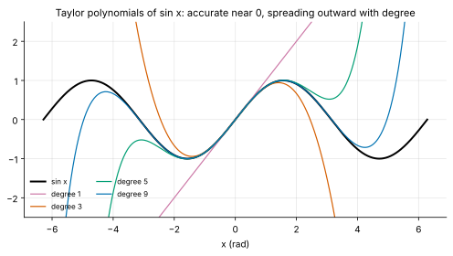
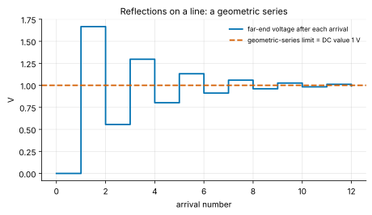
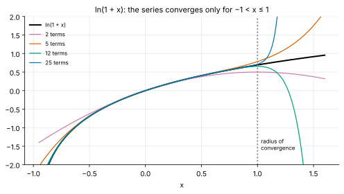
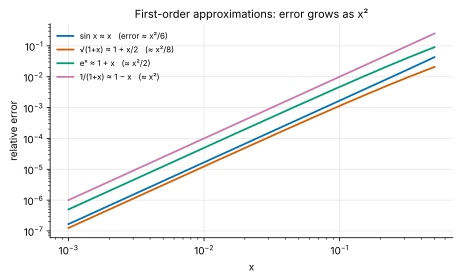
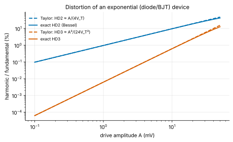

<!-- status: reviewed -->
# 01-08 · Sequences, Series and Taylor Expansions

| | |
|---|---|
| **Course** | [01 · Calculus for Engineers](../README.md) |
| **University equivalent** | Calculus II, infinite sequences and series (Stewart, ch. 11: sequences, series, convergence tests, power series, Taylor and Maclaurin series, the binomial series, applications of Taylor polynomials) |
| **Prerequisites** | [01-03](01-03-derivatives.md), [01-04](01-04-applications-of-derivatives.md) (linearization), [01-06](01-06-techniques-of-integration.md) (improper integrals). |
| **Estimated study hours** | 13 |
| **Last verified** | 2026-11-12 |

**Learning objectives.** After this chapter you can:

1. Decide whether sequences and series converge (geometric, p-series, comparison, limit comparison, integral, ratio, root and alternating-series tests, with error estimates for the integral and alternating tests), and sum geometric series that arise in feedback, reflections and finance.
2. Derive the Taylor and Maclaurin series of $e^x$, $\sin x$, $\cos x$, $\ln(1 + x)$, $1/(1 - x)$ and $(1 + x)^\alpha$, and find radii of convergence.
3. Bound truncation errors with the Lagrange remainder and the alternating-series bound, and choose how many terms a computation needs.
4. Apply and error-bound the standard engineering approximations (small angle, binomial, $e^x \approx 1 + x$, $1/(1 + x) \approx 1 - x$), including the gain error of a feedback amplifier.
5. Use Taylor expansions to derive Euler's formula, the error terms of numerical methods, and the harmonic distortion of nonlinear devices.

## 1. Big picture

Much of engineering consists of replacing a hard function by a polynomial that is easy to compute and to reason about. Taylor series make that replacement systematic, and they come with a bound on the error. Earlier chapters used their results on credit:

- the small-angle approximation (01-01);
- linearization's $\tfrac{1}{2}f''\Delta^2$ error (01-04);
- the $h/2$ and $h^2/6$ errors of numerical derivatives (01-03);
- Newton's quadratic convergence (01-04).

This chapter pays the debt. It also gives a new tool, the infinite **series**, a sum with infinitely many terms, and the conditions under which such a sum means anything.

- **Linearization is the first term of a Taylor series,** and every small-signal model rests on it ([10-04](../../10-electronics-1/chapters/10-04-small-signal-models.md)).
- **Nonlinear distortion is the second and third term:** harmonic distortion and intermodulation come straight from a device's Taylor coefficients ([21](../../21-rf-and-microwave-engineering/README.md)).
- **Geometric series describe repetition:** reflections bouncing on a line, signals circulating in a feedback loop, the impulse response of a digital filter, the present value of an annuity.
- **Computers evaluate functions with series:** library routines for exp, sin and log use polynomial approximations derived from these ideas.
- **Euler's formula, $e^{j\theta} = \cos\theta + j\sin\theta$,** drops out of three series ([02-01](../../02-complex-numbers-des-and-linear-algebra/chapters/02-01-complex-numbers-euler-and-phasors.md)).

## 2. Intuition first

### Matching a function at a point, one derivative at a time

To approximate $f$ near $a$, choose a polynomial that matches more and more of $f$'s behavior at $a$:

- **degree 0:** match the value, $p_0(x) = f(a)$;
- **degree 1:** also match the slope, giving the tangent line of 01-04;
- **degree 2:** also match the curvature;

and so on. Each extra matched derivative makes the polynomial hug $f$ over a wider neighborhood (Figure 1). The infinite sequence of matches, if it converges to $f$, is the **Taylor series**.

*Figure 1. Taylor polynomials of $\sin x$ about 0 of degree 1, 3, 5 and 9. Each is excellent near 0, and higher degrees stay accurate farther out.*

### An analogy from finance: duration and convexity

A bond's price as a function of yield, $P(y)$, is approximated near today's yield $y_0$ by

$$
\frac{\Delta P}{P} \approx -D\,\Delta y + \tfrac{1}{2}C\,(\Delta y)^2,
$$

with $D$ the (modified) duration and $C$ the convexity. That is the second-order Taylor expansion of the price $P(y)$ about the current yield, divided by $P$: duration is $D = -P'/P$ and convexity is $C = P''/P$, the first and second derivatives scaled by the price. Risk managers use the first term for small moves and add the second when moves are large. Engineers do exactly the same with gain (first derivative) and distortion (second and third).

*Where the analogy breaks:* a bond's price function is smooth and well behaved, so two terms usually suffice. Engineering functions can have nearby singularities (a resonance, a pole), beyond which *no* number of Taylor terms converges (§3.4). The radius of convergence is the limit of trust, and finance rarely has an analogue of it.

### Adding infinitely many numbers

Adding 1 + ½ + ¼ + ⅛ + ⋯ never "finishes", yet the partial sums 1, 1.5, 1.75, 1.875, … close in on 2. We *define* the sum of an infinite series as the limit of its partial sums (01-02), when that limit exists. Some series, such as 1 + ½ + ⅓ + ¼ + ⋯, grow without bound even though their terms shrink to zero. Telling the two kinds apart is the first job of this chapter.

## 3. Theory

### 3.1 Sequences and series

A **sequence** $a_1, a_2, a_3, \ldots$ **converges** to $L$ if $a_n \to L$ as $n \to \infty$ (01-02). For example, $(1 + 2/n)^n \to e^2$. A bounded monotone sequence always converges.

A **series** $\sum_{k=1}^\infty a_k$ is the limit of its **partial sums** $S_n = \sum_{k=1}^n a_k$. If $S_n \to S$ the series converges, with sum $S$; otherwise it diverges.

**The n-th term test.** If $\sum a_k$ converges, then $a_k \to 0$. So terms that do not shrink to zero mean divergence. The converse is false (§3.3).

### 3.2 The geometric series

$\sum_{k=0}^{n-1}ar^k = a + ar + \cdots + ar^{n-1}$. Multiply by $r$ and subtract: $S_n - rS_n = a - ar^n$, so

$$
\sum_{k=0}^{n-1}ar^k = a\,\frac{1 - r^n}{1 - r} \quad(r \ne 1), \qquad \sum_{k=0}^{\infty}ar^k = \frac{a}{1 - r}\quad(\lvert r\rvert < 1).
$$

For $\lvert r\rvert \ge 1$ the infinite series diverges. Geometric series appear whenever something repeats with a constant ratio:

- **Reflections on a transmission line** ([00-02](../../00-orientation/chapters/00-02-the-abstraction-stack.md)). Each round trip multiplies the wave by $\Gamma_s\Gamma_L$, the product of the reflection coefficients at the source and load ends. The far-end voltage after many round trips is a geometric series whose sum is the DC (lumped) answer (Example 01-08.1, Figure 2).
- **Digital filters.** The recursion $y[n] = ay[n-1] + x[n]$ has impulse response $a^n$. Its DC gain is $\sum a^n = 1/(1 - a)$, finite only for $\lvert a\rvert < 1$, which is the stability condition ([16](../../16-digital-signal-processing/README.md), Problem 01-08.5).
- **Annuities and perpetuities.** A payment of 1 per period discounted at rate $i$ has present value $\sum_{k=1}^n(1 + i)^{-k} = \frac{1 - (1 + i)^{-n}}{i}$, and a perpetuity is worth $1/i$ (Problem 01-08.6).

*Figure 2. The far-end voltage of a mismatched line after each wave arrival: a geometric series converging to the DC value.*

### 3.3 Convergence tests

**p-series.** $\sum_{k=1}^\infty\frac{1}{k^p}$ converges if and only if $p > 1$. The proof compares the sum with the improper integral $\int_1^\infty x^{-p}\,dx$ of [01-06](01-06-techniques-of-integration.md) (the **integral test**). The **harmonic series** $\sum 1/k$ ($p = 1$) diverges, but only like $\ln n$: a million terms sum to about 14.4.

**Comparison test.** If $0 \le a_k \le b_k$ and $\sum b_k$ converges, so does $\sum a_k$. If $\sum a_k$ diverges, so does $\sum b_k$.

**Ratio test.** If $\lim\lvert a_{k+1}/a_k\rvert = L$, the series converges (absolutely) when $L < 1$ and diverges when $L > 1$; $L = 1$ is inconclusive. It suits factorials and powers: for $\sum x^k/k!$, the ratio is $\lvert x\rvert/(k + 1) \to 0$, so the series converges for every $x$.

**Limit comparison test.** If $a_k, b_k > 0$ and $a_k/b_k \to L$ with $0 < L < \infty$, then $\sum a_k$ and $\sum b_k$ converge or diverge together. This is the practical version of comparison: you only need the terms to behave alike for large $k$. For example, $\sum\frac{1}{k^2 + 3k}$ converges because its terms behave like $1/k^2$ (the ratio tends to 1).

**The integral test, with a remainder estimate.** If $f$ is positive and decreasing on $[1, \infty)$ and $a_k = f(k)$, then each term is squeezed between areas under $f$: $\int_k^{k+1}f\,dx \le a_k \le \int_{k-1}^kf\,dx$ (draw the rectangles). Summing, $\sum a_k$ converges exactly when $\int_1^\infty f\,dx$ does, and the error after $n$ terms is bracketed by

$$
\int_{n+1}^\infty f(x)\,dx \;\le\; \sum_{k=n+1}^\infty a_k \;\le\; \int_n^\infty f(x)\,dx .
$$

For $\sum 1/k^2 = \pi^2/6$, stopping after $n$ terms leaves an error between $1/(n + 1)$ and $1/n$: a thousand terms buy only three digits. That is the price of a slowly converging series (Problem 01-08.17).

**Root test.** If $\lvert a_k\rvert^{1/k} \to L$, the series converges when $L < 1$ and diverges when $L > 1$. It suits terms raised to the $k$-th power, such as $\sum(k/(2k + 1))^k$, where $L = 1/2$.

**Alternating series test, with an error bound.** If the terms alternate in sign and decrease in magnitude to zero, the series converges. Truncating it leaves an error **no larger than the first omitted term**, and of that term's sign. For example, $1 - \tfrac{1}{2} + \tfrac{1}{3} - \cdots = \ln 2$. Its convergence is painfully slow: the error after $n$ terms is about $1/(2n)$.

**Absolute versus conditional convergence.** A series converges *absolutely* if $\sum\lvert a_k\rvert$ converges. Absolutely convergent series can be rearranged freely. *Conditionally* convergent ones, like the alternating harmonic series, cannot: rearranging their terms can change the sum. Engineering power series are absolutely convergent inside their radius of convergence, so this subtlety rarely bites.

### 3.4 Power series and the radius of convergence

A **power series** about $a$ is $\sum_{k=0}^\infty c_k(x - a)^k$. By the ratio test it converges absolutely for $\lvert x - a\rvert < R$ and diverges for $\lvert x - a\rvert > R$. The **radius of convergence** $R$ is often $\lim\lvert c_k/c_{k+1}\rvert$. At $\lvert x - a\rvert = R$ each endpoint must be checked separately.

Inside its radius a power series behaves like a polynomial. It can be **differentiated and integrated term by term**, and the results have the same radius. Starting from the geometric series,

$$
\frac{1}{1 - x} = 1 + x + x^2 + x^3 + \cdots \qquad(\lvert x\rvert < 1).
$$

Replace $x$ by $-x$ and integrate from 0:

$$
\ln(1 + x) = x - \frac{x^2}{2} + \frac{x^3}{3} - \cdots \qquad(-1 < x \le 1).
$$

Replace $x$ by $-x^2$ and integrate:

$$
\arctan x = x - \frac{x^3}{3} + \frac{x^5}{5} - \cdots \qquad(\lvert x\rvert \le 1).
$$

> **Math refresher — the imaginary unit j.** Engineers write $j$ for the number with $j^2 = -1$ (mathematicians use $i$, which EE reserves for current). A complex number $a + jb$ is a point in a plane: $a$ along the real axis, $b$ along the imaginary axis. Its distance from the origin is $\sqrt{a^2 + b^2}$, so $\pm j$ are at distance 1 from 0, and $j^3 = -j$, $j^4 = 1$. Chapter [02-01](../../02-complex-numbers-des-and-linear-algebra/chapters/02-01-complex-numbers-euler-and-phasors.md) develops all of this. Here you need only $j^2 = -1$ and the idea of distance in the plane.

**Why the radius is what it is.** $\ln(1 + x)$ blows up at $x = -1$, one unit from the center, and its series stops converging at that distance on *both* sides: it diverges for $x > 1$, where the function itself is perfectly smooth (Figure 3). The deeper reason lives in the complex plane ([02-01](../../02-complex-numbers-des-and-linear-algebra/chapters/02-01-complex-numbers-euler-and-phasors.md)). The radius equals the distance from the center to the nearest point where the function misbehaves, *including complex points*. $1/(1 + x^2)$ is smooth for every real $x$, yet its series converges only for $\lvert x\rvert < 1$, because the function has poles at $x = \pm j$. Circuit transfer functions behave the same way: their poles limit series expansions in frequency.

*Figure 3. Partial sums of the series for $\ln(1 + x)$ converge for $-1 < x \le 1$ and diverge beyond, although $\ln(1 + x)$ itself continues smoothly.*

### 3.5 Taylor and Maclaurin series

Suppose $f(x) = \sum c_k(x - a)^k$ near $a$. Setting $x = a$ gives $c_0 = f(a)$. Differentiating term by term and setting $x = a$ again gives $c_1 = f'(a)$. Differentiating $k$ times leaves $k!\,c_k$ as the only surviving term at $x = a$. So

$$
f(x) = \sum_{k=0}^\infty\frac{f^{(k)}(a)}{k!}(x - a)^k = f(a) + f'(a)(x - a) + \frac{f''(a)}{2}(x - a)^2 + \cdots .
$$

This is the **Taylor series** of $f$ about $a$. It is the **Maclaurin series** when $a = 0$. The partial sum through degree $n$ is the **Taylor polynomial** $T_n(x)$.

**The essential Maclaurin series.** Each follows from the derivative patterns of 01-03:

| Function | Series | Converges for |
|---|---|---|
| $e^x$ | $1 + x + \dfrac{x^2}{2!} + \dfrac{x^3}{3!} + \cdots$ | all $x$ |
| $\sin x$ | $x - \dfrac{x^3}{3!} + \dfrac{x^5}{5!} - \cdots$ | all $x$ |
| $\cos x$ | $1 - \dfrac{x^2}{2!} + \dfrac{x^4}{4!} - \cdots$ | all $x$ |
| $\dfrac{1}{1 - x}$ | $1 + x + x^2 + x^3 + \cdots$ | $\lvert x\rvert < 1$ |
| $\ln(1 + x)$ | $x - \dfrac{x^2}{2} + \dfrac{x^3}{3} - \cdots$ | $-1 < x \le 1$ |
| $(1 + x)^\alpha$ | $1 + \alpha x + \dfrac{\alpha(\alpha - 1)}{2!}x^2 + \cdots$ | $\lvert x\rvert < 1$ (any real α) |

For $e^x$: every derivative is $e^x$, which is 1 at 0, so $c_k = 1/k!$. For $\sin x$: the derivatives at 0 cycle through 0, 1, 0, −1, so only odd powers survive, with alternating signs. The last row is the **binomial series**. For a positive integer α it terminates, giving the binomial theorem used in 01-03.

**Euler's formula from series.** Substitute $x = j\theta$ into the exponential series and use $j^2 = -1$:

$$
e^{j\theta} = 1 + j\theta - \frac{\theta^2}{2!} - j\frac{\theta^3}{3!} + \frac{\theta^4}{4!} + \cdots = \underbrace{\left(1 - \frac{\theta^2}{2!} + \frac{\theta^4}{4!} - \cdots\right)}_{\cos\theta} + j\underbrace{\left(\theta - \frac{\theta^3}{3!} + \cdots\right)}_{\sin\theta}.
$$

This is the bridge to phasors ([02-01](../../02-complex-numbers-des-and-linear-algebra/chapters/02-01-complex-numbers-euler-and-phasors.md)). The regrouping is legitimate because the series converges absolutely.

### 3.6 Taylor's theorem and the remainder

A Taylor polynomial is useful only with a bound on its error. **Taylor's theorem** (Lagrange form): if $f$ has $n + 1$ continuous derivatives, then

$$
f(x) = T_n(x) + R_n(x), \qquad R_n(x) = \frac{f^{(n+1)}(\xi)}{(n + 1)!}(x - a)^{n+1}
$$

for some $\xi$ between $a$ and $x$. The remainder looks like the first omitted term, with the derivative evaluated at an unknown intermediate point. To *bound* it, use the largest possible value of $\lvert f^{(n+1)}\rvert$ on the interval.

> **Going deeper — where the remainder comes from.** For $n = 0$ the formula is the mean value theorem: $f(x) = f(a) + f'(\xi)(x - a)$. The general case follows by applying Rolle's theorem repeatedly to $g(t) = f(x) - T_n(x; t) - K(x - t)^{n+1}$, where $T_n(x; t)$ is the Taylor polynomial centered at $t$ and $K$ is chosen so that $g(a) = 0$. An equivalent integral form, $R_n = \frac{1}{n!}\int_a^xf^{(n+1)}(t)(x - t)^n\,dt$, follows from repeated integration by parts.

**Paying earlier debts.** Each of these is the remainder formula applied with $n = 1$ or $n = 2$:

- **Linearization error** (01-04) is $R_1 = \tfrac{1}{2}f''(\xi)(x - a)^2$.
- **Small-angle error** (01-01): $\sin x = x - \tfrac{x^3}{6}\cos\xi$, so $\lvert\sin x - x\rvert \le \lvert x\rvert^3/6$, a relative error of about $x^2/6$.
- **Forward difference** (01-03): expanding $f(x + h) = f(x) + hf'(x) + \tfrac{h^2}{2}f''(\xi)$ gives $\dfrac{f(x + h) - f(x)}{h} - f'(x) = \tfrac{h}{2}f''(\xi)$.
- **Central difference:** subtract the expansions of $f(x \pm h)$. The even terms cancel, leaving an error of $\tfrac{h^2}{6}f'''$ (Problem 01-08.11).
- **Newton's convergence** (01-04) used the $n = 1$ remainder about $x_k$.

**How many terms?** To compute $e^1$ to within $10^{-6}$, the remainder after the degree-$n$ term is $e^\xi/(n + 1)!$ with $0 < \xi < 1$. We cannot use the value of $e$ we are computing to bound it, but $e^\xi < e < 3$ is safe, so the error is below $3/(n + 1)!$. This first drops below $10^{-6}$ at $n + 1 = 10$, so 10 terms (degree 9) suffice (Example 01-08.2). Library implementations go further: they reduce the argument to a small range first, so that a short polynomial suffices.

### 3.7 Approximations engineers use

Each is a truncated Taylor series, valid for $\lvert x\rvert \ll 1$, with the first neglected term as the error estimate (Figure 4):

| Approximation | First neglected term | Typical use |
|---|---|---|
| $\sin x \approx x$, $\tan x \approx x$ | $-x^3/6$, $+x^3/3$ | Small phase angles, tilt sensors |
| $\cos x \approx 1 - x^2/2$ | $+x^4/24$ | Phase error in mixers and PLLs |
| $e^x \approx 1 + x$ | $x^2/2$ | Early-time transients, $e^{-t/\tau}$ for $t \ll \tau$ |
| $\ln(1 + x) \approx x$ | $-x^2/2$ | Log returns ≈ simple returns; small changes in dB |
| $(1 + x)^n \approx 1 + nx$ | $\binom{n}{2}x^2$ | Sensitivity, compounding, tempco |
| $\sqrt{1 + x} \approx 1 + x/2$ | $-x^2/8$ | Noise sums, RMS of small ripple |
| $\dfrac{1}{1 + x} \approx 1 - x$ | $+x^2$ | Feedback gain error, loading |

*Figure 4. Every first-order approximation has an error that grows as $x^2$. At $x = 0.1$ the errors range from 0.11% (the square root) to 1% (the reciprocal).*

**Feedback gain error.** An amplifier of open-loop gain $A$ with feedback fraction $\beta$ has closed-loop gain

$$
G = \frac{A}{1 + A\beta} = \frac{1}{\beta}\cdot\frac{1}{1 + \frac{1}{A\beta}} \approx \frac{1}{\beta}\left(1 - \frac{1}{A\beta}\right).
$$

The **relative gain error** is about $1/(A\beta)$, the reciprocal of the **loop gain**. With $A = 10^5$ and $\beta = 0.01$ (ideal gain 100), the error is 0.1% (Example 01-08.3). This one approximation explains why op-amps have enormous open-loop gains: the gain buys accuracy ([12](../../12-electronics-2/README.md)).

### 3.8 Nonlinear distortion from Taylor coefficients

Expand any smooth device characteristic about its operating point:

$$
y = a_1x + a_2x^2 + a_3x^3 + \cdots,
$$

with $x$ the small input deviation. Drive it with $x = A\cos\omega t$ and use $\cos^2\theta = \tfrac{1}{2}(1 + \cos2\theta)$ and $\cos^3\theta = \tfrac{3}{4}\cos\theta + \tfrac{1}{4}\cos3\theta$:

$$
y = \tfrac{1}{2}a_2A^2 + \left(a_1A + \tfrac{3}{4}a_3A^3\right)\cos\omega t + \tfrac{1}{2}a_2A^2\cos2\omega t + \tfrac{1}{4}a_3A^3\cos3\omega t + \cdots
$$

So, for small $A$, the second and third harmonic distortion are

$$
\text{HD2} \approx \frac{a_2}{2a_1}A, \qquad \text{HD3} \approx \frac{a_3}{4a_1}A^2 .
$$

HD2 grows in proportion to the amplitude, and HD3 with its square: on a dB scale, 20 and 40 dB per decade of amplitude. The $\tfrac{1}{2}a_2A^2$ term is a **DC shift** produced by even-order nonlinearity (the principle of every detector and mixer). The $\tfrac{3}{4}a_3A^3$ term changes the fundamental's gain: **compression** when $a_3$ has the opposite sign to $a_1$, expansion when it has the same sign (Problem 01-08.12).

**The exponential device.** A diode or bipolar transistor has $i = Ie^{v/V_T}$ about its bias point. Its Taylor coefficients in $x = v_{small}/V_T$ are $1, \tfrac{1}{2}, \tfrac{1}{6}$, giving

$$
\text{HD2} \approx \frac{A}{4V_T}, \qquad \text{HD3} \approx \frac{A^2}{24V_T^2} .
$$

A 1 mV signal already produces about 1% second harmonic (Example 01-08.5, Figure 5). This is the quantitative meaning of "small signal": amplitudes well below $V_T$. It also explains why precision analog design leans on differential circuits, which cancel even-order terms, and on negative feedback, which suppresses all of them.

*Figure 5. HD2 and HD3 of an exponential I–V law. The Taylor approximations (dashed) are excellent below about 10 mV and drift from the exact values (solid) at larger drive.*

## 4. Worked examples

### Example 01-08.1 — Reflections as a geometric series (tier A)

**Setup.** A 1 V step source with $R_s = 10\ \Omega$ drives a 50 Ω line open at the far end ($\Gamma_L = +1$). The launched wave is $V_l = 1\times\frac{50}{60}$ V, and the source reflection coefficient is $\Gamma_s = \frac{10 - 50}{10 + 50}$. The far-end voltage after the $n$-th arrival is the partial sum $V_l(1 + \Gamma_L)\sum_{k=0}^{n-1}(\Gamma_s\Gamma_L)^k$. Find the partial sums after the first four arrivals, and the limit.

**Solution.** $V_l = $ **0.8333 V**, $\Gamma_s = $ **−0.6667**, $\Gamma_s\Gamma_L = -2/3$. The partial sums are $1.6667\times\big(1, \tfrac{1}{3}, \tfrac{7}{9}, \tfrac{13}{27}\big)$: **1.667, 0.5556, 1.296, 0.8025 V**. The limit is $V_l(1 + \Gamma_L)/(1 - \Gamma_s\Gamma_L) = 1.6667/1.6667 = $ **1.000 V**.

**Interpretation.** The infinite sum of reflections reproduces exactly what a lumped (DC) analysis says: an open load sees the full source voltage. The geometric ratio −2/3 sets how violently, and for how long, it rings on the way.

**Sanity check.** $\lvert\Gamma_s\Gamma_L\rvert < 1$, so the series converges ✓. With $R_s = Z_0$, $\Gamma_s = 0$ and the first arrival already equals the limit, the source-termination principle of 00-02 ✓.

### Example 01-08.2 — Computing e^x, with a remainder bound (tier A)

**Setup.** (a) Approximate $e^{0.5}$ with the Maclaurin polynomial of degree 4, and compare the actual error with the Lagrange bound. (b) How many terms of the series guarantee $e^1$ to within $10^{-6}$?

**Solution.**

(a) $T_4(0.5) = 1 + 0.5 + 0.125 + 0.0208333 + 0.0026042 = $ **1.648438**, against $e^{0.5} = $ **1.648721**: an error of **2.84×10^−4**. The bound is $e^{\xi}\frac{0.5^5}{5!}$ with $0 < \xi < 0.5$. We must not use the value of $e^{0.5}$ we are estimating, but $e^\xi < e^{0.5} < \sqrt4 = 2$ (since $e < 4$) is safe, so the error is at most $2\times\frac{0.03125}{120} = $ **5.21×10^−4** ✓ (actual ≤ bound).

(b) Using $e^\xi < 3$, we need $3/(n + 1)! \le 10^{-6}$. $3/9! = 8.3\times10^{-6}$ is too large, while $3/10! = 8.3\times10^{-7}$ works. So $n + 1 = 10$: **10 terms** (degree 9).

**Sanity check.** The factorial grows so fast that each extra term buys about one more decimal digit near $x = 1$ ✓.

### Example 01-08.3 — The gain error of a feedback amplifier (tier B)

**Setup.** An op-amp with open-loop gain $A = 10^5$ is configured for an ideal gain of $1/\beta = 100$. Find the exact closed-loop gain and its relative error, and compare with the first-order approximation $1/(A\beta)$.

**Solution.** Exact: $G = \dfrac{10^5}{1 + 10^5\times0.01} = \dfrac{10^5}{1001} = $ **99.90**, a relative error of $-1/1001 = $ **−0.0999%**. First-order: $1/(A\beta) = 1/1000 = $ **0.1%**, so $G \approx 100(1 - 0.001) = 99.9$. The two agree to about one part in $10^6$, the size of the neglected $(1/A\beta)^2$ term.

**Interpretation.** Accuracy is bought with loop gain: 1% accuracy needs $A\beta \ge 100$, and 0.01% needs $10^4$. The open-loop gain falls with frequency, so accuracy does too ([15](../../15-control-systems/README.md)).

**Sanity check.** As $A \to \infty$, $G \to 1/\beta$ ✓.

### Example 01-08.4 — Small-angle and binomial approximations with error bounds (tier B)

**Setup.** (a) Approximate $\sin0.1$ by $0.1$ and bound the error. (b) Approximate $\sqrt{1.02}$ with $1 + x/2$ and estimate the error from the next term. (c) Evaluate $1.001^{1000}$, and explain its relation to $e$.

**Solution.**

(a) The error is $0.1 - \sin0.1 = $ **1.666×10^−4**. The bound $x^3/6 = $ **1.667×10^−4** is essentially exact here, since the next term is tiny.

(b) $\sqrt{1.02} \approx 1.01$; the exact value is **1.009950**. The next term is $-x^2/8 = $ **−5×10^−5**, and the actual error is −4.95×10^−5 ✓.

(c) $1.001^{1000} = e^{1000\ln1.001} = e^{1000(0.001 - 0.0000005 + \cdots)} = e^{0.9995}$, which is **2.7169**, against $e = 2.7183$. This is the compounding limit of 01-02. The $\ln(1 + x) \approx x - x^2/2$ correction explains the small shortfall.

**Sanity check.** All three errors are second order in the small quantity, as Figure 4 predicts ✓.

### Example 01-08.5 — Harmonic distortion of an exponential device (tier C)

**Setup.** A forward-biased diode (or a BJT's base–emitter junction) at room temperature ($V_T = 25.85$ mV) is driven with a small sinusoid of amplitude $A$ about its bias point. Using the Taylor coefficients of $e^x$, find HD2 and HD3 for $A = 1$ mV and $A = 10$ mV, in percent and in dB relative to the fundamental.

**Solution.** From §3.8, HD2 $\approx A/(4V_T)$ and HD3 $\approx A^2/(24V_T^2)$.

- $A = 1$ mV: HD2 $= 1/(4\times25.85) = $ **0.967%** (**−40.3 dB**); HD3 $= 1/(24\times25.85^2) = $ **6.24×10^−5** (**−84.1 dB**).
- $A = 10$ mV: HD2 $= $ **9.67%** (**−20.3 dB**); HD3 $= $ **0.624%** (**−44.1 dB**).

Ten times the amplitude gives 20 dB more HD2 and 40 dB more HD3, as predicted.

> **Going deeper — the exact answer.** The exact harmonic amplitudes of $e^{x\cos\theta}$ are $2I_n(x)$, where $I_n$ are modified Bessel functions. So the exact HD2 is $I_2(x)/I_1(x)$, which is 9.611% at 10 mV against the Taylor estimate of 9.671%. The lab compares the two across amplitudes.

**Interpretation.** For −60 dB (0.1%) second harmonic, a single diode or BJT must see less than about 0.1 mV of signal. That is why front-ends use emitter degeneration, differential pairs (which cancel HD2) and feedback. The lab confirms the 1 mV result with an ngspice transient and a Fourier integral.

<!-- answer-key -->
| ID | Quantity | Value | Unit |
|---|---|---|---|
| Ex 01-08.1a | launched wave | 0.8333 | V |
| Ex 01-08.1b | Γ_s | −0.6667 | — |
| Ex 01-08.1c | after arrival 1 | 1.667 | V |
| Ex 01-08.1d | after arrival 2 | 0.5556 | V |
| Ex 01-08.1e | after arrival 3 | 1.296 | V |
| Ex 01-08.1f | after arrival 4 | 0.8025 | V |
| Ex 01-08.1g | limit | 1.000 | V |
| Ex 01-08.2a | T4(0.5) | 1.648438 | — |
| Ex 01-08.2b | e^0.5 | 1.648721 | — |
| Ex 01-08.2c | actual error | 2.84×10^-4 | — |
| Ex 01-08.2d | Lagrange bound | 5.21×10^-4 | — |
| Ex 01-08.2f | 3/9! | 8.3×10^-6 | — |
| Ex 01-08.2g | 3/10! | 8.3×10^-7 | — |
| Ex 01-08.2e | terms for 1e−6 at x = 1 | 10 | — |
| Ex 01-08.3a | exact closed-loop gain | 99.90 | — |
| Ex 01-08.3b | exact relative error | −0.0999 | % |
| Ex 01-08.3c | first-order error | 0.1 | % |
| Ex 01-08.4a | error of sin 0.1 ≈ 0.1 | 1.666×10^-4 | — |
| Ex 01-08.4b | bound x³/6 | 1.667×10^-4 | — |
| Ex 01-08.4c | √1.02 | 1.009950 | — |
| Ex 01-08.4d | next-term estimate | −5×10^-5 | — |
| Ex 01-08.4e | 1.001^1000 | 2.7169 | — |
| Ex 01-08.5a | HD2 at 1 mV | 0.967 | % |
| Ex 01-08.5b | HD2 at 1 mV | −40.3 | dB |
| Ex 01-08.5c | HD3 at 1 mV | 6.24×10^-5 | — |
| Ex 01-08.5d | HD3 at 1 mV | −84.1 | dB |
| Ex 01-08.5e | HD2 at 10 mV | 9.67 | % |
| Ex 01-08.5f | HD2 at 10 mV | −20.3 | dB |
| Ex 01-08.5g | HD3 at 10 mV | 0.624 | % |
| Ex 01-08.5h | HD3 at 10 mV | −44.1 | dB |
| Ex 01-08.5i | exact HD2 at 10 mV | 9.611 | % |

*Recomputed by [verify_01_08.py](../verify/verify_01_08.py). Examples 01-08.3 and 01-08.5 are also confirmed in ngspice by the lab netlists.*

## 5. Simulate it

The lab ([labs/01-08-lab/](../labs/01-08-lab/README.md)) has a notebook and two ngspice netlists:

1. **Series explorer.** Plot partial sums and Taylor polynomials, find where each converges, and compare actual errors with Lagrange bounds.
2. **Convergence speed.** Compute π with the Leibniz series and with Machin's formula, and count the terms each needs.
3. **Distortion.** Drive a modeled exponential and a cubic amplifier with sinusoids, take the FFT, and compare harmonic levels with the Taylor predictions and the exact Bessel values.
4. **ngspice.** `diode_hd.cir` measures a real diode model's HD2 and HD3 with Fourier integrals. `opamp_gain_error.cir` measures a feedback amplifier's gain error for two open-loop gains.

**Predict, then run.** Before running `diode_hd.cir`, predict HD2 at 1 mV and at 3 mV.

## 6. Engineering tradeoffs

| Knob | Improves | Costs | Typical decision owner |
|---|---|---|---|
| More Taylor terms in a model or computation | Accuracy over a wider range | Computation; useless beyond the radius of convergence | Numerical and modeling engineer |
| Smaller signal swing at a nonlinear device | Lower distortion (HD2 ∝ A, HD3 ∝ A²) | Lower signal-to-noise ratio | Analog and RF designer |
| More loop gain $A\beta$ | Smaller gain error (≈ 1/(Aβ)) and distortion | Stability margin, power, bandwidth | Analog designer |
| Differential (balanced) circuits | Cancel even-order terms (HD2) | Twice the devices; matching requirements | Analog and RF designer |
| Argument reduction before series evaluation | Short, accurate polynomials in math libraries | Extra logic, care with rounding | Library and firmware engineer |

## 7. Numbers to know

| Quantity | Value | Note |
|---|---|---|
| $\sum_{k\ge0}r^k$ | $1/(1 - r)$ for $\lvert r\rvert < 1$ | DC gain of $y[n] = ry[n-1] + x[n]$ |
| Harmonic series, $10^6$ terms | ≈ 14.4 | Diverges, but like $\ln n$ |
| $\sum 1/k^2$ | $\pi^2/6 \approx 1.645$ | Converges ($p = 2$) |
| Terms of $e^x$ for 10⁻⁶ at $x = 1$ | 10 | $e/10! \approx 7.5\times10^{-7}$ |
| Small-angle error at 0.1 rad | 0.17% | $x^2/6$ |
| Feedback gain error | ≈ $1/(A\beta)$ | Loop gain 1000 → 0.1% |
| Exponential-device HD2 | $A/(4V_T)$: 1 mV → 0.97% (−40 dB) | +20 dB per decade of A |
| Exponential-device HD3 | $A^2/(24V_T^2)$: 1 mV → −84 dB | +40 dB per decade of A |
| Leibniz series for π | about 2 million terms per 10⁻⁶ | Machin's formula: 5 terms of each part |

## 8. Common mistakes

1. **Concluding convergence because the terms go to zero.** The harmonic series is the counterexample.
2. **Using a series outside its radius of convergence.** $\ln(1 + x)$'s series is useless at $x = 2$, however many terms you take.
3. **Forgetting the factorial** in Taylor coefficients: $c_k = f^{(k)}(a)/k!$.
4. **Applying the alternating-series bound to a non-alternating series,** or to terms that do not decrease.
5. **Using a first-order approximation where the second-order term matters.** Check the size of the first neglected term.
6. **Treating "small signal" as any signal smaller than the bias.** For an exponential device, "small" means ≪ $V_T$ ≈ 26 mV.
7. **Expecting HD2 and HD3 to scale the same way with amplitude.** They grow at 20 and 40 dB per decade respectively.
8. **Rearranging a conditionally convergent series** and expecting the same sum.

## 9. Practitioner lens

### Taylor coefficients in today's specifications (as of Nov 2026)

- **Linearity specifications are Taylor coefficients in disguise.** RF and analog datasheets specify harmonic distortion, the 1 dB compression point (P1dB) and the third-order intercept point (IP3). For a memoryless cubic nonlinearity, all three follow from $a_1$, $a_2$ and $a_3$. The textbook result that the input IP3 sits about 9.6 dB above the input P1dB follows from §3.8's analysis extended to two input tones (Problem 01-08.12 derives it). Real amplifiers, with memory effects and higher-order terms, deviate from it **[Established]**.
- **Loop gain buys accuracy and linearity.** The $1/(A\beta)$ gain error and the corresponding suppression of distortion by feedback are why precision amplifiers advertise open-loop gains of 100 dB or more **[Established]** ([12](../../12-electronics-2/README.md)).
- **Polynomial approximations power hardware math.** Math libraries and hardware function units evaluate exp, log and trigonometric functions with argument reduction followed by short polynomial or rational approximations. Taylor series are the starting point; minimax-optimized polynomials are the refinement **[Established]**.

### Why it matters commercially

- **Linearity is a cost driver.** Distortion grows with signal amplitude. Meeting a linearity specification at a given output power can mean more supply current, larger devices or a more complex architecture (linearization, digital predistortion), which shows up directly in the power and cost of RF front ends and data converters.
- **Approximations hide in performance claims.** A specification derived from a small-signal (first-order) model holds only for small signals. A product used at larger swings will underperform it.

### Marketing vs Reality

**"Distortion −80 dB."** At what amplitude? HD3 worsens by 40 dB per decade of amplitude, so a figure measured 10 dB below full scale can hide a 20 dB worse number at full scale. **Sanity check:** ask for distortion against amplitude, not a single point.

**"Gain accuracy 0.01%."** At DC? Loop gain falls with frequency, and the error $1/(A\beta)$ rises with it. Ask for accuracy at the operating frequency.

**"Converges in a few iterations."** Series and iterative methods converge fast only inside their region of validity. Ask how the method behaves at the edge of its operating range.

### Questions to ask engineering leaders

1. **"How does your distortion scale with signal level, and where is the knee?"**
   *Strong answer:* shows HD2 and HD3 against amplitude with the expected slopes, and knows the mechanism for each. *Evasive:* a single best-case figure.
2. **"What loop gain do you have at the highest signal frequency, and what accuracy does that give?"**
   *Strong:* quantifies $A\beta$ against frequency and the resulting error. *Evasive:* quotes DC open-loop gain only.
3. **"Which of your models are linearized, and over what range have you validated them?"**
   *Strong:* names the range and the measured deviation beyond it. *Evasive:* "the model matches".

## 10. Concept check

**Q1.** Does $\sum_{k=1}^\infty\frac{1}{\sqrt{k}}$ converge?

Answer

No: it is a p-series with $p = \tfrac{1}{2} \le 1$.

**Q2.** Sum $1 - \tfrac{1}{2} + \tfrac{1}{4} - \tfrac{1}{8} + \cdots$.

Answer

A geometric series with $r = -\tfrac{1}{2}$: $1/(1 + \tfrac{1}{2}) = 2/3$.

**Q3.** Write the first three nonzero terms of the Maclaurin series of $e^{-x^2}$.

Answer

Substitute $-x^2$ into the series for $e^u$: $1 - x^2 + x^4/2$.

**Q4.** What is the radius of convergence of $\sum x^k/k!$? Of $\sum k!\,x^k$?

Answer

Infinite (ratio $\lvert x\rvert/(k + 1) \to 0$) and zero (ratio $(k + 1)\lvert x\rvert \to \infty$ for any $x \ne 0$).

**Q5.** Truncating $1 - \tfrac{1}{3} + \tfrac{1}{5} - \tfrac{1}{7} + \cdots$ after four terms, what is the maximum error?

Answer

The first omitted term, $1/9 \approx 0.111$: alternating, decreasing terms.

**Q6.** Approximate $1/0.97$ to first order, and estimate the error.

Answer

$1/(1 - 0.03) \approx 1.03$; the next term is $0.03^2 = 0.0009$. (Exact: 1.03093.)

**Q7.** By how many dB does HD3 rise when the drive amplitude rises by 6 dB?

Answer

12 dB: HD3 ∝ A², and in dB that is twice the amplitude change.

**Q8.** An op-amp has $A\beta = 500$. What is the approximate gain error?

Answer

$1/500 = 0.2\%$, with the gain slightly below its ideal value.

Now work the problem set: [01-08 problems](../problems/01-08-problems.md) (solutions in [01-08 solutions](../solutions/01-08-solutions.md)).

## 11. Key terms

[Sequence](../../../reference/glossary.md#sequence) ·
[Series](../../../reference/glossary.md#series) ·
[Geometric series](../../../reference/glossary.md#geometric-series) ·
[Harmonic series](../../../reference/glossary.md#harmonic-series) ·
[Ratio test](../../../reference/glossary.md#ratio-test) ·
[Power series](../../../reference/glossary.md#power-series) ·
[Radius of convergence](../../../reference/glossary.md#radius-of-convergence) ·
[Taylor series](../../../reference/glossary.md#taylor-series) ·
[Lagrange remainder](../../../reference/glossary.md#lagrange-remainder) ·
[Binomial series](../../../reference/glossary.md#binomial-series) ·
[Loop gain](../../../reference/glossary.md#loop-gain) ·
[Harmonic distortion](../../../reference/glossary.md#harmonic-distortion) ·
[Integral test](../../../reference/glossary.md#integral-test) ·
[Limit comparison test](../../../reference/glossary.md#limit-comparison-test)

## 12. Connections

- **Builds on:** [01-02](01-02-limits-and-continuity.md) (limits), [01-04](01-04-applications-of-derivatives.md) (linearization, MVT), [01-06](01-06-techniques-of-integration.md) (improper integrals).
- **Next:** [01-09 Multivariable Calculus I](01-09-multivariable-calculus-1.md).
- **Used later in:**
  - [02-01](../../02-complex-numbers-des-and-linear-algebra/chapters/02-01-complex-numbers-euler-and-phasors.md): Euler's formula.
  - [02-10](../../02-complex-numbers-des-and-linear-algebra/chapters/02-10-numerical-methods.md): error analysis of numerical methods.
  - [10-04](../../10-electronics-1/chapters/10-04-small-signal-models.md): small-signal models.
  - [11-09](../../11-signals-and-systems/chapters/11-09-z-transform.md): z-transforms as power series.
  - [12](../../12-electronics-2/README.md): feedback and gain error.
  - [21](../../21-rf-and-microwave-engineering/README.md): P1dB, IP3 and intermodulation.

## 13. Further study

- **Stewart, *Calculus: Early Transcendentals*,** chapter 11 (sequences and series) for more drill.
- **Strang, *Calculus* (free, MIT OpenCourseWare),** chapter 10 (infinite series).
- **MIT OpenCourseWare 18.01SC,** Unit 5 (infinite series and Taylor series).
- **B. Razavi, *RF Microelectronics*,** chapter 2 (nonlinearity: harmonics, compression, intermodulation), for the engineering use of §3.8.

## 14. Sources

1. B. Razavi, *RF Microelectronics*, 2nd ed., Prentice Hall, 2011, ch. 2 (relations among harmonic distortion, P1dB and IP3 for memoryless nonlinearities).
2. The convergence tests and Taylor's theorem are standard calculus (Stewart, ch. 11). All text, examples and problems are original.
