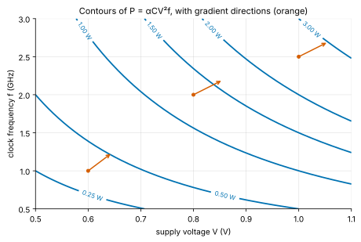
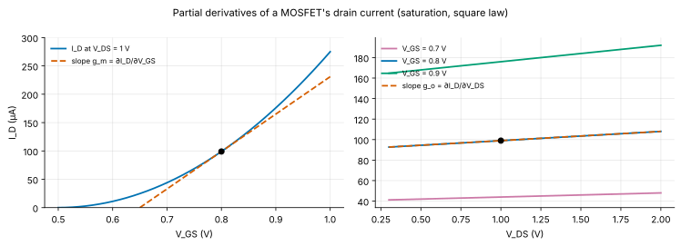
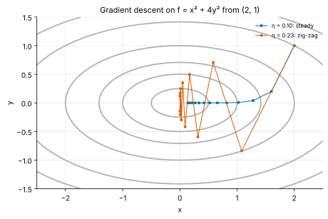
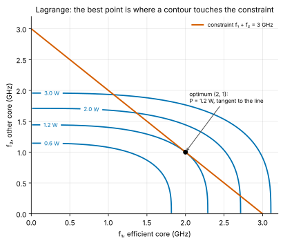
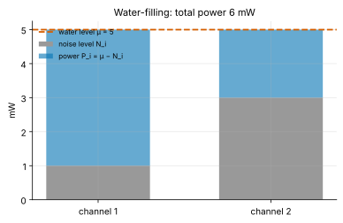

<!-- status: reviewed -->
# 01-09 · Multivariable Calculus I: Partial Derivatives and Gradients

| | |
|---|---|
| **Course** | [01 · Calculus for Engineers](../README.md) |
| **University equivalent** | Calculus III, partial derivatives (Stewart, ch. 14: functions of several variables, partial derivatives, tangent planes and linear approximation, the chain rule, directional derivatives and the gradient, maximum and minimum values, Lagrange multipliers) |
| **Prerequisites** | [01-03](01-03-derivatives.md), [01-04](01-04-applications-of-derivatives.md) (linearization, optimization), [01-08](01-08-sequences-series-and-taylor.md) (Taylor expansions). |
| **Estimated study hours** | 12 |
| **Last verified** | 2026-11-12 |

**Learning objectives.** After this chapter you can:

1. Describe functions of several variables with level curves, and compute and interpret partial derivatives, with units, as sensitivities such as a transistor's $g_m$ and $g_o$.
2. Linearize a function of several variables (tangent plane, total differential), and use it for small-signal models and multivariable tolerance analysis.
3. Apply the multivariable chain rule and implicit differentiation, including the temperature coefficient of a junction voltage.
4. Compute gradients and directional derivatives, explain why the gradient points uphill and is perpendicular to level curves, and run gradient descent.
5. Find and classify critical points with the Hessian, and solve constrained problems with Lagrange multipliers, interpreting the multiplier as a shadow price.

## 1. Big picture

Real engineering quantities depend on several variables at once:

- a chip's power depends on supply voltage, clock frequency and temperature;
- a transistor's current depends on its gate and drain voltages;
- a link's capacity depends on bandwidth and on the power assigned to each channel.

Multivariable calculus extends the tools of 01-03 and 01-04 to these functions. The ideas stay the same: rates (now *partial* derivatives), linear approximation (now a tangent *plane*), and optimization (now with a *gradient*, and often with constraints).

- **Small-signal models are partial derivatives:** a MOSFET's transconductance $g_m = \partial I_D/\partial V_{GS}$ and output conductance $g_o = \partial I_D/\partial V_{DS}$ define every amplifier calculation ([10-04](../../10-electronics-1/chapters/10-04-small-signal-models.md)).
- **Temperature coefficients are partial derivatives at fixed bias.** The −2 mV/K of a junction, and the bandgap reference built to cancel it, come from implicit differentiation (Problem 01-09.14).
- **Machine learning runs on gradients:** training a neural network is gradient descent on a loss function of millions of variables, run on the accelerators this learner covers.
- **Resource allocation is constrained optimization:** splitting work between heterogeneous cores, power between radio channels, or budget between design blocks. Lagrange multipliers solve such problems, and give the marginal value of each constraint.

## 2. Intuition first

### A landscape

A function $f(x, y)$ is a landscape: the height above each point of a map. **Level curves** (contours), where $f$ is constant, are a topographic map's contour lines (Figure 1). Standing at a point, you can ask:

- *How steep is it going east?* That is the partial derivative $\partial f/\partial x$, the slope with $y$ held fixed.
- *How steep is it going north?* That is $\partial f/\partial y$.
- *Which way is straight uphill, and how steep is it?* That is the **gradient** $\nabla f$, which points uphill. Its length is the steepest slope available, and it crosses the contour lines at right angles.

*Figure 1. Contours of dynamic power $P = \alpha CV^2f$ (with αC = 1 nF) over supply voltage and clock frequency. The orange arrows point in the direction of steepest increase in the plot's scaled axes, crossing each contour at right angles.*

### An analogy from finance: the Greeks and the shadow price

An option's value depends on the underlying price, volatility, time and interest rate. Its **Greeks** are partial derivatives: delta $= \partial V/\partial S$, vega $= \partial V/\partial\sigma$, theta, rho. Each holds the other inputs fixed. A risk manager linearizes the portfolio with them, $\Delta V \approx \text{delta}\cdot\Delta S + \text{vega}\cdot\Delta\sigma + \cdots$, which is exactly the total differential of §3.3. In capital budgeting under a constraint, the **shadow price** of the constraint is how much the optimal value would rise if the constraint were relaxed by one unit. That is precisely the Lagrange multiplier of §3.7.

*Where the analogy breaks:* the Greeks of a portfolio interact through correlations that change in a crisis. A circuit's partial derivatives come from fixed physical laws, but they change with the operating point. $g_m$ at 1 mA differs from $g_m$ at 1 µA, so a small-signal model is valid only near the bias point it was computed at, just as delta is valid only for small moves.

## 3. Theory

### 3.1 Functions of several variables

A function $f(x, y)$ assigns a number to each point of a region of the plane, or of higher-dimensional space for more variables. Two engineering examples recur in this chapter:

- **Dynamic power** $P(V, f) = \alpha CV^2f$ (W), with supply $V$ (V) and frequency $f$ (Hz).
- **A MOSFET in saturation** (square law with channel-length modulation, [10-02](../../10-electronics-1/chapters/10-02-mosfet-dc-operation-and-biasing.md)):

$$
I_D(V_{GS}, V_{DS}) = \tfrac{1}{2}k_n\,(V_{GS} - V_{TH})^2\left(1 + \frac{V_{DS}}{V_A}\right),
$$

with transconductance parameter $k_n$ (A/V²; the subscript keeps it apart from Boltzmann's $k$), threshold $V_{TH}$ and Early voltage $V_A$ (V).

A **level curve** $f(x, y) = c$ collects the points with the same output. For $P(V, f)$ the level curves are the combinations of voltage and frequency with equal power (Figure 1). Level curves never cross, and they crowd together where the function changes quickly.

### 3.2 Partial derivatives

The **partial derivative** of $f$ with respect to $x$ treats every other variable as a constant:

$$
\frac{\partial f}{\partial x}(a, b) = \lim_{h\to0}\frac{f(a + h, b) - f(a, b)}{h}, \qquad \text{also written } f_x .
$$

All the rules of 01-03 apply, with the other variables treated as constants. For $P = \alpha CV^2f$:

$$
\frac{\partial P}{\partial V} = 2\alpha CVf \ \ (\text{W/V}), \qquad \frac{\partial P}{\partial f} = \alpha CV^2 \ \ (\text{W/Hz, i.e. J}).
$$

The units are those of $f$ divided by those of the variable. Each partial derivative is a **sensitivity**: how much the output moves per unit change in one input, with the others held fixed (Example 01-09.1).

**The MOSFET's small-signal parameters.** Differentiating $I_D$:

$$
g_m = \frac{\partial I_D}{\partial V_{GS}} = k_n\,(V_{GS} - V_{TH})\left(1 + \frac{V_{DS}}{V_A}\right), \qquad g_o = \frac{\partial I_D}{\partial V_{DS}} = \frac{\tfrac{1}{2}k_n(V_{GS} - V_{TH})^2}{V_A} .
$$

$g_m$ (siemens) measures how strongly the gate controls the current, and $r_o = 1/g_o$ is the output resistance (Figure 2). Their product $g_mr_o$ is the transistor's **intrinsic gain**, the most voltage gain one transistor can give (Example 01-09.2).

*Figure 2. Left: $I_D$ against $V_{GS}$ at fixed $V_{DS}$; the slope is $g_m$. Right: $I_D$ against $V_{DS}$ at fixed $V_{GS}$; the much gentler slope is $g_o$.*

**Higher and mixed partials.** $f_{xx} = \partial^2f/\partial x^2$, and the mixed partial $f_{xy} = \partial^2f/\partial y\,\partial x$. **Clairaut's theorem:** if the mixed partials are continuous, $f_{xy} = f_{yx}$, so the order of differentiation does not matter (Problem 01-09.1).

### 3.3 Linear approximation and the total differential

Near a point $(a, b)$, a smooth $f(x, y)$ is approximated by its **tangent plane**:

$$
f(x, y) \approx f(a, b) + f_x(a, b)(x - a) + f_y(a, b)(y - b).
$$

In differentials, the **total differential** is

$$
df = \frac{\partial f}{\partial x}dx + \frac{\partial f}{\partial y}dy .
$$

Small changes in each input contribute independently and additively, each weighted by its sensitivity. This is the multivariable version of 01-04's linearization, and its error is second order.

**The second-order expansion.** To see the error term, reduce to one variable. Fix a step $(h, m)$ and let $g(t) = f(a + th, b + tm)$, the function along the line from $(a, b)$ in that direction. By the chain rule (§3.4), $g'(t) = f_xh + f_ym$ and $g''(t) = f_{xx}h^2 + 2f_{xy}hm + f_{yy}m^2$ (using $f_{xy} = f_{yx}$). The one-variable Taylor expansion of [01-08](01-08-sequences-series-and-taylor.md), $g(1) \approx g(0) + g'(0) + \tfrac12g''(0)$, then gives

$$
f(a + h, b + m) \approx f + f_xh + f_ym + \tfrac12\big(f_{xx}h^2 + 2f_{xy}hm + f_{yy}m^2\big),
$$

with all derivatives at $(a, b)$. The first-order part is the tangent plane; the bracket is the curvature correction, which §3.6 uses to classify critical points.

**The small-signal model of a MOSFET** is the total differential of $I_D$:

$$
i_d = g_m\,v_{gs} + g_o\,v_{ds},
$$

where lower-case letters are small changes about the bias point (the notation of [reference/notation.md](../../../reference/notation.md)). This one equation is the circuit model used in [10-04](../../10-electronics-1/chapters/10-04-small-signal-models.md): a current source $g_mv_{gs}$ in parallel with $r_o$.

**Tolerance analysis with several inputs.** For $y = f(x_1, \ldots, x_n)$ with independent small errors $\Delta x_i$:

$$
\Delta y \approx \sum_i\frac{\partial f}{\partial x_i}\Delta x_i, \qquad \text{worst case } \sum_i\left\lvert\frac{\partial f}{\partial x_i}\right\rvert\lvert\Delta x_i\rvert, \qquad \text{RSS } \sqrt{\sum_i\left(\frac{\partial f}{\partial x_i}\Delta x_i\right)^2}.
$$

These are the formulas used informally in 01-04, now justified (Problem 01-09.5). As there, the RSS form gives the output's standard deviation only when each $\Delta x_i$ is the input's standard deviation, not its ± tolerance limit.

### 3.4 The chain rule and implicit differentiation

**Chain rule.** If $z = f(x, y)$ with $x = x(t)$ and $y = y(t)$, then

$$
\frac{dz}{dt} = \frac{\partial f}{\partial x}\frac{dx}{dt} + \frac{\partial f}{\partial y}\frac{dy}{dt}.
$$

Each path from $t$ to $z$ contributes the product of the rates along it. Example: a processor's power drifts as both its temperature and its supply voltage drift with time.

**Implicit differentiation.** If $F(x, y) = c$ defines $y$ as a function of $x$, differentiate both sides with respect to $x$: $F_x + F_y\frac{dy}{dx} = 0$, so

$$
\frac{dy}{dx} = -\frac{F_x}{F_y}.
$$

**The temperature coefficient of a junction voltage.** A diode carries a fixed current $I$. How does its voltage change with temperature? The saturation current depends strongly on temperature: $I_s \propto T^3e^{-E_g/(kT)}$, with bandgap energy $E_g = 1.12$ eV for silicon ([09-06](../../09-semiconductor-devices/chapters/09-06-pn-junction-iv-and-capacitance.md)). Take logs of $I = I_se^{qV/(kT)}$:

$$
\ln I = \text{const} + 3\ln T - \frac{E_g}{kT} + \frac{qV}{kT}.
$$

At constant $I$, the total differential of the right side with respect to $T$ (with $V$ depending on $T$) must vanish:

$$
\frac{3}{T} + \frac{E_g}{kT^2} + \frac{q}{kT}\frac{dV}{dT} - \frac{qV}{kT^2} = 0 \quad\Longrightarrow\quad \frac{dV}{dT} = \frac{V - E_g/q - 3kT/q}{T}.
$$

At $V = 0.655$ V and 300 K this is about **−1.8 mV/K** (Example 01-09.3). This is the famous "−2 mV per kelvin" of silicon junctions, used in on-chip temperature sensors and cancelled in bandgap references (Problem 01-09.14).

### 3.5 The gradient and directional derivatives

The **gradient** of $f(x, y)$ is the vector of its partial derivatives:

$$
\nabla f = \left(\frac{\partial f}{\partial x}, \frac{\partial f}{\partial y}\right).
$$

> **Math refresher — vectors and the dot product.** A vector in the plane is a pair $\mathbf{a} = (a_1, a_2)$: an arrow with a length and a direction. Its length is $\lvert\mathbf{a}\rvert = \sqrt{a_1^2 + a_2^2}$, and a **unit vector** has length 1. The **dot product** of two vectors is $\mathbf{a}\cdot\mathbf{b} = a_1b_1 + a_2b_2$. By the law of cosines it also equals $\lvert\mathbf{a}\rvert\lvert\mathbf{b}\rvert\cos\theta$, where θ is the angle between them. So the dot product measures how much two vectors point the same way: it is zero when they are perpendicular. In three dimensions add a third component. [02-06](../../02-complex-numbers-des-and-linear-algebra/chapters/02-06-vectors-matrices-and-linear-systems.md) develops vector algebra fully.

The rate of change of $f$ in the direction of a unit vector $\mathbf{u}$ is the **directional derivative**

$$
D_{\mathbf{u}}f = \nabla f\cdot\mathbf{u} = \lvert\nabla f\rvert\cos\theta,
$$

where θ is the angle between $\nabla f$ and $\mathbf{u}$. This follows from the chain rule applied along the line $(a, b) + t\mathbf{u}$. Three facts follow at once:

1. $D_{\mathbf{u}}f$ is largest when $\mathbf{u}$ points along $\nabla f$ ($\theta = 0$). **The gradient points in the direction of steepest ascent,** and its magnitude $\lvert\nabla f\rvert$ is that steepest slope.
2. $-\nabla f$ is the direction of steepest *descent*.
3. Along a level curve $f$ does not change, so $D_{\mathbf{u}}f = 0$ there. The gradient is **perpendicular to level curves**.

**Gradient descent.** To minimize $f$, repeatedly step downhill:

$$
\mathbf{x}_{k+1} = \mathbf{x}_k - \eta\,\nabla f(\mathbf{x}_k),
$$

with a **step size** (learning rate) $\eta > 0$. This algorithm, in many refined variants, trains essentially all modern neural networks, where $f$ is a loss function and $\mathbf{x}$ holds millions or billions of weights. Its weakness shows in an elongated bowl such as $f = x^2 + 4y^2$ (Figure 3, Example 01-09.4):

- a step size small enough for the steep direction is too small for the shallow one, so progress is slow;
- a larger step makes the iterates zig-zag across the valley;
- beyond a critical size, the iterates diverge.

The ratio of the steepest to the shallowest curvature, the **condition number**, governs this tradeoff (Problem 01-09.10). Much of the engineering of training algorithms (momentum, adaptive step sizes, normalization) exists to cope with it.

*Figure 3. Gradient descent on $f = x^2 + 4y^2$ from (2, 1). With η = 0.10 the path is steady. With η = 0.23 it zig-zags across the steep direction, close to the stability limit of 0.25.*

### 3.6 Unconstrained optimization

At an interior minimum or maximum of a smooth $f$, every partial derivative is zero: $\nabla f = \mathbf{0}$. Such points are **critical points**. To classify them, use the **Hessian** matrix of second partials and its determinant:

$$
H = \begin{pmatrix}f_{xx} & f_{xy}\\ f_{xy} & f_{yy}\end{pmatrix}, \qquad D = f_{xx}f_{yy} - f_{xy}^2 .
$$

- $D > 0$ and $f_{xx} > 0$: a local **minimum** (bowl);
- $D > 0$ and $f_{xx} < 0$: a local **maximum** (dome);
- $D < 0$: a **saddle point**, up in one direction and down in another;
- $D = 0$: inconclusive.

**Why the test works.** At a critical point the first-order terms of §3.3's expansion vanish, so $f(a + h, b + m) - f(a, b) \approx \tfrac12Q(h, m)$ with $Q = f_{xx}h^2 + 2f_{xy}hm + f_{yy}m^2$. If $f_{xx} \ne 0$, complete the square:

$$
Q = f_{xx}\left(h + \frac{f_{xy}}{f_{xx}}m\right)^2 + \frac{f_{xx}f_{yy} - f_{xy}^2}{f_{xx}}\,m^2 = f_{xx}\left(h + \frac{f_{xy}}{f_{xx}}m\right)^2 + \frac{D}{f_{xx}}\,m^2 .
$$

If $D > 0$, both terms have the sign of $f_{xx}$ for every nonzero step, so $f$ rises in all directions (minimum, $f_{xx} > 0$) or falls in all directions (maximum, $f_{xx} < 0$). If $D < 0$, the two terms have opposite signs, so $Q$ is positive along some steps and negative along others: a saddle. ([02-08](../../02-complex-numbers-des-and-linear-algebra/chapters/02-08-eigenvalues-and-eigenvectors.md) generalizes this to many variables with eigenvalues.)

**Least squares, derived.** To fit a line $y = a + bx$ to data $(x_i, y_i)$, minimize the sum of squared errors $S(a, b) = \sum_i(y_i - a - bx_i)^2$. Setting both partials to zero gives the **normal equations**:

$$
\frac{\partial S}{\partial a} = -2\sum(y_i - a - bx_i) = 0, \qquad \frac{\partial S}{\partial b} = -2\sum x_i(y_i - a - bx_i) = 0,
$$

whose solution is found in two steps. Dividing the first equation by $-2n$ gives $\bar y - a - b\bar x = 0$, so $a = \bar y - b\bar x$: the line passes through the point of means. Substitute this into the second equation: $\sum x_i\big((y_i - \bar y) - b(x_i - \bar x)\big) = 0$. Because $\sum(y_i - \bar y) = 0$ and $\sum(x_i - \bar x) = 0$, the factor $x_i$ can be replaced by $x_i - \bar x$ without changing the sum, which gives

$$
b = \frac{\sum(x_i - \bar{x})(y_i - \bar{y})}{\sum(x_i - \bar{x})^2}, \qquad a = \bar{y} - b\bar{x} .
$$

**It is a minimum.** The second partials are $S_{aa} = 2n$, $S_{bb} = 2\sum x_i^2$ and $S_{ab} = 2\sum x_i$, so $D = 4n\sum x_i^2 - 4\big(\sum x_i\big)^2 = 4n\sum(x_i - \bar x)^2 > 0$ unless all $x_i$ are equal, and $S_{aa} > 0$. So the critical point is a minimum, and since $S$ is a quadratic that never goes negative, it is the global one. It is the regression of 01-01's model fitting, and the same formula that gives a stock's **beta** (Problem 01-09.9).

### 3.7 Constrained optimization and Lagrange multipliers

Often we optimize $f(x, y)$ subject to a constraint $g(x, y) = c$: minimize power at fixed throughput, or maximize capacity at fixed total power. At the optimum, the level curve of $f$ just touches the constraint curve without crossing it (Figure 4). Their normals are then parallel:

$$
\nabla f = \lambda\,\nabla g, \qquad g(x, y) = c .
$$

These are three equations for $x$, $y$ and the **Lagrange multiplier** λ. Equivalently, find the critical points of the Lagrangian $\mathcal{L} = f - \lambda(g - c)$.

**What λ means: the shadow price.** If the constraint level $c$ changes slightly, the optimal value changes at the rate

$$
\frac{df^\ast}{dc} = \lambda .
$$

*Proof.* Let $(x^*(c), y^*(c))$ be the optimum for each $c$, and $f^*(c) = f(x^*, y^*)$. By the chain rule, $\dfrac{df^*}{dc} = \nabla f\cdot\dfrac{d\mathbf{x}^*}{dc}$. At the optimum $\nabla f = \lambda\nabla g$, so $\dfrac{df^*}{dc} = \lambda\,\nabla g\cdot\dfrac{d\mathbf{x}^*}{dc} = \lambda\dfrac{d}{dc}g(x^*, y^*)$. But the optimum always satisfies the constraint, $g(x^*, y^*) = c$, whose derivative with respect to $c$ is 1. So $df^*/dc = \lambda$. ∎

λ is the marginal value of relaxing the constraint, in units of $f$ per unit of $c$: watts per extra GHz of required throughput, bits per extra milliwatt of transmit power. A finance reader knows it as the shadow price of a capital or budget constraint.

*Figure 4. Power contours of two cores and the throughput constraint $f_1 + f_2 = 3$ GHz. The minimum-power split is where a contour is tangent to the constraint line (Example 01-09.5).*

**Engineering instances.**

- **Heterogeneous cores ("big.LITTLE").** Split a required throughput between cores of different efficiency. The optimum equalizes the *marginal* power per unit of throughput across cores (Example 01-09.5, Problem 01-09.13).
- **Water-filling.** Split transmit power among channels of different noise to maximize total capacity. The optimum fills each channel up to a common "water level" (Problem 01-09.12, Figure 5). Multicarrier systems such as DSL use this to load bits onto subcarriers.

*Figure 5. Water-filling: each channel receives power up to a common level μ, so noisier channels get less.*

## 4. Worked examples

### Example 01-09.1 — Sensitivities of dynamic power (tier A)

**Setup.** A block has $P = \alpha CV^2f$ with $\alpha C = 1$ nF, operating at $V = 0.8$ V and $f = 2$ GHz. Find $P$, $\partial P/\partial V$ and $\partial P/\partial f$. Estimate the saving from lowering $V$ by 10 mV, and from lowering $f$ by 100 MHz.

**Solution.**

- $P = 10^{-9}\times0.64\times2\times10^9 = $ **1.28 W**.
- $\partial P/\partial V = 2\alpha CVf = 2\times10^{-9}\times0.8\times2\times10^9 = $ **3.2 W/V**, so 10 mV saves about **32 mW**.
- $\partial P/\partial f = \alpha CV^2 = 0.64$ nJ $= $ **0.64 W/GHz**, so 100 MHz saves **64 mW**.

**Interpretation.** Per percentage point, voltage is the stronger knob: a 1% cut in $V$ (8 mV) saves 25.6 mW, against 12.8 mW for a 1% cut in $f$. The elasticities are 2 and 1, as in 01-03.

**Sanity check.** Units: W/V × V = W ✓. Since $P$ is linear in $f$, the frequency estimate is exact.

### Example 01-09.2 — A MOSFET's small-signal parameters (tier B)

**Setup.** A MOSFET with $k_n = 2$ mA/V², $V_{TH} = 0.5$ V and $V_A = 10$ V is biased at $V_{GS} = 0.8$ V, $V_{DS} = 1.0$ V. Find $I_D$, $g_m$, $g_o$, $r_o$ and the intrinsic gain $g_mr_o$. Then estimate the current change when $V_{GS}$ rises by 10 mV and $V_{DS}$ by 0.1 V, and compare with the exact change.

**Solution.**

- $I_D = \tfrac{1}{2}(2\times10^{-3})(0.3)^2(1.1) = $ **99.0 µA**.
- $g_m = 2\times10^{-3}\times0.3\times1.1 = $ **0.660 mS**.
- $g_o = \tfrac{1}{2}(2\times10^{-3})(0.09)/10 = $ **9.00 µS**, so $r_o = $ **111.1 kΩ**.
- $g_mr_o = $ **73.3**.
- Linear estimate: $\Delta I \approx g_m(0.01) + g_o(0.1) = 6.60 + 0.90 = $ **7.50 µA**. Exact: $I_D(0.81, 1.1) - I_D(0.8, 1.0) = $ **7.67 µA**.

**Interpretation.** The 2% gap comes from the second-order terms, mostly the curvature in $V_{GS}$ (the square law). An intrinsic gain of 73 limits a single-transistor amplifier's voltage gain. The lab confirms $g_m$ and $g_o$ with ngspice's operating-point analysis of the same model.

**Sanity check.** $g_m = 2I_D/(V_{GS} - V_{TH}) = 2\times99\text{ µA}/0.3\text{ V} = 0.66$ mS ✓, a standard shortcut for square-law devices.

### Example 01-09.3 — The temperature coefficient of a diode voltage (tier B)

**Setup.** A silicon diode with $I_s = 10^{-14}$ A at 300 K carries a constant 1 mA. Using $I_s \propto T^3e^{-E_g/(kT)}$ with $E_g = 1.12$ eV, find its voltage and $dV/dT$.

**Solution.** $V_T = kT/q = 25.852$ mV (kept to five digits, since it multiplies a large logarithm), so $V = V_T\ln(10^{-3}/10^{-14}) = $ **0.6548 V**. By §3.4,

$$
\frac{dV}{dT} = \frac{0.6548 - 1.12 - 3(0.02585)}{300} = \frac{-0.5428}{300} = \mathbf{-1.809\ mV/K}.
$$

**Interpretation.** The junction voltage *falls* as it warms, because $I_s$ rises steeply. A 1 K rise is equivalent to lowering the bias voltage by 1.8 mV. Over an automotive range of −40 to 125 °C, that is a 0.3 V swing, which designs must tolerate or cancel.

**Sanity check.** The lab sweeps temperature in ngspice with a diode model using the same $E_g$ and $T^3$ law, and finds −1.809 mV/K ✓. The answer depends on the bias: higher current means higher $V$, so a smaller magnitude.

### Example 01-09.4 — Gradient, directional derivative and a descent step (tier B)

**Setup.** For $f(x, y) = x^2 + 4y^2$ at (2, 1): find $\nabla f$, its magnitude, and the directional derivative toward $(1, 1)/\sqrt{2}$. Take one gradient-descent step with η = 0.1, and find the new value of $f$.

**Solution.**

- $\nabla f = (2x, 8y) = $ **(4, 8)**, with magnitude $\sqrt{80} = $ **8.944**.
- $D_{\mathbf{u}}f = (4 + 8)/\sqrt{2} = $ **8.485**, less than 8.944, as it must be for any direction other than the gradient's.
- Step: $(2, 1) - 0.1(4, 8) = $ **(1.6, 0.2)**, where $f = 2.56 + 0.16 = $ **2.72**, down from 8.

**Interpretation.** The $y$ coordinate fell by 80% in one step and $x$ by only 20%. In the steep direction the step is nearly too big, while in the shallow direction it is small. With η > 0.25 the $y$ update $y(1 - 8\eta)$ would grow in magnitude: divergence.

### Example 01-09.5 — Splitting work between two cores (tier C)

**Setup.** A workload needs a total of 3 GHz of throughput, split between two cores running at $f_1$ and $f_2$ (GHz). Under DVFS each core's power is about $P_i = k_if_i^3$, with $k_1 = 0.1$ W/GHz³ (an efficient core) and $k_2 = 0.4$ W/GHz³. Minimize total power. Find λ and interpret it. Compare with an equal split and with running everything on the efficient core.

**Solution.** Lagrange: $\nabla P = \lambda\nabla(f_1 + f_2)$ gives $3k_1f_1^2 = 3k_2f_2^2 = \lambda$. So $f_1/f_2 = \sqrt{k_2/k_1} = 2$, and with $f_1 + f_2 = 3$: $f_1 = $ **2 GHz**, $f_2 = $ **1 GHz**.

- Optimal power: $0.1(8) + 0.4(1) = $ **1.2 W**.
- $\lambda = 3k_1f_1^2 = $ **1.2 W/GHz**.
- Equal split (1.5/1.5): $0.5\times3.375 = $ **1.6875 W**.
- All on core 1: $0.1\times27 = $ **2.7 W**.

**Interpretation of λ.** Each extra GHz of required throughput costs about 1.2 W at the margin. Raising the requirement to 3.1 GHz gives an optimum of **1.324 W**, an increase of 0.124 W for 0.1 GHz. That is 1.24 W/GHz, close to λ, with the difference due to curvature. The optimum equalizes the marginal cost $\partial P_i/\partial f_i$ across cores, which is the principle behind energy-aware scheduling on heterogeneous processors.

**Sanity check.** The efficient core gets more work, but not all of it: its marginal cost $3k_1f_1^2$ rises as it speeds up, until it matches the other core's ✓.

<!-- answer-key -->
| ID | Quantity | Value | Unit |
|---|---|---|---|
| Ex 01-09.1a | power | 1.28 | W |
| Ex 01-09.1b | ∂P/∂V | 3.2 | W/V |
| Ex 01-09.1c | ∂P/∂f | 0.64 | W/GHz |
| Ex 01-09.1d | saving for −10 mV | 32 | mW |
| Ex 01-09.1e | saving for −100 MHz | 64 | mW |
| Ex 01-09.2a | I_D | 99.0 | µA |
| Ex 01-09.2b | g_m | 0.660 | mS |
| Ex 01-09.2c | g_o | 9.00 | µS |
| Ex 01-09.2d | r_o | 111.1 | kΩ |
| Ex 01-09.2e | intrinsic gain | 73.3 | — |
| Ex 01-09.2f | linear current change | 7.50 | µA |
| Ex 01-09.2g | exact current change | 7.67 | µA |
| Ex 01-09.3a | diode voltage at 1 mA | 0.6548 | V |
| Ex 01-09.3b | dV/dT | −1.809 | mV/K |
| Ex 01-09.3c | thermal voltage at 300 K | 25.852 | mV |
| Ex 01-09.4a | magnitude of ∇f | 8.944 | — |
| Ex 01-09.4b | directional derivative | 8.485 | — |
| Ex 01-09.4c | f after one step | 2.72 | — |
| Ex 01-09.5a | f1 | 2 | GHz |
| Ex 01-09.5b | f2 | 1 | GHz |
| Ex 01-09.5c | minimum power | 1.2 | W |
| Ex 01-09.5d | λ | 1.2 | W/GHz |
| Ex 01-09.5e | equal-split power | 1.6875 | W |
| Ex 01-09.5f | all-on-core-1 power | 2.7 | W |
| Ex 01-09.5g | optimum at 3.1 GHz | 1.324 | W |

*Recomputed by [verify_01_09.py](../verify/verify_01_09.py). Examples 01-09.2 and 01-09.3 are also confirmed in ngspice by the lab netlist.*

## 5. Simulate it

The lab ([labs/01-09-lab/](../labs/01-09-lab/README.md)) has a notebook and an ngspice netlist:

1. **Surfaces and contours.** Plot $P(V, f)$ and $I_D(V_{GS}, V_{DS})$, and compute partial derivatives numerically and symbolically.
2. **Gradient descent.** Run descent on bowls of different condition numbers and step sizes, and find the divergence threshold.
3. **Constrained optimization.** Solve the heterogeneous-core and water-filling problems with SciPy's optimizer, and check them against the Lagrange solutions.
4. **ngspice.** `mosfet_tempco.cir` reads $g_m$ and $g_{ds}$ from a MOSFET operating point, and sweeps temperature to measure a diode's −1.8 mV/K.

**Predict, then run.** Before Part 2, predict the largest stable step size for $f = x^2 + 10y^2$.

## 6. Engineering tradeoffs

| Knob | Improves | Costs | Typical decision owner |
|---|---|---|---|
| Lower supply voltage (largest power sensitivity) | Power, about 2% per 1% of V at fixed f | Speed and noise margin | SoC architect, power team |
| Longer channel or lower overdrive in an analog MOSFET | Higher $r_o$, so higher intrinsic gain $g_mr_o$ | Speed (lower $g_m$ per unit capacitance) and area | Analog designer |
| Larger gradient-descent step | Faster progress | Zig-zag and divergence beyond 2/(largest curvature) | ML engineer |
| Assign work by marginal cost across heterogeneous cores | Lower total power for the same throughput | Scheduler complexity; migration overhead | OS and power-management engineers |
| Water-filling power allocation | More total capacity | Needs channel-state feedback; signaling overhead | Communications systems engineer |

## 7. Numbers to know

| Quantity | Value | Note |
|---|---|---|
| Power sensitivity to V and f | elasticities 2 and 1 (3 together under DVFS) | $\partial P/\partial V = 2P/V$ |
| Square-law $g_m$ | $2I_D/(V_{GS} - V_{TH})$ | 99 µA at 0.3 V overdrive → 0.66 mS |
| Output resistance | $r_o \approx V_A/I_D$ (exactly $(V_A + V_{DS})/I_D$ in this model) | Intrinsic gain $g_mr_o \approx 2V_A/V_{ov}$ (exactly $2(V_A + V_{DS})/V_{ov}$) |
| Silicon junction tempco at constant current | ≈ −1.8 to −2 mV/K | $(V - E_g/q - 3kT/q)/T$ |
| PTAT slope of $V_T$ | $k/q$ = 0.0862 mV/K | Used to cancel the junction tempco |
| Silicon bandgap reference output | ≈ 1.2 V | $E_g/q + 3kT/q$ (Problem 01-09.14) |
| Gradient-descent stability | $\eta < 2/h_{max}$, with $h_{max}$ the largest Hessian eigenvalue (curvature) | Condition number sets speed |
| Lagrange multiplier | marginal value of the constraint | Units of objective per unit of constraint |

## 8. Common mistakes

1. **Forgetting what is held constant.** $\partial I_D/\partial V_{GS}$ at fixed $V_{DS}$ differs from the slope at fixed current or at fixed load.
2. **Using a small-signal parameter far from its bias point.** $g_m$ and $r_o$ change with operating conditions.
3. **Adding sensitivities without their signs** in a tolerance analysis. Opposite signs can cancel, and worst case must use magnitudes.
4. **Reading the gradient as a point rather than a direction.** It is a vector of rates, in units of $f$ per unit of each variable.
5. **Assuming $\nabla f = 0$ means a minimum.** It may be a maximum or a saddle; check the Hessian.
6. **Choosing a single step size for an ill-conditioned problem** and blaming the algorithm when it zig-zags or diverges.
7. **Dropping the constraint** when solving the Lagrange equations. You need all of $\nabla f = \lambda\nabla g$ *and* $g = c$.
8. **Ignoring the meaning of λ.** It is the price of the constraint, often the most useful number in the answer.

## 9. Practitioner lens

### Partial derivatives and gradients in today's products (as of Nov 2026)

- **Heterogeneous processors rely on marginal-cost scheduling.** Mobile and many client processors combine high-performance and high-efficiency cores (Arm's big.LITTLE approach, announced in 2011, and its successors such as DynamIQ; see [Arm's big.LITTLE overview](https://www.arm.com/technologies/big-little)). Their operating systems place work using energy models of exactly the kind in Example 01-09.5 **[Established]**. For wearables and phones, how well the scheduler uses the efficient cores is a visible differentiator in battery life.
- **Training compute is spent on gradients.** Each step of neural-network training computes the gradient of a loss with respect to every weight (by the chain rule applied systematically: backpropagation), then takes a descent step. The accelerators in AI datacenters are, at bottom, machines for computing and applying these partial derivatives at enormous scale **[Established]**.
- **Temperature coefficients are designed in.** Bandgap voltage references combine a junction voltage (about −2 mV/K) with a voltage proportional to absolute temperature (+0.086 mV/K per $V_T$) so that the two partial derivatives cancel. The result, near 1.2 V, is the reference inside almost every chip **[Established]** (Problem 01-09.14).

### Why it matters commercially

- **Marginal analysis is how good engineering tradeoffs are made.** A team that knows the partial derivatives of its key metrics (power, area, performance) with respect to each design knob can allocate its budget where the marginal return is highest. That is the Lagrange condition in practice.
- **Small-signal parameters set analog product limits.** Intrinsic gain $g_mr_o$ fell across successive planar CMOS generations as channels shortened; FinFET and gate-all-around devices recovered part of it through tighter gate control, but it remains far below that of older long-channel processes **[Established]**. That pushes analog design toward more elaborate circuits, or toward keeping analog functions on older nodes ([19](../../19-digital-vlsi-design/README.md), [20](../../20-analog-and-mixed-signal-ic-design/README.md)).

### Marketing vs Reality

**"Our core is X% more efficient."** At which point on the voltage–frequency curve? Efficiency comparisons between cores depend on where each operates. A slower core can look "more efficient" simply by running at a lower voltage. Ask for energy per operation against performance, not single points.

**"Trained to convergence."** Gradient descent converges to *a* critical point, not necessarily the best one, and its speed depends on conditioning and step size. Ask how sensitive the result is to those choices.

**"Temperature-stable."** Over what range, and with how much trimming? The first-order tempco can be cancelled at one temperature, but second-order curvature remains.

### Questions to ask engineering leaders

1. **"What are the sensitivities of your key metric to each design knob, and where is the marginal return highest?"**
   *Strong answer:* gives quantified partial derivatives (or elasticities) and a resource allocation consistent with them. *Evasive:* "we optimized everything".
2. **"How does your scheduler decide which core runs a task, and what model does it use?"**
   *Strong:* describes an energy model calibrated on silicon, and the marginal-cost logic. *Evasive:* "the OS handles it".
3. **"What is your design's temperature coefficient, and how is it compensated?"**
   *Strong:* gives first- and second-order coefficients, and the trimming strategy. *Evasive:* a single "ppm/K" number without a range.

## 10. Concept check

**Q1.** For $f = x^2y^3$, find $f_x$ and $f_y$.

Answer

$f_x = 2xy^3$ and $f_y = 3x^2y^2$.

**Q2.** A MOSFET has $I_D = 200$ µA at an overdrive of 0.2 V (square law). What is $g_m$?

Answer

$2I_D/V_{ov} = 2\times200\text{ µA}/0.2\text{ V} = 2$ mS.

**Q3.** In which direction does a function increase fastest, and at what rate?

Answer

Along $\nabla f$, at rate $\lvert\nabla f\rvert$.

**Q4.** Why is the gradient perpendicular to level curves?

Answer

Along a level curve $f$ is constant, so the directional derivative there is zero: $\nabla f\cdot\mathbf{u} = 0$ for $\mathbf{u}$ tangent to the curve.

**Q5.** At a critical point, $f_{xx} = 2$, $f_{yy} = -3$, $f_{xy} = 0$. Classify it.

Answer

$D = (2)(-3) - 0 = -6 < 0$: a saddle point.

**Q6.** What does the Lagrange multiplier measure?

Answer

The rate at which the optimal value changes as the constraint is relaxed: the shadow price of the constraint.

**Q7.** A diode's voltage falls 1.8 mV per kelvin at constant current. By how much does it change from 25 °C to 85 °C?

Answer

About $-1.8\times60 = -108$ mV.

**Q8.** Gradient descent on $f = 5x^2$: what step sizes converge?

Answer

The update is $x \leftarrow x(1 - 10\eta)$. It converges when $\lvert1 - 10\eta\rvert < 1$, i.e. $0 < \eta < 0.2 = 2/f''$.

Now work the problem set: [01-09 problems](../problems/01-09-problems.md) (solutions in [01-09 solutions](../solutions/01-09-solutions.md)).

## 11. Key terms

[Partial derivative](../../../reference/glossary.md#partial-derivative) ·
[Level curve](../../../reference/glossary.md#level-curve) ·
[Total differential](../../../reference/glossary.md#total-differential) ·
[Transconductance](../../../reference/glossary.md#transconductance) ·
[Intrinsic gain](../../../reference/glossary.md#intrinsic-gain) ·
[Gradient](../../../reference/glossary.md#gradient) ·
[Directional derivative](../../../reference/glossary.md#directional-derivative) ·
[Gradient descent](../../../reference/glossary.md#gradient-descent) ·
[Hessian](../../../reference/glossary.md#hessian) ·
[Lagrange multiplier](../../../reference/glossary.md#lagrange-multiplier) ·
[Water-filling](../../../reference/glossary.md#water-filling) ·
[Bandgap reference](../../../reference/glossary.md#bandgap-reference) ·
[Dot product](../../../reference/glossary.md#dot-product)

## 12. Connections

- **Builds on:** [01-03](01-03-derivatives.md), [01-04](01-04-applications-of-derivatives.md) (single-variable rates and optimization), [01-08](01-08-sequences-series-and-taylor.md) (Taylor expansions).
- **Next:** [01-10 Multivariable Calculus II](01-10-multivariable-calculus-2.md): multiple, line and surface integrals.
- **Used later in:**
  - [02-08](../../02-complex-numbers-des-and-linear-algebra/chapters/02-08-eigenvalues-and-eigenvectors.md): Hessians and eigenvalues.
  - [03](../../03-probability-statistics-and-random-variables/README.md): least squares and regression.
  - [09-06](../../09-semiconductor-devices/chapters/09-06-pn-junction-iv-and-capacitance.md): junction temperature dependence.
  - [10-04](../../10-electronics-1/chapters/10-04-small-signal-models.md): small-signal models.
  - [13](../../13-electromagnetics/README.md): gradients of potential fields.
  - [17](../../17-communication-systems/README.md): water-filling and bit loading.

## 13. Further study

- **Stewart, *Calculus: Early Transcendentals*,** chapter 14 (partial derivatives) for more drill.
- **Strang, *Calculus* (free, MIT OpenCourseWare),** chapter 13 (partial derivatives).
- **MIT OpenCourseWare 18.02SC,** *Multivariable Calculus*, Unit 2 (partial derivatives).
- **S. Boyd and L. Vandenberghe, *Convex Optimization*** (free online), chapters 1 and 5, for where Lagrange multipliers lead.

## 14. Sources

1. Arm Ltd., big.LITTLE heterogeneous processing, introduced in 2011 (architecture overview in Arm's public technical documentation).
2. The temperature dependence of junction voltage and the bandgap principle are standard device physics (see Course 09 and Razavi, *Design of Analog CMOS Integrated Circuits*, chapter on bandgap references).
3. The theorems of this chapter are standard multivariable calculus (Stewart, ch. 14). All text, examples and problems are original.
