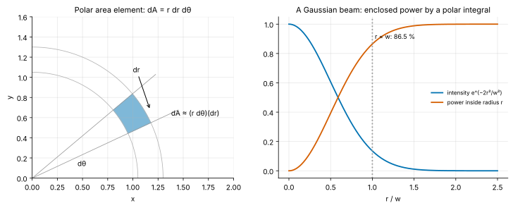
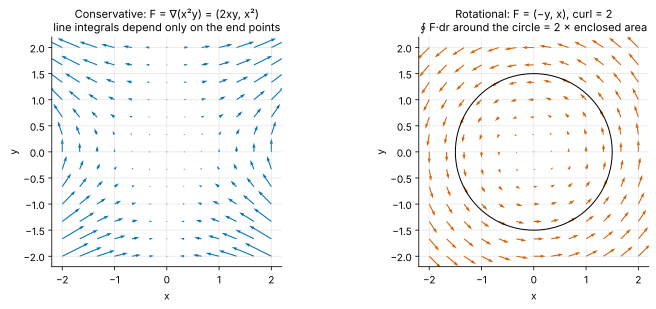
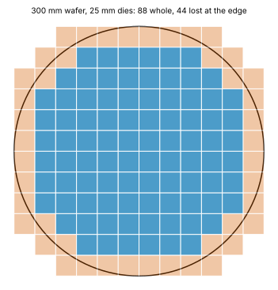

<!-- status: verified -->
# 01-10 · Multivariable Calculus II: Multiple, Line and Surface Integrals

| | |
|---|---|
| **Course** | [01 · Calculus for Engineers](../README.md) |
| **University equivalent** | Calculus III, multiple integrals and vector calculus (Stewart, ch. 15–16: double and triple integrals, polar/cylindrical/spherical coordinates, vector fields, line integrals, Green's theorem, curl and divergence, surface integrals, Stokes' and divergence theorems) |
| **Prerequisites** | [01-05](01-05-integrals.md), [01-06](01-06-techniques-of-integration.md) (integration), [01-09](01-09-multivariable-calculus-1.md) (partial derivatives, gradient). |
| **Estimated study hours** | 12 |
| **Last verified** | 2026-11-12 |

**Learning objectives.** After this chapter you can:

1. Set up and evaluate double and triple integrals over rectangles and general regions, and interpret them as totals and averages (power on a die, charge in a volume).
2. Change to polar, cylindrical and spherical coordinates with the correct area and volume elements, and use them for circular and spherical geometries (Gaussian integrals, beams, wafers, charged spheres).
3. Evaluate line integrals of vector fields (work, voltage, circulation), and decide whether a field is conservative.
4. Evaluate flux integrals through surfaces (current through a conductor, electric flux), and apply Gauss's law in simple symmetric cases.
5. Compute divergence and curl, interpret them physically, and state Green's, Stokes' and the divergence theorems as the bridge to Maxwell's equations and to KCL and KVL.

## 1. Big picture

Single integrals add up along a line. Real objects are spread over areas and volumes:

- the power dissipated across a chip's surface;
- the charge throughout a region of space;
- the current crossing a wire's cross-section;
- the magnetic field circulating around a loop.

This chapter extends integration to two and three dimensions and to curves and surfaces. It gives you the vocabulary of electromagnetics ([13](../../13-electromagnetics/README.md)), the physics under every circuit law.

- **Multiple integrals give totals and averages over regions:** total power from a power-density map, dies per wafer, the normalization of the Gaussian distribution.
- **Line integrals give work and voltage:** the voltage between two points is a line integral of the electric field, and KVL says that integral around a loop is zero, until a changing magnetic field says otherwise.
- **Surface integrals give flux:** current is the flux of current density through a cross-section, and Gauss's law relates electric flux to enclosed charge.
- **Divergence and curl are local "source" and "swirl" densities.** Maxwell's equations are statements about them, and KCL is the divergence theorem applied to current.

## 2. Intuition first

### Adding up a map

A thermal engineer has a map of power density over a die, in W/mm², hottest where the multiply units cluster. The total power is the "volume" under that surface. Chop the die into tiny squares, multiply each square's density by its area, and add. That double sum, in the limit, is the **double integral** $\iint p\,dA$. The average density is the total divided by the area, and the ratio of peak to average is the hot-spot factor that drives the cooling design (Example 01-10.1, Figure 1).

*Figure 1. A power-density map $p(x, y)$ on a 10 mm × 10 mm die. The total power is the integral of $p$ over the area; the peak is 3.1 times the average.*

### An analogy from finance: portfolios over two dimensions

A portfolio's value at risk integrates a joint probability density over two or more risk factors, such as rates and equities, across the region where losses exceed a threshold. That is a multiple integral. Changing coordinates to make the integral easy, for example rotating to uncorrelated factors, is exactly what polar coordinates do for circular regions here.

*Where the analogy breaks:* financial densities are estimated from data and have fat tails that a Gaussian misses. Physical densities, such as charge, current or power, are often known from design or from Maxwell's equations. And physical *vector* fields carry a direction at each point, which has no clean analogue in a scalar risk density. Line and surface integrals need that direction.

### Flow through a surface, flow around a loop

Imagine water flowing in a stream. Hold a hoop in it: the volume of water passing through the hoop per second is the **flux** through the hoop. It is largest when the hoop faces the flow and zero when edge-on. Now drag a paddle around a closed loop: if the water swirls, the push you feel adds up to a nonzero **circulation**. Electric and magnetic fields have flux and circulation in exactly this sense. Maxwell's equations say what produces each (§3.8).

## 3. Theory

### 3.1 Double integrals over rectangles

For $f(x, y)$ on the rectangle $R = [a, b]\times[c, d]$, divide $R$ into small rectangles of area $\Delta A = \Delta x\,\Delta y$, sample $f$ in each, and sum. The limit is the **double integral** $\iint_Rf\,dA$. **Fubini's theorem** says that for continuous $f$ it equals an **iterated integral**, in either order:

$$
\iint_Rf\,dA = \int_a^b\left(\int_c^df(x, y)\,dy\right)dx = \int_c^d\left(\int_a^bf(x, y)\,dx\right)dy .
$$

Integrate the inner variable with the outer one held constant, exactly as for partial derivatives. The units are those of $f$ times area. The **average value** is $\frac{1}{\text{area}}\iint_Rf\,dA$.

### 3.2 General regions and the order of integration

If the region lies between two curves, $a \le x \le b$ and $g_1(x) \le y \le g_2(x)$, then

$$
\iint_Df\,dA = \int_a^b\int_{g_1(x)}^{g_2(x)}f(x, y)\,dy\,dx,
$$

with the inner limits now depending on the outer variable. Swapping the order means redescribing the region with $y$ outside. Sometimes only one order is doable. For example, $\int_0^1\int_y^1e^{x^2}dx\,dy$ is impossible as written, but becomes $\int_0^1\int_0^xe^{x^2}dy\,dx = \int_0^1xe^{x^2}dx$ after swapping (Problem 01-10.1).

### 3.3 Polar coordinates

For circular regions use $x = r\cos\theta$, $y = r\sin\theta$. A small polar patch, between radii $r$ and $r + dr$ and angles θ and $\theta + d\theta$, is nearly a rectangle of sides $dr$ and $r\,d\theta$ (Figure 2). So

$$
dA = r\,dr\,d\theta .
$$

The factor $r$ is the **Jacobian** of the change of variables. Forgetting it is the most common error in this chapter. A disk of radius $R$ has area $\int_0^{2\pi}\int_0^Rr\,dr\,d\theta = \pi R^2$ ✓.

**The Gaussian integral.** $I = \int_{-\infty}^\infty e^{-x^2}dx$ has no elementary antiderivative, but its square is a double integral over the plane that polar coordinates crack:

$$
I^2 = \iint_{\mathbb{R}^2}e^{-(x^2 + y^2)}dA = \int_0^{2\pi}\int_0^\infty e^{-r^2}r\,dr\,d\theta = 2\pi\cdot\frac{1}{2} = \pi,
$$

so $I = \sqrt{\pi}$. This normalizes the Gaussian density of [01-07](01-07-applications-of-integration.md), the noise distribution behind every bit-error-rate calculation.

**Power in a Gaussian beam.** A laser or fiber mode often has intensity $I(r) = I_0e^{-2r^2/w^2}$, where $w$ is the beam radius. The power inside radius $a$ is

$$
P(a) = \int_0^{2\pi}\int_0^aI_0e^{-2r^2/w^2}r\,dr\,d\theta = \frac{\pi I_0w^2}{2}\left(1 - e^{-2a^2/w^2}\right).
$$

So 86.5% of the power lies within $r = w$ (Figure 2). This sets how much light couples into a fiber or a photodetector ([24-07](../../24-high-speed-io-signal-integrity-and-photonics/chapters/24-07-photonics-fundamentals.md), Problem 01-10.7).

*Figure 2. Left: the polar area element $r\,dr\,d\theta$. Right: a Gaussian beam's intensity and the fraction of its power inside radius $r$.*

### 3.4 Triple integrals, cylindrical and spherical coordinates

Triple integrals $\iiint_Ef\,dV$ add up quantities over volumes, such as total charge $\iiint\rho\,dV$ from a charge density ρ (C/m³). Two coordinate systems fit common shapes:

- **Cylindrical** $(r, \theta, z)$, for wires, vias and coaxial cables: $dV = r\,dr\,d\theta\,dz$.
- **Spherical** $(\rho, \phi, \theta)$, with ρ the distance from the origin, φ the angle from the $z$ axis and θ the azimuth: $dV = \rho^2\sin\phi\,d\rho\,d\phi\,d\theta$. The volume element is a small box of sides $d\rho$, $\rho\,d\phi$ and $\rho\sin\phi\,d\theta$.

For a spherically symmetric integrand the angular integrals give $4\pi$, so $dV \to 4\pi\rho^2\,d\rho$, the volume of a thin shell. For example, the volume of a ball is $\int_0^R4\pi\rho^2d\rho = \tfrac{4}{3}\pi R^3$.

### 3.5 Line integrals of vector fields

A **vector field** $\mathbf{F}(x, y, z)$ assigns a vector to each point: an electric field, a magnetic field, a current density. The **line integral** along a curve $C$, parametrized by $\mathbf{r}(t)$ for $a \le t \le b$, is

$$
\int_C\mathbf{F}\cdot d\mathbf{r} = \int_a^b\mathbf{F}\big(\mathbf{r}(t)\big)\cdot\mathbf{r}'(t)\,dt .
$$

It adds up the component of $\mathbf{F}$ *along* the path. If $\mathbf{F}$ is a force, the integral is the **work** done moving along $C$.

**Voltage is a line integral.** The potential difference between points $a$ and $b$ in an electric field is

$$
V_b - V_a = -\int_a^b\mathbf{E}\cdot d\mathbf{l} .
$$

**Conservative fields.** If $\mathbf{F} = \nabla\varphi$ for some scalar potential φ, then by the chain rule

$$
\int_C\mathbf{F}\cdot d\mathbf{r} = \varphi(\text{end}) - \varphi(\text{start}),
$$

whatever the path (Figure 3, left). Every closed loop then gives zero. In a simply connected region (no holes), $\mathbf{F}$ is conservative exactly when its curl is zero, which in two dimensions means $\partial F_y/\partial x = \partial F_x/\partial y$. Static electric fields are conservative, which is why voltage is well defined and **KVL holds**: the sum of voltage drops around any loop is $\oint\mathbf{E}\cdot d\mathbf{l} = 0$.

**Non-conservative fields: circulation.** The magnetic field around a straight wire carrying current $I$ circles the wire, $\mathbf{B} = \frac{\mu_0I}{2\pi r}\hat{\boldsymbol\theta}$. Its line integral around any loop enclosing the wire is $\mu_0I$, **Ampère's law** (Example 01-10.4). And when the magnetic flux through a loop changes, $\oint\mathbf{E}\cdot d\mathbf{l} = -d\Phi_B/dt \ne 0$ (**Faraday's law**). KVL then fails for that loop. This is the physics of transformers, inductive coupling and ground loops (Problem 01-10.10).

*Figure 3. Left: a gradient field, whose line integrals depend only on the end points. Right: a rotational field, whose circulation around the circle equals twice the enclosed area (Green's theorem).*

### 3.6 Surface integrals and flux

The **flux** of a vector field through a surface $S$ with unit normal $\mathbf{n}$ is

$$
\Phi = \iint_S\mathbf{F}\cdot\mathbf{n}\,dS .
$$

It counts only the component crossing the surface. Two essential instances:

- **Current is the flux of current density.** $I = \iint_S\mathbf{J}\cdot\mathbf{n}\,dS$, with $\mathbf{J}$ in A/m². In a wire carrying AC, the current crowds toward the surface (the **skin effect**), so the cross-section is used unevenly and the resistance rises (Problem 01-10.13).
- **Electric flux and Gauss's law.** $\oint_S\mathbf{E}\cdot\mathbf{n}\,dS = Q_{enc}/\varepsilon_0$: the flux out of any closed surface equals the enclosed charge divided by $\varepsilon_0 = 8.854\times10^{-12}$ F/m. With spherical symmetry, $\mathbf{E}$ is radial and constant in magnitude on a sphere, so $E\cdot4\pi r^2 = Q_{enc}/\varepsilon_0$ (Example 01-10.5).

### 3.7 Divergence and curl

For $\mathbf{F} = (F_x, F_y, F_z)$:

$$
\nabla\cdot\mathbf{F} = \frac{\partial F_x}{\partial x} + \frac{\partial F_y}{\partial y} + \frac{\partial F_z}{\partial z}, \qquad
\nabla\times\mathbf{F} = \left(\frac{\partial F_z}{\partial y} - \frac{\partial F_y}{\partial z},\ \frac{\partial F_x}{\partial z} - \frac{\partial F_z}{\partial x},\ \frac{\partial F_y}{\partial x} - \frac{\partial F_x}{\partial y}\right).
$$

- **Divergence** is the net outflow per unit volume at a point, the local "source density". Positive divergence is a source, negative a sink, zero means no net creation.
- **Curl** is the circulation per unit area at a point, the local "swirl". Its direction is the axis of the swirl, by the right-hand rule. For $\mathbf{F} = (-y, x, 0)$, the curl is $(0, 0, 2)$ everywhere: uniform rotation.

A gradient field has zero curl, $\nabla\times\nabla\varphi = \mathbf{0}$, by equality of mixed partials (01-09). So zero curl is the hallmark of conservative fields.

### 3.8 The integral theorems, and the circuit laws they imply

Three theorems link a derivative inside a region to an integral over its boundary. Each is a multidimensional fundamental theorem of calculus.

**Green's theorem** (plane): for a closed curve $C$ bounding a region $D$ (counterclockwise),

$$
\oint_C(P\,dx + Q\,dy) = \iint_D\left(\frac{\partial Q}{\partial x} - \frac{\partial P}{\partial y}\right)dA .
$$

**Stokes' theorem:** circulation around a loop equals the flux of the curl through any surface it bounds:

$$
\oint_C\mathbf{F}\cdot d\mathbf{r} = \iint_S(\nabla\times\mathbf{F})\cdot\mathbf{n}\,dS .
$$

**Divergence (Gauss's) theorem:** outflow through a closed surface equals the total divergence inside:

$$
\oint_S\mathbf{F}\cdot\mathbf{n}\,dS = \iiint_V\nabla\cdot\mathbf{F}\,dV .
$$

**Maxwell's equations, in a sentence each** ([13-04](../../13-electromagnetics/chapters/13-04-maxwells-equations.md)):

- $\nabla\cdot\mathbf{E} = \rho/\varepsilon_0$: charge is the source of electric field.
- $\nabla\cdot\mathbf{B} = 0$: no magnetic charges.
- $\nabla\times\mathbf{E} = -\partial\mathbf{B}/\partial t$: a changing magnetic field makes the electric field swirl.
- $\nabla\times\mathbf{B} = \mu_0\mathbf{J} + \mu_0\varepsilon_0\,\partial\mathbf{E}/\partial t$: currents, and changing electric fields, make magnetic fields swirl.

The theorems turn each into an integral law: Gauss, Faraday, Ampère.

**KCL and KVL from vector calculus.** Charge conservation says $\nabla\cdot\mathbf{J} = -\partial\rho/\partial t$. In a circuit node no charge accumulates, so $\nabla\cdot\mathbf{J} = 0$, and the divergence theorem over a surface enclosing the node gives $\oint\mathbf{J}\cdot\mathbf{n}\,dS = 0$: the currents leaving sum to zero. That is **KCL**. Where magnetic flux is not changing, $\nabla\times\mathbf{E} = 0$, and Stokes' theorem gives $\oint\mathbf{E}\cdot d\mathbf{l} = 0$: that is **KVL**. The lumped circuit abstraction of [00-02](../../00-orientation/chapters/00-02-the-abstraction-stack.md) is precisely the assumption that these conditions hold within each loop and node.

## 4. Worked examples

### Example 01-10.1 — Total power and hot-spot factor of a die (tier A)

**Setup.** A 10 mm × 10 mm die has power density $p(x, y) = 0.2 + 0.02xy$ W/mm² ($x$, $y$ in mm, from 0 to 10). Find the total power, the average density, the peak density and the peak-to-average ratio.

**Solution.**

$$
P = \int_0^{10}\int_0^{10}(0.2 + 0.02xy)\,dy\,dx = 0.2(100) + 0.02\left(\int_0^{10}x\,dx\right)^2 = 20 + 0.02(50)^2 = \mathbf{70\ W}.
$$

Average: $70/100 = $ **0.7 W/mm²**. Peak at (10, 10): $0.2 + 2 = $ **2.2 W/mm²**, a peak-to-average ratio of **3.14**.

**Interpretation.** A heat sink sized for the average would let the hot corner overheat. Thermal design follows the peak, which is why chip floorplans spread hot blocks apart ([25-08](../../25-fabrication-packaging-test-and-reliability/chapters/25-08-thermal-engineering.md)).

**Sanity check.** The $xy$ term separates into a product of two single integrals ✓. Units: W/mm² × mm² = W ✓.

### Example 01-10.2 — The Gaussian integral and a laser beam (tier B)

**Setup.** (a) Evaluate $\int_{-\infty}^\infty e^{-x^2}dx$. (b) What fraction of a Gaussian beam's power lies within its radius $w$?

**Solution.**

(a) By polar coordinates (§3.3), $I^2 = \pi$, so $I = \sqrt{\pi} = $ **1.772**.

(b) $1 - e^{-2} = $ **86.47%**.

**Interpretation.** The same integral fixes the $\frac{1}{\sigma\sqrt{2\pi}}$ in the Gaussian pdf: substitute $x = u/(\sigma\sqrt{2})$ in $\int e^{-u^2/(2\sigma^2)}du = \sigma\sqrt{2\pi}$.

### Example 01-10.3 — Dies per wafer (tier B)

**Setup.** A widely used estimate for the number of whole square dies of area $A$ on a wafer of diameter $d$ is

$$
\text{DPW} \approx \frac{\pi(d/2)^2}{A} - \frac{\pi d}{\sqrt{2A}} .
$$

The first term is the wafer area divided by the die area. The second subtracts the dies lost along the circumference, about one partial die per $\sqrt{2A}$ of perimeter. Evaluate it for a 300 mm wafer with 100 mm² dies and with 800 mm² dies, and find the fraction of the gross area-ratio lost at the edge in each case.

**Solution.**

- 100 mm²: $70\,686/100 - \pi\times300/\sqrt{200} = 706.9 - 66.6 = $ **640** dies, an edge loss of **9.4%**.
- 800 mm² (near the reticle limit): $88.36 - 23.56 = $ **64.8**, i.e. about 64 dies, an edge loss of **26.7%**.

Figure 4 shows the edge loss directly for large dies.

*Figure 4. Large (25 mm) dies on a 300 mm wafer: 88 whole dies and 44 lost at the edge. The formula gives 86; the exact count depends on how the grid is placed.*

**Interpretation.** Big dies waste more of the wafer's expensive edge, before even counting defects. Combined with yield falling exponentially with area (Problem 01-10.14), this is one quantitative reason the industry splits large designs into chiplets ([25-04](../../25-fabrication-packaging-test-and-reliability/chapters/25-04-yield-and-die-cost.md)).

**Sanity check.** The edge-loss fraction scales as $\sqrt{A}/d$: 8 times the area should give about $\sqrt{8} = 2.8$ times the fraction, and 26.7/9.4 = 2.8 ✓.

### Example 01-10.4 — Line integrals: a conservative field and Ampère's law (tier B)

**Setup.** (a) For $\mathbf{F} = (2xy, x^2)$, evaluate $\int\mathbf{F}\cdot d\mathbf{r}$ from (0, 0) to (1, 2) along two paths: the straight line, and along the $x$ axis then up. (b) A long wire carries 1 A. Evaluate $\oint\mathbf{B}\cdot d\mathbf{l}$ around a circle of radius $r$ centered on the wire.

**Solution.**

(a) $\partial F_y/\partial x = 2x = \partial F_x/\partial y$, so $\mathbf{F}$ is conservative, with potential $\varphi = x^2y$. Both paths therefore give $\varphi(1, 2) - \varphi(0, 0) = $ **2**. Check the axis path: along the $x$ axis $y = 0$, so $F_x = 0$, contributing 0. Up the line $x = 1$, $F_y = 1$, so $\int_0^21\,dy = 2$ ✓.

(b) $\mathbf{B} = \frac{\mu_0I}{2\pi r}\hat{\boldsymbol\theta}$ is tangent to the circle and constant in magnitude, so $\oint\mathbf{B}\cdot d\mathbf{l} = \frac{\mu_0I}{2\pi r}\cdot2\pi r = \mu_0I = $ **1.257×10^−6 T·m**, independent of $r$.

**Interpretation.** The magnetic field's circulation measures the enclosed current. Its curl is zero everywhere except on the wire, yet the loop integral is not zero: the wire is a "hole" in the region, so zero curl alone does not make the field conservative there (Problem 01-10.15).

### Example 01-10.5 — Gauss's law for a non-uniform charged sphere (tier C)

**Setup.** A sphere of radius $R = 0.1$ m holds charge density $\rho(r) = \rho_0(1 - r/R)$ with $\rho_0 = 10^{-6}$ C/m³. Find the total charge and the electric field at the surface.

**Solution.** In spherical coordinates with a radially symmetric density, $dV = 4\pi r^2dr$:

$$
Q = \int_0^R\rho_0\left(1 - \frac{r}{R}\right)4\pi r^2\,dr = 4\pi\rho_0\left(\frac{R^3}{3} - \frac{R^3}{4}\right) = \frac{\pi\rho_0R^3}{3} = \mathbf{1.047\times10^{-9}\ C}.
$$

By Gauss's law on a sphere of radius $R$: $E(R) = \dfrac{Q}{4\pi\varepsilon_0R^2} = $ **941.2 V/m**, pointing outward.

**Interpretation.** Symmetry turned a three-dimensional integral into a one-dimensional one, and a field calculation into an algebra step. Electromagnetic design relies on such symmetry arguments. Problem 01-10.12 finds that this field actually peaks *inside* the sphere.

**Sanity check.** A uniform sphere of density $\rho_0$ would hold $\tfrac{4}{3}\pi\rho_0R^3$, four times more. The density falling to zero at the surface removes most of the outer, high-volume shells ✓.

<!-- answer-key -->
| ID | Quantity | Value | Unit |
|---|---|---|---|
| Ex 01-10.1a | total power | 70 | W |
| Ex 01-10.1b | average density | 0.7 | W/mm² |
| Ex 01-10.1c | peak density | 2.2 | W/mm² |
| Ex 01-10.1d | peak-to-average | 3.14 | — |
| Ex 01-10.2a | Gaussian integral | 1.772 | — |
| Ex 01-10.2b | beam power within w | 86.47 | % |
| Ex 01-10.3a | dies per wafer, 100 mm² | 640 | — |
| Ex 01-10.3b | edge loss, 100 mm² | 9.4 | % |
| Ex 01-10.3c | dies per wafer, 800 mm² | 64.8 | — |
| Ex 01-10.3d | edge loss, 800 mm² | 26.7 | % |
| Ex 01-10.4a | line integral, either path | 2 | — |
| Ex 01-10.4b | circulation of B for 1 A | 1.257×10^-6 | T·m |
| Ex 01-10.5a | total charge | 1.047×10^-9 | C |
| Ex 01-10.5b | surface field | 941.2 | V/m |

*Recomputed by [verify_01_10.py](../verify/verify_01_10.py).*

## 5. Simulate it

The lab ([labs/01-10-lab/](../labs/01-10-lab/README.md)) is a notebook:

1. **Multiple integrals numerically.** Evaluate the die-power and charged-sphere integrals with SciPy (`dblquad`, `tplquad`) and by Monte Carlo sampling, and compare accuracy against the number of samples.
2. **Coordinate changes.** Integrate a Gaussian over a disk in Cartesian and polar coordinates, and see the polar version reach similar accuracy with far fewer function evaluations.
3. **Line integrals.** Integrate conservative and rotational fields along different paths, and verify Green's theorem numerically.
4. **Dies per wafer.** Count whole dies on a simulated wafer for several die sizes and grid offsets, and compare with the formula.

**Predict, then run.** Before Part 1, predict how the Monte Carlo error falls as the number of samples grows by 100× (from 01-07: what is the standard error of a mean?).

## 6. Engineering tradeoffs

| Knob | Improves | Costs | Typical decision owner |
|---|---|---|---|
| Choose coordinates matched to the geometry | Simpler integrals; insight from symmetry | Must remember Jacobians; awkward if geometry is irregular | Analyst, EM and thermal engineer |
| Numerical integration (grids) for multiple integrals | Works on arbitrary maps and shapes | Cost grows rapidly with dimension (grid points ∝ n^d) | Simulation engineer |
| Monte Carlo integration | Error ∝ 1/√N regardless of dimension | Slow convergence; randomness | Simulation and statistics engineer |
| Larger die (monolithic) | No die-to-die interconnect overhead | More edge loss and lower yield per die (Problem 01-10.14) | SoC architect, product management |
| Smaller loop area in wiring (twisted pairs, ground planes) | Less magnetically induced voltage (Faraday) | Layout constraints; cost | Board and signal-integrity engineers |

## 7. Numbers to know

| Quantity | Value | Note |
|---|---|---|
| Polar / cylindrical / spherical elements | $r\,dr\,d\theta$ / $r\,dr\,d\theta\,dz$ / $\rho^2\sin\phi\,d\rho\,d\phi\,d\theta$ | Never forget the Jacobian |
| $\int_{-\infty}^\infty e^{-x^2}dx$ | $\sqrt{\pi}$ ≈ 1.772 | Normalizes the Gaussian |
| Gaussian beam power within $w$ | 86.5% | $1 - e^{-2}$ |
| $\mu_0$ | $1.257\times10^{-6}$ T·m/A | $\oint\mathbf{B}\cdot d\mathbf{l} = \mu_0I$ |
| $\varepsilon_0$ | $8.854\times10^{-12}$ F/m | Gauss: flux = $Q/\varepsilon_0$ |
| Field 1 cm from a 1 A wire | 20 µT | $\mu_0I/(2\pi r)$ |
| 300 mm wafer area | 70 686 mm² | ≈ 640 dies of 100 mm² |
| Copper skin depth | ≈ 0.21 mm at 100 kHz, 0.066 mm at 1 MHz | $\sqrt{\rho/(\pi f\mu_0)}$ |

## 8. Common mistakes

1. **Dropping the Jacobian** ($r$ in polar, $\rho^2\sin\phi$ in spherical).
2. **Wrong limits after changing the order** of integration. Sketch the region first.
3. **Integrating the magnitude of a vector field** instead of its component along the path or normal to the surface.
4. **Assuming every field is conservative.** Check the curl, and beware of regions with holes.
5. **Applying KVL to a loop with changing magnetic flux through it.** Faraday's law adds an EMF.
6. **Using Gauss's law without symmetry.** It always holds, but it only *gives* the field when symmetry makes $E$ constant on the surface.
7. **Confusing flux (through a surface) with circulation (around a loop).**
8. **Trusting a coarse grid for an integrand with a sharp hot spot.** Refine where the integrand varies.

## 9. Practitioner lens

### Where these integrals sit in today's engineering (as of Nov 2026)

- **Thermal and power-integrity sign-off integrate density maps.** Chip teams compute power-density maps across the die and integrate them for totals and hot spots; package and heat-sink design follow the peaks **[Established]**. The highest-power accelerators push power densities so high that cooling (direct liquid cooling in datacenters) has become a first-order product constraint ([25-08](../../25-fabrication-packaging-test-and-reliability/chapters/25-08-thermal-engineering.md)).
- **Wafer economics are geometry plus probability.** Dies per wafer (Example 01-10.3) and defect-limited yield (Problem 01-10.14) are the first two lines of every die-cost model. The textbook dies-per-wafer formula appears in Hennessy and Patterson's *Computer Architecture* **[Established]**. Large monolithic dies pay twice, at the edge and in yield, which is a quantitative core of the chiplet argument ([25-04](../../25-fabrication-packaging-test-and-reliability/chapters/25-04-yield-and-die-cost.md)).
- **Field solvers do these integrals at scale.** Extraction tools compute capacitance and inductance of chip and package wiring by solving Maxwell's equations, in their integral or differential forms, over complex 3D geometry **[Established]**.

### Why it matters commercially

- **Cost per good die scales faster than area.** A die twice as large yields fewer than half as many good dies per wafer, which shapes product segmentation and the economics of chiplets and advanced packaging.
- **Electromagnetic coupling is a product-quality issue.** Faraday's law makes every loop in a board or package an antenna. Products fail EMC compliance, or show noise and data errors, when loop areas and return paths are ignored.

### Marketing vs Reality

**"Same die area, so same cost."** Not if one design needs a larger contiguous die: edge loss and yield both worsen with area. Ask for the die size and the assumed defect density behind any cost-per-chip claim.

**"Average power density X W/cm²."** Cooling must handle the peak, not the average. Ask for the hot-spot factor.

**"Ground is ground."** Two "ground" points can differ in voltage when time-varying flux threads the loop between them, by Faraday's law. Ask how return paths are designed.

### Questions to ask engineering leaders

1. **"What is the peak-to-average ratio of your power-density map, and how does your thermal solution handle the peak?"**
   *Strong answer:* gives a measured or simulated map with hot-spot mitigation. *Evasive:* quotes only total power.
2. **"How many good dies per wafer do you assume, and with which defect density?"**
   *Strong:* shows the edge-loss and yield model with sensitivity to defect density. *Evasive:* gives a cost per chip without the model.
3. **"How are return paths and loop areas controlled on your critical interfaces?"**
   *Strong:* describes ground planes, stitching and loop-area budgets backed by EMC pre-scans. *Evasive:* "we follow the reference design".

## 10. Concept check

**Q1.** Why does the polar area element contain a factor $r$?

Answer

A polar patch is approximately a rectangle with sides $dr$ and $r\,d\theta$. Arcs at larger radius are longer for the same angle.

**Q2.** Evaluate $\int_0^2\int_0^3xy\,dy\,dx$.

Answer

$\left(\int_0^2x\,dx\right)\left(\int_0^3y\,dy\right) = 2\times4.5 = 9$.

**Q3.** How can you tell that $\mathbf{F} = (y, x)$ is conservative, and what is its potential?

Answer

$\partial F_y/\partial x = 1 = \partial F_x/\partial y$, so its curl is zero. The potential is $\varphi = xy$.

**Q4.** What is the flux of $\mathbf{F} = (0, 0, 5)$ through a horizontal square of side 2 m? Through a vertical one?

Answer

$5\times4 = 20$ (units of F × m²) through the horizontal square; 0 through the vertical one, since the field is parallel to it.

**Q5.** Compute the divergence and curl of $\mathbf{F} = (x, y, z)$.

Answer

Divergence 3 (a uniform source); curl $\mathbf{0}$ (no swirl).

**Q6.** Which circuit law is the divergence theorem applied to current density, and which is Stokes' theorem applied to the electric field?

Answer

KCL (no charge accumulates at a node) and KVL (no changing flux through the loop), respectively.

**Q7.** Why might two points both called "ground" on a board differ by millivolts?

Answer

Changing magnetic flux through the loop between them induces an EMF (Faraday), and current through the return path's impedance drops voltage. KVL with ideal zero-impedance grounds ignores both.

**Q8.** What fraction of a Gaussian beam's power lies within $r = w/2$?

Answer

$1 - e^{-2(1/4)} = 1 - e^{-0.5} \approx 39.3\%$.

Now work the problem set: [01-10 problems](../problems/01-10-problems.md) (solutions in [01-10 solutions](../solutions/01-10-solutions.md)).

## 11. Key terms

[Double integral](../../../reference/glossary.md#double-integral) ·
[Fubini's theorem](../../../reference/glossary.md#fubinis-theorem) ·
[Jacobian](../../../reference/glossary.md#jacobian) ·
[Vector field](../../../reference/glossary.md#vector-field) ·
[Line integral](../../../reference/glossary.md#line-integral) ·
[Conservative field](../../../reference/glossary.md#conservative-field) ·
[Flux](../../../reference/glossary.md#flux) ·
[Divergence](../../../reference/glossary.md#divergence) ·
[Curl](../../../reference/glossary.md#curl) ·
[Divergence theorem](../../../reference/glossary.md#divergence-theorem) ·
[Stokes' theorem](../../../reference/glossary.md#stokes-theorem) ·
[Gauss's law](../../../reference/glossary.md#gausss-law) ·
[Skin effect](../../../reference/glossary.md#skin-effect) ·
[Dies per wafer](../../../reference/glossary.md#dies-per-wafer)

## 12. Connections

- **Builds on:** [01-05](01-05-integrals.md), [01-06](01-06-techniques-of-integration.md), [01-09](01-09-multivariable-calculus-1.md).
- **Next:** Course 02, [02-02 First-Order Linear ODEs](../../02-complex-numbers-des-and-linear-algebra/chapters/02-02-first-order-linear-odes.md) (with [02-01](../../02-complex-numbers-des-and-linear-algebra/chapters/02-01-complex-numbers-euler-and-phasors.md) already written as a pilot).
- **Used later in:**
  - [13-01](../../13-electromagnetics/chapters/13-01-vector-calculus-refresher.md): vector calculus for EM.
  - [13-04](../../13-electromagnetics/chapters/13-04-maxwells-equations.md): Maxwell's equations.
  - [06](../../06-circuit-analysis-1-dc/README.md): KCL and KVL.
  - [24-07](../../24-high-speed-io-signal-integrity-and-photonics/chapters/24-07-photonics-fundamentals.md): optical beams and coupling.
  - [25-04](../../25-fabrication-packaging-test-and-reliability/chapters/25-04-yield-and-die-cost.md): die cost.
  - [25-08](../../25-fabrication-packaging-test-and-reliability/chapters/25-08-thermal-engineering.md): thermal design.

## 13. Further study

- **Stewart, *Calculus: Early Transcendentals*,** chapters 15–16 (multiple integrals and vector calculus).
- **MIT OpenCourseWare 18.02SC,** *Multivariable Calculus*, Units 3–4 (double integrals, line integrals, triple integrals, surface integrals).
- **H. M. Schey, *Div, Grad, Curl, and All That*,** an informal and very readable introduction to vector calculus through electrostatics.
- **J. L. Hennessy and D. A. Patterson, *Computer Architecture: A Quantitative Approach*,** chapter 1 (cost of an integrated circuit: dies per wafer and yield).

## 14. Sources

1. J. L. Hennessy and D. A. Patterson, *Computer Architecture: A Quantitative Approach*, 6th ed., Morgan Kaufmann, 2017, ch. 1 (dies-per-wafer formula and yield model).
2. Physical constants $\mu_0$ and $\varepsilon_0$: CODATA values as provided by SciPy (`scipy.constants`).
3. The theorems of this chapter are standard vector calculus (Stewart, ch. 15–16). All text, examples and problems are original.
