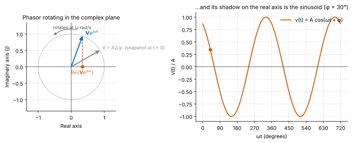
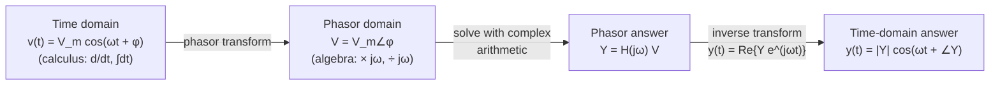
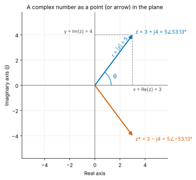
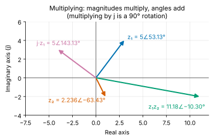
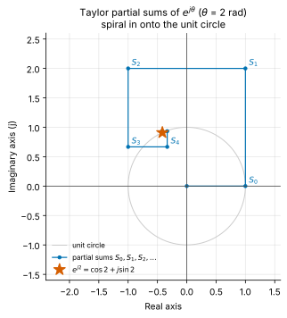
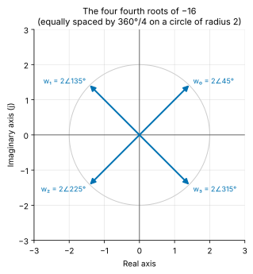
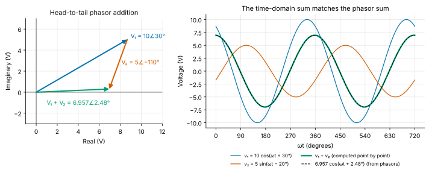
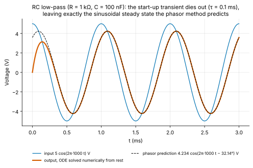

<!-- status: verified -->
# 02-01 · Complex Numbers, Euler's Formula and Phasors

| | |
|---|---|
| **Course** | [02 · Complex Numbers, Differential Equations and Linear Algebra](../README.md) |
| **University equivalent** | The complex-numbers and complex-exponentials unit of a sophomore engineering-math course (MIT 18.03 Unit I; Kreyszig, complex-numbers chapter) plus the "Sinusoids and Phasors" chapter of a Circuits course (Alexander & Sadiku; Nilsson & Riedel) |
| **Prerequisites** | [01-01 Functions, Models and Units](../../01-calculus-for-engineers/chapters/01-01-functions-models-and-units.md) (trigonometry, exponentials), [01-03 Derivatives](../../01-calculus-for-engineers/chapters/01-03-derivatives.md), [01-08 Taylor Expansions](../../01-calculus-for-engineers/chapters/01-08-sequences-series-and-taylor.md). Every fact needed from them is restated in a *Math refresher* box, so you can start here. |
| **Estimated study hours** | 10 |
| **Last verified** | 2026-11-12 |

**Learning objectives.** After this chapter you can:

1. Convert complex numbers among rectangular, polar and exponential form, placing the angle in the correct quadrant, and add, multiply, divide, conjugate, raise to powers and take roots in whichever form is most efficient.
2. Derive Euler's formula $e^{j\theta} = \cos\theta + j\sin\theta$ from Taylor series, and use it to write sinusoids as complex exponentials and to derive trigonometric identities.
3. Represent a sinusoid as a phasor and back, and add sinusoids of the same frequency using phasor arithmetic.
4. Prove that differentiation and integration act on phasors as multiplication and division by $j\omega$, and use this to find the sinusoidal steady-state response of a linear differential equation, including the impedances of R, L and C.
5. Interpret complex multiplication geometrically (scale and rotate), and recognize where complex arithmetic is implemented in real hardware: I/Q radios, FFT engines and power-grid phasor measurement.

## 1. Big picture

Electrical engineering runs on sinusoids. The power grid delivers 50 Hz or 60 Hz sine waves. Every radio transmits on a sinusoidal carrier. Clocks, audio tones and the vibrations a MEMS gyroscope measures are all, to a first approximation, sinusoids. Linear circuits respond to a sinusoid in a remarkably simple way: the output is a sinusoid **of the same frequency**, changed only in amplitude and phase. Complex numbers let us carry amplitude and phase together as a single number. Under that representation, the derivatives and integrals in circuit equations become multiplication and division. This trick, invented for AC power engineering in the 1890s, is why the complex plane is the native coordinate system of EE. You will use it in almost every remaining course.

- **AC circuits and power:** impedance and phasor analysis ([07-05](../../07-circuit-analysis-2-transient-and-ac/chapters/07-05-sinusoidal-steady-state-and-impedance.md)), complex power and power factor ([07-06](../../07-circuit-analysis-2-transient-and-ac/chapters/07-06-ac-power-and-power-factor.md)).
- **Frequency response:** filters, Bode plots and amplifier bandwidth are all statements about a complex gain $H(j\omega)$ ([07-07](../../07-circuit-analysis-2-transient-and-ac/chapters/07-07-frequency-response-and-bode-plots.md)).
- **Radios and modems:** every modern transceiver processes signals as complex *I/Q* samples, and each point of a QAM constellation is a complex number ([17-06](../../17-communication-systems/chapters/17-06-bandpass-digital-modulation.md)).
- **FFT engines** in 5G and Wi-Fi modems, radar and audio chips spend much of their silicon on complex multiplications ([16-04](../../16-digital-signal-processing/chapters/16-04-the-fft.md)).
- **Dynamics and stability:** complex roots of a characteristic equation mean ringing, in a circuit, a control loop or a power-delivery network ([02-03](02-03-second-order-linear-odes.md)).

## 2. Intuition first

### The rotating arrow

Picture an arrow of length $A$ pinned at the origin and spinning counterclockwise at a steady $\omega$ radians per second. Shine a light from above, so the arrow casts a shadow on the horizontal axis. The shadow's position is $A\cos(\omega t + \phi)$, where $\phi$ is the arrow's angle at $t = 0$. It slides back and forth exactly as a sinusoid does.

*Figure 1. A sinusoid is the shadow of a rotating arrow. The phasor is a snapshot of the arrow at t = 0.*

Two sinusoids of the same frequency are two arrows spinning at the same rate. Their angular positions *relative to each other* never change, so a single snapshot captures everything about them. That snapshot (length and angle at $t = 0$) is the **phasor**. Adding two same-frequency sinusoids means adding two arrows head to tail, and the sum is again an arrow spinning at the same rate.

### Multiplying by $j$ is a quarter turn

Multiplying a number by $-1$ flips it to the opposite side of the origin: a 180° rotation. What operation, done twice, gives a 180° rotation? A 90° rotation. That is all the "imaginary" unit $j$ is: **multiplication by $j$ rotates an arrow 90° counterclockwise without changing its length**, so $j \cdot j = -1$. Once you think of $j$ as a rotation rather than a mysterious square root, the rest of this chapter is geometry.

### An analogy from finance: compounding at an imaginary rate

A balance under continuous compounding obeys $\frac{dB}{dt} = rB$. The rate of change always points *along* the balance, so the balance grows: $B(t) = B_0 e^{rt}$. Now imagine a strange account whose interest is always credited *perpendicular* to the current balance, rotated by 90°. Mathematically that means $\frac{dz}{dt} = j\omega z$. A change perpendicular to the current value turns the balance without lengthening it, just as a ball on a string moves in a circle. The solution is $z(t) = z_0 e^{j\omega t}$, an arrow of constant length rotating at $\omega$ rad/s. **A complex exponential is continuous compounding at an imaginary rate.**

*Where the analogy breaks:* no money is imaginary. The analogy is only about the shape of the differential equation, a rate of change proportional to the current value. In circuits, the physically real quantity is the *projection* (the real part) of the rotating arrow. The imaginary part is bookkeeping that keeps track of where the arrow is headed.

### The workflow this chapter builds

## 3. Theory

### 3.1 Why complex numbers exist

The equation $x^2 + 1 = 0$ has no real solution, because squaring any real number gives something non-negative. Mathematicians therefore *define* a new number $j$ by

$$
j^2 = -1 .
$$

Mathematicians call it $i$. Electrical engineers write $j$ because $i$ is reserved for current. A **complex number** is

$$
z = x + jy ,
$$

where $x = \operatorname{Re}\lbrace z\rbrace$ is the **real part** and $y = \operatorname{Im}\lbrace z\rbrace$ is the **imaginary part**. Both are ordinary real numbers; note that the imaginary part is $y$, not $jy$. Two complex numbers are equal only if their real parts are equal *and* their imaginary parts are equal. That is two real equations, a fact we will exploit repeatedly.

We draw $z$ as the point $(x, y)$, or as an arrow from the origin to that point, in the **complex plane**: real part on the horizontal axis, imaginary part on the vertical axis.

*Figure 2. The complex number z = 3 + j4 has magnitude 5 and angle 53.13°. Its conjugate is the mirror image across the real axis.*

**Units.** Complex numbers in EE usually carry units. An impedance $Z = 30 + j40\ \Omega$ has real and imaginary parts both measured in ohms; a voltage phasor is measured in volts. The $j$ itself is dimensionless.

### 3.2 Arithmetic in rectangular form

Let $z_1 = a + jb$ and $z_2 = c + jd$.

**Addition and subtraction** work component by component, exactly like adding arrows head to tail:

$$
z_1 \pm z_2 = (a \pm c) + j(b \pm d).
$$

**Multiplication** uses the ordinary distributive law plus $j^2 = -1$:

$$
z_1 z_2 = (a + jb)(c + jd) = ac + jad + jbc + j^2 bd = (ac - bd) + j(ad + bc).
$$

**The complex conjugate** flips the sign of the imaginary part: $z^{\ast} = x - jy$. Geometrically, it is a reflection across the real axis. Multiplying a number by its own conjugate gives a real, non-negative result:

$$
z z^{\ast} = (x + jy)(x - jy) = x^2 - jxy + jxy - j^2y^2 = x^2 + y^2 .
$$

**Division** uses that fact. Multiply numerator and denominator by the conjugate of the denominator, which makes the denominator real:

$$
\frac{z_1}{z_2} = \frac{a + jb}{c + jd}\cdot\frac{c - jd}{c - jd}
= \frac{(ac + bd) + j(bc - ad)}{c^2 + d^2}.
$$

Two useful special cases: $\dfrac{1}{j} = \dfrac{1}{j}\cdot\dfrac{-j}{-j} = \dfrac{-j}{1} = -j$, and the powers of $j$ cycle with period 4: $j^1 = j$, $j^2 = -1$, $j^3 = -j$, $j^4 = 1$, $j^5 = j$, and so on.

### 3.3 Polar form

The same arrow can be described by its length and direction instead of its components:

- the **magnitude** (or modulus) $r = \lvert z\rvert = \sqrt{x^2 + y^2} \ge 0$;
- the **angle** (or argument) $\theta = \angle z$, measured counterclockwise from the positive real axis.

From the right triangle in Figure 2:

$$
x = r\cos\theta, \qquad y = r\sin\theta, \qquad z = r(\cos\theta + j\sin\theta) \equiv r\angle\theta .
$$

The notation $r\angle\theta$ ("$r$ at angle $\theta$") is engineering shorthand for $r(\cos\theta + j\sin\theta)$.

> **Math refresher — trigonometry on the unit circle.** For the point at angle $\theta$ on a circle of radius 1, $\cos\theta$ is its horizontal coordinate and $\sin\theta$ its vertical coordinate, so $\cos^2\theta + \sin^2\theta = 1$. Values to know: $\cos 0 = 1$, $\sin 0 = 0$; $\cos 30^\circ = \sqrt{3}/2 \approx 0.8660$, $\sin 30^\circ = 0.5$; $\cos 45^\circ = \sin 45^\circ = 1/\sqrt{2} \approx 0.7071$; $\cos 90^\circ = 0$, $\sin 90^\circ = 1$. Angles in formulas are in **radians** ($\pi$ rad = 180°). The **angle-addition formulas**, used below, are
> $\cos(\alpha + \beta) = \cos\alpha\cos\beta - \sin\alpha\sin\beta$ and $\sin(\alpha + \beta) = \sin\alpha\cos\beta + \cos\alpha\sin\beta$.
> Section 3.6 gives a two-line proof of both using Euler's formula.

**Finding the angle: the quadrant trap.** It is tempting to write $\theta = \arctan(y/x)$. That is wrong half the time, because $y/x$ is the same for $(x, y)$ and $(-x, -y)$, two points pointing in opposite directions. The arctangent returns an angle between $-90^\circ$ and $+90^\circ$, which is correct only when $x > 0$. The safe rule is the **two-argument arctangent** $\theta = \operatorname{atan2}(y, x)$, which looks at the signs of $x$ and $y$ separately:

| Quadrant | Signs | Correct angle |
|---|---|---|
| I | $x > 0,\ y \ge 0$ | $\arctan(y/x)$ |
| II | $x < 0,\ y \ge 0$ | $\arctan(y/x) + 180^\circ$ |
| III | $x < 0,\ y < 0$ | $\arctan(y/x) - 180^\circ$ |
| IV | $x > 0,\ y < 0$ | $\arctan(y/x)$ |

(For $x = 0$: the angle is $+90^\circ$ if $y > 0$ and $-90^\circ$ if $y < 0$.) Angles are only defined up to multiples of 360°; this curriculum reports the **principal value** in $(-180^\circ, 180^\circ]$. Always sketch the point first. If your angle doesn't point where the sketch does, it's wrong.

### 3.4 Multiplication and division in polar form

Take $z_1 = r_1\angle\theta_1$ and $z_2 = r_2\angle\theta_2$ and multiply using the rectangular rule from §3.2:

$$
\begin{aligned}
z_1 z_2 &= r_1 r_2(\cos\theta_1 + j\sin\theta_1)(\cos\theta_2 + j\sin\theta_2)\\
&= r_1 r_2\big[(\cos\theta_1\cos\theta_2 - \sin\theta_1\sin\theta_2) + j(\sin\theta_1\cos\theta_2 + \cos\theta_1\sin\theta_2)\big]\\
&= r_1 r_2\big[\cos(\theta_1 + \theta_2) + j\sin(\theta_1 + \theta_2)\big],
\end{aligned}
$$

using the angle-addition formulas in the last step. Therefore:

$$
\boxed{\,z_1 z_2 = r_1 r_2\,\angle(\theta_1 + \theta_2)\,} \qquad\text{magnitudes multiply, angles add.}
$$

Division is the inverse operation, so **magnitudes divide and angles subtract**: $z_1/z_2 = (r_1/r_2)\angle(\theta_1 - \theta_2)$. You can confirm this by multiplying the claimed quotient by $z_2$ and recovering $z_1$.

This is the geometric heart of complex numbers: **multiplying by $r\angle\theta$ scales an arrow by $r$ and rotates it by $\theta$.** In particular $j = 1\angle 90^\circ$, so multiplying by $j$ rotates by exactly 90° (Figure 3). The conjugate in polar form is $z^{\ast} = r\angle(-\theta)$.

*Figure 3. Multiplying z₁ by z₂ multiplies the lengths (5 × 2.236 = 11.18) and adds the angles (53.13° − 63.43° = −10.30°). Multiplying by j rotates by 90°.*

**Which form to use.** Add and subtract in rectangular form; multiply, divide, and take powers and roots in polar form. Converting back and forth is routine.

### 3.5 Powers and roots

Applying the multiplication rule $n$ times to the same number gives **De Moivre's theorem**:

$$
z^n = (r\angle\theta)^n = r^n\angle(n\theta), \qquad n = 1, 2, 3, \ldots
$$

(by induction: if $z^{n} = r^{n}\angle n\theta$, then $z^{n+1} = z^n\cdot z = r^{n+1}\angle(n+1)\theta$).

**Roots** run this backward, with one twist. We want all $w$ with $w^n = z$. Write $w = \rho\angle\varphi$. Then $\rho^n\angle(n\varphi) = r\angle\theta$ requires $\rho^n = r$ and $n\varphi = \theta + 2\pi k$ for any integer $k$, since angles that differ by full turns describe the same direction. Hence

$$
w_k = r^{1/n}\angle\frac{\theta + 2\pi k}{n}, \qquad k = 0, 1, \ldots, n-1 .
$$

Values $k \ge n$ repeat earlier ones, so **every nonzero complex number has exactly $n$ distinct $n$-th roots**, equally spaced by $360^\circ/n$ on a circle of radius $r^{1/n}$. The $N$-th roots of 1, $e^{j2\pi k/N}$ in the notation of the next section, are called the **roots of unity**. They are the "twiddle factors" that an FFT engine multiplies by billions of times per second ([16-04](../../16-digital-signal-processing/chapters/16-04-the-fft.md)).

### 3.6 Euler's formula

The most important formula in this course is

$$
\boxed{\,e^{j\theta} = \cos\theta + j\sin\theta\,} \qquad (\theta \text{ real, in radians}).
$$

It says that $r\angle\theta$ and $re^{j\theta}$ are the same number. We will derive it two ways.

> **Math refresher — Taylor (Maclaurin) series.** A smooth function can be written near $0$ as $f(x) = f(0) + f'(0)x + \frac{f''(0)}{2!}x^2 + \frac{f'''(0)}{3!}x^3 + \cdots$. For the three functions we need, the series converge for **every** value of $x$:
> $e^{x} = 1 + x + \dfrac{x^2}{2!} + \dfrac{x^3}{3!} + \dfrac{x^4}{4!} + \cdots$,
> $\cos x = 1 - \dfrac{x^2}{2!} + \dfrac{x^4}{4!} - \cdots$,
> $\sin x = x - \dfrac{x^3}{3!} + \dfrac{x^5}{5!} - \cdots$.
> (Derived in [01-08](../../01-calculus-for-engineers/chapters/01-08-sequences-series-and-taylor.md). For example, every derivative of $e^x$ is $e^x$, which equals 1 at $x = 0$.) For a complex number $z$, $e^{z}$ is **defined** by the same series, which converges for every complex $z$.

**Derivation 1 (series).** Substitute $x = j\theta$ into the exponential series. The powers of $j$ cycle $j, -1, -j, 1, \ldots$, so

$$
\begin{aligned}
e^{j\theta} &= 1 + j\theta + \frac{(j\theta)^2}{2!} + \frac{(j\theta)^3}{3!} + \frac{(j\theta)^4}{4!} + \frac{(j\theta)^5}{5!} + \cdots\\
&= 1 + j\theta - \frac{\theta^2}{2!} - j\frac{\theta^3}{3!} + \frac{\theta^4}{4!} + j\frac{\theta^5}{5!} - \cdots\\
&= \Big(1 - \frac{\theta^2}{2!} + \frac{\theta^4}{4!} - \cdots\Big) + j\Big(\theta - \frac{\theta^3}{3!} + \frac{\theta^5}{5!} - \cdots\Big)\\
&= \cos\theta + j\sin\theta .
\end{aligned}
$$

The regrouping in the third line is legitimate because the series converges absolutely (the sum of the absolute values of its terms is the convergent series for $e^{\lvert\theta\rvert}$). Figure 4 shows the partial sums for $\theta = 2$: each new term is the previous one rotated by 90° and shrunk by a factor $\theta/n$, so the partial sums spiral in onto the point $\cos 2 + j\sin 2$ on the unit circle.

*Figure 4. Partial sums of the exponential series with a purely imaginary argument converge to a point on the unit circle.*

**Derivation 2 (calculus).** This one does not need infinite sums once you accept that $\frac{d}{d\theta}e^{a\theta} = ae^{a\theta}$ also holds for a complex constant $a$ (it follows from differentiating the series term by term). Define

$$
f(\theta) = (\cos\theta + j\sin\theta)\,e^{-j\theta}.
$$

By the product rule,

$$
\begin{aligned}
f'(\theta) &= (-\sin\theta + j\cos\theta)\,e^{-j\theta} + (\cos\theta + j\sin\theta)(-j)\,e^{-j\theta}\\
&= \big(-\sin\theta + j\cos\theta - j\cos\theta - j^2\sin\theta\big)\,e^{-j\theta}\\
&= \big(-\sin\theta + \sin\theta\big)\,e^{-j\theta} = 0 .
\end{aligned}
$$

A function with zero derivative everywhere is constant, so $f(\theta) = f(0) = (1 + 0)\cdot 1 = 1$, which means $\cos\theta + j\sin\theta = e^{j\theta}$. ∎

**Consequences you will use constantly.**

1. **Exponential form:** $z = r\angle\theta = re^{j\theta}$. Now the multiplication rule is just the law of exponents: $r_1e^{j\theta_1}\cdot r_2e^{j\theta_2} = r_1r_2e^{j(\theta_1 + \theta_2)}$.
2. **Unit magnitude:** $\lvert e^{j\theta}\rvert = \sqrt{\cos^2\theta + \sin^2\theta} = 1$ for every real $\theta$. A complex exponential with purely imaginary exponent only rotates.
3. **Landmarks:** $e^{j0} = 1$, $e^{j\pi/2} = j$, $e^{j\pi} = -1$, $e^{-j\pi/2} = -j$, $e^{j2\pi} = 1$.
4. **Sines and cosines as exponentials.** Adding and subtracting $e^{j\theta} = \cos\theta + j\sin\theta$ and $e^{-j\theta} = \cos\theta - j\sin\theta$ gives $\cos\theta = \tfrac{1}{2}\big(e^{j\theta} + e^{-j\theta}\big)$ and $\sin\theta = \tfrac{1}{2j}\big(e^{j\theta} - e^{-j\theta}\big)$. A real cosine is the sum of two counter-rotating arrows whose imaginary parts cancel. This "two-sided" picture is the basis of Fourier analysis ([11-05](../../11-signals-and-systems/chapters/11-05-fourier-series.md)).
5. **Trigonometric identities for free.** Expand $e^{j(\alpha+\beta)} = e^{j\alpha}e^{j\beta}$ on both sides:
   $\cos(\alpha + \beta) + j\sin(\alpha + \beta) = (\cos\alpha + j\sin\alpha)(\cos\beta + j\sin\beta)$. Equating real parts and imaginary parts gives both angle-addition formulas at once. Similarly, squaring the formula for $\cos\theta$ gives $\cos^2\theta = \frac{1}{4}\big(e^{j2\theta} + 2 + e^{-j2\theta}\big) = \frac{1}{2}(1 + \cos 2\theta)$, the identity behind every AC power calculation ([07-06](../../07-circuit-analysis-2-transient-and-ac/chapters/07-06-ac-power-and-power-factor.md)).

> **Going deeper — why the law of exponents holds for complex exponents.** For real numbers, $e^{a}e^{b} = e^{a+b}$ is familiar. For complex $a$ and $b$, it follows from multiplying the two power series term by term (the *Cauchy product*) and recognizing the binomial theorem in each group of terms: the coefficient of the degree-$n$ group is $\sum_k \frac{a^k}{k!}\frac{b^{n-k}}{(n-k)!} = \frac{(a+b)^n}{n!}$. Absolute convergence justifies the rearrangement. A first course in complex analysis makes this rigorous; at BSEE level you may use the law of exponents freely.

### 3.7 Complex exponential signals $e^{st}$

Let $s = \sigma + j\omega$ be a complex constant ($\sigma$ in 1/s, $\omega$ in rad/s). Then

$$
e^{st} = e^{\sigma t}e^{j\omega t} = e^{\sigma t}(\cos\omega t + j\sin\omega t).
$$

The magnitude $e^{\sigma t}$ decays if $\sigma < 0$, grows if $\sigma > 0$ and stays constant if $\sigma = 0$; the angle $\omega t$ rotates. So $e^{st}$ traces an inward spiral, an outward spiral or a circle. Its real part, $e^{\sigma t}\cos\omega t$, is a **damped (or growing) sinusoid**, the waveform of a ringing circuit. In [02-03](02-03-second-order-linear-odes.md) you will find that the natural responses of circuits are exactly such exponentials, with $s$ set by the circuit's components. In [07-04](../../07-circuit-analysis-2-transient-and-ac/chapters/07-04-laplace-domain-circuit-analysis.md) those values of $s$ become the *poles* of a transfer function. This chapter focuses on the special case $\sigma = 0$: steady sinusoids.

### 3.8 Sinusoids

A sinusoid in the standard form used throughout this curriculum is

$$
v(t) = V_m\cos(\omega t + \phi),
$$

with:

- **amplitude** $V_m > 0$ (peak value, in volts here);
- **angular frequency** $\omega$ in rad/s, related to the **frequency** $f$ in hertz (cycles per second) by $\omega = 2\pi f$;
- **period** $T = 1/f = 2\pi/\omega$ seconds;
- **phase** $\phi$ in radians or degrees.

We always use the **cosine** as the reference. Convert everything else to it first:

- $\sin x = \cos(x - 90^\circ)$ (a sine lags the cosine by a quarter cycle);
- $-\cos x = \cos(x \pm 180^\circ)$ (a negative amplitude is a 180° phase shift);
- $-\sin x = \cos(x + 90^\circ)$.

**Leading and lagging.** If $v_1 = V\cos(\omega t + 30^\circ)$ and $v_2 = V\cos(\omega t - 20^\circ)$, then $v_1$ **leads** $v_2$ by 50°: it reaches each peak earlier, by $50^\circ/360^\circ$ of a period.

**Phase is time delay at a given frequency.** Delaying $V_m\cos(\omega t)$ by $t_d$ seconds gives $V_m\cos(\omega(t - t_d)) = V_m\cos(\omega t - \omega t_d)$. A time delay $t_d$ is therefore a phase lag of

$$
\Delta\phi = \omega t_d \ \text{(radians)} = 360^\circ \times f t_d \ \text{(degrees)}.
$$

The same physical delay is a bigger phase shift at higher frequency. A 1 ns delay is 0.36° at 1 MHz but a full 360° at 1 GHz. This is why timing and phase become the same problem in high-speed design ([24-01](../../24-high-speed-io-signal-integrity-and-photonics/chapters/24-01-signal-integrity-fundamentals.md)).

**RMS value.** The root-mean-square value of a sinusoid is $V_m/\sqrt{2}$. Proof: the mean of $\cos^2$ over a period is the mean of $\frac{1}{2}(1 + \cos 2\theta)$, which is $\frac{1}{2}$ because the $\cos 2\theta$ term averages to zero. So $V_{\text{rms}} = \sqrt{V_m^2/2}$. Mains voltages are quoted as RMS values.

### 3.9 Phasors

**Definition.** The phasor of $v(t) = V_m\cos(\omega t + \phi)$ is the complex number

$$
\mathbf{V} = V_m e^{j\phi} = V_m\angle\phi, \qquad\text{so that}\qquad v(t) = \operatorname{Re}\lbrace\mathbf{V}e^{j\omega t}\rbrace .
$$

Check: $\operatorname{Re}\lbrace V_m e^{j\phi}e^{j\omega t}\rbrace = \operatorname{Re}\lbrace V_m e^{j(\omega t + \phi)}\rbrace = V_m\cos(\omega t + \phi)$. ✓

The phasor is the rotating arrow frozen at $t = 0$. It records amplitude and phase but **not** frequency; the frequency is a shared, understood background. This curriculum uses **peak-amplitude** phasors (bold capitals, as in $\mathbf{V}$). RMS phasors appear only in AC power, always written $\mathbf{V}_{\text{rms}}$ ([notation](../../../reference/notation.md)).

**Linearity.** For real constants $a, b$ and phasors $\mathbf{X}_1, \mathbf{X}_2$ at the same $\omega$,

$$
a\operatorname{Re}\lbrace\mathbf{X}_1e^{j\omega t}\rbrace + b\operatorname{Re}\lbrace\mathbf{X}_2e^{j\omega t}\rbrace = \operatorname{Re}\lbrace(a\mathbf{X}_1 + b\mathbf{X}_2)e^{j\omega t}\rbrace ,
$$

because taking the real part commutes with adding and with multiplying by a *real* number. So **a weighted sum of same-frequency sinusoids is the sinusoid whose phasor is the same weighted sum of phasors.**

**Uniqueness.** Solving circuits with phasors means writing an equation like $\operatorname{Re}\lbrace\mathbf{X}e^{j\omega t}\rbrace = \operatorname{Re}\lbrace\mathbf{Y}e^{j\omega t}\rbrace$ for all $t$ and concluding $\mathbf{X} = \mathbf{Y}$. That step needs proof, because the real part throws information away.

*Lemma.* If $\operatorname{Re}\lbrace\mathbf{D}e^{j\omega t}\rbrace = 0$ for all $t$ (with $\omega \ne 0$), then $\mathbf{D} = 0$.

*Proof.* Write $\mathbf{D} = a + jb$. Then $\operatorname{Re}\lbrace(a + jb)(\cos\omega t + j\sin\omega t)\rbrace = a\cos\omega t - b\sin\omega t$. At $t = 0$ this is $a = 0$. At $t = \pi/(2\omega)$ it is $-b = 0$. So $\mathbf{D} = 0$. ∎

Applying the lemma to $\mathbf{D} = \mathbf{X} - \mathbf{Y}$ shows that two same-frequency sinusoids are equal for all time exactly when their phasors are equal. The real part works only because it is taken at *every* instant: two well-chosen instants pin down both components.

**What phasors cannot do.** Phasor arithmetic is valid only for **linear** operations on sinusoids of a **single frequency**:

- You cannot add phasors of different frequencies. Their arrows rotate at different rates, so no single snapshot describes both (Problem 02-01.16).
- You cannot multiply two sinusoids by multiplying their phasors, because $\operatorname{Re}\lbrace\mathbf{X}\rbrace\operatorname{Re}\lbrace\mathbf{Y}\rbrace \ne \operatorname{Re}\lbrace\mathbf{X}\mathbf{Y}\rbrace$ in general. Instantaneous power $p = vi$ is such a product, which is why AC power needs its own rules (Problem 02-01.17; [07-06](../../07-circuit-analysis-2-transient-and-ac/chapters/07-06-ac-power-and-power-factor.md)).

### 3.10 Calculus becomes algebra

Differentiate a sinusoid written in phasor form. Because $t$ is real, the derivative can be taken inside the real part (differentiate the real and imaginary parts separately):

$$
\frac{d}{dt}\operatorname{Re}\lbrace\mathbf{V}e^{j\omega t}\rbrace = \operatorname{Re}\Big\lbrace\mathbf{V}\frac{d}{dt}e^{j\omega t}\Big\rbrace = \operatorname{Re}\lbrace (j\omega\mathbf{V})\,e^{j\omega t}\rbrace .
$$

So **differentiation in time is multiplication of the phasor by $j\omega$**:

$$
\boxed{\ \frac{dv}{dt}\ \longleftrightarrow\ j\omega\mathbf{V}\ }
$$

Since $j\omega = \omega\angle 90^\circ$, differentiating scales the amplitude by $\omega$ and advances the phase by 90°. Check directly: $\frac{d}{dt}V_m\cos(\omega t + \phi) = -\omega V_m\sin(\omega t + \phi) = \omega V_m\cos(\omega t + \phi + 90^\circ)$, whose phasor is $\omega V_m\angle(\phi + 90^\circ) = j\omega\mathbf{V}$. ✓

Integration is the inverse. The antiderivative of a sinusoid that is itself a pure sinusoid (no added constant, which is what "steady state" means) has phasor $\mathbf{V}/(j\omega)$:

$$
\int v\,dt\ \longleftrightarrow\ \frac{\mathbf{V}}{j\omega}\qquad(\text{amplitude} \div\omega,\ \text{phase} - 90^\circ).
$$

Dimensional check: $\omega$ has units 1/s, so $j\omega\mathbf{V}$ has units V/s, the units of $dv/dt$. ✓

### 3.11 Sinusoidal steady state of a linear ODE

Consider any linear constant-coefficient differential equation driven by a sinusoid:

$$
a_n\frac{d^ny}{dt^n} + \cdots + a_1\frac{dy}{dt} + a_0y = X_m\cos(\omega t + \phi).
$$

Its full solution is a **transient** part, which for a stable system dies away (in [07-02](../../07-circuit-analysis-2-transient-and-ac/chapters/07-02-first-order-rc-rl-transients.md) it is a decaying exponential), plus a **steady-state** part that persists. [02-04](02-04-forced-response-and-resonance.md) proves that the steady-state part is a sinusoid at the input frequency. For now, accept that and write it as $y_{ss}(t) = \operatorname{Re}\lbrace\mathbf{Y}e^{j\omega t}\rbrace$. Substituting, and using $d^k/dt^k \leftrightarrow (j\omega)^k$ and linearity:

$$
\operatorname{Re}\Big\lbrace\big[a_n(j\omega)^n + \cdots + a_1(j\omega) + a_0\big]\mathbf{Y}\,e^{j\omega t}\Big\rbrace = \operatorname{Re}\lbrace\mathbf{X}e^{j\omega t}\rbrace, \qquad \mathbf{X} = X_m\angle\phi .
$$

By the uniqueness lemma, the phasors on both sides are equal. **The differential equation has become one line of complex algebra:**

$$
\mathbf{Y} = H(j\omega)\,\mathbf{X}, \qquad H(j\omega) = \frac{1}{a_n(j\omega)^n + \cdots + a_1(j\omega) + a_0}.
$$

The complex number $H(j\omega)$ is the system's **frequency response**. Its magnitude $\lvert H\rvert$ multiplies the amplitude, and its angle $\angle H$ adds to the phase:

$$
y_{ss}(t) = \lvert H(j\omega)\rvert X_m\cos\big(\omega t + \phi + \angle H(j\omega)\big).
$$

**The canonical example: a first-order low-pass.** An RC circuit in which the capacitor voltage $y$ follows a source $x$ through a resistor obeys $\tau\frac{dy}{dt} + y = x(t)$ with time constant $\tau = RC$ ([07-02](../../07-circuit-analysis-2-transient-and-ac/chapters/07-02-first-order-rc-rl-transients.md) derives this). Its frequency response is

$$
H(j\omega) = \frac{1}{1 + j\omega\tau}, \qquad \lvert H\rvert = \frac{1}{\sqrt{1 + (\omega\tau)^2}}, \qquad \angle H = -\arctan(\omega\tau).
$$

At low frequency ($\omega\tau \ll 1$), $H \approx 1$ and the output tracks the input. At $\omega = 1/\tau$, the **corner frequency**, $\lvert H\rvert = 1/\sqrt{2} \approx 0.707$ (−3 dB) and the phase lag is exactly 45°. At high frequency ($\omega\tau \gg 1$), $\lvert H\rvert \approx 1/(\omega\tau)$ and the lag approaches 90°: the capacitor cannot charge and discharge fast enough to keep up. This one formula is the seed of filters, amplifier bandwidth and the "RC delay" of every on-chip wire ([07-07](../../07-circuit-analysis-2-transient-and-ac/chapters/07-07-frequency-response-and-bode-plots.md)).

Phasors give **only** the steady state. They say nothing about the start-up transient, which [07-02](../../07-circuit-analysis-2-transient-and-ac/chapters/07-02-first-order-rc-rl-transients.md) handles and Figure 7 in Example 02-01.4 shows.

### 3.12 Preview: impedance

Apply the calculus rules to the three passive elements. Each element law becomes an algebraic ratio of voltage phasor to current phasor, called the **impedance** $Z = \mathbf{V}/\mathbf{I}$:

| Element | Time-domain law | Phasor law | Impedance $Z$ |
|---|---|---|---|
| Resistor | $v = Ri$ | $\mathbf{V} = R\,\mathbf{I}$ | $R$ |
| Inductor | $v = L\,\dfrac{di}{dt}$ | $\mathbf{V} = j\omega L\,\mathbf{I}$ | $j\omega L$ |
| Capacitor | $i = C\,\dfrac{dv}{dt}$ | $\mathbf{I} = j\omega C\,\mathbf{V}$ | $\dfrac{1}{j\omega C} = -\dfrac{j}{\omega C}$ |

Units check: $\omega L$ has units $(1/\text{s})(\text{V}\cdot\text{s}/\text{A}) = \text{V}/\text{A} = \Omega$, and $1/(\omega C)$ has units $1/\big((1/\text{s})(\text{A}\cdot\text{s}/\text{V})\big) = \text{V}/\text{A} = \Omega$. ✓ The imaginary part of an impedance is its **reactance**: positive (inductive) for $L$, negative (capacitive) for $C$. Because KVL and KCL are linear, they hold for phasors too. Every resistive-circuit technique from Course 06 therefore carries over to AC circuits with $R$ replaced by $Z$. That is the whole of [07-05](../../07-circuit-analysis-2-transient-and-ac/chapters/07-05-sinusoidal-steady-state-and-impedance.md).

> **Going deeper — why exponentials are special.** For any linear time-invariant (LTI) system with impulse response $h(t)$, the output for input $e^{st}$ is $\int h(\lambda)e^{s(t-\lambda)}d\lambda = \Big(\int h(\lambda)e^{-s\lambda}d\lambda\Big)e^{st} = H(s)\,e^{st}$. The output is the input multiplied by a constant: complex exponentials are the **eigenfunctions** of LTI systems, and $H(s)$ is the eigenvalue. Sinusoids inherit this property because they are sums of two exponentials. That is the deep reason phasors work, and the foundation of Fourier and Laplace analysis ([11-04](../../11-signals-and-systems/chapters/11-04-lti-systems-and-differential-equations.md)).

## 4. Worked examples

### Example 02-01.1 — Arithmetic in both forms (tier A)

**Setup.** Let $z_1 = 3 + j4$ and $z_2 = 1 - j2$. Compute $z_1 + z_2$, $z_1 - z_2$, $z_1z_2$, $z_1/z_2$ and $z_1z_2^{\ast}$ in rectangular form. Convert $z_1$, $z_2$, $z_1z_2$ and $z_1/z_2$ to polar form and confirm the polar multiplication and division rules.

**Solution.**

- Sum: $(3 + 1) + j(4 - 2) = 4 + j2$. Difference: $(3 - 1) + j(4 + 2) = 2 + j6$.
- Product: $(3 + j4)(1 - j2) = 3 - j6 + j4 - j^2 8 = (3 + 8) + j(-6 + 4) = 11 - j2$.
- Quotient: multiply by $z_2^{\ast}/z_2^{\ast}$:
  $\dfrac{(3 + j4)(1 + j2)}{(1 - j2)(1 + j2)} = \dfrac{3 + j6 + j4 + j^2 8}{1 + 4} = \dfrac{-5 + j10}{5} = -1 + j2$.
- $z_1z_2^{\ast} = (3 + j4)(1 + j2) = -5 + j10$ (the numerator we just computed).

Polar forms:

- $\lvert z_1\rvert = \sqrt{9 + 16} = 5$, $\angle z_1 = \arctan(4/3) = 53.13^\circ$ (quadrant I, so no correction).
- $\lvert z_2\rvert = \sqrt{1 + 4} = \sqrt{5} = 2.236$, $\angle z_2 = \arctan(-2/1) = -63.43^\circ$ (quadrant IV, no correction).
- Product by the polar rule: $5 \times 2.236 = 11.18$ at $53.13^\circ - 63.43^\circ = -10.30^\circ$. Direct check: $\lvert 11 - j2\rvert = \sqrt{125} = 11.18$ and $\arctan(-2/11) = -10.30^\circ$. ✓
- Quotient by the polar rule: $5/2.236 = 2.236$ at $53.13^\circ + 63.43^\circ = 116.57^\circ$. Direct check: $-1 + j2$ is in **quadrant II**. The naive $\arctan(2/(-1)) = -63.43^\circ$ points the wrong way; adding 180° gives $116.57^\circ$. ✓

**Units check.** These are pure numbers; nothing to check.
**Sanity check.** $\lvert z_1z_2\rvert = \lvert z_1\rvert\lvert z_2\rvert$ and $\lvert z_1/z_2\rvert = \lvert z_1\rvert/\lvert z_2\rvert$ both hold. The quotient's angle had to be in quadrant II because $-1 + j2$ has a negative real part. This is the quadrant trap in action.

### Example 02-01.2 — Powers and roots (tier A/B)

**Setup.** (a) Compute $(1 + j)^8$. (b) Find all four solutions of $w^4 = -16$.

**Solution.**

(a) In rectangular form this would take seven multiplications. In polar form, $1 + j = \sqrt{2}\angle 45^\circ$, so by De Moivre

$$
(1 + j)^8 = (\sqrt{2})^8\angle(8 \times 45^\circ) = 16\angle 360^\circ = 16 .
$$

(b) Write $-16 = 16\angle 180^\circ$. The four roots have magnitude $16^{1/4} = 2$ and angles $(180^\circ + 360^\circ k)/4 = 45^\circ + 90^\circ k$ for $k = 0, 1, 2, 3$:

$$
w_0 = 2\angle 45^\circ = \sqrt{2} + j\sqrt{2},\quad w_1 = 2\angle 135^\circ = -\sqrt{2} + j\sqrt{2},\quad w_2 = 2\angle 225^\circ = -\sqrt{2} - j\sqrt{2},\quad w_3 = 2\angle 315^\circ = \sqrt{2} - j\sqrt{2},
$$

with $\sqrt{2} = 1.414$.

*Figure 5. The n-th roots are equally spaced around a circle.*

**Check.** $w_0^2 = (2\angle 45^\circ)^2 = 4\angle 90^\circ = j4$, and $w_0^4 = (j4)^2 = -16$. ✓
**Sanity check.** A degree-4 polynomial ($w^4 + 16$) must have 4 roots. Its coefficients are real, so complex roots must come in conjugate pairs, and $w_0, w_3$ and $w_1, w_2$ are conjugate pairs. ✓

### Example 02-01.3 — Adding sinusoids with phasors (tier B)

**Setup.** Two voltages of the same frequency are connected in series: $v_1(t) = 10\cos(\omega t + 30^\circ)$ V and $v_2(t) = 5\sin(\omega t - 20^\circ)$ V. Find $v(t) = v_1 + v_2$ as a single sinusoid.

**Solution.**

1. Put both in cosine form: $5\sin(\omega t - 20^\circ) = 5\cos(\omega t - 20^\circ - 90^\circ) = 5\cos(\omega t - 110^\circ)$.
2. Phasors: $\mathbf{V}_1 = 10\angle 30^\circ$ V, $\mathbf{V}_2 = 5\angle -110^\circ$ V.
3. Convert to rectangular form for addition:
   $\mathbf{V}_1 = 10\cos 30^\circ + j10\sin 30^\circ = 8.660 + j5.000$ V;
   $\mathbf{V}_2 = 5\cos(-110^\circ) + j5\sin(-110^\circ) = -1.710 - j4.698$ V.
4. Add: $\mathbf{V} = 6.950 + j0.302$ V.
5. Back to polar: $\lvert\mathbf{V}\rvert = \sqrt{6.950^2 + 0.302^2} = 6.957$ V; $\angle\mathbf{V} = \arctan(0.302/6.950) = 2.48^\circ$ (quadrant I).
6. Result: $v(t) = 6.957\cos(\omega t + 2.48^\circ)$ V.

*Figure 6. Left: the phasors added head to tail. Right: adding the two waveforms point by point gives exactly the sinusoid predicted by the phasor sum.*

**Units check.** Both phasors are in volts, so their sum is in volts. ✓
**Sanity check.** The sum of two arrows of lengths 10 and 5 must have a length between $10 - 5 = 5$ and $10 + 5 = 15$; 6.957 is in range. The two phasors are 140° apart, nearly opposed, so the result is closer to 5 than to 15. ✓

### Example 02-01.4 — Sinusoidal steady state of an RC low-pass (tier B)

**Setup.** A resistor $R = 1\ \text{k}\Omega$ feeds a capacitor $C = 100\ \text{nF}$. The source is $v_{in}(t) = 5\cos(2\pi\cdot 1000\,t)$ V and the output is the capacitor voltage $v_{out}$, which obeys $RC\,\dfrac{dv_{out}}{dt} + v_{out} = v_{in}$. Find the steady-state $v_{out}(t)$ and the time delay between input and output peaks, then check the answer by substituting back into the ODE.

**Solution.**

1. $\omega = 2\pi \times 1000 = 6283.2$ rad/s and $\tau = RC = 10^3 \times 100\times10^{-9} = 1.0\times10^{-4}$ s $= 0.1$ ms. So $\omega\tau = 0.6283$.
2. Phasor equation: $(j\omega\tau + 1)\mathbf{V}_{out} = \mathbf{V}_{in}$, so $H = \dfrac{1}{1 + j0.6283}$.
3. Magnitude: $\lvert H\rvert = 1/\sqrt{1 + 0.6283^2} = 1/\sqrt{1.3948} = 0.8467$. Angle: $\angle H = -\arctan(0.6283) = -32.14^\circ$.
4. $\mathbf{V}_{out} = 0.8467\angle -32.14^\circ \times 5\angle 0^\circ = 4.234\angle -32.14^\circ$ V, so
   $v_{out}(t) = 4.234\cos(2\pi\cdot 1000\,t - 32.14^\circ)$ V.
5. Time delay: a lag of 32.14° at $f = 1$ kHz ($T = 1$ ms) is $t_d = \dfrac{32.14^\circ}{360^\circ}\times 1\ \text{ms} = 89.3\ \mu\text{s}$.

**Check by substitution.** With $\mathbf{V}_{out} = H\mathbf{V}_{in}$, the left side of the phasor equation is $(1 + j\omega\tau)H\mathbf{V}_{in} = \mathbf{V}_{in}$, the right side. ✓ The verification script also substitutes the time-domain answer into the ODE at many instants and confirms the residual is zero to machine precision.
**Units check.** $\omega\tau$ = (rad/s)(s), dimensionless ✓. $\lvert H\rvert$ is a ratio of volts to volts ✓.
**Sanity check.** The input frequency (1 kHz) is below the corner frequency $f_c = 1/(2\pi\tau) = 1.59$ kHz, so we expect modest attenuation (less than 3 dB) and a lag of less than 45°. We got $0.8467$ (−1.4 dB) and $32^\circ$. ✓ Figure 7 solves the ODE numerically from rest: after a transient lasting a few $\tau$, the output settles onto exactly this sinusoid.

*Figure 7. The numerical solution of the ODE (orange) starts at zero, overshoots briefly while the transient decays, then coincides with the phasor prediction (dashed).*

### Example 02-01.5 — A series RLC circuit, solved as an ODE in the phasor domain (tier C)

**Setup.** A source $v_s(t) = 10\cos(1000\,t)$ V drives a series loop of $R = 10\ \Omega$, $L = 20$ mH and $C = 100\ \mu$F. KVL around the loop gives the integro-differential equation

$$
L\frac{di}{dt} + Ri + \frac{1}{C}\int i\,dt = v_s(t).
$$

(a) Find the steady-state current $i(t)$. (b) Find the frequency $\omega_0$ at which the current is in phase with the source, and the current amplitude there. (c) At $\omega_0$, find the amplitude of the voltage across the inductor, and compare it with the source amplitude.

**Solution.**

(a) Transform term by term: $\frac{d}{dt} \to j\omega$, $\int dt \to 1/(j\omega)$:

$$
\Big(j\omega L + R + \frac{1}{j\omega C}\Big)\mathbf{I} = \mathbf{V}_s .
$$

The bracket is the series impedance $Z$. At $\omega = 1000$ rad/s: $j\omega L = j(1000)(0.020) = j20\ \Omega$ and $\frac{1}{j\omega C} = \frac{1}{j(1000)(100\times10^{-6})} = \frac{1}{j0.1} = -j10\ \Omega$. So

$$
Z = 10 + j20 - j10 = 10 + j10\ \Omega = 14.14\angle 45^\circ\ \Omega,
$$

$$
\mathbf{I} = \frac{10\angle 0^\circ}{14.14\angle 45^\circ} = 0.7071\angle -45^\circ\ \text{A}, \qquad i(t) = 0.7071\cos(1000\,t - 45^\circ)\ \text{A}.
$$

(b) The current is in phase with the source when $Z$ is real, i.e. when the inductive and capacitive reactances cancel: $\omega L = 1/(\omega C)$, so

$$
\omega_0 = \frac{1}{\sqrt{LC}} = \frac{1}{\sqrt{0.020 \times 100\times10^{-6}}} = \frac{1}{\sqrt{2\times10^{-6}}} = 707.1\ \text{rad/s}.
$$

There $Z = R = 10\ \Omega$ and the current amplitude is $10/10 = 1.000$ A, the largest it can be at any frequency, because $\lvert Z\rvert \ge R$ always.

(c) At $\omega_0$ the inductor voltage amplitude is $\lvert j\omega_0 L\,\mathbf{I}\rvert = 707.1 \times 0.020 \times 1.000 = 14.14$ V. This is **larger than the 10 V source**. The capacitor voltage is equally large and exactly opposite in phase, so the two cancel in the KVL sum. This is **resonance**, and the ratio $\omega_0L/R = 1.414$ is the circuit's quality factor $Q$ ([07-08](../../07-circuit-analysis-2-transient-and-ac/chapters/07-08-filters-and-resonance.md)).

**Units check.** $\omega L$: (1/s)(H) = Ω ✓; $1/\sqrt{LC}$: $1/\sqrt{\text{H}\cdot\text{F}} = 1/\sqrt{\text{s}^2} = 1/\text{s}$ ✓ (since H·F = (Ω·s)(s/Ω) = s²).
**Sanity check.** At 1000 rad/s, above resonance, the inductor dominates ($j20$ vs $-j10$), so the circuit looks inductive and the current should **lag** the voltage. It lags by 45°. ✓ The voltage magnification at resonance is not free energy: the inductor and capacitor trade stored energy back and forth each cycle while the source supplies only what the resistor dissipates.

<!-- answer-key -->
| ID | Quantity | Value | Unit |
|---|---|---|---|
| Ex 02-01.1a | $z_1 + z_2$ | 4 + j2 | — |
| Ex 02-01.1b | $z_1 - z_2$ | 2 + j6 | — |
| Ex 02-01.1c | $z_1 z_2$ | 11 − j2 | — |
| Ex 02-01.1d | $z_1 / z_2$ | −1 + j2 | — |
| Ex 02-01.1e | $z_1 z_2^{\ast}$ | −5 + j10 | — |
| Ex 02-01.1f | $z_1$ (polar) | 5∠53.13° | — |
| Ex 02-01.1g | $z_2$ (polar) | 2.236∠−63.43° | — |
| Ex 02-01.1h | $z_1 z_2$ (polar) | 11.18∠−10.30° | — |
| Ex 02-01.1i | $z_1 / z_2$ (polar) | 2.236∠116.57° | — |
| Ex 02-01.2a | $(1+j)^8$ | 16 | — |
| Ex 02-01.2b | $w_0$ | 1.414 + j1.414 | — |
| Ex 02-01.2c | $w_1$ | −1.414 + j1.414 | — |
| Ex 02-01.2d | $w_2$ | −1.414 − j1.414 | — |
| Ex 02-01.2e | $w_3$ | 1.414 − j1.414 | — |
| Ex 02-01.3a | $\mathbf{V}_1$ | 8.660 + j5.000 | V |
| Ex 02-01.3b | $\mathbf{V}_2$ | −1.710 − j4.698 | V |
| Ex 02-01.3c | $\mathbf{V}_1 + \mathbf{V}_2$ | 6.950 + j0.302 | V |
| Ex 02-01.3d | $\mathbf{V}_1 + \mathbf{V}_2$ (polar) | 6.957∠2.48° | V |
| Ex 02-01.4a | $\omega\tau$ | 0.6283 | — |
| Ex 02-01.4b | $\lvert H\rvert$ | 0.8467 | — |
| Ex 02-01.4c | $\angle H$ | −32.14 | ° |
| Ex 02-01.4d | output amplitude | 4.234 | V |
| Ex 02-01.4e | time delay $t_d$ | 89.3 | µs |
| Ex 02-01.4f | corner frequency $f_c$ | 1.59 | kHz |
| Ex 02-01.5a | $Z$ at 1000 rad/s | 10 + j10 | Ω |
| Ex 02-01.5b | $\mathbf{I}$ | 0.7071∠−45.00° | A |
| Ex 02-01.5c | $\omega_0$ | 707.1 | rad/s |
| Ex 02-01.5d | current amplitude at $\omega_0$ | 1.000 | A |
| Ex 02-01.5e | inductor voltage amplitude at $\omega_0$ | 14.14 | V |
| Ex 02-01.5f | $Q = \omega_0 L / R$ | 1.414 | — |

*Every value in this table is recomputed independently by [verify_02_01.py](../verify/verify_02_01.py).*

## 5. Simulate it

Open the lab notebook in [labs/02-01-lab/](../labs/02-01-lab/README.md). It has five short parts:

1. **Complex arithmetic in Python.** Use NumPy's complex type and see the quadrant trap: `np.arctan(y/x)` against `np.angle(z)`.
2. **Euler's formula by brute force.** Sum the Taylor series term by term and watch it spiral onto the unit circle (Figure 4, interactive).
3. **Phasor addition.** Add two sinusoids point by point and compare with the phasor sum (Example 02-01.3).
4. **Transient versus steady state.** Integrate the RC differential equation numerically from rest and compare it with the phasor prediction (Example 02-01.4).
5. **Resonance.** Sweep the frequency of the series RLC circuit (Example 02-01.5) and plot current amplitude and phase.

**Guided exercise (predict, then run).** In Part 4, change $C$ from 100 nF to 1 µF. **Before running,** predict the new output amplitude and phase from $H = 1/(1 + j\omega RC)$. Hint: $\omega\tau$ becomes 6.283, well above the corner, so expect strong attenuation and a lag approaching 90°. Write your numbers down, then run the cell and compare. Then predict how long the start-up transient now lasts, and check that too.

## 6. Engineering tradeoffs

Complex numbers are mathematics, but choosing *how* to represent and compute with them is an engineering decision made every day in chip design.

| Knob | Improves | Costs | Typical decision owner |
|---|---|---|---|
| Analyze in the phasor (frequency) domain instead of running a transient simulation | Speed (one complex linear solve per frequency), direct insight into gain and phase | Only steady state, one frequency at a time; linear circuits only, so start-up, distortion and clipping are invisible | Circuit designer; verification engineer |
| Represent radio signals as complex baseband (I/Q) instead of a real intermediate frequency | One datapath handles every modulation format; lower sample rate for a given bandwidth; image rejection in principle | Two matched mixer/filter/ADC paths; any I/Q gain or phase mismatch creates an image that must be calibrated out; more area and power | RF/system architect |
| Build complex multipliers with 3 real multiplications instead of 4 ([R-011](../../../reference/research-log.md#r-011--complex-multiplication-with-three-real-multiplications)) | 25% fewer multipliers, which saves area and power in FFT and beamforming engines | Three extra additions; a longer critical path; one bit of word growth in the pre-added terms | DSP/ASIC datapath architect |
| Use fixed-point instead of floating-point complex arithmetic | Much smaller and lower-power arithmetic units | Limited dynamic range: overflow handling, scaling and quantization noise must be budgeted ([16-10](../../16-digital-signal-processing/chapters/16-10-quantization-and-fixed-point.md)) | DSP architect; algorithm team |
| Polar (magnitude + phase) instead of Cartesian (I/Q) transmitter architecture | Allows efficient, strongly nonlinear power amplifiers to carry the amplitude path | The phase and amplitude signals occupy much wider bandwidth than the I/Q signal, and the two paths must be time-aligned precisely | RF architect |
| Peak versus RMS phasor convention in a spec or model | Consistency within a team | Mixing conventions silently introduces factor-of-2 power errors | Whoever owns the spec or model |

## 7. Numbers to know

| Quantity | Value | Note |
|---|---|---|
| Powers of $j$ | $j, -1, -j, 1$, repeating | $1/j = -j$ |
| 1 radian | 57.30° | |
| 3-4-5 triangle angle | $\arctan(4/3) = 53.13^\circ$ | Handy for checking work |
| $\lvert H\rvert$ of a single pole at its corner | $1/\sqrt{2} = 0.7071$ (−3.01 dB), phase −45° | Defines "bandwidth" |
| RMS of a sinusoid | $0.7071 \times$ peak | Peak = RMS × 1.414 |
| Grid frequency | 50 Hz or 60 Hz, giving $\omega$ = 314.16 or 376.99 rad/s | [R-006](../../../reference/research-log.md#r-006--power-grid-frequencies) |
| Mains peak voltage | 120 V rms (North America) → 169.7 V peak; 230 V rms (Europe) → 325.3 V peak | Nominal voltages [Established] |
| Phase of a time delay | $360^\circ \times f \times t_d$; 1 ns = 360° at 1 GHz | Timing becomes phase at high frequency |
| 4096-QAM (Wi-Fi 7) transmit EVM limit | ≤ −38 dB, an RMS error of 1.26% of the signal | As of Nov 2026, [R-002](../../../reference/research-log.md#r-002--ieee-80211-evm-requirements) |
| 5G NR frequency range FR1 | 410–7125 MHz | As of Nov 2026, [R-003](../../../reference/research-log.md#r-003--3gpp-nr-frequency-ranges) |

<!-- answer-key -->
| ID | Quantity | Value | Unit |
|---|---|---|---|
| N 02-01.a | 1 rad in degrees | 57.30 | ° |
| N 02-01.b | $\omega$ at 50 Hz | 314.16 | rad/s |
| N 02-01.c | $\omega$ at 60 Hz | 376.99 | rad/s |
| N 02-01.d | peak of 120 V rms | 169.7 | V |
| N 02-01.e | peak of 230 V rms | 325.3 | V |
| N 02-01.f | −38 dB as an RMS ratio | 1.26 | % |
| N 02-01.g | corner magnitude in dB | −3.01 | dB |

## 8. Common mistakes

1. **Using `arctan(y/x)` for the angle.** It is wrong in quadrants II and III; use `atan2(y, x)` and sketch the point (Example 02-01.1, the quotient).
2. **Degrees versus radians.** `np.cos(30)` is the cosine of 30 *radians*. Formulas need radians; degrees are only for reporting.
3. **Mixing sine and cosine references.** Convert every sinusoid to cosine form before writing phasors ($\sin x = \cos(x - 90^\circ)$).
4. **Adding phasors of different frequencies.** Phasors share an implied $e^{j\omega t}$; with different $\omega$ the arrows rotate at different rates and no single snapshot works.
5. **Mixing domains.** Writing $v(t) = 5\angle 30^\circ$ is meaningless; $v(t)$ is a real function of time and $5\angle 30^\circ$ is a complex constant. Keep a clear "transform" step.
6. **Assuming magnitudes add.** $\lvert z_1 + z_2\rvert \ne \lvert z_1\rvert + \lvert z_2\rvert$ unless the arrows point the same way, and angles do not add under addition.
7. **Multiplying phasors to get power.** $p(t) = v(t)i(t)$ is a product of sinusoids, not a phasor; the correct average is $\frac{1}{2}\operatorname{Re}\lbrace\mathbf{V}\mathbf{I}^{\ast}\rbrace$ (Problem 02-01.17).
8. **Peak versus RMS confusion.** This curriculum's phasors are peak values. Mixing them with RMS values gives power errors of exactly 2×.
9. **Forgetting that phasors give only the steady state.** The start-up transient (Figure 7) is invisible to phasor analysis.
10. **Dropping "Re" without justification.** It is valid for linear equations at one frequency (the uniqueness lemma), not in general.

## 9. Practitioner lens

### Where complex arithmetic lives in silicon (as of Nov 2026)

- **Every modem is a complex-number machine.** Cellular and Wi-Fi chips mix the received RF signal down to two baseband signals, in-phase (I) and quadrature (Q), which together form one complex sample stream. The demodulator, equalizer and decoder operate on complex numbers throughout. Wi-Fi 7 (IEEE 802.11be-2024) supports channels up to 320 MHz wide and 4096-QAM constellations ([R-002](../../../reference/research-log.md#r-002--ieee-80211-evm-requirements)) **[Established]**.
- **FFT engines.** OFDM-based standards (4G, 5G, Wi-Fi) use an FFT on every received symbol. Each radix-2 FFT stage is a set of complex multiplications by roots of unity (§3.5).
- **Multiplier economics.** A complex multiply needs 4 real multiplications and 2 additions, or 3 multiplications and 5 additions/subtractions with the Ungar/"Gauss" rearrangement ([R-011](../../../reference/research-log.md#r-011--complex-multiplication-with-three-real-multiplications)) **[Established]**. In massive-MIMO base stations and automotive radar, where thousands of complex multiplies run in parallel, that 25% difference in multipliers shows up in die area and power.
- **The power grid measures phasors directly.** Phasor measurement units (PMUs) timestamp voltage and current phasors from GPS time and stream them to grid operators. IEEE C37.118.1-2011 specifies reporting rates up to 50 frames/s on 50 Hz systems and 60 frames/s on 60 Hz systems ([R-005](../../../reference/research-log.md#r-005--synchrophasor-standards)) **[Established]**.

### Why it matters commercially

The quality of a radio's complex signal path sets the highest constellation order it can use, and therefore its peak data rate, which is the number on the spec sheet. The limiting impairments are I/Q gain and phase mismatch, oscillator phase noise and power-amplifier distortion, which together appear as EVM. The calibration and digital-correction algorithms that fix them (I/Q imbalance correction, digital pre-distortion) are hard-won IP. They are a large part of why RF/modem teams are scarce and why acquiring one is often cheaper than building one.

### Marketing vs Reality

**Claim pattern 1: "4096-QAM delivers 20% faster Wi-Fi."** The arithmetic is right: 4096-QAM carries $\log_2 4096 = 12$ bits per symbol versus 10 for 1024-QAM, a 20% peak gain. But the constellation is a 64 × 64 grid instead of 32 × 32 within a similar average power. Adjacent points are therefore about half as far apart, so the receiver needs about $10\log_{10}(4095/1023) = 6.02$ dB more signal-to-noise ratio to tell them apart. The transmitter must also hold its EVM to −38 dB instead of −35 dB ([R-002](../../../reference/research-log.md#r-002--ieee-80211-evm-requirements)). Under realistic conditions the radio falls back to lower orders. **Sanity check:** ask at what distance, signal strength and channel width a throughput number was measured, and whether it is a PHY rate or measured application throughput.

**Claim pattern 2: "Our FFT/beamforming accelerator delivers N GMAC/s."** Ask whether a *complex* multiply-accumulate is counted as one operation or as the four real multiplies inside it. The same silicon can be described with numbers 4× apart. The same inflation reappears in TOPS claims for AI accelerators ([28-02](../../28-technical-diligence-and-leadership-fluency/chapters/28-02-validating-claims.md)).

<!-- answer-key -->
| ID | Quantity | Value | Unit |
|---|---|---|---|
| PL 02-01.a | bits per symbol, 4096-QAM | 12 | bits |
| PL 02-01.b | peak-rate gain vs 1024-QAM | 20 | % |
| PL 02-01.c | extra SNR needed, 4096- vs 1024-QAM | 6.02 | dB |
| PL 02-01.d | −35 dB as an RMS ratio | 1.78 | % |

### Questions to ask engineering leaders

1. **"What transmit EVM do you achieve at maximum output power for your highest-order QAM, and what is your margin to the standard's limit?"**
   *Strong answer:* a number in dB with conditions (output power, channel width, temperature, which calibrations were on) and margin, e.g., "−41 dB at full power, 3 dB margin, measured across temperature." *Evasive:* "We meet spec," with no number or conditions.
2. **"How do you correct I/Q gain and phase mismatch: factory calibration, at boot, or continuously in the background? What image rejection do you get after correction, and how does it hold over temperature?"**
   *Strong:* names the method, gives a measured image-rejection figure in dB and describes the temperature drift strategy. *Evasive:* "Our algorithms handle it."
3. **"What word lengths do you use for complex samples and FFT twiddle factors, and how did you size them?"**
   *Strong:* describes a quantization-noise budget tied to the required SNR, checked in simulation. *Evasive:* "We use enough bits."
4. **"When you quote GMAC/s or TOPS for this block, is a complex MAC one operation or four?"**
   *Strong:* answers directly and gives both numbers. *Evasive:* changes the subject to benchmarks.
5. **"Which of these results are from simulation, and which from measured silicon?"**
   *Strong:* separates them clearly, with chip revision and test conditions. *Evasive:* blends them without saying which is which.

## 10. Concept check

**Q1.** Geometrically, what does multiplying a complex number by $j$ do?

Answer

It rotates the arrow by 90° counterclockwise and leaves its length unchanged, because $j = 1\angle 90^\circ$ and multiplication multiplies magnitudes (by 1) and adds angles (90°).

**Q2.** What is the angle of $z = -2 - j2$?

Answer

$-135^\circ$ (equivalently $225^\circ$). The point is in quadrant III. The naive $\arctan(-2/-2) = \arctan(1) = 45^\circ$ points in exactly the opposite direction.

**Q3.** What is the phasor of $-3\sin(\omega t)$?

Answer

$3\angle 90^\circ = j3$, because $-\sin x = \cos(x + 90^\circ)$.

**Q4.** If $v(t)$ has phasor $\mathbf{V}$, what is the phasor of $dv/dt$, and what does that do to amplitude and phase?

Answer

$j\omega\mathbf{V}$: the amplitude is multiplied by $\omega$ and the phase advances by 90°.

**Q5.** Why can't you add the phasors of a 50 Hz and a 60 Hz sinusoid?

Answer

A phasor is a snapshot of an arrow rotating at a shared frequency. Arrows at 50 Hz and 60 Hz rotate at different rates, so their relative angle keeps changing and no single complex number describes the sum. The sum is not even a sinusoid; it beats at 10 Hz (Problem 02-01.16).

**Q6.** Why is $\lvert e^{j\theta}\rvert = 1$ for every real $\theta$?

Answer

By Euler's formula, $\lvert e^{j\theta}\rvert = \sqrt{\cos^2\theta + \sin^2\theta} = 1$. A purely imaginary exponent only rotates.

**Q7.** A system has $H(j\omega) = 0.5\angle -90^\circ$ at the input frequency. Describe the output for input $\cos\omega t$.

Answer

$0.5\cos(\omega t - 90^\circ) = 0.5\sin\omega t$: half the amplitude, lagging by a quarter period.

Now work the full problem set: [02-01 problems](../problems/02-01-problems.md) (worked solutions in [02-01 solutions](../solutions/02-01-solutions.md)).

## 11. Key terms

[Complex number](../../../reference/glossary.md#complex-number) ·
[Imaginary unit](../../../reference/glossary.md#imaginary-unit) ·
[Complex plane](../../../reference/glossary.md#complex-plane) ·
[Rectangular form](../../../reference/glossary.md#rectangular-form) ·
[Polar form](../../../reference/glossary.md#polar-form) ·
[Magnitude](../../../reference/glossary.md#magnitude) ·
[Angle (argument)](../../../reference/glossary.md#angle-argument) ·
[Complex conjugate](../../../reference/glossary.md#complex-conjugate) ·
[De Moivre's theorem](../../../reference/glossary.md#de-moivres-theorem) ·
[Roots of unity](../../../reference/glossary.md#roots-of-unity) ·
[Euler's formula](../../../reference/glossary.md#eulers-formula) ·
[Complex exponential](../../../reference/glossary.md#complex-exponential) ·
[Sinusoid](../../../reference/glossary.md#sinusoid) ·
[Angular frequency](../../../reference/glossary.md#angular-frequency) ·
[Phase](../../../reference/glossary.md#phase) ·
[RMS value](../../../reference/glossary.md#rms-value) ·
[Phasor](../../../reference/glossary.md#phasor) ·
[Sinusoidal steady state](../../../reference/glossary.md#sinusoidal-steady-state) ·
[Frequency response](../../../reference/glossary.md#frequency-response) ·
[Corner frequency](../../../reference/glossary.md#corner-frequency) ·
[Impedance](../../../reference/glossary.md#impedance) ·
[Reactance](../../../reference/glossary.md#reactance) ·
[Resonance](../../../reference/glossary.md#resonance) ·
[I/Q (in-phase/quadrature)](../../../reference/glossary.md#iq) ·
[Error vector magnitude](../../../reference/glossary.md#error-vector-magnitude)

## 12. Connections

- **Builds on:** [01-01](../../01-calculus-for-engineers/chapters/01-01-functions-models-and-units.md) (trigonometric and exponential functions), [01-03](../../01-calculus-for-engineers/chapters/01-03-derivatives.md) (derivatives), [01-08](../../01-calculus-for-engineers/chapters/01-08-sequences-series-and-taylor.md) (Taylor series).
- **Next:** [02-02 First-Order Linear ODEs](02-02-first-order-linear-odes.md) develops the transient half of the story that phasors leave out.
- **Used later in:**
  - [02-03](02-03-second-order-linear-odes.md): complex characteristic roots.
  - [02-04](02-04-forced-response-and-resonance.md): forced response.
  - [07-02](../../07-circuit-analysis-2-transient-and-ac/chapters/07-02-first-order-rc-rl-transients.md): transients.
  - [07-05](../../07-circuit-analysis-2-transient-and-ac/chapters/07-05-sinusoidal-steady-state-and-impedance.md): phasor circuit analysis.
  - [07-06](../../07-circuit-analysis-2-transient-and-ac/chapters/07-06-ac-power-and-power-factor.md): AC power.
  - [07-07](../../07-circuit-analysis-2-transient-and-ac/chapters/07-07-frequency-response-and-bode-plots.md): Bode plots.
  - [11-05](../../11-signals-and-systems/chapters/11-05-fourier-series.md) and [11-06](../../11-signals-and-systems/chapters/11-06-continuous-time-fourier-transform.md): Fourier analysis.
  - [13-04](../../13-electromagnetics/chapters/13-04-maxwells-equations.md): time-harmonic fields.
  - [16-04](../../16-digital-signal-processing/chapters/16-04-the-fft.md): FFT.
  - [17-06](../../17-communication-systems/chapters/17-06-bandpass-digital-modulation.md): I/Q modulation and QAM.
  - [21-08](../../21-rf-and-microwave-engineering/chapters/21-08-transceiver-architectures.md): transceivers.

## 13. Further study

- **Kreyszig, *Advanced Engineering Mathematics*:** the opening sections of the complex-numbers chapter (complex plane, polar form, powers and roots), for more drill on the algebra.
- **Alexander & Sadiku, *Fundamentals of Electric Circuits*:** the chapter "Sinusoids and Phasors" covers the same material from the circuits side, with many practice problems.
- **Nilsson & Riedel, *Electric Circuits*:** the phasor sections at the start of the sinusoidal steady-state chapter.
- **MIT OpenCourseWare 18.03SC *Differential Equations*:** Unit I sessions on complex numbers and complex exponentials, with recitation videos.
- **Berkeley EE16B course notes:** the phasor notes connect this chapter directly to circuits and to linear algebra.

## 14. Sources

1. L. Euler, *Introductio in analysin infinitorum* (1748), where the relation between the exponential and the trigonometric functions appears.
2. C. P. Steinmetz, "Complex Quantities and Their Use in Electrical Engineering," *Proceedings of the International Electrical Congress*, Chicago, 1893, which introduced complex-number (phasor) methods to AC engineering.
3. Research log [R-002](../../../reference/research-log.md#r-002--ieee-80211-evm-requirements): IEEE 802.11ax/be EVM limits and 802.11be status.
4. Research log [R-003](../../../reference/research-log.md#r-003--3gpp-nr-frequency-ranges): 3GPP NR frequency ranges.
5. Research log [R-005](../../../reference/research-log.md#r-005--synchrophasor-standards): synchrophasor standards and PMU reporting rates.
6. Research log [R-006](../../../reference/research-log.md#r-006--power-grid-frequencies): power-grid frequencies.
7. Research log [R-011](../../../reference/research-log.md#r-011--complex-multiplication-with-three-real-multiplications): three-multiplication complex product (Higham 1992, citing Knuth).
8. Textbook alignment as listed in §13. All text, examples and problems in this chapter are original.
