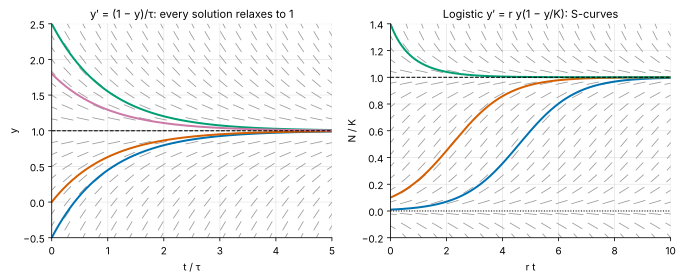
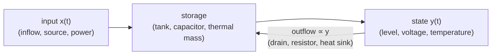
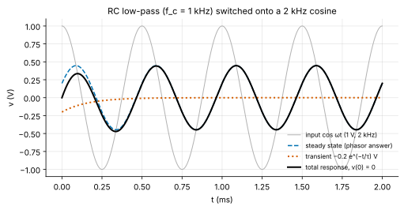
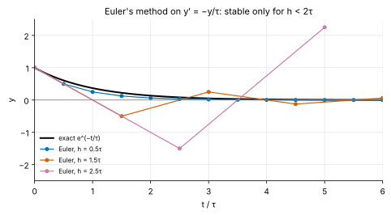
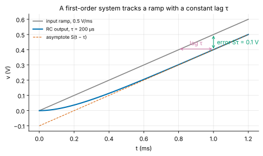
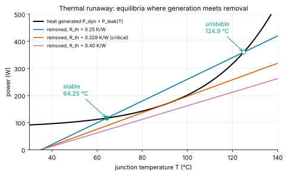

<!-- status: verified -->
# 02-02 · First-Order Linear ODEs

| | |
|---|---|
| **Course** | [02 · Complex Numbers, Differential Equations and Linear Algebra](../README.md) |
| **University equivalent** | The first-order equations unit of a sophomore differential-equations course (MIT 18.03 Unit I; Boyce & DiPrima, chapter on first-order equations): separable and linear equations, integrating factors, autonomous equations and stability, existence and uniqueness, Euler's method |
| **Prerequisites** | [01-03 Derivatives](../../01-calculus-for-engineers/chapters/01-03-derivatives.md) (chain rule), [01-05 Integrals](../../01-calculus-for-engineers/chapters/01-05-integrals.md), [01-06 Techniques of Integration](../../01-calculus-for-engineers/chapters/01-06-techniques-of-integration.md) (by parts, partial fractions), [02-01 Complex Numbers and Phasors](02-01-complex-numbers-euler-and-phasors.md) (for sinusoidal inputs) |
| **Estimated study hours** | 10 |
| **Last verified** | 2026-11-12 |

**Learning objectives.** After this chapter you can:

1. Classify a differential equation by order, linearity and homogeneity, and verify that a given function solves an initial-value problem.
2. Read a direction field and a phase line: find the equilibria of an autonomous equation and decide their stability, and their local time constants, without solving it.
3. Solve separable equations, including nonlinear ones such as the logistic equation, without losing equilibrium solutions.
4. Derive the integrating-factor method, use it on any first-order linear equation (constant or variable coefficients), and interpret the integrating factor as a discount factor.
5. Split a solution into natural and forced parts, or transient and steady-state parts, and compute the response to step, ramp, exponential and sinusoidal inputs in terms of the time constant.
6. State when a solution exists and is unique, recognize non-uniqueness and finite-time blow-up, and choose a stable step size for Euler's method.

## 1. Big picture

A differential equation says how fast something changes in terms of where it is now. A **first-order** equation involves only the first derivative, and describes any system with a single place to store something: one capacitor (charge), one inductor (flux), one thermal mass (heat), one tank, one bank balance. The stored quantity drifts toward a target set by the inputs, at a pace set by one number, the **time constant**. This one model, and the way to solve it, covers a surprising share of engineering. It is also the building block from which every higher-order system in this course is assembled ([02-03](02-03-second-order-linear-odes.md), [02-09](02-09-systems-of-odes-and-matrix-exponential.md)).

- **Circuits:** every RC and RL circuit, from a debounce filter to the settling of an ADC's sampling capacitor ([07-02](../../07-circuit-analysis-2-transient-and-ac/chapters/07-02-first-order-rc-rl-transients.md)).
- **Thermal management:** a chip's temperature follows a first-order law to a first approximation. That is why a phone runs fast for a minute and then throttles ([25-08](../../25-fabrication-packaging-test-and-reliability/chapters/25-08-thermal-engineering.md), [15-12](../../15-control-systems/chapters/15-12-control-applications-pll-regulators-thermal.md)).
- **Memory and analog storage:** DRAM cells and sample-and-hold capacitors lose charge through leakage, setting refresh intervals and droop ([23-03](../../23-memory-and-storage-technology/chapters/23-03-dram-cells-arrays-refresh.md)).
- **Simulation:** circuit simulators solve differential equations numerically, step by step. Whether a time step is stable is a first-order question (§3.9, [02-10](02-10-numerical-methods.md)).
- **Finance and markets:** continuous compounding with deposits is a first-order linear equation, and technology adoption S-curves are logistic equations. Both appear in the M&A models you already build.

## 2. Intuition first

### A bathtub with an open drain

Water pours into a tub at a steady rate $q_{in}$. The drain lets water out at a rate proportional to the depth $h$, since a deeper tub pushes water out faster: $q_{out} = h/R$, where $R$ measures how restrictive the drain is. The tub's area is $A$, so the depth changes as

$$
A\frac{dh}{dt} = q_{in} - \frac{h}{R}.
$$

If the tub is shallow, inflow beats outflow and the level rises. As it rises, outflow grows until it matches inflow at $h_\infty = Rq_{in}$, the **equilibrium**. The approach slows as the gap closes, because the net rate is proportional to the gap: an exponential approach with time constant $\tau = RA$. A big tub (large $A$) or a restrictive drain (large $R$) responds slowly. That is all a first-order system is: **storage, an input, and an outflow proportional to the stored amount.** An RC circuit is the same tub with charge for water, capacitance for area and resistance for the drain.

### The slope field: reading the answer before solving

Every first-order equation $y' = f(t, y)$ assigns a slope to every point of the $(t, y)$ plane. Draw a short segment with that slope at a grid of points and you get a **direction field** (Figure 1). Solutions are curves that run tangent to the segments everywhere, like leaves floating on a current. Before doing any algebra, you can see where solutions go: on the left of Figure 1, everything relaxes to 1. On the right, small populations grow slowly, then rapidly, then saturate in an S-shape.

*Figure 1. Left: $y' = (1 - y)/\tau$. Every solution approaches the equilibrium y = 1 exponentially. Right: the logistic equation. Solutions starting near 0 trace S-curves to the carrying capacity; those starting above it decay down to it.*

### An analogy from finance: an account with fees and deposits

A fund receives constant contributions $d$ per year, and charges a fee proportional to its balance at rate $k$ per year. The balance obeys $B' = d - kB$, the bathtub again. It approaches $B_\infty = d/k$: at that level, the fees exactly consume the contributions. With interest instead of fees, $B' = rB + d$, the same equation with the sign of the feedback flipped, and the balance grows without bound. The sign of the coefficient of $B$ decides between "settles" and "runs away". Section 3.4 shows that the integrating factor, the key tool of this chapter, *is* the discount factor $e^{-rt}$ of your valuation models.

*Where the analogy breaks:* real rates and fees change over time and money is discrete. The mathematics handles time-varying rates (§3.4), but discrete compounding is a difference equation, which is the subject of [11-09](../../11-signals-and-systems/chapters/11-09-z-transform.md). Circuits have no analogue of a negative balance being disallowed, so a voltage can happily cross zero where a balance might not.

## 3. Theory

### 3.1 Vocabulary and what counts as a solution

An **ordinary differential equation (ODE)** relates an unknown function $y(t)$ of one variable to its derivatives. "Ordinary" distinguishes it from partial differential equations, which involve several variables (the wave and diffusion equations of Courses 13 and 09).

- The **order** is that of the highest derivative present. This chapter is about first order: $y' = f(t, y)$.
- The equation is **linear** if $y$ and $y'$ appear only to the first power, multiplied by functions of $t$ alone. Every first-order linear equation can be put in **standard form**:

$$
y' + p(t)\,y = g(t).
$$

- It is **homogeneous** if $g(t) = 0$. The input-free equation $y' + p(t)y = 0$ describes the system left alone.
- It is **autonomous** if $t$ does not appear explicitly: $y' = f(y)$.
- A **solution** on an interval $I$ is a differentiable function that satisfies the equation at every $t$ in $I$. The **general solution** contains one arbitrary constant. An **initial-value problem (IVP)** adds a condition $y(t_0) = y_0$ that fixes the constant.

| Equation | Linear? | Homogeneous? | Autonomous? |
|---|---|---|---|
| $\tau v' + v = v_s(t)$ (RC circuit) | yes | no (unless $v_s = 0$) | only if $v_s$ is constant |
| $t y' + 2y = t^2$ | yes ($p = 2/t$, $g = t$) | no | no |
| $y' = ry(1 - y/K)$ (logistic) | no ($y^2$ term) | — | yes |
| $C\,dv/dt = -I_S(e^{v/V_T} - 1)$ (capacitor discharged by a diode) | no ($e^v$) | — | yes |

**Verifying a solution** needs only differentiation. Claim: $y = 1 + 3e^{-2t}$ solves $y' = -2y + 2$ with $y(0) = 4$. Check: $y' = -6e^{-2t}$, and $-2y + 2 = -2 - 6e^{-2t} + 2 = -6e^{-2t}$ ✓. Also $y(0) = 1 + 3 = 4$ ✓. Get into the habit: substituting back into the equation catches most algebra errors.

### 3.2 Autonomous equations: equilibria, the phase line and local time constants

For an autonomous equation $y' = f(y)$, the slope depends only on height, so all the information fits on a vertical line, the **phase line**. Mark the **equilibria**, the values $y^*$ where $f(y^*) = 0$: a solution that starts there stays there forever. Between equilibria, $f$ has a fixed sign, so solutions move steadily up (where $f > 0$) or down (where $f < 0$), and can never cross an equilibrium (§3.7 explains why).

Near an equilibrium, linearize ([01-04](../../01-calculus-for-engineers/chapters/01-04-applications-of-derivatives.md)). Write $y = y^* + u$ with $u$ small:

$$
u' = f(y^* + u) \approx f(y^*) + f'(y^*)\,u = f'(y^*)\,u \quad\Longrightarrow\quad u(t) \approx u(0)\,e^{f'(y^*)\,t}.
$$

- If $f'(y^*) < 0$, small deviations decay: the equilibrium is **stable**, with **local time constant** $\tau = -1/f'(y^*)$.
- If $f'(y^*) > 0$, deviations grow: the equilibrium is **unstable**, like a pencil on its tip.
- If $f'(y^*) = 0$, linearization is inconclusive and you must look at the sign of $f$ on either side.

**Example.** $y' = (y - 1)(3 - y)$ has equilibria at 1 and 3. Since $f'(y) = 4 - 2y$, $f'(1) = 2 > 0$ (unstable) and $f'(3) = -2 < 0$ (stable, with $\tau = 0.5$). Any start between 1 and 3 rises toward 3, any start above 3 falls toward 3, and any start below 1 falls away forever.

This is how engineers reason about nonlinear systems they cannot solve: find the operating points, then linearize to judge their stability and speed. Example 02-02.5 applies it to a chip at risk of thermal runaway.

### 3.3 Separable equations

An equation is **separable** if the slope factors into a function of $t$ times a function of $y$:

$$
\frac{dy}{dt} = a(t)\,b(y).
$$

**Derivation.** Wherever $b(y) \ne 0$, divide: $\dfrac{1}{b(y)}\dfrac{dy}{dt} = a(t)$. Let $G(y)$ be an antiderivative of $1/b(y)$. By the chain rule, $\dfrac{d}{dt}G\big(y(t)\big) = \dfrac{1}{b(y)}\dfrac{dy}{dt}$. So the equation says $\dfrac{d}{dt}G(y(t)) = a(t)$, and integrating both sides in $t$ gives

$$
\int\frac{dy}{b(y)} = \int a(t)\,dt + C.
$$

The shorthand "multiply both sides by $dt$ and integrate" is justified by exactly this chain-rule argument. **Do not lose the equilibria.** Dividing by $b(y)$ assumed $b(y) \ne 0$. Each root $y^*$ of $b$ is a constant solution that the formula may miss, so check them separately.

**Exponential decay.** $y' = -y/\tau$: $\int dy/y = -\int dt/\tau$, so $\ln\lvert y\rvert = -t/\tau + C$, and $y = y_0e^{-t/\tau}$. (Here the equilibrium $y = 0$ is the case $y_0 = 0$, so nothing is lost.)

**The logistic equation.** Growth at rate $r$ that saturates at a capacity $K$ is modeled by

$$
\frac{dN}{dt} = rN\left(1 - \frac{N}{K}\right).
$$

It models product adoption, epidemics and populations: growth is proportional to the current base $N$ and to the remaining room $1 - N/K$. Separate and use partial fractions ([01-06](../../01-calculus-for-engineers/chapters/01-06-techniques-of-integration.md)): $\dfrac{K}{N(K - N)} = \dfrac{1}{N} + \dfrac{1}{K - N}$, so

$$
\int\left(\frac{1}{N} + \frac{1}{K - N}\right)dN = \int r\,dt \;\Longrightarrow\; \ln\frac{N}{K - N} = rt + C.
$$

Exponentiate, apply $N(0) = N_0$, and solve for $N$:

$$
N(t) = \frac{K}{1 + \dfrac{K - N_0}{N_0}\,e^{-rt}}.
$$

The equilibria $N = 0$ (unstable, since $f'(0) = r$) and $N = K$ (stable, since $f'(K) = -r$) are visible on the phase line. Growth is fastest at $N = K/2$, the inflection point of the S-curve, reached at $t_{1/2} = \frac{1}{r}\ln\frac{K - N_0}{N_0}$. The time from 10% to 90% of $K$ is $2\ln 9/r = 4.394/r$, whatever $N_0$ is. For a market model, $r$ sets how fast the S-curve climbs and $K$ sets where it stops. Early data, from the near-exponential phase, pins down $r$ but says almost nothing about $K$, which is why adoption forecasts made early are so unreliable.

### 3.4 Linear equations and the integrating factor

Separation fails for $y' + p(t)y = g(t)$ whenever $g \ne 0$. The general method is to multiply by a cleverly chosen function $\mu(t)$, the **integrating factor**, that turns the left side into the derivative of a product.

**Derivation.** Multiply the standard form by $\mu(t) > 0$:

$$
\mu y' + \mu p\,y = \mu g.
$$

By the product rule, $(\mu y)' = \mu y' + \mu' y$. The left side equals $(\mu y)'$ exactly when $\mu' = \mu p$. That is a separable equation for $\mu$, with solution

$$
\mu(t) = e^{\int p(t)\,dt}
$$

(any antiderivative will do, since a constant factor cancels). Then $(\mu y)' = \mu g$. Integrate and divide by $\mu$:

$$
y(t) = \frac{1}{\mu(t)}\left[\int \mu(t)\,g(t)\,dt + C\right].
$$

For an initial-value problem, define $P(t) = \int_{t_0}^t p(s)\,ds$ so that $\mu(t_0) = 1$. Integrating from $t_0$ to $t$ gives the form worth remembering:

$$
\boxed{\,y(t) = y_0\,e^{-P(t)} + \int_{t_0}^{t} e^{-\left(P(t) - P(s)\right)}\,g(s)\,ds\,}
$$

Read it as two pieces. The first term is the initial condition, decaying (or growing) on its own. The second is the sum of every past input $g(s)\,ds$, each weighted by how much it has decayed between time $s$ and now.

**Constant coefficients: fading memory.** For $\tau y' + y = x(t)$, the standard form has $p = 1/\tau$ and $g = x/\tau$, so $P(t) - P(s) = (t - s)/\tau$ and, with $t_0 = 0$,

$$
y(t) = y_0e^{-t/\tau} + \frac{1}{\tau}\int_0^t e^{-(t - s)/\tau}\,x(s)\,ds.
$$

The output is a weighted average of past inputs with exponentially fading weights: an input from one time constant ago counts $e^{-1} = 36.8\%$ as much as the present one. This integral is a **convolution** of the input with the impulse response $\frac{1}{\tau}e^{-t/\tau}$, the central object of [11-03](../../11-signals-and-systems/chapters/11-03-convolution.md).

**Finance: the integrating factor is the discount factor.** A balance earning a time-varying rate $r(t)$ with deposits $d(t)$ obeys $B' - r(t)B = d(t)$. Here $p = -r$, so the integrating factor is

$$
\mu(t) = e^{-\int_0^t r(s)\,ds} = D(t),
$$

the continuous-time **discount factor**. The step $(\mu B)' = \mu d$ says: *the present value of the balance grows only by the present value of each new deposit.* Then the boxed formula reads $B(t) = B_0/D(t) + \int_0^t d(s)\,D(s)/D(t)\,ds$: the future value of the initial balance plus the future value of every deposit. You have used this formula for years; the integrating factor is its derivation.

> **Math refresher — choosing the antiderivative of p.** Any antiderivative works, because a constant added to $\int p\,dt$ multiplies $\mu$ by a constant, which cancels between $\mu y$ and $\mu g$. For $p(t) = 2/t$ on $t > 0$, take $\int p\,dt = 2\ln t$, so $\mu = e^{2\ln t} = t^2$.

**A variable-coefficient example.** Solve $ty' + 2y = t^2$ for $t > 0$. Standard form: $y' + (2/t)y = t$, so $\mu = t^2$. Then $(t^2y)' = t^3$ gives $t^2y = t^4/4 + C$ and $y = t^2/4 + C/t^2$. Check: $ty' + 2y = t(t/2 - 2C/t^3) + t^2/2 + 2C/t^2 = t^2$ ✓.

### 3.5 Structure of the solution: natural plus forced, transient plus steady state

Linearity gives the solutions a structure that you will use in every later course.

1. **Superposition.** If $y_1$ solves the equation with input $g_1$ and $y_2$ with input $g_2$, then $ay_1 + by_2$ solves it with input $ag_1 + bg_2$. The proof is one line: the left side $y' + py$ is linear in $y$.
2. **Homogeneous plus particular.** Every solution is $y = y_h + y_p$: any one particular solution $y_p$ of the full equation, plus the general solution $y_h = Ce^{-P(t)}$ of the homogeneous equation. The difference of two solutions solves the homogeneous equation, so nothing else is possible.
3. **Zero-input plus zero-state.** The boxed formula splits the response into the part due to the initial condition alone (the *zero-input* or **natural response**) and the part due to the input alone, starting from rest (the *zero-state* or **forced response**). Circuit analysts and control engineers use this split.
4. **Transient plus steady state.** For a stable constant-coefficient system ($\tau > 0$), the homogeneous part $Ce^{-t/\tau}$ dies away. What remains is the **steady-state** response, determined by the input alone. The constant $C$ only adjusts the **transient** so that the initial condition is met.

**The step response.** For a constant input $x(t) = X$, try a constant particular solution: $y_p = X$. With $y(0) = y_0$,

$$
y(t) = X + (y_0 - X)\,e^{-t/\tau} = \text{final} + (\text{initial} - \text{final})\,e^{-t/\tau}.
$$

This "final plus (initial minus final)" formula solves every first-order circuit with constant sources ([07-02](../../07-circuit-analysis-2-transient-and-ac/chapters/07-02-first-order-rc-rl-transients.md) §3.5). After one $\tau$, 63.2% of the change is done; after $5\tau$, 99.3%.

### 3.6 Responses to the standard inputs

For $\tau y' + y = x(t)$, a particular solution has the same form as the input. This is the **method of undetermined coefficients**: guess the form, substitute, and match coefficients. It works because differentiating these functions returns the same family.

| Input $x(t)$ | Guess for $y_p$ | Result |
|---|---|---|
| constant $X$ | constant $a$ | $y_p = X$ |
| ramp $St$ | $a + bt$ | $y_p = S(t - \tau)$ |
| exponential $e^{-\alpha t}$, $\alpha\tau \ne 1$ | $ae^{-\alpha t}$ | $y_p = \dfrac{e^{-\alpha t}}{1 - \alpha\tau}$ |
| exponential with $\alpha\tau = 1$ | $ate^{-t/\tau}$ | $y_p = \dfrac{t}{\tau}e^{-t/\tau}$ |
| $\cos\omega t$ | $a\cos\omega t + b\sin\omega t$ | $y_p = \dfrac{\cos(\omega t - \varphi)}{\sqrt{1 + (\omega\tau)^2}}$, $\varphi = \arctan\omega\tau$ |

**Ramp.** Substitute $y_p = a + bt$: $\tau b + a + bt = St$, so $b = S$ and $a = -S\tau$. The output runs parallel to the input, **lagging by exactly $\tau$ in time**, which is an error of $S\tau$ in value (Figure 3). A temperature sensor with a 4 s time constant in an oven ramping 2 °C/s reads 8 °C low, forever.

**Exponential, and the matched case.** Substituting $ae^{-\alpha t}$ gives $a(1 - \alpha\tau) = 1$. When the input decays at exactly the system's own rate, $\alpha\tau = 1$, the guess fails (it solves the homogeneous equation). Multiply the guess by $t$: $y_p = ate^{-t/\tau}$ gives $\tau a e^{-t/\tau}(1 - t/\tau) + ate^{-t/\tau} = e^{-t/\tau}$, so $a = 1/\tau$. The factor $t$ is the first-order version of **resonance**: driving a system at its natural rate produces a response with a growing envelope factor. [02-04](02-04-forced-response-and-resonance.md) develops the second-order version.

**Sinusoid.** The quickest route is the phasor method of [02-01](02-01-complex-numbers-euler-and-phasors.md). Replace $d/dt$ by $j\omega$: $(1 + j\omega\tau)\mathbf{Y} = \mathbf{X}$, so

$$
\mathbf{Y} = \frac{\mathbf{X}}{1 + j\omega\tau}, \qquad \lvert\mathbf{Y}\rvert = \frac{\lvert\mathbf{X}\rvert}{\sqrt{1 + (\omega\tau)^2}}, \qquad \angle\mathbf{Y} = \angle\mathbf{X} - \arctan\omega\tau.
$$

Undetermined coefficients gives the same answer (Example 02-02.4 checks this). At $\omega\tau = 1$ the amplitude is $1/\sqrt2$ (−3.01 dB) and the phase lag is 45°: this is the **corner frequency** $f_c = 1/(2\pi\tau)$ of every first-order low-pass. The phasor gives only the steady state. To meet an initial condition, add the transient $Ce^{-t/\tau}$ (Figure 2).

*Figure 2. Total response = steady state (the phasor answer) + transient. The transient cancels the mismatch at t = 0 and is gone within about 5τ = 0.8 ms.*

### 3.7 Existence and uniqueness

Does an IVP always have a solution, and only one? For engineering models the answer is usually yes, but the exceptions matter.

**Theorem 1 (linear equations).** If $p$ and $g$ are continuous on an open interval $I$ containing $t_0$, then $y' + p(t)y = g(t)$, $y(t_0) = y_0$ has exactly one solution, and it exists on **all** of $I$.

*Proof.* Existence: the boxed formula of §3.4 is a solution, and it is defined on all of $I$ because $p$ and $g$ are continuous there. Uniqueness: if $y_1$ and $y_2$ are both solutions, their difference $w$ solves $w' + pw = 0$ with $w(t_0) = 0$. Then $(\mu w)' = 0$, so $\mu w$ is constant, and it equals 0 at $t_0$. Since $\mu > 0$, $w \equiv 0$. ∎

The interval matters. For $y' + y/(t - 3) = 1$ with $y(1) = 0$, $p$ is discontinuous at $t = 3$, so the guarantee covers $t < 3$ only.

**Theorem 2 (nonlinear equations, Picard–Lindelöf).** If $f(t, y)$ and $\partial f/\partial y$ are continuous in a rectangle around $(t_0, y_0)$, then $y' = f(t, y)$, $y(t_0) = y_0$ has exactly one solution on *some* interval around $t_0$, possibly short.

Two classic failures show what the hypotheses buy:

- **Non-uniqueness.** $y' = 2\sqrt{y}$ with $y(0) = 0$ has the solution $y = 0$, and also $y = t^2$ for $t \ge 0$. In fact it has infinitely many: stay at 0 until any time $c$, then follow $(t - c)^2$. The culprit is $\partial f/\partial y = 1/\sqrt{y}$, which is unbounded at $y = 0$. Physically, run Torricelli's draining tank backward: from an empty tank you cannot tell when it emptied.
- **Finite-time blow-up.** $y' = y^2$ with $y(0) = 1$ has the smooth right side $f = y^2$, yet its solution $y = 1/(1 - t)$ reaches infinity at $t = 1$. The theorem promised only a local solution. Superlinear growth (the rate grows faster than $y$) can reach infinity in finite time. Exponential leakage feeding back into temperature behaves the same way (Example 02-02.5): in the model the temperature diverges in finite time, and in reality the chip fails first, or a protection circuit trips.

Uniqueness also explains the phase line: two different solutions of a well-behaved equation can never cross, because at the crossing point they would share an initial condition.

> **Going deeper — where Theorem 2 comes from.** Picard's proof rewrites the IVP as an integral equation $y(t) = y_0 + \int_{t_0}^t f(s, y(s))\,ds$ and iterates $y_{k+1}(t) = y_0 + \int_{t_0}^t f(s, y_k(s))\,ds$. If $\partial f/\partial y$ is bounded by $L$, each iteration shrinks the distance between successive guesses by a factor $L\lvert t - t_0\rvert$, so on a short enough interval they converge to a unique fixed point (the contraction-mapping principle). Boyce & DiPrima prove this in their section on existence and uniqueness.

### 3.8 Substitutions: Bernoulli equations

Some nonlinear equations become linear after a change of variable. A **Bernoulli equation** has the form

$$
y' + p(t)\,y = q(t)\,y^n, \qquad n \ne 0, 1.
$$

Divide by $y^n$ and set $v = y^{1-n}$, so $v' = (1 - n)y^{-n}y'$:

$$
\frac{v'}{1 - n} + p(t)\,v = q(t),
$$

which is linear in $v$. The logistic equation is the Bernoulli case $n = 2$. Problem 02-02.13 works one.

> **Going deeper — exact equations.** An equation $M(t, y) + N(t, y)\,y' = 0$ is *exact* if $\partial M/\partial y = \partial N/\partial t$. Then it is $\frac{d}{dt}\Phi(t, y) = 0$ for a potential $\Phi$, and the solutions are the level curves $\Phi = C$. This is the conservative-field test of [01-10](../../01-calculus-for-engineers/chapters/01-10-multivariable-calculus-2.md) in another guise. Exact equations seldom arise in circuits, so this curriculum does not develop them further.

### 3.9 Euler's method and step-size stability

Most ODEs have no closed-form solution, so simulators integrate them numerically. The simplest scheme follows the tangent line for a step $h$:

$$
y_{n+1} = y_n + h\,f(t_n, y_n) \qquad\text{(forward Euler)}.
$$

Each step makes an error of order $h^2$ (the neglected Taylor term, [01-08](../../01-calculus-for-engineers/chapters/01-08-sequences-series-and-taylor.md)). Over a fixed interval there are $1/h$ steps, so the total error is of order $h$: halving the step halves the error.

**Stability** is a separate and more dangerous issue. Apply Euler to $y' = -y/\tau$:

$$
y_{n+1} = \left(1 - \frac{h}{\tau}\right)y_n \quad\Longrightarrow\quad y_n = \left(1 - \frac{h}{\tau}\right)^n y_0.
$$

The true solution decays, but the numerical one decays only if $\lvert 1 - h/\tau\rvert < 1$, that is $0 < h < 2\tau$. For $\tau < h < 2\tau$ it oscillates in sign while decaying. Beyond $2\tau$ it oscillates and *grows*, which is pure numerical artifact (Figure 4).

*Figure 4. Forward Euler with h = 0.5τ tracks the decay. With h = 1.5τ it oscillates but decays. With h = 2.5τ it blows up, although the true solution is decaying.*

This matters because real circuits are **stiff**: they have time constants spanning many orders of magnitude, from picoseconds in a gate to milliseconds in a supply filter. Forward Euler would need steps smaller than twice the *fastest* time constant for the whole simulation, even after those fast parts have settled. Circuit simulators therefore use **implicit** methods, which evaluate the slope at the end of the step. For example, backward Euler $y_{n+1} = y_n + h f(t_{n+1}, y_{n+1})$ gives $y_{n+1} = y_n/(1 + h/\tau)$, which decays for *every* $h > 0$. SPICE uses the trapezoidal rule and Gear's methods, both implicit. [02-10](02-10-numerical-methods.md) treats stiffness properly.

### 3.10 A modeling recipe

1. **Identify the stored quantity** (charge, flux, heat, volume, money) and the state variable that measures it (voltage, current, temperature, level, balance).
2. **Write a balance:** rate of change of storage = inflow − outflow. Express the flows in terms of the state and the inputs.
3. **Check units** term by term.
4. **Put it in the form $\tau y' + y = Kx(t)$** if it is linear with constant coefficients. Read off $\tau$ (storage × resistance) and the steady-state gain $K$.
5. **Sanity-check the sign.** The coefficient of $y$ must make the system relax (positive $\tau$) unless there is a real source of positive feedback, such as interest or leakage that rises with temperature.

**A thermal model.** A chip dissipating $P$ watts has heat capacity $C_{th}$ (J/K) and thermal resistance $R_{th}$ (K/W) to ambient at $T_a$. The heat balance is

$$
C_{th}\frac{dT}{dt} = P - \frac{T - T_a}{R_{th}} \quad\Longleftrightarrow\quad R_{th}C_{th}\frac{dT}{dt} + T = T_a + R_{th}P.
$$

The thermal time constant is $\tau_{th} = R_{th}C_{th}$, and the steady temperature rise is $R_{th}P$. Units: K/W × J/K = J/W = s ✓. This is an RC circuit with temperature for voltage and power for current. Thermal engineers draw it that way, and SPICE can simulate it (lab).

## 4. Worked examples

### Example 02-02.1 — A die cooling down (tier A)

**Setup.** A chip at 85 °C is switched off in 25 °C ambient. Its heat capacity is $C_{th} = 15$ J/K and its thermal resistance to ambient is $R_{th} = 2$ K/W. (a) Find $T(t)$. (b) How long until it reaches 40 °C? (c) What is its temperature after 60 s?

**Solution.** (a) With $P = 0$, the heat balance $C_{th}T' = -(T - T_a)/R_{th}$ is separable in $u = T - T_a$: $u' = -u/\tau$ with $\tau = R_{th}C_{th} = 2 \times 15 = 30$ s. So $u = u_0e^{-t/\tau}$ and

$$
T(t) = 25 + 60\,e^{-t/(30\text{ s})}\ ^\circ\text{C}.
$$

(b) $60e^{-t/30} = 15$ gives $t = 30\ln(60/15) = 30\ln 4 = 41.59$ s.

(c) $T(60) = 25 + 60e^{-2} = 33.12$ °C.

**Units check.** K/W × J/K = J/W = s ✓. **Sanity check.** 40 °C is 25% of the initial excess, which takes $\ln 4 = 1.39$ time constants, between one $\tau$ (36.8% left) and two (13.5% left) ✓.

### Example 02-02.2 — An RL circuit with a nonzero initial current (tier A)

**Setup.** At $t = 0$ a 12 V source is connected across a 10 mH inductor in series with 5 Ω. The inductor already carries 0.4 A. Use an integrating factor to find $i(t)$, then $i(1\text{ ms})$, and the time at which the current reaches 2.3 A.

**Solution.** KVL: $L\,di/dt + Ri = V$, or in standard form $i' + (R/L)i = V/L$. With $p = R/L = 500$ s⁻¹, $\mu = e^{500t}$, and

$$
(e^{500t}i)' = \frac{V}{L}e^{500t} \;\Longrightarrow\; e^{500t}i = \frac{V}{R}e^{500t} + C \;\Longrightarrow\; i = \frac{V}{R} + Ce^{-t/\tau},
$$

with $\tau = L/R = 2$ ms and $V/R = 2.4$ A. The initial condition gives $C = 0.4 - 2.4 = -2.0$ A, so

$$
i(t) = 2.4 - 2.0\,e^{-t/(2\text{ ms})}\text{ A}.
$$

Then $i(1\text{ ms}) = 2.4 - 2e^{-0.5} = 1.187$ A. For 2.3 A: $2e^{-t/\tau} = 0.1$, so $t = 2\text{ ms}\times\ln 20 = 5.991$ ms.

**Units check.** H/Ω = (V·s/A)/(V/A) = s ✓. **Sanity check.** The answer has the "final + (initial − final)$e^{-t/\tau}$" form of §3.5, with final 2.4 A and initial 0.4 A ✓.

### Example 02-02.3 — Tracking a ramp (tier B)

**Setup.** A supply ramps up at $S = 0.5$ V/ms (a "soft start") and is filtered by an RC low-pass with $\tau = 200$ µs, starting from 0 V. Solve for the output, and find the tracking error at $t = 1$ ms and as $t \to \infty$.

**Solution.** The equation is $\tau v' + v = St$, with $v(0) = 0$. Standard form: $v' + v/\tau = St/\tau$, with $\mu = e^{t/\tau}$:

$$
(ve^{t/\tau})' = \frac{S}{\tau}\,te^{t/\tau}.
$$

Integrate by parts ($u = t$, $dw = e^{t/\tau}dt$): $\int te^{t/\tau}dt = \tau te^{t/\tau} - \tau^2e^{t/\tau}$. So

$$
ve^{t/\tau} = S(t - \tau)e^{t/\tau} + C \;\Longrightarrow\; v = S(t - \tau) + Ce^{-t/\tau}.
$$

From $v(0) = 0$, $C = S\tau$, so $v(t) = S(t - \tau) + S\tau e^{-t/\tau}$. The tracking error is

$$
e(t) = St - v(t) = S\tau\left(1 - e^{-t/\tau}\right).
$$

As $t \to \infty$, $e \to S\tau = 0.5\text{ V/ms}\times0.2\text{ ms} = 0.1$ V, or 100 mV. At $t = 1$ ms $= 5\tau$, $e = 100(1 - e^{-5}) = 99.33$ mV.

**Units check.** V/ms × ms = V ✓. **Sanity check.** The output runs parallel to the ramp, delayed by $\tau$ = 200 µs (Figure 3), and the particular solution matches the table in §3.6 ✓.

*Figure 3. After the transient, a first-order system follows a ramp with a constant time lag τ and a constant error Sτ.*

### Example 02-02.4 — Switching an RC filter onto a sinusoid (tier B)

**Setup.** An RC low-pass with corner frequency $f_c = 1$ kHz, initially discharged, is connected at $t = 0$ to $v_s = \cos(2\pi\cdot2000\,t)$ V. Find $v(t)$, including the transient, by undetermined coefficients, and check the steady state against the phasor method.

**Solution.** Here $\tau = 1/(2\pi f_c) = 159.2$ µs and $\omega\tau = f/f_c = 2$. Substitute $v_p = a\cos\omega t + b\sin\omega t$ into $\tau v' + v = \cos\omega t$:

$$
(a + b\,\omega\tau)\cos\omega t + (b - a\,\omega\tau)\sin\omega t = \cos\omega t.
$$

Matching coefficients gives $a + 2b = 1$ and $b = 2a$, so $a = 0.2$ V and $b = 0.4$ V. The amplitude is $\sqrt{a^2 + b^2} = 0.4472$ V and the phase lag is $\arctan(b/a) = \arctan 2 = 63.43°$.

**Phasor check.** $\mathbf{V} = 1/(1 + j2)$, with magnitude $1/\sqrt5 = 0.4472$ and angle $-63.43°$ ✓.

**Transient.** The full solution is $v = v_p + Ce^{-t/\tau}$, and $v(0) = a + C = 0$ gives $C = -0.2$ V:

$$
v(t) = 0.4472\cos(\omega t - 63.43°) - 0.2\,e^{-t/(159.2\text{ µs})}\text{ V}.
$$

The transient is negligible after $5\tau = 0.7958$ ms (Figure 2).

**Units check.** $\omega\tau$ is dimensionless ✓. **Sanity check.** At twice the corner frequency, the gain $1/\sqrt{1 + 4} = 0.447$ (−7.0 dB) lies close to the −20 dB/decade asymptote ($f_c/f = 0.5$, or −6 dB) ✓.

### Example 02-02.5 — Thermal runaway (tier C)

**Setup.** A processor's dynamic power is $P_{dyn} = 80$ W. Its leakage power rises with junction temperature as $P_{leak}(T) = P_{L0}\,e^{(T - T_0)/T_c}$, with $P_{L0} = 10$ W at $T_0 = 25$ °C and $T_c = 30$ K (illustrative values: leakage doubles every $T_c\ln 2 = 20.8$ K). It sits in 35 °C ambient with $R_{th} = 0.25$ K/W and $C_{th} = 50$ J/K, so

$$
C_{th}\frac{dT}{dt} = P_{dyn} + P_{leak}(T) - \frac{T - T_a}{R_{th}} = f(T).
$$

(a) Find the operating temperature. (b) Find the local time constant there, and compare it with $R_{th}C_{th}$. (c) Show that there is a second, unstable equilibrium, and say what it means. (d) Find the critical $R_{th}$ beyond which no operating point exists.

**Solution.** The equation is autonomous and nonlinear, so use §3.2: equilibria, then linearization.

(a) An equilibrium satisfies $T = T_a + R_{th}\big(P_{dyn} + P_{leak}(T)\big)$. Iterate this fixed-point map from $T = 35$ °C: 58.49, 62.63, 63.76, 64.10, 64.20, … It converges to $T^* = 64.25$ °C, where $P_{leak} = 37.00$ W. Check: $35 + 0.25 \times 117 = 64.25$ ✓.

(b) Write $T = T^* + u$ and linearize. Since $dP_{leak}/dT = P_{leak}/T_c = 37.00/30 = 1.233$ W/K,

$$
C_{th}u' = \left(\frac{dP_{leak}}{dT} - \frac{1}{R_{th}}\right)u \quad\Longrightarrow\quad \tau_{eff} = \frac{C_{th}}{1/R_{th} - dP_{leak}/dT} = \frac{50}{4 - 1.233} = 18.07\text{ s}.
$$

Without the leakage feedback, $\tau_0 = R_{th}C_{th} = 12.5$ s. Define the **thermal loop gain** $G = R_{th}\,dP_{leak}/dT = 0.3083$: a 1 K rise adds 1.233 W of leakage, which the heat sink converts into another 0.31 K. The feedback stretches the time constant by $1/(1 - G) = 1.446$. The same $G$ is the contraction factor of the iteration in (a), which is why it converged.

(c) The leakage grows exponentially and the heat removal only linearly, so the curves cross again (Figure 5). Bracketing and bisection give $T_u = 124.9$ °C. There $dP_{leak}/dT = 279.8/30 = 9.33$ W/K, which exceeds $1/R_{th} = 4$ W/K, so $f'(T_u) > 0$: unstable. Below $T_u$, the chip returns to 64.25 °C. If anything pushes it above $T_u$ (a burst of activity, a fan failure), heat generation beats removal and the temperature diverges: **thermal runaway**. This equilibrium is the boundary of the safe region.

(d) As $R_{th}$ grows, the removal line flattens until it just touches the generation curve. At that point both $f(T) = 0$ and $f'(T) = 0$ hold. The second condition gives $R_{th}P_{leak}(T)/T_c = 1$, so $P_{leak} = T_c/R_{th}$ and $T = T_0 + T_c\ln\big(T_c/(R_{th}P_{L0})\big)$. Substituting into the first leaves one equation in $R_{th}$. Solving it numerically (Newton's method or bisection) gives $R_{crit} = 0.3289$ K/W, touching at 91.31 °C. A heat sink 31.6% worse than the design value leaves no operating point at all.

*Figure 5. Equilibria are intersections of heat generated (black) and heat removed (straight lines). At 0.25 K/W there are two: stable at 64.25 °C and unstable at 124.9 °C. At 0.329 K/W they merge, and beyond it there is none.*

**Units check.** $R_{th}\,dP/dT$ has units (K/W)(W/K) = dimensionless ✓. **Sanity check.** As the loop gain approaches 1, $\tau_{eff} \to \infty$. Response slows dramatically near the edge of stability, a warning sign worth watching for in measurements ✓.

<!-- answer-key -->
| ID | Quantity | Value | Unit |
|---|---|---|---|
| Ex 02-02.1a | thermal time constant | 30 | s |
| Ex 02-02.1b | time to cool to 40 °C | 41.59 | s |
| Ex 02-02.1c | temperature after 60 s | 33.12 | °C |
| Ex 02-02.1d | time constants to 40 °C (ln 4) | 1.39 | — |
| Ex 02-02.2a | time constant | 2 | ms |
| Ex 02-02.2b | final current | 2.4 | A |
| Ex 02-02.2c | current at 1 ms | 1.187 | A |
| Ex 02-02.2d | time to reach 2.3 A | 5.991 | ms |
| Ex 02-02.3a | steady tracking error | 100 | mV |
| Ex 02-02.3b | tracking error at 1 ms | 99.33 | mV |
| Ex 02-02.4a | time constant | 159.2 | µs |
| Ex 02-02.4b | cosine coefficient a | 0.2 | V |
| Ex 02-02.4c | sine coefficient b | 0.4 | V |
| Ex 02-02.4d | steady-state amplitude | 0.4472 | V |
| Ex 02-02.4e | phase lag | 63.43 | ° |
| Ex 02-02.4f | transient coefficient | −0.2 | V |
| Ex 02-02.4g | five time constants | 0.7958 | ms |
| Ex 02-02.4h | gain at twice the corner | −7.0 | dB |
| Ex 02-02.5a | stable operating temperature | 64.25 | °C |
| Ex 02-02.5b | leakage at the operating point | 37.00 | W |
| Ex 02-02.5c | leakage slope at the operating point | 1.233 | W/K |
| Ex 02-02.5d | local time constant | 18.07 | s |
| Ex 02-02.5e | time constant without feedback | 12.5 | s |
| Ex 02-02.5f | thermal loop gain | 0.3083 | — |
| Ex 02-02.5g | time-constant stretch factor | 1.446 | — |
| Ex 02-02.5h | unstable equilibrium | 124.9 | °C |
| Ex 02-02.5i | leakage slope at the unstable point | 9.33 | W/K |
| Ex 02-02.5j | critical thermal resistance | 0.3289 | K/W |
| Ex 02-02.5k | temperature at tangency | 91.31 | °C |
| Ex 02-02.5l | margin in thermal resistance | 31.6 | % |
| Ex 02-02.5m | leakage doubling interval | 20.8 | K |
| Ex 02-02.5n | first fixed-point iterate | 58.49 | °C |

*Recomputed by [verify_02_02.py](../verify/verify_02_02.py). Examples 02-02.3, 02-02.4 and 02-02.5 are also confirmed in ngspice in the lab.*

## 5. Simulate it

The lab ([labs/02-02-lab/](../labs/02-02-lab/README.md)) has a notebook and three ngspice netlists:

1. **Direction fields** for the relaxation, logistic and $y' = y^2$ equations, with solutions overlaid. *Predict first:* where does $y' = y^2$ with $y(0) = 1$ go, and when?
2. **Euler, backward Euler and the trapezoidal rule** on $y' = -y/\tau$ for several step sizes. *Predict first:* which methods survive $h = 3\tau$?
3. **A logistic fit.** Fit the logistic curve to noisy early-phase data, and see how poorly the early data constrain the capacity $K$: the fit can be confidently wrong.
4. **Thermal runaway.** Integrate Example 02-02.5 for several values of $R_{th}$ and starting temperatures. *Predict first:* starting at 120 °C and at 130 °C with $R_{th} = 0.25$ K/W, which way does each go?
5. **ngspice, `rc_inputs.cir`.** An RC filter driven by a ramp and by a switched-on cosine, and the RL circuit of Problem 02-02.9. Confirm the 99.33 mV tracking error at 1 ms and the 0.4472 V steady amplitude.
6. **ngspice, `thermal_rc.cir` and `thermal_runaway.cir`.** The thermal model of Example 02-02.5 as an electrical RC network, with a behavioral current source for the leakage. Confirm 64.25 °C, and watch runaway at $R_{th} = 0.40$ K/W.

## 6. Engineering tradeoffs

| Knob | Improves | Costs | Typical decision owner |
|---|---|---|---|
| Larger RC filter time constant | Noise and ripple rejection | Slower settling; larger lag on ramps and steps | Analog / board designer |
| Larger thermal capacitance (heat spreader, vapor chamber) | Longer bursts before throttling | Weight, thickness, cost; same steady-state limit | Mechanical / thermal architect |
| Lower thermal resistance (heat sink, airflow, liquid cooling) | Lower steady temperature; more margin to runaway | Fan power, noise, size, cost | System thermal architect |
| Lower leakage (higher threshold voltage, power gating) | Smaller thermal loop gain; lower standby power | Speed, or area and design effort for gating | Device / circuit / power architect |
| Smaller simulation time step | Accuracy and stability of explicit methods | Run time | Simulation / CAD engineer |
| Implicit integration method | Stability for stiff circuits at large steps | More work per step (a nonlinear solve) | Simulator developer |

## 7. Numbers to know

| Quantity | Value | Note |
|---|---|---|
| Fraction of a step complete after τ, 2τ, 3τ, 4τ, 5τ | 63.2%, 86.5%, 95.0%, 98.2%, 99.3% | $1 - e^{-n}$ |
| Time to 50% | $0.693\tau$ | $\tau\ln 2$ |
| 10–90% rise time | $2.197\tau$ | $\tau\ln 9$ |
| Ramp lag | $\tau$ in time, $S\tau$ in value | Constant forever |
| First-order filter at $\omega\tau = 1$ | −3.01 dB, −45° | Corner frequency $1/(2\pi\tau)$ |
| Logistic 10% → 90% | $4.394/r$ | $2\ln 9/r$, independent of $N_0$ |
| Thermal time constant | $R_{th}C_{th}$ | K/W × J/K = s |
| Feedback stretch of τ | $1/(1 - G)$ | $G$ = loop gain; runaway as $G \to 1$ |
| Forward-Euler stability on $y' = -y/\tau$ | $h < 2\tau$ | Backward Euler: any $h$ |
| JEDEC still-air θJA test enclosure | about 305 mm cube | JESD51-2A, as of Nov 2026 ([R-029](../../../reference/research-log.md#r-029--jedec-thermal-test-environments-jesd51-2a)) |

<!-- answer-key -->
| ID | Quantity | Value | Unit |
|---|---|---|---|
| N 02-02.a | step complete after 1τ | 63.2 | % |
| N 02-02.b | step complete after 2τ | 86.5 | % |
| N 02-02.c | step complete after 3τ | 95.0 | % |
| N 02-02.d | step complete after 4τ | 98.2 | % |
| N 02-02.e | step complete after 5τ | 99.3 | % |
| N 02-02.f | time to 50% in τ | 0.693 | — |
| N 02-02.g | 10–90% rise time in τ | 2.197 | — |
| N 02-02.h | gain at the corner | −3.01 | dB |
| N 02-02.i | logistic 10–90% time × r | 4.394 | — |
| N 02-02.j | one-τ-old input weight | 36.8 | % |

## 8. Common mistakes

1. **Dropping equilibrium solutions when separating.** Dividing by $b(y)$ silently assumes $b(y) \ne 0$. Check the constant solutions separately.
2. **Forgetting to put the equation in standard form before computing μ.** For $ty' + 2y = t^2$, $p = 2/t$, not 2.
3. **Applying the initial condition to the particular solution alone.** The constant belongs to the *full* solution $y_h + y_p$. In Example 02-02.4, forcing $v_p(0) = 0$ would be wrong.
4. **Using the phasor answer as the whole answer.** Phasors give the steady state only. If the question asks what happens right after switching, add the transient.
5. **Guessing $ae^{-t/\tau}$ when the input decays at the system's own rate.** That guess solves the homogeneous equation and cannot match the input. Multiply by $t$.
6. **Trusting a simulation with an unstable step.** Oscillations that grow while the physics says "decay" are numerical artifacts. Halve the step and see whether the answer changes.
7. **Assuming a solution exists forever.** Nonlinear equations can blow up in finite time, and linear ones are guaranteed only where $p$ and $g$ are continuous.

## 9. Practitioner lens

### State of the art (as of Nov 2026)

- **Burst versus sustained performance.** Phones and thin laptops can dissipate more power for a short burst than they can remove steadily. The first-order thermal model says why: the thermal capacitance absorbs heat until the temperature approaches its limit, over a time scale of $R_{th}C_{th}$. Reviewers therefore run looping stress tests. For example, UL's 3DMark stress tests report *frame-rate stability*: the lowest-scoring loop as a percentage of the best, with 97% or more counted as a pass ([R-030](../../../reference/research-log.md#r-030--3dmark-stress-tests-and-frame-rate-stability)) **[Established]**. A device that throttles hard scores well on a single run and poorly on stability.
- **Datasheet thermal resistances are test-board numbers.** A package's junction-to-ambient resistance θJA is measured in a standardized still-air enclosure (JEDEC JESD51-2A, a sealed box of about 305 mm per side) on a standardized test board. Vendors themselves warn that θJA is not a good predictor of junction temperature in a real product, whose heat paths differ ([R-029](../../../reference/research-log.md#r-029--jedec-thermal-test-environments-jesd51-2a)) **[Established]**.
- **Thermal runaway is a real failure mode.** In leakage-heavy processors, rising temperature raises leakage, which raises temperature. Burn-in, which deliberately runs parts hot and at elevated voltage to screen early failures, can push the loop gain toward 1. Vassighi and Sachdev (IEEE TDMR, 2006) analyzed the triggering conditions and the thermal management needed to avoid it ([R-031](../../../reference/research-log.md#r-031--thermal-runaway-in-integrated-circuits)) **[Established]**. Example 02-02.5 is a simplified version of their argument.

### Why it matters commercially

Thermal design sets what a product can actually deliver. A phone SoC's sustained performance, not its peak, determines how it feels after five minutes of gaming. A datacenter accelerator's thermal solution (air or liquid) determines its power rating and rack density ([27-07](../../27-system-architectures/chapters/27-07-ai-datacenter-server-and-rack.md)). In diligence, the first-order model lets you ask whether a claimed performance number can be sustained, and how much margin a design has before leakage feedback bites.

### Marketing vs Reality

- **"Peak performance of X."** *Reality:* peak is measured before the thermal RC has charged. Ask for sustained performance, such as stress-test stability or performance after 20 minutes, at a stated skin or junction temperature limit.
- **"θJA of only N °C/W."** *Reality:* that number comes from a JEDEC test board in still air. The thermal resistance in a sealed phone or a dense server can be very different. Ask for system-level thermal simulations correlated with measurements.
- **"Leakage is not a concern."** *Reality:* what matters is the loop gain $R_{th}\,dP_{leak}/dT$ at the worst corner (hot, fast process, high voltage), and during burn-in, not the leakage at room temperature.

### Questions to ask engineering leaders

1. **"What is your sustained-to-peak performance ratio, and over what window and temperature limit is it measured?"**
   - *Strong:* gives stress-test stability or long-run numbers, the thermal time constants of the product, and the limit being enforced (skin or junction temperature).
   - *Evasive:* quotes only peak benchmark scores.
2. **"What is the thermal loop gain at the worst-case corner, and how much margin do you have to runaway, including at burn-in?"**
   - *Strong:* states $dP_{leak}/dT$, the effective $R_{th}$, and the margin, and explains the burn-in conditions and the protection in place.
   - *Evasive:* "Leakage is low on our process."
3. **"How were the thermal models validated against silicon?"**
   - *Strong:* on-die sensors, transient measurements correlated with simulation, known error bars.
   - *Evasive:* "Our simulations show it's fine."
4. **"How fast does the thermal-throttling controller act compared with the package's thermal time constant?"**
   - *Strong:* explains the control loop, its sensors and their placement, and why it is stable ([15-12](../../15-control-systems/chapters/15-12-control-applications-pll-regulators-thermal.md)).
   - *Evasive:* treats throttling as a firmware detail.
5. **"How do you choose time steps and integration methods in your transient simulations, and how do you know the results converged?"**
   - *Strong:* mentions tolerance settings, step-halving checks and stiff solvers.
   - *Evasive:* "We use the default settings."

## 10. Concept check

1. Is $y' = ty + \sin t$ linear? Is $y' = y^2$? Which of them is autonomous?

   

Answer

   $y' = ty + \sin t$ is linear (standard form $y' - ty = \sin t$) and not autonomous. $y' = y^2$ is nonlinear and autonomous.

   

2. An autonomous equation $y' = f(y)$ has $f(y^*) = 0$ and $f'(y^*) = -4$ s⁻¹. Is the equilibrium stable, and how fast do small deviations decay?

   

Answer

   Stable, with local time constant $-1/f'(y^*) = 0.25$ s.

   

3. Why is the integrating factor $e^{\int p\,dt}$ and not something else?

   

Answer

   It is the function that makes $\mu y' + \mu py$ equal to $(\mu y)'$, which requires $\mu' = \mu p$. That separable equation has solution $\mu = e^{\int p\,dt}$.

   

4. A first-order low-pass with $\tau = 1$ ms follows a 2 V/s ramp. What are its steady time lag and value error?

   

Answer

   Lag $\tau = 1$ ms; error $S\tau = 2\text{ V/s}\times10^{-3}\text{ s} = 2$ mV.

   

5. Can two solutions of $y' = -y/\tau$ cross? What about two solutions of $y' = 2\sqrt{y}$?

   

Answer

   Not for $y' = -y/\tau$: its right side is smooth, so solutions are unique and cannot cross or touch. For $y' = 2\sqrt{y}$, uniqueness fails at $y = 0$, where $\partial f/\partial y$ is unbounded. The zero solution and $(t - c)^2$ meet there, so solutions can touch and separate.

   

6. What does forward Euler do on $y' = -y/\tau$ with $h = 3\tau$? And backward Euler?

   

Answer

   Forward Euler multiplies by $1 - 3 = -2$ each step: the sign alternates and the size doubles, so it is unstable. Backward Euler multiplies by $1/(1 + 3) = 0.25$ each step: it decays (too fast, but stably).

   

7. Leakage feedback gives a thermal loop gain of 0.5. How does the thermal time constant change, and why should that worry you?

   

Answer

   It doubles: $\tau_{eff} = \tau_0/(1 - 0.5)$. The system is halfway to the edge of runaway, and its slower response is a measurable symptom of shrinking margin.

   

**Problem set:** [02-02 problems](../problems/02-02-problems.md) · [solutions](../solutions/02-02-solutions.md)

## 11. Key terms

[Ordinary differential equation](../../../reference/glossary.md#ordinary-differential-equation) ·
[Initial-value problem](../../../reference/glossary.md#initial-value-problem) ·
[Direction field](../../../reference/glossary.md#direction-field) ·
[Equilibrium solution](../../../reference/glossary.md#equilibrium-solution) ·
[Phase line](../../../reference/glossary.md#phase-line) ·
[Separable equation](../../../reference/glossary.md#separable-equation) ·
[Logistic equation](../../../reference/glossary.md#logistic-equation) ·
[Integrating factor](../../../reference/glossary.md#integrating-factor) ·
[Discount factor](../../../reference/glossary.md#discount-factor) ·
[Method of undetermined coefficients](../../../reference/glossary.md#method-of-undetermined-coefficients) ·
[Steady-state response](../../../reference/glossary.md#steady-state-response) ·
[Time constant](../../../reference/glossary.md#time-constant) ·
[Existence and uniqueness theorem](../../../reference/glossary.md#existence-and-uniqueness-theorem) ·
[Finite-time blow-up](../../../reference/glossary.md#finite-time-blow-up) ·
[Bernoulli equation](../../../reference/glossary.md#bernoulli-equation) ·
[Euler's method](../../../reference/glossary.md#eulers-method) ·
[Stiff system](../../../reference/glossary.md#stiff-system) ·
[Thermal resistance](../../../reference/glossary.md#thermal-resistance) ·
[Thermal runaway](../../../reference/glossary.md#thermal-runaway)

## 12. Connections

- **Previous:** [02-01 Complex Numbers and Phasors](02-01-complex-numbers-euler-and-phasors.md) supplies the sinusoidal steady state. [01-05](../../01-calculus-for-engineers/chapters/01-05-integrals.md) and [01-06](../../01-calculus-for-engineers/chapters/01-06-techniques-of-integration.md) supply the integration.
- **Next:** [02-03 Second-Order Linear ODEs](02-03-second-order-linear-odes.md) adds a second storage element, and with it oscillation.
- **Used in:**
  - [07-02 First-Order RC and RL Transients](../../07-circuit-analysis-2-transient-and-ac/chapters/07-02-first-order-rc-rl-transients.md) (circuit applications in depth);
  - [02-05 Laplace Transform](02-05-laplace-transform-for-odes.md) (an algebraic route to the same solutions);
  - [02-09 Systems of ODEs](02-09-systems-of-odes-and-matrix-exponential.md) and [02-10 Numerical Methods](02-10-numerical-methods.md);
  - [11-03 Convolution](../../11-signals-and-systems/chapters/11-03-convolution.md) and [11-04 LTI Systems and Differential Equations](../../11-signals-and-systems/chapters/11-04-lti-systems-and-differential-equations.md);
  - [15-01 Modeling Dynamic Systems](../../15-control-systems/chapters/15-01-modeling-dynamic-systems.md);
  - [25-08 Thermal Engineering](../../25-fabrication-packaging-test-and-reliability/chapters/25-08-thermal-engineering.md) and [25-11 Test and Burn-In](../../25-fabrication-packaging-test-and-reliability/chapters/25-11-test-ate-sort-burn-in.md).

## 13. Further study

- Boyce & DiPrima, *Elementary Differential Equations and Boundary Value Problems*, chapter 2 (first-order equations: linear, separable, autonomous, existence and uniqueness, Euler's method).
- MIT OCW 18.03SC *Differential Equations*, Unit I (first-order equations), including the direction-field and integrating-factor sessions.
- Strang, *Differential Equations and Linear Algebra*, chapter 1 (first-order equations, with the growth-and-decay viewpoint used here).
- Kreyszig, *Advanced Engineering Mathematics*, chapter 1 (first-order ODEs, with the modeling examples).

## 14. Sources

1. Boyce, W. E., DiPrima, R. C. and Meade, D. B., *Elementary Differential Equations and Boundary Value Problems*, Wiley: integrating factors, separable and autonomous equations, the existence and uniqueness theorems and their counterexamples.
2. MIT OpenCourseWare, 18.03SC *Differential Equations*, Unit I: First-Order Differential Equations.
3. JEDEC JESD51-2A, *Integrated Circuits Thermal Test Method Environmental Conditions — Natural Convection (Still Air)*, Jan 2007; vendor application notes on θJA. [R-029]
4. UL Solutions, 3DMark stress-test documentation (frame-rate stability). [R-030]
5. Vassighi, A. and Sachdev, M., "Thermal runaway in integrated circuits," *IEEE Transactions on Device and Materials Reliability*, vol. 6, no. 2, pp. 300–305, June 2006. [R-031]
