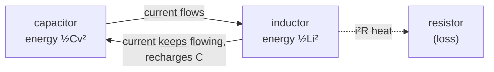
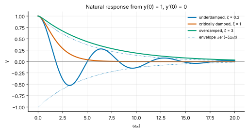
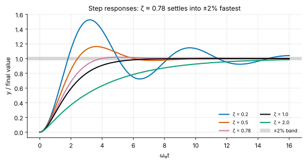
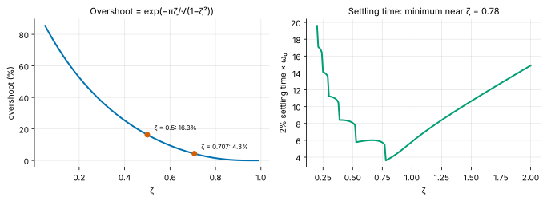
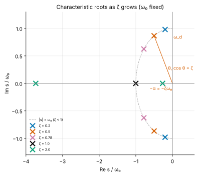
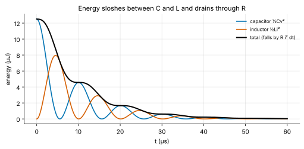
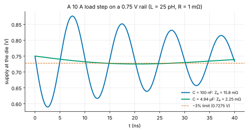

<!-- status: verified -->
# 02-03 · Second-Order Linear ODEs and the Characteristic Equation

| | |
|---|---|
| **Course** | [02 · Complex Numbers, Differential Equations and Linear Algebra](../README.md) |
| **University equivalent** | The second-order linear equations unit of a sophomore differential-equations course (MIT 18.03 Unit II; Boyce & DiPrima, chapter on second-order linear equations: constant coefficients, real, repeated and complex roots, the Wronskian), plus the natural and step responses of RLC circuits from a circuits course |
| **Prerequisites** | [02-01 Complex Numbers and Phasors](02-01-complex-numbers-euler-and-phasors.md) (Euler's formula), [02-02 First-Order Linear ODEs](02-02-first-order-linear-odes.md), [01-04 Applications of Derivatives](../../01-calculus-for-engineers/chapters/01-04-applications-of-derivatives.md) (L'Hôpital's rule) |
| **Estimated study hours** | 12 |
| **Last verified** | 2026-11-12 |

**Learning objectives.** After this chapter you can:

1. Write a second-order system (series or parallel RLC, mass–spring–damper) in the standard form $y'' + 2\alpha y' + \omega_0^2y = 0$, and identify its natural frequency $\omega_0$, neper frequency α, damping ratio ζ and quality factor $Q$.
2. Derive the characteristic equation, solve it in the overdamped, critically damped and underdamped cases, and derive the $te^{-\alpha t}$ solution of the repeated-root case.
3. Apply two initial conditions, including those that come from capacitor voltages and inductor currents, and compute the natural response.
4. Derive and use the step-response specifications: overshoot, peak time, ringing frequency and settling time, and infer ζ and $\omega_0$ from a measured response.
5. Read characteristic roots in the complex plane, and explain stability, linear independence (the Wronskian) and the energy picture of damping.
6. Estimate ringing and droop in real systems such as a chip's power-delivery network, and reason about the tradeoff between speed and overshoot.

## 1. Big picture

A first-order system has one place to store energy and can only relax. Give it a *second* store, a capacitor and an inductor, or a mass and a spring, and something new becomes possible: energy can slosh back and forth between the two, so the system can **oscillate**. Every second-order system is a contest between that sloshing and the losses that damp it, and one number, the **damping ratio** ζ, says who wins. Whether a supply rail rings when a processor wakes up, whether a control loop overshoots, how cleanly a clock edge settles and how pure a crystal oscillator's tone is are all questions about ζ. This chapter derives the mathematics once, from the characteristic equation, and shows how to read a system's behavior from two numbers.

- **Power integrity:** the inductance of a package and the capacitance on a die form an LC tank. A sudden load step makes the supply ring, and the first droop can crash a processor ([22-10](../../22-power-electronics-and-energy-conversion/chapters/22-10-datacenter-power-delivery.md), Example 02-03.5).
- **Signal integrity:** bond wires, package traces and pad capacitance ring on every fast edge ([24-01](../../24-high-speed-io-signal-integrity-and-photonics/chapters/24-01-signal-integrity-fundamentals.md)).
- **Control loops:** phase-locked loops, voltage regulators and motor drives are designed to a target overshoot and settling time, which are functions of ζ ([15-03](../../15-control-systems/chapters/15-03-time-response.md)).
- **Resonators:** quartz crystals, MEMS gyroscopes and RF filters are deliberately *under*damped, with very high $Q$ ([12-09](../../12-electronics-2/chapters/12-09-oscillators.md), [07-08](../../07-circuit-analysis-2-transient-and-ac/chapters/07-08-filters-and-resonance.md)).
- **Mechanics:** a mass on a spring with friction obeys the same equation, which is why sensors, speakers and hard-disk heads share the vocabulary ([04-01](../../04-physics-for-ee/chapters/04-01-mechanics-essentials.md)).

## 2. Intuition first

### A swing, a pendulum, an LC tank

Push a child on a swing and let go. The swing trades energy back and forth: all potential at the top of the arc, all kinetic at the bottom. Friction and air resistance skim a little off every swing, so the arcs shrink until it stops. If the swing were sitting in thick syrup instead, it would never swing back at all: it would ooze down to the bottom and stop. Between those extremes is a special amount of friction where it returns to rest as fast as possible without overshooting.

An LC circuit does the same with charge. A charged capacitor pushes current through the inductor; the inductor's current keeps flowing after the capacitor is empty (inertia) and charges it the other way; then the process reverses. Energy alternates between the capacitor's electric field ($\tfrac12Cv^2$) and the inductor's magnetic field ($\tfrac12Li^2$). A resistor plays the role of friction (Figure 6).

### Two numbers describe everything

- **How fast would it oscillate with no loss?** The **undamped natural frequency** $\omega_0 = 1/\sqrt{LC}$ (rad/s), set by the two stores alone.
- **How strong is the loss compared with the restoring tendency?** The **damping ratio** ζ. Below 1 the system rings (**underdamped**), above 1 it oozes (**overdamped**), and at exactly 1 it is **critically damped**.

Engineers also use the **quality factor** $Q = 1/(2\zeta)$: roughly, how many radians of oscillation it takes for the energy to fall by a factor $e$. A crystal has $Q$ in the millions; a well-damped regulator has $Q$ below 1.

### An analogy from finance: overshooting markets

When an asset is mispriced, arbitrage pulls it back toward fair value (the restoring "spring"). Traders who pile in late add momentum (the "mass", or inertia), and transaction costs and risk limits dissipate it (the "friction"). With strong momentum and weak friction, prices overshoot fair value and oscillate around it before settling: an underdamped market. With heavy friction they creep back slowly and never overshoot. The second-order model explains why adding momentum to a mean-reverting process creates cycles.

*Where the analogy breaks:* markets have no fixed $\omega_0$ or ζ. Their "parameters" change with participants and regimes, and the restoring force is not linear. Circuits obey the linear model accurately over wide ranges, which is why the predictions here are quantitative rather than just suggestive.

## 3. Theory

### 3.1 Where second-order equations come from

**Series RLC.** A resistor $R$, inductor $L$ and capacitor $C$ in a loop, with no source. KVL around the loop, with current $i$ and capacitor voltage $v$ (passive sign convention):

$$
L\frac{di}{dt} + Ri + v = 0, \qquad i = C\frac{dv}{dt}.
$$

Substituting the second into the first gives one equation for $v$:

$$
LC\,v'' + RC\,v' + v = 0 \quad\Longleftrightarrow\quad v'' + \frac{R}{L}v' + \frac{1}{LC}v = 0 .
$$

**Parallel RLC.** The three elements share a voltage $v$. KCL at the top node, with inductor current $i_L$:

$$
C\frac{dv}{dt} + \frac{v}{R} + i_L = 0, \qquad v = L\frac{di_L}{dt} \quad\Longrightarrow\quad v'' + \frac{1}{RC}v' + \frac{1}{LC}v = 0 .
$$

**Mass–spring–damper.** A mass $m$ on a spring of stiffness $k_s$ with viscous damping $b$ obeys Newton's law $m x'' = -k_sx - bx'$, or $x'' + (b/m)x' + (k_s/m)x = 0$. The correspondence $m \leftrightarrow L$, $b \leftrightarrow R$, $k_s \leftrightarrow 1/C$ maps it onto the series RLC.

### 3.2 The standard form and its parameters

Every case has the form

$$
y'' + 2\alpha y' + \omega_0^2\,y = 0,
$$

which defines the two parameters:

| | Series RLC | Parallel RLC | Mass–spring–damper |
|---|---|---|---|
| Neper frequency α (1/s) | $R/(2L)$ | $1/(2RC)$ | $b/(2m)$ |
| Natural frequency $\omega_0$ (rad/s) | $1/\sqrt{LC}$ | $1/\sqrt{LC}$ | $\sqrt{k_s/m}$ |
| Damping ratio $\zeta = \alpha/\omega_0$ | $\dfrac{R}{2}\sqrt{\dfrac{C}{L}}$ | $\dfrac{1}{2R}\sqrt{\dfrac{L}{C}}$ | $\dfrac{b}{2\sqrt{k_sm}}$ |

Note that resistance damps a *series* circuit when it is large, but a *parallel* circuit when it is small: a large parallel resistor barely loads the tank. The quantity $\sqrt{L/C}$, an impedance in ohms, appears in both. It is the **characteristic impedance** of the tank, and it reappears in Example 02-03.5. **Units:** $R/L$ is (V/A)/(V·s/A) = 1/s, and $1/\sqrt{LC}$ is $1/\sqrt{\text{s}^2}$ = 1/s ✓.

### 3.3 The characteristic equation

The first-order equation $y' = -y/\tau$ was solved by an exponential. Try the same here: $y = e^{st}$, with $s$ a constant to be found. Then $y' = se^{st}$ and $y'' = s^2e^{st}$, so

$$
(s^2 + 2\alpha s + \omega_0^2)\,e^{st} = 0 .
$$

Since $e^{st}$ is never zero, $s$ must satisfy the **characteristic equation**

$$
s^2 + 2\alpha s + \omega_0^2 = 0, \qquad s_{1,2} = -\alpha \pm \sqrt{\alpha^2 - \omega_0^2} = \omega_0\left(-\zeta \pm \sqrt{\zeta^2 - 1}\right).
$$

A quick way to write it down: replace $y''$ by $s^2$, $y'$ by $s$ and $y$ by 1. The equation is **linear and homogeneous**, so any combination $c_1y_1 + c_2y_2$ of solutions is a solution (superposition, as in 02-02 §3.5). A second-order equation needs **two** constants, matched to **two** initial conditions, $y(0)$ and $y'(0)$. The sign of $\zeta^2 - 1$ splits the problem into three cases.

### 3.4 Overdamped: two real roots (ζ > 1)

Both roots are real and negative, so

$$
y(t) = c_1e^{s_1t} + c_2e^{s_2t}, \qquad s_2 < s_1 < 0 .
$$

The response is a sum of two decaying exponentials, with no oscillation. The root closer to zero, $s_1$, decays more slowly and dominates the late response; its time constant $-1/s_1$ sets how long the system takes to settle. For large ζ, $s_1 \approx -\omega_0/(2\zeta)$ (Problem 02-03.4): **adding more damping makes an overdamped system slower**, because the slow root creeps toward zero.

### 3.5 Critically damped: a repeated root (ζ = 1)

Now $s_1 = s_2 = -\alpha$, and $e^{-\alpha t}$ gives only one solution. Where is the second? **Reduction of order:** look for a solution of the form $y = u(t)e^{-\alpha t}$. Then

$$
y' = (u' - \alpha u)e^{-\alpha t}, \qquad y'' = (u'' - 2\alpha u' + \alpha^2u)e^{-\alpha t}.
$$

Substituting into $y'' + 2\alpha y' + \alpha^2y = 0$ (with $\omega_0 = \alpha$):

$$
\big[u'' - 2\alpha u' + \alpha^2u + 2\alpha u' - 2\alpha^2u + \alpha^2u\big]e^{-\alpha t} = u''e^{-\alpha t} = 0 .
$$

So $u'' = 0$, and $u = c_1 + c_2t$. The general solution is

$$
y(t) = (c_1 + c_2t)\,e^{-\alpha t}.
$$

The factor $t$ is the same one you met in 01-04 (L'Hôpital, as two time constants merge) and in 02-02 (an input matching the system's own rate). It always signals a repeated root.

### 3.6 Underdamped: complex roots (0 < ζ < 1)

Now $\alpha^2 - \omega_0^2 < 0$ and the roots are a complex conjugate pair:

$$
s_{1,2} = -\alpha \pm j\omega_d, \qquad \omega_d = \sqrt{\omega_0^2 - \alpha^2} = \omega_0\sqrt{1 - \zeta^2}.
$$

$\omega_d$ is the **damped natural frequency**, the actual ringing frequency. By Euler's formula ([02-01](02-01-complex-numbers-euler-and-phasors.md)), $e^{s_1t} = e^{-\alpha t}(\cos\omega_dt + j\sin\omega_dt)$. That is a complex solution of a real equation. Because the equation has real coefficients, its real and imaginary parts are each real solutions (substitute $y = y_r + jy_i$: the real and imaginary parts of the left side must vanish separately). So

$$
y(t) = e^{-\alpha t}\big(A\cos\omega_dt + B\sin\omega_dt\big) = Me^{-\alpha t}\cos(\omega_dt - \phi),
$$

with $M = \sqrt{A^2 + B^2}$ and $\tan\phi = B/A$. The response is a sinusoid at $\omega_d$ inside a decaying **envelope** $\pm Me^{-\alpha t}$ (Figure 1). Note what each part of the root does: the **real part** $-\alpha$ sets the decay, and the **imaginary part** $\omega_d$ sets the oscillation.

*Figure 1. The same initial condition with three damping ratios. The underdamped response rings inside its exponential envelope; the critically damped one returns fastest without crossing zero; the overdamped one creeps.*

**Undamped (ζ = 0).** With no loss, $\alpha = 0$ and the solution $A\cos\omega_0t + B\sin\omega_0t$ oscillates forever: an ideal LC tank or frictionless pendulum.

### 3.7 Initial conditions

A second-order problem needs $y(0)$ and $y'(0)$. In circuits the given quantities are usually the capacitor voltages and inductor currents, which are continuous across switching (02-02, 01-02). Convert them into the two conditions the equation needs:

- **Series RLC, solving for $v_C$:** $v_C(0)$ is given, and $v_C'(0) = i_C(0)/C = i_L(0)/C$, because the same current flows through every element.
- **Parallel RLC, solving for $v$:** $v(0)$ is given, and from KCL, $v'(0) = -\big(v(0)/R + i_L(0)\big)/C$.

Then solve two linear equations for the two constants. For the underdamped form, $y(0) = A$ and $y'(0) = -\alpha A + \omega_dB$, so

$$
A = y(0), \qquad B = \frac{y'(0) + \alpha y(0)}{\omega_d}.
$$

### 3.8 The step response and its specifications

Apply a constant input $X$ at $t = 0$, starting from rest: $y'' + 2\alpha y' + \omega_0^2y = \omega_0^2X$. A constant particular solution, $y_p = X$, is the final value, so $y = X + y_h$ and the initial conditions $y(0) = 0$, $y'(0) = 0$ fix the homogeneous part. For the underdamped case,

$$
y(t) = X\left[1 - e^{-\alpha t}\left(\cos\omega_dt + \frac{\alpha}{\omega_d}\sin\omega_dt\right)\right],
$$

and for the critically damped case, $y(t) = X\big[1 - (1 + \omega_0t)e^{-\omega_0t}\big]$ (Problem 02-03.6). Four numbers summarize the underdamped response (Figure 3).

**Peak time.** Differentiate: $y'(t) = X\dfrac{\omega_0^2}{\omega_d}e^{-\alpha t}\sin\omega_dt$ (Problem 02-03.7). It first returns to zero at $t_p = \pi/\omega_d$.

**Overshoot.** Substitute $t_p$: $\cos\pi = -1$ and $\sin\pi = 0$, so $y(t_p) = X\big(1 + e^{-\alpha\pi/\omega_d}\big)$. The fractional overshoot is

$$
\text{OS} = e^{-\alpha\pi/\omega_d} = \exp\!\left(\frac{-\pi\zeta}{\sqrt{1 - \zeta^2}}\right).
$$

It depends *only* on ζ: 16.3% at ζ = 0.5, 4.3% at ζ = 0.707 (Figure 4).

**Settling time.** The envelope falls to a fraction ε of the step in about $\ln(1/\varepsilon)/\alpha$; for a ±2% band that is about $4/(\zeta\omega_0)$, the common rule of thumb, accurate for small ζ.

**Ringing frequency.** $\omega_d$, from the spacing of successive peaks, $2\pi/\omega_d$.

Inverting the overshoot formula gives ζ from a measured overshoot: $\zeta = \dfrac{-\ln\text{OS}}{\sqrt{\pi^2 + \ln^2\text{OS}}}$. Engineers use this constantly to diagnose a loop from a scope trace (Example 02-03.4).

*Figure 3. Lightly damped responses ring for a long time. Heavily damped ones creep. The fastest entry into the ±2% band comes from a slight overshoot (ζ ≈ 0.78), not from critical damping (Example 02-03.3).*

*Figure 4. Left: overshoot depends only on ζ. Right: 2% settling time is minimized near ζ = 0.78; its jagged left side reflects successive ring peaks leaving the band.*

### 3.9 The roots in the complex plane

Plotting $s_1$ and $s_2$ (Figure 2) turns the three cases into geometry. For ζ < 1 the roots lie on a circle of radius $\omega_0$ (since $\alpha^2 + \omega_d^2 = \omega_0^2$), at an angle θ from the negative real axis with $\cos\theta = \zeta$. As ζ increases from 0, the pair slides around the circle from the imaginary axis to $-\omega_0$, meets there at ζ = 1, and then splits along the real axis, one root heading toward zero and the other toward $-\infty$.

*Figure 2. Roots move around a circle of radius ω₀ as ζ grows, meet at −ω₀ when ζ = 1, then split along the real axis.*

**Stability.** Every term $e^{st}$ decays if and only if $\operatorname{Re}s < 0$: **all roots in the left half-plane** means stable. Roots on the imaginary axis give undying oscillation, and roots in the right half-plane give growth. This is the circuit designer's and control engineer's central picture ([15-05](../../15-control-systems/chapters/15-05-stability-routh-hurwitz.md)). An oscillator is built precisely by pushing a pair of roots onto, or just past, the imaginary axis with an active circuit that supplies a *negative* resistance ([12-09](../../12-electronics-2/chapters/12-09-oscillators.md)).

### 3.10 Linear independence, the Wronskian, and uniqueness

Why are two solutions, and two constants, always enough? For $y'' + p(t)y' + q(t)y = 0$ with $p$ and $q$ continuous on an interval, the existence and uniqueness theorem (the second-order analogue of 02-02 §3.7) says that $y(t_0)$ and $y'(t_0)$ determine exactly one solution. So the solution set is two-dimensional: if $y_1$ and $y_2$ are solutions, $c_1y_1 + c_2y_2$ can match any pair of initial values exactly when the system

$$
\begin{pmatrix}y_1(t_0) & y_2(t_0)\\ y_1'(t_0) & y_2'(t_0)\end{pmatrix}\begin{pmatrix}c_1\\ c_2\end{pmatrix} = \begin{pmatrix}y(t_0)\\ y'(t_0)\end{pmatrix}
$$

can be solved, that is when the **Wronskian** $W = y_1y_2' - y_1'y_2$ is nonzero. For the two exponentials of the overdamped case, $W = (s_2 - s_1)e^{(s_1 + s_2)t} \ne 0$ because the roots differ. For the repeated root, $W\big(e^{-\alpha t}, te^{-\alpha t}\big) = e^{-2\alpha t} \ne 0$, which confirms that $te^{-\alpha t}$ is genuinely new (Problem 02-03.10). [02-07](02-07-determinants-inverses-and-vector-spaces.md) generalizes this to determinants and linear independence.

### 3.11 The energy picture: why damping drains, and what Q means

For the series RLC, the stored energy is $w = \tfrac12Li^2 + \tfrac12Cv^2$. Differentiate and use the circuit equations ($Li' = -Ri - v$ and $Cv' = i$):

$$
\frac{dw}{dt} = Lii' + Cvv' = i(-Ri - v) + vi = -Ri^2 \le 0 .
$$

Energy only ever drains, through the resistor, so with $R > 0$ every natural response decays: a physical proof of stability that needs no algebra. With $R = 0$ the energy is constant and the tank rings forever (Figure 6).

*Figure 6. Energy alternates between the capacitor and the inductor, and the total falls in steps whenever current flows through the resistor.*

**Quality factor.** For light damping, the energy decays as $e^{-2\alpha t}$, so in one radian of oscillation ($t = 1/\omega_0$) it loses a fraction of about $2\alpha/\omega_0 = 2\zeta = 1/Q$. Hence

$$
Q = \frac{1}{2\zeta} = \omega_0\,\frac{\text{energy stored}}{\text{power dissipated}},
$$

and the amplitude falls by a factor $e$ in $Q/\pi$ cycles. For the series RLC, $Q = \omega_0L/R = \dfrac{1}{R}\sqrt{\dfrac{L}{C}}$. [02-04](02-04-forced-response-and-resonance.md) shows that the same $Q$ sets the sharpness of resonance in the frequency domain.

## 4. Worked examples

### Example 02-03.1 — Classifying a series RLC (tier A)

**Setup.** A series RLC has $L = 10$ µH and $C = 1$ µF. Find $\omega_0$ and $f_0$, the resistance for critical damping, and ζ for $R$ = 1 Ω, the critical value and 20 Ω. For 20 Ω, find the two roots and the slow time constant.

**Solution.** $\omega_0 = 1/\sqrt{10^{-5}\times10^{-6}} = 1/\sqrt{10^{-11}} = $ **316.2 krad/s**, so $f_0 = \omega_0/2\pi = $ **50.33 kHz**. Critical damping needs ζ = 1, so $R = 2\sqrt{L/C} = 2\sqrt{10} = $ **6.325 Ω**. Then $\zeta = \frac{R}{2}\sqrt{C/L} = R/6.325$:

- 1 Ω: ζ = **0.1581**, underdamped;
- 6.325 Ω: ζ = **1**, critically damped;
- 20 Ω: ζ = **3.162**, overdamped.

For 20 Ω, α = $R/2L = 10^6$ s⁻¹ and $s_{1,2} = -10^6 \pm\sqrt{10^{12} - 10^{11}}$, giving $s_1 = $ **−51.32 krad/s** and $s_2 = $ **−1949 krad/s**. The slow time constant is $-1/s_1 = $ **19.49 µs**.

**Units check.** $\sqrt{\text{H/F}} = \sqrt{\Omega^2} = \Omega$ ✓. **Sanity check.** $s_1s_2 = \omega_0^2 = 10^{11}$ and $s_1 + s_2 = -2\alpha = -2\times10^6$ (the product and sum of the roots of a quadratic) ✓. Compare $s_1 \approx -\omega_0/(2\zeta) = -50.0$ krad/s, close to the exact −51.32.

### Example 02-03.2 — An underdamped ring-down (tier B)

**Setup.** The same circuit with $R = 1$ Ω starts with $v_C(0) = 5$ V and $i(0) = 0$. Find $v_C(t)$, its first negative peak, the quality factor, and how long the envelope takes to fall to 1%.

**Solution.** α = $R/2L = $ **5.000×10⁴ s⁻¹** and $\omega_d = \sqrt{\omega_0^2 - \alpha^2} = \sqrt{10^{11} - 2.5\times10^9} = $ **312.2 krad/s** ($f_d = $ **49.70 kHz**, just below $f_0$). The initial conditions are $v_C(0) = 5$ V and $v_C'(0) = i(0)/C = 0$. By §3.7, $A = 5$ V and $B = \alpha A/\omega_d = $ **0.8006 V**:

$$
v_C(t) = e^{-\alpha t}\big(5\cos\omega_dt + 0.8006\sin\omega_dt\big)\text{ V}.
$$

At $t = \pi/\omega_d = $ **10.06 µs**, $v_C = -5e^{-\alpha\pi/\omega_d} = $ **−3.023 V**: the charge has swung to the other plate, having lost $1 - (3.023/5)^2 = 63\%$ of its energy in half a cycle. $Q = 1/(2\zeta) = $ **3.162**. The envelope reaches 1% after $\ln100/\alpha = $ **92.10 µs**, about **4.58** cycles.

**Units check.** $\alpha/\omega_d$ is dimensionless, so $B$ is in volts ✓. **Sanity check.** Each full cycle keeps $e^{-2\alpha(2\pi/\omega_d)} = $ **13.37%** of the energy, and the amplitude falls by $e$ in $Q/\pi \approx 1$ cycle, consistent with a low-$Q$ tank ✓.

### Example 02-03.3 — Is critical damping the fastest? (tier B)

**Setup.** A designer wants a step response to settle within ±2% of its final value as fast as possible. Compare the 2% settling time of the critically damped response with that of the ζ for which the overshoot is exactly 2%.

**Solution.** *Critical damping.* $y = 1 - (1 + x)e^{-x}$ with $x = \omega_0t$ rises monotonically, so it settles when $(1 + x)e^{-x} = 0.02$. Solving numerically (bisection or Newton) gives $x = $ **5.834**: $t_s = 5.834/\omega_0$.

*Slightly underdamped.* Set the overshoot to 2%: $\pi\zeta/\sqrt{1 - \zeta^2} = \ln50 = 3.912$. Squaring, $\pi^2\zeta^2 = 15.30(1 - \zeta^2)$, so $\zeta^2 = 15.30/(\pi^2 + 15.30) = 0.6079$ and ζ = **0.7797**. The peak then just touches the top of the band, so the response settles the first time it rises through 98%. Solving $y(t) = 0.98$ numerically gives $\omega_0t_s = $ **3.602**.

The slightly underdamped design settles **1.62×** faster than the critically damped one (Figure 3).

**Sanity check.** The rule of thumb $4/(\zeta\omega_0) = 5.13/\omega_0$ is pessimistic here, because the rule assumes the slowly decaying envelope sets settling, while at ζ ≈ 0.78 the response never leaves the band after entering it ✓. **The lesson:** "critically damped" is a boundary, not an optimum. Control and regulator designers usually aim for ζ between about 0.5 and 0.8.

### Example 02-03.4 — Diagnosing a loop from a scope trace (tier B)

**Setup.** A voltage regulator's response to a load step overshoots by 25%, with the first peak 2 µs after the step. Estimate ζ, $\omega_0$ and $Q$, and say whether the design is healthy.

**Solution.** With OS = 0.25, $\ln\text{OS} = -1.386$, so

$$
\zeta = \frac{1.386}{\sqrt{\pi^2 + 1.386^2}} = \frac{1.386}{3.434} = 0.4037 .
$$

The peak time gives $\omega_d = \pi/t_p = \pi/(2\text{ µs}) = $ **1.571 Mrad/s**, and $\omega_0 = \omega_d/\sqrt{1 - \zeta^2} = $ **1.717 Mrad/s** ($f_0 = $ **273.3 kHz**). $Q = 1/(2\zeta) = $ **1.239**.

**Interpretation.** ζ ≈ 0.4 is lightly damped for a regulator: the loop's phase margin is low, roughly 40° by the common rule ζ ≈ PM/100 that [15](../../15-control-systems/README.md) derives. A design review would ask for more compensation, accepting a slightly slower response for less ringing.

**Units check.** ζ is dimensionless; rad/µs = Mrad/s ✓. **Sanity check.** Overshoot $\exp(-\pi\times0.4037/0.9149) = 0.250$ ✓.

### Example 02-03.5 — Supply droop on a processor (tier C)

**Setup.** A processor's 0.75 V rail is fed through package and board inductance $L = 25$ pH and resistance $R = 1$ mΩ, with $C = 100$ nF of on-die decoupling capacitance at the die (illustrative values). At $t = 0$ the load current steps from 0 to $\Delta I = 10$ A. (a) Find $f_0$, the characteristic impedance $Z_0 = \sqrt{L/C}$, ζ and $Q$. (b) Find the die voltage $v(t)$ and its worst droop. (c) The design allows ±3% ripple. Find the *target impedance* $Z_t = 0.03\,V_{DD}/\Delta I$ and the capacitance that would make $Z_0 = Z_t$.

**Solution.** (a) $\omega_0 = 1/\sqrt{25\times10^{-12}\times10^{-7}} = 6.325\times10^8$ rad/s, so $f_0 = $ **100.7 MHz**. $Z_0 = \sqrt{25\times10^{-12}/10^{-7}} = $ **15.81 mΩ**. $\zeta = \frac{R}{2}\sqrt{C/L} = R/(2Z_0) = $ **0.03162**, and $Q = $ **15.81**: a very lightly damped tank.

(b) KCL at the die: the inductor carries $i_L$, the capacitor $Cv'$ and the load $\Delta I$, so $i_L = Cv' + \Delta I$. KVL along the supply path: $L\,i_L' + Ri_L + v = V_{DD}$. Substituting the first into the second, for $t > 0$:

$$
LCv'' + RCv' + v = V_{DD} - R\Delta I .
$$

The final value is $V_{DD} - R\Delta I = 0.74$ V. Just after the step the capacitor voltage is still 0.75 V, and since the inductor current cannot jump, the capacitor alone supplies the load: $v'(0^+) = -\Delta I/C$. With $A = R\Delta I$ and $B = (-\Delta I/C + \alpha R\Delta I)/\omega_d$ (§3.7),

$$
v(t) = 0.74 + e^{-\alpha t}\big(A\cos\omega_dt + B\sin\omega_dt\big)\text{ V}.
$$

Minimizing numerically, the worst droop is **160.3 mV** at **2.535 ns**, which is **21.37%** of the rail (Figure 5). For light damping the droop is close to $\Delta I\,Z_0 = $ **158.1 mV**: the capacitor, starved of charge while the inductor's current ramps up, sags by about $\Delta I/(C\omega_0) = \Delta I\sqrt{L/C}$.

(c) $Z_t = 0.03\times0.75/10 = $ **2.25 mΩ**. Making $Z_0 = Z_t$ at the same inductance needs $C = L/Z_t^2 = $ **4.938 µF**, about **49.4×** more capacitance. With it, the worst droop falls to **24.95 mV** (Figure 5), still slightly beyond the 22.5 mV budget because the 10 mV resistive drop adds to it. Real designs also lower $L$ (more power bumps, capacitors closer to the die) and add damping through the capacitors' own series resistance.

*Figure 5. With 100 nF the rail rings at 101 MHz and droops 160 mV. With 4.94 µF the characteristic impedance matches the 2.25 mΩ target and the droop is about 25 mV.*

**Units check.** $\Delta I\cdot Z_0$: A × Ω = V ✓. **Sanity check.** $\pi/(2\omega_d) = 2.48$ ns, close to the 2.535 ns of the minimum: for light damping the worst droop arrives about a quarter period after the step ✓.

<!-- answer-key -->
| ID | Quantity | Value | Unit |
|---|---|---|---|
| Ex 02-03.1a | natural frequency ω0 | 316.2 | krad/s |
| Ex 02-03.1b | f0 | 50.33 | kHz |
| Ex 02-03.1c | critical resistance | 6.325 | Ω |
| Ex 02-03.1d | ζ at 1 Ω | 0.1581 | — |
| Ex 02-03.1e | ζ at 20 Ω | 3.162 | — |
| Ex 02-03.1f | slow root at 20 Ω | −51.32 | krad/s |
| Ex 02-03.1g | fast root at 20 Ω | −1949 | krad/s |
| Ex 02-03.1h | slow time constant | 19.49 | µs |
| Ex 02-03.1i | large-ζ approximation of the slow root | −50.0 | krad/s |
| Ex 02-03.2a | neper frequency α | 5.000×10^4 | 1/s |
| Ex 02-03.2b | damped frequency ωd | 312.2 | krad/s |
| Ex 02-03.2c | fd | 49.70 | kHz |
| Ex 02-03.2d | sine coefficient B | 0.8006 | V |
| Ex 02-03.2e | time of first negative peak | 10.06 | µs |
| Ex 02-03.2f | first negative peak | −3.023 | V |
| Ex 02-03.2g | energy lost in half a cycle | 63 | % |
| Ex 02-03.2h | quality factor | 3.162 | — |
| Ex 02-03.2i | envelope to 1 % | 92.10 | µs |
| Ex 02-03.2j | cycles to 1 % | 4.58 | — |
| Ex 02-03.2k | energy kept per cycle | 13.37 | % |
| Ex 02-03.3a | critical 2 % settling, ω0·ts | 5.834 | — |
| Ex 02-03.3b | ln 50 | 3.912 | — |
| Ex 02-03.3c | ζ for 2 % overshoot | 0.7797 | — |
| Ex 02-03.3d | its 2 % settling, ω0·ts | 3.602 | — |
| Ex 02-03.3e | speed-up | 1.62 | — |
| Ex 02-03.3f | rule-of-thumb 4/ζ at ζ = 0.78 | 5.13 | — |
| Ex 02-03.4a | ζ from 25 % overshoot | 0.4037 | — |
| Ex 02-03.4b | ωd | 1.571 | Mrad/s |
| Ex 02-03.4c | ω0 | 1.717 | Mrad/s |
| Ex 02-03.4d | f0 | 273.3 | kHz |
| Ex 02-03.4e | Q | 1.239 | — |
| Ex 02-03.5a | f0 | 100.7 | MHz |
| Ex 02-03.5b | characteristic impedance | 15.81 | mΩ |
| Ex 02-03.5c | ζ | 0.03162 | — |
| Ex 02-03.5d | Q | 15.81 | — |
| Ex 02-03.5e | worst droop | 160.3 | mV |
| Ex 02-03.5f | time of worst droop | 2.535 | ns |
| Ex 02-03.5g | droop as % of the rail | 21.37 | % |
| Ex 02-03.5h | ΔI·Z0 | 158.1 | mV |
| Ex 02-03.5i | target impedance | 2.25 | mΩ |
| Ex 02-03.5j | capacitance for Z0 = Zt | 4.938 | µF |
| Ex 02-03.5k | capacitance ratio | 49.4 | — |
| Ex 02-03.5l | droop with 4.938 µF | 24.95 | mV |
| Ex 02-03.5m | quarter period π/(2ωd) | 2.48 | ns |
| Ex 02-03.5n | ω0 | 6.325×10^8 | rad/s |
| Ex 02-03.5o | droop budget, 3 % of 0.75 V | 22.5 | mV |
| C 02-03.1 | concept check 1: ζ | 0.0632 | — |
| C 02-03.2 | concept check 1: critical R | 63.2 | Ω |
| C 02-03.3 | concept check 7: √(L/C) | 15.8 | mΩ |
| C 02-03.4 | concept check 7: droop | 0.316 | V |
| Q 02-03.a | Q·f limit for AT/SC quartz (f in MHz) | 1.6×10^7 | — |

*Recomputed by [verify_02_03.py](../verify/verify_02_03.py). Examples 02-03.2 and 02-03.5 are also confirmed in ngspice in the lab.*

## 5. Simulate it

The lab ([labs/02-03-lab/](../labs/02-03-lab/README.md)) has a notebook and two ngspice netlists:

1. **Roots and responses.** Sweep ζ, plot the roots in the complex plane and the matching natural responses. *Predict first:* for ζ = 0.1, how many visible cycles before the ring-down is below 5%?
2. **Specifications.** Measure overshoot, peak time and 2% settling time from simulated step responses and compare with the formulas of §3.8. *Predict first:* which ζ minimizes 2% settling?
3. **Energy.** Track $\tfrac12Cv^2 + \tfrac12Li^2$ and confirm that it falls at the rate $Ri^2$.
4. **The PDN design space.** Sweep $C$ and $L$ in Example 02-03.5 and map the worst droop. *Predict first:* does doubling $C$ or halving $L$ cut the droop more?
5. **ngspice, `rlc_natural.cir`.** The ring-down of Example 02-03.2: confirm the −3.023 V first negative peak at 10.06 µs.
6. **ngspice, `pdn_droop.cir`.** The load step of Example 02-03.5: confirm the 160.3 mV droop.

## 6. Engineering tradeoffs

| Knob | Improves | Costs | Typical decision owner |
|---|---|---|---|
| More damping (larger series R, or ESR in decoupling capacitors) | Less overshoot and ringing | Slower response once ζ > 1; resistive loss and DC drop | Circuit / power-integrity designer |
| Less damping (higher Q) | Selectivity, low phase noise in oscillators, low loss | Long ring-down, sensitivity to disturbances | RF / oscillator designer |
| More decoupling capacitance | Lower $\sqrt{L/C}$, so smaller droop; lower resonance | Die area (on-die), board area and cost (off-die), leakage | Power-integrity and package architects |
| Less loop inductance (more bumps, closer capacitors, backside power) | Smaller droop, higher resonance | Package and process cost | Package / technology architects |
| Target ζ ≈ 0.5–0.8 in a control loop | Fast settling with modest overshoot | Requires compensation design and margin | Control / mixed-signal designer |

## 7. Numbers to know

| Quantity | Value | Note |
|---|---|---|
| Overshoot at ζ = 0.3 / 0.5 / 0.707 | 37.2% / 16.3% / 4.3% | Depends only on ζ |
| ζ giving 2% overshoot | 0.78 | Fastest ±2% settling, $3.60/\omega_0$ |
| Critically damped 2% settling | $5.83/\omega_0$ | Not the fastest |
| Quality factor | $Q = 1/(2\zeta)$ | Series RLC: $Q = \omega_0L/R$ |
| Ring-down by a factor $e$ | $Q/\pi$ cycles | Energy loses $2\pi/Q$ per cycle |
| Series RLC critical resistance | $2\sqrt{L/C}$ | Twice the characteristic impedance |
| First droop after a load step | $\approx \Delta I\sqrt{L/C}$ | Light damping |
| PDN target impedance | $V_{DD}\times$ripple / $\Delta I$ | Smith et al. 1999 ([R-032](../../../reference/research-log.md#r-032--pdn-target-impedance-method)) |
| High-stability 5 MHz quartz crystal Q | about 2–3 million | Vig tutorial, as of Nov 2026 ([R-033](../../../reference/research-log.md#r-033--quartz-crystal-resonator-q)) |

<!-- answer-key -->
| ID | Quantity | Value | Unit |
|---|---|---|---|
| N 02-03.a | overshoot at ζ = 0.3 | 37.2 | % |
| N 02-03.b | overshoot at ζ = 0.5 | 16.3 | % |
| N 02-03.c | overshoot at ζ = 0.707 | 4.3 | % |
| N 02-03.d | ζ for 2 % overshoot | 0.78 | — |
| N 02-03.e | fastest 2 % settling, ω0·ts | 3.60 | — |
| N 02-03.f | critical 2 % settling, ω0·ts | 5.83 | — |

## 8. Common mistakes

1. **Using only one initial condition.** A second-order equation has two constants; you need both $y(0)$ and $y'(0)$. Derive $y'(0)$ from the inductor current or capacitor voltage, not by guessing.
2. **Confusing $\omega_0$ and $\omega_d$.** The ringing you see on a scope is at $\omega_d = \omega_0\sqrt{1 - \zeta^2}$, slightly below $\omega_0$.
3. **Forgetting the $t$ in the repeated-root case.** $c_1e^{-\alpha t} + c_2e^{-\alpha t}$ is only one solution in disguise.
4. **Mixing up series and parallel damping.** Large $R$ damps a series RLC but *un*-damps a parallel one.
5. **Assuming more damping is always better.** Beyond ζ = 1, more damping makes the response slower, not safer.
6. **Taking the complex solution as the answer.** For real circuits combine the conjugate pair into $e^{-\alpha t}(A\cos\omega_dt + B\sin\omega_dt)$ with real $A$ and $B$.
7. **Using the settling-time rule of thumb near ζ = 1.** $4/(\zeta\omega_0)$ assumes a slowly decaying envelope; it fails for heavily damped or overdamped responses.

## 9. Practitioner lens

### State of the art (as of Nov 2026)

- **Power delivery is designed to a target impedance.** Smith and colleagues at Sun Microsystems formalized the method in 1999: compute the impedance the power-delivery network may present, $Z_{target} = V_{DD}\times\text{allowed ripple}/\Delta I$, and choose regulators and capacitors so that the network's impedance stays below it across frequency ([R-032](../../../reference/research-log.md#r-032--pdn-target-impedance-method)) **[Established]**. The LC resonance of package inductance with on-die capacitance, in the tens to hundreds of megahertz, is where the impedance peaks and where the first droop of Example 02-03.5 comes from **[Established]**.
- **The currents are now enormous.** An AI accelerator rated around 1,000 W ([R-026](../../../reference/research-log.md#r-026--ai-accelerator-power-ratings)) at a core voltage below 1 V draws over a thousand amperes, so its target impedance is a small fraction of a milliohm. That is why the industry is moving power delivery closer to the die, with integrated voltage regulators and backside power delivery ([22-10](../../22-power-electronics-and-energy-conversion/chapters/22-10-datacenter-power-delivery.md)) **[Industry estimate: the current follows from the power and voltage; individual products differ]**.
- **Resonators exploit very high Q.** A high-stability 5 MHz quartz crystal reaches a $Q$ of about 2–3 million, and for AT- and SC-cut quartz the product $Q\times f$ is limited to about $1.6\times10^7$ with $f$ in MHz ([R-033](../../../reference/research-log.md#r-033--quartz-crystal-resonator-q)) **[Established]**. In the language of this chapter, ζ is below $10^{-6}$, so a crystal rings for hundreds of thousands of cycles after a kick.

### Why it matters commercially

Second-order dynamics set real product limits. A processor's maximum frequency is often set by the worst supply droop, not the average voltage, so a better power-delivery network converts directly into performance or lower power through smaller voltage margins. Regulator and PLL vendors compete on transient response, which is overshoot and settling. Timing products (crystals, MEMS oscillators) compete on $Q$ and stability.

### Marketing vs Reality

- **"Our regulator has the fastest transient response."** *Reality:* speed and overshoot trade off through ζ. Ask for the overshoot, settling time and test conditions (load step size, slew rate, output capacitance) together; a fast but ringing response can be worse.
- **"Low droop thanks to our package."** *Reality:* the droop is roughly $\Delta I\sqrt{L/C}$ and depends on the load step and the on-die capacitance as much as on the package. Ask for the power-delivery impedance profile across frequency against the target, not a single number.
- **"Critically damped for the best response."** *Reality:* critical damping is not the fastest to settle (Example 02-03.3). Ask what settling band and ζ the design targets, and why.

### Questions to ask engineering leaders

1. **"What is your PDN target impedance, and where does the measured impedance peak?"**
   - *Strong:* gives the target, the resonance frequencies and peak values, the worst-case load step used, and correlation between simulation and silicon droop measurements.
   - *Evasive:* "We added plenty of decoupling capacitors."
2. **"What is the worst first droop on the core rail, and how much frequency or voltage margin does it cost?"**
   - *Strong:* quotes droop in millivolts under a defined workload, and mitigations such as adaptive clocking or droop detectors.
   - *Evasive:* quotes only the average IR drop.
3. **"What damping ratio or phase margin do your control loops target, and how do they vary across process, voltage and temperature?"**
   - *Strong:* a target with margin, verified at corners, and measured step responses.
   - *Evasive:* "It's stable in simulation."
4. **"How do you measure and guarantee oscillator Q and startup?"**
   - *Strong:* explains the tradeoff between high Q (low noise) and slow startup, and has data on startup margin at temperature extremes.
   - *Evasive:* treats the crystal as a commodity.

## 10. Concept check

1. A series RLC has $R = 4$ Ω, $L = 1$ mH and $C = 1$ µF. Is it underdamped, critically damped or overdamped?

   

Answer

   $\zeta = \frac{R}{2}\sqrt{C/L} = 2\sqrt{10^{-3}} = 0.0632$: underdamped (critical needs $2\sqrt{L/C} = 63.2$ Ω).

   

2. Why is $te^{-\alpha t}$ a solution only in the critically damped case?

   

Answer

   Substituting $y = ue^{-\alpha t}$ gives $u'' = 0$ only when $\omega_0 = \alpha$, that is, when the characteristic equation has a double root. Otherwise $te^{-\alpha t}$ leaves a nonzero residual.

   

3. What do the real and imaginary parts of the characteristic roots tell you?

   

Answer

   The real part $-\alpha$ sets the decay rate of the envelope; the imaginary part $\pm\omega_d$ sets the ringing frequency.

   

4. A step response overshoots by 4.3%. Estimate ζ.

   

Answer

   About 0.707: that is the textbook value whose overshoot is 4.3%.

   

5. Does adding a larger parallel resistor to a parallel RLC increase or decrease ringing?

   

Answer

   It increases ringing: in a parallel RLC, $\zeta = \frac{1}{2R}\sqrt{L/C}$ falls as $R$ grows, because a large resistor barely loads the tank.

   

6. Why does every natural response of a passive RLC decay?

   

Answer

   The stored energy obeys $dw/dt = -Ri^2 \le 0$, so it can only drain; with $R > 0$ it drains to zero.

   

7. A rail has $L = 50$ pH and $C = 200$ nF and sees a 20 A load step. Estimate the first droop.

   

Answer

   $\Delta I\sqrt{L/C} = 20\sqrt{50\times10^{-12}/200\times10^{-9}} = 20\times15.8\text{ mΩ} = 0.316$ V, a huge droop that the design must fix.

   

**Problem set:** [02-03 problems](../problems/02-03-problems.md) · [solutions](../solutions/02-03-solutions.md)

## 11. Key terms

[Characteristic equation](../../../reference/glossary.md#characteristic-equation) ·
[Natural frequency](../../../reference/glossary.md#natural-frequency) ·
[Neper frequency](../../../reference/glossary.md#neper-frequency) ·
[Damping ratio](../../../reference/glossary.md#damping-ratio) ·
[Quality factor](../../../reference/glossary.md#quality-factor) ·
[Underdamped](../../../reference/glossary.md#underdamped) ·
[Critically damped](../../../reference/glossary.md#critically-damped) ·
[Overdamped](../../../reference/glossary.md#overdamped) ·
[Damped natural frequency](../../../reference/glossary.md#damped-natural-frequency) ·
[Reduction of order](../../../reference/glossary.md#reduction-of-order) ·
[Wronskian](../../../reference/glossary.md#wronskian) ·
[Overshoot](../../../reference/glossary.md#overshoot) ·
[Settling time](../../../reference/glossary.md#settling-time) ·
[Characteristic impedance](../../../reference/glossary.md#characteristic-impedance) ·
[Target impedance](../../../reference/glossary.md#target-impedance) ·
[Power delivery network](../../../reference/glossary.md#power-delivery-network)

## 12. Connections

- **Previous:** [02-02 First-Order Linear ODEs](02-02-first-order-linear-odes.md) (one storage element); [02-01](02-01-complex-numbers-euler-and-phasors.md) (Euler's formula turns complex roots into real oscillations).
- **Next:** [02-04 Forced Response and Resonance](02-04-forced-response-and-resonance.md) drives these systems with sinusoids and finds that $Q$ also sets the sharpness of resonance.
- **Used in:**
  - [02-05 Laplace Transform](02-05-laplace-transform-for-odes.md), where the characteristic polynomial becomes the denominator of a transfer function;
  - [02-09 Systems of ODEs](02-09-systems-of-odes-and-matrix-exponential.md), where the roots become eigenvalues;
  - [07-03 Second-Order RLC Transients](../../07-circuit-analysis-2-transient-and-ac/chapters/07-03-second-order-rlc-transients.md) (circuit applications in depth);
  - [15-03 Time Response](../../15-control-systems/chapters/15-03-time-response.md) and [15-05 Stability](../../15-control-systems/chapters/15-05-stability-routh-hurwitz.md);
  - [12-09 Oscillators](../../12-electronics-2/chapters/12-09-oscillators.md) and [22-10 Datacenter Power Delivery](../../22-power-electronics-and-energy-conversion/chapters/22-10-datacenter-power-delivery.md).

## 13. Further study

- Boyce & DiPrima, *Elementary Differential Equations and Boundary Value Problems*, chapter 3 (second-order linear equations: constant coefficients, complex and repeated roots, the Wronskian, mechanical and electrical vibrations).
- MIT OCW 18.03SC *Differential Equations*, Unit II (second-order constant-coefficient linear equations, damped oscillators).
- Strang, *Differential Equations and Linear Algebra*, chapter 2 (second-order equations, with the damping and frequency viewpoint used here).
- Alexander & Sadiku, *Fundamentals of Electric Circuits*, chapter on second-order circuits (series and parallel RLC natural and step responses).

## 14. Sources

1. Boyce, W. E., DiPrima, R. C. and Meade, D. B., *Elementary Differential Equations and Boundary Value Problems*, Wiley: characteristic equations, reduction of order and the Wronskian.
2. MIT OpenCourseWare, 18.03SC *Differential Equations*, Unit II: Second-Order Constant-Coefficient Linear Equations.
3. Smith, L. D., Anderson, R. E., Forehand, D. W., Pelc, T. J. and Roy, T., "Power distribution system design methodology and capacitor selection for modern CMOS technology," *IEEE Transactions on Advanced Packaging*, vol. 22, no. 3, pp. 284–291, Aug. 1999. [R-032]
4. Vig, J. R., *Quartz Crystal Resonators and Oscillators for Frequency Control and Timing Applications — A Tutorial*. [R-033]
5. Research log [R-026](../../../reference/research-log.md#r-026--ai-accelerator-power-ratings): AI accelerator power ratings.
