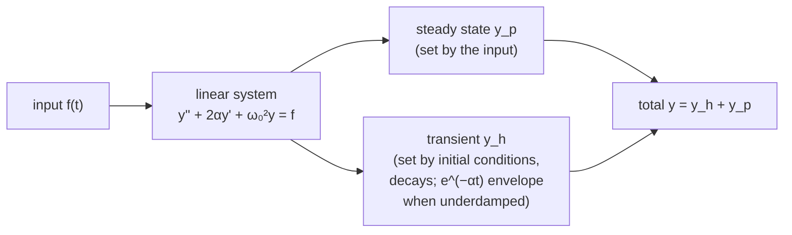
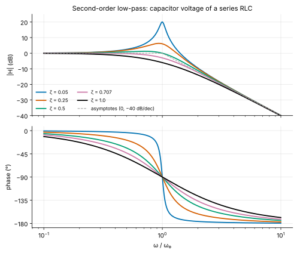
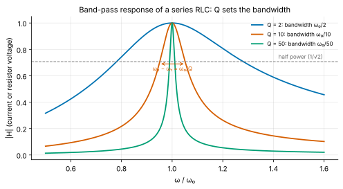
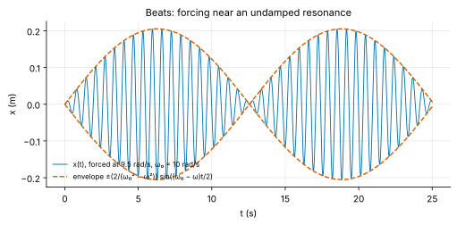
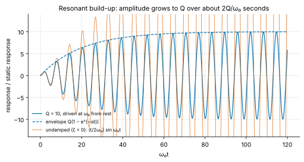
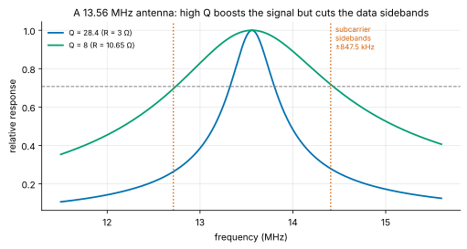

<!-- status: reviewed -->
# 02-04 · Forced Response and Resonance

| | |
|---|---|
| **Course** | [02 · Complex Numbers, Differential Equations and Linear Algebra](../README.md) |
| **University equivalent** | The forced-oscillation unit of a sophomore differential-equations course (MIT 18.03 Unit II: nonhomogeneous equations, undetermined coefficients, the exponential response formula, frequency response, resonance; Boyce & DiPrima, sections on nonhomogeneous equations, variation of parameters and forced vibrations), plus the resonance and bandwidth material of a circuits course |
| **Prerequisites** | [02-01 Complex Numbers and Phasors](02-01-complex-numbers-euler-and-phasors.md), [02-03 Second-Order Linear ODEs](02-03-second-order-linear-odes.md) |
| **Estimated study hours** | 10 |
| **Last verified** | 2026-11-17 |

**Learning objectives.** After this chapter you can:

1. Write the general solution of a forced linear equation as a homogeneous plus a particular solution, superpose responses to several inputs, and separate transient from steady state.
2. Find particular solutions by undetermined coefficients, including the resonant case where the guess must be multiplied by $t$, and by variation of parameters when the input has no convenient form.
3. Derive and apply the exponential response formula, and use complex replacement to find the sinusoidal steady state of any linear constant-coefficient equation.
4. Compute and sketch the frequency response of a second-order system: gain and phase versus frequency, the resonant peak and its location, and the half-power bandwidth $\omega_0/Q$.
5. Explain undamped resonance, beats and resonant build-up, and relate $Q$ to selectivity and to settling time.
6. Reason about resonance in products: tuned antennas, crystal oscillators, filters and unwanted resonances in power delivery.

## 1. Big picture

The previous chapter left a second-order system alone and watched it ring down. This chapter *drives* it. Push a swing once and it rings; push it periodically and the outcome depends dramatically on *when* you push. In time with its natural rhythm, small pushes build a large motion: **resonance**. Out of time, the swing barely moves. That sensitivity to frequency is both a tool and a hazard. Every radio receiver, filter and oscillator uses resonance to pick one frequency out of many. Every power-delivery network, mechanical mount and bridge must be designed so that resonance does not amplify a disturbance into a failure. The mathematics is a short step from 02-03: the complete response is the natural (homogeneous) response plus one particular (forced) solution, and for sinusoidal inputs the phasors of 02-01 find it with algebra alone.

- **Filters and frequency response:** every analog filter, audio crossover and anti-aliasing filter is a forced linear system described by its gain and phase versus frequency ([07-07](../../07-circuit-analysis-2-transient-and-ac/chapters/07-07-frequency-response-and-bode-plots.md), [07-08](../../07-circuit-analysis-2-transient-and-ac/chapters/07-08-filters-and-resonance.md)).
- **Tuned radios and NFC:** a 13.56 MHz contactless-payment antenna is a series or parallel resonant circuit whose $Q$ trades signal strength against data bandwidth (Example 02-04.4).
- **Timing:** quartz crystals and MEMS resonators set every clock in a phone or server; their enormous $Q$ gives frequency stability but slow start-up (Example 02-04.5, [12-09](../../12-electronics-2/chapters/12-09-oscillators.md)).
- **Power integrity:** the impedance peak of a power-delivery network is a resonance; a load that switches near that frequency pumps it ([22-10](../../22-power-electronics-and-energy-conversion/chapters/22-10-datacenter-power-delivery.md)).
- **Signals and systems:** the frequency response $H(j\omega)$ developed here is the central object of Courses 11, 15 and 16.

## 2. Intuition first

### Pushing a swing

Push a swing with a steady rhythm. If you push much more slowly than it naturally swings, it simply follows your hand: the response is in phase with the push and about as large as the push alone would move it. If you push much faster, it cannot keep up: it barely moves and lags half a cycle behind. If you push *at* its natural rhythm, each push adds energy at exactly the right moment, and the swing grows until friction removes energy as fast as you add it. At that point the swing is a quarter cycle behind your push: you push hardest as it passes the bottom, moving fastest. **The size of the resonant motion is set by the friction**: half the friction, twice the swing. That ratio is the quality factor $Q$.

### The response has two parts

When you start pushing, the swing does two things at once. It begins to follow your rhythm (the **steady state**, set by the input), and it also rings at its own natural frequency (the **transient**, set by the starting conditions). The transient dies away at the rate the swing would ring down by itself, so a low-friction swing takes a long time to settle into your rhythm. High $Q$ means both a big resonant response *and* a slow approach to it.

### An analogy from finance: momentum and rebalancing

Consider a portfolio manager who rebalances toward a target allocation with some delay, while a market cycle oscillates the asset prices. A slow cycle is tracked closely; a very fast one is ignored. A cycle that matches the manager's own reaction time can be amplified: by the time the manager acts, the market has turned, and the trades add to the swing. Policies that react at the system's natural frequency can create oscillations rather than damp them.

*Where the analogy breaks:* real markets are neither linear nor driven by a single clean frequency, and their "natural frequency" changes as participants adapt. The linear model here is exact for circuits over a wide range of amplitudes, which is why its predictions can be trusted to several digits.

## 3. Theory

### 3.1 Structure of the solution

The forced (nonhomogeneous) equation is

$$
y'' + 2\alpha y' + \omega_0^2y = f(t),
$$

where $f(t)$ is the input, often a source voltage scaled by $\omega_0^2$ (§3.4). As in 02-02, linearity gives the structure:

- **General solution = homogeneous + particular.** If $y_p$ is any one solution of the forced equation, every solution is $y = y_h + y_p$, where $y_h$ is the general solution of the homogeneous equation found in 02-03. The difference of two forced solutions solves the homogeneous equation, so nothing else is possible.
- **Superposition of inputs.** If $y_1$ responds to $f_1$ and $y_2$ to $f_2$, then $y_1 + y_2$ responds to $f_1 + f_2$. A complicated input can be broken into simple pieces, each solved separately. Fourier series ([01-06](../../01-calculus-for-engineers/chapters/01-06-techniques-of-integration.md)) do this for any periodic input.
- **Transient and steady state.** For a stable system (α > 0), $y_h$ decays: with an $e^{-\alpha t}$ envelope when underdamped or critically damped, and at the rate of the slower root, $-\alpha + \sqrt{\alpha^2 - \omega_0^2}$, when overdamped. What remains is the steady-state response, which depends on the input alone. The two initial conditions fix the constants of $y_h$, which must be applied to the *total* solution.

### 3.2 Undetermined coefficients

For inputs built from polynomials, exponentials and sinusoids, guess a particular solution of the same form and solve for its coefficients:

| Input $f(t)$ | Guess $y_p$ |
|---|---|
| polynomial of degree $n$ | general polynomial of degree $n$ |
| $e^{at}$ | $Ae^{at}$ |
| $\cos\omega t$ or $\sin\omega t$ | $A\cos\omega t + B\sin\omega t$ |
| $e^{at}\cos\omega t$ | $e^{at}(A\cos\omega t + B\sin\omega t)$ |
| (polynomial of degree $n$) × $e^{at}$ | $e^{at}$ × (general polynomial of degree $n$) |
| (polynomial of degree $n$) × $\cos\omega t$ or $\sin\omega t$ | $P(t)\cos\omega t + R(t)\sin\omega t$, with $P$, $R$ general polynomials of degree $n$ |
| sum of the above | sum of the matching guesses (superposition) |

**The duplication rule.** If any term of the guess already solves the *homogeneous* equation, the guess cannot work: substituting it gives zero, not $f$. Multiply the *entire* guess for that input term by $t$ (by $t^2$ if $t$ times it is also a homogeneous solution, which happens for a repeated root). Multiplying only the offending part is a common error. For $y'' + 2y' = t$ the roots are 0 and −2, and the guess $At + B$ contains the constant $B$, a homogeneous solution. Multiplying only $B$ by $t$ gives $At + Bt = Ct$, which cannot work: $2C = t$ has no solution. Multiplying the whole guess gives $y_p = t(At + B) = At^2 + Bt$, so $y_p'' + 2y_p' = 2A + 4At + 2B = t$, giving $A = 1/4$ and $B = -1/4$. This is exactly the "matched input" case of 02-02 §3.6 and the repeated-root case of 02-03 §3.5, and it is the algebraic signature of **resonance** (§3.6).

### 3.3 The exponential response formula and complex replacement

Write the equation with the derivative operator $D = d/dt$: $p(D)\,y = f$, where $p(D) = D^2 + 2\alpha D + \omega_0^2$ is the **characteristic polynomial** with $s$ replaced by $D$. Applying it to an exponential is easy: $De^{st} = se^{st}$ and $D^2e^{st} = s^2e^{st}$, so

$$
p(D)\,e^{st} = p(s)\,e^{st}.
$$

So if $p(s) \ne 0$, dividing by $p(s)$ gives a particular solution at once. This is the **exponential response formula (ERF)**:

$$
p(D)\,y = e^{st} \quad\Longrightarrow\quad y_p = \frac{e^{st}}{p(s)} .
$$

**Sinusoidal inputs by complex replacement.** To solve $p(D)\,y = \cos\omega t$, solve the complex equation $p(D)\,z = e^{j\omega t}$ instead, and take the real part. This works because $p$ has real coefficients, so the real part of a complex solution solves the real equation with the real part of the input (as in 02-03 §3.6). By the ERF, $z_p = e^{j\omega t}/p(j\omega)$, so

$$
y_p = \operatorname{Re}\!\left[\frac{e^{j\omega t}}{p(j\omega)}\right] = \frac{1}{\lvert p(j\omega)\rvert}\cos\!\big(\omega t - \angle p(j\omega)\big).
$$

This is the phasor method of 02-01, now proved for any order: the response to a sinusoid is a sinusoid of the same frequency, scaled by $1/\lvert p(j\omega)\rvert$ and shifted by $-\angle p(j\omega)$.

**The resonant case.** If $p(s) = 0$, the ERF divides by zero: the input is one of the system's own natural modes. Differentiate the identity $p(D)e^{st} = p(s)e^{st}$ with respect to $s$. Since $\partial(e^{st})/\partial s = te^{st}$,

$$
p(D)\big(te^{st}\big) = p'(s)\,e^{st} + p(s)\,te^{st}.
$$

At a simple root $s_0$ of $p$, the last term vanishes, leaving the **resonant response formula**

$$
p(D)\,y = e^{s_0t},\ p(s_0) = 0,\ p'(s_0) \ne 0 \quad\Longrightarrow\quad y_p = \frac{te^{s_0t}}{p'(s_0)} .
$$

The factor $t$ is the duplication rule of §3.2, now derived rather than guessed. Differentiating once more handles a **double root** ($p(s_0) = p'(s_0) = 0$, $p''(s_0) \ne 0$): the same argument gives $y_p = t^2e^{s_0t}/p''(s_0)$.

### 3.4 Frequency response of a second-order system

**The series RLC as a low-pass filter.** Drive a series RLC with a source $v_s(t)$ and take the output across the capacitor. KVL gives $LCv'' + RCv' + v = v_s$, or

$$
v'' + 2\alpha v' + \omega_0^2v = \omega_0^2v_s .
$$

For $v_s = V\cos\omega t$, complex replacement gives the steady-state output $\operatorname{Re}\big[H(j\omega)Ve^{j\omega t}\big]$, with the **frequency response** (transfer function evaluated at $s = j\omega$)

$$
H(j\omega) = \frac{\omega_0^2}{\omega_0^2 - \omega^2 + j\,2\zeta\omega_0\omega} = \frac{1}{1 - r^2 + j\,2\zeta r}, \qquad r = \frac{\omega}{\omega_0} .
$$

Its magnitude and phase (Figure 1) have three regimes:

- **Low frequency** ($r \ll 1$): $H \approx 1$. The capacitor follows the source, in phase.
- **At** $\omega_0$ ($r = 1$): $H = 1/(j2\zeta) = -jQ$. The output is $Q$ times the input and lags by exactly 90°. A circuit with $Q = 50$ turns a 1 V source into a 50 V capacitor voltage, which is how a resonant circuit can damage components rated for the source voltage.
- **High frequency** ($r \gg 1$): $H \approx -1/r^2$. The gain falls at −40 dB per decade and the phase approaches −180°.

*Figure 1. The peak near ω₀ grows as ζ shrinks; at ω₀ the gain is Q and the phase is always −90°. ζ = 0.707 gives the flattest response without a peak.*

**Where is the peak, exactly?** With $u = r^2$, $\lvert H\rvert^2 = 1/D(u)$ with $D(u) = (1 - u)^2 + 4\zeta^2u$. Setting $D'(u) = -2(1 - u) + 4\zeta^2 = 0$ gives $u = 1 - 2\zeta^2$, so

$$
\omega_{peak} = \omega_0\sqrt{1 - 2\zeta^2}, \qquad \lvert H\rvert_{peak} = \frac{1}{2\zeta\sqrt{1 - \zeta^2}} \qquad (\zeta < 1/\sqrt2),
$$

the second from $D_{min} = 4\zeta^2(1 - \zeta^2)$. For ζ ≥ 1/√2 there is no peak: the response falls monotonically. At exactly ζ = 1/√2, the response is **maximally flat** (the Butterworth response of [07-08](../../07-circuit-analysis-2-transient-and-ac/chapters/07-08-filters-and-resonance.md)) and is −3.01 dB at $\omega_0$. For high $Q$ the peak sits essentially at $\omega_0$ with height $Q$.

Notice that the peak of the *driven* response, $\omega_0\sqrt{1 - 2\zeta^2}$, is slightly lower than the *free* ringing frequency $\omega_d = \omega_0\sqrt{1 - \zeta^2}$ of 02-03, and both are below $\omega_0$. All three coincide as ζ → 0.

### 3.5 Bandwidth and Q: the band-pass view

Take the output across the resistor instead (equivalently, the loop current). Then

$$
H_{BP}(j\omega) = \frac{j2\zeta r}{1 - r^2 + j2\zeta r} = \frac{1}{1 + jQ\left(r - \dfrac{1}{r}\right)},
$$

a **band-pass** response: zero at DC and at infinity, exactly 1 at $\omega_0$ (where the inductor's and capacitor's impedances cancel), with phase zero there (Figure 2).

**Half-power bandwidth.** The power delivered falls to half its peak where $\lvert H_{BP}\rvert = 1/\sqrt2$, that is where $Q(r - 1/r) = \pm1$. Multiplying by $r$ gives $r^2 \mp r/Q - 1 = 0$, with positive roots

$$
r_{1,2} = \sqrt{1 + \frac{1}{4Q^2}} \mp \frac{1}{2Q} .
$$

Their difference is exactly $1/Q$ and their product is exactly 1, so

$$
\omega_2 - \omega_1 = \frac{\omega_0}{Q}, \qquad \omega_1\omega_2 = \omega_0^2 .
$$

The **bandwidth is the center frequency divided by Q**, exactly, and the band is centered geometrically (not arithmetically) on $\omega_0$. This is the frequency-domain meaning of $Q$, matching the energy definition of 02-03 §3.11.

*Figure 2. Higher Q gives a narrower, more selective response; the half-power bandwidth is ω₀/Q.*

### 3.6 Resonance without damping: linear growth and beats

With no damping (α = 0), driving at $\omega_0$ hits a root of $p(s) = s^2 + \omega_0^2$: $s_0 = j\omega_0$, with $p'(s_0) = 2j\omega_0$. The resonant response formula gives, for $y'' + \omega_0^2y = F\cos\omega_0t$,

$$
y_p = \operatorname{Re}\!\left[\frac{Fte^{j\omega_0t}}{2j\omega_0}\right] = \frac{F}{2\omega_0}\,t\sin\omega_0t .
$$

The amplitude grows **linearly without bound**. Real systems always have some damping, so the growth saturates at the damped steady state, after a time of order $1/\alpha$ (§3.7). The growth also explains why soldiers break step on bridges, and why a lightly damped mechanical mount must not be driven at its resonance.

**Beats.** Driving slightly off resonance, at $\omega$ close to $\omega_0$, from rest ($y(0) = y'(0) = 0$), gives

$$
y = \frac{F}{\omega_0^2 - \omega^2}\big(\cos\omega t - \cos\omega_0t\big) = \frac{2F}{\omega_0^2 - \omega^2}\sin\frac{(\omega_0 - \omega)t}{2}\,\sin\frac{(\omega_0 + \omega)t}{2},
$$

using the identity $\cos A - \cos B = -2\sin\frac{A + B}{2}\sin\frac{A - B}{2}$. A fast oscillation at the average frequency is modulated by a slow envelope at half the difference frequency: **beats** (Figure 3). Musicians tune instruments by listening for beats to slow down and vanish; RF engineers see the same pattern when two oscillators are close in frequency.

*Figure 3. Forcing at 9.5 rad/s near a 10 rad/s resonance: the response swells and fades with a beat period of 2π/0.5 = 12.6 s.*

### 3.7 Resonant build-up and the transient

Drive a damped system at $\omega_0$, starting from rest: $y'' + 2\alpha y' + \omega_0^2y = \omega_0^2X\cos\omega_0t$, where $X$ is the static response. The steady state comes from complex replacement: $p(j\omega_0) = -\omega_0^2 + j2\alpha\omega_0 + \omega_0^2 = j2\alpha\omega_0$, so

$$
y_p = \operatorname{Re}\!\left[\frac{\omega_0^2X}{j2\alpha\omega_0}e^{j\omega_0t}\right] = \frac{\omega_0}{2\alpha}X\sin\omega_0t = QX\sin\omega_0t .
$$

Add the natural response for light damping, $e^{-\alpha t}(A\cos\omega_dt + B\sin\omega_dt)$. Then $y(0) = 0$ gives $A = 0$, and $y'(0) = QX\omega_0 + B\omega_d = 0$ gives $B = -QX\omega_0/\omega_d$:

$$
y(t) = QX\left[\sin\omega_0t - \frac{\omega_0}{\omega_d}e^{-\alpha t}\sin\omega_dt\right].
$$

When ζ ≪ 1, $\omega_d = \omega_0\sqrt{1 - \zeta^2} \approx \omega_0$, and the two sines stay nearly in phase while the transient lasts, so

$$
y(t) \approx QX\left(1 - e^{-\alpha t}\right)\sin\omega_0t, \qquad \frac{1}{\alpha} = \frac{2Q}{\omega_0}
$$

(Figure 4). For moderate damping the small frequency difference makes the true envelope beat slightly around this curve. The response takes about $2Q/\omega_0$ seconds, or $Q/\pi$ cycles, per time constant to build up, and about $4.6$ time constants to reach 99%. **A high-Q resonator is both selective and slow**: the same $Q$ that narrows the bandwidth to $\omega_0/Q$ stretches the build-up and settling time constant to $2Q/\omega_0$ (99% takes about $9.2Q/\omega_0$). Bandwidth × settling time is roughly constant, a recurring theme of Courses 11 and 17.

*Figure 4. Driven at ω₀ from rest, a Q = 10 system grows toward 10 times its static response with time constant 2Q/ω₀; an undamped one grows without limit.*

### 3.8 Variation of parameters

Undetermined coefficients needs an input of a special form. **Variation of parameters** works for any continuous input $g(t)$ in $y'' + p(t)y' + q(t)y = g(t)$, once two independent homogeneous solutions $y_1$, $y_2$ are known.

**Derivation.** Look for $y_p = u_1(t)y_1 + u_2(t)y_2$, letting the constants of the homogeneous solution vary. There are two unknown functions, so we may impose one extra condition; choose

$$
u_1'y_1 + u_2'y_2 = 0 .
$$

Then $y_p' = u_1y_1' + u_2y_2'$, and $y_p'' = u_1y_1'' + u_2y_2'' + u_1'y_1' + u_2'y_2'$. Substituting into the equation, the terms with $u_1$ and $u_2$ undifferentiated vanish because $y_1$ and $y_2$ solve the homogeneous equation, leaving

$$
u_1'y_1' + u_2'y_2' = g .
$$

These two linear equations for $u_1'$ and $u_2'$ have determinant equal to the Wronskian $W = y_1y_2' - y_1'y_2 \ne 0$ (02-03 §3.10). Solve by elimination. Multiply the first equation by $y_2'$ and the second by $y_2$ and subtract: $u_1'(y_1y_2' - y_1'y_2) = -y_2g$. Multiply the first by $y_1'$ and the second by $y_1$ and subtract: $u_2'(y_1'y_2 - y_1y_2') = -y_1g$. Dividing by $W$:

$$
u_1' = -\frac{y_2\,g}{W}, \qquad u_2' = \frac{y_1\,g}{W}, \qquad y_p = -y_1\int\frac{y_2g}{W}\,dt + y_2\int\frac{y_1g}{W}\,dt .
$$

**Example.** For $y'' + y = \sec t$ on $(-\pi/2, \pi/2)$, which undetermined coefficients cannot handle, take $y_1 = \cos t$, $y_2 = \sin t$ and $W = 1$. Then $u_1' = -\tan t$ and $u_2' = 1$, so $u_1 = \ln\cos t$, $u_2 = t$, and

$$
y_p = \cos t\,\ln(\cos t) + t\sin t .
$$

In circuit terms, variation of parameters is the convolution of the input with the impulse response ([11-03](../../11-signals-and-systems/chapters/11-03-convolution.md)), the second-order version of 02-02 §3.4's fading-memory integral.

> **Going deeper — every periodic input.** A periodic input has a Fourier series $f(t) = \sum_n c_ne^{jn\omega t}$. By superposition and the ERF, the steady-state response is $\sum_n c_nH(jn\omega)e^{jn\omega t}$: each harmonic is scaled and shifted by the frequency response at its own frequency. A square wave driving a resonant circuit tuned to its third harmonic therefore produces a nearly pure sinusoid at three times the drive frequency, which is the principle of harmonic frequency multipliers. Course 11 develops this fully.

## 4. Worked examples

### Example 02-04.1 — Two inputs and two initial conditions (tier A)

**Setup.** Solve $y'' + 3y' + 2y = 4t + e^{-3t}$ with $y(0) = 0$ and $y'(0) = 0$, and evaluate $y(1)$.

**Solution.** The characteristic roots are −1 and −2, so $y_h = c_1e^{-t} + c_2e^{-2t}$. By superposition, treat the inputs separately.

- *Ramp:* guess $at + b$. Then $3a + 2at + 2b = 4t$, so $a = 2$ and $b = -3$.
- *Exponential:* −3 is not a root, so the ERF gives $e^{-3t}/p(-3) = e^{-3t}/(9 - 9 + 2) = \tfrac12e^{-3t}$.

So $y = c_1e^{-t} + c_2e^{-2t} + 2t - 3 + \tfrac12e^{-3t}$. The initial conditions on the *total* solution give

$$
c_1 + c_2 - 3 + \tfrac12 = 0, \qquad -c_1 - 2c_2 + 2 - \tfrac32 = 0,
$$

so $c_1 + c_2 = 2.5$ and $c_1 + 2c_2 = 0.5$: $c_2 = -2$ and $c_1 = 4.5$. Then

$$
y(1) = 4.5e^{-1} - 2e^{-2} + 2 - 3 + \tfrac12e^{-3} = 0.4097 .
$$

**Check.** $y(0) = 4.5 - 2 - 3 + 0.5 = 0$ ✓. For large $t$, $y \to 2t - 3$: a ramp input gives a ramp output lagging behind, as in 02-02 ✓.

### Example 02-04.2 — Frequency response of an RLC low-pass (tier B)

**Setup.** A series RLC with $L = 10$ mH, $C = 1$ µF and $R = 50$ Ω is driven by $\cos\omega t$ V, with the output across the capacitor. Find the gain and phase at $\omega_0/2$, $\omega_0$ and $2\omega_0$, and the frequency and height of the peak.

**Solution.** $\omega_0 = 1/\sqrt{LC} = 10^4$ rad/s and $\zeta = \frac{R}{2}\sqrt{C/L} = 0.25$ ($Q = 2$). With $H = 1/(1 - r^2 + j2\zeta r)$:

| $r = \omega/\omega_0$ | $1 - r^2 + j0.5r$ | $\lvert H\rvert$ | phase |
|---|---|---|---|
| 0.5 | $0.75 + j0.25$ | **1.265** | **−18.43°** |
| 1 | $j0.5$ | **2.000** | **−90°** |
| 2 | $-3 + j1$ | **0.3162** | **−161.57°** |

The peak is at $\omega_0\sqrt{1 - 2(0.0625)} = $ **9354 rad/s**, with height $1/\big(2\times0.25\sqrt{1 - 0.0625}\big) = $ **2.066**, which is **+6.30 dB**, barely above the value $Q = 2$ at $\omega_0$.

**Units check.** $r$ and $2\zeta r$ are dimensionless, so $H$ is a pure ratio ✓. **Sanity check.** At $2\omega_0$ the asymptote $1/r^2 = 0.25$ is below the exact 0.316 because the asymptote drops the 1 in $1 - r^2$, which is not negligible at $r^2 = 4$: without damping the gain would be $1/\lvert1 - 4\rvert = 0.333$, and damping lowers that slightly, to 0.316 ✓.

### Example 02-04.3 — Undamped resonance and beats (tier B)

**Setup.** A lightly damped sensor proof mass is modeled as undamped: $x'' + 100x = \cos\omega t$ (m/s², rad/s), starting at rest. (a) Forced at $\omega = \omega_0 = 10$ rad/s, what is the amplitude envelope after 5 s? (b) Forced at 9.5 rad/s, find the largest amplitude, when it first occurs, and the beat period. Compare with (a) at the same time.

**Solution.** (a) The resonant formula gives $x = \frac{1}{2\omega_0}t\sin\omega_0t = 0.05\,t\sin10t$. At 5 s the envelope is **0.25 m**, and still growing.

(b) From §3.6, $x = \frac{2}{\omega_0^2 - \omega^2}\sin\frac{(\omega_0 - \omega)t}{2}\sin\frac{(\omega_0 + \omega)t}{2}$, with $\omega_0^2 - \omega^2 = 100 - 90.25 = 9.75$. The envelope peaks at $2/9.75 = $ **0.2051 m** when $\sin(0.25t) = 1$, first at $t = \pi/0.5 = $ **6.283 s**. The envelope repeats every $2\pi/(\omega_0 - \omega) = $ **12.57 s**: the beat period. At 6.283 s the exactly tuned system of (a) has already reached $0.05\times6.283 = $ **0.3142 m**, and it keeps growing, while the detuned one turns back down.

**Sanity check.** As $\omega \to \omega_0$, $\sin\frac{(\omega_0 - \omega)t}{2} \approx \frac{(\omega_0 - \omega)t}{2}$ and $\omega_0^2 - \omega^2 \approx 2\omega_0(\omega_0 - \omega)$, so the beat formula tends to $\frac{t}{2\omega_0}\sin\omega_0t$, the resonant result ✓.

### Example 02-04.4 — Tuning a 13.56 MHz antenna (tier B)

**Setup.** A contactless-card reader's antenna loop has $L = 1$ µH and a total series resistance of 3 Ω (illustrative values). It is tuned with a series capacitor to the 13.56 MHz carrier. The card answers by load modulation on a subcarrier at 847.5 kHz, which puts data sidebands at 13.56 MHz ± 847.5 kHz ([R-034](../../../reference/research-log.md#r-034--nfc-and-isoiec-14443-carrier-and-data-rates)). (a) Find the tuning capacitor, $Q$, the bandwidth and the half-power frequencies. (b) How strongly are the subcarrier sidebands attenuated relative to the carrier? (c) What $Q$, and what total resistance, would make the half-power bandwidth equal to the sideband spacing, $2\times847.5$ kHz? Do both sidebands then fall inside the half-power band? If not, what $Q$ is needed?

**Solution.** (a) $C = 1/\big((2\pi f_0)^2L\big) = $ **137.8 pF**. $Q = \omega_0L/R = 85.20/3 = $ **28.40**, so the bandwidth is $f_0/Q = $ **477.5 kHz**. The half-power frequencies, from §3.5, are **13.32 MHz** and **13.80 MHz**.

(b) At $f = 13.56 + 0.8475$ MHz, $\lvert H_{BP}\rvert = 1/\sqrt{1 + Q^2(f/f_0 - f_0/f)^2} = $ **0.2787**, or **−11.10 dB**; the lower sideband sees **0.2630**. The data sidebands are about 3.59 and 3.80 times weaker than the carrier (Figure 5).

(c) Requiring $f_0/Q = 2\times847.5$ kHz gives $Q = $ **8.0**, and $R = \omega_0L/Q = $ **10.65 Ω**: about 7.65 Ω of deliberate damping resistance added. Because the band is centered geometrically rather than arithmetically, the upper sideband then sees **0.718** and the lower **0.695**: the lower sideband falls just *outside* the half-power band. To keep it at or above 0.707, solve $Q(r - 1/r) = -1$ at $r = f_l/f_0 = 1 - 0.8475/13.56$: $Q \le$ **7.742**, which needs a total resistance of at least **11.00 Ω**.

**Interpretation.** Higher $Q$ means a larger resonant current, so more field and more power delivered to the card, but a narrower band that attenuates the data. Antenna designers therefore lower $Q$ on purpose, trading field strength for data integrity. The same tradeoff appears in every tuned receiver.

*Figure 5. At Q = 28.4 the ±847.5 kHz data sidebands fall well outside the band; at Q = 8 they sit close to the half-power points, the lower one just outside.*

**Units check.** $\omega_0L$ in ohms: (rad/s)(H) = Ω ✓.

### Example 02-04.5 — A watch crystal is slow to settle (tier C)

**Setup.** A 32.768 kHz tuning-fork crystal has $Q = 50\,000$, within the typical range for such crystals ([R-035](../../../reference/research-log.md#r-035--32768-khz-tuning-fork-crystals-q-and-start-up)). It is driven exactly at resonance, starting from rest. (a) Find the build-up time constant and the time to reach 99% of the steady amplitude, in seconds and in cycles. (b) Find the half-power bandwidth. (c) If the drive is 1 Hz off resonance, what fraction of the resonant amplitude results?

**Solution.** (a) $\omega_0 = 2\pi\times32\,768 = 2.059\times10^5$ rad/s and $1/\alpha = 2Q/\omega_0 = $ **0.4857 s**. Reaching 99% needs $\ln100 = 4.605$ time constants: **2.237 s**, or about **73,300** cycles.

(b) $f_0/Q = 32\,768/50\,000 = $ **0.6554 Hz**.

(c) Near resonance, $r - 1/r \approx 2\Delta f/f_0$, so the band-pass factor is $1/\sqrt{1 + (2Q\Delta f/f_0)^2} = 1/\sqrt{1 + (3.052)^2} = $ **0.3114**: a 1 Hz error, about 31 parts per million, cuts the response to under a third.

**Interpretation.** A watch's accuracy is set mainly by the crystal's frequency tolerance and temperature coefficient (an error of 20 ppm is $20\times10^{-6}\times30\times86\,400 \approx 52$ s in a 30-day month). What the enormous $Q$ buys is a frequency that is insensitive to the amplifier and the rest of the circuit, and the same $Q$ makes it slow. An oscillator built around it starts from noise, and its start-up time is set by how much excess negative resistance the amplifier provides, but it cannot settle faster than the crystal's own time scale. Vendor guides put typical start-up of 32.768 kHz crystal oscillators within about a second, and list high $Q$, high series resistance and heavy load capacitance as causes of slow starts ([R-035](../../../reference/research-log.md#r-035--32768-khz-tuning-fork-crystals-q-and-start-up)). For a wearable that wakes its clock often, that start-up time and the oscillator's current are real product tradeoffs.

**Units check.** $Q$ is dimensionless, so $2Q/\omega_0$ is in seconds ✓.

<!-- answer-key -->
| ID | Quantity | Value | Unit |
|---|---|---|---|
| Ex 02-04.1a | c1 | 4.5 | — |
| Ex 02-04.1b | c2 | −2 | — |
| Ex 02-04.1c | y(1) | 0.4097 | — |
| Ex 02-04.2a | gain at ω0/2 | 1.265 | — |
| Ex 02-04.2b | phase at ω0/2 | −18.43 | ° |
| Ex 02-04.2c | gain at ω0 | 2.000 | — |
| Ex 02-04.2d | gain at 2ω0 | 0.3162 | — |
| Ex 02-04.2e | phase at 2ω0 | −161.57 | ° |
| Ex 02-04.2f | peak frequency | 9354 | rad/s |
| Ex 02-04.2g | peak gain | 2.066 | — |
| Ex 02-04.2h | peak gain in dB | 6.30 | dB |
| Ex 02-04.2i | phase at r = 1 | −90 | ° |
| Ex 02-04.2j | undamped gain at r = 2 | 0.333 | — |
| Fig 02-04.a | beat period, 2π/0.5 | 12.6 | s |
| Ex 02-04.3a | envelope at 5 s, tuned | 0.25 | m |
| Ex 02-04.3b | ω0² − ω² | 9.75 | rad²/s² |
| Ex 02-04.3c | largest detuned amplitude | 0.2051 | m |
| Ex 02-04.3d | time of first envelope peak | 6.283 | s |
| Ex 02-04.3e | beat period | 12.57 | s |
| Ex 02-04.3f | tuned envelope at 6.283 s | 0.3142 | m |
| Ex 02-04.4a | tuning capacitor | 137.8 | pF |
| Ex 02-04.4b | ω0L | 85.20 | Ω |
| Ex 02-04.4c | Q | 28.40 | — |
| Ex 02-04.4d | bandwidth | 477.5 | kHz |
| Ex 02-04.4e | lower half-power frequency | 13.32 | MHz |
| Ex 02-04.4f | upper half-power frequency | 13.80 | MHz |
| Ex 02-04.4g | upper sideband gain | 0.2787 | — |
| Ex 02-04.4h | upper sideband gain in dB | −11.10 | dB |
| Ex 02-04.4i | lower sideband gain | 0.2630 | — |
| Ex 02-04.4j | Q to pass both sidebands | 8.0 | — |
| Ex 02-04.4k | total resistance for that Q | 10.65 | Ω |
| Ex 02-04.4l | added damping resistance | 7.65 | Ω |
| Ex 02-04.4m | upper sideband gain at Q = 8 | 0.718 | — |
| Ex 02-04.4n | lower sideband gain at Q = 8 | 0.695 | — |
| Ex 02-04.4p | largest Q keeping the lower sideband at half power | 7.742 | — |
| Ex 02-04.4q | smallest total resistance for that | 11.00 | Ω |
| Ex 02-04.4o | half-power value 1/√2 | 0.707 | — |
| Ex 02-04.5a | ω0 | 2.059×10^5 | rad/s |
| Ex 02-04.5b | build-up time constant | 0.4857 | s |
| Ex 02-04.5c | ln 100 | 4.605 | — |
| Ex 02-04.5d | time to 99 % | 2.237 | s |
| Ex 02-04.5e | cycles to 99 % | 73300 | — |
| Ex 02-04.5f | bandwidth | 0.6554 | Hz |
| Ex 02-04.5g | 2QΔf/f0 at 1 Hz | 3.052 | — |
| Ex 02-04.5h | relative amplitude at 1 Hz off | 0.3114 | — |
| Ex 02-04.5i | 1 Hz in parts per million | 31 | ppm |
| Ex 02-04.5j | time error from 20 ppm in 30 days | 52 | s |
| T 02-04.a | capacitor voltage at Q = 50 from a 1 V source | 50 | V |
| T 02-04.b | carrier-to-sideband amplitude ratio, upper | 3.59 | — |
| T 02-04.c | carrier-to-sideband amplitude ratio, lower | 3.80 | — |

*Recomputed by [verify_02_04.py](../verify/verify_02_04.py). Examples 02-04.2 and 02-04.4 are also confirmed with ngspice AC analyses in the lab.*

## 5. Simulate it

The lab ([labs/02-04-lab/](../labs/02-04-lab/README.md)) has a notebook and two ngspice netlists:

1. **Complex replacement by machine.** Compute $H(j\omega)$ symbolically from the ODE, and compare with a time-domain simulation run until the transient dies. *Predict first:* how many cycles must you wait at $Q = 20$ before the steady state is within 1%?
2. **Bode plots and the peak.** Sweep ζ, measure the peak frequency and height numerically, and compare with §3.4. *Predict first:* at which ζ does the peak disappear?
3. **Bandwidth.** Measure the half-power frequencies for several $Q$ and confirm $\omega_2 - \omega_1 = \omega_0/Q$ and $\omega_1\omega_2 = \omega_0^2$.
4. **Beats and build-up.** Plot the transition, in three panels, from beats (no damping, detuned) to resonant build-up (damped, tuned).
5. **ngspice, `rlc_ac.cir`.** An AC sweep of Example 02-04.2: confirm the 2.066 peak at 9354 rad/s and the gain $Q = 2$ at $\omega_0$.
6. **ngspice, `nfc_tank.cir`.** An AC sweep of the antenna of Example 02-04.4: confirm the 477.5 kHz bandwidth and the −11.10 dB sideband.

## 6. Engineering tradeoffs

| Knob | Improves | Costs | Typical decision owner |
|---|---|---|---|
| Higher Q in a tuned circuit | Selectivity; larger resonant voltage or current (more field, more sensitivity) | Narrower bandwidth (data rate); slower settling; sensitivity to component tolerance and drift | RF / antenna designer |
| Lower Q (added damping resistance) | Bandwidth; robustness to detuning; faster settling | Lower peak response; resistive loss | RF / analog designer |
| ζ ≈ 0.707 in a filter | Flattest passband without a peak | Less selectivity than higher-order filters | Analog / filter designer |
| Moving a resonance away from excitation frequencies (PDN, mechanics) | Avoids amplification of disturbances | Board area, capacitors, stiffness or mass | Power-integrity / mechanical architect |
| Higher-Q timing resonator (crystal vs MEMS vs RC) | Frequency stability and low jitter | Start-up time, cost, size, drive current | System architect |

## 7. Numbers to know

| Quantity | Value | Note |
|---|---|---|
| Low-pass gain at $\omega_0$ | $Q$, phase −90° | Series RLC capacitor voltage |
| Peak of the low-pass | at $\omega_0\sqrt{1 - 2\zeta^2}$, height $1/(2\zeta\sqrt{1 - \zeta^2})$ | Only for ζ < 0.707 |
| Maximally flat (Butterworth) second order | ζ = 0.707, −3.01 dB at $\omega_0$ | |
| Band-pass half-power bandwidth | $\omega_0/Q$ exactly | $\omega_1\omega_2 = \omega_0^2$ |
| High-frequency roll-off of second order | −40 dB/decade | Phase → −180° |
| Resonant build-up time constant | $2Q/\omega_0$ | $Q/\pi$ cycles |
| NFC / ISO/IEC 14443 carrier and subcarrier | 13.56 MHz; 847.5 kHz ($f_c/16$) | Base rate 106 kbit/s, as of Nov 2026 ([R-034](../../../reference/research-log.md#r-034--nfc-and-isoiec-14443-carrier-and-data-rates)) |
| 32.768 kHz tuning-fork crystal Q | about 40,000–70,000 | Vendor note, as of Nov 2026 ([R-035](../../../reference/research-log.md#r-035--32768-khz-tuning-fork-crystals-q-and-start-up)) |

<!-- answer-key -->
| ID | Quantity | Value | Unit |
|---|---|---|---|
| N 02-04.a | Butterworth damping ratio | 0.707 | — |
| N 02-04.b | Butterworth gain at ω0 | −3.01 | dB |
| N 02-04.c | NFC subcarrier, 13.56 MHz / 16 | 847.5 | kHz |

## 8. Common mistakes

1. **Applying the initial conditions to the particular solution alone.** The constants belong to $y_h$ but are fixed by the *total* solution $y_h + y_p$.
2. **Forgetting the duplication rule.** If the guess solves the homogeneous equation, multiply it by $t$; otherwise the coefficients come out undefined.
3. **Reading the peak frequency as $\omega_0$.** The low-pass peak is at $\omega_0\sqrt{1 - 2\zeta^2}$ and disappears for ζ ≥ 0.707; only the band-pass response peaks exactly at $\omega_0$.
4. **Arithmetic centering of the passband.** The half-power frequencies satisfy $\omega_1\omega_2 = \omega_0^2$; for low $Q$ the band is noticeably lopsided.
5. **Ignoring resonant voltage step-up.** A series resonant circuit's capacitor and inductor voltages are $Q$ times the source; components must be rated for them.
6. **Expecting instant steady state.** High-Q systems take about $Q/\pi$ cycles per time constant to settle; measurements taken too soon show the transient.
7. **Taking the real part too early.** In complex replacement, keep everything complex until the end, then take the real part once.

## 9. Practitioner lens

### State of the art (as of Nov 2026)

- **Contactless payment and NFC are tuned resonant circuits.** ISO/IEC 14443 proximity cards and readers use a 13.56 MHz carrier; the base data rate is 106 kbit/s, and the card answers by load modulation on an 847.5 kHz subcarrier ($f_c/16$). Higher rates of about 212, 424 and 848 kbit/s are defined as further divisions of the carrier ([R-034](../../../reference/research-log.md#r-034--nfc-and-isoiec-14443-carrier-and-data-rates)) **[Established]**. Every faster rate widens the sidebands, so the antenna's $Q$ must fall to pass them.
- **Watch crystals trade start-up for stability.** 32.768 kHz tuning-fork crystals have $Q$ of roughly 40,000–70,000 in vendor data, and design guides expect start-up within about a second, slowed by high $Q$, high series resistance and heavy load capacitance ([R-035](../../../reference/research-log.md#r-035--32768-khz-tuning-fork-crystals-q-and-start-up)) **[Industry estimate: vendor design guidance]**. Slow start-up is one reason a low-power design may keep the 32 kHz clock running through sleep rather than restart it, a choice each product weighs against the oscillator's running current.
- **Unwanted resonances are designed out.** A power-delivery network's impedance peaks at its LC resonance (02-03); if the processor's activity varies near that frequency, the supply rings up just as the swing does in §2. Power-integrity engineers keep the impedance under the target across frequency and damp the peaks ([R-032](../../../reference/research-log.md#r-032--pdn-target-impedance-method)) **[Established]**.

### Why it matters commercially

Resonance sets what a radio, antenna, timing or power product can do. Antenna and matching networks determine NFC read range and payment reliability; crystal and MEMS oscillator specifications set jitter and power in every connected device; and resonances in power delivery and mechanics are a classic source of field failures that appear only in particular workloads or environments. In diligence, the questions are always about $Q$, bandwidth and margin, and how they were verified.

### Marketing vs Reality

- **"Our high-Q resonator gives the best performance."** *Reality:* high $Q$ means narrow bandwidth and slow settling, and greater sensitivity to detuning by temperature or tolerance. Ask what bandwidth and settling time the application needs.
- **"Extended read range from our new antenna."** *Reality:* range can be bought with $Q$ (more field) at the expense of data rate and robustness to detuning (a hand or a metal surface nearby shifts the resonance). Ask about range *at* the required data rate and with detuning.
- **"Flat frequency response."** *Reality:* "flat" depends on the band and tolerance claimed; a second-order section is maximally flat only at ζ = 0.707 and still rolls off −3 dB at its corner. Ask for the gain ripple and the corner frequency.

### Questions to ask engineering leaders

1. **"What Q does the design use, and how did you choose it against bandwidth and settling time?"**
   - *Strong:* states $Q$, the required bandwidth (data rate, channel) and settling budget, and shows they are consistent.
   - *Evasive:* "Higher Q is better."
2. **"How sensitive is the resonance to detuning: component tolerance, temperature, nearby metal or a hand?"**
   - *Strong:* quantifies detuning in units of the bandwidth, and has a tuning or calibration scheme.
   - *Evasive:* tested only on the bench.
3. **"Where are the resonances of the power-delivery network, and does any workload excite them?"**
   - *Strong:* impedance profile against the target, plus workload current spectra and measured droop.
   - *Evasive:* only DC IR drop numbers.
4. **"What is the oscillator start-up time across temperature and supply, and what margin does the amplifier have?"**
   - *Strong:* data at corners and a negative-resistance margin specification.
   - *Evasive:* "It always starts on the bench."

## 10. Concept check

1. Why must initial conditions be applied to $y_h + y_p$ and not to $y_h$?

   

Answer

   The initial values describe the actual state of the system, which is the total response. $y_p$ alone generally does not satisfy them, so the constants of $y_h$ must make up the difference.

   

2. What particular solution should you try for $y'' + 4y = \cos2t$, and why?

   

Answer

   $t(A\cos2t + B\sin2t)$: $\cos2t$ and $\sin2t$ solve the homogeneous equation (roots ±2j), so the plain guess fails. This is undamped resonance.

   

3. State the exponential response formula and the condition it needs.

   

Answer

   For $p(D)y = e^{st}$, $y_p = e^{st}/p(s)$, valid when $p(s) \ne 0$.

   

4. A series RLC low-pass has $Q = 10$. What are the gain and phase of the capacitor voltage at $\omega_0$?

   

Answer

   Gain 10, phase −90°.

   

5. A band-pass resonator at 10 MHz has $Q = 50$. What is its half-power bandwidth?

   

Answer

   $10\text{ MHz}/50 = 200$ kHz.

   

6. Why does a high-Q resonator take a long time to reach steady state?

   

Answer

   The transient decays as $e^{-\alpha t}$ with $1/\alpha = 2Q/\omega_0$; little damping means slow decay, so the response needs many cycles to settle.

   

7. Two guitar strings tuned 2 Hz apart are plucked together. What do you hear?

   

Answer

   Beats: the loudness swells and fades 2 times per second (the envelope $\lvert\sin(\Delta\omega t/2)\rvert$ peaks once per period of the difference frequency, which is 2 Hz here).

   

**Problem set:** [02-04 problems](../problems/02-04-problems.md) · [solutions](../solutions/02-04-solutions.md)

## 11. Key terms

[Particular solution](../../../reference/glossary.md#particular-solution) ·
[Method of undetermined coefficients](../../../reference/glossary.md#method-of-undetermined-coefficients) ·
[Exponential response formula](../../../reference/glossary.md#exponential-response-formula) ·
[Complex replacement](../../../reference/glossary.md#complex-replacement) ·
[Frequency response](../../../reference/glossary.md#frequency-response) ·
[Resonance](../../../reference/glossary.md#resonance) ·
[Quality factor](../../../reference/glossary.md#quality-factor) ·
[Half-power bandwidth](../../../reference/glossary.md#half-power-bandwidth) ·
[Beats](../../../reference/glossary.md#beats) ·
[Variation of parameters](../../../reference/glossary.md#variation-of-parameters) ·
[Butterworth response](../../../reference/glossary.md#butterworth-response) ·
[Steady-state response](../../../reference/glossary.md#steady-state-response)

## 12. Connections

- **Previous:** [02-03 Second-Order Linear ODEs](02-03-second-order-linear-odes.md) (natural response, ζ and $Q$); [02-01](02-01-complex-numbers-euler-and-phasors.md) (phasors, here proved in general by the ERF).
- **Next:** [02-05 The Laplace Transform for ODEs](02-05-laplace-transform-for-odes.md) turns the whole forced problem, initial conditions included, into algebra, and makes $H(s)$ the central object.
- **Used in:**
  - [07-07 Frequency Response and Bode Plots](../../07-circuit-analysis-2-transient-and-ac/chapters/07-07-frequency-response-and-bode-plots.md) and [07-08 Filters and Resonance](../../07-circuit-analysis-2-transient-and-ac/chapters/07-08-filters-and-resonance.md);
  - [11-03 Convolution](../../11-signals-and-systems/chapters/11-03-convolution.md) (variation of parameters as convolution);
  - [12-09 Oscillators](../../12-electronics-2/chapters/12-09-oscillators.md) and [15-03 Time Response](../../15-control-systems/chapters/15-03-time-response.md);
  - [22-10 Datacenter Power Delivery](../../22-power-electronics-and-energy-conversion/chapters/22-10-datacenter-power-delivery.md).

## 13. Further study

- Boyce & DiPrima, *Elementary Differential Equations and Boundary Value Problems*, chapter 3 (nonhomogeneous equations, undetermined coefficients, variation of parameters, forced vibrations).
- MIT OCW 18.03SC *Differential Equations*, Unit II sessions on the exponential response formula, complex replacement, frequency response and resonance.
- Strang, *Differential Equations and Linear Algebra*, chapter 2 (forced oscillations and the frequency response).
- Alexander & Sadiku, *Fundamentals of Electric Circuits*, chapter on frequency response (series and parallel resonance, quality factor, bandwidth).

## 14. Sources

1. Boyce, W. E., DiPrima, R. C. and Meade, D. B., *Elementary Differential Equations and Boundary Value Problems*, Wiley: undetermined coefficients, variation of parameters, forced vibrations.
2. MIT OpenCourseWare, 18.03SC *Differential Equations*, Unit II: exponential response formula and resonance.
3. ISO/IEC 14443 (proximity cards) carrier, subcarrier and data rates, via standard drafts and an NXP reader datasheet. [R-034]
4. Maxim/Dallas Application Note 58 and Microchip AN2648 on 32.768 kHz crystals. [R-035]
5. Research log [R-032](../../../reference/research-log.md#r-032--pdn-target-impedance-method): PDN target impedance.
