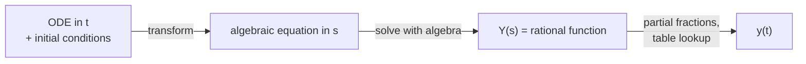
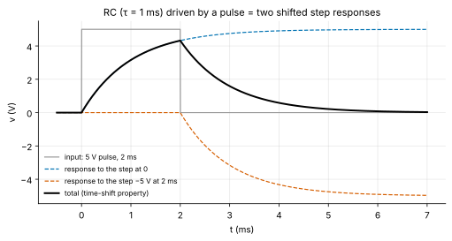
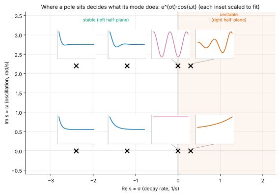
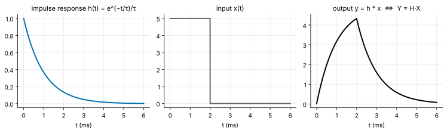

<!-- status: verified -->
# 02-05 · The Laplace Transform for ODEs

| | |
|---|---|
| **Course** | [02 · Complex Numbers, Differential Equations and Linear Algebra](../README.md) |
| **University equivalent** | The Laplace-transform unit of a sophomore differential-equations course (MIT 18.03SC Unit III: definition, rules, partial fractions, step and delta functions, convolution, transfer functions and poles; Boyce & DiPrima, chapter on the Laplace transform) |
| **Prerequisites** | [01-06 Techniques of Integration](../../01-calculus-for-engineers/chapters/01-06-techniques-of-integration.md) (improper integrals, partial fractions, completing the square), [02-03](02-03-second-order-linear-odes.md) and [02-04](02-04-forced-response-and-resonance.md) |
| **Estimated study hours** | 10 |
| **Last verified** | 2026-11-17 |

**Learning objectives.** After this chapter you can:

1. Define the Laplace transform, compute transforms from the definition, and state when the integral converges.
2. Derive and use the core properties: linearity, transforms of derivatives (with initial conditions) and integrals, the $s$-shift, the time shift with the unit step, multiplication by $t$, and the convolution theorem.
3. Invert rational transforms by partial fractions, for distinct real, repeated and complex-conjugate poles.
4. Solve linear constant-coefficient initial-value problems, including inputs that switch on, switch off or act as impulses.
5. Apply the initial- and final-value theorems, and say when the final-value theorem fails.
6. Explain the transfer function $H(s)$, its poles and zeros, and the impulse response, and connect them to the characteristic equation, the frequency response and stability.

## 1. Big picture

The last three chapters solved differential equations in the time domain: guess a form, substitute, match coefficients, then apply initial conditions. The **Laplace transform** replaces that whole process with algebra. It turns differentiation into multiplication by $s$, builds the initial conditions in automatically, handles inputs that switch on and off, and turns the response to *any* input into a product: output = transfer function × input. That is why engineers rarely solve circuit or control equations "by hand" in the time domain. They think in $s$. The poles of the transfer function are the characteristic roots of 02-03, its value on the imaginary axis is the frequency response of 02-04, and its inverse transform is the system's impulse response. One object captures everything.

- **Circuit analysis:** Course 07 analyzes circuits directly in the $s$-domain, with impedances $sL$ and $1/(sC)$ ([07-04](../../07-circuit-analysis-2-transient-and-ac/chapters/07-04-laplace-domain-circuit-analysis.md)).
- **Control and PLL design:** every loop is drawn as a block diagram of transfer functions, and stability is read from pole locations ([15-02](../../15-control-systems/chapters/15-02-transfer-functions-and-block-diagrams.md)).
- **Signals and systems:** the Laplace transform is the continuous-time partner of the $z$-transform used for digital filters ([11-09](../../11-signals-and-systems/chapters/11-09-z-transform.md)).
- **Behavioral modeling:** analog and mixed-signal designers write blocks directly as $H(s)$ in Verilog-AMS and in SPICE behavioral models (§9).

## 2. Intuition first

### A change of language

Logarithms turned multiplication into addition: multiply two numbers by adding their logs, then take the antilog. The Laplace transform does the same for calculus. In the "$s$ language", differentiation becomes multiplication by $s$ and integration becomes division by $s$. So a differential equation becomes an algebraic equation. Solve it with algebra, then translate back.

### Decomposing a signal into growing and decaying exponentials

02-04 decomposed periodic inputs into sinusoids $e^{j\omega t}$. The Laplace transform uses the more general exponentials $e^{st}$, with $s = \sigma + j\omega$ complex: they can grow or decay *and* oscillate. A system responds to $e^{st}$ by multiplying it by $H(s)$ (the exponential response formula of 02-04), so once a signal is expressed in terms of $e^{st}$, every system becomes multiplication.

### An analogy from finance: discounting a cash-flow stream

The Laplace transform of a cash-flow stream $f(t)$ at rate $s$ is $\int_0^\infty f(t)e^{-st}\,dt$: its **present value** under continuous discounting at rate $s$. Think of $F(s)$ as the whole curve of present values, one for every discount rate. A level perpetuity of 1 per year has present value $1/s$, exactly the transform of the constant 1. A stream growing at rate $a$ has present value $1/(s - a)$, finite only if $s > a$: exactly the transform of $e^{at}$ and its convergence condition. Shifting the stream later by $T$ multiplies its present value by $e^{-sT}$: the time-shift rule.

*Where the analogy breaks:* in engineering, $s$ is complex, and the transform is useful mostly for its algebraic rules, not as a present value. Finance uses a real discount rate and evaluates at one rate; here the whole function $F(s)$ matters, and its poles (where the "present value" blows up) carry the information.

## 3. Theory

### 3.1 Definition and first transforms

For a function $f(t)$ defined for $t \ge 0$, the **(unilateral) Laplace transform** is

$$
F(s) = \mathcal{L}\{f\}(s) = \int_{0^-}^\infty f(t)\,e^{-st}\,dt,
$$

an improper integral ([01-06](../../01-calculus-for-engineers/chapters/01-06-techniques-of-integration.md)). The lower limit $0^-$, just before zero, lets the transform capture an impulse at $t = 0$ and makes the initial conditions those that exist *before* any switching (§3.4). The integral converges when $f$ is piecewise continuous and of **exponential order**: $\lvert f(t)\rvert \le Me^{ct}$ for some $M$ and $c$. Then it converges for $\operatorname{Re}s > c$. Almost every engineering signal qualifies.

**Basic transforms, derived.**

- $f = 1$: $\int_0^\infty e^{-st}dt = \Big[-\frac{e^{-st}}{s}\Big]_0^\infty = \dfrac{1}{s}$, for $\operatorname{Re}s > 0$.
- $f = e^{at}$: $\int_0^\infty e^{-(s - a)t}dt = \dfrac{1}{s - a}$, for $\operatorname{Re}s > a$.
- $f = \cos\omega t$ and $\sin\omega t$: write them with Euler's formula and use the previous line with $a = \pm j\omega$:
  $\mathcal{L}\{\cos\omega t\} = \frac12\left(\frac{1}{s - j\omega} + \frac{1}{s + j\omega}\right) = \dfrac{s}{s^2 + \omega^2}$ and $\mathcal{L}\{\sin\omega t\} = \dfrac{\omega}{s^2 + \omega^2}$.
- $f = t^n$: by repeated integration by parts, $\mathcal{L}\{t^n\} = \dfrac{n!}{s^{n+1}}$ (Problem 02-05.2).

**The unit step and the impulse.** The unit step $u(t - a)$ switches on at $t = a \ge 0$:

$$
\mathcal{L}\{u(t - a)\} = \int_a^\infty e^{-st}dt = \frac{e^{-as}}{s} .
$$

The **unit impulse** $\delta(t)$ (Dirac delta) is the limit of a pulse of height $1/\varepsilon$ and width ε as ε → 0: zero width, unit area. Its transform is the limit of $\frac{1}{\varepsilon}\cdot\frac{1 - e^{-\varepsilon s}}{s}$, which tends to **1** (by L'Hôpital, 01-04). Physically, an impulse is a kick: a hammer blow, an electrostatic discharge, or a charge $q_0$ dumped onto a capacitor in a negligibly short time, $i = q_0\delta(t)$.

### 3.2 Properties, derived

| Property | Time domain | $s$ domain |
|---|---|---|
| Linearity | $af + bg$ | $aF + bG$ |
| Derivative | $f'$ | $sF(s) - f(0^-)$ |
| Second derivative | $f''$ | $s^2F(s) - sf(0^-) - f'(0^-)$ |
| Integral | $\int_0^tf(\lambda)\,d\lambda$ | $F(s)/s$ |
| $s$-shift (exponential weighting) | $e^{at}f(t)$ | $F(s - a)$ |
| Time shift (delay $a \ge 0$) | $f(t - a)\,u(t - a)$ | $e^{-as}F(s)$ |
| Multiplication by $t$ | $tf(t)$ | $-F'(s)$ |
| Convolution | $(f * g)(t) = \int_0^tf(\lambda)g(t - \lambda)\,d\lambda$ | $F(s)\,G(s)$ |

**Derivative.** Integrate by parts with $u = e^{-st}$ and $dv = f'\,dt$:

$$
\int_{0^-}^\infty f'(t)e^{-st}dt = \Big[f(t)e^{-st}\Big]_{0^-}^\infty + s\int_{0^-}^\infty f(t)e^{-st}dt = sF(s) - f(0^-),
$$

since $f(t)e^{-st} \to 0$ for exponential order and $\operatorname{Re}s$ large. Applying the rule twice gives the second derivative. **This is the key property: differentiation becomes multiplication by $s$, and the initial conditions appear on their own.**

**Integral.** If $g(t) = \int_0^tf$, then $g' = f$ and $g(0) = 0$, so $sG(s) = F(s)$ and $G = F/s$.

**$s$-shift.** $\int_0^\infty e^{at}f(t)e^{-st}dt = \int_0^\infty f(t)e^{-(s - a)t}dt = F(s - a)$. So $\mathcal{L}\{e^{-\alpha t}\cos\omega t\} = \dfrac{s + \alpha}{(s + \alpha)^2 + \omega^2}$: completing the square in a denominator reveals a damped sinusoid ([01-06](../../01-calculus-for-engineers/chapters/01-06-techniques-of-integration.md) §3.4).

**Time shift.** With $\lambda = t - a$: $\int_a^\infty f(t - a)e^{-st}dt = \int_0^\infty f(\lambda)e^{-s(\lambda + a)}d\lambda = e^{-as}F(s)$. A delay of $a$ multiplies the transform by $e^{-as}$.

**Multiplication by $t$.** Differentiate $F(s) = \int f e^{-st}dt$ with respect to $s$ under the integral: $F'(s) = \int(-t)f(t)e^{-st}dt$. So $\mathcal{L}\{te^{at}\} = -\frac{d}{ds}\frac{1}{s - a} = \dfrac{1}{(s - a)^2}$: the transform of the repeated-root mode of 02-03.

**Convolution theorem.** Write the product of transforms as a double integral and change variables to $t = \lambda + \mu$:

$$
F(s)G(s) = \int_0^\infty\!\!\int_0^\infty f(\lambda)g(\mu)e^{-s(\lambda + \mu)}d\mu\,d\lambda = \int_0^\infty\left[\int_0^tf(\lambda)g(t - \lambda)\,d\lambda\right]e^{-st}dt,
$$

where the order of integration was swapped over the region $0 \le \lambda \le t$ (Fubini, [01-10](../../01-calculus-for-engineers/chapters/01-10-multivariable-calculus-2.md)). The bracket is the **convolution** $(f * g)(t)$. **Multiplication in $s$ is convolution in time.**

### 3.3 Inversion by partial fractions

Inverting by table lookup relies on **uniqueness**: two functions with the same transform agree at every point where both are continuous (Lerch's theorem), so the table gives *the* inverse, up to the values at jumps. Solving an ODE produces a rational $Y(s) = N(s)/D(s)$. If the degree of $N$ is lower than that of $D$ (a *proper* fraction), split it into simple terms, each with a known inverse ([01-06](../../01-calculus-for-engineers/chapters/01-06-techniques-of-integration.md) §3.4):

| Factor of $D(s)$ | Partial-fraction term | Inverse transform |
|---|---|---|
| distinct real pole $s = p$ | $\dfrac{A}{s - p}$ | $Ae^{pt}$ |
| repeated pole, multiplicity 2 | $\dfrac{A_1}{s - p} + \dfrac{A_2}{(s - p)^2}$ | $A_1e^{pt} + A_2te^{pt}$ |
| complex pair $-\alpha \pm j\omega$ | $\dfrac{B(s + \alpha) + C\omega}{(s + \alpha)^2 + \omega^2}$ | $e^{-\alpha t}(B\cos\omega t + C\sin\omega t)$ |

**Coefficients.** For a simple pole, the **cover-up (residue) formula** is $A = \big[(s - p)Y(s)\big]_{s = p}$. For a double pole, multiply by $(s - p)^2$: $(s - p)^2Y = A_1(s - p) + A_2 + (s - p)^2R(s)$, where $R(s)$ holds the other terms. Setting $s = p$ gives $A_2 = \big[(s - p)^2Y\big]_{s = p}$, and differentiating once before setting $s = p$ gives $A_1 = \frac{d}{ds}\big[(s - p)^2Y\big]_{s = p}$. For a complex pair, complete the square and match coefficients, or apply the cover-up formula at the complex pole and combine the conjugate terms. Every pole contributes its natural mode ($e^{pt}$ for a simple pole; $e^{pt}$ and $te^{pt}$ for a double one), and its coefficients set how strongly that mode is excited. This is Heaviside's method, the reason engineers call the poles of a circuit its *natural frequencies*.

If $N$ has degree equal to or greater than $D$, divide first: the polynomial part inverts to impulses and their derivatives, which arise when the system *differentiates* its input. A capacitor driven by an ideal voltage step is the standard case: $I(s) = sC\cdot V/s = CV$, an impulse of current $CV\delta(t)$ that delivers the charge $CV$ instantly. They also arise when the input is itself impulsive.

### 3.4 Solving initial-value problems

The procedure, for $ay'' + by' + cy = f(t)$ with $y(0^-)$ and $y'(0^-)$:

**Step 1.** Transform both sides using the derivative rules: $a\big(s^2Y - sy(0^-) - y'(0^-)\big) + b\big(sY - y(0^-)\big) + cY = F(s)$.

**Step 2.** Solve for $Y(s)$:

$$
Y(s) = \underbrace{\frac{F(s)}{as^2 + bs + c}}_{\text{zero-state}} + \underbrace{\frac{(as + b)\,y(0^-) + a\,y'(0^-)}{as^2 + bs + c}}_{\text{zero-input}} .
$$

**Step 3.** Invert by partial fractions.

The decomposition of 02-02 §3.5 falls out automatically: one term depends only on the input, the other only on the initial state. This split is by *cause*. It is not the split by *form* into natural (homogeneous) and forced (particular) parts: the zero-state term's partial fractions include the poles of $1/(as^2 + bs + c)$, so it contains natural modes too. In Example 02-05.2 the zero-state part, $12/\big(s(s + 2)(s + 3)\big)$, inverts to $2 - 6e^{-2t} + 4e^{-3t}$: the forced constant 2 plus two natural modes. The denominator $as^2 + bs + c$ is the characteristic polynomial of 02-03, so its roots, the **poles**, are the natural modes.

**Why $0^-$.** If the input switches at $t = 0$, quantities such as an inductor's voltage can jump. Using values just *before* the switch ($0^-$, which are known from the circuit's history) lets the transform compute what happens across the jump, including any impulse. Initial values at $0^+$ are then outputs of the analysis, not inputs. A one-line check of the convention: the derivative of the unit step is the impulse, and indeed $\mathcal{L}\{u'\} = s\cdot\frac{1}{s} - u(0^-) = 1 = \mathcal{L}\{\delta\}$. Using $u(0^+) = 1$ instead would give 0 and lose the impulse.

### 3.5 Switching and impulsive inputs

Inputs that turn on, off, or kick are where the transform saves the most work:

- **A delayed step:** $Vu(t - a) \;\to\; Ve^{-as}/s$.
- **A rectangular pulse** of height $V$ from 0 to $T$: $V\big[u(t) - u(t - T)\big] \;\to\; V\dfrac{1 - e^{-Ts}}{s}$. By the time-shift rule the response is the step response minus the same step response delayed by $T$ (Example 02-05.4, Figure 1).
- **An impulse** of area $q_0$: $q_0\delta(t) \to q_0$. The response to a unit impulse with zero initial conditions is the **impulse response** $h(t)$, and since $\mathcal{L}\{\delta\} = 1$, its transform is $H(s)$ itself.
- **A shifted impulse** at $t = a > 0$: $\delta(t - a) \to e^{-as}$, by the time-shift rule. The impulse is defined by what it does inside an integral, the **sifting property**: $\int f(t)\,\delta(t - a)\,dt = f(a)$ for any $f$ continuous at $a$, because the narrow unit-area pulse averages $f$ over a vanishing interval around $a$. With $f = e^{-st}$ this gives $e^{-as}$ directly.
- **Piecewise inputs.** Write the input as a sum of pieces, each in the form $f(t - a)u(t - a)$, *before* transforming. The trap: $t\,u(t - 2)$ is not $(t - 2)u(t - 2)$. Write $t = (t - 2) + 2$, so $t\,u(t - 2) = (t - 2)u(t - 2) + 2u(t - 2) \to e^{-2s}\left(\dfrac{1}{s^2} + \dfrac{2}{s}\right)$. A ramp that rises at unit slope for 1 s and then holds is $t\,u(t) - (t - 1)u(t - 1) \to (1 - e^{-s})/s^2$.
- **Periodic inputs.** If $f$ has period $T$ and $F_1$ is the transform of one period, split the integral into periods: $F(s) = \sum_{k\ge0}e^{-ksT}F_1(s) = \dfrac{F_1(s)}{1 - e^{-sT}}$ for $\operatorname{Re}s > 0$ (a geometric series). A square wave equal to $V$ for the first half of each period and 0 for the second has $F_1 = V(1 - e^{-sT/2})/s$, so $F(s) = \dfrac{V}{s\left(1 + e^{-sT/2}\right)}$.
- **Any input at all.** With zero initial conditions $Y = H(s)G(s)$, so the convolution theorem gives $y(t) = \int_0^th(t - \lambda)\,g(\lambda)\,d\lambda$ for an arbitrary input $g$, even one known only as measured data. For $y'' + 3y' + 2y = g(t)$, $H = 1/\big((s + 1)(s + 2)\big)$ gives $h = e^{-t} - e^{-2t}$ and $y(t) = \int_0^t\big(e^{-(t - \lambda)} - e^{-2(t - \lambda)}\big)g(\lambda)\,d\lambda$ (Problem 02-05.17).

*Figure 1. The time-shift rule in action: a pulse is a step up at 0 plus a step down at T, so the response is the difference of two step responses.*

### 3.6 Transfer functions, poles and zeros

With zero initial conditions, the output's transform is the input's transform multiplied by a function that depends on the system alone:

$$
Y(s) = H(s)\,X(s), \qquad H(s) = \frac{N(s)}{D(s)} .
$$

$H(s)$ is the **transfer function**. Everything from the previous chapters lives in it:

- **Poles** (roots of $D$) are the characteristic roots of 02-03: their positions in the complex plane decide whether each natural mode decays, oscillates or grows (Figure 2). **The system is stable exactly when every pole has a negative real part.**
- **Zeros** (roots of $N$) are frequencies the system blocks: an input $e^{z t}$ at a zero $z$ produces no forced response.
- **Impulse response:** $h(t) = \mathcal{L}^{-1}\{H\}$. By the convolution theorem, the zero-state response to any input is $y = h * x$ (Figure 3): the system's output is a weighted sum of its past inputs, weighted by its impulse response. This generalizes the fading-memory integral of 02-02 §3.4 and is the foundation of [11-03](../../11-signals-and-systems/chapters/11-03-convolution.md).
- **Frequency response:** for a stable system, $H(j\omega)$, the transfer function on the imaginary axis, is the frequency response of 02-04.

For the series RLC with output across the capacitor, $H(s) = \dfrac{\omega_0^2}{s^2 + 2\alpha s + \omega_0^2}$: two poles at $-\alpha \pm j\omega_d$ when underdamped (two real poles otherwise) and no finite zeros. Setting $s = j\omega$ recovers 02-04's $H(j\omega)$ exactly.

*Figure 2. Left-half-plane poles give decaying modes, poles on the imaginary axis give sustained oscillation or a constant, and right-half-plane poles give growth. Height above the axis sets the oscillation frequency.*

*Figure 3. The output is the convolution of the input with the impulse response; in the s-domain it is simply the product H(s)X(s).*

### 3.7 The initial- and final-value theorems

Two limits give the beginning and end of a response without inverting the transform.

**Initial-value theorem.** If $f$ and $f'$ are transformable, $f(0^+) = \displaystyle\lim_{s\to\infty}sF(s)$.

*Why:* from the derivative rule (taken from $0^+$), $sF(s) - f(0^+) = \int_{0^+}^\infty f'(t)e^{-st}dt$, and as $s \to \infty$ the weight $e^{-st}$ kills the integral.

**Final-value theorem.** If every pole of $sF(s)$ lies in the open left half-plane, $\displaystyle\lim_{t\to\infty}f(t) = \lim_{s\to0}sF(s)$.

*Why:* let $s \to 0$ in $sF(s) - f(0^-) = \int_{0^-}^\infty f'(t)e^{-st}dt$. The right side tends to $\int_{0^-}^\infty f'\,dt = f(\infty) - f(0^-)$, so $sF(s) \to f(\infty)$. The condition guarantees that $f(\infty)$ exists.

**When the final-value theorem lies.** For $F = 1/(s - 1)$, $\lim_{s\to0}sF = 0$, but $f = e^t$ grows without bound: the pole at $+1$ violates the condition. For $F = \omega/(s^2 + \omega^2)$ it also returns 0, but $\sin\omega t$ never settles: the poles on the imaginary axis violate it. **Always check the poles first.** For a step input to a stable system, the final value is $H(0)$ times the step: the **DC gain**.

## 4. Worked examples

### Example 02-05.1 — Transforms from the table (tier A)

**Setup.** Find the transforms of (a) $3 - 2e^{-4t} + 5\sin2t$; (b) $te^{-2t}$; (c) $e^{-t}\cos3t$.

**Solution.** (a) By linearity, $\dfrac{3}{s} - \dfrac{2}{s + 4} + \dfrac{10}{s^2 + 4}$. (b) By the $t$-multiplication rule, or the $s$-shift of $\mathcal{L}\{t\} = 1/s^2$: $\dfrac{1}{(s + 2)^2}$. (c) By the $s$-shift of $s/(s^2 + 9)$: $\dfrac{s + 1}{(s + 1)^2 + 9}$.

**Check.** The initial-value theorem on (a): $\lim_{s\to\infty}s\left(\frac{3}{s} - \frac{2}{s + 4} + \frac{10}{s^2 + 4}\right) = 3 - 2 + 0 = 1$, and indeed $f(0) = 3 - 2 + 0 = 1$ ✓.

### Example 02-05.2 — A second-order IVP with a constant input (tier B)

**Setup.** Solve $y'' + 5y' + 6y = 12$ with $y(0) = 1$ and $y'(0) = 0$. Evaluate $y(1)$, and check the final value with the final-value theorem.

**Solution.** Transforming: $s^2Y - s + 5(sY - 1) + 6Y = 12/s$, so

$$
Y(s) = \frac{s + 5 + 12/s}{s^2 + 5s + 6} = \frac{s^2 + 5s + 12}{s(s + 2)(s + 3)} .
$$

By cover-up: at $s = 0$, $A = 12/6 = 2$; at $s = -2$, $B = (4 - 10 + 12)/((-2)(1)) = -3$; at $s = -3$, $C = (9 - 15 + 12)/((-3)(-1)) = 2$. So

$$
y(t) = 2 - 3e^{-2t} + 2e^{-3t}, \qquad y(1) = 1.694 .
$$

**Checks.** $y(0) = 2 - 3 + 2 = 1$ ✓ and $y'(0) = 6 - 6 = 0$ ✓. The poles of $sY$ are −2 and −3, both in the left half-plane, so the final-value theorem applies: $\lim_{s\to0}sY = 12/6 = $ **2**, matching $y(\infty) = 2$ ✓.

### Example 02-05.3 — The RLC step response, rederived in one page (tier B)

**Setup.** The series RLC of 02-04 Example 2 ($L = 10$ mH, $C = 1$ µF, $R = 50$ Ω), initially at rest, receives a 1 V step. Find $v_C(t)$ by Laplace transform, and its overshoot.

**Solution.** $V_C(s) = H(s)\cdot\frac1s$ with $H = \dfrac{\omega_0^2}{s^2 + 2\alpha s + \omega_0^2}$, α = 2500 s⁻¹ and $\omega_0^2 = 10^8$. Partial fractions:

$$
\frac{\omega_0^2}{s(s^2 + 2\alpha s + \omega_0^2)} = \frac{1}{s} - \frac{s + 2\alpha}{s^2 + 2\alpha s + \omega_0^2} = \frac{1}{s} - \frac{(s + \alpha) + \alpha}{(s + \alpha)^2 + \omega_d^2},
$$

(the cover-up at $s = 0$ gives 1, and matching the $s^2$ and $s$ coefficients gives the rest), with $\omega_d = \sqrt{\omega_0^2 - \alpha^2} = $ **9682 rad/s**. Inverting with the $s$-shift rule:

$$
v_C(t) = 1 - e^{-\alpha t}\left(\cos\omega_dt + \frac{\alpha}{\omega_d}\sin\omega_dt\right)\text{ V},
$$

exactly the step response of 02-03 §3.8, now obtained without guessing. The overshoot is $e^{-\alpha\pi/\omega_d} = $ **44.43%**, at $t_p = \pi/\omega_d = $ **0.3245 ms**.

**Sanity check.** Final value: $\lim_{s\to0}sV_C = H(0) = 1$ V ✓ (the DC gain of a low-pass is 1). Initial value: $\lim_{s\to\infty}sV_C = 0$ ✓ (the capacitor voltage cannot jump). The lab confirms the overshoot by simulating both the circuit and an $s$-domain block with this $H(s)$.

### Example 02-05.4 — A pulse through an RC filter (tier B)

**Setup.** An RC low-pass with τ = 1 ms, initially at rest, is driven by a 5 V pulse lasting 2 ms. Find $v(t)$ and evaluate it at 2 ms and 3 ms.

**Solution.** $X(s) = 5\dfrac{1 - e^{-0.002s}}{s}$ and $H(s) = \dfrac{1}{1 + \tau s}$. The step response of $H$ is $\mathcal{L}^{-1}\left\{\frac{1}{s(1 + \tau s)}\right\} = 1 - e^{-t/\tau}$ (cover-up: $\frac{1}{s} - \frac{\tau}{1 + \tau s}$). By the time-shift rule,

$$
v(t) = 5\left(1 - e^{-t/\tau}\right)u(t) - 5\left(1 - e^{-(t - 2\text{ ms})/\tau}\right)u(t - 2\text{ ms}).
$$

At 2 ms only the first term acts: $v = 5(1 - e^{-2}) = $ **4.323 V**. At 3 ms both act: $v = 5(1 - e^{-3}) - 5(1 - e^{-1}) = 5(e^{-1} - e^{-3}) = $ **1.590 V**.

**Check.** After the pulse, the capacitor discharges from 4.323 V with time constant τ: $4.323e^{-1} = $ **1.590 V** at 3 ms ✓.

### Example 02-05.5 — A power-delivery network in the s-domain (tier C)

**Setup.** Revisit the processor rail of 02-03 Example 5: regulator → $R = 1$ mΩ and $L = 25$ pH → die with $C = 100$ nF, and a load current step $\Delta I = 10$ A at $t = 0$. (a) Find the impedance $Z(s)$ seen by the load and its poles. (b) Write the voltage deviation $\Delta V(s)$. Use the initial-value theorem to find the deviation and its slope just after the step, and the final-value theorem for its final value. (c) Interpret the poles and the zero.

**Solution.** (a) The load sees the capacitor in parallel with the supply branch:

$$
Z(s) = \frac{R + sL}{1 + sC(R + sL)} = \frac{R + sL}{LCs^2 + RCs + 1} .
$$

Its poles solve $LCs^2 + RCs + 1 = 0$: $s = -\alpha \pm j\omega_d$ with α = $R/(2L) = $ **2.000×10⁷ s⁻¹** and $\omega_d = \sqrt{1/(LC) - \alpha^2} = $ **6.321×10⁸ rad/s**, a ring at **100.6 MHz**, as in 02-03. It has one zero, at $s = -R/L = -4\times10^7$ s⁻¹.

(b) The load draws $\Delta I\,u(t)$, so $\Delta V(s) = -Z(s)\dfrac{\Delta I}{s}$.

- *Initial value:* $\lim_{s\to\infty}s\Delta V = -\Delta I\lim_{s\to\infty}Z(s) = 0$, since $Z \approx 1/(sC)$ at high frequency. The voltage is continuous, as a capacitor requires.
- *Initial slope:* the transform of $\Delta V'$ is $s\Delta V - \Delta V(0) = s\Delta V$, so the initial slope is $\lim_{s\to\infty}s\cdot s\Delta V = -\Delta I\lim_{s\to\infty}sZ(s) = -\Delta I/C = $ **−1.000×10⁸ V/s**: the capacitor alone feeds the load at first, falling 0.1 V per nanosecond.
- *Final value:* the poles of $s\Delta V = -\Delta I\,Z(s)$ lie in the left half-plane, so $\Delta V(\infty) = -\Delta I\,Z(0) = -\Delta I\,R = $ **−10 mV**: only the resistive drop remains.

Inverting $\Delta V(s)$ by partial fractions reproduces the 160.3 mV worst droop of 02-03 (Problem 02-05.14).

(c) The lightly damped pole pair, close to the imaginary axis, is the resonance that rings. The zero at $-R/L$ is the complex frequency at which the supply branch's own impedance $R + sL$ vanishes: an input of the form $e^{-Rt/L}$ would be absorbed entirely by that branch without moving the voltage. Designers move poles left (more damping) and lower $\lvert Z\rvert$ near them (more capacitance, less inductance), exactly the knobs of 02-03 and 02-04, but now read off a single function.

**Units check.** At high frequency $Z \approx 1/(sC)$, so $sZ \to 1/C$ and the initial slope $-\Delta I/C$ has units A/F = V/s ✓. The final value $-\Delta I\,R$ is A × Ω = V ✓.

<!-- answer-key -->
| ID | Quantity | Value | Unit |
|---|---|---|---|
| Ex 02-05.1a | initial value of (a) by the theorem | 1 | — |
| Ex 02-05.2a | residue at s = 0 | 2 | — |
| Ex 02-05.2b | residue at s = −2 | −3 | — |
| Ex 02-05.2c | residue at s = −3 | 2 | — |
| Ex 02-05.2d | y(1) | 1.694 | — |
| Ex 02-05.2e | final value | 2 | — |
| Ex 02-05.3a | damped frequency ωd | 9682 | rad/s |
| Ex 02-05.3b | overshoot | 44.43 | % |
| Ex 02-05.3c | peak time | 0.3245 | ms |
| Ex 02-05.4a | v at 2 ms | 4.323 | V |
| Ex 02-05.4b | v at 3 ms | 1.590 | V |
| Ex 02-05.5a | α | 2.000×10^7 | 1/s |
| Ex 02-05.5b | ωd | 6.321×10^8 | rad/s |
| Ex 02-05.5c | ring frequency | 100.6 | MHz |
| Ex 02-05.5d | zero at −R/L | −4×10^7 | 1/s |
| Ex 02-05.5e | initial slope | −1.000×10^8 | V/s |
| Ex 02-05.5f | final deviation | −10 | mV |
| Ex 02-05.5g | worst droop (from 02-03) | 160.3 | mV |

*Recomputed by [verify_02_05.py](../verify/verify_02_05.py). Examples 02-05.3 and 02-05.4 are also confirmed in ngspice in the lab, Example 02-05.3 both as a circuit and as an s-domain block.*

## 5. Simulate it

The lab ([labs/02-05-lab/](../labs/02-05-lab/README.md)) has a notebook and two ngspice netlists:

1. **Transforms by machine.** SymPy computes transforms and inverses; check them against the table and the derived properties.
2. **Partial fractions.** Use `sympy.apart` and `scipy.signal.residue` on the examples, including repeated and complex poles. *Predict first:* how many terms does $1/(s^2(s + 1))$ split into?
3. **Poles and modes.** Compare the impulse responses of five fixed pole positions, from the left half-plane to the right. *Predict first:* what does moving a pole pair toward the imaginary axis do to the ringing?
4. **The final-value trap.** Apply the final-value theorem to stable and unstable transforms and compare with simulation.
5. **ngspice, `rlc_step_vs_sxfer.cir`.** The RLC of Example 02-05.3 as a circuit and as an XSPICE `s_xfer` block implementing $H(s)$ directly: both give 44.43% overshoot.
6. **ngspice, `rc_pulse.cir`.** The pulse of Example 02-05.4: confirm 4.323 V at 2 ms and 1.590 V at 3 ms.

## 6. Engineering tradeoffs

| Knob | Improves | Costs | Typical decision owner |
|---|---|---|---|
| Analyze in the s-domain (transfer functions) | Fast, insightful design; poles, zeros and stability at a glance | Linear, time-invariant systems only; loses nonlinear effects | Analog / control designer |
| Simulate in the time domain (SPICE) | Captures nonlinearity, saturation, switching | Slower; less insight into why | Circuit designer, verification |
| Behavioral $H(s)$ blocks in simulation | Fast system-level simulation of PLLs, filters, regulators | Accuracy only as good as the model; misses device effects | Mixed-signal architect |
| Move poles further into the left half-plane | Faster decay, more damping, more margin | Often bandwidth, power or noise | Control / analog designer |
| Cancel a pole with a zero (compensation) | Removes a slow or troublesome mode from the response | Sensitive to tolerance: imperfect cancellation leaves a slow "doublet" tail | Control / analog designer |

## 7. Numbers to know

| Transform pair | | Note |
|---|---|---|
| $1 \leftrightarrow 1/s$; $\delta(t) \leftrightarrow 1$ | $u(t - a) \leftrightarrow e^{-as}/s$ | Step, impulse, delayed step |
| $e^{at} \leftrightarrow 1/(s - a)$ | $te^{at} \leftrightarrow 1/(s - a)^2$ | Real and repeated poles |
| $\cos\omega t \leftrightarrow s/(s^2 + \omega^2)$ | $\sin\omega t \leftrightarrow \omega/(s^2 + \omega^2)$ | Poles on the imaginary axis |
| $e^{-\alpha t}\cos\omega t \leftrightarrow (s + \alpha)/((s + \alpha)^2 + \omega^2)$ | $e^{-\alpha t}\sin\omega t \leftrightarrow \omega/((s + \alpha)^2 + \omega^2)$ | Complex poles |
| $f' \leftrightarrow sF - f(0^-)$ | $\int_0^tf \leftrightarrow F/s$ | Derivative, integral |
| $f(t - a)u(t - a) \leftrightarrow e^{-as}F(s)$ | $e^{at}f \leftrightarrow F(s - a)$ | Delay and shift |
| DC gain of a stable system | $H(0)$ | Final value of the unit-step response |

## 8. Common mistakes

1. **Dropping the initial conditions** in the derivative rule. $\mathcal{L}\{y'\} = sY - y(0^-)$, not $sY$.
2. **Using the final-value theorem on an unstable or oscillating system.** Check that every pole of $sF(s)$ is in the open left half-plane first.
3. **Forgetting the step in the time-shift rule.** $e^{-as}F(s)$ inverts to $f(t - a)u(t - a)$, which is zero before $t = a$, not $f(t - a)$ for all $t$.
4. **Applying cover-up to a repeated pole.** It gives only the highest-power coefficient; the others need a derivative or coefficient matching.
5. **Partial fractions of an improper fraction.** Divide first when the numerator's degree is not lower.
6. **Confusing $H(s)$ with $H(j\omega)$.** The frequency response is $H$ on the imaginary axis, and only for a stable system does it describe a measurable steady state.
7. **Mixing $0^-$ and $0^+$.** Initial conditions belong at $0^-$; values at $0^+$ may differ after an impulse or a switched source.

## 9. Practitioner lens

### State of the art (as of Nov 2026)

- **Designers write blocks as transfer functions.** The Accellera Verilog-AMS language reference manual (version 2.4.0, 2014) defines analog filter operators that implement $H(s)$ directly, specified by zeros and poles (`laplace_zp`) or by numerator and denominator polynomials (`laplace_nd`), with mixed forms as well ([R-036](../../../reference/research-log.md#r-036--s-domain-blocks-in-design-tools-verilog-ams-and-ngspice)) **[Established]**. Mixed-signal teams use such blocks to model PLLs, filters and regulators at system level long before transistor-level design is finished ([20](../../20-analog-and-mixed-signal-ic-design/README.md)).
- **Open-source simulators support it too.** ngspice's XSPICE extension includes an `s_xfer` code model for rational transfer functions in $s$, used in this chapter's lab; it handles only ratios of polynomials ([R-036](../../../reference/research-log.md#r-036--s-domain-blocks-in-design-tools-verilog-ams-and-ngspice)) **[Established]**.
- **Transient simulation does not use the transform.** SPICE's transient analysis integrates the nonlinear circuit equations step by step (02-02 §3.9, [02-10](02-10-numerical-methods.md)), so the Laplace transform is the designer's tool for insight there, not the simulator's engine. Its small-signal `.AC` analysis is the exception in spirit: it linearizes the circuit at the operating point and solves the resulting complex equations at $s = j\omega$, frequency by frequency, which is the phasor method of 02-01 applied to the whole circuit **[Established: standard SPICE analysis types]**.

### Why it matters commercially

Transfer functions are the shared language of every engineering conversation about dynamics: "the loop has a pole at 100 kHz and a zero at 20 kHz", "the PDN has an anti-resonance at 80 MHz". A team that models its regulators, PLLs and power-delivery networks as $H(s)$ early can trade bandwidth, stability margin and component cost on paper, before committing silicon. In diligence, a team's fluency in poles, zeros and margins is a quick read on its analog and control maturity.

### Marketing vs Reality

- **"Unconditionally stable regulator."** *Reality:* stability is a statement about pole locations for a stated range of load, capacitance and ESR. Ask for the range over which the poles stay in the left half-plane with margin, not a single bench measurement.
- **"Our model predicts silicon exactly."** *Reality:* an $H(s)$ model is linear and time-invariant. It cannot capture slew limits, saturation or switching. Ask which effects the behavioral model omits and how it was correlated with transistor-level and silicon results.
- **"Zero steady-state error."** *Reality:* the final-value theorem gives zero error only for stable systems with enough integrators for the input type; for a ramp input a single integrator still leaves an error ([15-04](../../15-control-systems/chapters/15-04-feedback-and-steady-state-error.md)). Ask for the input class.

### Questions to ask engineering leaders

1. **"Where are the dominant poles and zeros of your key loops, and how do they move across process, voltage, temperature and load?"**
   - *Strong:* a pole-zero map with variation, plus measured step responses.
   - *Evasive:* "We simulated it at nominal and it was fine."
2. **"How do your behavioral models correlate with transistor-level simulation and with silicon?"**
   - *Strong:* a correlation plan, error bars and known limitations.
   - *Evasive:* "The models are accurate."
3. **"Do you rely on any pole-zero cancellation, and what happens when it is imperfect?"**
   - *Strong:* quantifies the residual slow mode for component tolerances.
   - *Evasive:* is unaware of the doublet tail.

## 10. Concept check

1. Why does the Laplace transform turn a differential equation into an algebraic one?

   

Answer

   Because $\mathcal{L}\{y'\} = sY - y(0^-)$: differentiation becomes multiplication by $s$ (plus initial-condition terms), so a linear ODE with constant coefficients becomes a polynomial equation in $s$ times $Y$.

   

2. What is the transform of a 3 V step applied at $t = 2$ ms?

   

Answer

   $3e^{-0.002s}/s$.

   

3. $Y(s) = \dfrac{5}{(s + 1)(s + 5)}$. Without partial fractions, what are $y(0^+)$ and $y(\infty)$?

   

Answer

   Initial value: $\lim_{s\to\infty}sY = 0$. Final value: the poles of $sY$ are −1 and −5 (stable), so $\lim_{s\to0}sY = 0$. (It is the impulse response of a two-pole system: it rises and returns to zero.)

   

4. Why does the final-value theorem give a wrong answer for $F(s) = 1/(s^2 + 4)$?

   

Answer

   Its poles ±2j are on the imaginary axis: $f = \frac12\sin2t$ never settles, so there is no final value to find, although $\lim sF = 0$.

   

5. A system has poles at −1 ± 10j. Describe its impulse response.

   

Answer

   A ringing oscillation at 10 rad/s (1.59 Hz) inside an envelope $e^{-t}$: lightly damped, ζ ≈ 0.0995.

   

6. What does multiplication of transforms correspond to in time?

   

Answer

   Convolution: $\mathcal{L}^{-1}\{FG\} = \int_0^tf(\lambda)g(t - \lambda)\,d\lambda$. The output of a system is the input convolved with the impulse response.

   

**Problem set:** [02-05 problems](../problems/02-05-problems.md) · [solutions](../solutions/02-05-solutions.md)

## 11. Key terms

[Laplace transform](../../../reference/glossary.md#laplace-transform) ·
[Unit step function](../../../reference/glossary.md#unit-step-function) ·
[Unit impulse](../../../reference/glossary.md#unit-impulse) ·
[Transfer function](../../../reference/glossary.md#transfer-function) ·
[Poles and zeros](../../../reference/glossary.md#poles-and-zeros) ·
[Impulse response](../../../reference/glossary.md#impulse-response) ·
[Convolution](../../../reference/glossary.md#convolution) ·
[Partial fractions](../../../reference/glossary.md#partial-fractions) ·
[Initial-value theorem](../../../reference/glossary.md#initial-value-theorem) ·
[Final-value theorem](../../../reference/glossary.md#final-value-theorem) ·
[DC gain](../../../reference/glossary.md#dc-gain)

## 12. Connections

- **Previous:** [02-03](02-03-second-order-linear-odes.md) (characteristic roots, now poles) and [02-04](02-04-forced-response-and-resonance.md) (frequency response, now $H(j\omega)$); [01-06](../../01-calculus-for-engineers/chapters/01-06-techniques-of-integration.md) (partial fractions and improper integrals).
- **Next:** [02-06 Vectors, Matrices and Linear Systems](02-06-vectors-matrices-and-linear-systems.md) begins the linear-algebra half of the course; [02-09](02-09-systems-of-odes-and-matrix-exponential.md) brings it back to systems of ODEs.
- **Used in:**
  - [07-04 Laplace-Domain Circuit Analysis](../../07-circuit-analysis-2-transient-and-ac/chapters/07-04-laplace-domain-circuit-analysis.md);
  - [11-04 LTI Systems and Differential Equations](../../11-signals-and-systems/chapters/11-04-lti-systems-and-differential-equations.md) and [11-09 The z-Transform](../../11-signals-and-systems/chapters/11-09-z-transform.md);
  - [15-02 Transfer Functions and Block Diagrams](../../15-control-systems/chapters/15-02-transfer-functions-and-block-diagrams.md) and [15-05 Stability](../../15-control-systems/chapters/15-05-stability-routh-hurwitz.md).

## 13. Further study

- Boyce & DiPrima, *Elementary Differential Equations and Boundary Value Problems*, chapter 6 (the Laplace transform: definition, IVPs, step functions, impulse functions, convolution).
- MIT OCW 18.03SC *Differential Equations*, Unit III (Fourier series and the Laplace transform: poles, transfer functions, convolution, the delta function).
- Kreyszig, *Advanced Engineering Mathematics*, chapter on Laplace transforms (with an extended table).
- Oppenheim & Willsky, *Signals and Systems*, chapter on the Laplace transform (the engineering view of poles, zeros and regions of convergence).

## 14. Sources

1. Boyce, W. E., DiPrima, R. C. and Meade, D. B., *Elementary Differential Equations and Boundary Value Problems*, Wiley: Laplace transform properties, step and impulse functions, convolution.
2. MIT OpenCourseWare, 18.03SC *Differential Equations*, Unit III: Fourier Series and Laplace Transform.
3. Accellera, *Verilog-AMS Language Reference Manual*, version 2.4.0 (30 May 2014), §4.5.11 Laplace transform filters; ngspice-42 XSPICE code-model library, model `s_xfer`. [R-036]
