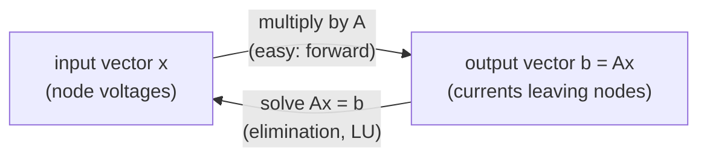
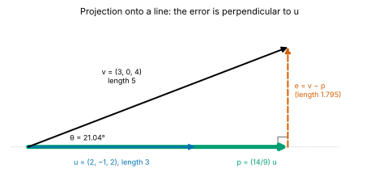
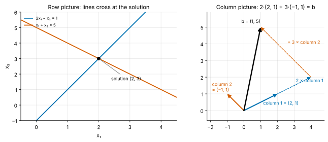
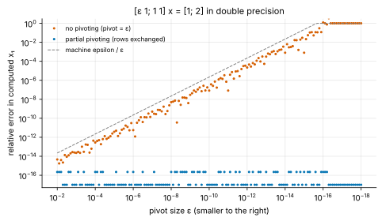
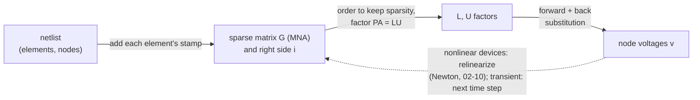

<!-- status: reviewed -->
# 02-06 · Vectors, Matrices and Linear Systems

| | |
|---|---|
| **Course** | [02 · Complex Numbers, Differential Equations and Linear Algebra](../README.md) |
| **University equivalent** | The opening units of a sophomore linear-algebra course (MIT 18.06 lectures 1–5: the geometry of linear equations, elimination, matrix multiplication, A = LU, transposes and permutations; Strang, *Introduction to Linear Algebra*, chapters 1–2), plus the matrix form of nodal analysis from a first circuits course |
| **Prerequisites** | [01-01 Functions, Models and Units](../../01-calculus-for-engineers/chapters/01-01-functions-models-and-units.md) (algebra, units), [01-09](../../01-calculus-for-engineers/chapters/01-09-multivariable-calculus-1.md) (3-D vectors and the dot product), [02-01](02-01-complex-numbers-euler-and-phasors.md) (complex numbers, for §3.2's complex vectors) |
| **Estimated study hours** | 12 |
| **Last verified** | 2026-11-18 |

**Learning objectives.** After this chapter you can:

1. Add, scale and combine vectors; compute dot products, lengths, angles and projections; and interpret each geometrically.
2. Multiply matrices by vectors and by matrices in both the row and the column picture, and use the transpose and its product rule.
3. Describe a linear system $\mathbf{A}\mathbf{x} = \mathbf{b}$ in the row and the column picture, and decide whether it has one solution, none or infinitely many.
4. Solve $\mathbf{A}\mathbf{x} = \mathbf{b}$ by Gaussian elimination and back substitution, with row exchanges when a pivot is zero or small, and count the arithmetic it costs.
5. Factor $\mathbf{A} = \mathbf{L}\mathbf{U}$ (and $\mathbf{P}\mathbf{A} = \mathbf{L}\mathbf{U}$), use the factors to solve for many right-hand sides, and explain why pivoting protects against roundoff.
6. Write the nodal equations of a resistive circuit as $\mathbf{G}\mathbf{v} = \mathbf{i}$ by stamping, explain the structure of $\mathbf{G}$, and solve them.

## 1. Big picture

Every circuit simulator, every chip power-grid analysis, every machine-learning accelerator and much of signal processing reduces, at its core, to two operations: **multiplying matrices** and **solving linear systems** $\mathbf{A}\mathbf{x} = \mathbf{b}$. When SPICE computes the operating point of a million-transistor circuit, it builds a matrix from Kirchhoff's current law and solves it, again and again, inside Newton iterations and time steps. When a large language model generates a token, almost all the arithmetic is matrix–vector products. This chapter builds the vocabulary (vectors, matrices, the dot product, matrix multiplication) and the main algorithm (Gaussian elimination, organized as the factorization $\mathbf{A} = \mathbf{L}\mathbf{U}$), and applies it to the first real engineering use: nodal analysis of circuits.

- **Circuit analysis:** nodal analysis turns Kirchhoff's current law into $\mathbf{G}\mathbf{v} = \mathbf{i}$, the formulation used in [06-04 Nodal Analysis](../../06-circuit-analysis-1-dc/chapters/06-04-nodal-analysis.md) and inside every SPICE simulator.
- **Chip power delivery:** an on-chip power grid is a resistor mesh with millions of nodes; its voltage drop ("IR drop") is a giant sparse $\mathbf{G}\mathbf{v} = \mathbf{i}$ (Problem 02-06.14 and the lab).
- **AI hardware:** accelerators are built around matrix-multiply engines, and whether a workload is limited by arithmetic or by memory follows from counting the operations in a matrix product (Example 02-06.6).
- **Signals and statistics:** a sampled waveform is a vector; correlation is a normalized dot product; least-squares fitting is a projection ([02-07](02-07-determinants-inverses-and-vector-spaces.md), [03](../../03-probability-statistics-and-random-variables/README.md)).

## 2. Intuition first

### Vectors are lists, arrows and signals

A **vector** is an ordered list of numbers, such as $\mathbf{v} = (3, 0, 4)$. Three pictures of the same object are useful:

- **An arrow** from the origin to the point $(3, 0, 4)$ in space, with a length and a direction.
- **A list of quantities** that belong together: the three node voltages of a circuit, the holdings of a portfolio, the red-green-blue values of a pixel.
- **A sampled signal:** 1,000 samples of a waveform form a vector with 1,000 components. You cannot draw the arrow, but length and angle still make sense, and they mean energy and similarity.

### A matrix is a machine that acts on vectors

A **matrix** is a rectangular table of numbers. Its job is to take a vector in and produce a vector out, *linearly*: doubling the input doubles the output, and the response to a sum is the sum of the responses. A rotation, a stretch, the map from a circuit's node voltages to the currents leaving each node, and one layer of a neural network are all matrices.

Solving $\mathbf{A}\mathbf{x} = \mathbf{b}$ runs the machine backwards: given the output $\mathbf{b}$, find the input $\mathbf{x}$ that produces it.

### An analogy from finance: replicating a payoff

Suppose a market has three possible states tomorrow and three traded instruments. Write each instrument's payoff in the three states as a column, and put the columns side by side in a matrix $\mathbf{A}$. Holding $x_1, x_2, x_3$ units of the instruments pays $\mathbf{A}\mathbf{x}$: in each state, a weighted sum of payoffs. To **replicate** a target payoff $\mathbf{b}$ (say, an option's payoff in each state), you solve $\mathbf{A}\mathbf{x} = \mathbf{b}$ for the holdings. That is the column picture of §3.6: find the combination of the available columns that reaches the target.

*Where the analogy breaks:* a market can be **incomplete**, with more states than independent instruments, so no exact replication exists. That corresponds to an overdetermined system, treated by least squares in [02-07](02-07-determinants-inverses-and-vector-spaces.md). Circuit matrices are better behaved than payoff matrices: physics makes the conductance matrix of a resistive network in which every node has a path to ground symmetric and nonsingular, so its system always has exactly one solution (§3.10).

## 3. Theory

### 3.1 Vectors and linear combinations

A vector with $n$ real components is written as a column,

$$
\mathbf{v} = \begin{bmatrix} v_1 \\ v_2 \\ \vdots \\ v_n \end{bmatrix},
$$

or, to save space in text, as $(v_1, v_2, \dots, v_n)$. The set of all such vectors is $\mathbb{R}^n$. Following the [notation guide](../../../reference/notation.md), vectors are bold lowercase ($\mathbf{v}$) and their components italic ($v_i$).

Two operations define everything else:

- **Addition**, component by component: $\mathbf{u} + \mathbf{v} = (u_1 + v_1, \dots, u_n + v_n)$. Geometrically, place the tail of $\mathbf{v}$ at the head of $\mathbf{u}$.
- **Scalar multiplication**: $c\mathbf{v} = (cv_1, \dots, cv_n)$, which stretches the arrow by $c$ (and reverses it if $c < 0$).

A **linear combination** of vectors $\mathbf{v}_1, \dots, \mathbf{v}_k$ is any sum $c_1\mathbf{v}_1 + \dots + c_k\mathbf{v}_k$. Combinations are the central idea of the subject. In $\mathbb{R}^3$, all combinations of one nonzero vector fill a line, all combinations of two vectors in different directions fill a plane, and all combinations of three vectors not in one plane fill all of space.

Units ride along with components. If $\mathbf{v}$ holds node voltages in volts, then $2\mathbf{v}$ is in volts too; adding a voltage vector to a current vector is as meaningless as adding volts to amperes.

### 3.2 Dot product, length and angle

The **dot product** (inner product) of two vectors in $\mathbb{R}^n$ multiplies matching components and adds:

$$
\mathbf{u}\cdot\mathbf{v} = u_1v_1 + u_2v_2 + \dots + u_nv_n = \sum_{i=1}^n u_iv_i .
$$

It is a scalar, and it is symmetric ($\mathbf{u}\cdot\mathbf{v} = \mathbf{v}\cdot\mathbf{u}$) and linear in each argument. The **length** (Euclidean norm) of a vector follows from Pythagoras applied repeatedly:

$$
\lVert\mathbf{v}\rVert = \sqrt{\mathbf{v}\cdot\mathbf{v}} = \sqrt{v_1^2 + \dots + v_n^2} .
$$

A **unit vector** has length 1; dividing any nonzero vector by its length, $\mathbf{v}/\lVert\mathbf{v}\rVert$, gives the unit vector in its direction.

**The angle formula, derived.** Place $\mathbf{u}$ and $\mathbf{v}$ tail to tail with angle θ between them. The third side of the triangle is $\mathbf{u} - \mathbf{v}$.

> **Math refresher — the law of cosines.** In a triangle with sides $a$, $b$ and $c$, where θ is the angle between sides $a$ and $b$: $c^2 = a^2 + b^2 - 2ab\cos\theta$. When θ = 90° it reduces to Pythagoras.

The law of cosines gives $\lVert\mathbf{u} - \mathbf{v}\rVert^2 = \lVert\mathbf{u}\rVert^2 + \lVert\mathbf{v}\rVert^2 - 2\lVert\mathbf{u}\rVert\lVert\mathbf{v}\rVert\cos\theta$. Expanding the left side with the dot product instead:

$$
\lVert\mathbf{u} - \mathbf{v}\rVert^2 = (\mathbf{u} - \mathbf{v})\cdot(\mathbf{u} - \mathbf{v}) = \lVert\mathbf{u}\rVert^2 - 2\,\mathbf{u}\cdot\mathbf{v} + \lVert\mathbf{v}\rVert^2 .
$$

Comparing the two expressions:

$$
\mathbf{u}\cdot\mathbf{v} = \lVert\mathbf{u}\rVert\,\lVert\mathbf{v}\rVert\cos\theta .
$$

So the dot product measures alignment. It is positive for an acute angle, zero for perpendicular vectors and negative for an obtuse angle. Vectors with $\mathbf{u}\cdot\mathbf{v} = 0$ are called **orthogonal**.

**The Cauchy–Schwarz inequality.** In $\mathbb{R}^2$ and $\mathbb{R}^3$, $\lvert\cos\theta\rvert \le 1$ gives $\lvert\mathbf{u}\cdot\mathbf{v}\rvert \le \lVert\mathbf{u}\rVert\lVert\mathbf{v}\rVert$. In $\mathbb{R}^{1000}$ there is no triangle to draw, so we prove the inequality algebraically, and then *define* the angle by the formula above. For any real $t$, a squared length cannot be negative:

$$
0 \le \lVert\mathbf{u} - t\mathbf{v}\rVert^2 = \lVert\mathbf{u}\rVert^2 - 2t\,(\mathbf{u}\cdot\mathbf{v}) + t^2\lVert\mathbf{v}\rVert^2 .
$$

This is a quadratic in $t$ that never goes below zero, so it has at most one real root, and its discriminant is not positive: $4(\mathbf{u}\cdot\mathbf{v})^2 - 4\lVert\mathbf{u}\rVert^2\lVert\mathbf{v}\rVert^2 \le 0$. Hence

$$
\lvert\mathbf{u}\cdot\mathbf{v}\rvert \le \lVert\mathbf{u}\rVert\,\lVert\mathbf{v}\rVert ,
$$

with equality exactly when one vector is a multiple of the other. (If $\mathbf{v} = \mathbf{0}$, the quadratic degenerates, but then both sides are zero and the inequality holds trivially; the argument above assumes $\mathbf{v} \ne \mathbf{0}$.) Two consequences follow. First, the angle $\cos\theta = \mathbf{u}\cdot\mathbf{v}/(\lVert\mathbf{u}\rVert\lVert\mathbf{v}\rVert)$ is well defined in any dimension. Second, the **triangle inequality** $\lVert\mathbf{u} + \mathbf{v}\rVert \le \lVert\mathbf{u}\rVert + \lVert\mathbf{v}\rVert$ holds, because $\lVert\mathbf{u} + \mathbf{v}\rVert^2 = \lVert\mathbf{u}\rVert^2 + 2\,\mathbf{u}\cdot\mathbf{v} + \lVert\mathbf{v}\rVert^2 \le (\lVert\mathbf{u}\rVert + \lVert\mathbf{v}\rVert)^2$.

**What the dot product means for signals.** If $\mathbf{x}$ holds $N$ samples of a voltage across a 1 Ω resistor taken $\Delta t$ apart, then $\lVert\mathbf{x}\rVert^2\Delta t$ approximates the energy delivered, and $\lVert\mathbf{x}\rVert/\sqrt{N}$ is the RMS value ([01-07](../../01-calculus-for-engineers/chapters/01-07-applications-of-integration.md)). If two sampled signals have had their means subtracted, $\cos\theta$ between them is exactly their **correlation coefficient**. You already know it from statistics, and Cauchy–Schwarz is why it lies between −1 and 1.

**Complex vectors.** Node-voltage phasors are complex ([02-01](02-01-complex-numbers-euler-and-phasors.md)). For complex vectors the length must use magnitudes, $\lVert\mathbf{v}\rVert^2 = \sum\lvert v_i\rvert^2$, so the inner product conjugates the first vector: $\mathbf{u}^\mathsf{H}\mathbf{v} = \sum\overline{u_i}\,v_i$. Everything in this chapter carries over with that change.

### 3.3 Projection onto a line

Given a vector $\mathbf{b}$ and a direction $\mathbf{a}$, which multiple $\hat{x}\,\mathbf{a}$ is closest to $\mathbf{b}$? Call it the **projection** $\mathbf{p} = \hat{x}\,\mathbf{a}$, and the leftover $\mathbf{e} = \mathbf{b} - \mathbf{p}$ the **error**. The closest point is where the error is perpendicular to the line, so

$$
\mathbf{a}\cdot(\mathbf{b} - \hat{x}\,\mathbf{a}) = 0 \quad\Longrightarrow\quad \hat{x} = \frac{\mathbf{a}\cdot\mathbf{b}}{\mathbf{a}\cdot\mathbf{a}}, \qquad \mathbf{p} = \frac{\mathbf{a}\cdot\mathbf{b}}{\mathbf{a}\cdot\mathbf{a}}\,\mathbf{a} .
$$

*Why perpendicular means closest:* for any other multiple $x\mathbf{a}$, the vector $\mathbf{b} - x\mathbf{a} = \mathbf{e} + (\hat{x} - x)\mathbf{a}$ is the sum of two orthogonal pieces, so by Pythagoras its squared length is $\lVert\mathbf{e}\rVert^2 + (\hat{x} - x)^2\lVert\mathbf{a}\rVert^2 \ge \lVert\mathbf{e}\rVert^2$.

Projection is the seed of **least squares**. Take $\mathbf{a} = (1, 1, \dots, 1)$ and a data vector $\mathbf{b}$. The best constant approximation is $\hat{x} = \sum b_i/n$, the mean, and $\lVert\mathbf{e}\rVert^2$ is $n$ times the (population) variance (Problem 02-06.5). Regression, curve fitting and channel estimation are all projections onto larger subspaces ([02-07](02-07-determinants-inverses-and-vector-spaces.md)).

*Figure 02-06.1 — Projection of $\mathbf{v}$ onto the line through $\mathbf{u}$ (the vectors of Example 02-06.1 drawn in their own plane). The error is perpendicular to the line, which is what makes $\mathbf{p}$ the closest point.*

### 3.4 Matrices and the matrix–vector product

An $m\times n$ **matrix** $\mathbf{A}$ has $m$ rows and $n$ columns; its entry in row $i$ and column $j$ is $a_{ij}$. Multiplying $\mathbf{A}$ by a vector $\mathbf{x}$ with $n$ components gives a vector with $m$ components, and there are two equivalent ways to compute it.

**Row picture: dot products with the rows.** Component $i$ of $\mathbf{A}\mathbf{x}$ is the dot product of row $i$ with $\mathbf{x}$:

$$
(\mathbf{A}\mathbf{x})_i = \sum_{j=1}^n a_{ij}x_j .
$$

**Column picture: a combination of the columns.** Writing the columns of $\mathbf{A}$ as $\mathbf{a}_1, \dots, \mathbf{a}_n$,

$$
\mathbf{A}\mathbf{x} = x_1\mathbf{a}_1 + x_2\mathbf{a}_2 + \dots + x_n\mathbf{a}_n .
$$

The two pictures give the same numbers, because both compute $\sum_j a_{ij}x_j$ for every $i$. They suggest different questions, though. The row picture asks how $\mathbf{x}$ lines up with each row. The column picture asks which vectors can be reached at all: every $\mathbf{A}\mathbf{x}$ is a combination of the columns. For example,

$$
\begin{bmatrix} 2 & -1 \\ 1 & 1 \end{bmatrix}\begin{bmatrix} 2 \\ 3 \end{bmatrix} = \begin{bmatrix} 2\cdot2 + (-1)\cdot3 \\ 1\cdot2 + 1\cdot3 \end{bmatrix} = 2\begin{bmatrix} 2 \\ 1 \end{bmatrix} + 3\begin{bmatrix} -1 \\ 1 \end{bmatrix} = \begin{bmatrix} 1 \\ 5 \end{bmatrix} .
$$

**Linearity.** From the entry formula, $\mathbf{A}(c\mathbf{x} + d\mathbf{y}) = c\mathbf{A}\mathbf{x} + d\mathbf{A}\mathbf{y}$ for any scalars $c, d$. Conversely, every linear map from $\mathbb{R}^n$ to $\mathbb{R}^m$ is multiplication by some matrix, whose columns are the images of the unit vectors $(1, 0, \dots, 0), (0, 1, 0, \dots), \dots$. For instance, rotating the plane by 90° counterclockwise sends $(1, 0)$ to $(0, 1)$ and $(0, 1)$ to $(-1, 0)$, so its matrix is $\mathbf{R} = \begin{bmatrix} 0 & -1 \\ 1 & 0\end{bmatrix}$. The **identity matrix** $\mathbf{I}$, with ones on the diagonal and zeros elsewhere, leaves every vector unchanged.

### 3.5 Matrix multiplication

Matrix multiplication is *defined* so that it represents doing one map after another. If $\mathbf{B}$ is $n\times p$ and $\mathbf{A}$ is $m\times n$, then $\mathbf{A}\mathbf{B}$ is the $m\times p$ matrix with

$$
(\mathbf{A}\mathbf{B})\mathbf{x} = \mathbf{A}(\mathbf{B}\mathbf{x}) \quad\text{for every }\mathbf{x}.
$$

Applying this to the unit vectors shows that **column $j$ of $\mathbf{A}\mathbf{B}$ is $\mathbf{A}$ times column $j$ of $\mathbf{B}$**. Writing that out entry by entry gives the familiar rows-times-columns rule:

$$
(\mathbf{A}\mathbf{B})_{ij} = \sum_{k=1}^n a_{ik}b_{kj} .
$$

**Shapes.** The inner dimensions must match: $(m\times n)(n\times p) = m\times p$. Each of the $mp$ entries needs $n$ multiplications and about $n$ additions, so the product costs $mnp$ **multiply–add** operations, or about $2mnp$ floating-point operations (**flops**). For square $n\times n$ matrices that is $2n^3$ flops: doubling $n$ multiplies the work by 8.

**Rules that hold.** Because matrix multiplication is composition of maps:

- **Associative:** $(\mathbf{A}\mathbf{B})\mathbf{C} = \mathbf{A}(\mathbf{B}\mathbf{C})$, since both mean "apply $\mathbf{C}$, then $\mathbf{B}$, then $\mathbf{A}$".
- **Distributive:** $\mathbf{A}(\mathbf{B} + \mathbf{C}) = \mathbf{A}\mathbf{B} + \mathbf{A}\mathbf{C}$.
- **Identity:** $\mathbf{I}\mathbf{A} = \mathbf{A}\mathbf{I} = \mathbf{A}$.

**The rule that fails: commutativity.** In general $\mathbf{A}\mathbf{B} \ne \mathbf{B}\mathbf{A}$. Often only one of them is even defined. When both are, rotating then stretching differs from stretching then rotating (Example 02-06.2). Order matters, just as "apply a 20% discount, then add a fixed fee" differs from the reverse.

**The transpose.** $\mathbf{A}^\mathsf{T}$ swaps rows and columns: $(\mathbf{A}^\mathsf{T})_{ij} = a_{ji}$. A dot product is a matrix product of a row and a column, $\mathbf{u}\cdot\mathbf{v} = \mathbf{u}^\mathsf{T}\mathbf{v}$. A matrix with $\mathbf{A}^\mathsf{T} = \mathbf{A}$ is **symmetric**; conductance matrices are (§3.10). The transpose of a product reverses the order:

$$
\big((\mathbf{A}\mathbf{B})^\mathsf{T}\big)_{ij} = (\mathbf{A}\mathbf{B})_{ji} = \sum_k a_{jk}b_{ki} = \sum_k (\mathbf{B}^\mathsf{T})_{ik}(\mathbf{A}^\mathsf{T})_{kj} = (\mathbf{B}^\mathsf{T}\mathbf{A}^\mathsf{T})_{ij},
$$

so $(\mathbf{A}\mathbf{B})^\mathsf{T} = \mathbf{B}^\mathsf{T}\mathbf{A}^\mathsf{T}$. (Taking off shoes and socks: the last thing put on comes off first.)

> **Going deeper — faster multiplication.** The $2n^3$ count is for the standard algorithm. Strassen's 1969 algorithm multiplies $n\times n$ matrices in about $n^{2.81}$ operations by trading multiplications for additions, and theoretical algorithms go lower still. Hardware almost always uses the standard algorithm anyway, because its regular data flow maps onto arrays of multiply–add units, and its numerical error is better understood.

### 3.6 Linear systems: the row and column pictures

A **linear system** of $m$ equations in $n$ unknowns,

$$
\begin{aligned}
a_{11}x_1 + a_{12}x_2 + \dots + a_{1n}x_n &= b_1 \\
&\;\;\vdots \\
a_{m1}x_1 + a_{m2}x_2 + \dots + a_{mn}x_n &= b_m ,
\end{aligned}
$$

is exactly $\mathbf{A}\mathbf{x} = \mathbf{b}$. Take the 2×2 system $2x_1 - x_2 = 1$, $x_1 + x_2 = 5$ from §3.4.

- **Row picture:** each equation is a line in the $(x_1, x_2)$ plane, and the solution is where the lines cross, at $(2, 3)$. With three unknowns, each equation is a plane, and three planes typically meet at one point.
- **Column picture:** find the combination of the columns $(2, 1)$ and $(-1, 1)$ that produces $\mathbf{b} = (1, 5)$. The answer is 2 of the first plus 3 of the second.

*Figure 02-06.2 — The same system in the row picture (lines crossing) and the column picture (a combination of the columns reaching b).*

**Three possibilities.** For a square system ($m = n$), either:

1. **exactly one solution:** the lines (or planes) meet at a single point, and the columns point in independent directions, so their combinations reach every $\mathbf{b}$. The matrix is called **nonsingular** (invertible);
2. **no solution:** for example parallel lines, $x_1 + 2x_2 = 3$ and $2x_1 + 4x_2 = 7$; the columns are multiples of each other, and $\mathbf{b}$ lies off the single line they span;
3. **infinitely many solutions:** the same equations with $b_2 = 6$ describe one line twice, and $\mathbf{b}$ happens to lie on the line the columns span.

Cases 2 and 3 happen exactly when the matrix is **singular**: its columns are dependent, and some combination of them with not all coefficients zero gives the zero vector. Which of the two occurs depends on $\mathbf{b}$. A singular matrix gives no solution for most $\mathbf{b}$ and infinitely many for the rest. [02-07](02-07-determinants-inverses-and-vector-spaces.md) makes this precise with determinants, rank and the null space. Elimination, next, detects it in practice.

### 3.7 Gaussian elimination

Elimination solves $\mathbf{A}\mathbf{x} = \mathbf{b}$ by subtracting multiples of equations from one another until the system is **upper triangular**, then solving from the bottom up. Subtracting a multiple of one equation from another does not change the solution set: any $\mathbf{x}$ that satisfies the old pair satisfies the new pair, and the step can be undone by adding the multiple back.

**The procedure for an $n\times n$ system.**

1. Work with the **augmented matrix** $[\mathbf{A} \mid \mathbf{b}]$, which carries the right-hand side along.
2. **Column 1:** the entry $a_{11}$ is the first **pivot**. For each row $i$ below it, compute the **multiplier** $\ell_{i1} = a_{i1}/a_{11}$ and subtract $\ell_{i1}$ times row 1 from row $i$. This puts zeros below the pivot.
3. **Columns 2 to $n - 1$:** repeat on the smaller system that remains. The pivot of column $k$ is the current entry in position $(k, k)$, and the multipliers are $\ell_{ik} = (\text{entry to remove})/(\text{pivot})$.
4. The result is $\mathbf{U}\mathbf{x} = \mathbf{c}$ with $\mathbf{U}$ upper triangular and the pivots on its diagonal.
5. **Back substitution:** solve the last equation for $x_n$, then the one above it for $x_{n-1}$, and so on.

Step 5 uses

$$
x_i = \frac{1}{u_{ii}}\left(c_i - \sum_{j=i+1}^n u_{ij}x_j\right), \qquad i = n, n-1, \dots, 1 .
$$

**Zero pivots.** Pivots must be nonzero, since we divide by them. If a zero appears in a pivot position, exchange that row with a lower row that has a nonzero entry in the same column, and continue. If every entry at and below the pivot position is zero, the matrix is singular: there is no way to get a full set of $n$ pivots, and the system has either no solution or infinitely many. So elimination answers the existence question as a by-product: **$\mathbf{A}$ is nonsingular exactly when elimination, with row exchanges allowed, produces $n$ nonzero pivots.**

**How much arithmetic? Derived.** At step $k$, the remaining submatrix has $n - k$ rows below the pivot. Each of these rows needs one multiplier and then $n - k$ multiply–adds to update its entries to the right of the pivot column. Summing over the steps,

$$
\sum_{k=1}^{n-1}(n - k)^2 = \sum_{j=1}^{n-1}j^2 = \frac{(n - 1)n(2n - 1)}{6} \approx \frac{n^3}{3}
$$

multiply–adds, about $\tfrac23n^3$ flops.

> **Math refresher — sums of powers.** $\sum_{j=1}^Nj = N(N + 1)/2 \approx N^2/2$ and $\sum_{j=1}^Nj^2 = N(N + 1)(2N + 1)/6 \approx N^3/3$. For large $N$, a sum of $j^p$ behaves like the integral $\int_0^Nx^p\,dx = N^{p+1}/(p + 1)$ ([01-05](../../01-calculus-for-engineers/chapters/01-05-integrals.md)).

Carrying the right-hand side along costs $\sum(n - k) \approx n^2/2$ multiply–adds, and back substitution another $\approx n^2/2$. So:

| Step | Multiply–adds | Flops |
|---|---|---|
| Eliminate (factor $\mathbf{A}$) | $\approx n^3/3$ | $\approx \tfrac23n^3$ |
| Forward pass on $\mathbf{b}$ | $\approx n^2/2$ | $\approx n^2$ |
| Back substitution | $\approx n^2/2$ | $\approx n^2$ |

For $n = 1000$ the factorization is about $6.7\times10^8$ flops; the two triangular solves together are $2\times10^6$, more than 300 times cheaper. That asymmetry is the whole economic case for the next section.

### 3.8 Elimination as a factorization: A = LU

Each elimination step is itself multiplication by a simple matrix. Subtracting $\ell_{21}$ times row 1 from row 2 is multiplication on the left by the **elimination matrix** $\mathbf{E}_{21}$: the identity with $-\ell_{21}$ in position $(2, 1)$. Its inverse adds the row back, so it is the identity with $+\ell_{21}$ in that position:

$$
\mathbf{E}_{21} = \begin{bmatrix} 1 & 0 & 0 \\ -\ell_{21} & 1 & 0 \\ 0 & 0 & 1 \end{bmatrix}, \qquad \mathbf{E}_{21}^{-1} = \begin{bmatrix} 1 & 0 & 0 \\ \ell_{21} & 1 & 0 \\ 0 & 0 & 1 \end{bmatrix} .
$$

For a 3×3 matrix without row exchanges, elimination is $\mathbf{E}_{32}\mathbf{E}_{31}\mathbf{E}_{21}\mathbf{A} = \mathbf{U}$. Undoing the steps in reverse order:

$$
\mathbf{A} = \mathbf{E}_{21}^{-1}\mathbf{E}_{31}^{-1}\mathbf{E}_{32}^{-1}\,\mathbf{U} = \mathbf{L}\mathbf{U} .
$$

Multiplying out the three inverses gives a pleasant surprise:

$$
\mathbf{L} = \mathbf{E}_{21}^{-1}\mathbf{E}_{31}^{-1}\mathbf{E}_{32}^{-1} = \begin{bmatrix} 1 & 0 & 0 \\ \ell_{21} & 1 & 0 \\ \ell_{31} & \ell_{32} & 1 \end{bmatrix} .
$$

The multipliers drop into place unchanged. (The forward product $\mathbf{E}_{32}\mathbf{E}_{31}\mathbf{E}_{21}$ is messier: its $(3, 1)$ entry is $\ell_{32}\ell_{21} - \ell_{31}$, as Problem 02-06.10 shows. In $\mathbf{L}$, each inverse adds a multiple of an *earlier* row to a *later* one, and no later step disturbs it.) So:

- **$\mathbf{L}$** is lower triangular, with ones on the diagonal and the multipliers below it;
- **$\mathbf{U}$** is upper triangular, with the pivots on the diagonal.

Elimination *is* the factorization; nothing extra is computed.

**Solving with the factors.** $\mathbf{A}\mathbf{x} = \mathbf{L}(\mathbf{U}\mathbf{x}) = \mathbf{b}$ splits into two triangular solves:

$$
\mathbf{L}\mathbf{c} = \mathbf{b}\ \ \text{(forward substitution, top down)}, \qquad \mathbf{U}\mathbf{x} = \mathbf{c}\ \ \text{(back substitution, bottom up)}.
$$

Forward substitution on $\mathbf{L}$ performs exactly the operations elimination would have applied to $\mathbf{b}$. The point is that $\mathbf{b}$ no longer has to be present during the expensive part. **Factor once for about $\tfrac23n^3$ flops, then solve for each new right-hand side for about $2n^2$.** A circuit simulator sweeping a source, a power-grid tool trying many load-current patterns, and an engineer computing an inverse one column at a time all exploit this.

> **Going deeper — symmetric matrices and Cholesky.** When $\mathbf{A}$ is symmetric, the factors are related: $\mathbf{A} = \mathbf{L}\mathbf{D}\mathbf{L}^\mathsf{T}$ with $\mathbf{D}$ the diagonal matrix of pivots. If additionally every pivot is positive (the matrix is *positive definite*, as a resistor network's $\mathbf{G}$ is when every node has a resistive path to ground), then $\mathbf{A} = \mathbf{C}\mathbf{C}^\mathsf{T}$ with $\mathbf{C} = \mathbf{L}\mathbf{D}^{1/2}$. This is the **Cholesky factorization**: half the storage and half the work of LU, and no pivoting is needed. See Trefethen and Bau, lecture 23.

### 3.9 Pivoting and roundoff: PA = LU

Computers store numbers in **floating point**. IEEE 754 double precision keeps 53 significant bits, so each stored number and each arithmetic result is rounded to a relative accuracy of about $2^{-53} \approx 1.1\times10^{-16}$. The spacing between 1 and the next larger double, $2^{-52} \approx 2.2\times10^{-16}$, is called **machine epsilon**. Usually this is invisible. Elimination can magnify it catastrophically, however, if it divides by a small pivot.

A tiny pivot $\varepsilon$ produces a huge multiplier $1/\varepsilon$. Subtracting $1/\varepsilon$ times the pivot row then **swamps** the other row: its own entries are lost below the rounding level of the huge numbers. Example 02-06.4 shows a 2×2 system whose computed answer is completely wrong for this reason, although the matrix is perfectly well behaved.

The cure is **partial pivoting**: at each step, before eliminating column $k$, exchange rows so that the entry of largest magnitude in column $k$ (at or below the diagonal) becomes the pivot. Then every multiplier satisfies $\lvert\ell_{ik}\rvert \le 1$, and nothing gets swamped in this way. Recording the exchanges in a **permutation matrix** $\mathbf{P}$, which is the identity with its rows reordered, the factorization becomes

$$
\mathbf{P}\mathbf{A} = \mathbf{L}\mathbf{U} ,
$$

and solving means applying the same exchanges to $\mathbf{b}$, then the two triangular solves. Every serious library routine works this way, including LAPACK's `getrf` factorization, which NumPy's `numpy.linalg.solve` and SciPy's `scipy.linalg.lu_factor` call.

Pivoting is a correction for roundoff, not a change in the mathematics: with exact arithmetic, any nonzero pivot would do. Some matrices need no pivoting at all. If each diagonal entry is strictly larger than the sum of the magnitudes of the other entries in its column (**strict column diagonal dominance**), every multiplier satisfies $\lvert\ell\rvert \le 1$ and no entry more than doubles during elimination, so roundoff is never amplified: no pivoting is needed for stability. Weak dominance ("at least as large") is not enough by itself: $\begin{bmatrix}1 & 1\\ 1 & 1\end{bmatrix}$ is weakly dominant and singular. The conductance matrix of a connected network in which every node has a resistive path to ground is *irreducibly* diagonally dominant, which gives the same guarantee (§3.10). Its pivots can still be small: a chain of $n$ unit resistors grounded at one end has a last pivot of $1/n$. That reflects a genuinely sensitive problem, not roundoff growth. Voltage sources change the picture. In modified nodal analysis their rows have zeros on the diagonal (§3.10, Going deeper), so circuit simulators use **threshold pivoting**: among the pivots that are numerically acceptable (at least a set fraction of the largest entry in the column), they choose the one that best preserves sparsity.

> **Going deeper — how much can still go wrong?** Partial pivoting bounds the multipliers but not the growth of entries in $\mathbf{U}$. There are contrived matrices for which entries double at every step, a growth of $2^{n-1}$. In practice such growth is essentially never seen, and Gaussian elimination with partial pivoting is *backward stable* in practice: the computed solution is the exact solution of a slightly perturbed system. A different issue, **ill-conditioning**, is a property of the problem rather than the algorithm. When the lines of the row picture are nearly parallel, tiny changes in $\mathbf{b}$ move the solution a lot, and no algorithm can fix that. Condition numbers are treated in [02-10](02-10-numerical-methods.md); see also Trefethen and Bau, lectures 20–22, and Higham, chapter 9.

*Figure 02-06.3 — The 2×2 system of Example 02-06.4 solved in double precision. Without pivoting, the error grows as the pivot shrinks, tracking machine epsilon divided by ε until it reaches 100%; with partial pivoting it stays at the rounding level. Results that are exact to double precision are plotted at 10⁻¹⁷ so they show on the log scale.*

### 3.10 Nodal analysis: G v = i

Here is the first engineering payoff. Course 06 develops circuit analysis in full; the two laws needed here are short.

> **Circuit refresher — Ohm's law and KCL.** A resistor $R$ (in ohms, Ω) carries current $i = v/R = g\,v$ from its higher-voltage end to its lower, where $v$ is the voltage across it and $g = 1/R$ is its **conductance** in siemens (S). **Kirchhoff's current law (KCL):** charge does not pile up at a node, so the total current leaving any node is zero. Equivalently, the current leaving through the resistors equals the current injected by sources. Full treatment: [06-02](../../06-circuit-analysis-1-dc/chapters/06-02-circuit-elements-and-ohms-law.md) and [06-03](../../06-circuit-analysis-1-dc/chapters/06-03-kirchhoffs-laws.md).

**Setting up.** Pick one node as **ground** (reference, 0 V) and number the others $1, \dots, n$. The unknowns are the **node voltages** $v_1, \dots, v_n$, measured from ground. Let $g_{kj}$ be the total conductance connected directly between nodes $k$ and $j$, and $g_{k0}$ the total conductance from node $k$ to ground. Let $i_k$ be the net current injected into node $k$ by current sources.

**KCL at node $k$.** The current leaving through each resistor is its conductance times the voltage across it:

$$
g_{k0}\,v_k + \sum_{j\ne k}g_{kj}\,(v_k - v_j) = i_k .
$$

Collecting the coefficient of each unknown:

$$
\Big(g_{k0} + \sum_{j\ne k}g_{kj}\Big)v_k - \sum_{j\ne k}g_{kj}\,v_j = i_k .
$$

Doing this for every node gives $\mathbf{G}\mathbf{v} = \mathbf{i}$, with the **conductance matrix**

$$
G_{kk} = \text{sum of all conductances touching node }k, \qquad G_{kj} = -\,(\text{conductance between nodes }k\text{ and }j)\ \ (k \ne j).
$$

Units check: siemens × volts = amperes, matching $\mathbf{i}$.

**Stamping.** The formula says each element contributes a fixed pattern, called its **stamp**, independently of everything else:

- **A conductance $g$ between nodes $a$ and $b$:** add $g$ to $G_{aa}$ and $G_{bb}$, and add $-g$ to $G_{ab}$ and $G_{ba}$.
- **A conductance $g$ from node $a$ to ground:** add $g$ to $G_{aa}$ only.
- **A current source pushing $I$ into node $a$ (out of node $b$):** add $I$ to $i_a$ and $-I$ to $i_b$. Any terminal at ground is simply dropped.

A simulator reads the netlist one element at a time and adds each stamp into the matrix. That is how SPICE builds its equations.

**Structure, and why it matters.**

- **Symmetric:** the stamp of a resistor puts the same $-g$ in positions $(a, b)$ and $(b, a)$.
- **Diagonally dominant, with a positive diagonal:** each diagonal entry is the sum of the magnitudes of the off-diagonal entries in its row, plus any conductance to ground, so rows of nodes with a resistor to ground are strictly dominant. If the network is connected and every node has a resistive path to ground, this irreducible dominance means elimination needs no pivoting for stability (§3.9).
- **Sparse:** a node connects to only a few neighbors, so almost all entries are zero. A grid of a million nodes with four neighbors each has about 5 million nonzeros out of $10^{12}$ entries. Sparse solvers store and operate on the nonzeros only, which turns an impossible dense problem into a routine one (Example 02-06.6).
- **Singular without ground:** if no node is grounded, every row sums to zero (each $g$ appears once positive and once negative). Then $\mathbf{G}(1, 1, \dots, 1) = \mathbf{0}$, so $\mathbf{G}$ is singular. Physically, raising every node voltage by the same amount changes no current, so the voltages are not determined until one node is fixed. This is why every SPICE netlist needs a node 0 (Problem 02-06.13).

> **Going deeper — voltage sources and modified nodal analysis.** A voltage source between nodes $a$ and $b$ fixes $v_a - v_b$ but carries an unknown current, so plain nodal analysis cannot stamp it. **Modified nodal analysis (MNA)** adds that current as an extra unknown, $i_V$, and adds the source's equation $v_a - v_b = V$ as an extra row. Its stamp places $+1$ and $-1$ in the new column (the current enters KCL at $a$ and $b$) and in the new row. SPICE uses MNA, which also handles inductors, controlled sources and linearized transistors ([06-04](../../06-circuit-analysis-1-dc/chapters/06-04-nodal-analysis.md)). Problem 02-06.13(d) builds one by hand. With capacitors and inductors in sinusoidal steady state, the same construction with complex admittances gives $\mathbf{Y}\mathbf{V} = \mathbf{I}$. There $\mathbf{Y}$ is a matrix and $\mathbf{V}$ a vector of phasors: bold capitals for both, as the notation guide notes.

## 4. Worked examples

### Example 02-06.1 — Dot product, angle and projection (tier A)

**Setup.** For $\mathbf{u} = (2, -1, 2)$ and $\mathbf{v} = (3, 0, 4)$, find $\mathbf{u}\cdot\mathbf{v}$, both lengths, the angle between the vectors, the projection of $\mathbf{v}$ onto the line through $\mathbf{u}$, and the length of the error.

**Solution.** $\mathbf{u}\cdot\mathbf{v} = 2\cdot3 + (-1)\cdot0 + 2\cdot4 = $ **14**. Lengths: $\lVert\mathbf{u}\rVert = \sqrt{4 + 1 + 4} = $ **3** and $\lVert\mathbf{v}\rVert = \sqrt{9 + 0 + 16} = $ **5**. Angle: $\cos\theta = 14/(3\cdot5) = 0.9333$, so θ = **21.04°**.

Projection: $\hat{x} = \mathbf{u}\cdot\mathbf{v}/\mathbf{u}\cdot\mathbf{u} = 14/9 = 1.556$, so $\mathbf{p} = \tfrac{14}{9}(2, -1, 2) = (3.111, -1.556, 3.111)$. Error: $\mathbf{e} = \mathbf{v} - \mathbf{p} = (-0.1111, 1.556, 0.8889)$, with length **1.795**.

**Checks.** Orthogonality: $\mathbf{e}\cdot\mathbf{u} = -0.2222 - 1.556 + 1.778 = 0$ ✓. Geometry: the error is the side opposite θ in a right triangle with hypotenuse $\lVert\mathbf{v}\rVert$, so $\lVert\mathbf{e}\rVert = 5\sin21.04° = 1.795$ ✓. Cauchy–Schwarz: $14 \le 15$ ✓.

### Example 02-06.2 — Matrix products and the order of operations (tier A)

**Setup.** Let $\mathbf{R} = \begin{bmatrix} 0 & -1 \\ 1 & 0\end{bmatrix}$ (rotate 90° counterclockwise) and $\mathbf{S} = \begin{bmatrix} 2 & 0 \\ 0 & 1\end{bmatrix}$ (stretch horizontally by 2). (a) Compute $\mathbf{S}\mathbf{R}$ and $\mathbf{R}\mathbf{S}$, and apply both to $\mathbf{x} = (1, 1)$. (b) For $\mathbf{A} = \begin{bmatrix} 1 & 2 & 0 \\ -1 & 3 & 1\end{bmatrix}$ and $\mathbf{B} = \begin{bmatrix} 2 & 1 \\ 0 & -1 \\ 4 & 2\end{bmatrix}$, find the shapes and the multiplication counts of $\mathbf{A}\mathbf{B}$ and $\mathbf{B}\mathbf{A}$, and compute $\mathbf{A}\mathbf{B}$.

**Solution.** (a) Rows times columns:

$$
\mathbf{S}\mathbf{R} = \begin{bmatrix} 0 & -2 \\ 1 & 0\end{bmatrix}, \qquad \mathbf{R}\mathbf{S} = \begin{bmatrix} 0 & -1 \\ 2 & 0\end{bmatrix} .
$$

So $\mathbf{S}\mathbf{R}\mathbf{x} = (\mathbf{-2}, \mathbf{1})$: rotate $(1, 1)$ to $(-1, 1)$, then stretch to $(-2, 1)$. And $\mathbf{R}\mathbf{S}\mathbf{x} = (\mathbf{-1}, \mathbf{2})$: stretch to $(2, 1)$, then rotate to $(-1, 2)$. The products differ because the operations do not commute. Note also the reading order: $\mathbf{S}\mathbf{R}\mathbf{x}$ applies $\mathbf{R}$ *first*.

(b) $\mathbf{A}$ is 2×3 and $\mathbf{B}$ is 3×2, so $\mathbf{A}\mathbf{B}$ is 2×2, costing $2\cdot3\cdot2 = $ **12** multiplications. $\mathbf{B}\mathbf{A}$ is 3×3, costing $3\cdot2\cdot3 = $ **18**. Computing:

$$
\mathbf{A}\mathbf{B} = \begin{bmatrix} 1\cdot2 + 2\cdot0 + 0\cdot4 & 1\cdot1 + 2(-1) + 0\cdot2 \\ (-1)2 + 3\cdot0 + 1\cdot4 & (-1)1 + 3(-1) + 1\cdot2\end{bmatrix} = \begin{bmatrix} 2 & -1 \\ 2 & -2\end{bmatrix} .
$$

The $(1, 2)$ entry of $\mathbf{B}\mathbf{A}$ is (row 1 of $\mathbf{B}$)·(column 2 of $\mathbf{A}$) $= 2\cdot2 + 1\cdot3 = $ **7**: not even the same size of matrix as $\mathbf{A}\mathbf{B}$.

**Check.** Column picture: column 1 of $\mathbf{A}\mathbf{B}$ should be $\mathbf{A}$ times column 1 of $\mathbf{B}$, $2(1, -1) + 0(2, 3) + 4(0, 1) = (2, 2)$ ✓. Transpose rule: $\mathbf{B}^\mathsf{T}\mathbf{A}^\mathsf{T}$ has first row (row 1 of $\mathbf{B}^\mathsf{T}$)·(columns of $\mathbf{A}^\mathsf{T}$) $= (2, 0, 4)\cdot(1, 2, 0), (2, 0, 4)\cdot(-1, 3, 1) = (2, 2)$, which is the first column of $\mathbf{A}\mathbf{B}$, as $(\mathbf{A}\mathbf{B})^\mathsf{T} = \mathbf{B}^\mathsf{T}\mathbf{A}^\mathsf{T}$ requires ✓.

### Example 02-06.3 — Elimination, LU and a second right-hand side (tier B)

**Setup.** Solve

$$
\begin{aligned}
2x_1 + x_2 - x_3 &= 1 \\
4x_1 + 5x_2 - 3x_3 &= 5 \\
-2x_1 + 5x_2 + 4x_3 &= 20
\end{aligned}
$$

by elimination. Record $\mathbf{L}$ and $\mathbf{U}$, then use them to solve the same system with right-hand side $(0, 3, 6)$.

**Solution.** *Column 1* (pivot 2): $\ell_{21} = 4/2 = $ **2** and $\ell_{31} = -2/2 = $ **−1**.

$$
\left[\begin{array}{ccc|c} 2 & 1 & -1 & 1 \\ 4 & 5 & -3 & 5 \\ -2 & 5 & 4 & 20 \end{array}\right] \;\xrightarrow{\;R_2 - 2R_1,\ R_3 + R_1\;}\; \left[\begin{array}{ccc|c} 2 & 1 & -1 & 1 \\ 0 & 3 & -1 & 3 \\ 0 & 6 & 3 & 21 \end{array}\right] .
$$

*Column 2* (pivot 3): $\ell_{32} = 6/3 = $ **2**.

$$
\xrightarrow{\;R_3 - 2R_2\;}\; \left[\begin{array}{ccc|c} 2 & 1 & -1 & 1 \\ 0 & 3 & -1 & 3 \\ 0 & 0 & 5 & 15 \end{array}\right] .
$$

The pivots are 2, 3 and **5**, all nonzero, so the matrix is nonsingular. Back substitution: $x_3 = 15/5 = $ **3**; $x_2 = (3 + x_3)/3 = $ **2**; $x_1 = (1 - x_2 + x_3)/2 = $ **1**.

The factors are the multipliers and the final upper triangle:

$$
\mathbf{L} = \begin{bmatrix} 1 & 0 & 0 \\ 2 & 1 & 0 \\ -1 & 2 & 1\end{bmatrix}, \qquad \mathbf{U} = \begin{bmatrix} 2 & 1 & -1 \\ 0 & 3 & -1 \\ 0 & 0 & 5\end{bmatrix} .
$$

*Second right-hand side* $\mathbf{b}' = (0, 3, 6)$. Forward substitution in $\mathbf{L}\mathbf{c} = \mathbf{b}'$: $c_1 = 0$, $c_2 = 3 - 2c_1 = 3$, $c_3 = 6 + c_1 - 2c_2 = 0$. Back substitution in $\mathbf{U}\mathbf{x} = \mathbf{c}$: $x_3 = 0$, $x_2 = (3 + 0)/3 = 1$, $x_1 = (0 - 1 + 0)/2 = $ **−0.5**. No elimination was repeated.

**Checks.** Multiply $\mathbf{L}\mathbf{U}$: row 3 is $-1\cdot(2, 1, -1) + 2\cdot(0, 3, -1) + (0, 0, 5) = (-2, 5, 4)$ ✓, matching row 3 of $\mathbf{A}$. Substitute the first solution into equation 3: $-2 + 10 + 12 = 20$ ✓. Substitute the second, $(-0.5, 1, 0)$, into equation 2: $-2 + 5 - 0 = 3$ ✓. A preview of [02-07](02-07-determinants-inverses-and-vector-spaces.md): the product of the pivots, $2\cdot3\cdot5 = $ **30**, is the determinant of $\mathbf{A}$.

### Example 02-06.4 — Why libraries pivot (tier B)

**Setup.** Solve

$$
\begin{bmatrix} \varepsilon & 1 \\ 1 & 1 \end{bmatrix}\begin{bmatrix} x_1 \\ x_2 \end{bmatrix} = \begin{bmatrix} 1 \\ 2 \end{bmatrix}
$$

in IEEE double precision, with $\varepsilon = 10^{-17}$, first without pivoting and then with partial pivoting. The exact solution is $x_1 = 1/(1 - \varepsilon)$ and $x_2 = (1 - 2\varepsilon)/(1 - \varepsilon)$, both within $10^{-16}$ of 1.

**Solution.** *Without pivoting*, the pivot is ε and the multiplier is $\ell_{21} = 1/\varepsilon = $ **10¹⁷**. Elimination gives

$$
u_{22} = 1 - 10^{17}, \qquad c_2 = 2 - 10^{17} .
$$

Near $10^{17}$, adjacent doubles are 16 apart, so both results round to $-10^{17}$: the 1 and the 2 are lost. Back substitution then gives $x_2 = c_2/u_{22} = 1$, which is fine, but $x_1 = (1 - x_2)/\varepsilon = 0/\varepsilon = $ **0**. The answer should be 1, so the error is 100%. Nothing was wrong with the matrix; the tiny pivot destroyed the information in row 2.

*With partial pivoting*, the larger entry of column 1 is the 1 in row 2, so exchange the rows. Now the multiplier is $\ell_{21} = \varepsilon/1 = $ **10⁻¹⁷**, and

$$
u_{22} = 1 - 10^{-17} \to 1, \qquad c_2 = 1 - 2\times10^{-17} \to 1 ,
$$

so $x_2 = 1$ and $x_1 = 2 - x_2 = $ **1**, correct to full precision. The rounding now discards only the $10^{-17}$ corrections, which are below the precision of the answer anyway.

**Sanity check.** The damage scales with the size of the multiplier. For $\varepsilon = 10^{-12}$, the unpivoted $x_1$ has relative error **2.2×10⁻⁵**: about $10^{-16}$ (the rounding error in $x_2$) amplified by $1/\varepsilon = 10^{12}$ through the division in $x_1 = (1 - x_2)/\varepsilon$. Figure 02-06.3 plots this trend, and the lab reproduces it.

### Example 02-06.5 — Nodal analysis by stamping (tier C)

**Setup.** In the circuit below, a 10 mA current source drives node 1 from ground. The resistors are $R_a = 1$ kΩ between nodes 1 and 2, $R_b = 2$ kΩ between 1 and 3, $R_c = 1$ kΩ from 2 to ground, $R_d = 2$ kΩ between 2 and 3, and $R_e = 500$ Ω from 3 to ground. Find the node voltages, the current in $R_a$, and the power the source delivers, and check energy conservation.

**Solution.** Work in mS, V and mA, which are consistent units, since mS × V = mA. The conductances are $g_a = 1$, $g_b = 0.5$, $g_c = 1$, $g_d = 0.5$ and $g_e = 2$ mS. Stamping element by element:

$$
\mathbf{G} = \begin{bmatrix} g_a + g_b & -g_a & -g_b \\ -g_a & g_a + g_c + g_d & -g_d \\ -g_b & -g_d & g_b + g_d + g_e\end{bmatrix} = \begin{bmatrix} 1.5 & -1 & -0.5 \\ -1 & 2.5 & -0.5 \\ -0.5 & -0.5 & 3\end{bmatrix}\text{ mS}, \qquad \mathbf{i} = \begin{bmatrix} 10 \\ 0 \\ 0\end{bmatrix}\text{ mA}.
$$

$\mathbf{G}$ is symmetric and diagonally dominant, so eliminate without exchanges. *Column 1:* $\ell_{21} = -1/1.5 = -2/3$ and $\ell_{31} = -0.5/1.5 = -1/3$. Row 2 becomes $(0, 2.5 - \tfrac23, -0.5 - \tfrac13 \mid 0 + \tfrac{20}{3}) = (0, \tfrac{11}{6}, -\tfrac56 \mid \tfrac{20}{3})$. Row 3 becomes $(0, -0.5 - \tfrac13, 3 - \tfrac16 \mid \tfrac{10}{3}) = (0, -\tfrac56, \tfrac{17}{6} \mid \tfrac{10}{3})$.

*Column 2:* $\ell_{32} = (-\tfrac56)/(\tfrac{11}{6}) = -\tfrac{5}{11}$. Row 3 becomes $u_{33} = \tfrac{17}{6} - \tfrac{5}{11}\cdot\tfrac56 = \tfrac{27}{11}$, with right side $\tfrac{10}{3} + \tfrac{5}{11}\cdot\tfrac{20}{3} = \tfrac{70}{11}$. The pivots are 1.5, 1.833 and **2.455** mS.

*Back substitution:*

$$
v_3 = \frac{70/11}{27/11} = \frac{70}{27}, \qquad v_2 = \frac{\tfrac{20}{3} + \tfrac56v_3}{11/6} = \frac{130}{27}, \qquad v_1 = \frac{10 + v_2 + 0.5\,v_3}{1.5} = \frac{290}{27} .
$$

So $v_1 = $ **10.74 V**, $v_2 = $ **4.815 V** and $v_3 = $ **2.593 V**. The current in $R_a$ is $g_a(v_1 - v_2) = 160/27 = $ **5.926 mA**, flowing from node 1 to node 2. The source delivers $P = v_1 \times 10\text{ mA} = $ **107.4 mW**.

**Checks.** *KCL at node 2:* in through $R_a$, 5.926 mA; out through $R_c$, $v_2/1\text{ kΩ} = 4.815$ mA; out through $R_d$, $(v_2 - v_3)/2\text{ kΩ} = 1.111$ mA. And $4.815 + 1.111 = 5.926$ ✓. *Energy:* the resistors dissipate $\sum g\,(\Delta v)^2 = 1(5.926)^2 + 0.5(8.148)^2 + 1(4.815)^2 + 0.5(2.222)^2 + 2(2.593)^2 = 107.4$ mW, in units of mS × V² = mW ✓. *Sanity:* the input resistance seen by the source is $v_1/10\text{ mA} = 1.074$ kΩ. That is plausible: less than $R_a + R_c = 2$ kΩ alone, because other paths share the current. The lab confirms all three voltages in ngspice.

### Example 02-06.6 — What matrix arithmetic costs at scale (tier C)

**Setup.** (a) An on-chip power grid is modeled as a resistor mesh with $n = 10^6$ nodes, each connected to about four neighbors. Compare a dense LU solve of $\mathbf{G}\mathbf{v} = \mathbf{i}$ with what sparsity allows. (b) In a large language model, generating one token for one user multiplies each weight matrix by a vector. For a $d\times d$ matrix with $d = 8192$ stored in 16-bit floating point (2 bytes per weight), find the flops, the bytes read and their ratio. Using NVIDIA's published H100 SXM figures (FP16 Tensor Core 1,979 TFLOPS with sparsity, so about 989.5 TFLOPS dense, and 3.35 TB/s of memory bandwidth, as of Nov 2026 [R-040]), decide whether the product is limited by arithmetic or by memory. (c) How many users' tokens must be batched into one matrix–matrix product to use the arithmetic fully?

**Solution.** (a) *Dense:* factoring costs $\tfrac23n^3 = $ **6.667×10¹⁷ flops**, and storing the matrix in double precision takes $8n^2 = 8\times10^{12}$ bytes = **8 TB**. Even at the H100's 67 TFLOPS FP64 Tensor Core peak, the arithmetic would take **2.8 hours**, and merely holding the matrix would take the memory of **100** such GPUs (80 GB each). Storage, not arithmetic, is the first wall. *Sparse:* each row has the diagonal plus about four neighbors, so $\mathbf{G}$ has only about $5n = $ **5×10⁶** nonzeros: **40 MB** of values in double precision. A sparse LU that orders the unknowns cleverly (nested dissection, which numbers a grid's separators last) needs on the order of $n^{1.5} = $ **10⁹** operations for a 2-D grid, times a modest constant: a fraction of a second on a laptop. Against the matrix $\mathbf{G}$ itself, the gap is a factor of about **7×10⁸** in arithmetic (before the modest constant) and **2×10⁵** in storage. The factors $\mathbf{L}$ and $\mathbf{U}$ fill in, though: nested dissection on a 2-D grid stores on the order of $n\log n$ entries, a few times $10^7$ in practice here, so the real dense-versus-sparse storage gap is nearer $10^4$–$10^5$. Either way, it is why every circuit and power-grid solver is sparse.

(b) Each of the $d^2$ weights is used once, in one multiply–add, so the product costs $2d^2 = $ **1.342×10⁸ flops** and must read $2d^2$ bytes = **134.2 MB** of weights. (The input and output vectors add only $4d = $ **32,768 bytes**.) The ratio, the **arithmetic intensity**, is

$$
I = \frac{2d^2\ \text{flops}}{2d^2 + 4d\ \text{bytes}} = \frac{d}{d + 2} \approx 1\ \text{flop/byte}.
$$

At 3.35 TB/s, reading the weights takes $134.2\text{ MB}/3.35\text{ TB/s} = $ **40.06 µs**. At 989.5 TFLOPS, the arithmetic would take only **0.1356 µs**. The product is **memory-bound**: the arithmetic units are busy only $0.1356/40.06 = $ **0.34%** of the time. The machine's balance point, its *ridge point*, is $989.5\text{ TFLOPS}/3.35\text{ TB/s} = $ **295.4 flops per byte**, and this workload delivers 1.

(c) Batching $B$ tokens turns the matrix–vector product into a $d\times d$ by $d\times B$ matrix product. Each weight is read once but used $B$ times, so $I = 2Bd^2/(2d^2 + 4Bd) = B/(1 + 2B/d)$. Ignoring the small activation term, $I \approx B$, and the arithmetic is fully used once $B \gtrsim 295$. Keeping the activation term and solving $B/(1 + 2B/d) = 295.4$ gives $B = 295.4/(1 - 2\cdot295.4/d) \approx $ **318**.

**Sanity check.** Units: flops ÷ (flops/s) = s and bytes ÷ (bytes/s) = s ✓. The memory-bound time ratio, $40.06/0.1356 = 295$, equals the ridge point, as it must when $I = 1$. The conclusion matches common practice: inference servers batch requests from many users, and the token rate of a single user is set by memory bandwidth, not by advertised TFLOPS. The roofline model ([14-15](../../14-computer-organization-and-architecture/chapters/14-15-roofline-and-benchmarks.md)) makes this a standard tool.

> **Deeper:** see companion repo *LLM Inference Engineering* for batching, KV-cache traffic and why decode and prefill have very different arithmetic intensities.

<!-- answer-key -->
| ID | Quantity | Value | Unit |
|---|---|---|---|
| Ex 02-06.1a | u·v | 14 | — |
| Ex 02-06.1b | length of u | 3 | — |
| Ex 02-06.1c | length of v | 5 | — |
| Ex 02-06.1d | angle between u and v | 21.04 | ° |
| Ex 02-06.1e | projection coefficient 14/9 | 1.556 | — |
| Ex 02-06.1f | length of the error | 1.795 | — |
| Ex 02-06.2a | first component of SRx | −2 | — |
| Ex 02-06.2b | second component of SRx | 1 | — |
| Ex 02-06.2c | first component of RSx | −1 | — |
| Ex 02-06.2d | second component of RSx | 2 | — |
| Ex 02-06.2e | multiplications for AB | 12 | — |
| Ex 02-06.2f | multiplications for BA | 18 | — |
| Ex 02-06.2g | (1, 2) entry of AB | −1 | — |
| Ex 02-06.2h | (2, 2) entry of AB | −2 | — |
| Ex 02-06.2i | (1, 2) entry of BA | 7 | — |
| Ex 02-06.3a | multiplier ℓ21 | 2 | — |
| Ex 02-06.3b | multiplier ℓ31 | −1 | — |
| Ex 02-06.3c | multiplier ℓ32 | 2 | — |
| Ex 02-06.3d | third pivot | 5 | — |
| Ex 02-06.3e | x1 | 1 | — |
| Ex 02-06.3f | x2 | 2 | — |
| Ex 02-06.3g | x3 | 3 | — |
| Ex 02-06.3h | x1 for the second right-hand side | −0.5 | — |
| Ex 02-06.3i | product of the pivots | 30 | — |
| Ex 02-06.4a | unpivoted multiplier | 1×10^17 | — |
| Ex 02-06.4b | unpivoted x1 (computed) | 0 | — |
| Ex 02-06.4c | pivoted multiplier | 1×10^-17 | — |
| Ex 02-06.4d | pivoted x1 (computed) | 1 | — |
| Ex 02-06.4e | unpivoted relative error in x1 at ε = 1e-12 | 2.2×10^-5 | — |
| Ex 02-06.5a | third pivot | 2.455 | mS |
| Ex 02-06.5b | v1 | 10.74 | V |
| Ex 02-06.5c | v2 | 4.815 | V |
| Ex 02-06.5d | v3 | 2.593 | V |
| Ex 02-06.5e | current in R_a | 5.926 | mA |
| Ex 02-06.5f | source power | 107.4 | mW |
| Ex 02-06.5g | input resistance | 1.074 | kΩ |
| Ex 02-06.6a | dense LU flops for n = 10^6 | 6.667×10^17 | flop |
| Ex 02-06.6b | dense storage | 8 | TB |
| Ex 02-06.6c | nonzeros of the sparse grid matrix | 5×10^6 | — |
| Ex 02-06.6d | n^1.5 for n = 10^6 | 1×10^9 | — |
| Ex 02-06.6e | flops per matrix–vector product | 1.342×10^8 | flop |
| Ex 02-06.6f | weight bytes read | 134.2 | MB |
| Ex 02-06.6g | memory-bound time | 40.06 | µs |
| Ex 02-06.6h | compute-bound time | 0.1356 | µs |
| Ex 02-06.6i | ridge point | 295.4 | flop/B |
| Ex 02-06.6j | batch for full use, with activations | 318 | — |
| Ex 02-06.6k | dense factor time at 67 TFLOPS | 2.8 | h |
| Ex 02-06.6l | 80 GB GPUs needed to hold the dense matrix | 100 | — |
| Ex 02-06.6m | sparse values in double precision | 40 | MB |
| Ex 02-06.6n | arithmetic ratio dense/sparse | 7×10^8 | — |
| Ex 02-06.6o | storage ratio dense/sparse | 2×10^5 | — |
| Ex 02-06.6p | activation bytes 4d | 32768 | B |
| Ex 02-06.6q | arithmetic utilization at batch 1 | 0.34 | % |

*Recomputed by [verify_02_06.py](../verify/verify_02_06.py). Example 02-06.5 is also confirmed in ngspice in the lab, and Example 02-06.4 is reproduced in its notebook.*

## 5. Simulate it

The lab ([labs/02-06-lab/](../labs/02-06-lab/README.md)) has a notebook and two ngspice netlists:

1. **Vectors as signals.** Compute dot products, angles and projections, and check that the correlation coefficient of two sampled waveforms equals $\cos\theta$ after their means are removed. *Predict first:* what is the angle between a sine and a cosine sampled over a whole number of periods?
2. **The cost of a matrix product.** Time `A @ B` for growing $n$. *Predict first:* by what factor does the time grow when $n$ doubles?
3. **Elimination by hand-written code.** Implement elimination and back substitution, compare with `numpy.linalg.solve` on Example 02-06.3, then factor once with `scipy.linalg.lu_factor` and solve for many right-hand sides.
4. **Pivoting.** Reproduce Example 02-06.4 and Figure 02-06.3. *Predict first:* at $\varepsilon = 10^{-8}$, about how many correct digits does the unpivoted $x_1$ keep?
5. **Nodal analysis by stamping.** Write a function that stamps resistors and current sources into $\mathbf{G}$ and $\mathbf{i}$, solve Example 02-06.5, and compare with `nodal.cir` in ngspice.
6. **A power grid.** Build the conductance matrix of a 20×20 resistor mesh as a sparse matrix, solve for the IR drop with one supply pad and with four, and map it. *Predict first:* how much does going from one corner pad to four reduce the worst drop?
7. **ngspice, `power_rail.cir`.** The rail of Problem 02-06.14, fed from one end and from both ends.

## 6. Engineering tradeoffs

| Knob | Improves | Costs | Typical decision owner |
|---|---|---|---|
| Dense LU with partial pivoting | Robust and predictable; runs on highly optimized dense kernels | Work grows as $n^3$ and memory as $n^2$; wasteful when most entries are zero | Numerical-library and EDA tool developers |
| Sparse direct LU (for example KLU) | Exact solution, fast for circuit-like sparsity; the factorization is reused across right-hand sides | Needs a fill-reducing ordering; fill-in can grow badly for dense-ish or 3-D problems | SPICE and EDA solver developers |
| Iterative solvers (conjugate gradient, multigrid) | Memory proportional to the nonzeros; scale to the largest grids | Answer only to a tolerance; convergence depends on conditioning and a good preconditioner | Power-integrity tool developers |
| Choose pivots for stability or for sparsity | Stability: accuracy on any matrix. Sparsity: less fill-in and time | Each sacrifices some of the other; diagonally dominant conductance matrices let sparsity win safely, and MNA rows with zero diagonals need threshold pivoting | Solver developers |
| Lower precision (FP16, BF16, FP8 instead of FP64) | Several times more arithmetic per second and per watt; less memory traffic | More roundoff; needs scaling, mixed precision or iterative refinement | Accelerator architects, ML engineers |
| Batch many requests into one matrix product | Uses the arithmetic units instead of waiting on memory | Higher latency for each user; more memory for activations | Inference-serving architects |

## 7. Numbers to know

| Quantity | Typical value | Note |
|---|---|---|
| Dot product of two $n$-vectors | $n$ multiply–adds | |
| $m\times n$ matrix times a vector | $mn$ multiply–adds | Each matrix entry used once |
| $n\times n$ matrix product | $n^3$ multiply–adds = $2n^3$ flops | Doubling $n$ costs 8× |
| LU factorization of an $n\times n$ matrix | $\approx n^3/3$ multiply–adds = $\tfrac23n^3$ flops | HPL counts $\tfrac23n^3 + O(n^2)$ [R-038] |
| Solve with known $\mathbf{L}$, $\mathbf{U}$ | $\approx 2n^2$ flops | One factorization costs as much as about $n/3$ solves |
| Dense double-precision storage | $8n^2$ bytes: **800 MB** at $n = 10^4$ | Memory is often the first limit |
| Double-precision machine epsilon | $2^{-52} \approx$ **2.22×10⁻¹⁶** | About 16 significant digits |
| Nonzeros per row of a 2-D grid's $\mathbf{G}$ | about 5 | Circuit matrices are very sparse |
| H100 SXM ridge point, FP16 dense (as of Nov 2026) | about **295** flops/byte | 989.5 TFLOPS ÷ 3.35 TB/s [R-040] |
| Rubin GPU ridge point, FP16/BF16 dense (as of Nov 2026) | about **208** flops/byte | 4 PFLOPS ÷ 19.2 TB/s, projected [R-040] |
| Google TPU v1 matrix unit | 256×256 = 65,536 8-bit MACs at 700 MHz: **91.75** TOPS, quoted as 92 | [R-039] |
| TOP500 No. 1, Nov 2026 (LineShine) | Rmax **2.198** EFlop/s, **80.36%** of Rpeak | Dense LU, HPL [R-038] |

<!-- answer-key -->
| ID | Quantity | Value | Unit |
|---|---|---|---|
| N 02-06.a | dense storage at n = 10^4 | 800 | MB |
| N 02-06.b | machine epsilon 2^-52 | 2.22×10^-16 | — |
| N 02-06.c | H100 ridge point | 295 | flop/B |
| N 02-06.d | Rubin ridge point | 208 | flop/B |
| N 02-06.e | TPU v1 peak from MAC count and clock | 91.75 | TOPS |
| N 02-06.f | LineShine Rmax | 2.198 | EFlop/s |
| N 02-06.g | LineShine Rmax/Rpeak | 80.36 | % |

## 8. Common mistakes

1. **Assuming $\mathbf{A}\mathbf{B} = \mathbf{B}\mathbf{A}$.** Order matters, and $\mathbf{A}\mathbf{B}\mathbf{x}$ applies $\mathbf{B}$ first.
2. **Mismatched shapes.** $(m\times n)(n\times p)$ needs the inner dimensions to agree; check before computing.
3. **Writing $(\mathbf{A}\mathbf{B})^\mathsf{T} = \mathbf{A}^\mathsf{T}\mathbf{B}^\mathsf{T}$.** The order reverses: $\mathbf{B}^\mathsf{T}\mathbf{A}^\mathsf{T}$.
4. **Forgetting the right-hand side.** Every row operation, and every row exchange, must also be applied to $\mathbf{b}$.
5. **Dividing by a small or zero pivot.** Exchange rows; in software, use a pivoting library routine rather than hand-written elimination.
6. **Computing $\mathbf{A}^{-1}$ to solve one system.** Forming the inverse costs about three times as much as an LU factorization and is usually less accurate. Factor and substitute instead.
7. **Sign errors in $\mathbf{G}$.** Off-diagonal entries are *minus* the conductance between the two nodes; diagonal entries include the conductances to ground.
8. **A floating node.** A subcircuit with no DC path to ground makes $\mathbf{G}$ singular. SPICE reports a "singular matrix" error, and the fix is a ground connection, not a different solver.
9. **Quoting peak arithmetic for a memory-bound workload.** A matrix–vector product runs at the speed of memory, whatever the TFLOPS figure says.

## 9. Practitioner lens

### State of the art (as of Nov 2026)

- **Circuit simulators are sparse-solver machines.** SPICE builds an MNA matrix by stamping and factors it with sparse LU, again and again inside Newton iterations and time steps. KLU (Davis and Palamadai Natarajan, 2010) was designed for circuit matrices. It permutes them to block triangular form, orders each block to reduce fill-in, and uses a left-looking sparse LU. Its documentation notes that circuit matrices fill in so little that solvers built around dense matrix kernels are slower on them ([R-037](../../../reference/research-log.md#r-037--klu-and-sparse-solvers-in-circuit-simulation)) **[Established]**. ngspice added KLU as an optional solver in ngspice-42 (December 2023), selected with `option klu`, while its long-standing sparse solver remains the default ([R-037](../../../reference/research-log.md#r-037--klu-and-sparse-solvers-in-circuit-simulation)) **[Established]**.
- **Supercomputers are ranked by Gaussian elimination.** The HPL benchmark behind the TOP500 list solves a random dense system by LU factorization with partial pivoting. Its rules require an operation count of $\tfrac23n^3 + O(n^2)$, which excludes fast algorithms such as Strassen's. On the 68th list (November 2026), the No. 1 system, LineShine at the National Supercomputing Centre in Shenzhen, achieved an Rmax of 2,198.40 PFlop/s, 80.36% of its theoretical peak ([R-038](../../../reference/research-log.md#r-038--hpl-and-the-top500-list)) **[Established]**.
- **AI accelerators are matrix-multiply engines.** Google's first TPU, described at ISCA 2017, centered on a 256×256 systolic array of 8-bit multiply–add units, 65,536 in all, clocked at 700 MHz for a peak of 92 TOPS ([R-039](../../../reference/research-log.md#r-039--google-tpu-v1-matrix-unit)) **[Established]**. GPUs add dedicated matrix units ("tensor cores"). NVIDIA lists the H100 SXM at 1,979 TFLOPS FP16 with sparsity, about 989.5 dense, and 3.35 TB/s of memory bandwidth. It lists its Rubin GPU at 4 PFLOPS dense FP16/BF16 and 19.2 TB/s of HBM4 bandwidth, figures it labels projected. Press reports say the bandwidth figure was revised down from an earlier 22 TB/s: projected specifications move, so treat them as targets ([R-040](../../../reference/research-log.md#r-040--nvidia-h100-and-rubin-arithmetic-and-memory-figures)) **[Established for H100; Rubin figures vendor-projected and revised, Contested until shipping]**.

### Why it matters commercially

Matrix arithmetic is the cost center of two industries this learner covers. In EDA, solver speed sets how many simulations and power-integrity checks fit before tape-out, so sparse-solver and parallelization improvements turn directly into schedule ([19-11](../../19-digital-vlsi-design/chapters/19-11-place-route-signoff.md)). In AI infrastructure, the ratio of arithmetic to memory bandwidth decides which workloads a chip serves well. Token generation at small batch is memory-bound (Example 02-06.6), which is why high-bandwidth memory is a strategic bottleneck, and why roadmaps raise bandwidth as aggressively as peak FLOPS ([27-07](../../27-system-architectures/chapters/27-07-ai-datacenter-server-and-rack.md)). An investment thesis about an accelerator or an inference startup should start with arithmetic intensity, not peak TOPS.

### Marketing vs Reality

- **"X PFLOPS of AI performance."** *Reality:* headline figures are often quoted at the lowest precision and "with sparsity", which assumes half the weights are zero in a structured pattern. Dense FP16 can be half the sparse figure or less, and a memory-bound workload uses a small fraction of either. Ask for delivered throughput on a named model and batch size, and the utilization it implies.
- **"Our NPU delivers 10 TOPS."** *Reality:* TOPS = 2 × number of MACs × clock, a peak that assumes every multiplier is busy every cycle. A wearable running a small model at batch 1 is doing matrix–vector work and may use a small fraction of the array. Ask for utilization on the target network, and for energy per inference rather than TOPS/W at peak.
- **"Our solver handles million-node power grids in seconds."** *Reality:* plausible for a sparse direct or iterative solver on a 2-D grid, but the claim needs a tolerance (iterative solvers stop early) and a matrix structure. Ask how runtime and memory scale with node count, and what accuracy is guaranteed.
- **"Exascale."** *Reality:* TOP500 Rmax is dense FP64 LU, a demanding but very regular workload. Sustained performance on sparse, irregular applications is typically a much smaller fraction of peak. Ask which benchmark a number comes from.

### Questions to ask engineering leaders

1. **"For our workload, is the chip compute-bound or memory-bound, and what fraction of peak do you sustain?"**
   - *Strong:* a roofline analysis by layer or kernel, with measured utilization.
   - *Evasive:* repeats the peak TOPS figure.
2. **"How does your solver's runtime and memory scale with problem size, and which limit do you hit first?"**
   - *Strong:* measured scaling curves, the ordering or preconditioner used, and where memory runs out.
   - *Evasive:* "It's fast on our benchmarks."
3. **"What precision do you compute in, and how do you know it is enough?"**
   - *Strong:* error analysis or comparison against FP64 references, pivoting or scaling strategy, and mixed-precision refinement where needed.
   - *Evasive:* "Lower precision is the industry trend."
4. **"How much of the advertised throughput depends on sparsity or batching that our application does not have?"**
   - *Strong:* separates dense from sparse figures and gives batch-1 numbers.
   - *Evasive:* cannot say which figure is which.

## 10. Concept check

1. Why is the column picture of $\mathbf{A}\mathbf{x} = \mathbf{b}$ useful?

   

Answer

   Because $\mathbf{A}\mathbf{x}$ is a combination of the columns of $\mathbf{A}$. The system is solvable exactly when $\mathbf{b}$ can be reached by such a combination, and the solution lists the weights.

   

2. Two nonzero vectors have $\mathbf{u}\cdot\mathbf{v} < 0$. What can you say about the angle between them?

   

Answer

   It is obtuse: between 90° and 180°, since $\cos\theta = \mathbf{u}\cdot\mathbf{v}/(\lVert\mathbf{u}\rVert\lVert\mathbf{v}\rVert) < 0$.

   

3. $\mathbf{A}$ is 3×4 and $\mathbf{B}$ is 4×2. Which of $\mathbf{A}\mathbf{B}$, $\mathbf{B}\mathbf{A}$ and $\mathbf{A}^\mathsf{T}\mathbf{A}$ are defined, and what are their shapes?

   

Answer

   $\mathbf{A}\mathbf{B}$ is 3×2. $\mathbf{B}\mathbf{A}$ is not defined, since (4×2)(3×4) has mismatched inner dimensions. $\mathbf{A}^\mathsf{T}\mathbf{A}$ is (4×3)(3×4) = 4×4, and it is symmetric.

   

4. Why do simulators factor $\mathbf{A} = \mathbf{L}\mathbf{U}$ once instead of re-running elimination for each new right-hand side?

   

Answer

   Factoring costs about $\tfrac23n^3$ flops, while each pair of triangular solves costs about $2n^2$. For many right-hand sides with the same matrix, the factorization is paid once.

   

5. During elimination, a pivot position holds zero and so does every entry below it. What does that tell you?

   

Answer

   The matrix is singular: its columns are dependent. The system has either no solution or infinitely many, depending on $\mathbf{b}$.

   

6. Why is the conductance matrix of a circuit singular if no node is grounded? What does that mean physically?

   

Answer

   Every row sums to zero, so $\mathbf{G}(1, \dots, 1) = \mathbf{0}$. Physically, adding the same constant to every node voltage changes no current, so voltages are defined only relative to a reference node.

   

7. Why is generating one token for one user on a large GPU limited by memory bandwidth rather than by arithmetic?

   

Answer

   Each weight is read from memory and used in only one multiply–add, about 1 flop per byte. The GPU can do hundreds of flops in the time it takes to read one byte (its ridge point), so the arithmetic units wait on memory. Batching many users reuses each weight and raises the ratio.

   

**Problem set:** [02-06 problems](../problems/02-06-problems.md) · [solutions](../solutions/02-06-solutions.md)

## 11. Key terms

[Vector](../../../reference/glossary.md#vector) ·
[Linear combination](../../../reference/glossary.md#linear-combination) ·
[Dot product](../../../reference/glossary.md#dot-product) ·
[Norm](../../../reference/glossary.md#norm) ·
[Projection](../../../reference/glossary.md#projection) ·
[Matrix](../../../reference/glossary.md#matrix) ·
[Matrix multiplication](../../../reference/glossary.md#matrix-multiplication) ·
[Transpose](../../../reference/glossary.md#transpose) ·
[Singular matrix](../../../reference/glossary.md#singular-matrix) ·
[Gaussian elimination](../../../reference/glossary.md#gaussian-elimination) ·
[Pivot](../../../reference/glossary.md#pivot) ·
[LU factorization](../../../reference/glossary.md#lu-factorization) ·
[Partial pivoting](../../../reference/glossary.md#partial-pivoting) ·
[Machine epsilon](../../../reference/glossary.md#machine-epsilon) ·
[Conductance matrix](../../../reference/glossary.md#conductance-matrix) ·
[Stamp](../../../reference/glossary.md#stamp) ·
[Modified nodal analysis](../../../reference/glossary.md#modified-nodal-analysis) ·
[Sparse matrix](../../../reference/glossary.md#sparse-matrix) ·
[Arithmetic intensity](../../../reference/glossary.md#arithmetic-intensity)

## 12. Connections

- **Previous:** [02-05](02-05-laplace-transform-for-odes.md) closes the differential-equations half of the course; this chapter opens the linear-algebra half. [02-01](02-01-complex-numbers-euler-and-phasors.md) supplies the complex numbers for complex vectors and AC nodal analysis. The dot product first appeared for 3-D vectors in [01-09](../../01-calculus-for-engineers/chapters/01-09-multivariable-calculus-1.md).
- **Next:** [02-07 Determinants, Inverses, Rank and Vector Spaces](02-07-determinants-inverses-and-vector-spaces.md) makes singularity precise and adds least squares; [02-08](02-08-eigenvalues-and-eigenvectors.md) and [02-09](02-09-systems-of-odes-and-matrix-exponential.md) use matrices to solve systems of ODEs; [02-10](02-10-numerical-methods.md) treats conditioning and how SPICE solves nonlinear circuits.
- **Used in:**
  - [06-04 Nodal Analysis](../../06-circuit-analysis-1-dc/chapters/06-04-nodal-analysis.md) and [06-05 Mesh Analysis](../../06-circuit-analysis-1-dc/chapters/06-05-mesh-analysis.md);
  - [14-14 AI Accelerators](../../14-computer-organization-and-architecture/chapters/14-14-ai-accelerators.md) and [14-15 The Roofline Model](../../14-computer-organization-and-architecture/chapters/14-15-roofline-and-benchmarks.md);
  - [22-10 Datacenter Power Delivery](../../22-power-electronics-and-energy-conversion/chapters/22-10-datacenter-power-delivery.md) (IR drop) and [19-11 Place and Route, Signoff](../../19-digital-vlsi-design/chapters/19-11-place-route-signoff.md).

## 13. Further study

- Strang, *Introduction to Linear Algebra*, chapters 1 (vectors, lengths, dot products, matrices) and 2 (solving linear equations, elimination, $\mathbf{A} = \mathbf{L}\mathbf{U}$, transposes and permutations).
- MIT OCW 18.06 *Linear Algebra* (Strang), lectures 1–5: the geometry of linear equations, elimination, multiplication and inverses, factorization into $\mathbf{L}\mathbf{U}$, transposes and permutations.
- Trefethen and Bau, *Numerical Linear Algebra*, lectures 20–23 (Gaussian elimination, pivoting, stability, Cholesky), for the floating-point view.
- Davis, *Direct Methods for Sparse Linear Systems* (SIAM, 2006), for how sparse LU works inside circuit simulators.

## 14. Sources

1. Strang, G., *Introduction to Linear Algebra*, Wellesley-Cambridge Press: vectors, elimination, LU, transposes and permutations.
2. MIT OpenCourseWare, 18.06 *Linear Algebra* (G. Strang), lectures 1–5.
3. Trefethen, L. N. and Bau, D., *Numerical Linear Algebra*, SIAM, 1997: lectures 20–23 on Gaussian elimination, pivoting and stability.
4. Higham, N. J., *Accuracy and Stability of Numerical Algorithms*, 2nd ed., SIAM, 2002: chapter 9 (LU factorization and growth factors).
5. IEEE Std 754-2019, *IEEE Standard for Floating-Point Arithmetic*: binary64 format (53-bit significand).
6. George, A., "Nested dissection of a regular finite element mesh," *SIAM Journal on Numerical Analysis*, 10(2), 1973: operation counts of order $n^{3/2}$ for 2-D grids.
7. Davis, T. A. and Palamadai Natarajan, E., "Algorithm 907: KLU, a direct sparse solver for circuit simulation problems," *ACM Transactions on Mathematical Software*, 37(3), article 36, 2010; ngspice release notes (NEWS) for ngspice-42 and ngspice-43. [R-037]
8. HPL (netlib.org/benchmark/hpl) and the TOP500 list of November 2026. [R-038]
9. Jouppi, N. P. et al., "In-Datacenter Performance Analysis of a Tensor Processing Unit," *Proc. ISCA 2017*. [R-039]
10. NVIDIA, H100 Tensor Core GPU product page and Vera Rubin NVL72 product page (specifications tables). [R-040]
