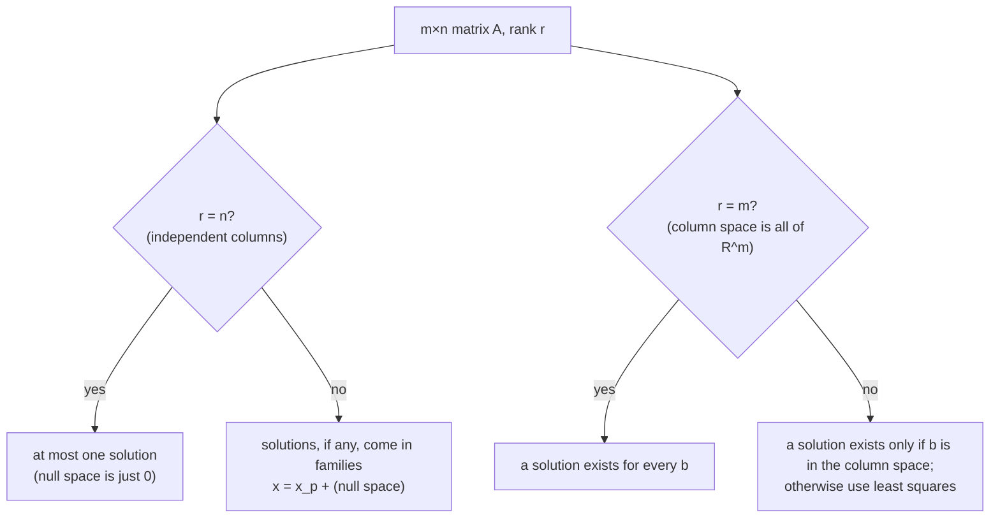
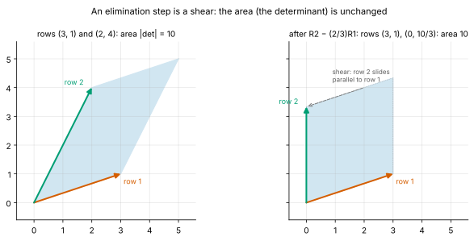
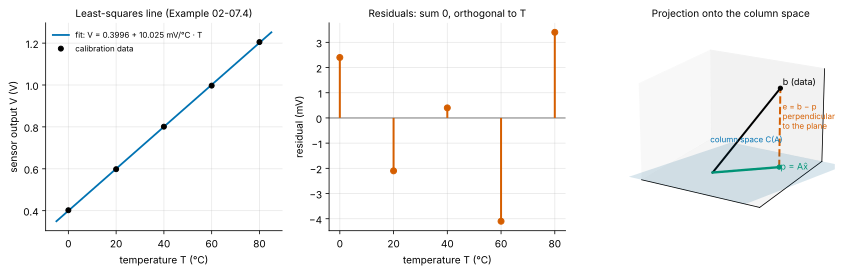
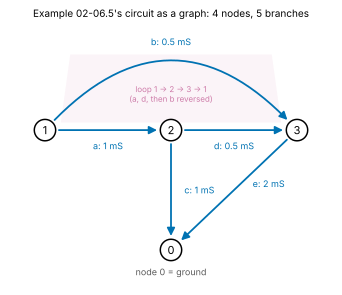

<!-- status: reviewed -->
# 02-07 · Determinants, Inverses, Rank and Vector Spaces

| | |
|---|---|
| **Course** | [02 · Complex Numbers, Differential Equations and Linear Algebra](../README.md) |
| **University equivalent** | The middle units of a sophomore linear-algebra course (MIT 18.06 lectures 3 and 5–10 on inverses, vector spaces, column and null spaces, rank and the complete solution; lecture 12 on graphs and networks; lectures 14–17 on orthogonality, projections, least squares, orthonormal bases and Gram–Schmidt; lectures 18–20 on determinants and Cramer's rule; Strang, *Introduction to Linear Algebra*, chapters 2.5, 3, 4.1–4.3 and 5) |
| **Prerequisites** | [02-06 Vectors, Matrices and Linear Systems](02-06-vectors-matrices-and-linear-systems.md) (elimination, LU, projection onto a line, nodal analysis) |
| **Estimated study hours** | 10 |
| **Last verified** | 2026-11-18 |

**Learning objectives.** After this chapter you can:

1. Compute determinants from pivots, by the 2×2 formula and by cofactor expansion; derive their main properties from three defining rules; and interpret the determinant as a signed volume and as the test for invertibility.
2. Compute inverses by Gauss–Jordan elimination, use the rules for inverses of products and transposes, apply Cramer's rule to small systems, and explain why large systems are never solved either way.
3. Decide whether vectors are linearly independent, and find a basis and the dimension of a subspace.
4. Find the rank, the column space and the null space of a matrix, write the complete solution of $\mathbf{A}\mathbf{x} = \mathbf{b}$, and say from the rank whether solutions exist and are unique.
5. Fit models to data by least squares through the normal equations, and interpret the fit as a projection onto the column space.
6. Use the incidence matrix of a circuit to explain the structure of its conductance matrix, and read driving-point and transfer resistances from the inverse of that matrix.

## 1. Big picture

[02-06](02-06-vectors-matrices-and-linear-systems.md) solved square systems by elimination and noticed that elimination sometimes fails: a pivot can vanish with nothing below it to swap in. This chapter explains *when* and *why*. The **determinant** is a single number that is zero exactly when a square matrix is singular, and it measures how a matrix scales volume. The **inverse** undoes a matrix, and for a circuit it is a table of every driving-point and transfer resistance. **Rank**, the **column space** and the **null space** describe the solutions of $\mathbf{A}\mathbf{x} = \mathbf{b}$ for any matrix, square or not: whether solutions exist, and how many there are. Finally, when there are more equations than unknowns and no exact solution, **least squares** finds the best compromise, which is the foundation of calibration, curve fitting and estimation.

- **Circuits:** the inverse of the conductance matrix gives every node's response to a current injected anywhere, and the rank of a circuit's incidence matrix counts its independent node and loop equations (§3.4, §3.9; [06-04](../../06-circuit-analysis-1-dc/chapters/06-04-nodal-analysis.md), [06-05](../../06-circuit-analysis-1-dc/chapters/06-05-mesh-analysis.md)).
- **Wireless:** the rank of a MIMO channel matrix caps how many independent data streams the antennas can carry at once (§9; [17](../../17-communication-systems/README.md)).
- **Measurement and calibration:** sensor and converter calibration, device-model parameter extraction and GPS positioning all solve least-squares problems (§3.8).
- **AI:** low-rank matrices are how large models are compressed and fine-tuned cheaply (§9, Problem 02-07.15).

## 2. Intuition first

### The determinant as a volume scale factor

Apply a 2×2 matrix to every point of the unit square. The square turns into a parallelogram whose sides are the matrix's columns. The **determinant** is that parallelogram's area, with a sign recording whether the map flipped the square over. In three dimensions it is the volume of the parallelepiped built on the columns. If the columns all lie in one plane, that volume is zero, and the matrix has collapsed space into something flatter. A collapse cannot be undone, which is why a zero determinant means "no inverse".

### Rank as the true number of independent directions

A matrix may have ten columns, but if they all lie in a plane, only two directions are really there. The **rank** counts the independent directions. Everything $\mathbf{A}\mathbf{x}$ can reach (the **column space**) has that dimension, and every direction the matrix squashes to zero (the **null space**) is a direction you cannot recover.

### An analogy from finance: redundant instruments

Return to the replication analogy of 02-06, with the payoffs of $n$ instruments across $m$ states as the columns of a matrix. The rank is the number of truly independent instruments. If one instrument's payoff is a combination of others, it is redundant, and it adds nothing to what can be replicated. The column space is the set of payoffs that can be replicated exactly. When the target payoff lies outside it, the market is incomplete, and the best you can do is hedge: choose the replicable payoff closest to the target, which is exactly least squares (§3.8). The null space is a set of zero-cost, zero-payoff positions: adding one changes the holdings but not the payoff, so the replicating portfolio is not unique.

*Where the analogy breaks:* finance cares about prices and no-arbitrage constraints, and "closest" in hedging is usually measured with probabilities and risk preferences, not the plain Euclidean distance used here. A weighted least-squares problem captures part of that, but not all.

## 3. Theory

### 3.1 Determinants from three rules

Rather than start from a formula, define the determinant of a square matrix by three rules. Everything else, including the formulas, follows from them.

1. **Identity:** $\det\mathbf{I} = 1$.
2. **Row exchange:** exchanging two rows reverses the sign of the determinant.
3. **Linearity in each row** (with the other rows held fixed): multiplying one row by $t$ multiplies the determinant by $t$, and if one row is a sum $\mathbf{r} + \mathbf{r}'$, the determinant is the sum of the two determinants with that row replaced by $\mathbf{r}$ and by $\mathbf{r}'$.

Rule 3 does *not* say $\det(\mathbf{A} + \mathbf{B}) = \det\mathbf{A} + \det\mathbf{B}$; it allows splitting one row at a time. The consequences, each derived from the rules:

- **Two equal rows give zero.** Exchanging them changes nothing, yet by rule 2 it reverses the sign, so $\det = -\det$, which forces $\det = 0$.
- **Elimination does not change the determinant.** Subtracting $\ell$ times row $j$ from row $i$ gives, by rule 3, the original determinant minus $\ell$ times the determinant of a matrix with two equal rows. That second term is zero.
- **A zero row gives zero:** scale the zero row by $t = 0$; by rule 3 the determinant is multiplied by 0.
- **A triangular matrix has determinant equal to the product of its diagonal.** If the diagonal entries are nonzero, elimination clears the off-diagonal entries without changing the determinant. Rule 3 then factors out each diagonal entry, leaving $\det\mathbf{I} = 1$. If a diagonal entry is zero, elimination produces a zero row, and both sides are 0.
- **The determinant is the product of the pivots, up to sign.** Elimination with row exchanges turns $\mathbf{A}$ into $\mathbf{U}$, so

$$
\det\mathbf{A} = \pm\,u_{11}u_{22}\cdots u_{nn} = \pm\,(\text{product of the pivots}),
$$

with $+$ for an even number of row exchanges and $-$ for an odd number. This is how computers evaluate determinants: as a by-product of LU, in about $\tfrac23n^3$ flops.

- **$\det\mathbf{A} = 0$ exactly when $\mathbf{A}$ is singular.** A singular matrix cannot produce $n$ nonzero pivots (02-06 §3.7), so the product is zero; a nonsingular matrix has $n$ nonzero pivots, so it is not.

Two further properties are worth knowing; proofs are in the Going deeper box.

$$
\det(\mathbf{A}\mathbf{B}) = \det\mathbf{A}\,\det\mathbf{B}, \qquad \det\mathbf{A}^\mathsf{T} = \det\mathbf{A} .
$$

The first gives $\det\mathbf{A}^{-1} = 1/\det\mathbf{A}$, because $\det\mathbf{A}\,\det\mathbf{A}^{-1} = \det\mathbf{I} = 1$. The second means every statement about rows also holds for columns. And by rule 3 applied to all $n$ rows, $\det(c\mathbf{A}) = c^n\det\mathbf{A}$.

> **Going deeper — the two product rules.** *Products:* if $\det\mathbf{B} \ne 0$, the function $d(\mathbf{A}) = \det(\mathbf{A}\mathbf{B})/\det\mathbf{B}$ satisfies all three rules. $d(\mathbf{I}) = 1$; exchanging rows of $\mathbf{A}$ exchanges the same rows of $\mathbf{A}\mathbf{B}$; and row $i$ of $\mathbf{A}\mathbf{B}$ is (row $i$ of $\mathbf{A}$)·$\mathbf{B}$, which is linear in row $i$ of $\mathbf{A}$. The three rules determine the function completely (they reduce any matrix to a triangular one), so $d(\mathbf{A}) = \det\mathbf{A}$. If $\det\mathbf{B} = 0$, then $\mathbf{B}$ is singular, so $\mathbf{A}\mathbf{B}$ is too, and both sides are 0. *Transposes:* from $\mathbf{P}\mathbf{A} = \mathbf{L}\mathbf{U}$, transposing gives $\mathbf{A}^\mathsf{T}\mathbf{P}^\mathsf{T} = \mathbf{U}^\mathsf{T}\mathbf{L}^\mathsf{T}$. Triangular matrices have the same diagonal as their transposes. A permutation matrix is $\mathbf{I}$ with its rows exchanged, so $\det\mathbf{P} = \pm1$ by rule 2; and $\mathbf{P}^\mathsf{T} = \mathbf{P}^{-1}$, so $\det\mathbf{P}^\mathsf{T} = 1/\det\mathbf{P}$, which equals $\det\mathbf{P}$ when that is ±1. The product rule then gives $\det\mathbf{A}^\mathsf{T} = \det\mathbf{A}$.

### 3.2 Formulas: 2×2, cofactors, and why they are not used for large matrices

**The 2×2 formula, derived.** Split each row into its two pieces using rule 3:

$$
\det\begin{bmatrix} a & b \\ c & d\end{bmatrix} = \det\begin{bmatrix} a & 0 \\ c & d\end{bmatrix} + \det\begin{bmatrix} 0 & b \\ c & d\end{bmatrix} = \det\begin{bmatrix} a & 0 \\ 0 & d\end{bmatrix} + \det\begin{bmatrix} 0 & b \\ c & 0\end{bmatrix} = ad - bc .
$$

The middle step drops two determinants that have a zero column, which is zero by the column version of the zero-row rule. The last step uses the triangular rule for the first term, and one row exchange for the second, which turns $\begin{bmatrix} 0 & b \\ c & 0\end{bmatrix}$ into a diagonal matrix with determinant $cb$, hence $-bc$.

**Cofactor expansion, derived.** Split row 1 of an $n\times n$ matrix into its $n$ pieces with rule 3: $\det\mathbf{A} = \sum_j\det\mathbf{A}^{(j)}$, where $\mathbf{A}^{(j)}$ keeps rows 2 to $n$ of $\mathbf{A}$ but has row 1 equal to $(0, \dots, a_{1j}, \dots, 0)$. Evaluate one piece in three steps.

1. Move column $j$ to the front by $j - 1$ exchanges of adjacent columns. Each exchange flips the sign (the column version of rule 2, valid because $\det\mathbf{A}^\mathsf{T} = \det\mathbf{A}$), so the sign is $(-1)^{j-1}$. Row 1 is now $(a_{1j}, 0, \dots, 0)$, and the lower-right $(n-1)\times(n-1)$ block is the **minor** $\mathbf{M}_{1j}$: $\mathbf{A}$ with row 1 and column $j$ deleted, its other columns in their original order.
2. If $a_{1j} = 0$ the piece is zero (a zero row). Otherwise subtract multiples of row 1 to clear the first column below it; elimination does not change the determinant, and row 1 has zeros elsewhere, so the block $\mathbf{M}_{1j}$ is untouched.
3. Now eliminate inside $\mathbf{M}_{1j}$, which never touches row 1 or column 1. The matrix becomes triangular with diagonal $a_{1j}$ followed by the pivots of $\mathbf{M}_{1j}$, so the piece equals $(-1)^{j-1}a_{1j}\det\mathbf{M}_{1j}$.

Summing the pieces, and writing $(-1)^{j-1} = (-1)^{1+j}$:

$$
\det\mathbf{A} = a_{11}C_{11} + a_{12}C_{12} + \dots + a_{1n}C_{1n}, \qquad C_{1j} = (-1)^{1+j}\det\mathbf{M}_{1j},
$$

where $C_{1j}$ is the **cofactor**. Any row works: move row $i$ to the top with $i - 1$ adjacent row exchanges (keeping the other rows in order) and expand along it, which gives the sign $(-1)^{i+j}$. Any column works too, by $\det\mathbf{A}^\mathsf{T} = \det\mathbf{A}$. The signs alternate in a checkerboard, starting with $+$ in the top-left corner. For 3×3:

$$
\det\begin{bmatrix} a_{11} & a_{12} & a_{13} \\ a_{21} & a_{22} & a_{23} \\ a_{31} & a_{32} & a_{33}\end{bmatrix} = a_{11}(a_{22}a_{33} - a_{23}a_{32}) - a_{12}(a_{21}a_{33} - a_{23}a_{31}) + a_{13}(a_{21}a_{32} - a_{22}a_{31}) .
$$

**Why nobody expands large determinants.** Fully expanded, an $n\times n$ determinant is a sum of $n!$ products, one for each way of choosing one entry from every row and every column (the *Leibniz formula*). For $n = 20$ that is $20! \approx 2.4\times10^{18}$ terms, against about 5,300 flops for elimination. Cofactors are for small matrices and for symbolic work. Numerical software uses pivots.

### 3.3 The determinant as volume

The three rules are also the rules of **signed volume** for the box (parallelepiped) whose edges are the rows:

- the unit cube has volume 1 (rule 1);
- stretching one edge by $t$ scales the volume by $t$ (rule 3);
- swapping two edges reverses the orientation (rule 2);
- sliding one edge parallel to another, a *shear*, leaves the volume unchanged, like pushing a stack of cards sideways.

The shear is exactly the elimination step that preserves the determinant. Because the rules determine the function, **$\lvert\det\mathbf{A}\rvert$ is the volume of the box built on the rows of $\mathbf{A}$**, and by $\det\mathbf{A}^\mathsf{T} = \det\mathbf{A}$, also on its columns. Elimination makes this concrete: each step shears the box without changing its volume, until the box has the pivots as its heights. Figure 02-07.1 shows the 2×2 case.

The consequence for linear maps: $\mathbf{A}$ sends the unit cube to the box built on its columns, so **$\mathbf{A}$ multiplies every volume by $\lvert\det\mathbf{A}\rvert$**. (Cut any region into tiny cubes, and each is scaled the same way.) This is the Jacobian factor of the change-of-variables formula in [01-10](../../01-calculus-for-engineers/chapters/01-10-multivariable-calculus-2.md): locally, a smooth map acts like its matrix of partial derivatives, and areas scale by that matrix's determinant.

*Figure 02-07.1 — An elimination step is a shear, so it preserves area. The determinant, 10, is the area before and after, and equals the product of the pivots, 3 × 10/3.*

### 3.4 Inverses

A square matrix $\mathbf{A}$ is **invertible** if some matrix $\mathbf{A}^{-1}$ satisfies $\mathbf{A}^{-1}\mathbf{A} = \mathbf{I}$ and $\mathbf{A}\mathbf{A}^{-1} = \mathbf{I}$. The following are equivalent; each one implies all the others:

- $\mathbf{A}$ has an inverse;
- elimination produces $n$ nonzero pivots;
- $\det\mathbf{A} \ne 0$;
- $\mathbf{A}\mathbf{x} = \mathbf{0}$ only for $\mathbf{x} = \mathbf{0}$;
- $\mathbf{A}\mathbf{x} = \mathbf{b}$ has exactly one solution for every $\mathbf{b}$, namely $\mathbf{x} = \mathbf{A}^{-1}\mathbf{b}$.

**2×2 inverse.** For $\mathbf{A} = \begin{bmatrix} a & b \\ c & d\end{bmatrix}$ with $ad - bc \ne 0$,

$$
\mathbf{A}^{-1} = \frac{1}{ad - bc}\begin{bmatrix} d & -b \\ -c & a\end{bmatrix} .
$$

Check by multiplying: $\begin{bmatrix} a & b \\ c & d\end{bmatrix}\begin{bmatrix} d & -b \\ -c & a\end{bmatrix} = \begin{bmatrix} ad - bc & 0 \\ 0 & ad - bc\end{bmatrix}$. Swap the diagonal, negate the off-diagonal, divide by the determinant.

**Gauss–Jordan elimination.** Column $j$ of $\mathbf{A}^{-1}$ solves $\mathbf{A}\mathbf{x} = \mathbf{e}_j$, where $\mathbf{e}_j$ is column $j$ of $\mathbf{I}$. Solve all $n$ systems at once:

1. Write the block matrix $[\mathbf{A} \mid \mathbf{I}]$.
2. Eliminate *downward* as in 02-06, to get $[\mathbf{U} \mid \cdot\,]$.
3. Eliminate *upward*, clearing the entries above each pivot.
4. Divide each row by its pivot.

The left block becomes $\mathbf{I}$ and the right block becomes $\mathbf{A}^{-1}$. Example 02-07.2 works one through.

**Rules.** $(\mathbf{A}\mathbf{B})^{-1} = \mathbf{B}^{-1}\mathbf{A}^{-1}$ (undo the last operation first: $\mathbf{B}^{-1}\mathbf{A}^{-1}\mathbf{A}\mathbf{B} = \mathbf{B}^{-1}\mathbf{B} = \mathbf{I}$). $(\mathbf{A}^\mathsf{T})^{-1} = (\mathbf{A}^{-1})^\mathsf{T}$ (transpose $\mathbf{A}\mathbf{A}^{-1} = \mathbf{I}$). The inverse of a diagonal matrix inverts each diagonal entry. The inverse of a symmetric matrix is symmetric.

**Cost, and the rule of practice.** Computing $\mathbf{A}^{-1}$ costs about $2n^3$ flops, three times an LU factorization. And computing $\mathbf{A}^{-1}\mathbf{b}$ is not *backward stable*: the solution it returns can leave a larger residual $\lVert\mathbf{A}\mathbf{x} - \mathbf{b}\rVert$ than solving with the LU factors, although the error in $\mathbf{x}$ itself is often similar ([02-10](02-10-numerical-methods.md) §3.6). So the inverse is a tool for *thinking* and for formulas, and for the occasional case where its entries themselves are wanted. To solve $\mathbf{A}\mathbf{x} = \mathbf{b}$, factor and substitute.

**The inverse of a conductance matrix is a resistance matrix.** For a grounded resistive circuit, $\mathbf{G}\mathbf{v} = \mathbf{i}$ gives $\mathbf{v} = \mathbf{R}\mathbf{i}$ with $\mathbf{R} = \mathbf{G}^{-1}$, in ohms. Column $j$ of $\mathbf{R}$ is the set of node voltages produced by 1 A injected at node $j$ (and nothing else). So:

- $R_{jj}$ is the **driving-point resistance** at node $j$: the Thevenin resistance between that node and ground;
- $R_{kj}$ is the **transfer resistance**: the voltage at node $k$ per ampere injected at node $j$;
- $\mathbf{R}$ is symmetric because $\mathbf{G}$ is: injecting at $j$ and measuring at $k$ gives the same ratio as the reverse. This is **reciprocity**, a theorem about linear resistive networks that here falls out of matrix algebra.

For a connected resistive network every entry of $\mathbf{R}$ is positive: current injected anywhere raises every node voltage. Example 02-07.5 computes $\mathbf{R}$ for the circuit of 02-06 and checks it in ngspice.

### 3.5 Cramer's rule

For a nonsingular $n\times n$ system, Cramer's rule gives each unknown as a ratio of determinants:

$$
x_i = \frac{\det\mathbf{B}_i}{\det\mathbf{A}}, \qquad \mathbf{B}_i = \mathbf{A}\text{ with column }i\text{ replaced by }\mathbf{b} .
$$

*Derivation.* Let $\mathbf{X}_i$ be the identity matrix with column $i$ replaced by $\mathbf{x}$. Then $\mathbf{A}\mathbf{X}_i$ has columns $\mathbf{A}\mathbf{e}_1, \dots, \mathbf{A}\mathbf{x}, \dots, \mathbf{A}\mathbf{e}_n$, which are the columns of $\mathbf{A}$ with column $i$ replaced by $\mathbf{A}\mathbf{x} = \mathbf{b}$. In other words, $\mathbf{A}\mathbf{X}_i = \mathbf{B}_i$. Expanding $\det\mathbf{X}_i$ along its row $i$ gives $x_i$, so the product rule yields $\det\mathbf{A}\cdot x_i = \det\mathbf{B}_i$.

Applying the rule to each column of $\mathbf{I}$ gives the **adjugate formula** for the inverse. Column $j$ of $\mathbf{A}^{-1}$ solves $\mathbf{A}\mathbf{x} = \mathbf{e}_j$, so its entry $i$ is $\det\mathbf{B}_i/\det\mathbf{A}$, where $\mathbf{B}_i$ is $\mathbf{A}$ with column $i$ replaced by $\mathbf{e}_j$. Expand $\det\mathbf{B}_i$ down that column: its only nonzero entry is the 1 in row $j$, so $\det\mathbf{B}_i = (-1)^{i+j}\det\mathbf{M}_{ji} = C_{ji}$. Hence $(\mathbf{A}^{-1})_{ij} = C_{ji}/\det\mathbf{A}$, that is $\mathbf{A}^{-1} = \mathbf{C}^\mathsf{T}/\det\mathbf{A}$, where $\mathbf{C}$ is the matrix of cofactors (here $\mathbf{C}$ means cofactors; §3.9 uses $\mathbf{C}$ for branch conductances). The transpose appears because the row index of the inverse is the column index of the cofactor. The 2×2 inverse above is its smallest case.

**When to use it.** Cramer's rule needs $n + 1$ determinants, so it is hopeless numerically for large $n$. Its value is *symbolic*. For a 2- or 3-node circuit it gives closed-form expressions, such as a gain as a ratio of polynomials in the component values. Those show how each component enters, which is what a designer wants when choosing values or estimating sensitivity. The denominator, $\det\mathbf{A}$, is common to every unknown. For circuits with capacitors and inductors analyzed in the $s$-domain, that common denominator is a rational function of $s$ (an inductor stamps $1/(sL)$). After clearing the powers of $s$, its numerator is the characteristic polynomial (barring cancellations), whose roots are the poles of [02-05](02-05-laplace-transform-for-odes.md).

### 3.6 Vector spaces, independence, basis and dimension

A **vector space** is a set of objects that can be added and scaled while staying in the set, following the usual algebra rules: $\mathbb{R}^n$, but also polynomials, sampled signals, and the solutions of a homogeneous linear ODE. A **subspace** of $\mathbb{R}^n$ is a subset that is closed under addition and scalar multiplication, and so contains $\mathbf{0}$. A plane through the origin is a subspace; a plane that misses the origin is not, because doubling one of its vectors leaves it.

The **span** of a set of vectors is the set of all their linear combinations; it is always a subspace.

Vectors $\mathbf{v}_1, \dots, \mathbf{v}_k$ are **linearly independent** if the only combination $c_1\mathbf{v}_1 + \dots + c_k\mathbf{v}_k$ equal to $\mathbf{0}$ is the one with every $c_i = 0$. Otherwise they are **dependent**: some combination with nonzero weights vanishes, and at least one of the vectors is a combination of the others. To test, put the vectors in the columns of a matrix $\mathbf{V}$ and ask whether $\mathbf{V}\mathbf{c} = \mathbf{0}$ has a nonzero solution: eliminate and count pivots. For $n$ vectors in $\mathbb{R}^n$, the matrix is square, and the test is $\det\mathbf{V} \ne 0$.

A **basis** of a subspace is a set of independent vectors that spans it. Every vector in the subspace is then a combination of the basis vectors *in exactly one way*: if two combinations gave the same vector, their difference would be a vanishing combination with nonzero weights. All bases of a subspace have the same number of vectors, its **dimension**. ($\mathbb{R}^n$ has dimension $n$, and the unit vectors are its standard basis.)

> **Going deeper — why every basis has the same size.** Suppose $\mathbf{w}_1, \dots, \mathbf{w}_m$ span a subspace and $\mathbf{v}_1, \dots, \mathbf{v}_n$ in it are independent. Each $\mathbf{v}_j$ is a combination of the $\mathbf{w}$'s, so $\mathbf{V} = \mathbf{W}\mathbf{K}$ for some $m\times n$ matrix $\mathbf{K}$ whose column $j$ holds the weights for $\mathbf{v}_j$. If $n > m$, then $\mathbf{K}$ is wide, elimination leaves it a free column, and $\mathbf{K}\mathbf{c} = \mathbf{0}$ has a nonzero solution (§3.7). Then $\mathbf{V}\mathbf{c} = \mathbf{W}\mathbf{K}\mathbf{c} = \mathbf{0}$, contradicting independence. So an independent set is never larger than a spanning set. Two bases are both, so each is at most the size of the other: they are equal.

You have already met a vector space that is not a set of lists. The solutions of $y'' + 2\alpha y' + \omega_0^2y = 0$ form a vector space, because sums and multiples of solutions are solutions (superposition, [02-03](02-03-second-order-linear-odes.md)). It has dimension 2, and for distinct characteristic roots $e^{s_1t}$ and $e^{s_2t}$ are a basis. That is why exactly two initial conditions pin down a solution.

### 3.7 Column space, null space and rank

For an $m\times n$ matrix $\mathbf{A}$, two subspaces matter most.

- **The column space** $C(\mathbf{A})$ is the span of the columns, a subspace of $\mathbb{R}^m$. It is the set of all $\mathbf{A}\mathbf{x}$, so **$\mathbf{A}\mathbf{x} = \mathbf{b}$ is solvable exactly when $\mathbf{b}$ is in $C(\mathbf{A})$**.
- **The null space** $N(\mathbf{A})$ is the set of all solutions of $\mathbf{A}\mathbf{x} = \mathbf{0}$, a subspace of $\mathbb{R}^n$. It is closed under combinations because $\mathbf{A}(c\mathbf{x} + d\mathbf{y}) = c\mathbf{0} + d\mathbf{0}$.

**Finding them by elimination.** Elimination works for rectangular matrices too. When a column has no pivot available, skip to the next column. The result is an **echelon form** $\mathbf{U}$, a staircase with the pivots on its steps. Continue upward and divide by the pivots to get the **reduced row echelon form** $\mathbf{R}$. Then:

- The **rank** $r$ is the number of pivots.
- The **pivot columns** of the *original* $\mathbf{A}$ are a basis for $C(\mathbf{A})$, so $\dim C(\mathbf{A}) = r$. Row operations change the columns, but not the dependencies among them: each row operation is invertible, so $\mathbf{A}\mathbf{x} = \mathbf{0}$ exactly when $\mathbf{R}\mathbf{x} = \mathbf{0}$, and any combination of columns that vanishes for $\mathbf{R}$ vanishes for $\mathbf{A}$. In $\mathbf{R}$ the pivot columns are distinct unit vectors, so they are independent, and every other column is a combination of them, with weights read off its entries in the pivot rows. The same holds for the columns of $\mathbf{A}$.
- The other $n - r$ columns are **free columns**, and their variables are free. For each free variable, set it to 1 and the other free variables to 0, and solve for the pivot variables. The resulting **special solutions** $\mathbf{s}_1, \dots, \mathbf{s}_{n-r}$ form a basis for $N(\mathbf{A})$, so $\dim N(\mathbf{A}) = n - r$. *They are independent:* each has a 1 in its own free slot and 0 in the other free slots, so a combination of them vanishes only if every weight does. *They span:* if $\mathbf{x}$ is any null vector with free-variable values $x_{f_1}, \dots, x_{f_{n-r}}$, then $\mathbf{x} - \sum_ix_{f_i}\mathbf{s}_i$ is a null vector whose free variables are all zero, and $\mathbf{R}\mathbf{x} = \mathbf{0}$ then forces its pivot variables to zero too. So $\mathbf{x} = \sum_ix_{f_i}\mathbf{s}_i$.

This gives the **rank–nullity theorem**:

$$
\dim C(\mathbf{A}) + \dim N(\mathbf{A}) = r + (n - r) = n .
$$

Every one of the $n$ input directions either survives into the output (there are $r$ of them) or is squashed to zero.

**The complete solution.** If $\mathbf{x}_p$ is any one solution of $\mathbf{A}\mathbf{x} = \mathbf{b}$ (a **particular solution**), then every solution is

$$
\mathbf{x} = \mathbf{x}_p + \mathbf{x}_n, \qquad \mathbf{x}_n \in N(\mathbf{A}),
$$

because $\mathbf{A}(\mathbf{x} - \mathbf{x}_p) = \mathbf{b} - \mathbf{b} = \mathbf{0}$. This is the same structure as particular plus homogeneous solutions of a linear ODE ([02-04](02-04-forced-response-and-resonance.md)): linearity at work. To find $\mathbf{x}_p$, set the free variables to zero and solve for the pivot variables. To test solvability, carry $\mathbf{b}$ through elimination. Every zero row of $\mathbf{U}$ becomes a condition, "this combination of the $b_i$ must vanish".

**What the rank decides.**

| Rank | Shape of $\mathbf{U}$ | Solutions of $\mathbf{A}\mathbf{x} = \mathbf{b}$ |
|---|---|---|
| $r = m = n$ | square, invertible | exactly one, for every $\mathbf{b}$ |
| $r = n < m$ | tall, independent columns | none or exactly one (least squares when none) |
| $r = m < n$ | wide, every row has a pivot | infinitely many, for every $\mathbf{b}$ |
| $r < m$, $r < n$ | zero rows and free columns | none, or infinitely many |

> **Going deeper — the four fundamental subspaces.** Every matrix has four subspaces: the column space $C(\mathbf{A})$ and **left null space** $N(\mathbf{A}^\mathsf{T})$ in $\mathbb{R}^m$, and the **row space** $C(\mathbf{A}^\mathsf{T})$ and null space $N(\mathbf{A})$ in $\mathbb{R}^n$. Their dimensions are $r$, $m - r$, $r$ and $n - r$. Each pair is **orthogonal**: every vector in $N(\mathbf{A})$ is perpendicular to every row, because $\mathbf{A}\mathbf{x} = \mathbf{0}$ says exactly that each row dotted with $\mathbf{x}$ is zero. Likewise $N(\mathbf{A}^\mathsf{T})$ is perpendicular to the columns. This picture, Strang's "fundamental theorem of linear algebra", is behind least squares (next section), behind the loop and node equations of circuits (§3.9), and behind the singular value decomposition ([02-08](02-08-eigenvalues-and-eigenvectors.md)).

### 3.8 Least squares

Measurements carry noise, so a model with $n$ parameters fitted to $m > n$ measurements gives a tall system $\mathbf{A}\mathbf{x} = \mathbf{b}$ that almost never has an exact solution: $\mathbf{b}$ is not in the column space. The **least-squares** solution $\hat{\mathbf{x}}$ minimizes the squared length of the error,

$$
\lVert\mathbf{e}\rVert^2 = \lVert\mathbf{b} - \mathbf{A}\mathbf{x}\rVert^2 = \sum_{i=1}^m\big(b_i - (\mathbf{A}\mathbf{x})_i\big)^2 .
$$

**Derivation by geometry.** As $\mathbf{x}$ varies, $\mathbf{A}\mathbf{x}$ moves over the column space. The closest point to $\mathbf{b}$ is its projection $\mathbf{p} = \mathbf{A}\hat{\mathbf{x}}$, where the error is perpendicular to the whole column space. That is the same Pythagoras argument as for one line in 02-06 §3.3. Perpendicular to every column means $\mathbf{A}^\mathsf{T}\mathbf{e} = \mathbf{0}$:

$$
\mathbf{A}^\mathsf{T}(\mathbf{b} - \mathbf{A}\hat{\mathbf{x}}) = \mathbf{0} \quad\Longrightarrow\quad \boxed{\mathbf{A}^\mathsf{T}\mathbf{A}\,\hat{\mathbf{x}} = \mathbf{A}^\mathsf{T}\mathbf{b}} .
$$

These are the **normal equations**: a square $n\times n$ system. The projection is $\mathbf{p} = \mathbf{A}(\mathbf{A}^\mathsf{T}\mathbf{A})^{-1}\mathbf{A}^\mathsf{T}\mathbf{b}$, and for $n = 1$ this reduces to the formula of 02-06.

**Derivation by calculus (a check).** Expanding,

$$
\lVert\mathbf{b} - \mathbf{A}\mathbf{x}\rVert^2 = \mathbf{b}^\mathsf{T}\mathbf{b} - 2\mathbf{x}^\mathsf{T}\mathbf{A}^\mathsf{T}\mathbf{b} + \mathbf{x}^\mathsf{T}\mathbf{A}^\mathsf{T}\mathbf{A}\mathbf{x} .
$$

Setting every partial derivative with respect to $x_j$ to zero ([01-09](../../01-calculus-for-engineers/chapters/01-09-multivariable-calculus-1.md)) gives $-2\mathbf{A}^\mathsf{T}\mathbf{b} + 2\mathbf{A}^\mathsf{T}\mathbf{A}\mathbf{x} = \mathbf{0}$: the same equations.

> **Math refresher — gradients of linear and quadratic forms.** For a constant vector $\mathbf{c}$, $\mathbf{x}^\mathsf{T}\mathbf{c} = \sum_kx_kc_k$, so $\partial/\partial x_j$ gives $c_j$: the gradient is $\mathbf{c}$. For a symmetric matrix $\mathbf{M}$, $\mathbf{x}^\mathsf{T}\mathbf{M}\mathbf{x} = \sum_k\sum_lx_kM_{kl}x_l$. Differentiating with respect to $x_j$ picks out the terms with $k = j$ and those with $l = j$: $\sum_lM_{jl}x_l + \sum_kx_kM_{kj} = 2(\mathbf{M}\mathbf{x})_j$, using $M_{kj} = M_{jk}$. So the gradient is $2\mathbf{M}\mathbf{x}$, the matrix version of $d(mx^2)/dx = 2mx$. Above, $\mathbf{c} = \mathbf{A}^\mathsf{T}\mathbf{b}$ and $\mathbf{M} = \mathbf{A}^\mathsf{T}\mathbf{A}$.

**When the solution is unique.** $\mathbf{A}^\mathsf{T}\mathbf{A}$ is invertible exactly when the columns of $\mathbf{A}$ are independent. If $\mathbf{A}^\mathsf{T}\mathbf{A}\mathbf{x} = \mathbf{0}$, then $0 = \mathbf{x}^\mathsf{T}\mathbf{A}^\mathsf{T}\mathbf{A}\mathbf{x} = \lVert\mathbf{A}\mathbf{x}\rVert^2$, so $\mathbf{A}\mathbf{x} = \mathbf{0}$, and independence forces $\mathbf{x} = \mathbf{0}$. In fitting terms: the model's parameters must not be redundant. A model with two offset terms cannot tell them apart.

**Fitting a straight line.** For data $(t_i, b_i)$ and the model $b \approx c + dt$, the matrix $\mathbf{A}$ has a column of ones and a column of the $t_i$. The normal equations are

$$
\begin{bmatrix} m & \sum t_i \\ \sum t_i & \sum t_i^2\end{bmatrix}\begin{bmatrix} c \\ d\end{bmatrix} = \begin{bmatrix} \sum b_i \\ \sum t_ib_i\end{bmatrix} .
$$

Their solution is the familiar ordinary-least-squares regression:

$$
\hat{d} = \frac{\sum(t_i - \bar{t})(b_i - \bar{b})}{\sum(t_i - \bar{t})^2}, \qquad \hat{c} = \bar{b} - \hat{d}\,\bar{t} .
$$

The orthogonality conditions say that the residuals sum to zero (perpendicular to the column of ones) and are uncorrelated with $t$ (perpendicular to the $t$ column). Any model that is *linear in its parameters* fits the same way: polynomials, sums of known sinusoids, $a + b\ln t$. So do some models that can be made linear, such as an exponential decay fitted through its logarithm (Problem 02-07.14).

**Orthonormal bases and Gram–Schmidt.** Least squares is easiest when the columns are **orthonormal**: unit length and mutually perpendicular, $\mathbf{q}_i^\mathsf{T}\mathbf{q}_j = 0$ for $i \ne j$ and 1 for $i = j$. Collected in an $m\times n$ matrix $\mathbf{Q}$, that says $\mathbf{Q}^\mathsf{T}\mathbf{Q} = \mathbf{I}$. The normal equations then collapse to $\hat{\mathbf{x}} = \mathbf{Q}^\mathsf{T}\mathbf{b}$, each coefficient a single dot product, and the projection is $\mathbf{p} = \mathbf{Q}\mathbf{Q}^\mathsf{T}\mathbf{b}$. A *square* $\mathbf{Q}$ with orthonormal columns is an **orthogonal matrix**: $\mathbf{Q}^{-1} = \mathbf{Q}^\mathsf{T}$, and it preserves lengths, because $\lVert\mathbf{Q}\mathbf{x}\rVert^2 = \mathbf{x}^\mathsf{T}\mathbf{Q}^\mathsf{T}\mathbf{Q}\mathbf{x} = \lVert\mathbf{x}\rVert^2$. Rotations and reflections are orthogonal matrices, and 02-08 uses them throughout.

The **Gram–Schmidt process** turns independent columns $\mathbf{a}_1, \dots, \mathbf{a}_n$ into orthonormal ones spanning the same space. Take each column in turn, subtract its projections onto the directions already built, and normalize:

$$
\mathbf{w}_k = \mathbf{a}_k - \sum_{i<k}(\mathbf{q}_i^\mathsf{T}\mathbf{a}_k)\,\mathbf{q}_i, \qquad \mathbf{q}_k = \frac{\mathbf{w}_k}{\lVert\mathbf{w}_k\rVert} .
$$

Each $\mathbf{w}_k$ is perpendicular to every earlier $\mathbf{q}_j$: dotting with $\mathbf{q}_j$ gives $\mathbf{q}_j^\mathsf{T}\mathbf{a}_k - \mathbf{q}_j^\mathsf{T}\mathbf{a}_k = 0$, because the earlier $\mathbf{q}$'s are orthonormal. And $\mathbf{w}_k \ne \mathbf{0}$, because independence means $\mathbf{a}_k$ is not a combination of the earlier columns.

**A = QR.** Read the process backward: $\mathbf{a}_k = \sum_{i<k}(\mathbf{q}_i^\mathsf{T}\mathbf{a}_k)\mathbf{q}_i + \lVert\mathbf{w}_k\rVert\mathbf{q}_k$, a combination of $\mathbf{q}_1, \dots, \mathbf{q}_k$ only. In matrix form $\mathbf{A} = \mathbf{Q}\mathbf{R}$, where $\mathbf{R}$ (the triangular factor, not the echelon form of §3.7) is upper triangular with $r_{ik} = \mathbf{q}_i^\mathsf{T}\mathbf{a}_k$ and $r_{kk} = \lVert\mathbf{w}_k\rVert > 0$. Substituting into the normal equations gives $\mathbf{R}^\mathsf{T}\mathbf{Q}^\mathsf{T}\mathbf{Q}\mathbf{R}\hat{\mathbf{x}} = \mathbf{R}^\mathsf{T}\mathbf{Q}^\mathsf{T}\mathbf{b}$. Cancel $\mathbf{Q}^\mathsf{T}\mathbf{Q} = \mathbf{I}$ and the invertible $\mathbf{R}^\mathsf{T}$:

$$
\mathbf{R}\,\hat{\mathbf{x}} = \mathbf{Q}^\mathsf{T}\mathbf{b},
$$

solved by back substitution, without ever forming $\mathbf{A}^\mathsf{T}\mathbf{A}$. Example 02-07.6 works one through.

> **Going deeper — how software actually solves least squares.** Forming $\mathbf{A}^\mathsf{T}\mathbf{A}$ squares the sensitivity of the problem to rounding (its *condition number*, [02-10](02-10-numerical-methods.md)). For badly scaled or nearly dependent columns, such as high-degree polynomial fits, that can lose half the available digits. Libraries therefore factor $\mathbf{A}$ itself: by QR factorization, computed with Householder reflections rather than classical Gram–Schmidt, which loses orthogonality in floating point, or by the singular value decomposition. SciPy's `scipy.linalg.lstsq` defaults to LAPACK's SVD-based driver `gelsd`, and NumPy's `numpy.linalg.lstsq` likewise returns singular values. Use the normal equations to understand and to derive; use `lstsq` to compute. See Trefethen and Bau, lectures 7–11.

*Figure 02-07.2 — Least squares (Example 02-07.4). The fitted line minimizes the sum of squared vertical residuals; geometrically, $\mathbf{A}\hat{\mathbf{x}}$ is the projection of the data vector onto the column space, and the residual vector is perpendicular to it.*

### 3.9 Circuits as graphs: the incidence matrix

Here is the connection between this chapter's subspaces and the conductance matrix of 02-06. Describe a circuit's wiring by its **incidence matrix**. Number the $n$ nodes (including ground) and the $b$ branches (resistors), and give each branch a reference direction from one node to another. Row $k$ of the $b\times n$ matrix $\mathbf{A}$ has $+1$ in the column of branch $k$'s start node, $-1$ in the column of its end node, and zeros elsewhere.

Three steps then rebuild nodal analysis.

1. **Voltage across each branch:** $\mathbf{e} = \mathbf{A}\mathbf{v}$, since row $k$ computes $v_{\text{start}} - v_{\text{end}}$. (In this section $\mathbf{e}$ holds branch voltages, not the least-squares error of §3.8.)
2. **Ohm's law, branch by branch:** the branch currents are $\mathbf{y} = \mathbf{C}\mathbf{e}$, where $\mathbf{C}$ is the diagonal matrix of branch conductances (not the cofactor matrix of §3.5).
3. **KCL at each node:** $\mathbf{A}^\mathsf{T}\mathbf{y} = \mathbf{f}$, where $\mathbf{f}$ holds the source currents injected at the nodes. Column $p$ of $\mathbf{A}$ has $+1$ for branches leaving node $p$ and $-1$ for branches arriving, so $(\mathbf{A}^\mathsf{T}\mathbf{y})_p$ is the net branch current leaving node $p$.

Chaining the three:

$$
\mathbf{A}^\mathsf{T}\mathbf{C}\mathbf{A}\,\mathbf{v} = \mathbf{f}, \qquad \text{that is,} \qquad \mathbf{G} = \mathbf{A}^\mathsf{T}\mathbf{C}\mathbf{A} .
$$

Everything 02-06 observed about $\mathbf{G}$ now has a reason:

- **Symmetry:** $(\mathbf{A}^\mathsf{T}\mathbf{C}\mathbf{A})^\mathsf{T} = \mathbf{A}^\mathsf{T}\mathbf{C}^\mathsf{T}\mathbf{A} = \mathbf{A}^\mathsf{T}\mathbf{C}\mathbf{A}$.
- **The stamp:** each branch contributes $g_k\mathbf{a}_k\mathbf{a}_k^\mathsf{T}$, where $\mathbf{a}_k^\mathsf{T}$ is its row of $\mathbf{A}$, which is exactly the resistor stamp.
- **Singularity without ground:** every row of $\mathbf{A}$ sums to zero, so the constant vector $(1, \dots, 1)$ is in $N(\mathbf{A})$. For a connected circuit that is all of it, so $\dim N(\mathbf{A}) = 1$ and $\operatorname{rank}\mathbf{A} = n - 1$: only $n - 1$ node equations are independent. Grounding a node deletes its column. The remaining **reduced incidence matrix** has independent columns, and $\mathbf{G}$ becomes invertible.
- **Loops:** the left null space $N(\mathbf{A}^\mathsf{T})$ holds the branch-current patterns that satisfy KCL with no sources. These are currents circulating around loops. Its dimension is $b - \operatorname{rank}\mathbf{A} = b - n + 1$, the number of **independent loops**, and so the number of equations mesh analysis needs ([06-05](../../06-circuit-analysis-1-dc/chapters/06-05-mesh-analysis.md)).
- **Power:** $\mathbf{v}^\mathsf{T}\mathbf{G}\mathbf{v} = (\mathbf{A}\mathbf{v})^\mathsf{T}\mathbf{C}(\mathbf{A}\mathbf{v}) = \sum_kg_ke_k^2$ is the total power dissipated, never negative. Matrices with this property are called *positive semidefinite*, or *positive definite* when the sum is zero only for $\mathbf{v} = \mathbf{0}$, as for a grounded network. They are central to [02-08](02-08-eigenvalues-and-eigenvectors.md).

The same $\mathbf{A}^\mathsf{T}\mathbf{C}\mathbf{A}$ pattern describes spring networks in mechanics, heat flow in a chip's thermal model, and the least-squares normal equations themselves (with $\mathbf{C}$ as weights).

*Figure 02-07.3 — The circuit of Example 02-06.5 as a graph: 4 nodes and 5 branches, so the incidence matrix has rank 3, and there are 5 − 4 + 1 = 2 independent loops.*

## 4. Worked examples

### Example 02-07.1 — Determinants three ways (tier A)

**Setup.** (a) Find $\det\begin{bmatrix} 3 & 1 \\ 2 & 4\end{bmatrix}$, and interpret it as an area. (b) Find the determinant of Example 02-06.3's matrix $\mathbf{A} = \begin{bmatrix} 2 & 1 & -1 \\ 4 & 5 & -3 \\ -2 & 5 & 4\end{bmatrix}$ by cofactor expansion, and compare with its pivots. (c) Find $\det(2\mathbf{A})$, $\det\mathbf{A}^\mathsf{T}$ and $\det\mathbf{A}^{-1}$.

**Solution.** (a) $3\cdot4 - 1\cdot2 = $ **10**. The columns $(3, 2)$ and $(1, 4)$ span a parallelogram of area 10, so the matrix multiplies every area by 10. The sign is positive, so it preserves orientation.

(b) Expand along row 1:

$$
\det\mathbf{A} = 2\begin{vmatrix} 5 & -3 \\ 5 & 4\end{vmatrix} - 1\begin{vmatrix} 4 & -3 \\ -2 & 4\end{vmatrix} + (-1)\begin{vmatrix} 4 & 5 \\ -2 & 5\end{vmatrix} = 2(35) - 1(10) - 1(30) = \mathbf{30} .
$$

Elimination in 02-06 found pivots 2, 3 and 5 with no row exchanges, and $2\cdot3\cdot5 = 30$ ✓.

(c) $\det(2\mathbf{A}) = 2^3\cdot30 = $ **240** (each of the three rows is doubled). $\det\mathbf{A}^\mathsf{T} = $ **30**. $\det\mathbf{A}^{-1} = 1/30 = $ **0.03333**.

**Check.** $\det(2\mathbf{A}) = 240$, not 60: doubling a 3-D box in every direction multiplies its volume by 8.

### Example 02-07.2 — The inverse of a resistor ladder (tier B)

**Setup.** Three nodes are connected in a chain by 1 Ω resistors: ground–1, 1–2, 2–3 and 3–ground. (a) Write the conductance matrix $\mathbf{K}$ (in S) and find its determinant. (b) Find $\mathbf{K}^{-1}$ by Gauss–Jordan elimination and interpret its entries. (c) Solve $\mathbf{K}\mathbf{v} = (1, 2, 3)$ A by Cramer's rule and check with $\mathbf{K}^{-1}$.

**Solution.** (a) Each node touches two 1 S conductances, so by stamping

$$
\mathbf{K} = \begin{bmatrix} 2 & -1 & 0 \\ -1 & 2 & -1 \\ 0 & -1 & 2\end{bmatrix}\text{ S}, \qquad \det\mathbf{K} = 2(4 - 1) - (-1)(-2 - 0) + 0 = \mathbf{4} .
$$

(The pivots are 2, 3/2 and 4/3, whose product is also 4.)

(b) Start from $[\mathbf{K} \mid \mathbf{I}]$ and eliminate downward:

$$
\left[\begin{array}{ccc|ccc} 2 & -1 & 0 & 1 & 0 & 0 \\ -1 & 2 & -1 & 0 & 1 & 0 \\ 0 & -1 & 2 & 0 & 0 & 1\end{array}\right] \to \left[\begin{array}{ccc|ccc} 2 & -1 & 0 & 1 & 0 & 0 \\ 0 & \tfrac32 & -1 & \tfrac12 & 1 & 0 \\ 0 & 0 & \tfrac43 & \tfrac13 & \tfrac23 & 1\end{array}\right] .
$$

(Row 2 plus ½ row 1, then row 3 plus ⅔ row 2.) Eliminating upward (row 2 plus ¾ row 3, then row 1 plus ⅔ of the new row 2) and dividing each row by its pivot gives

$$
\mathbf{K}^{-1} = \begin{bmatrix} 0.75 & 0.5 & 0.25 \\ 0.5 & 1 & 0.5 \\ 0.25 & 0.5 & 0.75\end{bmatrix}\ \Omega .
$$

*Interpretation.* Column 1 holds the node voltages produced by 1 A injected at node 1: 0.75, 0.5 and 0.25 V. The diagonal holds the driving-point resistances: **0.75 Ω** at nodes 1 and 3, and **1 Ω** at the middle node. These check by series and parallel combination. Node 2 sees two paths to ground, through node 1 or through node 3, each 1 Ω + 1 Ω = 2 Ω; in parallel they give 1 Ω ✓. Node 1 sees 1 Ω directly to ground, in parallel with 1 + 1 + 1 = 3 Ω through the rest of the chain: 0.75 Ω ✓. The matrix is symmetric (reciprocity), and every entry is positive.

(c) Cramer: replace each column of $\mathbf{K}$ in turn by $\mathbf{b} = (1, 2, 3)$:

$$
\det\mathbf{B}_1 = \begin{vmatrix} 1 & -1 & 0 \\ 2 & 2 & -1 \\ 3 & -1 & 2\end{vmatrix} = 10, \quad \det\mathbf{B}_2 = \begin{vmatrix} 2 & 1 & 0 \\ -1 & 2 & -1 \\ 0 & 3 & 2\end{vmatrix} = 16, \quad \det\mathbf{B}_3 = \begin{vmatrix} 2 & -1 & 1 \\ -1 & 2 & 2 \\ 0 & -1 & 3\end{vmatrix} = 14 .
$$

So $\mathbf{v} = (10, 16, 14)/4 = $ **(2.5, 4, 3.5) V**.

**Check.** $\mathbf{K}^{-1}\mathbf{b}$: row 1 gives $0.75 + 1 + 0.75 = 2.5$ ✓; row 2 gives $0.5 + 2 + 1.5 = 4$ ✓; row 3 gives $0.25 + 1 + 2.25 = 3.5$ ✓. The lab confirms column 1 and the middle entry $R_{22}$ in ngspice by injecting 1 A at one node at a time, and it also checks the Cramer voltages directly.

### Example 02-07.3 — Rank, null space and the complete solution (tier B)

**Setup.** For

$$
\mathbf{A} = \begin{bmatrix} 1 & 2 & 0 & 1 \\ 2 & 4 & 1 & 4 \\ 3 & 6 & 2 & 7\end{bmatrix},
$$

find the rank, bases for the column space and null space, the condition on $\mathbf{b}$ for $\mathbf{A}\mathbf{x} = \mathbf{b}$ to be solvable, and the complete solution for $\mathbf{b} = (3, 8, 13)$.

**Solution.** Elimination: $R_2 - 2R_1 = (0, 0, 1, 2)$ and $R_3 - 3R_1 = (0, 0, 2, 4)$. Column 2 has no pivot available (both entries below row 1 are zero), so move on to column 3, where row 2 supplies the pivot 1. Then $R_3 - 2R_2 = (0, 0, 0, 0)$:

$$
\mathbf{R} = \begin{bmatrix} 1 & 2 & 0 & 1 \\ 0 & 0 & 1 & 2 \\ 0 & 0 & 0 & 0\end{bmatrix} .
$$

(Here $\mathbf{U}$ is already reduced.) The pivots are in columns 1 and 3, so the rank is $r = $ **2**.

- **Column space:** the pivot columns of $\mathbf{A}$, $(1, 2, 3)$ and $(0, 1, 2)$, are a basis. $C(\mathbf{A})$ is a plane in $\mathbb{R}^3$.
- **Null space:** $x_2$ and $x_4$ are free, so $\dim N(\mathbf{A}) = 4 - 2 = $ **2**. Setting $x_2 = 1, x_4 = 0$ gives $x_3 = 0$ and $x_1 = -2$: the special solution $(-2, 1, 0, 0)$. Setting $x_2 = 0, x_4 = 1$ gives $x_3 = -2$ and $x_1 = -1$: the special solution $(-1, 0, -2, 1)$.
- **Solvability:** carry $\mathbf{b}$ through the same steps. The last row becomes $b_3 - 3b_1 - 2(b_2 - 2b_1) = b_1 - 2b_2 + b_3$, which must be zero. For $\mathbf{b} = (3, 8, 13)$: $3 - 16 + 13 = 0$ ✓.
- **Particular solution:** set the free variables to zero. Row 2 gives $x_3 = b_2 - 2b_1 = 2$, and row 1 gives $x_1 = 3$, so $\mathbf{x}_p = (3, 0, 2, 0)$.

The complete solution is

$$
\mathbf{x} = \begin{bmatrix} 3 \\ 0 \\ 2 \\ 0\end{bmatrix} + c_1\begin{bmatrix} -2 \\ 1 \\ 0 \\ 0\end{bmatrix} + c_2\begin{bmatrix} -1 \\ 0 \\ -2 \\ 1\end{bmatrix} .
$$

**Checks.** $\mathbf{A}\mathbf{x}_p = (3, 6 + 2, 9 + 4) = (3, 8, 13)$ ✓. $\mathbf{A}(-1, 0, -2, 1) = (-1 + 1, -2 - 2 + 4, -3 - 4 + 7) = \mathbf{0}$ ✓. Rank–nullity: $2 + 2 = 4$ columns ✓. For $\mathbf{b} = (1, 0, 0)$, the condition gives $1 \ne 0$, so there is no solution. Why there is a dependence: column 2 is twice column 1, and column 4 is column 1 plus twice column 3.

### Example 02-07.4 — Calibrating a sensor by least squares (tier B)

**Setup.** A temperature sensor is calibrated at five known temperatures. Its output voltages (illustrative data) are:

| T (°C) | 0 | 20 | 40 | 60 | 80 |
|---|---|---|---|---|---|
| V (V) | 0.402 | 0.598 | 0.801 | 0.997 | 1.205 |

Fit $V = c + dT$ by least squares. Report the offset, the sensitivity in mV/°C, the residuals and their RMS. Then use the fit to convert a reading of 1.000 V to a temperature.

**Solution.** With $m = 5$, $\sum T = 200$, $\sum T^2 = 12{,}000$, $\sum V = 4.003$ and $\sum TV = 200.22$, the normal equations are

$$
\begin{bmatrix} 5 & 200 \\ 200 & 12000\end{bmatrix}\begin{bmatrix} c \\ d\end{bmatrix} = \begin{bmatrix} 4.003 \\ 200.22\end{bmatrix} .
$$

Eliminate: subtract 40 × row 1 from row 2, giving $(12000 - 8000)d = 200.22 - 160.12$, so $4000\,d = 40.10$ and $d = $ **0.010025 V/°C = 10.025 mV/°C** (exact for these data). Then $c = (4.003 - 200d)/5 = $ **0.3996 V**.

The residuals $V_i - (c + dT_i)$ are $(2.4, -2.1, 0.4, -4.1, 3.4)$ mV. Their sum of squares is $3.87\times10^{-5}$ V², so their RMS is $\sqrt{3.87\times10^{-5}/5} = $ **2.782 mV**. As an estimate of the measurement noise, divide by the degrees of freedom instead: two fitted parameters leave $5 - 2 = 3$, so $\sqrt{3.87\times10^{-5}/3} = $ **3.592 mV**. A reading of 1.000 V corresponds to $T = (1.000 - c)/d = $ **59.89 °C**.

**Checks.** The residuals sum to zero ($2.4 - 2.1 + 0.4 - 4.1 + 3.4 = 0$) ✓, and they are orthogonal to the temperatures: $0(2.4) + 20(-2.1) + 40(0.4) + 60(-4.1) + 80(3.4) = 0$ ✓. Both conditions are $\mathbf{A}^\mathsf{T}\mathbf{e} = \mathbf{0}$. The regression formula agrees: $\bar{T} = 40$, $\bar{V} = 0.8006$, and $\hat{d} = \sum(T_i - \bar{T})(V_i - \bar{V})/\sum(T_i - \bar{T})^2 = 40.10/4000$ ✓. *Sanity:* the RMS residual of a few millivolts is a few tenths of a degree at 10 mV/°C, a plausible calibration quality. The fit itself absorbs some of the noise, which is why the degrees-of-freedom estimate is the larger of the two.

### Example 02-07.5 — The resistance matrix of a circuit, from its graph (tier C)

**Setup.** Take the circuit of Example 02-06.5 (Figure 02-07.3). (a) Write its full incidence matrix, with nodes 0 to 3 and branches $a$ = 1→2, $b$ = 1→3, $c$ = 2→0, $d$ = 2→3, $e$ = 3→0. Find its rank and the number of independent loops. (b) Show that $\mathbf{A}_r^\mathsf{T}\mathbf{C}\mathbf{A}_r$ reproduces 02-06's $\mathbf{G}$, where $\mathbf{A}_r$ is the incidence matrix with the ground column deleted. (c) Compute the resistance matrix $\mathbf{R} = \mathbf{G}^{-1}$ (not the echelon form of Example 02-07.3), interpret its first column, and identify the driving-point resistances.

**Solution.** (a) With columns for nodes 0, 1, 2 and 3:

$$
\mathbf{A} = \begin{bmatrix} 0 & 1 & -1 & 0 \\ 0 & 1 & 0 & -1 \\ -1 & 0 & 1 & 0 \\ 0 & 0 & 1 & -1 \\ -1 & 0 & 0 & 1\end{bmatrix}
\begin{matrix} \leftarrow a \\ \leftarrow b \\ \leftarrow c \\ \leftarrow d \\ \leftarrow e\end{matrix}
$$

Each row sums to zero, so $(1, 1, 1, 1)$ is in the null space. The graph is connected, so that is the whole null space, and the rank is $4 - 1 = $ **3**. The number of independent loops is $b - \operatorname{rank} = 5 - 3 = $ **2**: for example, the loop 1→2→3→1 (branches $a$, $d$, $b$) and the loop 2→3→0→2 (branches $d$, $e$, $c$).

(b) Delete the ground column. With $\mathbf{C} = \operatorname{diag}(1, 0.5, 1, 0.5, 2)$ mS, the product $\mathbf{A}_r^\mathsf{T}\mathbf{C}\mathbf{A}_r$ sums, branch by branch, $g_k$ times the outer product of that branch's row with itself. Branch $a$, row $(1, -1, 0)$, contributes $1\cdot\begin{bmatrix} 1 & -1 & 0 \\ -1 & 1 & 0 \\ 0 & 0 & 0\end{bmatrix}$, which is the resistor stamp. Adding all five gives

$$
\mathbf{G} = \begin{bmatrix} 1.5 & -1 & -0.5 \\ -1 & 2.5 & -0.5 \\ -0.5 & -0.5 & 3\end{bmatrix}\text{ mS},
$$

exactly 02-06's matrix ✓. Its determinant is the product of 02-06's pivots, $1.5\times\tfrac{11}{6}\times\tfrac{27}{11} = $ **6.75 mS³**.

(c) Inverting, for instance by the adjugate (each entry is a 2×2 cofactor divided by 6.75):

$$
\mathbf{R} = \mathbf{G}^{-1} = \begin{bmatrix} 1.074 & 0.4815 & 0.2593 \\ 0.4815 & 0.6296 & 0.1852 \\ 0.2593 & 0.1852 & 0.4074\end{bmatrix}\text{ kΩ}.
$$

For example, $R_{11} = C_{11}/\det\mathbf{G} = (2.5\cdot3 - 0.25)/6.75 = 7.25/6.75$. And $R_{21} = C_{12}/\det\mathbf{G}$, where $C_{12} = -\det\begin{bmatrix} -1 & -0.5 \\ -0.5 & 3\end{bmatrix} = 3.25$, so $R_{21} = 3.25/6.75$.

Column 1 gives the node voltages per milliampere injected at node 1, so 10 mA gives $(10.74, 4.815, 2.593)$ V, exactly the solution of Example 02-06.5 ✓. The driving-point resistances are **1.074 kΩ** (node 1, matching 02-06's input resistance), **0.6296 kΩ** (node 2) and **0.4074 kΩ** (node 3). The transfer resistance $R_{31} = $ **0.2593 kΩ** says that 1 mA injected at node 1 raises node 3 by 0.2593 V. By reciprocity, 1 mA injected at node 3 raises node 1 by the same amount.

**Checks.** $R_{33}$ by series and parallel combination, with the current source removed (an open circuit). From node 3 there are two ways to node 2: through $R_b$ and $R_a$ in series via node 1 (3 kΩ), or directly through $R_d$ (2 kΩ). In parallel they give $3\parallel2 = 1.2$ kΩ. Adding $R_c$ (1 kΩ) from node 2 to ground gives 2.2 kΩ. That is in parallel with $R_e$ (0.5 kΩ) from node 3 to ground: $0.5\parallel2.2 = 0.4074$ kΩ ✓. Symmetry $R_{kj} = R_{jk}$ ✓, and all entries are positive ✓. The lab injects 1 mA at node 2 in ngspice and reads column 2.

### Example 02-07.6 — Least squares by Gram–Schmidt and QR (tier B)

**Setup.** An ADC is calibrated with inputs of 0, 1 and 2 V, which read 1, 2 and 4 LSB. Fit code $= c + d\cdot$input by least squares, using QR rather than the normal equations. Then check the result against the normal equations.

**Solution.** The columns are $\mathbf{a}_1 = (1, 1, 1)$ and $\mathbf{a}_2 = (0, 1, 2)$, and $\mathbf{b} = (1, 2, 4)$.

*Gram–Schmidt.* $r_{11} = \lVert\mathbf{a}_1\rVert = \sqrt3 = $ **1.732**, so $\mathbf{q}_1 = (1, 1, 1)/\sqrt3$. Then $r_{12} = \mathbf{q}_1^\mathsf{T}\mathbf{a}_2 = 3/\sqrt3 = \sqrt3$, and $\mathbf{w}_2 = \mathbf{a}_2 - \sqrt3\,\mathbf{q}_1 = (0, 1, 2) - (1, 1, 1) = (-1, 0, 1)$. So $r_{22} = \lVert\mathbf{w}_2\rVert = \sqrt2 = $ **1.414** and $\mathbf{q}_2 = (-1, 0, 1)/\sqrt2$:

$$
\mathbf{Q} = \begin{bmatrix} 1/\sqrt3 & -1/\sqrt2 \\ 1/\sqrt3 & 0 \\ 1/\sqrt3 & 1/\sqrt2\end{bmatrix}, \qquad \mathbf{R} = \begin{bmatrix}\sqrt3 & \sqrt3 \\ 0 & \sqrt2\end{bmatrix}.
$$

*Solve.* $\mathbf{Q}^\mathsf{T}\mathbf{b} = (7/\sqrt3,\ 3/\sqrt2) = ($**4.041**, **2.121**$)$. Back substitution: $\sqrt2\,d = 3/\sqrt2$ gives $d = $ **1.5** LSB/V, and $\sqrt3\,c + \sqrt3\,d = 7/\sqrt3$ gives $c = 7/3 - 1.5 = $ **0.8333** LSB.

**Checks.** $\mathbf{Q}^\mathsf{T}\mathbf{Q} = \mathbf{I}$: $\mathbf{q}_1\cdot\mathbf{q}_2 = (-1 + 0 + 1)/\sqrt6 = 0$ ✓. $\mathbf{Q}\mathbf{R}$ reproduces $\mathbf{A}$: column 2 is $\sqrt3\,\mathbf{q}_1 + \sqrt2\,\mathbf{q}_2 = (1, 1, 1) + (-1, 0, 1) = (0, 1, 2)$ ✓. The normal equations $\begin{bmatrix}3 & 3\\ 3 & 5\end{bmatrix}\begin{bmatrix}c\\ d\end{bmatrix} = \begin{bmatrix}7\\ 10\end{bmatrix}$ give $2d = 3$ and the same $c$ ✓. The residual $\mathbf{b} - \mathbf{A}\hat{\mathbf{x}} = (0.1667, -0.3333, 0.1667)$ is orthogonal to both $\mathbf{q}$'s ✓. *Why bother:* QR works with $\mathbf{A}$'s own columns, so its sensitivity to rounding is that of $\mathbf{A}$, not the squared sensitivity of $\mathbf{A}^\mathsf{T}\mathbf{A}$ ([02-10](02-10-numerical-methods.md) §3.6).

<!-- answer-key -->
| ID | Quantity | Value | Unit |
|---|---|---|---|
| Ex 02-07.1a | det of [[3, 1], [2, 4]] | 10 | — |
| Ex 02-07.1b | det A by cofactors | 30 | — |
| Ex 02-07.1c | det(2A) | 240 | — |
| Ex 02-07.1d | det Aᵀ | 30 | — |
| Ex 02-07.1e | det A⁻¹ | 0.03333 | — |
| Ex 02-07.2a | det K | 4 | — |
| Ex 02-07.2b | (1, 1) entry of K⁻¹ | 0.75 | Ω |
| Ex 02-07.2c | (2, 2) entry of K⁻¹ | 1 | Ω |
| Ex 02-07.2d | (3, 1) entry of K⁻¹ | 0.25 | Ω |
| Ex 02-07.2e | v1 by Cramer | 2.5 | V |
| Ex 02-07.2f | v2 by Cramer | 4 | V |
| Ex 02-07.2g | v3 by Cramer | 3.5 | V |
| Ex 02-07.2h | (2, 1) entry of K⁻¹ | 0.5 | Ω |
| Ex 02-07.3a | rank | 2 | — |
| Ex 02-07.3b | dimension of the null space | 2 | — |
| Ex 02-07.3c | solvability value b1 − 2b2 + b3 for (3, 8, 13) | 0 | — |
| Ex 02-07.3d | x1 of the particular solution | 3 | — |
| Ex 02-07.3e | x3 of the particular solution | 2 | — |
| Ex 02-07.4a | sensitivity d | 10.025 | mV/°C |
| Ex 02-07.4b | offset c | 0.3996 | V |
| Ex 02-07.4c | RMS residual | 2.782 | mV |
| Ex 02-07.4d | temperature at 1.000 V | 59.89 | °C |
| Ex 02-07.4e | sum of squared residuals | 3.87×10^-5 | V² |
| Ex 02-07.5a | rank of the incidence matrix | 3 | — |
| Ex 02-07.5b | independent loops | 2 | — |
| Ex 02-07.5c | det G | 6.75 | mS³ |
| Ex 02-07.5d | R11 | 1.074 | kΩ |
| Ex 02-07.5e | R21 | 0.4815 | kΩ |
| Ex 02-07.5f | R31 | 0.2593 | kΩ |
| Ex 02-07.5g | R22 | 0.6296 | kΩ |
| Ex 02-07.5h | R33 | 0.4074 | kΩ |
| Ex 02-07.5i | R32 | 0.1852 | kΩ |
| Ex 02-07.4f | noise estimate with 3 degrees of freedom | 3.592 | mV |
| Ex 02-07.6a | r11 | 1.732 | — |
| Ex 02-07.6b | r22 | 1.414 | — |
| Ex 02-07.6c | first entry of Qᵀb | 4.041 | — |
| Ex 02-07.6d | second entry of Qᵀb | 2.121 | — |
| Ex 02-07.6e | slope d | 1.5 | LSB/V |
| Ex 02-07.6f | offset c | 0.8333 | LSB |

*Recomputed by [verify_02_07.py](../verify/verify_02_07.py). Examples 02-07.2 and 02-07.5 are also confirmed in ngspice in the lab.*

## 5. Simulate it

The lab ([labs/02-07-lab/](../labs/02-07-lab/README.md)) has a notebook and one ngspice netlist:

1. **Determinants as volume, and their cost.** Map the unit square through several matrices and compare the image's area with the determinant. Then time a recursive cofactor expansion against LU for growing $n$. *Predict first:* if $n = 9$ takes a second by cofactors, how long would $n = 12$ take?
2. **Inverse versus solve.** Solve a 1000×1000 system with `inv(A) @ b` and with `solve(A, b)`, and compare time and residuals. *Predict first:* which is faster, and by roughly how much?
3. **Rank and the four subspaces.** Use SymPy's `rref` and `nullspace` on Example 02-07.3, and NumPy's `matrix_rank` on a matrix whose rank is hidden by roundoff.
4. **Least squares.** Fit Example 02-07.4 three ways (normal equations, `numpy.polyfit`, `numpy.linalg.lstsq`) and check that the residuals are orthogonal to the columns. Then fit polynomials of rising degree to the same data. *Predict first:* what happens to the residuals, and to the fitted coefficients, as the degree approaches the number of points?
5. **Circuits as graphs.** Build the incidence matrix of Example 02-07.5, find its rank and a basis of loops, form $\mathbf{G} = \mathbf{A}^\mathsf{T}\mathbf{C}\mathbf{A}$ and invert it.
6. **ngspice, `resistance_matrix.cir`.** Inject 1 A (or 1 mA) at one node at a time and read off columns of the resistance matrices of Examples 02-07.2 and 02-07.5. The netlist also checks Problems 02-07.11 to 02-07.13.

## 6. Engineering tradeoffs

| Knob | Improves | Costs | Typical decision owner |
|---|---|---|---|
| Solve with LU instead of forming the inverse | About 3× less arithmetic; better accuracy | Loses the explicit table of all responses (compute selected columns if needed) | Tool and firmware developers |
| Symbolic formulas (Cramer, cofactors) instead of numerical solves | Closed-form insight: how each component enters a gain or a pole | Cost explodes with size; useful for a handful of unknowns only | Analog designer, by hand or with a symbolic tool |
| Normal equations instead of QR or SVD for least squares | Simple and fast; a small $n\times n$ system | Squares the condition number; loses accuracy on nearly dependent columns | Data, calibration and firmware engineers |
| More parameters in a fitted model | Smaller residuals; captures curvature | Overfitting; nearly dependent columns; noise amplified into the parameters | Modeling and calibration engineers |
| More calibration points | Averages noise: parameter errors shrink roughly as $1/\sqrt{m}$ | Test time, and so cost per part | Test and product engineers |
| Low-rank approximation | Fewer parameters, less memory and arithmetic | Approximation error if the matrix is not truly close to low rank | ML and DSP architects |
| More antennas (MIMO) | More parallel streams, if the channel's rank and signal-to-noise ratio allow | Cost, power and size; benefit capped by the channel's rank | RF system architects |

## 7. Numbers to know

| Quantity | Typical value | Note |
|---|---|---|
| Determinant via LU | $\approx\tfrac23n^3$ flops | The product of the pivots, with the row-exchange sign |
| Determinant by full expansion | $n!$ terms: **2.433×10¹⁸** at $n = 20$ | Never used numerically |
| Inverse | $\approx 2n^3$ flops, **3** times an LU factorization | Solve with the factors instead |
| $\det(c\mathbf{A})$ for $n\times n$ | $c^n\det\mathbf{A}$ | |
| Rank–nullity | $r + (n - r) = n$ | |
| Connected circuit with $n$ nodes and $b$ branches | $n - 1$ independent node equations; $b - n + 1$ independent loops | Rank of the incidence matrix is $n - 1$ |
| Straight-line fit to $m$ points | 2 parameters, $m - 2$ degrees of freedom left for the noise | |
| 5G NR spatial layers (as of Nov 2026) | downlink up to **8**; uplink up to **4** (Release 15), **8** from Release 18 | [R-041] |
| Wi-Fi spatial streams (as of Nov 2026) | up to **8** in both 802.11ax (Wi-Fi 6) and 802.11be-2024 (Wi-Fi 7) | 16 was an early 802.11be target, not adopted [R-042] |
| LoRA on GPT-3 175B, as reported by its authors | **10,000**× fewer trainable parameters, **3**× less GPU memory than full fine-tuning | [R-043] |
| GPS position fix | at least **4** satellites: three coordinates plus the receiver clock offset | Least squares when more are visible [R-044] |

<!-- answer-key -->
| ID | Quantity | Value | Unit |
|---|---|---|---|
| N 02-07.a | 20! | 2.433×10^18 | — |
| N 02-07.b | inverse cost relative to LU | 3 | — |
| N 02-07.c | NR downlink layers | 8 | — |
| N 02-07.d | NR uplink layers, Release 15 | 4 | — |
| N 02-07.e | NR uplink layers, Release 18 | 8 | — |
| N 02-07.f | Wi-Fi 7 spatial streams | 8 | — |
| N 02-07.g | LoRA trainable-parameter reduction | 10000 | — |
| N 02-07.h | LoRA GPU-memory reduction | 3 | — |
| N 02-07.i | minimum GPS satellites | 4 | — |

## 8. Common mistakes

1. **$\det(\mathbf{A} + \mathbf{B}) = \det\mathbf{A} + \det\mathbf{B}$.** False: the determinant is linear in *one row at a time*, not in the whole matrix.
2. **$\det(c\mathbf{A}) = c\det\mathbf{A}$.** For an $n\times n$ matrix it is $c^n\det\mathbf{A}$.
3. **Judging near-singularity by a small determinant.** $\det(0.1\,\mathbf{I})$ for a 50×50 matrix is $10^{-50}$, yet the system is trivially solvable. And rescaling units changes a determinant without changing the problem. The right measure is the condition number ([02-10](02-10-numerical-methods.md)).
4. **$(\mathbf{A}\mathbf{B})^{-1} = \mathbf{A}^{-1}\mathbf{B}^{-1}$.** The order reverses: $\mathbf{B}^{-1}\mathbf{A}^{-1}$.
5. **Taking a basis for $C(\mathbf{A})$ from the columns of $\mathbf{U}$ or $\mathbf{R}$.** Row operations change the column space. Use the pivot columns of the *original* $\mathbf{A}$.
6. **Calling any "flat" set a subspace.** A line or plane that misses the origin is not a subspace. The solutions of $\mathbf{A}\mathbf{x} = \mathbf{b}$ with $\mathbf{b} \ne \mathbf{0}$ form a shifted copy of the null space, not a subspace.
7. **Fitting through the normal equations when columns are nearly dependent** (high-degree polynomials, unscaled data). Use `lstsq`, and center and scale the data.
8. **Log-transforming an exponential fit and forgetting that it reweights the data.** After taking logarithms, small, noisy readings get as much influence as large, accurate ones (Problem 02-07.14).
9. **Confusing the meanings of "rank".** A DRAM "rank" is a set of memory chips accessed together, and a tensor's "rank" in ML software often means its number of dimensions. Neither is matrix rank.

## 9. Practitioner lens

### State of the art (as of Nov 2026)

- **MIMO wireless: rank caps the streams.** A link with $N_t$ transmit and $N_r$ receive antennas has an $N_r\times N_t$ channel matrix $\mathbf{H}$, and the received signals are $\mathbf{H}$ times the transmitted ones plus noise. Independent data streams ("layers") can be separated only along independent directions, so their number is at most $\operatorname{rank}\mathbf{H} \le \min(N_t, N_r)$. In 5G NR, Release 15 allows up to 8 layers in the downlink and 4 in the uplink, and Release 18 extends the uplink to 8 ([R-041](../../../reference/research-log.md#r-041--5g-nr-mimo-layers)) **[Established]**. Wi-Fi 6 (802.11ax) supports up to 8 spatial streams. Wi-Fi 7 (IEEE 802.11be-2024, approved September 2024) also supports 8: an early target of 16 was not adopted ([R-042](../../../reference/research-log.md#r-042--wi-fi-spatial-streams-80211ax-and-80211be)) **[Established]**. A device with two antennas can receive at most two streams, whatever the access point supports.
- **Positioning is least squares.** A GPS receiver must solve for three position coordinates and its own clock offset, so it needs at least four satellites. With more in view, it solves a linearized least-squares problem ([R-044](../../../reference/research-log.md#r-044--gps-four-satellites-and-least-squares)) **[Established]**.
- **Low rank in AI.** LoRA (Hu et al., ICLR 2022) fine-tunes a large model by freezing its weights and training only a low-rank update $\mathbf{B}\mathbf{A}$ for selected weight matrices, with ranks as small as 1 to 8 in the paper's experiments. The authors report 10,000 times fewer trainable parameters and 3 times less GPU memory than full fine-tuning of GPT-3 175B with Adam ([R-043](../../../reference/research-log.md#r-043--lora-low-rank-adaptation)) **[Established]**. Problem 02-07.15 does the arithmetic for one matrix.
- **Calibration and parameter extraction are least squares at production scale.** Sensor and converter calibration fit offsets and gains (Example 02-07.4), and device-model extraction fits model parameters to measured curves, usually by nonlinear least squares. Libraries solve these by QR or SVD, not the normal equations (§3.8) **[Established]**.

### Why it matters commercially

Rank is the hidden variable behind several headline numbers. A MIMO data-rate claim assumes a channel rich enough in scattering to support that many independent layers. In line-of-sight links with closely spaced, co-polarized antennas, or in small device settings, rank, and with it the throughput multiple, can collapse. Wearables and XR devices fit few antennas, which caps their stream count whatever the network supports (each stream needs its own antenna and receive chain) **[Established]**. In AI, low-rank adaptation makes it cheap to keep many customized variants of one base model ([R-043](../../../reference/research-log.md#r-043--lora-low-rank-adaptation)), which changes the economics of fine-tuning and serving **[Industry estimate: the size of the cost change depends on the deployment]**. In manufacturing, every calibration coefficient fitted per unit costs test time, so the number of calibration points and parameters is a cost decision as much as an accuracy one.

### Marketing vs Reality

- **"8×8 MIMO" or "8 spatial streams."** *Reality:* the peak assumes channel rank 8, high signal-to-noise ratio, and a client with enough antennas. Ask for throughput at the ranks actually measured in deployment, and for the client's antenna count.
- **"Wi-Fi 7 supports 16 spatial streams."** *Reality:* 16 was an early 802.11be target; the approved standard allows 8 ([R-042](../../../reference/research-log.md#r-042--wi-fi-spatial-streams-80211ax-and-80211be)).
- **"Calibrated to ±0.1 °C."** *Reality:* a model with as many parameters as calibration points fits perfectly and generalizes badly (lab Part 4). Ask how many points and parameters were used, and for residuals on held-out points measured separately from the fit.
- **"Fine-tuned with 10,000× fewer parameters."** *Reality:* that counts *trainable* parameters. The full base model is still stored and run at inference, and quality depends on the rank chosen. Ask for the accuracy gap to full fine-tuning on the target task.

### Questions to ask engineering leaders

1. **"What channel rank do your MIMO links actually see, and how does throughput degrade when it drops?"**
   - *Strong:* measured rank distributions across deployment scenarios, and throughput versus rank.
   - *Evasive:* quotes the peak layer count from the standard.
2. **"How is your production calibration fitted, and how do you know it is not overfitting?"**
   - *Strong:* a physically justified model, a held-out validation, residual statistics, and the test-time cost per added point.
   - *Evasive:* "We fit a polynomial to the data."
3. **"How do your estimators detect and handle nearly dependent unknowns?"**
   - *Strong:* monitoring of conditioning or rank, plus regularization or reduced models when needed.
   - *Evasive:* is unaware that estimates can blow up when columns become nearly dependent.
4. **"For your low-rank adapters, which rank did you choose, and what accuracy did you give up?"**
   - *Strong:* an ablation over ranks on the customer's task.
   - *Evasive:* "Low rank is enough for everything."

## 10. Concept check

1. $\det\mathbf{A} = 0$ for a square $\mathbf{A}$. What can you say about the solutions of $\mathbf{A}\mathbf{x} = \mathbf{b}$?

   

Answer

   $\mathbf{A}$ is singular, so there is never exactly one solution. There is none if $\mathbf{b}$ is outside the column space, and infinitely many ($\mathbf{x}_p$ plus the null space) if it is inside.

   

2. $\mathbf{A}$ is 4×4 with $\det\mathbf{A} = 2$. What are $\det(3\mathbf{A})$, $\det(\mathbf{A}^{-1})$ and $\det(\mathbf{A}^\mathsf{T}\mathbf{A})$?

   

Answer

   $3^4\cdot2 = 162$; $1/2$; $\det\mathbf{A}^\mathsf{T}\det\mathbf{A} = 4$.

   

3. Why is the resistance matrix $\mathbf{G}^{-1}$ of a resistive circuit symmetric, and what does the symmetry mean physically?

   

Answer

   $\mathbf{G}$ is symmetric, and the inverse of a symmetric matrix is symmetric: $(\mathbf{G}^{-1})^\mathsf{T} = (\mathbf{G}^\mathsf{T})^{-1} = \mathbf{G}^{-1}$. Physically this is reciprocity: the voltage at node $k$ per ampere injected at node $j$ equals the voltage at $j$ per ampere injected at $k$.

   

4. Can four vectors in $\mathbb{R}^3$ be linearly independent?

   

Answer

   No. As columns of a 3×4 matrix they give rank at most 3, so the null space has dimension at least 1, and some combination with nonzero weights vanishes.

   

5. $\mathbf{A}$ is 5×3 with rank 3. How many solutions can $\mathbf{A}\mathbf{x} = \mathbf{b}$ have, and what do you do when there is none?

   

Answer

   None or exactly one: the columns are independent, so the null space is $\{\mathbf{0}\}$, but the column space is only a 3-D subspace of $\mathbb{R}^5$. When there is none, solve the normal equations $\mathbf{A}^\mathsf{T}\mathbf{A}\hat{\mathbf{x}} = \mathbf{A}^\mathsf{T}\mathbf{b}$ for the least-squares solution, which is unique.

   

6. What do the residuals of a least-squares straight-line fit (with an intercept) add up to, and why?

   

Answer

   Zero. The residual vector is perpendicular to every column of $\mathbf{A}$, including the column of ones, and the dot product with the ones vector is the sum of the residuals.

   

7. A connected circuit has 6 nodes (including ground) and 9 resistors. How many independent node equations and independent loops does it have?

   

Answer

   The incidence matrix has rank $6 - 1 = 5$, so there are 5 independent node equations, and $9 - 5 = 4$ independent loops.

   

**Problem set:** [02-07 problems](../problems/02-07-problems.md) · [solutions](../solutions/02-07-solutions.md)

## 11. Key terms

[Determinant](../../../reference/glossary.md#determinant) ·
[Cofactor](../../../reference/glossary.md#cofactor) ·
[Inverse matrix](../../../reference/glossary.md#inverse-matrix) ·
[Cramer's rule](../../../reference/glossary.md#cramers-rule) ·
[Vector space](../../../reference/glossary.md#vector-space) ·
[Subspace](../../../reference/glossary.md#subspace) ·
[Linear independence](../../../reference/glossary.md#linear-independence) ·
[Basis](../../../reference/glossary.md#basis) ·
[Dimension](../../../reference/glossary.md#dimension) ·
[Rank](../../../reference/glossary.md#rank) ·
[Column space](../../../reference/glossary.md#column-space) ·
[Null space](../../../reference/glossary.md#null-space) ·
[Rank–nullity theorem](../../../reference/glossary.md#rank-nullity-theorem) ·
[Least squares](../../../reference/glossary.md#least-squares) ·
[Normal equations](../../../reference/glossary.md#normal-equations) ·
[Incidence matrix](../../../reference/glossary.md#incidence-matrix) ·
[Reciprocity](../../../reference/glossary.md#reciprocity) ·
[Driving-point resistance](../../../reference/glossary.md#driving-point-resistance) ·
[Jacobian](../../../reference/glossary.md#jacobian)

## 12. Connections

- **Previous:** [02-06](02-06-vectors-matrices-and-linear-systems.md) supplied elimination, LU, projection onto a line and nodal analysis; [02-03](02-03-second-order-linear-odes.md) and [02-04](02-04-forced-response-and-resonance.md) supplied the solution space of a linear ODE and the particular-plus-homogeneous structure; [01-10](../../01-calculus-for-engineers/chapters/01-10-multivariable-calculus-2.md) supplied the Jacobian determinant.
- **Next:** [02-08 Eigenvalues and Eigenvectors](02-08-eigenvalues-and-eigenvectors.md) uses $\det(\mathbf{A} - \lambda\mathbf{I}) = 0$ to find the directions a matrix only stretches, and introduces the singular value decomposition, the right tool for rank and low-rank approximation. [02-10](02-10-numerical-methods.md) adds condition numbers.
- **Used in:**
  - [06-04 Nodal Analysis](../../06-circuit-analysis-1-dc/chapters/06-04-nodal-analysis.md) and [06-05 Mesh Analysis](../../06-circuit-analysis-1-dc/chapters/06-05-mesh-analysis.md) (independent node and loop equations);
  - [11 Signals and Systems](../../11-signals-and-systems/README.md) and [16 Digital Signal Processing](../../16-digital-signal-processing/README.md) (bases of signals, least-squares filter design);
  - [17 Communication Systems](../../17-communication-systems/README.md) (MIMO channel rank, least-squares channel estimation);
  - [03 Probability and Statistics](../../03-probability-statistics-and-random-variables/README.md) (regression as least squares).

## 13. Further study

- Strang, *Introduction to Linear Algebra*: sections 2.5 (inverses), 3.1–3.5 (vector spaces, null space, rank, complete solution, independence and basis), 4.1–4.3 (orthogonal subspaces, projections, least squares), 5.1–5.3 (determinants and Cramer's rule), and the chapter section on graphs and networks.
- MIT OCW 18.06 *Linear Algebra* (Strang), lectures 3, 5–10, 15–16 and 18–20.
- Boyd and Vandenberghe, *Introduction to Applied Linear Algebra: Vectors, Matrices, and Least Squares* (Cambridge University Press, 2018), chapters on least squares and data fitting, with engineering examples.
- Trefethen and Bau, *Numerical Linear Algebra*, lectures 7–11 (QR and least squares done stably).

## 14. Sources

1. Strang, G., *Introduction to Linear Algebra*, Wellesley-Cambridge Press: inverses, vector spaces and subspaces, orthogonality and least squares, determinants, graphs and networks.
2. MIT OpenCourseWare, 18.06 *Linear Algebra* (G. Strang), lectures 3, 5–10, 15–16 and 18–20.
3. Boyd, S. and Vandenberghe, L., *Introduction to Applied Linear Algebra: Vectors, Matrices, and Least Squares*, Cambridge University Press, 2018.
4. Trefethen, L. N. and Bau, D., *Numerical Linear Algebra*, SIAM, 1997: lectures 7–11 (QR and least squares).
5. SciPy documentation, `scipy.linalg.lstsq` (default LAPACK driver `gelsd`).
6. 3GPP TS 38.211 (layer mapping for PDSCH and PUSCH), and NTT DOCOMO Technical Journal on Release 18 uplink MIMO. [R-041]
7. IEEE Std 802.11be-2024 (approved 26 Sep 2024) and secondary descriptions of its spatial-stream limit. [R-042]
8. Hu, E. J. et al., "LoRA: Low-Rank Adaptation of Large Language Models," ICLR 2022, arXiv:2106.09685. [R-043]
9. de Bakker, P. F., GPS course reader (TU Delft, CTB3310), 2017; gps.gov, Space Segment. [R-044]
