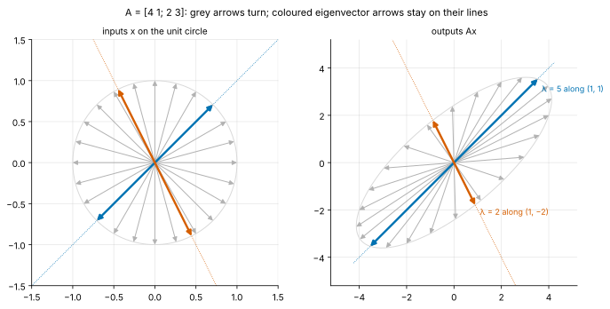
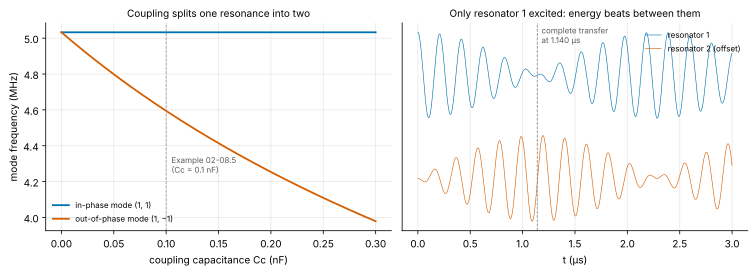
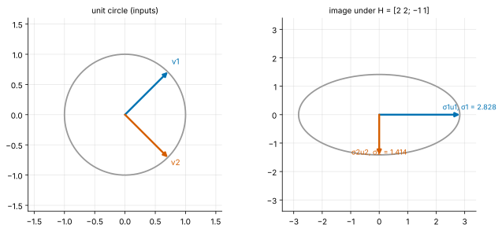
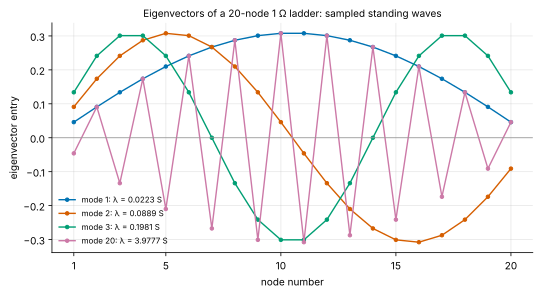

<!-- status: verified -->
# 02-08 · Eigenvalues and Eigenvectors

| | |
|---|---|
| **Course** | [02 · Complex Numbers, Differential Equations and Linear Algebra](../README.md) |
| **University equivalent** | The eigenvalue units of a sophomore linear-algebra course (MIT 18.06 lectures 21–22 and 24–26 on eigenvalues, diagonalization, powers, Markov matrices, symmetric and complex matrices; lectures 27 and 29 on positive definite matrices and the singular value decomposition; Strang, *Introduction to Linear Algebra*, chapters 6 and 7) |
| **Prerequisites** | [02-07 Determinants, Inverses, Rank and Vector Spaces](02-07-determinants-inverses-and-vector-spaces.md) (determinants, null spaces, least squares), [02-01](02-01-complex-numbers-euler-and-phasors.md) (complex numbers), [02-03](02-03-second-order-linear-odes.md) (characteristic roots) |
| **Estimated study hours** | 12 |
| **Last verified** | 2026-11-18 |

**Learning objectives.** After this chapter you can:

1. Find eigenvalues from the characteristic polynomial and eigenvectors from null spaces, and interpret them geometrically as the directions a matrix only stretches.
2. Use the trace and determinant checks and the eigenvalues of powers, inverses and shifts, and diagonalize a matrix as $\mathbf{A} = \mathbf{X}\boldsymbol{\Lambda}\mathbf{X}^{-1}$ (or recognize that it cannot be diagonalized).
3. Compute powers $\mathbf{A}^k$, analyze recurrences and Markov chains (steady state and rate of convergence), and decide stability from eigenvalue magnitudes.
4. Interpret complex eigenvalues of real matrices as rotation with growth or decay, and connect them to the poles of 02-03 and 02-05.
5. Apply the spectral theorem for symmetric matrices, and test positive definiteness by eigenvalues, pivots and energy.
6. Compute and interpret the singular value decomposition, and use it for rank, low-rank approximation, condition number and the parallel channels of MIMO.

## 1. Big picture

Most vectors change direction when a matrix multiplies them. A few special directions, the **eigenvectors**, do not: the matrix only stretches them, by a factor called the **eigenvalue**. In those directions a complicated coupled system behaves like a set of independent scalar ones. That is why eigenvalues are everywhere in engineering. They are the natural frequencies of coupled resonators, the poles of a system written in matrix form, the decay rates of a Markov chain, the principal axes of a covariance matrix and, through the singular value decomposition, the gains of a MIMO link. The **singular value decomposition** extends the idea to every matrix, square or not, and it is the standard tool for rank, compression and conditioning.

- **Circuits and RF:** coupled resonators split into normal modes at two frequencies, as in coupled-resonator filters, wireless power links and coupled qubits (Example 02-08.5).
- **Dynamics and control:** the eigenvalues of a system's state matrix are its poles; stability means every eigenvalue in the left half-plane, or inside the unit circle for discrete time ([02-09](02-09-systems-of-odes-and-matrix-exponential.md), [15](../../15-control-systems/README.md)).
- **Power management:** Markov models of a device's power states give its long-run average current, and the second eigenvalue says how fast it settles (Example 02-08.2).
- **Communications and data:** the SVD splits a MIMO channel into parallel streams, and principal components compress data, from sensor arrays to large language models (§3.9).

## 2. Intuition first

### The directions that don't turn

Picture a matrix as a transformation of the plane. Draw a circle of arrows from the origin, apply the matrix, and watch where each arrow lands. Most arrows rotate as well as stretch. Along one or two special directions, the arrow lands on the same line it started on, longer, shorter or flipped. Those are the eigenvectors, and the stretch factors are the eigenvalues (Figure 02-08.1).

Once you know them, a matrix power becomes easy. Applying $\mathbf{A}$ a hundred times to an eigenvector multiplies it by $\lambda^{100}$. Any other vector, written as a combination of eigenvectors, evolves as the same combination of those simple scalar sequences. The eigenvector with the largest $\lvert\lambda\rvert$ eventually dominates.

*Figure 02-08.1 — A matrix moves most vectors off their lines. The eigenvectors stay on theirs: here $\mathbf{A}(1, 1) = 5(1, 1)$ and $\mathbf{A}(1, -2) = 2(1, -2)$ (Example 02-08.1).*

### An analogy from finance: principal components of the yield curve

Daily changes in Treasury yields at, say, ten maturities form a ten-component vector, and their covariance matrix is 10×10. Its eigenvectors, the **principal components**, are uncorrelated patterns of movement, and its eigenvalues are the variances of those patterns. For yield curves, the leading patterns are famously interpretable: a parallel shift (**level**), a tilt (**steepness**) and a bend (**curvature**). Litterman and Scheinkman (1991) found that three such factors explain most of the variation in Treasury returns ([R-046](../../../reference/research-log.md#r-046--yield-curve-factors-litterman-and-scheinkman)). A risk manager who hedges those few components hedges most of the risk. That is low-rank approximation (§3.9) in a context you already know.

*Where the analogy breaks:* a covariance matrix is symmetric and positive semidefinite, so its eigenvalues are real and non-negative and its eigenvectors are orthogonal: the best-behaved case. Engineering matrices are often not symmetric. Their eigenvalues can be complex, meaning oscillation, or negative, meaning decay. Their eigenvectors need not be orthogonal, and sometimes there are not enough of them to form a basis (§3.3).

## 3. Theory

### 3.1 Eigenvalues and eigenvectors

A nonzero vector $\mathbf{x}$ is an **eigenvector** of a square matrix $\mathbf{A}$, with **eigenvalue** λ, if

$$
\mathbf{A}\mathbf{x} = \lambda\mathbf{x} .
$$

Rewrite this as $(\mathbf{A} - \lambda\mathbf{I})\mathbf{x} = \mathbf{0}$. A nonzero solution exists exactly when $\mathbf{A} - \lambda\mathbf{I}$ is singular ([02-07](02-07-determinants-inverses-and-vector-spaces.md) §3.4), that is, when

$$
\det(\mathbf{A} - \lambda\mathbf{I}) = 0 .
$$

This is the **characteristic equation**. Its left side is a polynomial of degree $n$ in λ, the **characteristic polynomial**, so an $n\times n$ matrix has $n$ eigenvalues, counted with multiplicity, possibly complex. The recipe:

> **Math refresher — how many roots a polynomial has.** The *fundamental theorem of algebra* says that every polynomial of degree $n \ge 1$ with complex coefficients factors into $n$ linear factors, $c(\lambda - \lambda_1)\cdots(\lambda - \lambda_n)$, over the complex numbers. Some roots may repeat (that is their *multiplicity*), and for a real polynomial the non-real roots come in conjugate pairs. So an $n\times n$ matrix always has exactly $n$ eigenvalues counted with multiplicity, though some may be complex even when the matrix is real.

1. Solve $\det(\mathbf{A} - \lambda\mathbf{I}) = 0$ for the eigenvalues.
2. For each eigenvalue, find the null space of $\mathbf{A} - \lambda\mathbf{I}$. Its nonzero vectors are the eigenvectors. Any nonzero multiple of an eigenvector is also one; only its direction matters.

**The 2×2 case.** For $\mathbf{A} = \begin{bmatrix} a & b \\ c & d\end{bmatrix}$:

$$
\det\begin{bmatrix} a - \lambda & b \\ c & d - \lambda\end{bmatrix} = \lambda^2 - (a + d)\lambda + (ad - bc) = \lambda^2 - (\operatorname{tr}\mathbf{A})\lambda + \det\mathbf{A} = 0,
$$

where the **trace** $\operatorname{tr}\mathbf{A} = a + d$ is the sum of the diagonal entries. The quadratic formula gives the eigenvalues. This is the same quadratic as the characteristic equation of a second-order ODE in [02-03](02-03-second-order-linear-odes.md), and §3.5 shows why.

### 3.2 Properties worth knowing

- **Sum and product.** The eigenvalues add up to the trace and multiply to the determinant: $\lambda_1 + \dots + \lambda_n = \operatorname{tr}\mathbf{A}$ and $\lambda_1\cdots\lambda_n = \det\mathbf{A}$. *Why:* factor $\det(\mathbf{A} - \lambda\mathbf{I}) = (\lambda_1 - \lambda)\cdots(\lambda_n - \lambda)$. Setting λ = 0 gives the product. Comparing the coefficients of $\lambda^{n-1}$ gives the sum, because only the diagonal product $(a_{11} - \lambda)\cdots(a_{nn} - \lambda)$ contributes to that power. These two checks catch most arithmetic errors.
- **Triangular matrices** have their eigenvalues on the diagonal, since $\det(\mathbf{A} - \lambda\mathbf{I})$ is then the product of the diagonal entries $(a_{ii} - \lambda)$.
- **Zero eigenvalue ⇔ singular.** λ = 0 is an eigenvalue exactly when $\det\mathbf{A} = 0$; its eigenvectors span the null space.
- **Powers, inverses and shifts keep the eigenvectors.** If $\mathbf{A}\mathbf{x} = \lambda\mathbf{x}$, then $\mathbf{A}^k\mathbf{x} = \lambda^k\mathbf{x}$, $\mathbf{A}^{-1}\mathbf{x} = \lambda^{-1}\mathbf{x}$ (when $\mathbf{A}$ is invertible) and $(\mathbf{A} + c\mathbf{I})\mathbf{x} = (\lambda + c)\mathbf{x}$.
- **$\mathbf{A}$ and $\mathbf{A}^\mathsf{T}$ have the same eigenvalues**, because $\det(\mathbf{A}^\mathsf{T} - \lambda\mathbf{I}) = \det(\mathbf{A} - \lambda\mathbf{I})^\mathsf{T}$. They generally have *different* eigenvectors.
- **What does not hold.** The eigenvalues of $\mathbf{A} + \mathbf{B}$ or $\mathbf{A}\mathbf{B}$ are *not* sums or products of the separate eigenvalues, unless the two matrices share their eigenvectors.

### 3.3 Diagonalization

Suppose $\mathbf{A}$ has $n$ independent eigenvectors $\mathbf{x}_1, \dots, \mathbf{x}_n$. Put them in the columns of $\mathbf{X}$, and the eigenvalues on the diagonal of $\boldsymbol{\Lambda}$. The $n$ equations $\mathbf{A}\mathbf{x}_i = \lambda_i\mathbf{x}_i$ say, column by column, $\mathbf{A}\mathbf{X} = \mathbf{X}\boldsymbol{\Lambda}$. Since $\mathbf{X}$ is invertible,

$$
\mathbf{A} = \mathbf{X}\boldsymbol{\Lambda}\mathbf{X}^{-1}, \qquad \boldsymbol{\Lambda} = \mathbf{X}^{-1}\mathbf{A}\mathbf{X} .
$$

In eigenvector coordinates, $\mathbf{A}$ is just a diagonal matrix: a set of independent stretches. Powers follow at once, because the inner $\mathbf{X}^{-1}\mathbf{X}$ pairs cancel:

$$
\mathbf{A}^k = \mathbf{X}\boldsymbol{\Lambda}^k\mathbf{X}^{-1} .
$$

**When does it work?** Eigenvectors belonging to *distinct* eigenvalues are always independent. For two of them: if $c_1\mathbf{x}_1 + c_2\mathbf{x}_2 = \mathbf{0}$, multiply by $\mathbf{A}$ to get $c_1\lambda_1\mathbf{x}_1 + c_2\lambda_2\mathbf{x}_2 = \mathbf{0}$. Subtract $\lambda_2$ times the first equation: $c_1(\lambda_1 - \lambda_2)\mathbf{x}_1 = \mathbf{0}$, so $c_1 = 0$, and then $c_2 = 0$. The same argument extends by induction. So **$n$ distinct eigenvalues guarantee diagonalizability.**

A repeated eigenvalue may or may not supply enough eigenvectors. The matrix $\begin{bmatrix} 3 & 1 \\ 0 & 3\end{bmatrix}$ has λ = 3 twice, but $\mathbf{A} - 3\mathbf{I} = \begin{bmatrix} 0 & 1 \\ 0 & 0\end{bmatrix}$ has only a one-dimensional null space. One eigenvector is missing, and the matrix is called **defective**. Its powers grow like $k\,3^k$, not just $3^k$. This is exactly the extra factor $t$ in the critically damped response $te^{st}$ of 02-03: the repeated characteristic root is a repeated eigenvalue with a missing eigenvector. (The general theory is the Jordan form; see Going deeper.)

> **Going deeper — the Jordan form.** Every square matrix can be written $\mathbf{A} = \mathbf{M}\mathbf{J}\mathbf{M}^{-1}$, where $\mathbf{J}$ is block diagonal with **Jordan blocks**: λ on the diagonal and 1 just above it. Diagonalizable matrices have only 1×1 blocks. A $k\times k$ block produces terms like $t^{k-1}e^{\lambda t}$ in solutions of ODEs. The Jordan form is numerically fragile, since arbitrarily small perturbations make a defective matrix diagonalizable, so software never computes it. It matters for theory and for understanding repeated poles. See Strang, section 6.6.

### 3.4 Powers, recurrences and Markov chains

A **linear recurrence** $\mathbf{u}_{k+1} = \mathbf{A}\mathbf{u}_k$ models anything updated in discrete steps: a digital filter's internal state, a population, a probability distribution. Its solution is $\mathbf{u}_k = \mathbf{A}^k\mathbf{u}_0$. Expand the start vector in eigenvectors, $\mathbf{u}_0 = c_1\mathbf{x}_1 + \dots + c_n\mathbf{x}_n$ (the weights $\mathbf{c} = \mathbf{X}^{-1}\mathbf{u}_0$), and each piece evolves on its own:

$$
\mathbf{u}_k = c_1\lambda_1^k\mathbf{x}_1 + c_2\lambda_2^k\mathbf{x}_2 + \dots + c_n\lambda_n^k\mathbf{x}_n .
$$

Three conclusions follow:

- the recurrence is **stable** (every solution decays to zero) exactly when every $\lvert\lambda_i\rvert < 1$;
- it is unstable if any $\lvert\lambda_i\rvert > 1$;
- over the long run, the eigenvalue of largest magnitude dominates.

For digital filters, these eigenvalues are the poles of the $z$-transform, and $\lvert\lambda\rvert < 1$ is the familiar "poles inside the unit circle" ([11-09](../../11-signals-and-systems/chapters/11-09-z-transform.md)).

**Markov chains.** A system that hops between $n$ states at random, with fixed probabilities, is a Markov chain. Let $p_{ij}$ be the probability of moving from state $j$ to state $i$ in one step, and let $\mathbf{u}_k$ be the probability distribution over states at step $k$. Then $\mathbf{u}_{k+1} = \mathbf{P}\mathbf{u}_k$. Each column of $\mathbf{P}$ sums to 1 (from state $j$, the system must go somewhere), and its entries are non-negative. (Statistics texts often use the transpose, with rows summing to 1; the mathematics is the same.) Two facts make these chains predictable:

- **λ = 1 is always an eigenvalue.** The columns of $\mathbf{P} - \mathbf{I}$ each sum to zero, so its rows add up to the zero row, and $\mathbf{P} - \mathbf{I}$ is singular. The eigenvector for λ = 1, scaled so that its entries sum to 1, is the **steady-state distribution** $\boldsymbol{\pi}$: the long-run fraction of time spent in each state.
- **No eigenvalue exceeds 1 in magnitude.** $\mathbf{P}^\mathsf{T}$ has the same eigenvalues as $\mathbf{P}$ (same characteristic polynomial, since $\det\mathbf{M}^\mathsf{T} = \det\mathbf{M}$), and its rows sum to 1. If $\mathbf{P}^\mathsf{T}\mathbf{y} = \lambda\mathbf{y}$, pick the index $i$ where $\lvert y_i\rvert$ is largest. Then $\lvert\lambda\rvert\lvert y_i\rvert = \big\lvert\sum_jp_{ji}y_j\big\rvert \le \sum_jp_{ji}\lvert y_j\rvert \le \lvert y_i\rvert\sum_jp_{ji} = \lvert y_i\rvert$, so $\lvert\lambda\rvert \le 1$. If every entry of $\mathbf{P}$ is positive (or some power of it is), λ = 1 is the only eigenvalue with $\lvert\lambda\rvert = 1$, and every starting distribution converges to $\boldsymbol{\pi}$ (the Perron–Frobenius theorem, stated here without proof; see Strang, chapter 10). The distance from $\boldsymbol{\pi}$ shrinks like $\lvert\lambda_2\rvert^k$, where $\lambda_2$ is the second-largest eigenvalue in magnitude. So $\lvert\lambda_2\rvert$ sets the convergence rate: the closer it is to 1, the slower the system forgets where it started.

> **Going deeper — the power method.** Multiply any starting vector by $\mathbf{A}$ again and again, rescaling each time. The component along the dominant eigenvector grows fastest relative to the others, so the vector converges to that eigenvector, with error shrinking like $\lvert\lambda_2/\lambda_1\rvert^k$. This simplest of eigenvalue algorithms underlies PageRank, which ranks web pages by the steady state of a random surfer's Markov chain ([R-047](../../../reference/research-log.md#r-047--pagerank-as-an-eigenvector)). Practical eigenvalue software uses the QR algorithm (Trefethen and Bau, lectures 24–29). NumPy's `numpy.linalg.eig` calls LAPACK's `geev`.

### 3.5 Complex eigenvalues: rotation, oscillation and poles

A real matrix can have complex eigenvalues. Because its characteristic polynomial has real coefficients, they come in conjugate pairs $a \pm jb$, with conjugate eigenvectors. The simplest example is the rotation by θ:

$$
\mathbf{R}_\theta = \begin{bmatrix} \cos\theta & -\sin\theta \\ \sin\theta & \cos\theta\end{bmatrix}, \qquad \lambda^2 - 2\cos\theta\,\lambda + 1 = 0 \;\Rightarrow\; \lambda = \cos\theta \pm j\sin\theta = e^{\pm j\theta} .
$$

No real direction survives a rotation, so the eigenvectors must be complex, here $(1, \mp j)$. Scaling the rotation by $r$ gives eigenvalues $re^{\pm j\theta}$. In general, a complex pair $re^{\pm j\theta}$ means the recurrence rotates by θ per step while its size scales by $r$: a spiral. It decays when $r < 1$. This is the matrix version of the phasor picture of 02-01.

**Poles are eigenvalues.** Write the ODE $y'' + 2\alpha y' + \omega_0^2y = 0$ of 02-03 as a first-order system. Its state is $\mathbf{x} = (y, y')$:

$$
\frac{d}{dt}\begin{bmatrix} y \\ y'\end{bmatrix} = \underbrace{\begin{bmatrix} 0 & 1 \\ -\omega_0^2 & -2\alpha\end{bmatrix}}_{\mathbf{A}}\begin{bmatrix} y \\ y'\end{bmatrix}, \qquad \det(\mathbf{A} - \lambda\mathbf{I}) = \lambda^2 + 2\alpha\lambda + \omega_0^2 .
$$

The eigenvalues of this **companion matrix** are exactly the characteristic roots of the ODE, which are the poles of its transfer function ([02-05](02-05-laplace-transform-for-odes.md)). Every linear circuit or control system can be written in this **state-space** form, with a matrix $\mathbf{A}$ whose eigenvalues are its natural frequencies. [02-09](02-09-systems-of-odes-and-matrix-exponential.md) solves $\mathbf{x}' = \mathbf{A}\mathbf{x}$ with exactly the eigenvector expansion of §3.4, with $e^{\lambda t}$ in place of $\lambda^k$.

### 3.6 Symmetric matrices and the spectral theorem

Symmetric matrices ($\mathbf{A}^\mathsf{T} = \mathbf{A}$) are the best-behaved case, and they are everywhere: conductance matrices, covariance matrices, Hessians, and $\mathbf{A}^\mathsf{T}\mathbf{A}$ for any $\mathbf{A}$.

**Real eigenvalues.** Suppose $\mathbf{A}\mathbf{x} = \lambda\mathbf{x}$, allowing complex λ and $\mathbf{x}$, and take the conjugate transpose: $\bar{\mathbf{x}}^\mathsf{T}\mathbf{A} = \bar\lambda\bar{\mathbf{x}}^\mathsf{T}$, since $\mathbf{A}$ is real and symmetric. Multiply the first equation on the left by $\bar{\mathbf{x}}^\mathsf{T}$, and the second on the right by $\mathbf{x}$:

$$
\bar{\mathbf{x}}^\mathsf{T}\mathbf{A}\mathbf{x} = \lambda\,\bar{\mathbf{x}}^\mathsf{T}\mathbf{x} = \bar\lambda\,\bar{\mathbf{x}}^\mathsf{T}\mathbf{x} .
$$

Since $\bar{\mathbf{x}}^\mathsf{T}\mathbf{x} = \sum\lvert x_i\rvert^2 > 0$, it follows that $\lambda = \bar\lambda$: λ is real.

**Orthogonal eigenvectors.** If $\mathbf{A}\mathbf{x} = \lambda_1\mathbf{x}$ and $\mathbf{A}\mathbf{y} = \lambda_2\mathbf{y}$ with $\lambda_1 \ne \lambda_2$, then $\lambda_1\mathbf{x}^\mathsf{T}\mathbf{y} = (\mathbf{A}\mathbf{x})^\mathsf{T}\mathbf{y} = \mathbf{x}^\mathsf{T}\mathbf{A}\mathbf{y} = \lambda_2\mathbf{x}^\mathsf{T}\mathbf{y}$. So $(\lambda_1 - \lambda_2)\mathbf{x}^\mathsf{T}\mathbf{y} = 0$, and $\mathbf{x}\perp\mathbf{y}$.

Even with repeated eigenvalues, an orthogonal set of eigenvectors can always be chosen: a symmetric matrix is never defective (proof in the Going deeper box below). This is the **spectral theorem**: every real symmetric matrix factors as

$$
\mathbf{A} = \mathbf{Q}\boldsymbol{\Lambda}\mathbf{Q}^\mathsf{T} = \lambda_1\mathbf{q}_1\mathbf{q}_1^\mathsf{T} + \lambda_2\mathbf{q}_2\mathbf{q}_2^\mathsf{T} + \dots + \lambda_n\mathbf{q}_n\mathbf{q}_n^\mathsf{T},
$$

with real eigenvalues and an **orthogonal matrix** $\mathbf{Q}$: unit eigenvectors as columns, so that $\mathbf{Q}^\mathsf{T}\mathbf{Q} = \mathbf{I}$ and $\mathbf{Q}^{-1} = \mathbf{Q}^\mathsf{T}$. The second form writes $\mathbf{A}$ as a sum of rank-1 projections onto its eigenvector directions, each weighted by its eigenvalue. Orthogonal matrices are rotations or reflections: they preserve lengths and angles, so they are numerically harmless. NumPy's `numpy.linalg.eigh` exploits the symmetry (LAPACK `syevd`) and returns orthonormal eigenvectors.

> **Going deeper — why a symmetric matrix is never defective (Schur).** Take a unit eigenvector $\mathbf{q}_1$ of $\mathbf{A}$ (its eigenvalue $\lambda_1$ is real) and complete it to an orthogonal matrix $\mathbf{Q}_1$ with Gram–Schmidt ([02-07](02-07-determinants-inverses-and-vector-spaces.md) §3.8). Then $\mathbf{Q}_1^\mathsf{T}\mathbf{A}\mathbf{Q}_1$ has first column $(\lambda_1, 0, \dots, 0)$, because $\mathbf{A}\mathbf{q}_1 = \lambda_1\mathbf{q}_1$ is perpendicular to the other columns of $\mathbf{Q}_1$. Repeat on the lower-right block. After $n$ steps $\mathbf{Q}^\mathsf{T}\mathbf{A}\mathbf{Q} = \mathbf{T}$ is upper triangular (this is *Schur's theorem*). If $\mathbf{A}$ is symmetric, so is $\mathbf{T} = \mathbf{Q}^\mathsf{T}\mathbf{A}\mathbf{Q}$, and a symmetric triangular matrix is diagonal. So $\mathbf{T} = \boldsymbol{\Lambda}$, and the columns of $\mathbf{Q}$ are $n$ orthonormal eigenvectors, whether or not eigenvalues repeat.

**Complex matrices: Hermitian and unitary.** Phasor circuits and radio channels produce *complex* matrices, for which the transpose is replaced by the **conjugate transpose** $\mathbf{A}^\mathsf{H} = \bar{\mathbf{A}}^\mathsf{T}$, and the length of a complex vector is $\lVert\mathbf{z}\rVert^2 = \mathbf{z}^\mathsf{H}\mathbf{z} = \sum\lvert z_i\rvert^2$. A matrix with $\mathbf{A}^\mathsf{H} = \mathbf{A}$ is **Hermitian**, the complex version of symmetric. The proof above carries over line for line, with $\mathsf{H}$ in place of $\mathsf{T}$: a Hermitian matrix has real eigenvalues and orthogonal eigenvectors, and factors as $\mathbf{A} = \mathbf{U}\boldsymbol{\Lambda}\mathbf{U}^\mathsf{H}$, where $\mathbf{U}$ is **unitary**: $\mathbf{U}^\mathsf{H}\mathbf{U} = \mathbf{I}$. Unitary matrices are the complex rotations; they preserve lengths, $\lVert\mathbf{U}\mathbf{z}\rVert^2 = \mathbf{z}^\mathsf{H}\mathbf{U}^\mathsf{H}\mathbf{U}\mathbf{z} = \lVert\mathbf{z}\rVert^2$. For example, $\begin{bmatrix}2 & j\\ -j & 2\end{bmatrix}$ is Hermitian, with real eigenvalues 1 and 3. NumPy's `eigh` handles Hermitian matrices too (LAPACK `heevd`).

### 3.7 Positive definite matrices

A symmetric matrix is **positive definite** if $\mathbf{x}^\mathsf{T}\mathbf{A}\mathbf{x} > 0$ for every nonzero $\mathbf{x}$, and **positive semidefinite** if $\mathbf{x}^\mathsf{T}\mathbf{A}\mathbf{x} \ge 0$. The quantity $\mathbf{x}^\mathsf{T}\mathbf{A}\mathbf{x}$ is a *quadratic form*, an "energy". These tests are equivalent for symmetric matrices:

1. **Energy:** $\mathbf{x}^\mathsf{T}\mathbf{A}\mathbf{x} > 0$ for all $\mathbf{x} \ne \mathbf{0}$.
2. **Eigenvalues:** all $\lambda_i > 0$. *Why:* with $\mathbf{A} = \mathbf{Q}\boldsymbol{\Lambda}\mathbf{Q}^\mathsf{T}$, $\mathbf{x}^\mathsf{T}\mathbf{A}\mathbf{x} = \sum\lambda_i(\mathbf{q}_i^\mathsf{T}\mathbf{x})^2$, which is positive for every $\mathbf{x}$ exactly when every $\lambda_i > 0$.
3. **Pivots:** elimination without row exchanges gives all pivots positive. *Why:* $\mathbf{A} = \mathbf{L}\mathbf{D}\mathbf{L}^\mathsf{T}$ gives $\mathbf{x}^\mathsf{T}\mathbf{A}\mathbf{x} = \sum d_i(\mathbf{L}^\mathsf{T}\mathbf{x})_i^2$.
4. **Leading determinants:** the upper-left 1×1, 2×2, …, $n\times n$ determinants are all positive (they are products of the first pivots).

   *The converse, closing the loop:* if $\mathbf{A}$ is positive definite, so is each leading $k\times k$ block $\mathbf{A}_k$ (use test 1 with $\mathbf{x}$ zero beyond position $k$). So $\det\mathbf{A}_k$, the product of the positive eigenvalues of $\mathbf{A}_k$, is positive. The pivots are ratios of consecutive leading determinants, $d_k = \det\mathbf{A}_k/\det\mathbf{A}_{k-1}$, so they are positive, and no row exchange is ever needed. Tests 1 to 4 are therefore equivalent.
5. **Factorization:** $\mathbf{A} = \mathbf{R}^\mathsf{T}\mathbf{R}$ for some $\mathbf{R}$ with independent columns. For example, the Cholesky factor of 02-06.

For a 2×2 matrix $\begin{bmatrix} a & b \\ b & c\end{bmatrix}$, test 4 reads $a > 0$ and $ac - b^2 > 0$.

Positive definite matrices show up wherever there is energy or variance:

- **Conductance matrices:** $\mathbf{v}^\mathsf{T}\mathbf{G}\mathbf{v}$ is the power dissipated ([02-07](02-07-determinants-inverses-and-vector-spaces.md) §3.9). It is positive for every nonzero voltage pattern once a node is grounded, so a grounded $\mathbf{G}$ is positive definite. That is why Cholesky (02-06) works on it without pivoting.
- **Covariance matrices** are positive semidefinite, because $\mathbf{w}^\mathsf{T}\boldsymbol{\Sigma}\mathbf{w}$ is the variance of the combination $\mathbf{w}^\mathsf{T}\mathbf{X}$, and a variance cannot be negative.
- **Minima:** at a critical point of $f(x_1, \dots, x_n)$, a positive definite Hessian (the matrix of second partial derivatives) means a local minimum. This is the second-derivative test of [01-09](../../01-calculus-for-engineers/chapters/01-09-multivariable-calculus-1.md) in matrix form. A Hessian with eigenvalues of both signs means a saddle.

**Geometry.** The set $\mathbf{x}^\mathsf{T}\mathbf{A}\mathbf{x} = 1$ is an ellipse (an ellipsoid in higher dimensions). Its axes point along the eigenvectors, with semi-axis lengths $1/\sqrt{\lambda_i}$. Large eigenvalues are short, stiff directions; small eigenvalues are long, soft ones.

### 3.8 Coupled resonators and normal modes

Two identical LC resonators, each an inductor $L$ in parallel with a capacitor $C$ from its node to ground, are coupled by a small capacitor $C_c$ between the nodes. KCL at node 1, with $i_{L1}$ the current in resonator 1's inductor, is $Cv_1' + C_c(v_1' - v_2') + i_{L1} = 0$, with $L\,i_{L1}' = v_1$; node 2 is the same with the indices swapped. Differentiating once and substituting $i_{L1}' = v_1/L$ gives $(C + C_c)v_1'' - C_cv_2'' + v_1/L = 0$, and likewise for node 2. In matrix form,

$$
\mathbf{C}\,\mathbf{v}'' + \frac{1}{L}\mathbf{v} = \mathbf{0}, \qquad \mathbf{C} = \begin{bmatrix} C + C_c & -C_c \\ -C_c & C + C_c\end{bmatrix},
$$

where $\mathbf{C}$ is the **capacitance matrix**, stamped exactly like a conductance matrix. Look for **normal modes**, solutions in which every node oscillates at the same frequency: $\mathbf{v} = \mathbf{x}\cos\omega t$. Substituting gives $\mathbf{C}\mathbf{x} = \dfrac{1}{\omega^2L}\mathbf{x}$, an eigenvalue problem for the symmetric matrix $\mathbf{C}$.

Its eigenvectors are $(1, 1)$, with eigenvalue $C$, and $(1, -1)$, with eigenvalue $C + 2C_c$. The two modes are:

- **In phase**, $(1, 1)$: both nodes swing together, the coupling capacitor carries no current, and $\omega_1 = 1/\sqrt{LC}$, the uncoupled frequency.
- **Out of phase**, $(1, -1)$: the nodes swing oppositely, the coupling capacitor is charged at both ends, and it adds $2C_c$ of effective capacitance, so $\omega_2 = 1/\sqrt{L(C + 2C_c)}$ is lower.

So coupling splits one resonant frequency into two. Excite only one resonator and the energy beats back and forth between them at the difference frequency. With mutual inductance instead of a capacitor, the same mathematics applies. Figure 02-08.3 shows the split growing with $C_c$, and the beating.

*Figure 02-08.3 — Mode splitting in the coupled resonators of Example 02-08.5. Left: mode frequencies versus $C_c$. Right: with only resonator 1 excited, the energy beats between the resonators, transferring almost completely every 1.140 µs.*

This mode splitting is how coupled-resonator band-pass filters get a flat passband, how resonant wireless-power links trade coupling against bandwidth, and how coupled superconducting qubits exchange energy ([21](../../21-rf-and-microwave-engineering/README.md)).

> **Deeper:** see companion repo *Quantum Computing* for coupled qubits and resonators, where the same eigenvalue splitting appears as an avoided crossing.

### 3.9 The singular value decomposition

Eigenvectors need a square matrix, and even then there may be too few of them, or they may not be orthogonal. The **singular value decomposition** (SVD) works for *every* matrix and always uses orthogonal directions. Any $m\times n$ matrix of rank $r$ factors as

$$
\mathbf{A} = \mathbf{U}\boldsymbol{\Sigma}\mathbf{V}^\mathsf{T} = \sigma_1\mathbf{u}_1\mathbf{v}_1^\mathsf{T} + \dots + \sigma_r\mathbf{u}_r\mathbf{v}_r^\mathsf{T}, \qquad \sigma_1 \ge \sigma_2 \ge \dots \ge \sigma_r > 0,
$$

where:

- $\mathbf{U}$ ($m\times m$) and $\mathbf{V}$ ($n\times n$) are orthogonal;
- $\boldsymbol{\Sigma}$ is $m\times n$, with the **singular values** $\sigma_i$ on its diagonal and zeros elsewhere;
- $\mathbf{v}_i$ and $\mathbf{u}_i$ are the **right** and **left singular vectors**.

**Construction, derived.**

1. $\mathbf{A}^\mathsf{T}\mathbf{A}$ is symmetric and positive semidefinite, since $\mathbf{x}^\mathsf{T}\mathbf{A}^\mathsf{T}\mathbf{A}\mathbf{x} = \lVert\mathbf{A}\mathbf{x}\rVert^2 \ge 0$. So by the spectral theorem it has orthonormal eigenvectors $\mathbf{v}_i$ with eigenvalues $\sigma_i^2 \ge 0$.
2. If $\sigma_i = 0$, then $\lVert\mathbf{A}\mathbf{v}_i\rVert^2 = \mathbf{v}_i^\mathsf{T}\mathbf{A}^\mathsf{T}\mathbf{A}\mathbf{v}_i = \sigma_i^2 = 0$, so $\mathbf{A}\mathbf{v}_i = \mathbf{0}$: those $\mathbf{v}_i$ span the null space. For each $\sigma_i > 0$, define $\mathbf{u}_i = \mathbf{A}\mathbf{v}_i/\sigma_i$. These are orthonormal too: $\mathbf{u}_i^\mathsf{T}\mathbf{u}_j = \mathbf{v}_i^\mathsf{T}\mathbf{A}^\mathsf{T}\mathbf{A}\mathbf{v}_j/(\sigma_i\sigma_j) = \sigma_j^2\,\mathbf{v}_i^\mathsf{T}\mathbf{v}_j/(\sigma_i\sigma_j)$, which is 1 if $i = j$ and 0 otherwise.
3. If the rank $r$ is less than $m$, complete $\mathbf{U}$ with orthonormal vectors $\mathbf{u}_{r+1}, \dots, \mathbf{u}_m$ spanning the left null space $N(\mathbf{A}^\mathsf{T})$ ([02-07](02-07-determinants-inverses-and-vector-spaces.md) §3.7). They are orthogonal to every $\mathbf{u}_i = \mathbf{A}\mathbf{v}_i/\sigma_i$, because $\mathbf{u}^\mathsf{T}\mathbf{A}\mathbf{v} = (\mathbf{A}^\mathsf{T}\mathbf{u})^\mathsf{T}\mathbf{v} = 0$. By construction $\mathbf{A}\mathbf{v}_i = \sigma_i\mathbf{u}_i$ (with $\sigma_i = 0$ for $i > r$), which is $\mathbf{A}\mathbf{V} = \mathbf{U}\boldsymbol{\Sigma}$ column by column. Multiplying by $\mathbf{V}^\mathsf{T}$ on the right gives the SVD.

**Geometry: rotate, stretch, rotate.** $\mathbf{V}^\mathsf{T}$ rotates the input so the $\mathbf{v}_i$ line up with the axes, $\boldsymbol{\Sigma}$ stretches axis $i$ by $\sigma_i$, and $\mathbf{U}$ rotates the result into place. The unit circle maps to an ellipse with semi-axes $\sigma_i$ along $\mathbf{u}_i$. The largest stretch of any unit vector is $\sigma_1$, the matrix's **2-norm** $\lVert\mathbf{A}\rVert_2$.

*Figure 02-08.4 — The SVD as rotate, stretch, rotate (Example 02-08.6). The orthogonal input directions $\mathbf{v}_1, \mathbf{v}_2$ map to orthogonal output directions $\mathbf{u}_1, \mathbf{u}_2$, stretched by $\sigma_1 = 2.828$ and $\sigma_2 = 1.414$.*

**What the SVD tells you.**

- **Rank** is the number of nonzero singular values. In floating point, it is the number above a tolerance, which is how `numpy.linalg.matrix_rank` decides (02-07, lab Part 3).
- **Low-rank approximation (Eckart–Young–Mirsky).** Keeping only the first $k$ terms, $\mathbf{A}_k = \sum_{i\le k}\sigma_i\mathbf{u}_i\mathbf{v}_i^\mathsf{T}$, gives the closest rank-$k$ matrix to $\mathbf{A}$. The error is $\lVert\mathbf{A} - \mathbf{A}_k\rVert_2 = \sigma_{k+1}$, and in the Frobenius norm (root-sum-square of all entries) it is $\sqrt{\sigma_{k+1}^2 + \dots + \sigma_r^2}$ ([R-048](../../../reference/research-log.md#r-048--eckart-young-theorem)). Eckart and Young proved the Frobenius-norm case in 1936; the 2-norm case is usually credited to Mirsky (1960). *Why no rank-$k$ matrix does better in the 2-norm:* a rank-$k$ matrix $\mathbf{B}$ has a null space of dimension $n - k$, which must meet the $(k+1)$-dimensional span of $\mathbf{v}_1, \dots, \mathbf{v}_{k+1}$ in some unit vector $\mathbf{z}$ (the dimensions add to more than $n$). Then $\lVert(\mathbf{A} - \mathbf{B})\mathbf{z}\rVert = \lVert\mathbf{A}\mathbf{z}\rVert \ge \sigma_{k+1}$, because $\mathbf{A}$ stretches every unit vector in that span by at least $\sigma_{k+1}$. When the singular values fall quickly, a few terms capture almost everything. This is the basis of data compression, of principal component analysis, and of the low-rank structure that LoRA exploits (02-07 §9).
- **Conditioning.** For a square invertible matrix, the **condition number** $\kappa = \sigma_1/\sigma_n$ measures how much relative errors in $\mathbf{b}$ can be amplified in the solution of $\mathbf{A}\mathbf{x} = \mathbf{b}$ ([02-10](02-10-numerical-methods.md)). A tiny $\sigma_n$, not a tiny determinant, is what "nearly singular" means.
- **Symmetric positive semidefinite matrices** have SVD equal to their spectral decomposition: $\sigma_i = \lambda_i$ and $\mathbf{U} = \mathbf{V} = \mathbf{Q}$.

**MIMO: the SVD as parallel channels.** A MIMO link sends a vector $\mathbf{s}$ from $N_t$ antennas and receives $\mathbf{y} = \mathbf{H}\mathbf{s} + \mathbf{n}$ at $N_r$ antennas. Baseband channels are complex (each entry of $\mathbf{H}$ is a gain and a phase), so the SVD takes its complex form $\mathbf{H} = \mathbf{U}\boldsymbol{\Sigma}\mathbf{V}^\mathsf{H}$, with unitary $\mathbf{U}$ and $\mathbf{V}$ (§3.6); for a real $\mathbf{H}$, $\mathsf{H}$ is just $\mathsf{T}$. The transmitter sends $\mathbf{s} = \mathbf{V}\mathbf{d}$ (**precoding**) and the receiver computes $\mathbf{U}^\mathsf{H}\mathbf{y}$:

$$
\mathbf{U}^\mathsf{H}\mathbf{y} = \mathbf{U}^\mathsf{H}\mathbf{U}\boldsymbol{\Sigma}\mathbf{V}^\mathsf{H}\mathbf{V}\mathbf{d} + \mathbf{U}^\mathsf{H}\mathbf{n} = \boldsymbol{\Sigma}\mathbf{d} + \tilde{\mathbf{n}} .
$$

Each data stream $d_i$ now arrives multiplied by its own gain $\sigma_i$, with no interference from the others. If the noise is white, with covariance $\mathbb{E}[\mathbf{n}\mathbf{n}^\mathsf{H}] = \sigma_n^2\mathbf{I}$ (independent, equal-power noise at each antenna), then $\tilde{\mathbf{n}} = \mathbf{U}^\mathsf{H}\mathbf{n}$ has the same covariance, $\mathbf{U}^\mathsf{H}\sigma_n^2\mathbf{I}\,\mathbf{U} = \sigma_n^2\mathbf{I}$, because $\mathbf{U}$ is unitary. The channel has become $r$ independent scalar channels with power gains $\sigma_i^2$. That is why the rank caps the number of streams (02-07 §9), and why weak singular values make some streams nearly useless. Real systems approximate this ideal by having the receiver estimate $\mathbf{H}$ and feed back the strongest singular directions ([R-045](../../../reference/research-log.md#r-045--5g-nr-type-ii-csi-and-eigenvector-feedback); [17](../../17-communication-systems/README.md)).

> **Going deeper — the pseudoinverse.** With $\boldsymbol{\Sigma}^+$ obtained by inverting the nonzero singular values (and transposing the shape), $\mathbf{A}^+ = \mathbf{V}\boldsymbol{\Sigma}^+\mathbf{U}^\mathsf{T}$ is the **pseudoinverse**. The vector $\mathbf{A}^+\mathbf{b}$ is the least-squares solution of 02-07, and when there are many least-squares solutions it picks the one of smallest length. Discarding singular values below a threshold (*truncated SVD*) regularizes ill-conditioned problems by refusing to amplify the noisiest directions. See Strang, chapter 7.

## 4. Worked examples

### Example 02-08.1 — Eigenvalues, eigenvectors and a matrix power (tier A)

**Setup.** For $\mathbf{A} = \begin{bmatrix} 4 & 1 \\ 2 & 3\end{bmatrix}$, find the eigenvalues and eigenvectors, check them with the trace and determinant, diagonalize, and compute $\mathbf{A}^5$.

**Solution.** The trace is 7 and the determinant is $12 - 2 = 10$, so the characteristic equation is $\lambda^2 - 7\lambda + 10 = (\lambda - 5)(\lambda - 2) = 0$: λ = **5** and **2**.

- λ = 5: $\mathbf{A} - 5\mathbf{I} = \begin{bmatrix} -1 & 1 \\ 2 & -2\end{bmatrix}$, whose null space contains $\mathbf{x}_1 = (1, 1)$.
- λ = 2: $\mathbf{A} - 2\mathbf{I} = \begin{bmatrix} 2 & 1 \\ 2 & 1\end{bmatrix}$, whose null space contains $\mathbf{x}_2 = (1, -2)$.

So

$$
\mathbf{X} = \begin{bmatrix} 1 & 1 \\ 1 & -2\end{bmatrix}, \quad \boldsymbol{\Lambda} = \begin{bmatrix} 5 & 0 \\ 0 & 2\end{bmatrix}, \quad \mathbf{X}^{-1} = \frac{1}{-3}\begin{bmatrix} -2 & -1 \\ -1 & 1\end{bmatrix} = \frac13\begin{bmatrix} 2 & 1 \\ 1 & -1\end{bmatrix} .
$$

Then

$$
\mathbf{A}^5 = \mathbf{X}\begin{bmatrix} 3125 & 0 \\ 0 & 32\end{bmatrix}\mathbf{X}^{-1} = \frac13\begin{bmatrix} 3125\cdot2 + 32 & 3125 - 32 \\ 3125\cdot2 - 64 & 3125 + 64\end{bmatrix} = \begin{bmatrix} \mathbf{2094} & \mathbf{1031} \\ 2062 & 1063\end{bmatrix} .
$$

**Checks.** $5 + 2 = 7$ = trace ✓ and $5\cdot2 = 10$ = determinant ✓. $\mathbf{A}(1, -2) = (4 - 2, 2 - 6) = (2, -4) = 2(1, -2)$ ✓. The trace of $\mathbf{A}^5$ is $2094 + 1063 = 3157 = 5^5 + 2^5$ ✓. The eigenvectors are not orthogonal, since $\mathbf{A}$ is not symmetric: $(1, 1)\cdot(1, -2) = -1$.

### Example 02-08.2 — A wearable's power states as a Markov chain (tier B)

**Setup.** A microcontroller in a wearable moves between three power states every 1 ms. The model is illustrative, though typical in form.

| From → to | Active | Idle | Sleep |
|---|---|---|---|
| **from Active** | 0.90 | 0.08 | 0.02 |
| **from Idle** | 0.10 | 0.80 | 0.10 |
| **from Sleep** | 0.01 | 0.01 | 0.98 |

The supply currents are 5 mA when active, 0.5 mA when idle and 2 µA asleep. Find the long-run fraction of time in each state, the average current, the life of a 100 mAh battery, and how many milliseconds the chain takes to forget its starting state to within 1%.

**Solution.** In the column convention ($\mathbf{u}_{k+1} = \mathbf{P}\mathbf{u}_k$), column $j$ lists the probabilities of leaving state $j$:

$$
\mathbf{P} = \begin{bmatrix} 0.90 & 0.10 & 0.01 \\ 0.08 & 0.80 & 0.01 \\ 0.02 & 0.10 & 0.98\end{bmatrix} .
$$

*Steady state:* solve $(\mathbf{P} - \mathbf{I})\boldsymbol{\pi} = \mathbf{0}$. Row 1 gives $-0.10\pi_A + 0.10\pi_I + 0.01\pi_S = 0$, and row 2 gives $0.08\pi_A - 0.20\pi_I + 0.01\pi_S = 0$. Subtracting row 2 from row 1 gives $-0.18\pi_A + 0.30\pi_I = 0$, so $\pi_I = 0.6\,\pi_A$. Then row 1 gives $\pi_S = 10\pi_A - 10\pi_I = 4\pi_A$. Normalizing, $\pi_A(1 + 0.6 + 4) = 1$, so

$$
\boldsymbol{\pi} = \left(\tfrac{5}{28}, \tfrac{3}{28}, \tfrac{5}{7}\right) = (\mathbf{0.1786}, \mathbf{0.1071}, \mathbf{0.7143}) .
$$

*Average current:* $5(0.1786) + 0.5(0.1071) + 0.002(0.7143) = $ **0.9479 mA**. A 100 mAh battery lasts $100/0.9479 = $ **105.5 h** (4.4 days).

*Convergence:* the other two eigenvalues follow from the trace and determinant, without solving a cubic. Their sum is $\operatorname{tr}\mathbf{P} - 1 = 2.68 - 1 = 1.68$, and their product is $\det\mathbf{P}/1 = 0.6968$. So they solve $\lambda^2 - 1.68\lambda + 0.6968 = 0$: λ = **0.9338** and **0.7462**. The memory of the start decays like $0.9338^k$, which falls to 1% after $k = \ln0.01/\ln0.9338 = $ **67.2** steps, about 67 ms.

**Checks.** Each column of $\mathbf{P}$ sums to 1 ✓. $\mathbf{P}\boldsymbol{\pi}$, first entry: $0.90(5/28) + 0.10(3/28) + 0.01(20/28) = (4.5 + 0.3 + 0.2)/28 = 5/28$ ✓. *Sanity:* the device sleeps 71% of the time, but the 18% spent active draws 94% of the charge ($5\times0.1786/0.9479$). Cutting active time pays far more than improving sleep current, the usual conclusion in low-power design. This is a model, not a measurement: real firmware has deterministic schedules too, and a Markov model captures only the statistics of event-driven wake-ups.

### Example 02-08.3 — Complex eigenvalues: poles and a digital resonator (tier B)

**Setup.** (a) Find the eigenvalues of the companion matrix of the RLC circuit of Example 02-05.3 (α = 2500 s⁻¹, $\omega_0^2 = 10^8$ s⁻²). (b) A digital oscillator updates its state by $\mathbf{u}_{k+1} = \mathbf{A}\mathbf{u}_k$ with $\mathbf{A} = 0.95\,\mathbf{R}_{30°}$. Find its eigenvalues, the number of steps per oscillation, and the amplitude after one oscillation.

**Solution.** (a) $\mathbf{A} = \begin{bmatrix} 0 & 1 \\ -10^8 & -5000\end{bmatrix}$, with characteristic equation $\lambda^2 + 5000\lambda + 10^8 = 0$. So

$$
\lambda = -2500 \pm j\sqrt{10^8 - 2500^2} = -2500 \pm j\,\mathbf{9682}\text{ s}^{-1},
$$

the poles of 02-05 ✓: decay rate 2500 s⁻¹, damped frequency 9682 rad/s.

(b) The eigenvalues of $\mathbf{R}_{30°}$ are $e^{\pm j30°}$, so $\mathbf{A}$ has $0.95e^{\pm j30°} = $ **0.8227** $\pm j$**0.475**. Each step rotates by 30°, so one oscillation takes $360/30 = $ **12** steps. Each step scales by 0.95, so after one oscillation the amplitude is $0.95^{12} = $ **0.5404** of its start. The magnitude $\lvert\lambda\rvert = 0.95 < 1$: stable, a decaying spiral.

**Check.** $\lvert0.8227 + j0.475\rvert = \sqrt{0.6769 + 0.2256} = 0.95$ ✓. For (a), the sum of the eigenvalues is $-5000$ = trace ✓ and the product is $2500^2 + 9682^2 = 10^8$ = determinant ✓.

### Example 02-08.4 — Modes of a resistor ladder (tier B)

**Setup.** Find the eigenvalues and orthonormal eigenvectors of the ladder conductance matrix of Example 02-07.2,

$$
\mathbf{K} = \begin{bmatrix} 2 & -1 & 0 \\ -1 & 2 & -1 \\ 0 & -1 & 2\end{bmatrix}\text{ S}.
$$

Confirm that it is positive definite, interpret the eigenvectors, and rebuild the driving-point resistance $(\mathbf{K}^{-1})_{11} = 0.75$ Ω from the spectral decomposition.

**Solution.** Expand $\det(\mathbf{K} - \lambda\mathbf{I})$ along row 1:

$$
(2 - \lambda)\big[(2 - \lambda)^2 - 1\big] - (2 - \lambda) = (2 - \lambda)\big[(2 - \lambda)^2 - 2\big] = 0 .
$$

So λ = 2, and $(2 - \lambda)^2 = 2$ gives λ = $2 \mp \sqrt2$. The eigenvalues are **0.5858**, **2** and **3.414** S, all positive, so $\mathbf{K}$ is positive definite. Its pivots, 2, 3/2 and 4/3, are also all positive.

The eigenvectors, normalized, are

$$
\mathbf{q}_1 = \tfrac12(1, \sqrt2, 1), \qquad \mathbf{q}_2 = \tfrac{1}{\sqrt2}(1, 0, -1), \qquad \mathbf{q}_3 = \tfrac12(1, -\sqrt2, 1) .
$$

They are mutually orthogonal: for example $\mathbf{q}_1\cdot\mathbf{q}_3 = \tfrac14(1 - 2 + 1) = 0$. *Interpretation:* they are the ladder's voltage "modes". In $\mathbf{q}_1$, a smooth bump, all nodes rise together. It costs the least injected current per volt (smallest λ), because little current flows between neighbors. In $\mathbf{q}_3$, an alternating pattern, neighbors oppose each other, and it costs the most. These are sampled sine waves, the discrete standing waves of the ladder. Figure 02-08.2 shows the same pattern for a 20-node ladder.

*Figure 02-08.2 — Modes of a 20-node ladder (the 20×20 version of $\mathbf{K}$). The eigenvectors are sampled sines with 1, 2, 3, … half-waves; small eigenvalues belong to smooth modes, large ones to jagged modes.*

*Spectral decomposition of the inverse:* $\mathbf{K}^{-1} = \sum\lambda_i^{-1}\mathbf{q}_i\mathbf{q}_i^\mathsf{T}$, so

$$
(\mathbf{K}^{-1})_{11} = \frac{(1/2)^2}{0.5858} + \frac{(1/\sqrt2)^2}{2} + \frac{(1/2)^2}{3.414} = 0.4268 + 0.25 + 0.0732 = \mathbf{0.75}\ \Omega .
$$

That matches Example 02-07.2 ✓. The condition number is $\lambda_{\max}/\lambda_{\min} = 3.414/0.5858 = $ **5.828**.

**Checks.** Sum of eigenvalues $= 6$ = trace ✓; product $= (2 - \sqrt2)\cdot2\cdot(2 + \sqrt2) = 4$ = determinant ✓. $\mathbf{K}\mathbf{q}_2 = \tfrac{1}{\sqrt2}(2, 0, -2) = 2\mathbf{q}_2$ ✓.

### Example 02-08.5 — Mode splitting in coupled resonators (tier C)

**Setup.** Two resonators, each $L = 1$ µH in parallel with $C = 1$ nF to ground, are coupled by $C_c = 0.1$ nF between their nodes. Find the normal-mode frequencies and their split. Then explain what happens if only resonator 1 is set ringing.

**Solution.** The uncoupled frequency is $f_0 = 1/(2\pi\sqrt{LC}) = 1/(2\pi\sqrt{10^{-15}}) = $ **5.033 MHz**. From §3.8:

- **in-phase mode** $(1, 1)$: eigenvalue $C$ of the capacitance matrix, so $f_1 = f_0 = $ **5.033 MHz**;
- **out-of-phase mode** $(1, -1)$: eigenvalue $C + 2C_c = 1.2$ nF, so $f_2 = 1/(2\pi\sqrt{L\cdot1.2\text{ nF}}) = $ **4.594 MHz**.

The split is $f_1 - f_2 = $ **438.5 kHz**, and the ratio is $f_1/f_2 = \sqrt{1 + 2C_c/C} = \sqrt{1.2} = $ **1.095**.

If only resonator 1 starts ringing, its initial state $(1, 0)$ is half the sum of the two modes, $\tfrac12(1, 1) + \tfrac12(1, -1)$. The modes oscillate at slightly different frequencies, so they drift in and out of phase. Node 1 sees $\tfrac12(\cos\omega_1t + \cos\omega_2t)$ and node 2 sees $\tfrac12(\cos\omega_1t - \cos\omega_2t)$. The energy therefore sloshes from resonator 1 to resonator 2 and back, with a beat at the difference frequency, 438.5 kHz: essentially complete transfer every $1/(2\times438.5\text{ kHz}) = $ **1.140 µs** (exact only in the limit of weak coupling: here **0.21%** of the initial energy remains in resonator 1's own capacitor and inductor at that instant, starting from $\mathbf{v}(0) = (1, 0)$ with both inductor currents zero). (The beat identity is that of 02-04.)

**Checks.** Units: $1/\sqrt{\text{H}\cdot\text{F}} = 1/\sqrt{\text{s}^2}$ = rad/s ✓. Limits: with $C_c \to 0$ the modes merge at $f_0$; with large $C_c$ the out-of-phase mode drops further. The in-phase frequency does not depend on $C_c$ at all, because the coupling capacitor sees no voltage in that mode. The lab confirms both peaks in an ngspice AC sweep, and the 1.140 µs transfer in a transient run ([coupled_lc_beat.cir](../labs/02-08-lab/coupled_lc_beat.cir)).

### Example 02-08.6 — An SVD, a low-rank approximation and a two-stream channel (tier C)

**Setup.** For $\mathbf{H} = \begin{bmatrix} 2 & 2 \\ -1 & 1\end{bmatrix}$, read as a 2×2 MIMO channel or simply as a matrix, find the SVD, the best rank-1 approximation and its error, and the condition number. Interpret the singular values as stream gains.

**Solution.** $\mathbf{H}^\mathsf{T}\mathbf{H} = \begin{bmatrix} 5 & 3 \\ 3 & 5\end{bmatrix}$, with eigenvalues $5 \pm 3$, that is 8 and 2, and eigenvectors $\mathbf{v}_1 = \tfrac{1}{\sqrt2}(1, 1)$ and $\mathbf{v}_2 = \tfrac{1}{\sqrt2}(1, -1)$. So $\sigma_1 = \sqrt8 = $ **2.828** and $\sigma_2 = \sqrt2 = $ **1.414**. Then

$$
\mathbf{u}_1 = \frac{\mathbf{H}\mathbf{v}_1}{\sigma_1} = \frac{(4, 0)/\sqrt2}{2\sqrt2} = (1, 0), \qquad \mathbf{u}_2 = \frac{\mathbf{H}\mathbf{v}_2}{\sigma_2} = \frac{(0, -2)/\sqrt2}{\sqrt2} = (0, -1) .
$$

*Best rank-1 approximation:* $\mathbf{H}_1 = \sigma_1\mathbf{u}_1\mathbf{v}_1^\mathsf{T} = 2\sqrt2\cdot(1, 0)\tfrac{1}{\sqrt2}(1, 1)^\mathsf{T} = \begin{bmatrix} 2 & 2 \\ 0 & 0\end{bmatrix}$. Its error $\mathbf{H} - \mathbf{H}_1 = \begin{bmatrix} 0 & 0 \\ -1 & 1\end{bmatrix}$ has 2-norm $\sigma_2 = $ **1.414**, as Eckart–Young promises. The condition number is $\sigma_1/\sigma_2 = $ **2**.

*As a channel:* precoding with $\mathbf{V}$ and receiving with $\mathbf{U}^\mathsf{T}$ creates two independent streams, with power gains $\sigma_1^2 = 8$ and $\sigma_2^2 = 2$. The second stream is $10\log_{10}(8/2) = $ **6.021 dB** weaker. If $\sigma_2$ were near zero (a rank-1 channel, as in a line-of-sight link with closely spaced, co-polarized antennas; dual-polarized antennas often keep rank 2 even in line of sight), the second stream would carry nothing useful.

**Checks.** $\sigma_1\sigma_2 = 4 = \lvert\det\mathbf{H}\rvert$ ✓ (a square matrix's singular values multiply to $\lvert\det\rvert$). $\sigma_1^2 + \sigma_2^2 = 10$ = sum of squared entries $4 + 4 + 1 + 1$ ✓ (the Frobenius norm). $\mathbf{u}_1\cdot\mathbf{u}_2 = 0$ ✓.

<!-- answer-key -->
| ID | Quantity | Value | Unit |
|---|---|---|---|
| Ex 02-08.1a | larger eigenvalue | 5 | — |
| Ex 02-08.1b | smaller eigenvalue | 2 | — |
| Ex 02-08.1c | (1, 1) entry of A⁵ | 2094 | — |
| Ex 02-08.1d | (1, 2) entry of A⁵ | 1031 | — |
| Ex 02-08.1e | trace of A⁵ | 3157 | — |
| Ex 02-08.2a | steady-state fraction active | 0.1786 | — |
| Ex 02-08.2b | steady-state fraction idle | 0.1071 | — |
| Ex 02-08.2c | steady-state fraction asleep | 0.7143 | — |
| Ex 02-08.2d | average current | 0.9479 | mA |
| Ex 02-08.2e | battery life | 105.5 | h |
| Ex 02-08.2f | second eigenvalue | 0.9338 | — |
| Ex 02-08.2g | third eigenvalue | 0.7462 | — |
| Ex 02-08.2h | steps to 1% | 67.2 | — |
| Ex 02-08.2i | share of charge used while active | 94 | % |
| Ex 02-08.3a | imaginary part of the poles | 9682 | rad/s |
| Ex 02-08.3b | real part of the discrete eigenvalues | 0.8227 | — |
| Ex 02-08.3c | imaginary part of the discrete eigenvalues | 0.475 | — |
| Ex 02-08.3d | steps per oscillation | 12 | — |
| Ex 02-08.3e | amplitude after one oscillation | 0.5404 | — |
| Ex 02-08.4a | smallest eigenvalue | 0.5858 | S |
| Ex 02-08.4b | middle eigenvalue | 2 | S |
| Ex 02-08.4c | largest eigenvalue | 3.414 | S |
| Ex 02-08.4d | rebuilt (K⁻¹)₁₁ | 0.75 | Ω |
| Ex 02-08.4e | condition number | 5.828 | — |
| Ex 02-08.5a | in-phase mode frequency | 5.033 | MHz |
| Ex 02-08.5b | out-of-phase mode frequency | 4.594 | MHz |
| Ex 02-08.5c | split | 438.5 | kHz |
| Ex 02-08.5d | frequency ratio | 1.095 | — |
| Ex 02-08.5e | time for complete energy transfer | 1.140 | µs |
| Ex 02-08.5k | energy fraction left in resonator 1 at that time | 0.21 | % |
| Ex 02-08.6a | σ1 | 2.828 | — |
| Ex 02-08.6b | σ2 | 1.414 | — |
| Ex 02-08.6c | rank-1 approximation error (2-norm) | 1.414 | — |
| Ex 02-08.6d | condition number | 2 | — |
| Ex 02-08.6e | second stream weaker by | 6.021 | dB |

*Recomputed by [verify_02_08.py](../verify/verify_02_08.py). Example 02-08.5 is also confirmed in ngspice in the lab.*

## 5. Simulate it

The lab ([labs/02-08-lab/](../labs/02-08-lab/README.md)) has a notebook and one ngspice netlist:

1. **Eigenpairs by machine.** Check Example 02-08.1 with `numpy.linalg.eig`, verify $\mathbf{A}\mathbf{x} = \lambda\mathbf{x}$ and the trace and determinant checks, and draw Figure 02-08.1 for your own matrices. *Predict first:* what does the figure look like for a matrix with complex eigenvalues?
2. **The wearable's Markov chain.** Simulate Example 02-08.2 step by step from "always active", and compare the convergence with $0.9338^k$. Then find the steady state by the power method. *Predict first:* how many steps does it take to get within 1%?
3. **Spirals and poles.** Iterate the digital resonator of Example 02-08.3 and plot the spiral. Then move the eigenvalues outside the unit circle. *Predict first:* what changes when $r$ crosses 1?
4. **Modes of a ladder.** Compute the eigenvectors of a 20-node version of the ladder in Example 02-08.4, and plot them. *Predict first:* what shapes will the smallest and largest modes have?
5. **Coupled resonators.** Sweep $C_c$ and plot the two mode frequencies; simulate the beat when one resonator starts alone.
6. **SVD and low rank.** Build a noisy, nearly low-rank "image" matrix, plot its singular values, and reconstruct it from $k$ terms. Check that the 2-norm error equals $\sigma_{k+1}$. *Predict first:* how many terms does a smooth image need?
7. **ngspice, `coupled_lc.cir`.** Drive the coupled resonators of Example 02-08.5 and Problem 02-08.13 in each eigenvector pattern, and find each mode's resonant peak.

## 6. Engineering tradeoffs

| Knob | Improves | Costs | Typical decision owner |
|---|---|---|---|
| Work in eigen-coordinates (modal analysis) | Decouples a system into independent modes; insight into frequencies and decay rates | Needs a full set of eigenvectors; nearly parallel eigenvectors make the transformation ill-conditioned | Control, RF and SI engineers |
| Use a symmetric solver (`eigh`) when the matrix is symmetric | Faster, more accurate, orthonormal eigenvectors guaranteed | Applies only to symmetric (or Hermitian) matrices | Tool and algorithm developers |
| Coupling strength between resonators | Wider passband, faster energy transfer | More mode splitting; more sensitivity to component tolerance | RF and filter designers |
| Truncation rank in an SVD or PCA | Compression, noise removal, fewer parameters | Approximation error $\sigma_{k+1}$; may discard weak but important structure | DSP, ML and data engineers |
| More spatial streams in MIMO | Throughput, when the channel's singular values are large | Weak singular values waste power; channel feedback overhead grows | RF system architects, standards teams |
| More aggressive power states (deeper sleep, faster transitions) | Lower average current | Wake-up latency and transition energy, which a simple Markov model omits | Firmware and system architects |

## 7. Numbers to know

| Quantity | Typical value | Note |
|---|---|---|
| 2×2 characteristic equation | $\lambda^2 - (\operatorname{tr}\mathbf{A})\lambda + \det\mathbf{A} = 0$ | |
| Sum and product of eigenvalues | trace and determinant | The first two checks to run |
| Stability | discrete time: all $\lvert\lambda\rvert < 1$; continuous time: all $\operatorname{Re}\lambda < 0$ | Poles inside the unit circle, or in the left half-plane |
| Markov convergence | error $\propto\lvert\lambda_2\rvert^k$; at $\lvert\lambda_2\rvert = 0.9$, **43.71** steps to 1% | $\ln0.01/\ln\lvert\lambda_2\rvert$ |
| Complex pair $re^{\pm j\theta}$ | rotates θ per step, scales by $r$; $360°/\theta$ steps per cycle | |
| Coupled resonators | $f_2/f_1 = 1/\sqrt{1 + 2C_c/C}$ | In-phase mode stays at $f_0$ |
| SVD identities | $\prod\sigma_i = \lvert\det\mathbf{A}\rvert$ (square); $\sum\sigma_i^2 = \lVert\mathbf{A}\rVert_F^2$; $\kappa = \sigma_1/\sigma_n$ | |
| 5G NR Type II CSI, maximum rank (as of Nov 2026) | **2** in Release 15; **4** for Enhanced Type II in Release 16 | [R-045] |
| PageRank damping factor (1998 paper) | **0.85** | [R-047] |

<!-- answer-key -->
| ID | Quantity | Value | Unit |
|---|---|---|---|
| N 02-08.a | steps to 1% at λ2 = 0.9 | 43.71 | — |
| N 02-08.b | Type II CSI maximum rank, Release 15 | 2 | — |
| N 02-08.c | Enhanced Type II CSI maximum rank, Release 16 | 4 | — |
| N 02-08.d | PageRank damping factor | 0.85 | — |

## 8. Common mistakes

1. **Row-reducing $\mathbf{A}$ before finding eigenvalues.** Elimination changes the eigenvalues. Only similarity transformations $\mathbf{M}^{-1}\mathbf{A}\mathbf{M}$ preserve them.
2. **Assuming the eigenvalues of $\mathbf{A} + \mathbf{B}$ or $\mathbf{A}\mathbf{B}$ are sums or products** of the separate ones. That holds only if the matrices share their eigenvectors.
3. **Comparing eigenvectors without accounting for scaling.** Any nonzero multiple of an eigenvector is also one. Software returns unit-length columns with an arbitrary sign, so compare directions, not raw numbers.
4. **Assuming every matrix is diagonalizable.** A repeated eigenvalue can be short of eigenvectors (Problem 02-08.6).
5. **Assuming eigenvectors are orthogonal.** That holds for symmetric matrices, not in general (Example 02-08.1).
6. **Mixing Markov conventions.** In the column convention, columns sum to 1 and $\mathbf{u}_{k+1} = \mathbf{P}\mathbf{u}_k$. In the row convention, rows sum to 1 and $\mathbf{u}_{k+1}^\mathsf{T} = \mathbf{u}_k^\mathsf{T}\mathbf{P}$. Use one consistently.
7. **Reading complex eigenvalues as "no solution".** They mean rotation and oscillation.
8. **Confusing eigenvalues with singular values.** They agree only for symmetric positive semidefinite matrices. Stability is decided by eigenvalues; conditioning and gain by singular values.
9. **Taking positive entries for positive definiteness.** $\begin{bmatrix} 1 & 2 \\ 2 & 1\end{bmatrix}$ has only positive entries but an eigenvalue of −1.

## 9. Practitioner lens

### State of the art (as of Nov 2026)

- **MIMO feedback approximates eigenvectors.** The ideal precoder of §3.9 needs the channel's singular vectors at the transmitter, but in FDD systems only the phone can measure the downlink channel. 5G NR's Type II CSI codebook (TS 38.214) has the phone report a quantized approximation: a weighted combination of a few orthogonal DFT beams, with amplitude and phase per beam. Vendor authors describe it as "quantized channel eigenvector feedback". Release 15 Type II is limited to rank 2; Release 16 Enhanced Type II goes up to rank 4 ([R-045](../../../reference/research-log.md#r-045--5g-nr-type-ii-csi-and-eigenvector-feedback)) **[Established]**. Feedback accuracy, and the uplink overhead it costs, is a long-running standards trade-off.
- **Eigenvectors at web scale.** Brin and Page's 1998 description of Google's ranking states that PageRank "corresponds to the principal eigenvector of the normalized link matrix of the web", computed by a simple iteration (the power method of §3.4), with a damping factor usually set to 0.85 ([R-047](../../../reference/research-log.md#r-047--pagerank-as-an-eigenvector)) **[Established, historical]**.
- **Coupled interconnect has modes.** Two coupled transmission lines on a board or package support an even mode and an odd mode, the eigenvectors of their symmetric 2×2 inductance and capacitance matrices, just as in §3.8. The modes see different impedances, and in inhomogeneous media such as microstrip (part field in air, part in the dielectric) they also travel at different speeds. Crosstalk comes from the mutual inductance and capacitance; the modes are the clean way to describe it, and the odd mode is what differential signaling uses ([24](../../24-high-speed-io-signal-integrity-and-photonics/README.md)) **[Established]**.
- **Low rank and principal components** run through modern data work: yield-curve factor models in finance ([R-046](../../../reference/research-log.md#r-046--yield-curve-factors-litterman-and-scheinkman)), low-rank adapters for large language models (02-07, [R-043](../../../reference/research-log.md#r-043--lora-low-rank-adaptation)), and compression of sensor-array data. The theorem that justifies truncation is Eckart and Young's ([R-048](../../../reference/research-log.md#r-048--eckart-young-theorem)) **[Established]**.

### Why it matters commercially

Eigenvalues are where performance claims meet physics. A battery-life figure is a steady-state Markov average under an assumed usage pattern. A MIMO throughput figure assumes a channel whose singular values support the claimed streams, and feedback accurate enough to use them. A filter's passband and a coupled link's crosstalk are set by mode splitting. A compression ratio is only as good as the singular-value decay of the data. Each is a place where a model's assumptions can be checked by asking about the eigen-structure behind the number.

### Marketing vs Reality

- **"Up to 10 days of battery life."** *Reality:* that is a steady-state average for a stated usage model (Example 02-08.2). Ask what usage profile was assumed and how the model compared with measured current over a real day. Small changes in time spent active dominate the result.
- **"Massive MIMO serves dozens of users at once."** *Reality:* the gain depends on how many strong, separable singular directions the channels offer, and on feedback accurate enough to exploit them; Type II feedback is capped at rank 2 or 4 per user. Ask for field measurements against the ideal.
- **"Compressed 10× with no accuracy loss."** *Reality:* truncation error is $\sigma_{k+1}$. Ask for the singular-value spectrum and accuracy as a function of the retained rank, on the target task.
- **"The loop is stable."** *Reality:* all eigenvalues in the left half-plane at nominal values is necessary, but not the whole story. Ask how far the eigenvalues move across process, voltage, temperature and load, and how close they come to the boundary.

### Questions to ask engineering leaders

1. **"How sensitive are your system's poles to parameter variation, and what is the worst-case margin?"**
   - *Strong:* eigenvalue loci or Monte Carlo spreads, with measured confirmation.
   - *Evasive:* "It's stable in simulation."
2. **"What usage model is behind your battery-life claim, and how was it validated?"**
   - *Strong:* a state model with measured transition statistics, cross-checked against current logging on real devices.
   - *Evasive:* one number with no profile.
3. **"What CSI feedback type and rank do you support, and what multi-user gain do you see in the field versus the ideal?"**
   - *Strong:* field data by scenario, with the gap to ideal explained.
   - *Evasive:* quotes peak lab throughput.
4. **"For your compressed model, how does accuracy fall with retained rank?"**
   - *Strong:* a rank sweep, with the singular-value spectrum.
   - *Evasive:* a single compression ratio.

## 10. Concept check

1. If $\mathbf{A}\mathbf{x} = 3\mathbf{x}$, what are $\mathbf{A}^2\mathbf{x}$, $\mathbf{A}^{-1}\mathbf{x}$ and $(\mathbf{A} - 2\mathbf{I})\mathbf{x}$?

   

Answer

   $9\mathbf{x}$, $\tfrac13\mathbf{x}$ and $\mathbf{x}$: the same eigenvector, with eigenvalues $3^2$, $3^{-1}$ and $3 - 2$.

   

2. A 3×3 matrix has eigenvalues 2, 2 and 5. What are its trace and determinant? Is it invertible? Must it be diagonalizable?

   

Answer

   Trace 9, determinant 20. It is invertible, since no eigenvalue is zero. It need not be diagonalizable: the repeated eigenvalue 2 may have only one eigenvector.

   

3. Why does every Markov matrix have eigenvalue 1?

   

Answer

   Its columns sum to 1, so the columns of $\mathbf{P} - \mathbf{I}$ sum to 0. The rows of $\mathbf{P} - \mathbf{I}$ therefore add up to the zero row, so it is singular, and λ = 1 is an eigenvalue. (Equivalently, $\mathbf{P}^\mathsf{T}$ maps $(1, \dots, 1)$ to itself.)

   

4. A real 2×2 matrix has an eigenvalue $0.6 + 0.8j$. What is the other one, and what does $\mathbf{u}_{k+1} = \mathbf{A}\mathbf{u}_k$ do?

   

Answer

   $0.6 - 0.8j$. The magnitude is exactly 1 and the angle is 53.13°, so the state rotates by 53.13° per step without growing or decaying: a sustained oscillation on the edge of stability.

   

5. Is $\begin{bmatrix} 4 & 2 \\ 2 & 1\end{bmatrix}$ positive definite?

   

Answer

   No. Its determinant is 0, so one eigenvalue is 0, and the other equals the trace, 5 > 0. So it is positive *semi*definite. $\mathbf{x} = (1, -2)$ gives $\mathbf{x}^\mathsf{T}\mathbf{A}\mathbf{x} = 0$.

   

6. A matrix has singular values 10, 1 and 0.001. What are its rank, its condition number, and the error of its best rank-2 approximation?

   

Answer

   Rank 3 (all three are nonzero), though it is numerically close to rank 2. The condition number is $10/0.001 = 10^4$, and the best rank-2 approximation has 2-norm error 0.001.

   

7. In two capacitively coupled identical resonators, why does the in-phase mode stay at the uncoupled frequency?

   

Answer

   In that mode both nodes have the same voltage, so the coupling capacitor has no voltage across it, carries no current, and might as well not be there.

   

**Problem set:** [02-08 problems](../problems/02-08-problems.md) · [solutions](../solutions/02-08-solutions.md)

## 11. Key terms

[Eigenvalue](../../../reference/glossary.md#eigenvalue) ·
[Eigenvector](../../../reference/glossary.md#eigenvector) ·
[Characteristic polynomial](../../../reference/glossary.md#characteristic-polynomial) ·
[Trace](../../../reference/glossary.md#trace) ·
[Diagonalization](../../../reference/glossary.md#diagonalization) ·
[Defective matrix](../../../reference/glossary.md#defective-matrix) ·
[Markov chain](../../../reference/glossary.md#markov-chain) ·
[Spectral theorem](../../../reference/glossary.md#spectral-theorem) ·
[Orthogonal matrix](../../../reference/glossary.md#orthogonal-matrix) ·
[Positive definite matrix](../../../reference/glossary.md#positive-definite-matrix) ·
[Hessian](../../../reference/glossary.md#hessian) ·
[Normal mode](../../../reference/glossary.md#normal-mode) ·
[Singular value decomposition](../../../reference/glossary.md#singular-value-decomposition) ·
[Low-rank approximation](../../../reference/glossary.md#low-rank-approximation) ·
[Condition number](../../../reference/glossary.md#condition-number) ·
[Principal component analysis](../../../reference/glossary.md#principal-component-analysis)

## 12. Connections

- **Previous:** [02-07](02-07-determinants-inverses-and-vector-spaces.md) supplied determinants, null spaces and least squares; [02-03](02-03-second-order-linear-odes.md) and [02-05](02-05-laplace-transform-for-odes.md) supplied characteristic roots and poles, which §3.5 identifies as eigenvalues; [02-04](02-04-forced-response-and-resonance.md) supplied the beat identity used in Example 02-08.5.
- **Next:** [02-09 Systems of Linear ODEs and the Matrix Exponential](02-09-systems-of-odes-and-matrix-exponential.md) solves $\mathbf{x}' = \mathbf{A}\mathbf{x}$ by the eigenvector expansion of §3.4; [02-10](02-10-numerical-methods.md) uses singular values for condition numbers.
- **Used in:**
  - [15 Control Systems](../../15-control-systems/README.md) (state-space poles and stability);
  - [11 Signals and Systems](../../11-signals-and-systems/README.md) and [16 Digital Signal Processing](../../16-digital-signal-processing/README.md) (poles of recurrences, eigenfunctions of LTI systems);
  - [17 Communication Systems](../../17-communication-systems/README.md) (MIMO and the SVD);
  - [21 RF and Microwave Engineering](../../21-rf-and-microwave-engineering/README.md) (coupled resonators) and [24 High-Speed I/O and Signal Integrity](../../24-high-speed-io-signal-integrity-and-photonics/README.md) (even and odd modes).

## 13. Further study

- Strang, *Introduction to Linear Algebra*, chapters 6 (eigenvalues, diagonalization, symmetric and positive definite matrices) and 7 (the singular value decomposition, principal components).
- MIT OCW 18.06 *Linear Algebra* (Strang), lectures 21–22, 24–25 and 27–30.
- Trefethen and Bau, *Numerical Linear Algebra*, lectures 4–5 (the SVD) and 24–29 (how eigenvalues are computed, including the QR algorithm).
- Tse and Viswanath, *Fundamentals of Wireless Communication* (Cambridge University Press, 2005), chapter 7, for MIMO and the SVD.

## 14. Sources

1. Strang, G., *Introduction to Linear Algebra*, Wellesley-Cambridge Press: chapters 6–7.
2. MIT OpenCourseWare, 18.06 *Linear Algebra* (G. Strang), lectures 21–30.
3. Trefethen, L. N. and Bau, D., *Numerical Linear Algebra*, SIAM, 1997.
4. Tse, D. and Viswanath, P., *Fundamentals of Wireless Communication*, Cambridge University Press, 2005: MIMO channels and the SVD.
5. NumPy documentation: `numpy.linalg.eig` (LAPACK `geev`), `eigh` (`syevd`/`heevd`) and `svd` (`gesdd`).
6. 3GPP TS 38.214 (Type II and Enhanced Type II CSI), and Jin et al., "Massive MIMO Evolution Towards 3GPP Release 18," arXiv:2210.08218. [R-045]
7. Litterman, R. and Scheinkman, J., "Common Factors Affecting Bond Returns," *Journal of Fixed Income*, 1(1), 1991. [R-046]
8. Brin, S. and Page, L., "The anatomy of a large-scale hypertextual Web search engine," *Computer Networks and ISDN Systems*, 30(1–7), 1998. [R-047]
9. Eckart, C. and Young, G., "The approximation of one matrix by another of lower rank," *Psychometrika*, 1(3), 1936. [R-048]
