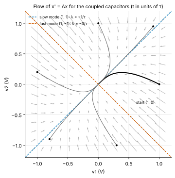
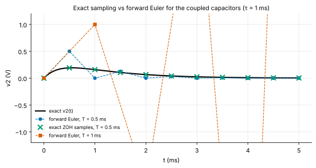

<!-- status: reviewed -->
# 02-09 · Systems of Linear ODEs and the Matrix Exponential

| | |
|---|---|
| **Course** | [02 · Complex Numbers, Differential Equations and Linear Algebra](../README.md) |
| **University equivalent** | The linear-systems unit of a sophomore differential-equations course (MIT 18.03SC Unit IV: first-order systems, linearization near equilibria, eigenvalue solutions, the phase plane, the matrix exponential; MIT 18.06 lecture 23; Boyce & DiPrima, chapter on systems of first-order linear equations), plus the state-space introduction of a first signals-and-systems or controls course |
| **Prerequisites** | [02-08 Eigenvalues and Eigenvectors](02-08-eigenvalues-and-eigenvectors.md), [02-05](02-05-laplace-transform-for-odes.md) (transfer functions and poles), [02-04](02-04-forced-response-and-resonance.md) (variation of parameters) |
| **Estimated study hours** | 10 |
| **Last verified** | 2026-11-18 |

**Learning objectives.** After this chapter you can:

1. Write a circuit or a higher-order ODE in state-space form $\mathbf{x}' = \mathbf{A}\mathbf{x} + \mathbf{B}u$, $y = \mathbf{C}\mathbf{x} + Du$, choosing capacitor voltages and inductor currents as the states.
2. Solve $\mathbf{x}' = \mathbf{A}\mathbf{x}$ by eigenvector expansion, for real, complex and repeated eigenvalues, and fit the initial conditions.
3. Define the matrix exponential $e^{\mathbf{A}t}$, compute it by diagonalization or by $(s\mathbf{I} - \mathbf{A})^{-1}$, and use its properties.
4. Classify the equilibrium of a 2-state system (node, saddle, spiral, center) from its trace and determinant, decide stability from eigenvalues, and linearize a nonlinear system at an operating point with its Jacobian.
5. Find forced responses with the convolution formula, steady states with $-\mathbf{A}^{-1}\mathbf{B}u$, and transfer functions with $\mathbf{C}(s\mathbf{I} - \mathbf{A})^{-1}\mathbf{B} + D$.
6. Discretize a state-space model exactly with a zero-order hold, map $s$-plane poles to the $z$-plane, and explain why forward Euler can go unstable.

## 1. Big picture

Real systems have more than one thing going on at once. A circuit with three capacitors and two inductors has five energy stores, each with its own voltage or current, all coupled through the wiring. A chip's thermal path has a die, a package and a heat sink, each warming at its own rate. A power converter, a PLL, a motor drive and a battery all have several interacting internal quantities. The **state-space** form writes all of them as one vector equation, $\mathbf{x}' = \mathbf{A}\mathbf{x} + \mathbf{B}u$, and the **matrix exponential** $e^{\mathbf{A}t}$ solves it in one stroke. Everything from 02-02 to 02-08 comes together here: exponentials, characteristic roots and poles become eigenvalues, and superposition becomes matrix algebra. This is the form in which modern control, estimation and simulation tools, including SPICE and some recent AI sequence models, actually work.

- **Circuits:** every lumped linear circuit can be written in state-space form, with the capacitor voltages and inductor currents as states. Its natural frequencies are the eigenvalues of $\mathbf{A}$ ([07](../../07-circuit-analysis-2-transient-and-ac/README.md)).
- **Thermal design:** junction-temperature transients follow a multi-time-constant state model, and the thermal-impedance curves in power-device datasheets are its modal expansion (Example 02-09.5).
- **Control and estimation:** state feedback, observers and Kalman filters are built on $\mathbf{x}' = \mathbf{A}\mathbf{x} + \mathbf{B}u$ ([15](../../15-control-systems/README.md)).
- **Digital implementation:** sampling a state-space model gives $\mathbf{x}_{k+1} = e^{\mathbf{A}T}\mathbf{x}_k + \dots$, the bridge between continuous physics and discrete-time processing (§3.7).

## 2. Intuition first

### The state is the system's memory

To predict what a circuit does next, you do not need its entire history, only the present values of the quantities that store energy: each capacitor's voltage and each inductor's current. Together they form the **state vector** $\mathbf{x}$. Given the state now and the inputs from now on, the future is determined. The state equation says how fast each state changes, given all of them and the input: $\mathbf{x}' = \mathbf{A}\mathbf{x} + \mathbf{B}u$. Geometrically, the state is a point moving through **state space**, and $\mathbf{A}\mathbf{x}$ is the velocity arrow attached to every point (Figure 02-09.1).

### Modes again

02-08 found the directions a matrix only stretches. For a differential equation, a state that starts along an eigenvector stays on that line forever and simply grows or decays as $e^{\lambda t}$. Any other start is a mixture of such **modes**, each evolving independently. A coupled system is a set of uncoupled ones in disguise, and the eigenvectors remove the disguise.

### An analogy from finance: a vector autoregression

An economist models quarterly GDP growth, inflation and the policy rate as a vector that evolves as $\mathbf{x}_{k+1} = \mathbf{A}\mathbf{x}_k + \mathbf{B}u_k + \text{noise}$: a vector autoregression (VAR). The matrix $\mathbf{A}$ captures how each variable feeds the others. An "impulse response" asks how a one-time shock propagates through all of them over the following quarters, and stationarity requires every eigenvalue of $\mathbf{A}$ inside the unit circle. That is exactly the discrete-time state-space model of §3.7, and the stability condition of 02-08.

*Where the analogy breaks:* a circuit's $\mathbf{A}$ comes from physics, with known structure: energy conservation, passivity, signs fixed by Kirchhoff's laws. An economy's $\mathbf{A}$ is estimated from noisy data, changes with policy regimes, and is only approximately linear. Engineers can usually trust their $\mathbf{A}$ to a few percent; economists cannot.

## 3. Theory

### 3.1 State-space form

A **state-space model** with one input $u$ and one output $y$ is

$$
\mathbf{x}' = \mathbf{A}\mathbf{x} + \mathbf{B}u, \qquad y = \mathbf{C}\mathbf{x} + Du .
$$

- $\mathbf{x}$ is the $n$-component **state**.
- $\mathbf{A}$ ($n\times n$) is the **state matrix**: how the states drive each other.
- $\mathbf{B}$ ($n\times1$) says where the input enters.
- $\mathbf{C}$ ($1\times n$) and $D$ say how the output is read out.

With several inputs and outputs, $\mathbf{B}$, $\mathbf{C}$ and $D$ simply gain columns and rows.

**Choosing states for a circuit.** Take the voltage across each capacitor and the current through each inductor, as long as they are independent. A loop of capacitors (and voltage sources) removes one capacitor voltage, and dually a cutset of inductors (and current sources), such as two inductors in series with nothing else at their junction, removes one inductor current. These are the quantities that cannot jump, because they hold energy ($\tfrac12Cv^2$ and $\tfrac12Li^2$). Then:

1. use KCL to find each capacitor current, giving $C\,v_C' = (\text{that current})$;
2. use KVL to find each inductor voltage, giving $L\,i_L' = (\text{that voltage})$;
3. express everything in terms of the states and the inputs.

The number of states equals the order of the circuit's characteristic equation.

**A series RLC, in state form.** A source $v_s$ drives $R$, $L$ and $C$ in series. With states $\mathbf{x} = (v_C, i_L)$:

$$
C\,v_C' = i_L, \qquad L\,i_L' = v_s - Ri_L - v_C,
$$

so

$$
\mathbf{A} = \begin{bmatrix} 0 & 1/C \\ -1/L & -R/L\end{bmatrix}, \qquad \mathbf{B} = \begin{bmatrix} 0 \\ 1/L\end{bmatrix}, \qquad \mathbf{C} = \begin{bmatrix} 1 & 0\end{bmatrix}, \quad D = 0 .
$$

Its characteristic polynomial is $\det(\lambda\mathbf{I} - \mathbf{A}) = \lambda^2 + (R/L)\lambda + 1/(LC)$, the familiar $\lambda^2 + 2\alpha\lambda + \omega_0^2$ of 02-03.

**Any $n$th-order ODE becomes $n$ first-order ones.** For $y''' + a_2y'' + a_1y' + a_0y = u$, take $\mathbf{x} = (y, y', y'')$. Then $x_1' = x_2$, $x_2' = x_3$ and $x_3' = -a_0x_1 - a_1x_2 - a_2x_3 + u$: the **companion form** of 02-08 §3.5.

Why bother with first-order form? Three reasons:

- every numerical ODE solver and circuit simulator works with first-order systems;
- multiple inputs and outputs fit naturally;
- the full power of matrix algebra applies.

### 3.2 Solving x' = Ax with eigenvectors

Try a solution that keeps its shape and only changes size: $\mathbf{x}(t) = e^{\lambda t}\mathbf{v}$. Substituting gives $\lambda e^{\lambda t}\mathbf{v} = \mathbf{A}e^{\lambda t}\mathbf{v}$, that is, $\mathbf{A}\mathbf{v} = \lambda\mathbf{v}$. So **each eigenpair gives a solution**. If $\mathbf{A}$ has $n$ independent eigenvectors, superposition gives the general solution

$$
\mathbf{x}(t) = c_1e^{\lambda_1t}\mathbf{v}_1 + c_2e^{\lambda_2t}\mathbf{v}_2 + \dots + c_ne^{\lambda_nt}\mathbf{v}_n ,
$$

and the initial condition fixes the constants: $\mathbf{x}(0) = c_1\mathbf{v}_1 + \dots + c_n\mathbf{v}_n$, that is, $\mathbf{V}\mathbf{c} = \mathbf{x}_0$. This is the continuous-time twin of 02-08 §3.4, with $e^{\lambda t}$ in place of $\lambda^k$.

*Figure 02-09.1 — The flow of $\mathbf{x}' = \mathbf{A}\mathbf{x}$ for the coupled capacitors of Example 02-09.2. Trajectories that start on an eigenvector line stay on it. Others first lose their fast-mode component (along $(1, -1)$) and then glide in along the slow eigenvector $(1, 1)$.*

**Complex eigenvalues.** For a real $\mathbf{A}$ with eigenpair $\lambda = \sigma + j\omega$ and $\mathbf{v} = \mathbf{a} + j\mathbf{b}$, the complex solution $e^{\lambda t}\mathbf{v}$ has real and imaginary parts that are each real solutions:

$$
e^{\sigma t}(\mathbf{a}\cos\omega t - \mathbf{b}\sin\omega t), \qquad e^{\sigma t}(\mathbf{a}\sin\omega t + \mathbf{b}\cos\omega t).
$$

These two replace the conjugate pair in the general solution: oscillation at ω inside an envelope $e^{\sigma t}$, as for the underdamped RLC of 02-03.

**Repeated eigenvalues with a missing eigenvector.** If λ is repeated but has only one eigenvector $\mathbf{v}$, the second solution is $e^{\lambda t}(t\mathbf{v} + \mathbf{w})$. Here $\mathbf{w}$, a **generalized eigenvector**, solves $(\mathbf{A} - \lambda\mathbf{I})\mathbf{w} = \mathbf{v}$. (Substitute to check: the $t$ terms cancel because $\mathbf{A}\mathbf{v} = \lambda\mathbf{v}$, and the rest is the defining equation for $\mathbf{w}$.) This is the $te^{st}$ of critical damping once more.

### 3.3 The matrix exponential

For scalars, $x' = ax$ has solution $x(t) = e^{at}x_0$. For systems, define the **matrix exponential** by the same power series:

$$
e^{\mathbf{A}t} = \mathbf{I} + \mathbf{A}t + \frac{(\mathbf{A}t)^2}{2!} + \frac{(\mathbf{A}t)^3}{3!} + \cdots .
$$

The series converges for every square matrix and every $t$: with any matrix norm satisfying $\lVert\mathbf{X}\mathbf{Y}\rVert \le \lVert\mathbf{X}\rVert\lVert\mathbf{Y}\rVert$, each term obeys $\lVert(\mathbf{A}t)^k/k!\rVert \le (\lVert\mathbf{A}\rVert\lvert t\rvert)^k/k!$, and those numbers sum to $e^{\lVert\mathbf{A}\rVert\lvert t\rvert}$, which is finite. Differentiating it term by term gives $\frac{d}{dt}e^{\mathbf{A}t} = \mathbf{A} + \mathbf{A}^2t + \frac{\mathbf{A}^3t^2}{2!} + \dots = \mathbf{A}e^{\mathbf{A}t}$, and at $t = 0$ it is $\mathbf{I}$. Therefore

$$
\boxed{\mathbf{x}(t) = e^{\mathbf{A}t}\mathbf{x}_0}
$$

solves $\mathbf{x}' = \mathbf{A}\mathbf{x}$ with $\mathbf{x}(0) = \mathbf{x}_0$. Column $j$ of $e^{\mathbf{A}t}$ is the response to the initial state $\mathbf{e}_j$, a single unit of state $j$.

**Properties.**

- $e^{\mathbf{A}(t + s)} = e^{\mathbf{A}t}e^{\mathbf{A}s}$: running for $s$ and then for $t$ is running for $t + s$. *Why:* both sides, as functions of $t$, solve $\mathbf{X}' = \mathbf{A}\mathbf{X}$ and equal $e^{\mathbf{A}s}$ at $t = 0$, so by uniqueness they are equal.
- $(e^{\mathbf{A}t})^{-1} = e^{-\mathbf{A}t}$: the exponential is always invertible (set $s = -t$ above: $e^{\mathbf{A}t}e^{-\mathbf{A}t} = e^{\mathbf{0}} = \mathbf{I}$).
- **But** $e^{(\mathbf{A} + \mathbf{B})t} = e^{\mathbf{A}t}e^{\mathbf{B}t}$ only when $\mathbf{A}\mathbf{B} = \mathbf{B}\mathbf{A}$. The scalar rule fails because matrix products do not commute.

**Computing it.**

1. **By diagonalization.** If $\mathbf{A} = \mathbf{V}\boldsymbol{\Lambda}\mathbf{V}^{-1}$, every power in the series is $\mathbf{V}\boldsymbol{\Lambda}^k\mathbf{V}^{-1}$, so

   $$
   e^{\mathbf{A}t} = \mathbf{V}e^{\boldsymbol{\Lambda}t}\mathbf{V}^{-1}, \qquad e^{\boldsymbol{\Lambda}t} = \operatorname{diag}(e^{\lambda_1t}, \dots, e^{\lambda_nt}) .
   $$

   This is the eigenvector expansion of §3.2 written as a single matrix.

2. **By Laplace transform.** Transforming $\mathbf{x}' = \mathbf{A}\mathbf{x}$ gives $s\mathbf{X} - \mathbf{x}_0 = \mathbf{A}\mathbf{X}$, so $\mathbf{X} = (s\mathbf{I} - \mathbf{A})^{-1}\mathbf{x}_0$. Comparing with $\mathbf{x} = e^{\mathbf{A}t}\mathbf{x}_0$:

   $$
   \mathcal{L}\{e^{\mathbf{A}t}\} = (s\mathbf{I} - \mathbf{A})^{-1} .
   $$

   Inverting each entry by partial fractions ([02-05](02-05-laplace-transform-for-odes.md)) gives $e^{\mathbf{A}t}$ entry by entry. The denominators are all $\det(s\mathbf{I} - \mathbf{A})$, the characteristic polynomial, so the poles are the eigenvalues.

3. **Special forms worth recognizing.**
   - A rotation generator gives a rotation: $\exp\!\left(\begin{bmatrix} 0 & -\omega \\ \omega & 0\end{bmatrix}t\right) = \begin{bmatrix} \cos\omega t & -\sin\omega t \\ \sin\omega t & \cos\omega t\end{bmatrix}$.
   - A Jordan block gives a factor $t$: $\exp\!\left(\begin{bmatrix} \lambda & 1 \\ 0 & \lambda\end{bmatrix}t\right) = e^{\lambda t}\begin{bmatrix} 1 & t \\ 0 & 1\end{bmatrix}$.

   Both follow from the series, because the relevant powers repeat or vanish (Example 02-09.3).

> **Going deeper — how software computes the exponential.** The obvious methods are poor numerically. Summing the series is inaccurate when $\lVert\mathbf{A}t\rVert$ is large, because huge terms cancel. Diagonalization fails when the eigenvectors are nearly parallel. Moler and Van Loan's classic survey "Nineteen dubious ways to compute the exponential of a matrix" (1978, revisited in 2003) catalogued the pitfalls ([R-050](../../../reference/research-log.md#r-050--matrix-exponential-algorithms)). The method in standard use is **scaling and squaring**. Divide $\mathbf{A}t$ by $2^s$ until it is small, approximate that exponential accurately with a rational (Padé) function, then square the result $s$ times, using $e^{\mathbf{M}} = (e^{\mathbf{M}/2^s})^{2^s}$. SciPy's `scipy.linalg.expm` implements the Al-Mohy–Higham (2009) version of this algorithm.

### 3.4 Stability and the phase plane

The **equilibrium** of $\mathbf{x}' = \mathbf{A}\mathbf{x}$ is $\mathbf{x} = \mathbf{0}$. Every solution decays to it exactly when **every eigenvalue has negative real part**, because each mode carries a factor $e^{\operatorname{Re}(\lambda)t}$. This is the matrix form of "all poles in the left half-plane" (02-05). An eigenvalue with positive real part means some initial conditions grow without bound. Eigenvalues on the imaginary axis mean sustained oscillation, or polynomial growth if they are defective.

**Two states: the trace–determinant plane.** For a 2×2 matrix, the eigenvalues are fixed by $T = \operatorname{tr}\mathbf{A} = \lambda_1 + \lambda_2$ and $\Delta = \det\mathbf{A} = \lambda_1\lambda_2$, through $\lambda^2 - T\lambda + \Delta = 0$. The discriminant $T^2 - 4\Delta$ decides real versus complex. That gives a complete classification of the **phase portrait**, the family of trajectories in the plane:

| Condition | Eigenvalues | Portrait | Circuit example |
|---|---|---|---|
| $\Delta < 0$ | real, opposite signs | **saddle**: unstable, trajectories approach along one eigenvector and leave along the other | a circuit with an active element (negative resistance) |
| $\Delta > 0$, $T^2 \ge 4\Delta$ | real, same sign | **node**: stable if $T < 0$ | overdamped RLC; coupled RC networks |
| $\Delta > 0$, $T^2 < 4\Delta$, $T \ne 0$ | complex pair | **spiral**: stable if $T < 0$ | underdamped RLC |
| $\Delta > 0$, $T = 0$ | $\pm j\omega$ | **center**: closed orbits | lossless LC tank |

So **a 2×2 system is stable exactly when $T < 0$ and $\Delta > 0$**. If $\Delta > 0$, the eigenvalues are either both real with the same sign or a complex pair, and $T < 0$ makes the sign (or the shared real part) negative. If $\Delta < 0$, the eigenvalues are real with opposite signs, and one of them is positive. For larger systems the Routh–Hurwitz criterion generalizes this test ([15-05](../../15-control-systems/chapters/15-05-stability-routh-hurwitz.md)).

*Figure 02-09.2 — The four basic phase portraits of a 2-state linear system (Example 02-09.4). Eigenvector directions are drawn for the node and the saddle.*

> **Going deeper — stable but still growing.** When $\mathbf{A}$ is far from symmetric (its eigenvectors are nearly parallel), $\lVert e^{\mathbf{A}t}\mathbf{x}_0\rVert$ can grow large for a while before the eigenvalues win and it decays. This *transient growth* matters in feedback loops and fluid flows, and it is invisible to an eigenvalue test. The singular values of $e^{\mathbf{A}t}$ reveal it. See Trefethen and Embree, *Spectra and Pseudospectra*.

### 3.5 Forced response, steady state and the transfer function

**Variation of parameters, in matrix form.** Multiply $\mathbf{x}' - \mathbf{A}\mathbf{x} = \mathbf{B}u$ by $e^{-\mathbf{A}t}$. The left side becomes an exact derivative, $\frac{d}{dt}\big(e^{-\mathbf{A}t}\mathbf{x}\big)$, the integrating factor of 02-02 in matrix form. Integrating from 0 to $t$ and multiplying by $e^{\mathbf{A}t}$:

$$
\mathbf{x}(t) = \underbrace{e^{\mathbf{A}t}\mathbf{x}_0}_{\text{zero-input}} + \underbrace{\int_0^te^{\mathbf{A}(t - \tau)}\mathbf{B}\,u(\tau)\,d\tau}_{\text{zero-state (a convolution)}} .
$$

The response is the free decay of the initial state plus the input convolved with the system's impulse response $e^{\mathbf{A}t}\mathbf{B}$: 02-05's convolution theorem, now for vectors.

**Constant input and steady state.** If $u$ is a constant $u_0$ and $\mathbf{A}$ is invertible, set $\mathbf{x}' = \mathbf{0}$ to find the equilibrium $\mathbf{x}_{ss} = -\mathbf{A}^{-1}\mathbf{B}u_0$. Then $\mathbf{x}(t) - \mathbf{x}_{ss}$ obeys the unforced equation, so

$$
\mathbf{x}(t) = \mathbf{x}_{ss} + e^{\mathbf{A}t}(\mathbf{x}_0 - \mathbf{x}_{ss}) .
$$

If the system is stable, every solution approaches $\mathbf{x}_{ss}$, through a mixture of its modes. In a circuit, $\mathbf{x}_{ss}$ is the DC operating point: capacitors open, inductors shorted, which is exactly what setting $\mathbf{x}' = \mathbf{0}$ means.

**The transfer function.** With zero initial state, transforming gives $\mathbf{X}(s) = (s\mathbf{I} - \mathbf{A})^{-1}\mathbf{B}U(s)$, so

$$
H(s) = \frac{Y(s)}{U(s)} = \mathbf{C}(s\mathbf{I} - \mathbf{A})^{-1}\mathbf{B} + D .
$$

The denominator is $\det(s\mathbf{I} - \mathbf{A})$, so **the poles of $H(s)$ are eigenvalues of $\mathbf{A}$**. A mode that $\mathbf{B}$ cannot excite or $\mathbf{C}$ cannot see can cancel out of $H(s)$: such a mode is *uncontrollable* or *unobservable*. An unstable mode hidden that way is a real hazard, because the transfer function looks fine while an internal state runs away ([15](../../15-control-systems/README.md)). The DC gain is $H(0) = -\mathbf{C}\mathbf{A}^{-1}\mathbf{B} + D$, consistent with $\mathbf{x}_{ss}$.

### 3.6 Modes, step responses and thermal networks

For a stable, diagonalizable system with a constant input switched on at $t = 0$ from rest, the formulas above combine into a constant plus a sum of exponentials, one per mode:

$$
y(t) = y_{ss} + \sum_{i=1}^nk_ie^{\lambda_it} .
$$

If the output starts at zero, then $y(0) = 0$ gives $y_{ss} = -\sum k_i$. Writing $r_i = -k_i$ and $\tau_i = -1/\lambda_i$ puts the step response in the form used everywhere in practice. (The $\tau_i$ are real because an RC or thermal network's eigenvalues are real and negative: with $\mathbf{C}$ the diagonal matrix of capacitances and $\mathbf{G}$ the symmetric conductance matrix, $\mathbf{A} = -\mathbf{C}^{-1}\mathbf{G}$ is similar to the symmetric negative-definite matrix $-\mathbf{C}^{-1/2}\mathbf{G}\mathbf{C}^{-1/2}$, so it has the same real, negative eigenvalues.)

$$
y(t) = \sum_{i=1}^nr_i\big(1 - e^{-t/\tau_i}\big), \qquad \sum_{i=1}^nr_i = y_{ss} .
$$

Each **mode** contributes one exponential with its own time constant. Slow modes (small $\lvert\lambda\rvert$) dominate the late response, fast modes the early one.

**Thermal impedance.** Heat flow through a chip and its package behaves like an RC network: temperature plays the role of voltage, power the role of current, thermal resistance (K/W) the role of resistance, and heat capacity (J/K) the role of capacitance. The junction's response to a power step $P$ defines the **transient thermal impedance** $Z_{th}(t) = \Delta T_j(t)/P$. Expanding in modes gives the **Foster form**

$$
Z_{th}(t) = \sum_{i=1}^nR_i\big(1 - e^{-t/\tau_i}\big), \qquad \tau_i = R_iC_i ,
$$

which device datasheets tabulate ([R-049](../../../reference/research-log.md#r-049--foster-and-cauer-thermal-models)). The $R_i$ and $\tau_i$ of a Foster network are **modal** quantities, the eigenvalue expansion of the physical model. They are not the resistances and capacitances of physical layers. That is why a Foster network fitted to one device cannot simply be chained with a heat-sink model. The **Cauer** (ladder) form, which mirrors the physical layers in series, can be, at the cost of a less convenient formula. Example 02-09.5 computes both views for a two-node model.

### 3.7 Sampling: from continuous to discrete time

A digital controller, a simulator or a DSP processes $\mathbf{x}$ only at sample times $t_k = kT$. If the input is held constant over each sample period (a **zero-order hold**, as a DAC does), apply the forced-response formula over one period, with the input constant at $u_k$:

$$
\mathbf{x}_{k+1} = \mathbf{A}_d\mathbf{x}_k + \mathbf{B}_du_k, \qquad \mathbf{A}_d = e^{\mathbf{A}T}, \qquad \mathbf{B}_d = \int_0^Te^{\mathbf{A}\sigma}\,d\sigma\,\mathbf{B} = \mathbf{A}^{-1}(e^{\mathbf{A}T} - \mathbf{I})\mathbf{B} .
$$

The integral form comes from the convolution formula of §3.5 over one period: $\mathbf{x}_{k+1} = e^{\mathbf{A}T}\mathbf{x}_k + \int_0^Te^{\mathbf{A}(T - \lambda)}\mathbf{B}u_k\,d\lambda$, and substituting $\sigma = T - \lambda$ gives $\int_0^Te^{\mathbf{A}\sigma}d\sigma\,\mathbf{B}u_k$. Integrating the series term by term, $\int_0^Te^{\mathbf{A}\sigma}d\sigma = \sum_k\mathbf{A}^kT^{k+1}/(k+1)!$, which equals $\mathbf{A}^{-1}(e^{\mathbf{A}T} - \mathbf{I})$ when $\mathbf{A}$ is invertible. This discretization is **exact** at the sample times, for any $T$: no approximation has been made.

The eigenvalues map as $z = e^{\lambda T}$. The left half of the $s$-plane maps inside the unit circle ($\lvert e^{\lambda T}\rvert = e^{\operatorname{Re}(\lambda)T} < 1$), so a stable continuous system always gives a stable sampled one. This is the bridge between the poles of 02-05 and the $z$-plane poles of digital filters ([11-09](../../11-signals-and-systems/chapters/11-09-z-transform.md)).

**Forward Euler is not exact.** The simplest numerical method replaces the derivative by a forward difference, $\mathbf{x}_{k+1} = \mathbf{x}_k + T\mathbf{A}\mathbf{x}_k$, that is, $\mathbf{A}_d \approx \mathbf{I} + \mathbf{A}T$: the first two terms of the exponential series. Its eigenvalues are $1 + \lambda T$ instead of $e^{\lambda T}$. For a decaying real mode, $\lvert1 + \lambda T\rvert < 1$ requires $T < 2/\lvert\lambda\rvert$. Above that step size, a perfectly stable circuit simulates as an exploding one (Example 02-09.6). Systems whose time constants span a wide range (**stiff** systems) force tiny steps on explicit methods. That is why circuit simulators use implicit methods such as backward Euler and the trapezoidal rule ([02-10](02-10-numerical-methods.md); [02-02](02-02-first-order-linear-odes.md) §3.9).

### 3.8 Nonlinear systems: linearizing at an equilibrium

Real circuits are nonlinear: $\mathbf{x}' = \mathbf{f}(\mathbf{x})$, with $\mathbf{f}$ built from diode, transistor and saturation curves. Everything in this chapter still applies near an **equilibrium** $\mathbf{x}^*$, a state where $\mathbf{f}(\mathbf{x}^*) = \mathbf{0}$ (a DC operating point). Write $\mathbf{x} = \mathbf{x}^* + \boldsymbol{\delta}$ and expand each component of $\mathbf{f}$ to first order in $\boldsymbol{\delta}$ ([01-09](../../01-calculus-for-engineers/chapters/01-09-multivariable-calculus-1.md)):

$$
\boldsymbol{\delta}' = \mathbf{f}(\mathbf{x}^* + \boldsymbol{\delta}) \approx \underbrace{\mathbf{f}(\mathbf{x}^*)}_{\mathbf{0}} + \mathbf{J}\boldsymbol{\delta}, \qquad J_{ij} = \left.\frac{\partial f_i}{\partial x_j}\right|_{\mathbf{x}^*} .
$$

The **Jacobian matrix** $\mathbf{J}$ plays the role of $\mathbf{A}$: small deviations obey the linear system $\boldsymbol{\delta}' = \mathbf{J}\boldsymbol{\delta}$, and the eigenvalues of $\mathbf{J}$ decide whether the operating point is stable. This is the **small-signal model** of Courses 10 and 12 in matrix form. The classification of §3.4 carries over, with one caveat (*Hartman–Grobman*, stated here without proof): the linearization predicts the local behavior correctly whenever no eigenvalue of $\mathbf{J}$ lies on the imaginary axis. A center or a zero eigenvalue is decided by the nonlinear terms.

**A latch and metastability.** Two cross-coupled inverters store a bit. Normalize each node voltage so that 0 is the switching point, and model each inverter as $\tau x_1' = -x_1 - \tanh(ax_2)$, $\tau x_2' = -x_2 - \tanh(ax_1)$, with gain $a > 1$ at the switching point and τ the inverter's time constant. The origin is an equilibrium. There $\tanh(ax) \approx ax$, so

$$
\mathbf{J} = \frac{1}{\tau}\begin{bmatrix} -1 & -a \\ -a & -1\end{bmatrix}, \qquad \lambda = \frac{-1 - a}{\tau}\ \text{along}\ (1, 1), \qquad \lambda = \frac{a - 1}{\tau}\ \text{along}\ (1, -1) .
$$

The determinant is $(1 - a^2)/\tau^2 < 0$: a **saddle**. Equal deviations decay, but any imbalance along $(1, -1)$, one node up and the other down, grows as $e^{(a - 1)t/\tau}$ until the latch falls into one of its two stable states. Started almost exactly at the saddle, the latch takes a long, unpredictable time to decide: **metastability**, the reason synchronizers between clock domains use chains of flip-flops (Example 02-09.7, [08](../../08-digital-logic-design/README.md)).

## 4. Worked examples

### Example 02-09.1 — The series RLC as a state-space model (tier A)

**Setup.** For the series RLC of 02-05 Example 3 ($R = 50$ Ω, $L = 10$ mH, $C = 1$ µF), with input $v_s$ and output $v_C$, write $\mathbf{A}$, $\mathbf{B}$, $\mathbf{C}$ and $D$. Find the eigenvalues, the DC gain, and the transfer function.

**Solution.** From §3.1:

$$
\mathbf{A} = \begin{bmatrix} 0 & 10^6 \\ -100 & -5000\end{bmatrix}, \quad \mathbf{B} = \begin{bmatrix} 0 \\ 100\end{bmatrix}, \quad \mathbf{C} = \begin{bmatrix} 1 & 0\end{bmatrix}, \quad D = 0 ,
$$

in units that make $\mathbf{x}'$ come out in V/s and A/s. The trace is −5000 and the determinant is $0 + 10^6\times100 = 10^8$, so the eigenvalues solve $\lambda^2 + 5000\lambda + 10^8 = 0$: $\lambda = -2500 \pm j$**9682** s⁻¹, the poles found in 02-05 and 02-08.

*DC gain:* $\mathbf{A}^{-1} = \frac{1}{10^8}\begin{bmatrix} -5000 & -10^6 \\ 100 & 0\end{bmatrix}$, so \$-\mathbf{C}\mathbf{A}^{-1}\mathbf{B} = -\frac{1}{10^8}(-10^6\times100) = \$ **1**. At DC the capacitor charges to the source voltage.

*Transfer function:* $(s\mathbf{I} - \mathbf{A})^{-1}\mathbf{B} = \dfrac{1}{s^2 + 5000s + 10^8}\begin{bmatrix} s + 5000 & 10^6 \\ -100 & s\end{bmatrix}\begin{bmatrix} 0 \\ 100\end{bmatrix}$, and taking the first entry gives

$$
H(s) = \frac{10^8}{s^2 + 5000s + 10^8},
$$

exactly 02-05's result ✓.

**Check.** $\operatorname{tr}\mathbf{A} = -R/L = -2\alpha$ ✓ and $\det\mathbf{A} = 1/(LC) = \omega_0^2$ ✓.

### Example 02-09.2 — Two coupled capacitors (tier B)

**Setup.** Two capacitors $C$ each have a resistor $R$ to ground and are joined by a third resistor $R$, with $RC = τ = 1$ ms. Capacitor 1 starts at 1 V and capacitor 2 at 0 V. Find $v_1(t)$ and $v_2(t)$, and the time and value of the peak of $v_2$.

**Solution.** KCL at each node: $Cv_1' = -v_1/R - (v_1 - v_2)/R$ and $Cv_2' = -v_2/R - (v_2 - v_1)/R$. So

$$
\mathbf{A} = \frac{1}{\tau}\begin{bmatrix} -2 & 1 \\ 1 & -2\end{bmatrix} .
$$

This is a symmetric matrix, with eigenvalues $-1/\tau$ for $\mathbf{v}_1 = (1, 1)$ and $-3/\tau$ for $\mathbf{v}_2 = (1, -1)$. The slow mode has both capacitors at the same voltage, so the middle resistor carries no current and each capacitor sees only its own $R$: time constant τ. In the fast mode the capacitors oppose each other, and each also discharges through half of the middle resistor (to the point that stays at zero by symmetry): time constant $\tau/3$.

Fitting $\mathbf{x}_0 = (1, 0) = \tfrac12(1, 1) + \tfrac12(1, -1)$:

$$
v_1(t) = \tfrac12\big(e^{-t/\tau} + e^{-3t/\tau}\big), \qquad v_2(t) = \tfrac12\big(e^{-t/\tau} - e^{-3t/\tau}\big)\ \text{V}.
$$

The peak of $v_2$ is where $-e^{-t/\tau} + 3e^{-3t/\tau} = 0$, that is, $e^{2t/\tau} = 3$, at \$t = \tfrac{\ln3}{2}\tau = \$ **0.5493 ms**. There, \$v_2 = \tfrac12(3^{-1/2} - 3^{-3/2}) = \$ **0.1925 V**. At $t = τ$: \$v_1 = \$ **0.2088 V** and \$v_2 = \$ **0.1590 V**.

**Checks.** $v_1(0) = 1$, $v_2(0) = 0$ ✓. Initially $v_2' = (v_1 - 2v_2)/\tau = 1/\tau > 0$: node 2 starts charging from node 1 ✓. Both decay to zero, since all the charge eventually drains through the grounded resistors ✓. The lab confirms the peak in ngspice.

### Example 02-09.3 — Three matrix exponentials (tier B)

**Setup.** Compute $e^{\mathbf{A}t}$ for (a) the coupled capacitors of Example 02-09.2, evaluated at $t = τ$; (b) $\begin{bmatrix} 0 & -\omega \\ \omega & 0\end{bmatrix}$; (c) $\begin{bmatrix} -1 & 1 \\ 0 & -1\end{bmatrix}$.

**Solution.** (a) With $\mathbf{V} = \begin{bmatrix} 1 & 1 \\ 1 & -1\end{bmatrix}$ and $\mathbf{V}^{-1} = \tfrac12\mathbf{V}$:

$$
e^{\mathbf{A}t} = \mathbf{V}\begin{bmatrix} e^{-t/\tau} & 0 \\ 0 & e^{-3t/\tau}\end{bmatrix}\mathbf{V}^{-1} = \frac12\begin{bmatrix} e^{-t/\tau} + e^{-3t/\tau} & e^{-t/\tau} - e^{-3t/\tau} \\ e^{-t/\tau} - e^{-3t/\tau} & e^{-t/\tau} + e^{-3t/\tau}\end{bmatrix} .
$$

At $t = τ$, the diagonal entries are **0.2088** and the off-diagonal entries **0.1590**. Column 1 is exactly $(v_1, v_2)$ of Example 02-09.2, the response to the unit initial state $(1, 0)$.

(b) Let $\mathbf{J} = \begin{bmatrix} 0 & -1 \\ 1 & 0\end{bmatrix}$, so $\mathbf{A} = \omega\mathbf{J}$. Then $\mathbf{J}^2 = -\mathbf{I}$, $\mathbf{J}^3 = -\mathbf{J}$ and $\mathbf{J}^4 = \mathbf{I}$, and the series splits into the cosine and sine series:

$$
e^{\omega\mathbf{J}t} = \mathbf{I}\Big(1 - \frac{(\omega t)^2}{2!} + \cdots\Big) + \mathbf{J}\Big(\omega t - \frac{(\omega t)^3}{3!} + \cdots\Big) = \begin{bmatrix} \cos\omega t & -\sin\omega t \\ \sin\omega t & \cos\omega t\end{bmatrix} .
$$

This is the lossless LC tank of a center (§3.4): the state rotates forever. It is also Euler's formula ([02-01](02-01-complex-numbers-euler-and-phasors.md)) in matrix form, with $\mathbf{J}$ playing $j$.

(c) $\mathbf{A} = -\mathbf{I} + \mathbf{N}$ with $\mathbf{N} = \begin{bmatrix} 0 & 1 \\ 0 & 0\end{bmatrix}$ and $\mathbf{N}^2 = \mathbf{0}$. Because $-\mathbf{I}$ and $\mathbf{N}$ commute, $e^{\mathbf{A}t} = e^{-t}e^{\mathbf{N}t} = e^{-t}(\mathbf{I} + \mathbf{N}t)$:

$$
e^{\mathbf{A}t} = \begin{bmatrix} e^{-t} & te^{-t} \\ 0 & e^{-t}\end{bmatrix} .
$$

At $t = 1$ the $(1, 2)$ entry is \$e^{-1} = \$ **0.3679**: the $te^{-t}$ of a repeated root.

**Check.** For (c), $\frac{d}{dt}e^{\mathbf{A}t}$ at $t = 0$ equals $\begin{bmatrix} -1 & 1 \\ 0 & -1\end{bmatrix} = \mathbf{A}$ ✓. For (b), $\det e^{\mathbf{A}t} = 1 = e^{\operatorname{tr}(\mathbf{A})t}$ ✓. (In general, $\det e^{\mathbf{A}t} = e^{\operatorname{tr}(\mathbf{A})t}$, because the determinant is the product of the $e^{\lambda_it}$.)

### Example 02-09.4 — Reading phase portraits from T and Δ (tier B)

**Setup.** Classify the equilibrium of each system, and say whether it is stable:

$$
\mathbf{A}_1 = \begin{bmatrix} -2 & 1 \\ 1 & -2\end{bmatrix}, \quad \mathbf{A}_2 = \begin{bmatrix} 1 & 2 \\ 2 & 1\end{bmatrix}, \quad \mathbf{A}_3 = \begin{bmatrix} -1 & -4 \\ 1 & -1\end{bmatrix}, \quad \mathbf{A}_4 = \begin{bmatrix} 0 & 1 \\ -4 & 0\end{bmatrix} .
$$

**Solution.**

| Matrix | $T$ | $\Delta$ | $T^2 - 4\Delta$ | Eigenvalues | Type |
|---|---|---|---|---|---|
| $\mathbf{A}_1$ | −4 | 3 | 4 | −1, −3 | stable node |
| $\mathbf{A}_2$ | 2 | **−3** | 16 | 3, −1 | saddle (unstable) |
| $\mathbf{A}_3$ | −2 | 5 | **−16** | $-1 \pm 2j$ | stable spiral |
| $\mathbf{A}_4$ | 0 | 4 | −16 | $\pm2j$ | center |

$\mathbf{A}_1$ is Example 02-09.2's matrix with τ = 1. The saddle $\mathbf{A}_2$ grows along $(1, 1)$ and decays along $(1, -1)$, so almost every start is eventually swept outward. The spiral $\mathbf{A}_3$ turns at 2 rad/s while decaying like $e^{-t}$. The center $\mathbf{A}_4$ is an undamped oscillator, $x'' = -4x$, circulating at 2 rad/s. Figure 02-09.2 draws all four.

**Check.** In each row, the sum of the eigenvalues is $T$ and the product is $\Delta$ ✓.

### Example 02-09.5 — Chip thermal transient: modes and the Foster model (tier C)

**Setup.** A two-node thermal model of a power device. The die (heat capacity $C_d = 2$ J/K) connects to a heat sink ($C_h = 50$ J/K) through $R_{dh} = 0.5$ K/W. The heat sink connects to ambient through $R_{ha} = 1.5$ K/W. The model values are illustrative. At $t = 0$ the device starts dissipating $P = 10$ W. With temperatures measured above ambient, find the steady state, the two thermal time constants, the die temperature at 1 s, 10 s and 100 s, and the Foster coefficients of the die's thermal impedance.

**Solution.** Heat balance at each node (the thermal KCL):

$$
C_dT_d' = P - \frac{T_d - T_h}{R_{dh}}, \qquad C_hT_h' = \frac{T_d - T_h}{R_{dh}} - \frac{T_h}{R_{ha}} .
$$

So

$$
\mathbf{A} = \begin{bmatrix} -1 & 1 \\ 0.04 & -0.05333\end{bmatrix}\text{ s}^{-1}, \qquad \mathbf{B} = \begin{bmatrix} 0.5 \\ 0\end{bmatrix}\text{ K/J}.
$$

*Steady state:* setting $\mathbf{x}' = \mathbf{0}$ makes all the heat flow through both resistances in series. So \$T_h = PR_{ha} = \$ **15 K** and \$T_d = P(R_{dh} + R_{ha}) = \$ **20 K**.

*Modes:* $T = -1.05333$ and $\Delta = 0.05333 - 0.04 = 0.01333$, so the eigenvalues are $\lambda = -1.0405$ and $-0.01281$ s⁻¹. The time constants are \$\tau_1 = \$ **0.9611 s** (the die equilibrating with the sink) and \$\tau_2 = \$ **78.04 s** (the sink heating up).

The eigenvalues come from $\lambda^2 + 1.05333\lambda + 0.01333 = 0$: $\lambda = \tfrac12\big(-1.05333 \pm \sqrt{1.05333^2 - 4\times0.01333}\big) = \tfrac12(-1.05333 \pm 1.02771)$.

*Die temperature:* $\mathbf{x}(t) = \mathbf{x}_{ss} + e^{\mathbf{A}t}(\mathbf{0} - \mathbf{x}_{ss})$, so expand the initial deviation $\mathbf{0} - \mathbf{x}_{ss} = (-20, -15)$ K in eigenvectors. Row 1 of $(\mathbf{A} - \lambda\mathbf{I})\mathbf{v} = \mathbf{0}$ reads $(-1 - \lambda)v_1 + v_2 = 0$, so with $v_1 = 1$, $v_2 = 1 + \lambda$: \$\mathbf{v}_1 = (1,\ $**−0.04052**$)\$ and \$\mathbf{v}_2 = (1,\ $**0.9872**$)\$. Solve $c_1\mathbf{v}_1 + c_2\mathbf{v}_2 = (-20, -15)$: the first row gives $c_1 = -20 - c_2$, and the second then gives $0.8104 + 1.0277c_2 = -15$, so \$c_2 = \$ **−15.38** and \$c_1 = \$ **−4.616**. The die temperature is the first component, $T_d(t) = 20 - 4.616e^{-t/\tau_1} - 15.38e^{-t/\tau_2}$ K. That gives **3.181 K** at 1 s, **6.466 K** at 10 s and **15.73 K** at 100 s.

*Foster model:* $Z_{th}(t) = T_d(t)/P = R_1(1 - e^{-t/\tau_1}) + R_2(1 - e^{-t/\tau_2})$, with \$R_1 = \$ **0.4616 K/W** and \$R_2 = \$ **1.538 K/W**.

**Checks.**

- $R_1 + R_2 = 2.000$ K/W $= R_{dh} + R_{ha}$ ✓: the steady-state thermal resistance.
- At $t = 0$, $T_d = 20 - 4.616 - 15.38 = 0$ ✓.
- The Foster resistances, 0.4616 and 1.538 K/W, are *not* the physical 0.5 and 1.5 K/W. They are modal weights, which is why Foster networks cannot be cut apart at a "case" node ([R-049](../../../reference/research-log.md#r-049--foster-and-cauer-thermal-models)).
- *Sanity:* after 1 s the die is only about 3 K above ambient, but heading for 20 K over minutes. A one-second power burst is limited by the die's own heat capacity, a sustained load by the heat sink. That is why datasheets plot $Z_{th}$ against pulse duration.

The lab simulates the electrical analog in ngspice.

*Figure 02-09.3 — Example 02-09.5. Left: temperatures after a 10 W step. Right: the die's thermal impedance on a log time axis, as datasheets plot it, and its two Foster terms (τ = 0.96 s and 78 s).*

### Example 02-09.6 — Exact sampling versus forward Euler (tier C)

**Setup.** Sample the coupled capacitors of Example 02-09.2 (τ = 1 ms) with period $T$. Compare the exact discrete eigenvalues $e^{\lambda T}$ with the forward-Euler ones, $1 + \lambda T$, for $T = 0.5$ ms and $T = 1$ ms. Find the largest step for which Euler is stable.

**Solution.** The continuous eigenvalues are $-1/\tau$ and $-3/\tau$.

- **T = 0.5 ms.** Exact: \$e^{-0.5} = \$ **0.6065** and \$e^{-1.5} = \$ **0.2231**, both positive and less than 1: smooth decay. Euler: $1 - 0.5 = 0.5$ and \$1 - 1.5 = \$ **−0.5**. Still stable, but the negative eigenvalue makes the fast mode flip sign every step, an oscillation the real circuit does not have.
- **T = 1 ms.** Exact: $e^{-1} = 0.3679$ and $e^{-3} = 0.04979$, still stable. Euler: $1 - 1 = 0$ and \$1 - 3 = \$ **−2**: unstable. The simulated voltages double in size and flip sign every step.
- **Stability limit.** Euler needs $\lvert1 + \lambda T\rvert < 1$ for both eigenvalues. The fast one is binding: \$T < 2/\lvert{-3/\tau}\rvert = 2\tau/3 = \$ **0.6667 ms**.

The slow mode, the one that matters at long times, would allow $T < 2$ ms. But the fast mode, which has died out after a millisecond or so, still limits the step. That is stiffness in miniature.

*Figure 02-09.4 — Exact sampling lands on the true curve at every sample. Forward Euler at $T = 0.5$ ms already wobbles (eigenvalue −0.5), and at $T = 1$ ms it diverges (eigenvalue −2).*

**Check.** The exact $\mathbf{A}_d = e^{\mathbf{A}T}$ has the same eigenvectors as $\mathbf{A}$, and eigenvalues $e^{\lambda T}$, which lie inside the unit circle for every $T > 0$ ✓.

### Example 02-09.7 — How long a latch takes to decide (tier B)

**Setup.** Model a latch as in §3.8 with inverter gain $a = 3$ and τ = 10 ps. (a) Classify the equilibrium at the origin and find its time constants. (b) An input leaves the two nodes imbalanced by $\delta_0 = 1$ µV (normalized units, where the stable states sit near ±1). How long until the imbalance reaches 0.5 and the latch has effectively decided? (c) Find the stable states and their decay rate.

**Solution.** (a) $\mathbf{J} = \frac{1}{\tau}\begin{bmatrix} -1 & -3 \\ -3 & -1\end{bmatrix}$ has trace $-2/\tau$ and determinant $-8/\tau^2 < 0$: a saddle. The eigenvalues are $-4/\tau$ along $(1, 1)$, time constant **2.5 ps**, and $+2/\tau$ along $(1, -1)$, growth time constant \$\tau/(a - 1) = \$ **5 ps**.

(b) The imbalance grows as $\delta_0e^{2t/\tau}$, so it reaches 0.5 when \$t = \frac{\tau}{2}\ln\frac{0.5}{10^{-6}} = 5\text{ ps}\times\ln(5\times10^5) = \$ **65.61 ps**. Every factor of 10 closer to perfect balance adds \$5\ln10 = \$ **11.51 ps**: the decision time grows without bound as the imbalance shrinks, which is why it cannot be guaranteed.

(c) By symmetry look for $x_1 = s$, $x_2 = -s$: then $s = \tanh(3s)$, and iterating $s \leftarrow \tanh(3s)$ from 1 gives \$s = \$ **0.9949**. There $\frac{d}{dx}\tanh(3x) = 3(1 - s^2) = 0.0305$, so $\mathbf{J} = \frac{1}{\tau}\begin{bmatrix} -1 & -0.0305 \\ -0.0305 & -1\end{bmatrix}$, with eigenvalues of about $-0.97/\tau$ and $-1.03/\tau$: a stable node. The latch holds its bit.

**Units check.** τ in ps, so the growth rate $(a - 1)/\tau$ is per ps, and the times come out in ps ✓. **Sanity check.** A larger gain shortens the growth time constant $\tau/(a - 1)$, which is why synchronizer flip-flops are designed for high gain at the switching point ✓.

<!-- answer-key -->
| ID | Quantity | Value | Unit |
|---|---|---|---|
| Ex 02-09.1a | imaginary part of the eigenvalues | 9682 | 1/s |
| Ex 02-09.1b | DC gain | 1 | — |
| Ex 02-09.2a | time of the v2 peak | 0.5493 | ms |
| Ex 02-09.2b | v2 peak | 0.1925 | V |
| Ex 02-09.2c | v1 at t = τ | 0.2088 | V |
| Ex 02-09.2d | v2 at t = τ | 0.1590 | V |
| Ex 02-09.3a | diagonal entry of e^(Aτ) | 0.2088 | — |
| Ex 02-09.3b | off-diagonal entry of e^(Aτ) | 0.1590 | — |
| Ex 02-09.3c | (1, 2) entry of the Jordan exponential at t = 1 | 0.3679 | — |
| Ex 02-09.4a | det A2 | −3 | — |
| Ex 02-09.4b | discriminant for A3 | −16 | — |
| Ex 02-09.5a | steady die temperature rise | 20 | K |
| Ex 02-09.5b | steady heat-sink temperature rise | 15 | K |
| Ex 02-09.5c | fast time constant | 0.9611 | s |
| Ex 02-09.5d | slow time constant | 78.04 | s |
| Ex 02-09.5e | die rise at 1 s | 3.181 | K |
| Ex 02-09.5f | die rise at 10 s | 6.466 | K |
| Ex 02-09.5g | die rise at 100 s | 15.73 | K |
| Ex 02-09.5h | Foster R1 | 0.4616 | K/W |
| Ex 02-09.5i | Foster R2 | 1.538 | K/W |
| Ex 02-09.5p | second entry of v1 | −0.04052 | — |
| Ex 02-09.5q | second entry of v2 | 0.9872 | — |
| Ex 02-09.5r | coefficient c2 | −15.38 | K |
| Ex 02-09.5s | coefficient c1 | −4.616 | K |
| Ex 02-09.7a | decay time constant along (1, 1) | 2.5 | ps |
| Ex 02-09.7b | growth time constant along (1, −1) | 5 | ps |
| Ex 02-09.7c | time to resolve from 1 µV to 0.5 | 65.61 | ps |
| Ex 02-09.7d | extra time per factor of 10 | 11.51 | ps |
| Ex 02-09.7e | stable state | 0.9949 | — |
| Ex 02-09.7f | slope of tanh(3x) at the stable state | 0.0305 | — |
| Ex 02-09.6a | exact discrete eigenvalue (slow), T = 0.5 ms | 0.6065 | — |
| Ex 02-09.6b | exact discrete eigenvalue (fast), T = 0.5 ms | 0.2231 | — |
| Ex 02-09.6c | Euler eigenvalue (fast), T = 0.5 ms | −0.5 | — |
| Ex 02-09.6d | Euler eigenvalue (fast), T = 1 ms | −2 | — |
| Ex 02-09.6e | Euler stability limit | 0.6667 | ms |

*Recomputed by [verify_02_09.py](../verify/verify_02_09.py). Examples 02-09.2 and 02-09.5 are also confirmed in ngspice in the lab.*

## 5. Simulate it

The lab ([labs/02-09-lab/](../labs/02-09-lab/README.md)) has a notebook and three ngspice netlists:

1. **Three ways to the same answer.** Solve Example 02-09.2 by eigenvectors, by `scipy.linalg.expm`, and with a general ODE solver (`solve_ivp`), and confirm they agree.
2. **How not to compute $e^{\mathbf{A}t}$.** Sum the Taylor series for a large $\lVert\mathbf{A}t\rVert$ and watch cancellation destroy it; compare with `expm`. *Predict first:* how many correct digits does the series give for $e^{-20}$?
3. **Phase portraits.** Draw the four portraits of Example 02-09.4 with trajectories, and move a matrix across the trace–determinant plane. *Predict first:* what happens to a spiral as the trace passes through zero?
4. **Thermal transients and Foster models.** Simulate Example 02-09.5, extract its Foster coefficients from the eigen-decomposition, and plot $Z_{th}$ against time on a log axis, the way datasheets do.
5. **Sampling.** Compare exact zero-order-hold sampling with forward Euler for Example 02-09.6 at several step sizes, and plot where $z = e^{\lambda T}$ and $1 + \lambda T$ land relative to the unit circle.
6. **A state-space sequence layer.** Run Problem 02-09.15's sampled one-state model on a sequence of inputs, and see how Δ controls its memory.
7. **ngspice.** `coupled_rc.cir` (Example 02-09.2 and Problem 02-09.9), `thermal_analog.cir` (Example 02-09.5 as an electrical analog), and `foster_pulse.cir` (Problem 02-09.14's 10 ms pulse).

## 6. Engineering tradeoffs

| Knob | Improves | Costs | Typical decision owner |
|---|---|---|---|
| Model order (number of states kept) | Accuracy across a wider frequency or time range | More parameters to identify, slower simulation, less insight | Modeling and control engineers |
| Modal (diagonal) form instead of physical states | Decoupled modes, easy time constants, cheap simulation | States lose physical meaning (Foster networks cannot be cascaded) | Thermal, control and SI engineers |
| Exact (ZOH) discretization instead of Euler | Exact at the samples, always stable for a stable plant | Needs a matrix exponential; slightly more computation | DSP, firmware and controls engineers |
| Smaller time step in explicit simulation | Stability and accuracy for fast modes | Run time grows; stiffness can force tiny steps | Simulation and verification engineers |
| Implicit integration (backward Euler, trapezoidal) | Stable at large steps for stiff circuits | A linear solve per step (02-06); some methods damp or ring numerically | SPICE and tool developers |
| More thermal mass close to the die | Lower $Z_{th}$ for short pulses, so the die survives longer power bursts | Cost, area and weight; no help with sustained power | Package and system thermal engineers |

## 7. Numbers to know

| Quantity | Typical value | Note |
|---|---|---|
| Solution of $\mathbf{x}' = \mathbf{A}\mathbf{x}$ | $\mathbf{x}(t) = e^{\mathbf{A}t}\mathbf{x}_0 = \sum c_ie^{\lambda_it}\mathbf{v}_i$ | One exponential per mode |
| Laplace pair | $\mathcal{L}\{e^{\mathbf{A}t}\} = (s\mathbf{I} - \mathbf{A})^{-1}$ | Poles are the eigenvalues |
| Transfer function | $H(s) = \mathbf{C}(s\mathbf{I} - \mathbf{A})^{-1}\mathbf{B} + D$ | DC gain $-\mathbf{C}\mathbf{A}^{-1}\mathbf{B} + D$ |
| 2-state stability | $\operatorname{tr}\mathbf{A} < 0$ and $\det\mathbf{A} > 0$ | |
| Determinant of the exponential | $\det e^{\mathbf{A}t} = e^{\operatorname{tr}(\mathbf{A})t}$ | Never zero |
| Exact sampling | $\mathbf{A}_d = e^{\mathbf{A}T}$, poles map as $z = e^{sT}$ | Left half-plane → inside the unit circle |
| Forward Euler stability, real mode λ | $T < 2/\lvert\lambda\rvert$ | The fastest mode sets the limit |
| Memory of a sampled first-order mode | $(\tau/h)\ln100 \approx$ **4.605** $\tau/h$ steps of length $h$ to decay to 1% | |
| Foster thermal impedance | $Z_{th}(t) = \sum R_i(1 - e^{-t/\tau_i})$, $\sum R_i = R_{th}$ | Datasheet format [R-049] |

<!-- answer-key -->
| ID | Quantity | Value | Unit |
|---|---|---|---|
| N 02-09.a | ln 100 | 4.605 | — |

## 8. Common mistakes

1. **Choosing dependent states.** Two capacitors in parallel, or a loop of capacitors and voltage sources, are not independent; including both gives a singular or inconsistent model.
2. **Writing $e^{\mathbf{A}t}$ as the matrix of $e^{a_{ij}t}$.** Exponentiating entry by entry is wrong, except for diagonal matrices.
3. **Using $e^{(\mathbf{A} + \mathbf{B})t} = e^{\mathbf{A}t}e^{\mathbf{B}t}$** when the matrices do not commute.
4. **Declaring a saddle stable because one eigenvalue is negative.** Stability needs *every* eigenvalue in the left half-plane.
5. **Trusting a transfer function to reveal every mode.** Uncontrollable or unobservable modes cancel out of $H(s)$, but they still exist, even when unstable.
6. **Simulating with forward Euler at a step larger than $2/\lvert\lambda_{\max}\rvert$** and blaming the circuit for the resulting explosion.
7. **Reading Foster resistances as physical layer resistances,** or cascading a Foster device model with a heat-sink model. Convert to a Cauer (ladder) form, or use the vendor's Cauer model, before connecting stages.
8. **Mixing the meaning of "state".** States are energy-storage variables. Node voltages without a capacitor attached are algebraic, not states.

## 9. Practitioner lens

### State of the art (as of Nov 2026)

- **Datasheets publish thermal modes.** Power-device vendors tabulate transient thermal impedance as Foster RC networks, $Z_{th}(t) = \sum r_i(1 - e^{-t/\tau_i})$. Infineon's application note on thermal equivalent circuits states that the Foster form is used "in datasheets, as the coefficients can be easily extracted from a measured cooling curve", but that its "network nodes do not have any physical significance". Only the Cauer (ladder) form maps onto the physical layers ([R-049](../../../reference/research-log.md#r-049--foster-and-cauer-thermal-models)) **[Established]**.
- **Tools compute $e^{\mathbf{A}t}$ by scaling and squaring.** MATLAB's `expm` and SciPy's `scipy.linalg.expm` both use scaling and squaring with Padé approximation. Moler and Van Loan, who surveyed the "dubious ways" in 1978 and again in 2003, call it "one of the most effective" methods, while declining to name any single method as best ([R-050](../../../reference/research-log.md#r-050--matrix-exponential-algorithms)) **[Established]**.
- **Estimation runs on state-space models.** Kalman's 1960 filter estimates the state of a linear state-space model from noisy measurements (the 1960 paper treats the discrete-time model $\mathbf{x}_{k+1} = \mathbf{A}_d\mathbf{x}_k + \mathbf{B}_du_k$ of §3.7; the continuous-time version is the Kalman–Bucy filter of 1961), and is the basis of navigation, tracking and sensor fusion. Battery fuel gauges likewise rely on state models of the cell: TI notes that "many battery gauge algorithms use an equivalent circuit model for the battery" ([R-051](../../../reference/research-log.md#r-051--kalman-filter-and-battery-gauging-models)) **[Established]**.
- **State-space models in AI.** Structured state-space sequence models apply $\mathbf{x}' = \mathbf{A}\mathbf{x} + \mathbf{B}u$ to token sequences. S4 (ICLR 2022) discretizes with the bilinear method. Mamba (COLM 2024) uses exactly the zero-order hold of §3.7, $\bar{\mathbf{A}} = \exp(\Delta\mathbf{A})$, where Δ is the step size (that literature's symbol for this chapter's $T$ or $h$, not the determinant of §3.4), and makes Δ, $\mathbf{B}$ and $\mathbf{C}$ depend on the input ("selective"), so the model can choose what to remember ([R-052](../../../reference/research-log.md#r-052--state-space-sequence-models-s4-and-mamba)) **[Established]**. Because they run as recurrences, these models carry a fixed-size state from token to token, unlike attention, whose key–value cache grows with context.

> **Deeper:** see companion repo *LLM Inference Engineering* for how state-space and attention architectures differ in memory traffic and serving cost.

### Why it matters commercially

The state-space view explains several numbers that drive product decisions. **Burst versus sustained performance** in phones, laptops and accelerators is a thermal-transient question. A short benchmark sees only the fast thermal modes, while sustained throughput is set after the slow modes, measured in minutes, have filled. **Pulse ratings** of power devices come from short-time $Z_{th}$, which is why a MOSFET can survive several times its continuous power for milliseconds (Problem 02-09.14). **Battery-life and state-of-charge accuracy** depend on how well a gauge's state model tracks a cell as it ages. And in AI infrastructure, architectures with a fixed-size recurrent state change the memory-per-token arithmetic of inference (02-06 Example 6).

### Marketing vs Reality

- **"Up to X GHz boost" or "peak TOPS."** *Reality:* boost is limited by thermal modes with time constants of seconds to minutes. Ask for sustained performance after 10–20 minutes at the product's real cooling (compare the stress-test method of [R-030](../../../reference/research-log.md#r-030--3dmark-stress-tests-and-frame-rate-stability)).
- **"Our thermal model predicts junction temperature."** *Reality:* a datasheet Foster model describes junction-to-case only, and cannot be cascaded with a heat-sink model. Ask how the system model was built (a Cauer or physical model, or CFD) and how it correlates with measured transients.
- **"State-of-charge accurate to within 1%."** *Reality:* a model-based estimate is only as good as its equivalent-circuit parameters, which drift with temperature and aging. Ask for accuracy across temperature and over the battery's life, not on a fresh cell at room temperature.
- **"A state-space model matches attention at a fraction of the cost."** *Reality:* comparisons depend on task, context length and model size. Ask for results on your workload and context length, not a headline benchmark.

### Questions to ask engineering leaders

1. **"What are your product's dominant thermal time constants, and what sustained power does it hold once the slowest one has settled?"**
   - *Strong:* measured $Z_{th}$ curves and a sustained-load test.
   - *Evasive:* quotes peak or boost numbers only.
2. **"How is your system thermal model built, and how was it correlated with hardware?"**
   - *Strong:* a physical (Cauer or CFD) model with measured transient correlation.
   - *Evasive:* "We added up the datasheet values."
3. **"How does your estimator (fuel gauge, sensor fusion) handle model drift and unmodeled dynamics?"**
   - *Strong:* parameter adaptation, validation over temperature and aging, and stated error bounds.
   - *Evasive:* a single accuracy figure.
4. **"In your simulations, what limits the time step, and how do you know the integrator is not inventing behavior?"**
   - *Strong:* identifies the stiff modes, uses implicit methods, and checks convergence by halving the step.
   - *Evasive:* "We use the simulator's default settings."

## 10. Concept check

1. Why are capacitor voltages and inductor currents the natural states of a circuit?

   

Answer

   They store energy, so they cannot change instantaneously (with finite currents and voltages), and knowing them now, plus the inputs from now on, determines everything that happens next.

   

2. $\mathbf{x}(0)$ lies exactly along an eigenvector $\mathbf{v}$ with eigenvalue −4. What is $\mathbf{x}(t)$?

   

Answer

   $\mathbf{x}(t) = e^{-4t}\mathbf{x}(0)$: it stays on the eigenvector's line and decays with time constant 0.25 (in the time unit of $t$, since λ = −4 per unit time).

   

3. A 2-state system has trace +1 and determinant +5. Describe its trajectories.

   

Answer

   $T^2 - 4\Delta = 1 - 20 < 0$, so the eigenvalues are complex with real part +0.5: an unstable spiral, rotating while growing like $e^{0.5t}$.

   

4. What is $e^{\mathbf{A}t}$ at $t = 0$, and what is its derivative there?

   

Answer

   $\mathbf{I}$ and $\mathbf{A}$. That is why $e^{\mathbf{A}t}\mathbf{x}_0$ starts at $\mathbf{x}_0$ and satisfies $\mathbf{x}' = \mathbf{A}\mathbf{x}$.

   

5. How do you find the DC operating point from a state-space model, and what does it mean physically for a circuit?

   

Answer

   Set $\mathbf{x}' = \mathbf{0}$: $\mathbf{x}_{ss} = -\mathbf{A}^{-1}\mathbf{B}u_0$. Physically, all capacitor currents and inductor voltages are zero: capacitors act as open circuits and inductors as short circuits.

   

6. A continuous system has a pole at $s = -1000$ s⁻¹. Where does it land after exact sampling at 1 kHz, and after a forward-Euler step of 1 ms?

   

Answer

   Exact: $z = e^{-1000\times0.001} = e^{-1} = 0.368$, safely inside the unit circle. Euler: $1 + (-1000)(0.001) = 0$, on the edge of a qualitative change. A faster pole lands at a negative $z$, so its mode alternates in sign from step to step (for example $-1500$ s⁻¹ gives $z = -0.5$, still stable). Only poles faster than $-2000$ s⁻¹, where $T > 2/\lvert\lambda\rvert$, land outside the unit circle and make the simulation unstable.

   

7. Why does a datasheet's thermal impedance curve rise slowly for long pulses and quickly for short ones?

   

Answer

   It is a sum of modes $R_i(1 - e^{-t/\tau_i})$. Short pulses excite only the fast modes (small $R_i$ and small $\tau_i$, dominated by the heat capacity close to the junction); long pulses let the slow, large-$R_i$ modes fill up. Foster terms are modes of the whole network, not individual layers, although fast modes are mostly set by the material near the die.

   

**Problem set:** [02-09 problems](../problems/02-09-problems.md) · [solutions](../solutions/02-09-solutions.md)

## 11. Key terms

[State variable](../../../reference/glossary.md#state-variable) ·
[State-space model](../../../reference/glossary.md#state-space-model) ·
[Matrix exponential](../../../reference/glossary.md#matrix-exponential) ·
[Phase portrait](../../../reference/glossary.md#phase-portrait) ·
[Equilibrium solution](../../../reference/glossary.md#equilibrium-solution) ·
[Saddle point](../../../reference/glossary.md#saddle-point) ·
[Transfer function](../../../reference/glossary.md#transfer-function) ·
[Zero-order hold](../../../reference/glossary.md#zero-order-hold) ·
[Thermal impedance](../../../reference/glossary.md#thermal-impedance) ·
[Foster network](../../../reference/glossary.md#foster-network) ·
[Cauer network](../../../reference/glossary.md#cauer-network) ·
[Stiff system](../../../reference/glossary.md#stiff-system) ·
[Kalman filter](../../../reference/glossary.md#kalman-filter)

## 12. Connections

- **Previous:** [02-08](02-08-eigenvalues-and-eigenvectors.md) supplied eigenvectors, companion matrices and the coupled resonators solved here in time; [02-05](02-05-laplace-transform-for-odes.md) supplied transfer functions and convolution; [02-02](02-02-first-order-linear-odes.md) supplied the integrating factor, Euler's method and the thermal RC model; [02-04](02-04-forced-response-and-resonance.md) supplied variation of parameters.
- **Next:** [02-10 Numerical Methods for Engineers](02-10-numerical-methods.md) treats stiffness, implicit integration, Newton's method and conditioning: how SPICE actually advances $\mathbf{x}$ in time.
- **Used in:**
  - [07 Circuit Analysis II](../../07-circuit-analysis-2-transient-and-ac/README.md) (higher-order transients);
  - [15 Control Systems](../../15-control-systems/README.md) (state feedback, observers, stability);
  - [11 Signals and Systems](../../11-signals-and-systems/README.md) and [16 Digital Signal Processing](../../16-digital-signal-processing/README.md) (sampling, $z = e^{sT}$);
  - [22 Power Electronics](../../22-power-electronics-and-energy-conversion/README.md) and [25 Fabrication, Packaging, Test and Reliability](../../25-fabrication-packaging-test-and-reliability/README.md) (thermal transients).

## 13. Further study

- Boyce & DiPrima, *Elementary Differential Equations and Boundary Value Problems*, chapter 7 (systems of first-order linear equations, phase plane, fundamental matrices).
- MIT OCW 18.03SC *Differential Equations*, Unit IV, "First-Order Systems" (the matrix exponential, phase portraits).
- Strang, *Introduction to Linear Algebra*, section 6.3 (differential equations and $e^{At}$).
- Franklin, Powell and Emami-Naeini, *Feedback Control of Dynamic Systems*, chapter on state-space design, for the controls view.

## 14. Sources

1. Boyce, W. E., DiPrima, R. C. and Meade, D. B., *Elementary Differential Equations and Boundary Value Problems*, Wiley: systems of first-order linear equations.
2. MIT OpenCourseWare, 18.03SC *Differential Equations* and 18.06 *Linear Algebra* (lecture 23).
3. Strang, G., *Introduction to Linear Algebra*, Wellesley-Cambridge Press, section 6.3.
4. Infineon Technologies, Application Note AN2015-10, "Transient thermal measurements and thermal equivalent circuit models," V1.2, 2020. [R-049]
5. Moler, C. and Van Loan, C., "Nineteen Dubious Ways to Compute the Exponential of a Matrix," *SIAM Review* 20(4), 1978, and "…Twenty-Five Years Later," *SIAM Review* 45(1), 2003; SciPy documentation for `scipy.linalg.expm` (Al-Mohy and Higham, 2009). [R-050]
6. Kalman, R. E., "A New Approach to Linear Filtering and Prediction Problems," *Transactions of the ASME, Journal of Basic Engineering* 82(1), 1960; Texas Instruments SLUAB20A (battery gauging). [R-051]
7. Gu, A., Goel, K. and Ré, C., "Efficiently Modeling Long Sequences with Structured State Spaces," ICLR 2022; Gu, A. and Dao, T., "Mamba: Linear-Time Sequence Modeling with Selective State Spaces," COLM 2024. [R-052]
