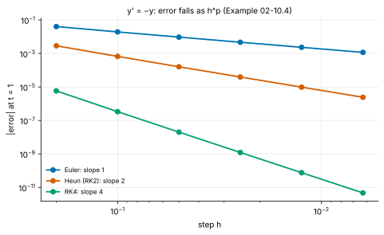

<!-- status: reviewed -->
# 02-10 · Numerical Methods for Engineers

| | |
|---|---|
| **Course** | [02 · Complex Numbers, Differential Equations and Linear Algebra](../README.md) |
| **University equivalent** | An introduction to the topics of a first numerical-methods course for engineers (Chapra & Canale, *Numerical Methods for Engineers*: roots of equations, ODE integration, error analysis; Heath, *Scientific Computing*: floating point, conditioning, stiffness), plus the "how SPICE works" material of a circuit-simulation course (Najm, *Circuit Simulation*) |
| **Prerequisites** | [02-09](02-09-systems-of-odes-and-matrix-exponential.md) (stability of sampled systems), [02-06](02-06-vectors-matrices-and-linear-systems.md) (elimination, pivoting, MNA), [02-08](02-08-eigenvalues-and-eigenvectors.md) (singular values), [01-08](../../01-calculus-for-engineers/chapters/01-08-sequences-series-and-taylor.md) (Taylor series) |
| **Estimated study hours** | 8 |
| **Last verified** | 2026-11-18 |

**Learning objectives.** After this chapter you can:

1. Explain how floating-point numbers are stored, quantify rounding with machine epsilon, and recognize and avoid catastrophic cancellation, including in the low-precision formats used for AI.
2. Solve nonlinear equations by bisection and Newton–Raphson, derive Newton's quadratic convergence, and recognize its failure modes.
3. Describe how SPICE finds a nonlinear DC operating point: companion models, MNA stamping, Newton iteration, convergence tolerances and voltage limiting.
4. Integrate ODEs with Euler, Runge–Kutta, backward-Euler and trapezoidal methods, and measure their order of accuracy.
5. Analyze the stability of integration methods on $y' = \lambda y$, explain stiffness, and explain why circuit simulators use implicit methods.
6. Compute and interpret condition numbers, separate an ill-conditioned problem from an unstable algorithm, and explain mixed-precision iterative refinement.

## 1. Big picture

Every simulation result an engineer sees has passed through three kinds of approximation. Numbers are **rounded** to a finite number of bits. Continuous problems are **discretized**: derivatives become differences and integrals become sums. Nonlinear equations are solved by **iteration** that stops when "close enough". A good engineer knows roughly how large each error is, when one of them can explode, and how tools such as SPICE keep them under control. This chapter closes Course 02 by turning its mathematics into the algorithms inside the tools: Newton's method from calculus, LU from linear algebra, and stability of sampled systems from 02-09.

- **Circuit simulation:** SPICE's DC, transient and AC analyses are Newton iterations, implicit integrators and sparse LU solves. Understanding them explains convergence failures, "timestep too small" errors and numerical ringing ([06-04](../../06-circuit-analysis-1-dc/chapters/06-04-nodal-analysis.md), [07](../../07-circuit-analysis-2-transient-and-ac/README.md)).
- **AI hardware:** accelerators trade precision for throughput (FP16, BF16, FP8). Knowing machine epsilon and conditioning tells you what can safely be computed in which format (§3.1, §3.6).
- **Firmware and DSP:** fixed- and floating-point rounding, accumulated over millions of operations, has caused real failures (§9).
- **Every engineering model:** a result is only as trustworthy as the conditioning of the problem and the stability of the method that produced it.

## 2. Intuition first

### Three different errors

- **Rounding error.** A computer stores about 16 significant decimal digits in double precision. Each operation may lose up to half a unit in the last place. Usually harmless, rounding becomes dangerous when nearly equal numbers are subtracted (the leading digits cancel and the rounding noise is promoted), or when errors accumulate over billions of steps.
- **Truncation (discretization) error.** Replacing $y'$ by $(y_{n+1} - y_n)/h$ throws away the rest of a Taylor series. Halving the step $h$ shrinks this error by a factor $2^p$, where $p$ is the method's **order**.
- **Problem sensitivity.** Some problems amplify any input error, whatever the algorithm. A system whose two equations are nearly parallel lines is like that. The **condition number** measures the amplification, and no algorithm can beat it.

A method can also be **unstable**: it amplifies its own errors even on a well-conditioned problem, as forward Euler did on the stiff circuit of 02-09. *Stability is a property of the algorithm; conditioning is a property of the problem.* Keep the two separate.

### An analogy from finance: solving for an IRR

Finding an internal rate of return means solving $\text{NPV}(r) = \sum_t CF_t(1 + r)^{-t} = 0$ for $r$, a nonlinear root-finding problem. Spreadsheet IRR functions iterate from a starting guess, much like Newton's method (§3.2). The familiar pathologies are numerical ones:

- with cash flows that change sign more than once there can be several roots, and the guess decides which one is found;
- a poor guess can fail to converge.

*Where the analogy breaks:* an IRR is a single equation in one unknown with a smooth function. A circuit is thousands of coupled equations with exponential device laws, which can overflow double precision if an iteration steps too far. That is why circuit simulators add safeguards that a spreadsheet does not need (§3.3).

## 3. Theory

### 3.1 Floating point and rounding

A floating-point number is stored as $\pm(1.b_1b_2\dots b_p)_2\times2^e$: a sign, an exponent $e$ in a limited range, and a **significand** with $p$ fraction bits after the leading 1. IEEE 754 double precision (binary64) uses 52 fraction bits (53 significant bits with the leading 1), 11 exponent bits and 1 sign bit, 64 bits in all.

- **Machine epsilon** $\epsilon = 2^{-52} \approx 2.2\times10^{-16}$ is the gap between 1 and the next double ([00-04](../../00-orientation/chapters/00-04-toolchain-walkthrough.md)).
- Rounding to nearest gives a relative error of at most the **unit roundoff** $u = \epsilon/2 = 2^{-53} \approx 1.1\times10^{-16}$. So each basic operation satisfies $\operatorname{fl}(x \circ y) = (x \circ y)(1 + \delta)$ with $\lvert\delta\rvert \le u$.

**Decimal fractions are not exact.** $0.1 = (0.000110011001100\dots)_2$ repeats forever in binary, so it is stored rounded. That is why `0.1 + 0.2` prints as `0.30000000000000004` and why summing 0.1 ten times gives `0.9999999999999999`. Harmless in one step, such errors accumulate in clocks and counters that add a rounded increment millions of times (§9).

**Catastrophic cancellation.** If $x$ and $y$ agree in their first $k$ digits, then $x - y$ has only about $16 - k$ correct digits. The subtraction itself is exact, but the rounding errors already present in $x$ and $y$ are now large *relative to* the small result. Two classic cures:

- **Reformulate.** $1 - \cos x$ for $x = 10^{-8}$ evaluates to exactly 0 in double precision, because $\cos x$ rounds to 1. The identity $1 - \cos x = 2\sin^2(x/2)$ gives the correct $5\times10^{-17}$.
- **Avoid subtracting nearly equal quantities.** For the quadratic $ax^2 + bx + c = 0$ with $b^2 \gg 4ac$, the formula $(-b + \sqrt{b^2 - 4ac})/2a$ subtracts nearly equal numbers. Use $x_1 = (-b - \operatorname{sign}(b)\sqrt{b^2 - 4ac})/2a$ and then $x_2 = c/(ax_1)$ (Example 02-10.1).

**Low-precision formats.** AI accelerators compute mostly in narrower formats: fewer significand bits means a much larger ε, and fewer exponent bits means a much smaller range.

| Format | Exponent bits | Stored fraction bits | ε = $2^{-p}$ | Largest finite value |
|---|---|---|---|---|
| FP64 (IEEE binary64) | 11 | 52 | $2.2\times10^{-16}$ | $1.8\times10^{308}$ |
| FP32 (IEEE binary32) | 8 | 23 | $1.19\times10^{-7}$ | $3.4\times10^{38}$ |
| FP16 (IEEE binary16) | 5 | 10 | $9.77\times10^{-4}$ | **65,504** |
| BF16 (bfloat16) | 8 | 7 | $7.81\times10^{-3}$ | about $3.4\times10^{38}$ (FP32's range) |
| FP8 E4M3 (OCP OFP8) | 4 | 3 | 0.125 | **448** |
| FP8 E5M2 (OCP OFP8) | 5 | 2 | 0.25 | **57,344** |

BF16 keeps FP32's exponent range but only about 2–3 significant digits. FP8's two variants trade precision (E4M3) against range (E5M2). The formats are defined by IEEE 754, by Google for bfloat16, and by the Open Compute Project's 2023 OFP8 specification ([R-056](../../../reference/research-log.md#r-056--low-precision-floating-point-formats)).

The practical rules follow from these numbers. Accumulate sums in a wider format than the products. Scale values into the representable range (the "loss scaling" used when training in FP16). Keep anything that subtracts nearly equal quantities, such as a residual, in high precision (§3.6).

### 3.2 Solving f(x) = 0: bisection and Newton–Raphson

**Bisection.** If $f$ is continuous and $f(a)$ and $f(b)$ have opposite signs, a root lies between them (the intermediate value theorem, [01-02](../../01-calculus-for-engineers/chapters/01-02-limits-and-continuity.md)). Evaluate $f$ at the midpoint, keep the half whose ends still differ in sign, and repeat. Each step halves the bracket, so the method gains one bit per step: about 3.3 steps per decimal digit, 52 steps to reach double precision from a unit-length bracket. It is slow but cannot fail.

**Newton–Raphson, derived.** Near a guess $x_k$, replace $f$ by its tangent line, $f(x) \approx f(x_k) + f'(x_k)(x - x_k)$ (the first two terms of the Taylor series), and solve the linear model for its zero:

$$
x_{k+1} = x_k - \frac{f(x_k)}{f'(x_k)} .
$$

**Quadratic convergence.** Let $x^*$ be the root and $e_k = x_k - x^*$ the error. Expand both $f(x_k)$ and $f'(x_k)$ about $x^*$, using $f(x^*) = 0$ and writing $f'$, $f''$ for their values at $x^*$:

$$
f(x_k) = f'e_k + \tfrac12f''e_k^2 + O(e_k^3), \qquad f'(x_k) = f' + f''e_k + O(e_k^2) .
$$

Divide, using $1/(1 + \epsilon) = 1 - \epsilon + O(\epsilon^2)$ with $\epsilon = (f''/f')e_k$:

$$
\frac{f(x_k)}{f'(x_k)} = e_k\left(1 + \frac{f''}{2f'}e_k\right)\left(1 - \frac{f''}{f'}e_k\right) + O(e_k^3) = e_k - \frac{f''}{2f'}e_k^2 + O(e_k^3) .
$$

Then

$$
e_{k+1} = e_k - \frac{f(x_k)}{f'(x_k)} = \frac{f''(x^*)}{2f'(x^*)}\,e_k^2 + O(e_k^3) .
$$

The expansion of $f'(x_k)$ matters: replacing it by $f'(x^*)$ would give the same size of error with the wrong sign.

So near a simple root, each iteration roughly *squares* the error: the number of correct digits doubles every step. That makes Newton the default root finder, and SPICE's DC engine (§3.3).

**Failure modes.** The convergence argument is local. Far from the root, Newton can:

- jump to a distant point where $f'$ is small (a flat tangent);
- overshoot into a region where $f$ is astronomically large (an exponential diode law: Example 02-10.2);
- cycle between two points;
- converge to the wrong root.

The cures are a good starting guess, **damping** or **limiting** the step, and bracketing safeguards that fall back on bisection.

**Systems.** For $n$ equations $\mathbf{F}(\mathbf{x}) = \mathbf{0}$, the tangent line becomes the first-order expansion $\mathbf{F}(\mathbf{x} + \Delta\mathbf{x}) \approx \mathbf{F}(\mathbf{x}) + \mathbf{J}(\mathbf{x})\,\Delta\mathbf{x}$, where the **Jacobian matrix** has entries $J_{ij} = \partial F_i/\partial x_j$: row $i$ holds the partial derivatives of equation $i$ ([01-09](../../01-calculus-for-engineers/chapters/01-09-multivariable-calculus-1.md)). Setting the expansion to zero, each Newton step solves a linear system:

$$
\mathbf{J}(\mathbf{x}_k)\,\Delta\mathbf{x} = -\mathbf{F}(\mathbf{x}_k), \qquad \mathbf{x}_{k+1} = \mathbf{x}_k + \Delta\mathbf{x} .
$$

Newton for systems is therefore a loop of LU solves (02-06), and convergence is again quadratic near a solution with nonsingular $\mathbf{J}$.

> **Going deeper — the secant method.** If $f'$ is unavailable, replace it by the slope through the last two iterates. The secant method converges with order $(1 + \sqrt5)/2 \approx 1.618$: slower than Newton per step, but each step costs only one function evaluation. Brent's method combines secant steps with bisection safeguards, and SciPy's `brentq` implements it.

### 3.3 How SPICE finds a DC operating point

A circuit with nonlinear devices produces nonlinear KCL equations. SPICE solves them by Newton's method, organized so that every iteration is just the linear MNA solve of 02-06.

1. **Linearize each device at the current guess.** A diode with $i_D = I_S(e^{v/V_T} - 1)$ is replaced, near the present voltage $v_k$, by its tangent line: a **conductance** $G_k = I_S e^{v_k/V_T}/V_T$ in parallel with a **current source** $I_{eq} = i_D(v_k) - G_kv_k$. This pair is the diode's **companion model** at that iteration.
2. **Stamp** the companion conductances and sources into the MNA matrix exactly as for resistors and current sources, then solve the linear system by sparse LU.
3. **Repeat** with the new voltages until converged.

For one diode, this is exactly scalar Newton (Example 02-10.3); for a whole circuit, it is Newton for systems with the Jacobian assembled by stamping.

**When is it "converged"?** SPICE checks that successive node voltages agree within $\text{reltol}\times\lvert v\rvert + \text{vntol}$, and that branch currents agree within $\text{reltol}\times\lvert i\rvert + \text{abstol}$. ngspice's defaults are reltol = $10^{-3}$, vntol = 1 µV and abstol = 1 pA, with at most 100 DC iterations ([R-053](../../../reference/research-log.md#r-053--ngspice-numerical-defaults-and-junction-limiting)). A relative tolerance of 0.1% is a deliberate engineering compromise: far looser than double precision, but far tighter than component tolerances.

**Safeguards that make it work.**

- **Junction voltage limiting.** A diode's current grows by a factor of $e$ every 26 mV, so an unlimited Newton step of a fraction of a volt can request an absurd current. When a proposed junction voltage $v_{new}$ exceeds a critical value $V_{crit} = V_T\ln\!\big(V_T/(\sqrt2I_S)\big)$ and differs from the previous value $v_{old}$ by more than $2V_T$, SPICE replaces the step with a logarithmically compressed one. ngspice's rule (`DEVpnjlim`, [R-053](../../../reference/research-log.md#r-053--ngspice-numerical-defaults-and-junction-limiting)) is, for $v_{old} > 0$ and a forward step with $a = (v_{new} - v_{old})/V_T > 0$, $v_{new} \leftarrow v_{old} + V_T\big(2 + \ln(a - 2)\big)$, and, from $v_{old} \le 0$, $v_{new} \leftarrow V_T\ln(v_{new}/V_T)$. A step of many volts becomes a step of a few $V_T$. Classic SPICE3 used the gentler $v_{old} + V_T\ln(1 + a)$, so iterate sequences, and iteration counts, differ between simulators (Example 02-10.2).
- **GMIN.** A tiny conductance (by default $10^{-12}$ S) is placed across every junction, so a reverse-biased or cut-off junction never leaves its node without a DC path, which would make the matrix singular. (A node connected only through capacitors still has no DC path; that is a netlist error GMIN does not fix.)
- **Continuation.** If plain Newton fails, SPICE can solve a sequence of easier problems: ramp the sources up from zero (**source stepping**), or start with a large GMIN and reduce it (**GMIN stepping**). Each solution is the starting guess for the next.

These heuristics are why "my circuit won't converge" is usually a modeling problem (a floating node, an unrealistic device parameter, a positive-feedback loop with several operating points), not a bug.

### 3.4 Integrating ODEs: Euler and Runge–Kutta

To integrate $y' = f(t, y)$ from $y(t_0) = y_0$ with step $h$:

- **Forward (explicit) Euler** follows the tangent at the current point: $y_{n+1} = y_n + hf(t_n, y_n)$. The Taylor series $y(t + h) = y + hy' + \tfrac12h^2y'' + \dots$ shows a **local truncation error** of order $h^2$ per step. Over the $T/h$ steps needed to reach a fixed time $T$, the errors add to a **global error** of order $h$. Euler is a *first-order* method: halving $h$ halves the error.
- **Heun's method** (a second-order Runge–Kutta method) averages the slopes at both ends of the step:

  $$
  k_1 = f(t_n, y_n), \quad k_2 = f(t_n + h, y_n + hk_1), \quad y_{n+1} = y_n + \tfrac{h}{2}(k_1 + k_2),
  $$

  with global error $O(h^2)$.
- **Classical fourth-order Runge–Kutta (RK4)** samples four slopes per step:

  $$
  \begin{aligned}
  k_1 &= f(t_n, y_n), & k_2 &= f(t_n + \tfrac h2, y_n + \tfrac h2k_1), \\
  k_3 &= f(t_n + \tfrac h2, y_n + \tfrac h2k_2), & k_4 &= f(t_n + h, y_n + hk_3),
  \end{aligned}
  \qquad y_{n+1} = y_n + \tfrac h6(k_1 + 2k_2 + 2k_3 + k_4),
  $$

  with global error $O(h^4)$: halving $h$ cuts the error 16-fold.

Higher order buys accuracy cheaply on smooth problems. **Adaptive** solvers go further: they estimate the local error at each step by comparing two methods of different order on the same step, and adjust $h$ to meet a tolerance. SciPy's default `solve_ivp` method, RK45, is such an embedded pair (the Dormand–Prince formulas).

### 3.5 Stability and stiffness

Accuracy is not enough: a method must also not amplify errors. Apply each method to the **test equation** $y' = \lambda y$, which describes any single mode of a linear system (02-09). Each step multiplies $y$ by an **amplification factor** $R(h\lambda)$:

| Method | $R(z)$, with $z = h\lambda$ | Stable for decaying modes ($\operatorname{Re}z < 0$) when |
|---|---|---|
| Forward Euler | $1 + z$ | $\lvert1 + z\rvert \le 1$: real λ needs $h \le 2/\lvert\lambda\rvert$ |
| RK4 | $1 + z + \frac{z^2}{2} + \frac{z^3}{6} + \frac{z^4}{24}$ | real λ needs $h \lesssim 2.785/\lvert\lambda\rvert$ |
| Backward (implicit) Euler: $y_{n+1} = y_n + hf(t_{n+1}, y_{n+1})$ | $1/(1 - z)$ | always (**A-stable**) |
| Trapezoidal: $y_{n+1} = y_n + \frac h2(f_n + f_{n+1})$ | $(1 + z/2)/(1 - z/2)$ | always (A-stable), second order |
| Exact | $e^z$ | always |

Explicit methods have bounded stability regions, so a fast decaying mode forces a small step even after that mode has died out. A system with widely separated time constants is **stiff**: an explicit method's step is set by the fastest mode, while the simulation must run for many time constants of the slowest one. Circuits are almost always stiff (picosecond parasitics alongside millisecond bias networks), so **circuit simulators use implicit methods**.

The price of implicitness is that $y_{n+1}$ appears on both sides, so every time step requires solving an equation: for a nonlinear circuit, a Newton iteration of §3.3 at each step. For a capacitor, backward Euler turns $i = Cv'$ into

$$
i_{n+1} = \frac{C}{h}(v_{n+1} - v_n),
$$

which is again a **companion model**: a conductance $C/h$ in parallel with a current source of value $Cv_n/h$ that injects current *into* the capacitor's top node (equivalently, $-Cv_n/h$ drawn from it), stamped into the same MNA matrix. So a transient simulation is a sequence of DC-like solves, one per time step.

**Trapezoidal ringing.** The trapezoidal rule is second order and A-stable, and it is ngspice's default integration method ([R-053](../../../reference/research-log.md#r-053--ngspice-numerical-defaults-and-junction-limiting)). But as $h\lambda \to -\infty$, its factor tends to −1. A very fast mode is therefore not damped; it flips sign every step, producing a small numerical oscillation ("trapezoidal ringing"). Backward Euler damps such modes strongly, but it is only first order and smears real ringing too. That is why simulators offer Gear (backward-differentiation) methods as an alternative, and why ngspice's trapezoidal setting includes a damping parameter.

**Step control.** Simulators also estimate the local truncation error from the change in derivatives between steps, and shrink or grow $h$ to keep it within tolerance. "Timestep too small" errors arise when that estimate demands an impossibly small step, typically at a discontinuity in a model or a source.

*Figure 02-10.1 — Stability regions in the $z = h\lambda$ plane (shaded: $\lvert R(z)\rvert \le 1$). Explicit methods are stable only in bounded regions near the origin; implicit backward Euler and trapezoidal (stable on the whole left half-plane) can take large steps on stiff circuits.*

### 3.6 Conditioning, stability and mixed precision

**The condition number of a linear system.** If $\mathbf{A}\mathbf{x} = \mathbf{b}$ and the right side is perturbed by $\delta\mathbf{b}$, then $\mathbf{A}\,\delta\mathbf{x} = \delta\mathbf{b}$, so $\lVert\delta\mathbf{x}\rVert \le \lVert\mathbf{A}^{-1}\rVert\lVert\delta\mathbf{b}\rVert$. Also $\lVert\mathbf{b}\rVert \le \lVert\mathbf{A}\rVert\lVert\mathbf{x}\rVert$. Dividing:

$$
\frac{\lVert\delta\mathbf{x}\rVert}{\lVert\mathbf{x}\rVert} \le \kappa(\mathbf{A})\,\frac{\lVert\delta\mathbf{b}\rVert}{\lVert\mathbf{b}\rVert}, \qquad \kappa(\mathbf{A}) = \lVert\mathbf{A}\rVert\,\lVert\mathbf{A}^{-1}\rVert = \frac{\sigma_{\max}}{\sigma_{\min}} ,
$$

using the 2-norm and the singular values of 02-08.

> **Math refresher — matrix norms.** The 2-norm of a matrix is the largest factor by which it stretches any vector, $\lVert\mathbf{A}\rVert = \max_{\mathbf{x}\ne\mathbf{0}}\lVert\mathbf{A}\mathbf{x}\rVert/\lVert\mathbf{x}\rVert$. So, by definition, $\lVert\mathbf{A}\mathbf{x}\rVert \le \lVert\mathbf{A}\rVert\lVert\mathbf{x}\rVert$ for every $\mathbf{x}$, which is the inequality used twice above. From the SVD, the largest stretch is $\sigma_{\max}$ (02-08 §3.9). $\mathbf{A}^{-1}$ has the reciprocal singular values, $\mathbf{A}^{-1} = \mathbf{V}\boldsymbol{\Sigma}^{-1}\mathbf{U}^\mathsf{T}$, so its largest stretch is $1/\sigma_{\min}$. Multiplying the two gives $\kappa = \sigma_{\max}/\sigma_{\min}$. The bound is attained for the worst perturbation. **Rule of thumb:** you can lose up to $\log_{10}\kappa$ decimal digits. A double-precision solve with $\kappa = 10^{10}$ may have only about 6 correct digits, *however good the algorithm*. Perturbations of $\mathbf{A}$ itself obey the same kind of bound.

**Stable algorithms, ill-conditioned problems.** Gaussian elimination with partial pivoting (02-06) is *backward stable* in practice: it computes the exact solution of a nearby problem, with perturbations of order $u\lVert\mathbf{A}\rVert$. So the computed error is about $\kappa u$, the best any method can do. An *unstable* algorithm, such as elimination without pivoting on a small pivot, or the normal equations on a nearly dependent least-squares problem (which squares κ, 02-07), adds error that the problem itself does not demand. The professional's question about any bad result is therefore twofold: is the problem ill-conditioned, or is the algorithm unstable?

**Mixed precision and iterative refinement.** Low precision is fast (§3.1), but a solve in FP16 has $u \approx 5\times10^{-4}$, so its answer is good to only a few digits. **Iterative refinement** recovers full accuracy cheaply:

1. factor $\mathbf{A}$ once in low precision (the expensive $\tfrac23n^3$ part);
2. compute the residual $\mathbf{r} = \mathbf{b} - \mathbf{A}\mathbf{x}$ in high precision;
3. solve $\mathbf{A}\,\mathbf{d} = \mathbf{r}$ with the low-precision factors (a cheap $n^2$ step);
4. update $\mathbf{x} \leftarrow \mathbf{x} + \mathbf{d}$ and repeat.

Each pass multiplies the error by roughly $\kappa\,u_{\text{low}}$, so refinement converges whenever $\kappa\,u_{\text{low}}$ is comfortably below 1. It converges to the accuracy that the high-precision residual allows: a forward error of about $\kappa\,u_{\text{high}}$, the same floor as a direct solve in high precision. For double precision at $\kappa = 10^3$ that is about $10^{-13}$, not $10^{-16}$. This is how matrix engines built for AI can produce FP64-quality answers to scientific problems ([R-055](../../../reference/research-log.md#r-055--hpl-mxp-mixed-precision-benchmark)).

## 4. Worked examples

### Example 02-10.1 — Three floating-point surprises (tier A)

**Setup.** In IEEE double precision, evaluate:

- (a) `0.1 + 0.2 - 0.3`;
- (b) $1 - \cos x$ for $x = 10^{-8}$, directly and as $2\sin^2(x/2)$;
- (c) the small root of $x^2 + 10^8x + 1 = 0$, by the textbook formula and by the stable formula.

**Solution.**

(a) Neither 0.1, 0.2 nor 0.3 is exactly representable. The computed result is **5.551×10⁻¹⁷**, not 0, which is $2^{-54}$: one **ulp** (unit in the last place, the spacing between adjacent doubles) at the scale of 0.3. Never test floating-point results for exact equality; compare with a tolerance.

(b) $\cos(10^{-8}) = 1 - 5\times10^{-17} + \dots$, which rounds to exactly 1 because the gap below 1 is $1.1\times10^{-16}$. The direct formula therefore returns **0**: 100% error. The identity gives $2\sin^2(5\times10^{-9}) = $ **5.000×10⁻¹⁷**, correct to full precision, because it contains no subtraction of nearly equal numbers.

(c) Here $\sqrt{b^2 - 4ac} = \sqrt{10^{16} - 4}$ is within one ulp of $10^8$. The textbook formula $(-b + \sqrt{b^2 - 4ac})/2a$ subtracts two numbers that agree in about 16 digits, and returns **−7.451×10⁻⁹**, a 25% error. The stable route computes the large root without cancellation, $x_1 = (-b - \sqrt{b^2 - 4ac})/2a \approx -10^8$, then uses the product of the roots, $x_1x_2 = c/a$: $x_2 = c/(ax_1) = $ **−1.000×10⁻⁸**, correct to full precision.

**Check.** For (c), $x_2 \approx -c/b = -10^{-8}$ when $b^2 \gg 4ac$ ✓, and the product $x_1x_2 = 1 = c/a$ ✓.

### Example 02-10.2 — Newton's method on a diode circuit (tier B)

**Setup.** A 5 V source drives a 1 kΩ resistor in series with a diode to ground. (To show convergence clearly, iterate until successive iterates differ by less than $10^{-12}$ V. SPICE's own test, $\lvert\Delta v\rvert < \text{reltol}\cdot\lvert v\rvert + \text{vntol} \approx 0.7$ mV here, stops sooner.) The diode has $I_S = 10^{-14}$ A and ideality 1, at 27 °C, so $V_T = kT/q = 25.86$ mV. Solve for the diode voltage $v$ by Newton's method:

1. from a good guess, $v_0 = 0.7$ V;
2. from a poor guess, $v_0 = 0.6$ V;
3. with SPICE-style junction voltage limiting.

Show the quadratic convergence.

**Solution.** KCL at the diode node gives

$$
f(v) = \frac{5 - v}{R} - I_S\big(e^{v/V_T} - 1\big) = 0, \qquad f'(v) = -\frac1R - \frac{I_S}{V_T}e^{v/V_T} .
$$

*From $v_0 = 0.7$ V:* the iterates are 0.69378, 0.69290, 0.69289 V. The errors are $7.11\times10^{-3}$, $8.90\times10^{-4}$, $1.51\times10^{-5}$, then $4.35\times10^{-9}$ V, roughly squaring each time. The root is $v^* = $ **0.6929 V**, and Newton reaches it to machine precision in **5** iterations. The current is $(5 - 0.6929)/1\text{ kΩ} = $ **4.307 mA**.

*From $v_0 = 0.6$ V:* at 0.6 V the diode carries only 0.12 mA, while the resistor supplies 4.4 mA. The tangent is fairly flat, so the first step jumps to **1.366 V**, where $e^{v/V_T}$ is about $10^{23}$. From there each step can only reduce $v$ by about $V_T$, because $f \approx -I_Se^{v/V_T}$ and $f' \approx f/V_T$. Newton crawls down in 26 mV steps and needs **33** iterations. From $v_0 = 0$, the first step lands at 5 V, and it takes 173 iterations. In a real simulator such a step would overflow the exponential or exceed the iteration limit.

*With limiting:* ngspice's rule caps a junction-voltage step above $V_{crit} = V_T\ln\big(V_T/(\sqrt2I_S)\big) = $ **0.7303 V** to a logarithmic one. From 0.6 V the iterates become 0.7376, 0.7163, 0.7009, 0.6940, … V, converging in **8** iterations; from 0 V, in 9. Under SPICE's looser stopping test the counts are **3** from 0.7 V, and **30** (plain) or **6** (limited) from 0.6 V. With classic SPICE3 limiting, $v_{old} + V_T\ln(1 + a)$, the first limited step from 0.6 V lands at **0.6885 V** instead, and convergence to $10^{-12}$ V takes **6** iterations: the limiting rule changes the path, not the answer.

**Checks.** At the root, the diode current $10^{-14}e^{0.6929/0.02586} = 4.307$ mA matches the resistor current ✓. The diode's small-signal conductance there is $I/V_T = $ **166.5 mS** (a resistance of about 6 Ω), much larger than the resistor's 1 mS. That is why the error constant $f''/2f'$ is large far from the root and small near it.

*Figure 02-10.2 — Newton's method on the diode circuit. Near the root the error is squared each step (the curve steepens); after an overshoot, plain Newton crawls for dozens of iterations; limiting the junction-voltage step restores fast convergence.*

### Example 02-10.3 — Newton as SPICE does it: the companion model (tier B)

**Setup.** Repeat the first Newton step of Example 02-10.2 from $v_0 = 0.7$ V, but in SPICE's way. Replace the diode with its companion model, stamp it, solve the resulting linear circuit, and confirm the result equals Newton's $v_1$.

**Solution.** At $v_0 = 0.7$ V, the diode current is $i_0 = I_S(e^{0.7/V_T} - 1) = $ **5.670 mA**, and its slope is $G_0 = I_Se^{0.7/V_T}/V_T = $ **0.2192 S**. The tangent line $i \approx i_0 + G_0(v - v_0) = G_0v + I_{eq}$ has $I_{eq} = i_0 - G_0v_0 = $ **−0.1478 A**. So the companion model is a 0.2192 S conductance in parallel with a current source, both from the node to ground.

KCL at the node, with the source and resistor stamped as usual:

$$
\Big(\frac1R + G_0\Big)v_1 = \frac{5}{R} - I_{eq} \quad\Longrightarrow\quad v_1 = \frac{0.005 + 0.1478}{0.001 + 0.2192} = \mathbf{0.6938}\text{ V},
$$

which is exactly Newton's $v_1 = v_0 - f(v_0)/f'(v_0)$ ✓.

**Why this matters.** The companion model turns every nonlinear device into "a resistor plus a current source" that changes from iteration to iteration. The simulator never needs anything beyond the linear MNA machinery of 02-06. For a circuit with $n$ nodes, the matrix it factors at each iteration *is* the Jacobian $\mathbf{J}$ of §3.2, assembled by stamping. The lab confirms the converged answer in ngspice.

### Example 02-10.4 — Measuring the order of a method (tier B)

**Setup.** Integrate $y' = -y$, $y(0) = 1$ to $t = 1$ (exact $e^{-1} = 0.367879$) with Euler, Heun and RK4, using $h = 0.1$ and $h = 0.05$. Find each method's error and the ratio by which halving $h$ reduces it.

**Solution.**

| Method | $y(1)$ at $h = 0.1$ | Error at $h = 0.1$ | Error at $h = 0.05$ | Ratio | Order |
|---|---|---|---|---|---|
| Euler | 0.348678 | **0.01920** | 0.009394 | **2.044** | 1 |
| Heun (RK2) | 0.368541 | **6.615×10⁻⁴** | 1.592×10⁻⁴ | **4.156** | 2 |
| RK4 | 0.3678798 | **3.332×10⁻⁷** | 1.998×10⁻⁸ | **16.68** | 4 |

Halving $h$ divides the error by about $2^p$: 2, 4 and 16. That is the operational definition of order $p$. For the same accuracy as RK4 at $h = 0.1$ (40 function evaluations in total), Euler would need roughly $0.0192/3.3\times10^{-7} \approx 60{,}000$ times more steps.

**Check.** Euler on $y' = -y$ gives exactly $(1 - h)^{1/h}$, which is $0.9^{10} = 0.348678$ ✓.

*Figure 02-10.3 — Error against step size on log–log axes: straight lines whose slopes are the methods' orders.*

### Example 02-10.5 — A stiff circuit (tier C)

**Setup.** A circuit has two decaying modes, with time constants 1 µs (a parasitic) and 1 ms (the bias network), so $\lambda_f = -10^6$ s⁻¹ and $\lambda_s = -10^3$ s⁻¹. It must be simulated for 5 ms. Compare forward Euler, backward Euler and the trapezoidal rule, using a step of 50 µs for the implicit methods.

**Solution.**

*Forward Euler* is stable only if $h \le 2/\lvert\lambda_f\rvert = $ **2 µs**, even though the fast mode has vanished within a few microseconds. Covering 5 ms needs at least **2500** steps.

*Backward Euler* at $h = 50$ µs takes **100** steps and is stable. Its factor for the fast mode is $1/(1 + 50) = $ **0.01961**: the fast mode is crushed in one step, as it should be. For the slow mode it gives $1/(1 + 0.05) = $ **0.9524**, against the exact $e^{-0.05} = 0.9512$.

*Trapezoidal* at the same step gives $(1 - 0.025)/(1 + 0.025) = $ **0.9512** for the slow mode, accurate to better than $10^{-5}$ (second order). But for the fast mode, $(1 - 25)/(1 + 25) = $ **−0.9231**. Any fast-mode content flips sign every step and decays only slowly: trapezoidal ringing. It is a numerical artifact, not circuit behavior.

**Lesson.** Implicit methods let the step follow the accuracy needs of the slow dynamics (here 25 times fewer steps than explicit Euler), at the cost of a linear solve per step. Each method's handling of the dead fast modes is a modeling choice that the engineer should know about.

### Example 02-10.6 — An ill-conditioned system (tier C)

**Setup.** Two nearly redundant measurements give the system

$$
\begin{bmatrix} 1 & 1 \\ 1 & 1.0001\end{bmatrix}\mathbf{x} = \begin{bmatrix} 2 \\ 2.0001\end{bmatrix}, \qquad \mathbf{x} = (1, 1) .
$$

Find the condition number. Then perturb $b_2$ by $10^{-4}$, a 0.0035% change in $\mathbf{b}$, and find the new solution. How many digits can a double-precision solve be trusted to?

**Solution.** $\mathbf{A}$ is symmetric, so its singular values are the magnitudes of its eigenvalues, the roots of $\lambda^2 - 2.0001\lambda + 0.0001 = 0$: about 2.00005 and $5.0\times10^{-5}$. So $\kappa = $ **4.000×10⁴**. With $b_2 = 2.0002$, the solution becomes $\mathbf{x} = (0, 2)$: a **100%** change in $\mathbf{x}$ from a 0.0035% change in $\mathbf{b}$. That is within the bound $\kappa\times3.5\times10^{-5} = 1.41$ (141%). In double precision, up to $\log_{10}\kappa = $ **4.6** of the 16 digits may be lost, leaving about 11 trustworthy digits. No algorithm can do better, because the sensitivity belongs to the problem: the two equations are nearly the same line.

**Interpretation.** If the 0.0001 coefficient came from measured data with 0.01% uncertainty, the solution would be meaningless. The fix is to change the problem: make independent measurements (better conditioning), or solve for the well-determined combination $x_1 + x_2$ only. Running a more precise solver would not help.

<!-- answer-key -->
| ID | Quantity | Value | Unit |
|---|---|---|---|
| Ex 02-10.1a | 0.1 + 0.2 − 0.3 in double | 5.551×10^-17 | — |
| Ex 02-10.1b | 1 − cos(1e-8), direct | 0 | — |
| Ex 02-10.1c | 2 sin²(x/2) at 1e-8 | 5.000×10^-17 | — |
| Ex 02-10.1d | small root, textbook formula | −7.451×10^-9 | — |
| Ex 02-10.1e | small root, stable formula | −1.000×10^-8 | — |
| Ex 02-10.2a | diode voltage | 0.6929 | V |
| Ex 02-10.2b | current | 4.307 | mA |
| Ex 02-10.2c | iterations from 0.7 V | 5 | — |
| Ex 02-10.2d | first iterate from 0.6 V | 1.366 | V |
| Ex 02-10.2e | iterations from 0.6 V, no limiting | 33 | — |
| Ex 02-10.2f | critical voltage | 0.7303 | V |
| Ex 02-10.2g | iterations from 0.6 V, with limiting | 8 | — |
| Ex 02-10.2h | small-signal conductance | 166.5 | mS |
| Ex 02-10.2i | iterations from 0.7 V, SPICE stopping test | 3 | — |
| Ex 02-10.2j | iterations from 0.6 V, plain, SPICE test | 30 | — |
| Ex 02-10.2k | iterations from 0.6 V, limited, SPICE test | 6 | — |
| Ex 02-10.2l | first SPICE3-limited step from 0.6 V | 0.6885 | V |
| Ex 02-10.2m | iterations with SPICE3 limiting, to 1e-12 V | 6 | — |
| Ex 02-10.3a | diode current at 0.7 V | 5.670 | mA |
| Ex 02-10.3b | companion conductance | 0.2192 | S |
| Ex 02-10.3c | companion current source | −0.1478 | A |
| Ex 02-10.3d | first iterate | 0.6938 | V |
| Ex 02-10.4a | Euler error, h = 0.1 | 0.01920 | — |
| Ex 02-10.4b | Euler error ratio | 2.044 | — |
| Ex 02-10.4c | Heun error, h = 0.1 | 6.615×10^-4 | — |
| Ex 02-10.4d | Heun error ratio | 4.156 | — |
| Ex 02-10.4e | RK4 error, h = 0.1 | 3.332×10^-7 | — |
| Ex 02-10.4f | RK4 error ratio | 16.68 | — |
| Ex 02-10.5a | forward Euler step limit | 2 | µs |
| Ex 02-10.5b | explicit steps for 5 ms | 2500 | — |
| Ex 02-10.5c | implicit steps for 5 ms | 100 | — |
| Ex 02-10.5d | backward Euler fast-mode factor | 0.01961 | — |
| Ex 02-10.5e | backward Euler slow-mode factor | 0.9524 | — |
| Ex 02-10.5f | trapezoidal slow-mode factor | 0.9512 | — |
| Ex 02-10.5g | trapezoidal fast-mode factor | −0.9231 | — |
| Ex 02-10.6a | condition number | 4.000×10^4 | — |
| Ex 02-10.6b | relative change in x | 100 | % |
| Ex 02-10.6c | digits that may be lost | 4.6 | — |

*Recomputed by [verify_02_10.py](../verify/verify_02_10.py). Example 02-10.2's operating point is also confirmed in ngspice in the lab.*

## 5. Simulate it

The lab ([labs/02-10-lab/](../labs/02-10-lab/README.md)) has a notebook and one ngspice netlist:

1. **Floating point up close.** Reproduce Example 02-10.1, then sum 0.1 twenty thousand times in double, single and half precision. *Predict first:* which format drifts most, and how badly?
2. **Newton and SPICE's diode.** Run Example 02-10.2 with and without ngspice's junction-limiting rule (`DEVpnjlim`, transcribed from the ngspice source), and confirm that the companion-model iteration reproduces Newton's iterates exactly.
3. **Order of accuracy.** Reproduce Example 02-10.4's error ratios, and compare with SciPy's adaptive RK45.
4. **Stiffness.** Count the steps taken by explicit (RK45) and implicit (Radau, BDF) solvers on Example 02-10.5's two-mode problem. *Predict first:* which takes more steps, and by how much?
5. **Conditioning and refinement.** Perturb Example 02-10.6, then build a κ = 10³ matrix, factor it in single precision, and refine to double-precision accuracy.
6. **ngspice, `diode_newton.cir`.** The operating point of Example 02-10.2, with ngspice's own Newton iteration count.

## 6. Engineering tradeoffs

| Knob | Improves | Costs | Typical decision owner |
|---|---|---|---|
| Lower numeric precision (FP16, BF16, FP8) | Throughput, memory and energy per operation | Rounding error and range limits; needs scaling, wider accumulation or refinement | Accelerator architects, ML and HPC engineers |
| Looser simulator tolerances (reltol, abstol) | Faster simulation, fewer convergence failures | Accuracy, and occasionally wrong answers that look plausible | Design and verification engineers |
| Implicit instead of explicit integration | Large stable steps on stiff circuits | A Newton iteration and linear solve per step; trapezoidal ringing or backward-Euler over-damping | Simulator developers |
| Higher-order method | Fewer steps for a given accuracy on smooth problems | More work per step; no help across discontinuities | Simulation and DSP engineers |
| Newton safeguards (limiting, damping, continuation) | Robust convergence from poor starting points | More iterations near the solution | Simulator developers |
| Reformulating a calculation (stable formula, centering, orthogonal bases) | Accuracy, often for free | Engineering time and code complexity | Algorithm and firmware engineers |

## 7. Numbers to know

| Quantity | Typical value | Note |
|---|---|---|
| Double-precision machine epsilon | **2.22×10⁻¹⁶** (about 16 digits) | Unit roundoff half of that |
| Single and half precision | 1.19×10⁻⁷ (about 7 digits); 9.77×10⁻⁴ (about 3 digits) | |
| Digits lost to conditioning | about $\log_{10}\kappa$ | |
| Newton near a simple root | correct digits roughly double per iteration | |
| Bisection | 1 bit per step; **3.32** steps per decimal digit | |
| Forward Euler stability, real λ | $h \le 2/\lvert\lambda\rvert$; RK4: $h \lesssim 2.785/\lvert\lambda\rvert$ | |
| ngspice defaults (as of Nov 2026) | reltol $10^{-3}$, vntol 1 µV, abstol 1 pA, GMIN $10^{-12}$ S, 100 DC iterations, trapezoidal integration | [R-053] |
| HPL-MxP versus HPL, Nov 2026 list (El Capitan) | **16.680** EFlop/s mixed precision against **1.809** EFlop/s FP64, a ratio of **9.2** | [R-055] |
| Patriot clock error after 100 h (GAO) | **0.3433** s, a range-gate shift of **687** m | [R-057] |

<!-- answer-key -->
| ID | Quantity | Value | Unit |
|---|---|---|---|
| N 02-10.a | double machine epsilon | 2.22×10^-16 | — |
| N 02-10.b | bisection steps per decimal digit | 3.32 | — |
| N 02-10.c | FP16 largest finite value | 65504 | — |
| N 02-10.d | FP8 E4M3 largest value | 448 | — |
| N 02-10.e | FP8 E5M2 largest value | 57344 | — |
| N 02-10.f | El Capitan HPL-MxP | 16.680 | EFlop/s |
| N 02-10.g | El Capitan HPL | 1.809 | EFlop/s |
| N 02-10.h | ratio | 9.2 | — |
| N 02-10.i | Patriot timing error after 100 h | 0.3433 | s |
| N 02-10.j | Patriot range-gate shift after 100 h | 687 | m |

## 8. Common mistakes

1. **Testing floating-point values for exact equality.** Compare with a tolerance scaled to the magnitudes involved.
2. **Subtracting nearly equal quantities** (variances by $\overline{x^2} - \bar{x}^2$, small roots by the textbook quadratic formula, $e^x - 1$ for small $x$). Reformulate.
3. **Accumulating long sums in low precision.** A running sum stalls once the increment falls below half the spacing (Problem 02-10.12, lab Part 1). Accumulate in a wider format.
4. **Trusting Newton from any starting point.** It converges fast only nearby. Bracket, limit or damp the step, and supply good initial guesses (SPICE's `.nodeset` and `.ic`).
5. **Reading "converged" as "correct".** SPICE stops at reltol = 0.1% by default. A sensitive measurement, such as a small difference between large node voltages, may need tighter tolerances.
6. **Choosing an explicit method for a stiff system,** then shrinking the step until it "works". Use an implicit method.
7. **Mistaking trapezoidal ringing for circuit behavior.** If a waveform oscillates at the time step, suspect the integrator; try Gear or smaller steps.
8. **Blaming the algorithm for an ill-conditioned problem,** or the reverse. Check κ first.
9. **Quoting FLOPS without the precision.** FP64, FP32, BF16 and FP8 FLOPS differ by orders of magnitude on the same chip.

## 9. Practitioner lens

### State of the art (as of Nov 2026)

- **SPICE's numerical recipe has lasted half a century.** SPICE (Nagel and Pederson, Berkeley, 1973) and SPICE2 (Nagel's 1975 thesis) established the recipe. The thesis concludes that "the Newton-Raphson algorithm appears to be the unanimous choice for a nonlinear equation solution method", describes simple step-limiting methods as essential, and reports that modified nodal analysis required "substantially less computational effort" than the alternatives tested ([R-054](../../../reference/research-log.md#r-054--spice-and-spice2-origins)) **[Established]**. The open-source descendant ngspice still defaults to trapezoidal integration, reltol $10^{-3}$, vntol 1 µV, abstol 1 pA, GMIN $10^{-12}$ S and 100 DC iterations, with junction limiting in its device models ([R-053](../../../reference/research-log.md#r-053--ngspice-numerical-defaults-and-junction-limiting)) **[Established]**.
- **Mixed precision reaches supercomputer scale.** The HPL-MxP benchmark solves the same dense system as HPL, with an LU factorization in low precision (down to 16-bit) followed by iterative refinement to 64-bit accuracy. On the November 2026 list, El Capitan leads at 16.680 EFlop/s, 9.2 times its 1.809 EFlop/s FP64 HPL result. LineShine, HPL No. 1 since June 2026, ranks fourth on HPL-MxP. FP8 results have not been admissible since November 2025 ([R-055](../../../reference/research-log.md#r-055--hpl-mxp-mixed-precision-benchmark)) **[Established]**.
- **Formats for AI are specified outside IEEE 754.** The industry consortium OCP's 2023 OFP8 specification (not an IEEE standard; IEEE's P3109 project, authorized in 2023, is developing one for such formats, [R-056](../../../reference/research-log.md#r-056--low-precision-floating-point-formats)) defines E4M3 (maximum 448) and E5M2 (maximum 57,344), and bfloat16 keeps FP32's 8 exponent bits with 7 fraction bits ([R-056](../../../reference/research-log.md#r-056--low-precision-floating-point-formats)) **[Established]**.
- **Rounding can be lethal.** In the 1991 Dhahran failure, a Patriot battery's clock counted tenths of a second in 24-bit registers. GAO reported a timing inaccuracy of 0.3433 s after about 100 hours, shifting the range gate by 687 m, so the incoming missile was not tracked; 28 soldiers died. Skeel's analysis traced the drift to the chopped binary value of 0.1, and its harm to an inconsistency: a modified routine converted one of two subtracted times more accurately than the other, so the errors did not cancel ([R-057](../../../reference/research-log.md#r-057--patriot-missile-timing-error)) **[Established]**.

### Why it matters commercially

Numerical choices are product decisions. Simulator robustness and speed determine how many corners and Monte Carlo runs fit before tape-out. Accelerator vendors compete on low-precision throughput, and the value of that throughput for engineering and scientific workloads depends on mixed-precision algorithms that recover full accuracy. In embedded products (wearables, automotive, medical), accumulated rounding in timekeeping, integration and sensor fusion is a reliability and safety issue, not an academic one. Diligence that asks *which precision* and *which tolerance* catches inflated performance claims early.

### Marketing vs Reality

- **"An exaflop machine."** *Reality:* in which precision? The same system is 1.8 EFlop/s in FP64 HPL and 16.7 EFlop/s in HPL-MxP; AI FLOPS in FP8 or FP4 (4-bit floating point, typically 1 sign, 2 exponent and 1 fraction bit) are higher again. Ask which benchmark, and whether the answer was refined to full accuracy.
- **"Our simulator is 10× faster than SPICE."** *Reality:* at what tolerances, and against what reference? Loosening reltol buys speed. Ask for accuracy against a tight-tolerance reference at equal settings.
- **"Quantized to FP8 with no accuracy loss."** *Reality:* it depends on per-tensor scaling, on accumulation precision, and on which layers stay in higher precision. Ask for task-level accuracy and the precision map.
- **"Results are deterministic."** *Reality:* floating-point addition is not associative, so parallel reductions in different orders give slightly different answers unless reproducibility is engineered in. Ask whether results are bit-reproducible across runs and hardware.

### Questions to ask engineering leaders

1. **"Which tolerances and integration method do your sign-off simulations use, and how do you know the results have converged?"**
   - *Strong:* tightened-tolerance and smaller-step reruns agree; stiff and switching nodes are handled deliberately.
   - *Evasive:* "We use the defaults."
2. **"Which parts of your workload run in which precision, where do you accumulate, and how was accuracy validated?"**
   - *Strong:* a precision map, wide accumulators, scaling, and accuracy against an FP32 or FP64 reference.
   - *Evasive:* quotes peak FP8 TOPS.
3. **"How is time kept, and how is accumulated rounding bounded, in your long-running firmware?"**
   - *Strong:* integer or fixed-point counters with known wraparound, and periodic resynchronization.
   - *Evasive:* "We use floats; they're accurate."
4. **"When a simulation fails to converge, what is your process?"**
   - *Strong:* find the modeling cause (floating nodes, unrealistic parameters, multiple operating points), then use nodesets or continuation.
   - *Evasive:* "We loosen the tolerances until it runs."

## 10. Concept check

1. Why does `0.1 + 0.2 == 0.3` evaluate to False?

   

Answer

   None of the three decimals is exactly representable in binary. Each is rounded, and the rounded sum of the first two differs from the rounded 0.3 by one ulp at that scale ($5.55\times10^{-17}$).

   

2. Newton's method gives errors $10^{-2}$, $10^{-4}$, $10^{-8}$. What is the next error likely to be, and what kind of convergence is this?

   

Answer

   About $10^{-16}$: quadratic convergence, with the number of correct digits doubling each step.

   

3. What is a companion model, and why does SPICE use one for every nonlinear device and every capacitor?

   

Answer

   A conductance plus a current source that matches the element's linearized (or time-discretized) behavior at the current iterate or time step. It turns every element into something the linear MNA machinery can stamp and solve, so the whole simulator reduces to repeated sparse LU solves.

   

4. Halving the step reduces an integrator's error by a factor of 8. What is its order?

   

Answer

   Third order ($2^3 = 8$).

   

5. Why are circuit simulators implicit?

   

Answer

   Circuits are stiff: tiny parasitic time constants coexist with long simulation times. Explicit methods would need steps set by the fastest mode, while A-stable implicit methods can take steps set by accuracy on the slow dynamics.

   

6. A matrix has κ = $10^{12}$. How many correct digits can you expect from a double-precision solve, and does a better algorithm help?

   

Answer

   About $16 - 12 = 4$ digits in the worst case. A better algorithm cannot help: the sensitivity belongs to the problem. Reformulate, rescale, or get better data.

   

7. Why can FP16 factorization plus iterative refinement in FP64 give FP64-accurate solutions?

   

Answer

   The expensive factorization tolerates low precision as long as $\kappa u_{16}$ is well below 1. Each refinement pass computes the residual in FP64 and corrects the solution, shrinking the error by about $\kappa u_{16}$ per pass until it reaches the floor set by the FP64 residual, a forward error of about $\kappa u_{64}$: the accuracy of a full FP64 solve.

   

**Problem set:** [02-10 problems](../problems/02-10-problems.md) · [solutions](../solutions/02-10-solutions.md)

## 11. Key terms

[Machine epsilon](../../../reference/glossary.md#machine-epsilon) ·
[Unit roundoff](../../../reference/glossary.md#unit-roundoff) ·
[Catastrophic cancellation](../../../reference/glossary.md#catastrophic-cancellation) ·
[Bisection method](../../../reference/glossary.md#bisection-method) ·
[Newton–Raphson method](../../../reference/glossary.md#newton-raphson-method) ·
[Quadratic convergence](../../../reference/glossary.md#quadratic-convergence) ·
[Companion model](../../../reference/glossary.md#companion-model) ·
[Junction voltage limiting](../../../reference/glossary.md#junction-voltage-limiting) ·
[Order of accuracy](../../../reference/glossary.md#order-of-accuracy) ·
[Runge–Kutta method](../../../reference/glossary.md#runge-kutta-method) ·
[A-stability](../../../reference/glossary.md#a-stability) ·
[Stiff system](../../../reference/glossary.md#stiff-system) ·
[Trapezoidal ringing](../../../reference/glossary.md#trapezoidal-ringing) ·
[Condition number](../../../reference/glossary.md#condition-number) ·
[Iterative refinement](../../../reference/glossary.md#iterative-refinement)

## 12. Connections

- **Previous:** [02-09](02-09-systems-of-odes-and-matrix-exponential.md) (stability of sampled systems, forward Euler's limit), [02-06](02-06-vectors-matrices-and-linear-systems.md) (floating point, pivoting, MNA, sparse LU), [02-08](02-08-eigenvalues-and-eigenvectors.md) (singular values and κ), [02-07](02-07-determinants-inverses-and-vector-spaces.md) (least squares and the normal equations), [02-02](02-02-first-order-linear-odes.md) (Euler, backward Euler and the trapezoidal rule in their first appearance), [01-08](../../01-calculus-for-engineers/chapters/01-08-sequences-series-and-taylor.md) (Taylor series).
- **Next:** this chapter completes Course 02. [03 Probability, Statistics and Random Variables](../../03-probability-statistics-and-random-variables/README.md) is next in Term 1.
- **Used in:**
  - [06-04 Nodal Analysis](../../06-circuit-analysis-1-dc/chapters/06-04-nodal-analysis.md) and every SPICE lab in the curriculum;
  - [10 Electronics I](../../10-electronics-1/README.md) (diode and transistor operating points);
  - [14 Computer Organization and Architecture](../../14-computer-organization-and-architecture/README.md) (floating-point hardware, accelerator number formats);
  - [16 Digital Signal Processing](../../16-digital-signal-processing/README.md) (fixed- and floating-point implementation).

## 13. Further study

- Heath, *Scientific Computing: An Introductory Survey*, chapters 1 (error and floating point), 2 (linear systems and conditioning), 5 (nonlinear equations) and 9 (initial-value problems and stiffness).
- Within this curriculum: numerical integration (quadrature) in [01-06](../../01-calculus-for-engineers/chapters/01-06-techniques-of-integration.md) §3.7, and finite-difference derivatives in [01-03](../../01-calculus-for-engineers/chapters/01-03-derivatives.md) §3.9.
- Chapra and Canale, *Numerical Methods for Engineers*, parts on roots of equations and ordinary differential equations.
- Goldberg, D., "What Every Computer Scientist Should Know About Floating-Point Arithmetic," *ACM Computing Surveys*, 1991, the classic tutorial.
- Najm, *Circuit Simulation* (Wiley, 2010), for MNA, companion models, Newton iteration and integration inside SPICE.

## 14. Sources

1. Heath, M. T., *Scientific Computing: An Introductory Survey*, 2nd ed., McGraw-Hill (and SIAM reprint).
2. Higham, N. J., *Accuracy and Stability of Numerical Algorithms*, 2nd ed., SIAM, 2002.
3. Najm, F. N., *Circuit Simulation*, Wiley-IEEE Press, 2010.
4. ngspice source code: default task settings (`cktntask.c`), junction limiting (`devsup.c`, `DEVpnjlim`) and diode critical voltage (`diotemp.c`). [R-053]
5. Nagel, L. W. and Pederson, D. O., "SPICE (Simulation Program with Integrated Circuit Emphasis)," UC Berkeley ERL-M382, 1973; Nagel, L. W., "SPICE2: A Computer Program to Simulate Semiconductor Circuits," ERL-M520, 1975. [R-054]
6. HPL-MxP benchmark description, rules and November 2026 results (hpl-mxp.org). [R-055]
7. Open Compute Project, *OCP 8-bit Floating Point Specification (OFP8)*, Revision 1.0, 2023; Google Cloud, "BFloat16: The secret to high performance on Cloud TPUs," 2019. [R-056]
8. U.S. General Accounting Office, GAO/IMTEC-92-26, "Patriot Missile Defense: Software Problem Led to System Failure at Dhahran, Saudi Arabia," February 1992; Skeel, R., "Roundoff Error and the Patriot Missile," *SIAM News* 25(4), 1992. [R-057]
9. SciPy documentation, `solve_ivp` (RK45, Dormand–Prince), `brentq`.
