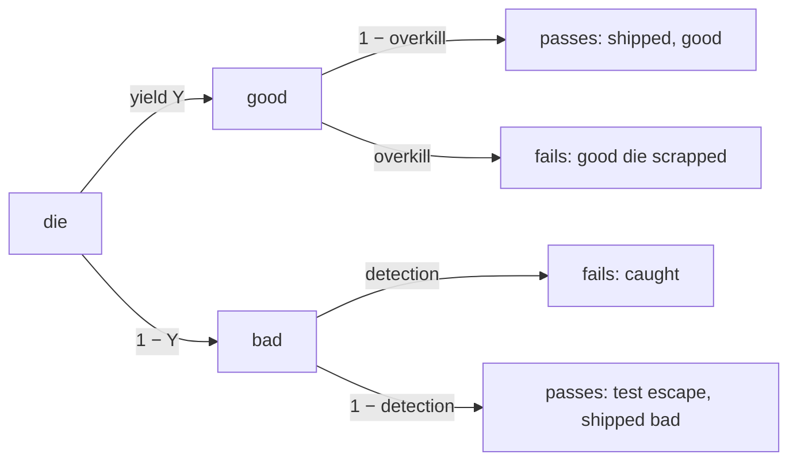
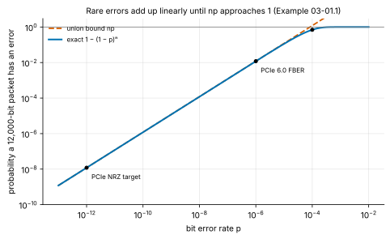
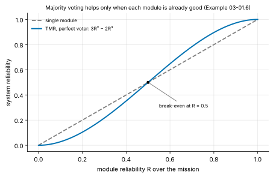
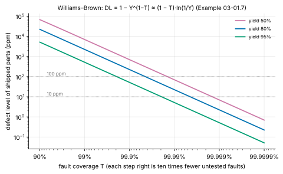

<!-- status: reviewed -->
# 03-01 · Probability in EE Language

| | |
|---|---|
| **Course** | [03 · Probability, Statistics and Random Variables for EE](../README.md) |
| **University equivalent** | The opening unit of a junior probability course for engineers (MIT 6.041/6.431 lectures 1–4: probability models and axioms, conditioning and Bayes' rule, independence, counting; Bertsekas & Tsitsiklis, *Introduction to Probability*, chapter 1; Leon-Garcia, chapter 2) |
| **Prerequisites** | [01-01 Functions, Models and Units](../../01-calculus-for-engineers/chapters/01-01-functions-models-and-units.md) (exponentials and logarithms), [01-08 Sequences, Series and Taylor](../../01-calculus-for-engineers/chapters/01-08-sequences-series-and-taylor.md) (the series for $\ln(1 - p)$) |
| **Estimated study hours** | 6 |
| **Last verified** | 2026-11-18 |

**Learning objectives.** After this chapter you can:

1. Model an engineering situation (bit errors, defects, test outcomes, failures) with a sample space, events and probabilities, and derive the consequences of the axioms: complements, inclusion–exclusion and the union bound.
2. Count outcomes with permutations and combinations, and use the counts to compute probabilities of error patterns and collisions, including the rare-event approximation $(1 - p)^n \approx e^{-np}$.
3. Compute conditional probabilities with the multiplication rule and the total probability theorem, and draw the probability tree of a multi-stage process.
4. Apply Bayes' rule to test and detection problems (test escapes, false alarms, maximum a posteriori decoding) and explain the base-rate effect.
5. Decide when events are independent or conditionally independent, and compute the reliability of series, parallel and majority-voting systems, including the effect of common-mode failures.
6. Sanity-check probability claims (bit error rates, defect levels, "nines" of availability, qualification sample sizes) with bounds and orders of magnitude.

## 1. Big picture

You already know probability from finance: default probabilities, conditional expectations, Bayesian updating of a thesis. Electrical engineering uses the same mathematics with different nouns. A **bit error rate** of $10^{-12}$ is a default probability per bit. A **yield** is the probability that a die works. A **test escape** is a false negative in a screening process, and a redundant power supply is a diversified portfolio whose diversification fails exactly when the failures are correlated. This chapter restates the foundations in that language, quickly, and spends its time on the tools engineers actually reach for: the union bound, the rare-event approximation, Bayes' rule for tests, and independence (with its failure modes).

- **Communication links:** every link specification states a bit error rate, and forward error correction, retries and link budgets are built on probability ([17](../../17-communication-systems/README.md)).
- **Manufacturing and test:** yield, fault coverage and the defect level shipped to customers, in parts per million, decide a chip's cost and its acceptability in automotive ([25](../../25-fabrication-packaging-test-and-reliability/README.md)).
- **Reliability:** redundancy, majority voting and failure rates in FIT decide whether a datacenter or a car meets its availability and safety targets.
- **Detection:** radar, smoke detectors, intrusion alarms and receiver decision circuits all trade false alarms against misses, which is Bayes' rule at work.

## 2. Intuition first

**Frequencies.** Read a probability as a long-run fraction. A bit error rate (BER) of $10^{-12}$ means that, over very many bits, about one in $10^{12}$ arrives wrong. A 32 Gb/s lane then sees $32\times10^9\times10^{-12} = 0.032$ errors per second: one every 31 seconds on average. A "rare" event is not rare at gigabit rates.

**Conditioning is zooming in.** $P(A \mid B)$, the probability of $A$ given $B$, asks: among the outcomes where $B$ happened, what fraction also have $A$? Picture the process that makes and tests a chip as a tree. Each branch carries a probability, and every question about the process is a sum of products along branches.

*Figure 1. The probability tree of wafer test. The shipped population is the two "passes" leaves; the fraction of it that is bad is the defect level (Examples 03-01.4 and 03-01.7).*

**An analogy from credit, and where it breaks.** Two loans that each default with probability 1% default together with probability $10^{-4}$ only if they are independent. In 2008 many structured products assumed low, stable default correlation (a Gaussian copula with thin joint tails) and discovered otherwise: a shared cause (house prices) made joint defaults far more likely. Engineering has the same trap. Two "independent" power supplies on the same circuit breaker, or two dies from the same particle-contaminated wafer region, fail together far more often than the product of their failure probabilities (Example 03-01.6). *Where the analogy breaks:* in engineering the physics often tells you when independence is justified. Thermal noise in one bit interval is independent of the next, so random bit errors really are close to independent. Burst errors from an equalizer, or clustered defects on a wafer, are not, and the physics tells you that too.

## 3. Theory

### 3.1 Sample spaces, events and the axioms

A **probability model** has three parts.

- The **sample space** Ω: the set of all possible outcomes of the experiment. Sending 8 bits has $2^8 = 256$ possible error patterns; testing a die has outcomes such as (good, passes).
- **Events**: subsets of Ω, such as "at least one bit is wrong".
- A **probability law** $P$ assigning a number to each event, obeying three axioms:
  1. **Nonnegativity:** $P(A) \ge 0$.
  2. **Normalization:** $P(\Omega) = 1$.
  3. **Additivity:** if $A_1, A_2, \dots$ are disjoint (no two share an outcome), $P(A_1 \cup A_2 \cup \dots) = P(A_1) + P(A_2) + \dots$.

Everything else is derived. Write $A^c$ for the complement of $A$ (the outcomes not in $A$).

- **Complement rule.** $A$ and $A^c$ are disjoint and their union is Ω, so $P(A) + P(A^c) = 1$: $P(A^c) = 1 - P(A)$. In particular $P(\varnothing) = 0$.
- **Monotonicity.** If $A \subseteq B$, then $B = A \cup (B \cap A^c)$, a disjoint union, so $P(B) = P(A) + P(B \cap A^c) \ge P(A)$.
- **Inclusion–exclusion.** Split $A \cup B$ into three disjoint pieces: $A \cap B^c$, $A \cap B$ and $A^c \cap B$. Adding $P(A) = P(A \cap B^c) + P(A \cap B)$ and $P(B) = P(A^c \cap B) + P(A \cap B)$ counts the middle piece twice, so

$$
P(A \cup B) = P(A) + P(B) - P(A \cap B) .
$$

- **The union bound.** Since $P(A \cap B) \ge 0$, $P(A \cup B) \le P(A) + P(B)$, and by induction, for any events,

$$
P(A_1 \cup A_2 \cup \dots \cup A_n) \le P(A_1) + P(A_2) + \dots + P(A_n) .
$$

The union bound needs no independence and no knowledge of the overlaps. It is the engineer's first estimate of "the probability that anything goes wrong": the sum of the probabilities of each thing going wrong. It is tight when the events are rare and nearly disjoint, and useless when the sum exceeds 1.

### 3.2 Rare events: the $e^{-np}$ approximation

Send $n$ bits, each wrong with probability $p$, independently (§3.6 makes this precise). The probability that *every* bit is right is $(1 - p)^n$, so

$$
P(\text{at least one error}) = 1 - (1 - p)^n .
$$

> **Math refresher — $\ln(1 - p)$ for small $p$.** From the Taylor series of [01-08](../../01-calculus-for-engineers/chapters/01-08-sequences-series-and-taylor.md), $\ln(1 - p) = -p - p^2/2 - p^3/3 - \dots$, so $\ln(1 - p) \approx -p$ with relative error about $p/2$.

Write $(1 - p)^n = e^{n\ln(1 - p)} \approx e^{-np}$. Then

$$
P(\text{at least one error}) \approx 1 - e^{-np} \approx np \quad\text{when } np \ll 1 .
$$

The last step uses $e^{-x} \approx 1 - x$ and reproduces the union bound $np$. So for rare errors, *probabilities of rare independent events add*. When $np$ approaches 1, the union bound overshoots and the exponential form takes over (Figure 2). One caution for computing: evaluating $1 - (1 - p)^n$ literally at $p = 10^{-12}$ subtracts two numbers that agree to 8 digits, the catastrophic cancellation of [02-10](../../02-complex-numbers-des-and-linear-algebra/chapters/02-10-numerical-methods.md) §3.1. Compute it as `-expm1(n * log1p(-p))`.

*Figure 2. Packet error probability against BER (Example 03-01.1). The union bound is exact to plotting accuracy until $np$ nears 1.*

### 3.3 Counting

When all outcomes are equally likely, $P(A) = (\text{number of outcomes in }A)/(\text{number in }\Omega)$, and probability becomes counting.

- **Multiplication principle.** A process with $k$ stages, with $n_i$ choices at stage $i$, has $n_1n_2\cdots n_k$ outcomes. An 8-bit byte has $2^8 = 256$ values.
- **Permutations.** Ordered selections of $k$ items from $n$ distinct ones: $n(n - 1)\cdots(n - k + 1) = \dfrac{n!}{(n - k)!}$.
- **Combinations.** Unordered selections. Each set of $k$ items can be ordered in $k!$ ways, so the number of sets is

$$
\binom{n}{k} = \frac{n!}{k!\,(n - k)!} .
$$

**Error patterns.** In $n$ independent bits, any *particular* pattern with exactly $k$ errors has probability $p^k(1 - p)^{n - k}$, and there are $\binom{n}{k}$ such patterns, so

$$
P(\text{exactly }k\text{ errors}) = \binom{n}{k}p^k(1 - p)^{n - k} .
$$

This is the binomial distribution of [03-02](03-02-random-variables-and-distributions.md). It is how an error-correcting code's failure rate is computed: a code that corrects up to $t$ errors fails only when more than $t$ occur.

**Collisions (the birthday problem).** Assign each of $k$ devices a random ID from $N$ equally likely values. The probability that all IDs differ is

$$
\frac{N}{N}\cdot\frac{N - 1}{N}\cdots\frac{N - k + 1}{N} = \prod_{i=0}^{k-1}\left(1 - \frac{i}{N}\right) \approx \exp\!\left(-\sum_{i=0}^{k-1}\frac{i}{N}\right) = \exp\!\left(-\frac{k(k - 1)}{2N}\right),
$$

using $1 - x \approx e^{-x}$ for each factor. Collisions become likely when $k$ approaches $\sqrt{N}$, far sooner than intuition suggests. With 32-bit random IDs ($N = 2^{32}$), 10,000 devices already collide with probability **0.01157**. The same mathematics sizes hash tables, random MAC addresses and the cryptographic "birthday attack".

### 3.4 Conditional probability

For $P(B) > 0$, the **conditional probability** of $A$ given $B$ is

$$
P(A \mid B) = \frac{P(A \cap B)}{P(B)} .
$$

It is a probability law in its own right on the smaller sample space $B$: knowing $B$ happened, renormalize so that $B$ has probability 1. Rearranged, it gives the **multiplication rule**, the rule for walking down a tree:

$$
P(A \cap B) = P(B)\,P(A \mid B), \qquad P(A_1 \cap A_2 \cap A_3) = P(A_1)\,P(A_2 \mid A_1)\,P(A_3 \mid A_1 \cap A_2) .
$$

**The total probability theorem.** If $B_1, \dots, B_m$ **partition** Ω (they are disjoint and one of them always happens), then for any event $A$,

$$
P(A) = \sum_{i=1}^mP(B_i)\,P(A \mid B_i) .
$$

*Derivation:* $A$ is the disjoint union of the pieces $A \cap B_i$, so by additivity $P(A) = \sum_iP(A \cap B_i)$, and each term is $P(B_i)P(A \mid B_i)$ by the multiplication rule. On a tree, it says: add up the probabilities of all the leaves where $A$ happens. A fab's overall yield is the weighted average of its lines' yields, with weights equal to their shares of the dies produced (Example 03-01.3).

### 3.5 Bayes' rule

Often we know $P(\text{observation} \mid \text{cause})$, from the physics or a datasheet, and want $P(\text{cause} \mid \text{observation})$. Write $P(A \cap B)$ both ways with the multiplication rule, $P(B)P(A \mid B) = P(A)P(B \mid A)$, and divide by $P(B)$:

$$
P(A \mid B) = \frac{P(A)\,P(B \mid A)}{P(B)}, \qquad P(B) = \sum_iP(A_i)\,P(B \mid A_i)\ \text{(total probability)} .
$$

$P(A)$ is the **prior**, $P(B \mid A)$ the **likelihood**, and $P(A \mid B)$ the **posterior**. A finance reader knows this as updating a probability on news. The **odds form** is often easier. For two hypotheses $A$ and $A^c$,

$$
\underbrace{\frac{P(A \mid B)}{P(A^c \mid B)}}_{\text{posterior odds}} = \underbrace{\frac{P(B \mid A)}{P(B \mid A^c)}}_{\text{likelihood ratio}} \times \underbrace{\frac{P(A)}{P(A^c)}}_{\text{prior odds}} .
$$

**The base-rate effect.** A test with a strong likelihood ratio still gives a weak posterior when the prior is small. A machine-health alarm that fires for 99% of real faults and for 1% of healthy machines, on a fleet where 0.1% of machines are faulty, is right only about 9% of the time when it fires: the 1% false-alarm rate applied to the 99.9% healthy majority swamps the true alarms. Engineers meet this in test (a large share of rejected parts can be good: 15% in Example 03-01.4, and a majority when yield is high), in radar and in fraud detection. Confusing $P(\text{alarm} \mid \text{fault})$ with $P(\text{fault} \mid \text{alarm})$ is the classic error.

**Decisions: maximum a posteriori (MAP) detection.** A receiver sees a noisy observation $y$ and must decide which symbol was sent. Deciding $\hat{s}(y)$ is wrong with probability $1 - P(\hat{s}(y) \mid y)$ for that observation, so the probability of error is smallest, observation by observation and therefore overall, when $\hat{s}(y)$ is the symbol with the **largest posterior** $P(s \mid y)$. That is the **MAP rule**. By Bayes' rule $P(s \mid y) \propto P(s)P(y \mid s)$, so MAP compares likelihoods weighted by priors. With equal priors it reduces to the **maximum-likelihood (ML)** rule, pick the $s$ that makes $y$ most likely, which is what most receivers implement. With skewed priors the two differ, sometimes dramatically (Example 03-01.5). The Gaussian version of this decision is the subject of [03-02](03-02-random-variables-and-distributions.md) and Course 17.

### 3.6 Independence

Events $A$ and $B$ are **independent** if

$$
P(A \cap B) = P(A)\,P(B),
$$

equivalently (when $P(B) > 0$) $P(A \mid B) = P(A)$: learning $B$ tells you nothing about $A$. Independence of $A$ and $B$ implies independence of $A$ and $B^c$: $P(A \cap B^c) = P(A) - P(A \cap B) = P(A) - P(A)P(B) = P(A)P(B^c)$. So "bit 1 is wrong" and "bit 2 is right" are independent too.

**Several events.** $A_1, \dots, A_n$ are (mutually) independent if *every* subcollection satisfies the product rule, for example $P(A_1 \cap A_2 \cap A_3) = P(A_1)P(A_2)P(A_3)$ as well as all the pairs. Pairwise independence is not enough. Send two independent, equally likely bits $b_1, b_2$ and a parity bit $b_3 = b_1 \oplus b_2$. Any two of the three are independent, but the three together are not: $b_1$ and $b_2$ determine $b_3$. Parity and checksum schemes depend on exactly this dependence.

**Conditional independence.** $A$ and $B$ are conditionally independent given $C$ if $P(A \cap B \mid C) = P(A \mid C)P(B \mid C)$. Two tests of the same die may be independent *given* the die's true state (their noise is unrelated) and still be strongly dependent *unconditionally*, because both reflect that state. Retesting a failed part is valuable precisely because of this structure.

**Independence is a modeling assumption.** It is justified when the physics separates the causes: thermal noise in different bit intervals, defects in different dies on a lightly contaminated wafer. It fails with shared causes: burst errors from an equalizer that propagates a wrong decision, clustered wafer defects, two servers on one power feed. Always ask what could make the events fail together.

### 3.7 System reliability

Let module $i$ survive a mission with probability $R_i$ (its **reliability**), independently of the others.

- **Series** (all must work, like a chain of links): $R_{\text{series}} = R_1R_2\cdots R_n$. Ten modules at 0.99 give only $0.99^{10} = 0.904$.
- **Parallel** (any one suffices, like redundant power supplies): the system fails only if all fail, so $R_{\text{par}} = 1 - (1 - R_1)(1 - R_2)\cdots(1 - R_n)$. Two supplies at 0.99 give $1 - 0.01^2 = 0.9999$.
- **k-out-of-n.** The system works if at least $k$ of $n$ identical modules work. With the binomial count of §3.3,

$$
R_{k/n} = \sum_{i=k}^n\binom{n}{i}R^i(1 - R)^{n - i} .
$$

**Triple modular redundancy (TMR)** runs three copies and takes a majority vote, a 2-out-of-3 system. With a perfect voter,

$$
R_{\text{TMR}} = R^3 + 3R^2(1 - R) = 3R^2 - 2R^3 .
$$

TMR beats a single module only when $R > 0.5$ (Figure 3): $3R^2 - 2R^3 - R = -R(2R - 1)(R - 1)$, which is positive exactly for $0.5 < R < 1$. For a long mission in which each module will probably fail, voting makes things worse. TMR protects flight computers and radiation-exposed logic, where single upsets are rare and short.

*Figure 3. Majority voting (Example 03-01.6). Above $R = 0.5$ voting helps; below it, voting hurts.*

**Common-mode failures.** Redundancy assumes independent failures. Split each unit's failure probability $q$ into an independent part $(1 - \beta)q$ and a **common-mode** part $\beta q$ that takes down all redundant units at once (a shared power feed, a design bug, a hot room). For two units in parallel,

$$
P(\text{system fails}) = \beta q + (1 - \beta q)\big((1 - \beta)q\big)^2 \approx \beta q \quad\text{for small }q .
$$

Even a small common-mode fraction dominates: the $q^2$ benefit of duplication is replaced by a term linear in $q$. This "beta-factor" model is a standard first estimate in safety engineering.

**Availability and "nines".** A system available a fraction $A$ of the time is down $(1 - A)\times8766$ hours a year. "Three nines" (99.9%) is 8.766 hours of downtime a year; "five nines" (99.999%) is 5.260 minutes.

### 3.8 Defect level and test escapes

A chip test applies patterns designed to detect modeled **faults** (for example, a node stuck at 0). **Fault coverage** $T$ is the fraction of modeled faults the test detects. The **defect level** DL is the fraction of *shipped* (passing) parts that are defective, quoted in parts per million (**DPPM**). Bayes' rule connects them.

**The Williams–Brown model, derived.** Suppose a die has $N$ possible faults, each present independently with probability $\pi$. The die is good only if none is present, so the yield is $Y = (1 - \pi)^N$. The test checks $TN$ of the faults. A die **passes** if none of the *tested* faults is present, so $P(\text{pass}) = (1 - \pi)^{TN} = Y^T$. Every good die passes (no overkill in this model), so $P(\text{good} \cap \text{pass}) = P(\text{good}) = Y$. By the definition of conditional probability,

$$
P(\text{good} \mid \text{pass}) = \frac{Y}{Y^T} = Y^{1 - T}, \qquad \boxed{\text{DL} = P(\text{bad} \mid \text{pass}) = 1 - Y^{1 - T}} .
$$

This is the result of Williams and Brown (1981) ([R-062](../../../reference/research-log.md#r-062--defect-level-and-fault-coverage)). For high coverage, $Y^{1 - T} = e^{(1 - T)\ln Y} \approx 1 + (1 - T)\ln Y$, so

$$
\text{DL} \approx (1 - T)\ln\frac{1}{Y} .
$$

The defect level falls in proportion to the *untested* fraction $1 - T$, and it is worse at low yield, because a low-yield process sends more bad dies to the tester (Figure 4). Each tenfold cut in DPPM needs a tenfold cut in untested faults. That is why automotive-grade parts need coverage measured in "nines".

*Figure 4. Defect level against fault coverage (Williams–Brown). The 80% curve crosses 100 ppm near 99.955% coverage and 10 ppm near 99.9955% (Example 03-01.7).*

> **Going deeper — clustered defects.** Real defects cluster: a particle burst damages a region, not random dies. Clustering raises the yield for the same average defect count (some dies collect many defects, others none) and changes the defect-level curve. Negative-binomial models, with a clustering parameter fitted to fab data, replace the independent-fault model in practice. The independent model remains the right first estimate and the right intuition: the escapes scale with the untested fraction.

## 4. Worked examples

### Example 03-01.1 — Packet errors and the union bound (tier A)

**Setup.** A link sends 1500-byte packets (12,000 bits) with independent bit errors. (a) Find the probability that a packet contains at least one error at BER $p = 10^{-12}$, $10^{-6}$ and $10^{-4}$, exactly and by the union bound. (b) At $p = 10^{-4}$, what is the probability of exactly one error? (c) At $10^{-12}$ and 32 Gb/s, how often does an error occur?

**Solution.** (a) $P = 1 - (1 - p)^n$ with $n = 12{,}000$; the union bound is $np$.

- $p = 10^{-12}$: $np = 1.2\times10^{-8}$, and the exact value is **1.200×10⁻⁸** to four figures: the bound is exact for all practical purposes.
- $p = 10^{-6}$: exact **0.01193**, against the bound 0.012.
- $p = 10^{-4}$: exact **0.6988**, while the bound gives **1.2**, an impossible "probability". With $np = 1.2$ the rare-event assumption has failed.

(b) $\binom{n}{1}p(1 - p)^{n - 1} = 12{,}000\times10^{-4}\times0.9999^{11{,}999} = $ **0.3614**. So of the 0.6988 chance of an error, about half is a single error and half is two or more.

(c) $32\times10^9\times10^{-12} = 0.032$ errors per second: one every **31.25 s** on average.

**Units check.** $n$ is a count and $p$ a probability per bit, so $np$ is dimensionless; errors per second = (bits/s) × (errors/bit) ✓. **Sanity check.** A packet error rate can never exceed 1, and the exact values never do ✓.

### Example 03-01.2 — Two failure modes and inclusion–exclusion (tier A)

**Setup.** At final test, 5% of dies show a logic fault and 4% a memory fault; 1% show both. (a) What fraction fail? (b) What would it be if the two faults were independent? (c) Are they independent, and what might explain the difference?

**Solution.** (a) \$P(L \cup M) = 0.05 + 0.04 - 0.01 = \$ **0.08**. (b) Independence would make $P(L \cap M) = 0.05\times0.04 = 0.002$, so \$P(L \cup M) = \$ **0.088**. (c) They are not independent: $P(L \cap M) = 0.01$ is five times the product. Equivalently, \$P(M \mid L) = 0.01/0.05 = \$ **0.2**, against $P(M) = 0.04$: a die with a logic fault is five times as likely to have a memory fault. A shared cause, such as a defect-dense wafer region, is the usual explanation. Positive correlation *lowers* the total failure rate here, because the failures pile onto the same dies.

**Sanity check.** $0.08 \le 0.05 + 0.04$ (the union bound) and $0.08 \ge 0.05$ (the larger single event) ✓.

### Example 03-01.3 — Two fabs: total probability and Bayes (tier B)

**Setup.** A product is built in two fabs. Fab A makes 60% of the dies with a die yield of 92%; fab B makes 40% at 85%. (a) What is the overall yield? (b) A die picked at random fails. What is the probability it came from fab B? (c) Given that a die is good, what is the probability it came from fab B?

**Solution.** (a) Total probability: $Y = 0.6\times0.92 + 0.4\times0.85 = 0.552 + 0.340 = $ **0.892**.

(b) Bayes: $P(B \mid \text{bad}) = \dfrac{P(B)P(\text{bad} \mid B)}{P(\text{bad})} = \dfrac{0.4\times0.15}{0.108} = $ **0.5556**. Fab B makes 40% of the dies but 56% of the failures.

(c) $P(B \mid \text{good}) = 0.340/0.892 = $ **0.3812**: knowing a die is good shifts the odds slightly toward fab A.

**Check.** $P(A \mid \text{bad}) = 0.6\times0.08/0.108 = 0.4444$, and $0.5556 + 0.4444 = 1$ ✓.

### Example 03-01.4 — Test escapes in DPPM (tier B)

**Setup.** Incoming yield is 90%. The test catches 99% of bad dies (the rest escape) and wrongly rejects 2% of good dies (**overkill**). (a) What fraction of dies pass? (b) What is the defect level of shipped parts, in DPPM? (c) What fraction of rejected dies were actually good? (d) What escape probability would bring the defect level down to 10 DPPM?

**Solution.** (a) Total probability over the tree of Figure 1: $P(\text{pass}) = 0.9\times0.98 + 0.1\times0.01 = 0.882 + 0.001 = $ **0.883**.

(b) $\text{DL} = P(\text{bad} \mid \text{pass}) = 0.001/0.883 = 1.1325\times10^{-3}$, that is **1132.5 DPPM**. A test that catches 99% of bad dies still ships about one bad part per thousand.

(c) $P(\text{good} \mid \text{fail}) = 0.9\times0.02/0.117 = $ **0.1538**. Over 15% of the scrap is good silicon: the overkill rate applies to the large good population. This is the base-rate effect in reverse, and it is why failing parts are often retested.

(d) With escape probability $e$, $\text{DL} = 0.1e/(0.882 + 0.1e) = 10^{-5}$. Solving, $0.1e(1 - 10^{-5}) = 8.82\times10^{-6}$, so \$e = \$ **8.820×10⁻⁵**: the test must catch 99.991% of bad dies. Cutting the escape probability by a factor of about 113 cuts DPPM by the same factor.

**Sanity check.** DL ≈ (bad fraction × escape probability)/(pass fraction) = $0.1\times0.01/0.883$ ✓, and DPPM scales linearly with the escape probability ✓.

### Example 03-01.5 — When the best decision ignores the data (tier B)

**Setup.** A sensor transmits 0 with probability 0.95 and 1 with probability 0.05 (alarms are rare). The channel flips each bit with probability 0.1. (a) Given a received 1, what is the probability a 1 was sent? Given a received 0? (b) Find the MAP decision rule and its error probability, and compare with the ML rule (believe the received bit). (c) How rare must alarms be before MAP ignores a received 1?

**Solution.** (a) $P(\text{recv }1) = 0.05\times0.9 + 0.95\times0.1 = 0.045 + 0.095 = 0.14$. So \$P(\text{sent }1 \mid \text{recv }1) = 0.045/0.14 = \$ **0.3214**, and \$P(\text{sent }1 \mid \text{recv }0) = 0.05\times0.1/0.86 = \$ **0.005814**.

(b) After either observation, "0 was sent" is more probable (0.6786 and 0.9942). So MAP always decides 0, and it errs exactly when a 1 was sent: probability **0.05**. The ML rule believes the received bit and errs whenever the channel flips it: probability **0.1**. Here MAP halves the error rate by ignoring the data entirely.

(c) MAP follows a received 1 only when $P(1)\times0.9 > P(0)\times0.1$, that is when \$P(1) > \$ **0.1**. Below that prior, the channel's 10% flip rate produces more false 1s than true ones.

**Sanity check.** The posteriors for each received bit sum to 1 ($0.3214 + 0.6786$, $0.005814 + 0.9942$) ✓, and the MAP error 0.05 can be no worse than "always guess 0", which it equals ✓.

**Interpretation.** Minimizing the error probability is not always the goal. A missed alarm may cost far more than a false one, and the decision rule should then weigh the two errors by their costs, not just their probabilities. Detection theory (Course 17) does exactly that. But the example shows why priors matter: with skewed priors, ignoring them leaves performance on the table.

### Example 03-01.6 — Redundancy, voting and common-mode failures (tier B)

**Setup.** (a) A module survives a mission with probability $R$. Compare a single module with TMR (perfect voter) at $R = 0.99$, 0.9 and 0.4. (b) Two power supplies each fail with probability $q = 0.01$ per year, with no repair during the year (a mission model). Find the probability both fail if failures are independent, and if 10% of each supply's failure probability is common-mode (β = 0.1). (c) What does "five nines" availability allow per year?

**Solution.** (a) $R_{\text{TMR}} = 3R^2 - 2R^3$:

| $R$ | single | TMR |
|---|---|---|
| 0.99 | 0.99 | **0.9997** |
| 0.9 | 0.9 | **0.972** |
| 0.4 | 0.4 | **0.352** |

At $R = 0.99$, TMR cuts the failure probability from 1% to 0.03%, about 34-fold. At $R = 0.4$ it makes things worse.

(b) Independent: \$q^2 = \$ **1×10⁻⁴**. With β = 0.1: \$\beta q + (1 - \beta q)\big((1 - \beta)q\big)^2 = 0.001 + 0.999\times(0.009)^2 = \$ **1.081×10⁻³**, about **10.81** times worse. The common-mode term $\beta q = 0.001$ dominates. With repair, a failed supply is replaced within hours, so independent double failures need overlapping outages and become far rarer still, which makes the common-mode term dominate even more.

(c) $(1 - 0.99999)\times8766\text{ h}\times60 = $ **5.260 minutes** of downtime a year.

**Sanity check.** TMR at $R = 0.5$ gives $0.75 - 0.25 = 0.5$, the break-even ✓.

### Example 03-01.7 — How much fault coverage does automotive need? (tier C)

**Setup.** A design has 80% yield. (a) With 99% fault coverage, what defect level does the Williams–Brown model predict? (b) What coverage is needed for 100 DPPM, and for 10 DPPM? (c) A supplier with 50% yield claims 99.9% coverage. What defect level does that imply?

**Solution.** (a) $\text{DL} = 1 - 0.8^{0.01} = 1 - e^{0.01\ln0.8} = 1 - e^{-0.0022314} = 2.229\times10^{-3}$: **2229 DPPM**.

(b) Solve $1 - Y^{1 - T} = \text{DL}$ for $T$: $1 - T = \ln(1 - \text{DL})/\ln Y$. For 100 DPPM, $1 - T = \ln(0.9999)/\ln(0.8) = 4.482\times10^{-4}$, so \$T = \$ **0.99955**. For 10 DPPM, \$T = \$ **0.999955**. Each tenfold cut in DPPM needs ten times fewer untested faults.

(c) $1 - 0.5^{0.001} = $ **692.9 DPPM**, about 7 per 10,000 shipped parts, even at "three nines" of coverage. The headline coverage number means little without the yield.

**Check.** The approximation $\text{DL} \approx (1 - T)\ln(1/Y)$ gives $0.01\times0.2231 = 2.231\times10^{-3}$ for (a), within about 0.1% ✓.

<!-- answer-key -->
| ID | Quantity | Value | Unit |
|---|---|---|---|
| Ex 03-01.1a | packet error probability at 1e-12 | 1.200×10^-8 | — |
| Ex 03-01.1b | packet error probability at 1e-6 | 0.01193 | — |
| Ex 03-01.1c | packet error probability at 1e-4 | 0.6988 | — |
| Ex 03-01.1d | union bound at 1e-4 | 1.2 | — |
| Ex 03-01.1e | probability of exactly one error at 1e-4 | 0.3614 | — |
| Ex 03-01.1f | mean time between errors at 32 Gb/s, 1e-12 | 31.25 | s |
| Ex 03-01.2a | fraction failing | 0.08 | — |
| Ex 03-01.2b | fraction failing if independent | 0.088 | — |
| Ex 03-01.2c | P(memory fault given logic fault) | 0.2 | — |
| Ex 03-01.3a | overall yield | 0.892 | — |
| Ex 03-01.3b | P(fab B given bad) | 0.5556 | — |
| Ex 03-01.3c | P(fab B given good) | 0.3812 | — |
| Ex 03-01.4a | pass fraction | 0.883 | — |
| Ex 03-01.4b | defect level | 1132.5 | DPPM |
| Ex 03-01.4c | fraction of rejects that are good | 0.1538 | — |
| Ex 03-01.4d | escape probability for 10 DPPM | 8.820×10^-5 | — |
| Ex 03-01.5a | P(sent 1 given received 1) | 0.3214 | — |
| Ex 03-01.5b | P(sent 1 given received 0) | 0.005814 | — |
| Ex 03-01.5c | MAP error probability | 0.05 | — |
| Ex 03-01.5d | ML error probability | 0.1 | — |
| Ex 03-01.6a | TMR reliability at R = 0.99 | 0.9997 | — |
| Ex 03-01.6b | TMR reliability at R = 0.9 | 0.972 | — |
| Ex 03-01.6c | TMR reliability at R = 0.4 | 0.352 | — |
| Ex 03-01.6d | both supplies fail, independent | 1×10^-4 | — |
| Ex 03-01.6e | both supplies fail, beta = 0.1 | 1.081×10^-3 | — |
| Ex 03-01.6f | common-mode penalty factor | 10.81 | — |
| Ex 03-01.6g | five-nines downtime | 5.260 | min/yr |
| Ex 03-01.7a | defect level, Y = 0.8, T = 0.99 | 2229 | DPPM |
| Ex 03-01.7b | coverage for 100 DPPM | 0.99955 | — |
| Ex 03-01.7c | coverage for 10 DPPM | 0.999955 | — |
| Ex 03-01.7d | defect level, Y = 0.5, T = 0.999 | 692.9 | DPPM |
| Ex 03-01.7e | approximate defect level for (a) | 2.231×10^-3 | — |
| Ex 03-01.7f | untested fraction for 100 DPPM | 4.482×10^-4 | — |
| Ex 03-01.4e | detection needed for 10 DPPM | 99.991 | % |
| Ex 03-01.4f | escape-probability reduction factor | 113 | — |
| Ex 03-01.5e | P(sent 0 given received 1) | 0.6786 | — |
| Ex 03-01.5f | P(sent 0 given received 0) | 0.9942 | — |
| Ex 03-01.5g | prior above which MAP follows a received 1 | 0.1 | — |
| N 03-01.i | bits for a 95% zero-error test at 1e-12 | 3.0×10^12 | bits |
| C 03-01.a | union-bound check, exact value | 0.00995 | — |
| C 03-01.b | shipped defect fraction at 90% yield | 0.11 | % |
| C 03-01.c | shipped defect fraction at 50% yield | 1 | % |
| Ex 03-01.6h | TMR failure-probability improvement at R = 0.99 | 34 | — |
| T 03-01.a | alarm posterior in the base-rate illustration | 9 | % |
| T 03-01.b | collision probability, 10,000 IDs of 32 bits | 0.01157 | — |
| T 03-01.c | ten modules in series at 0.99 | 0.904 | — |
| T 03-01.d | two supplies in parallel at 0.99 | 0.9999 | — |

## 5. Simulate it

The lab ([labs/03-01-lab/](../labs/03-01-lab/README.md)) is a notebook of Monte Carlo experiments that check this chapter's formulas against simulated "reality":

1. **Rare events.** Simulate packets at three BERs, and compare the measured packet error rate with $1 - (1 - p)^n$ and the union bound. *Predict first:* at which BER does the union bound visibly fail?
2. **Birthday collisions.** Draw random IDs and measure how often they collide. *Predict first:* how many 16-bit IDs make a collision more likely than not?
3. **A test floor.** Simulate a million dies through the test of Example 03-01.4. *Predict first:* how many of the shipped dies are bad, and how many of the scrapped ones are good?
4. **Independence and its failure.** Generate dies with clustered defects and measure $P(L \cap M)$ against $P(L)P(M)$.
5. **Voting.** Simulate TMR and duplicated supplies with and without common-mode failures.
6. **How long to prove a BER.** Simulate zero-error BER tests and check the "$3/p$ bits for 95% confidence" rule of §9.

## 6. Engineering tradeoffs

| Knob | Improves | Costs | Typical decision owner |
|---|---|---|---|
| Fault coverage (more test patterns, design for test) | Lower defect level (DPPM falls in proportion to the untested fraction) | Test time per die, tester capacity, area for test logic | Test and product engineering |
| Test limits (guard bands) | Fewer escapes | More overkill: good dies scrapped | Product and quality engineering |
| Redundancy (duplication, TMR) | Reliability: duplication always helps if failures are independent; TMR only if $R > 0.5$ | Area, power and cost (about ×2 or ×3), plus the voter | System and safety architects |
| Separation of redundant units (feeds, locations, designs) | Removes common-mode failures, which otherwise dominate | Cost and complexity | Datacenter and safety engineering |
| Forward error correction | Lower delivered BER for the same channel | Latency, overhead bits, decoder power | Link and PHY architects |
| BER test duration | Confidence in a low-BER claim | Tester time: about $3/p$ bits for 95% confidence | Validation engineering |
| Decision threshold (MAP vs ML, or cost-weighted) | Lower error probability, or lower cost of errors | Requires knowing the priors and costs | Communications and detection designers |

## 7. Numbers to know

| Quantity | Value | Note |
|---|---|---|
| Rare-event rule | $1 - (1 - p)^n \approx np$ when $np \ll 1$ | Union bound; exact form $1 - e^{-np}$ |
| Birthday collisions | likely once $k \approx \sqrt{N}$ | $P \approx 1 - e^{-k^2/(2N)}$ |
| TMR break-even | $R = 0.5$ | TMR helps only above it |
| "Nines" | 99.9%: 8.766 h/yr; 99.99%: 52.60 min/yr; 99.999%: 5.260 min/yr | Downtime per year |
| Defect level | $\approx (1 - T)\ln(1/Y)$ | Williams–Brown, high coverage |
| Zero-error BER test, 95% confidence | about $3/p$ bits ($-\ln0.05/p$) | §9; [R-060](../../../reference/research-log.md#r-060--zero-error-ber-tests-and-confidence) |
| PCIe target BER, Gen 1–5 (NRZ), as of Nov 2026 | $10^{-12}$ | [R-059](../../../reference/research-log.md#r-059--serial-link-bit-error-rate-targets-pcie-and-ethernet) |
| PCIe 6.0 first-bit error rate, as of Nov 2026 | $10^{-6}$, with FEC, CRC and retry | [R-059](../../../reference/research-log.md#r-059--serial-link-bit-error-rate-targets-pcie-and-ethernet) |
| Ethernet 400G/800G/1.6T BER objective, as of Nov 2026 | $10^{-13}$ at the MAC | [R-059](../../../reference/research-log.md#r-059--serial-link-bit-error-rate-targets-pcie-and-ethernet) |
| Automotive and JEDEC qualification sample, as of Nov 2026 (JESD47G; AEC-Q100 per a 2020 NASA summary; current revisions not checked) | 3 lots × 77 units, zero failures | Shows < 1% defective at 90% confidence [R-061](../../../reference/research-log.md#r-061--qualification-sample-sizes-aec-q100-and-jedec-jesd47) |

<!-- answer-key -->
| ID | Quantity | Value | Unit |
|---|---|---|---|
| N 03-01.a | three-nines downtime | 8.766 | h/yr |
| N 03-01.b | four-nines downtime | 52.60 | min/yr |
| N 03-01.c | five-nines downtime | 5.260 | min/yr |
| N 03-01.d | bits per unit p for a 95% zero-error test | 2.996 | — |
| N 03-01.e | qualification sample, 3 × 77 | 231 | units |
| N 03-01.f | 95% zero-error test at 1e-12, 32 Gb/s | 93.62 | s |
| N 03-01.g | same at 400 Gb/s | 7.489 | s |
| N 03-01.h | 95% zero-error test at 1e-15, 400 Gb/s | 2.080 | h |

## 8. Common mistakes

1. **Adding probabilities of events that overlap.** $P(A \cup B) = P(A) + P(B)$ only for disjoint events. The sum is an upper bound (the union bound), not the answer.
2. **Using the union bound when $np$ is not small.** It can exceed 1. Switch to $1 - (1 - p)^n$.
3. **Assuming independence by default.** Clustered defects, burst errors and shared power feeds all violate it. Ask what could make two events fail together.
4. **Confusing $P(A \mid B)$ with $P(B \mid A)$.** "The test catches 99% of bad parts" is not "99% of rejected parts are bad".
5. **Ignoring the base rate.** A good test on a rare condition still produces mostly false alarms.
6. **Treating pairwise independence as full independence.** The parity-bit example shows they differ.
7. **Reading zero observed failures as a zero failure rate.** Zero failures in $n$ trials bounds the rate, roughly $p < 3/n$ at 95% confidence; it does not prove $p = 0$.
8. **Assuming redundancy always helps.** Voting hurts when modules are unreliable ($R < 0.5$), and common-mode failures erase the gain.

## 9. Practitioner lens

### State of the art (as of Nov 2026)

- **Serial links are specified by bit error rate.** PCI Express through Gen 5, with NRZ (two-level) signaling, targets a BER of $10^{-12}$. PCIe 6.0 moved to PAM4 (four-level signaling, two bits per symbol) at 64 GT/s (gigatransfers, or symbols, per second per lane), where that raw BER is not feasible. It instead targets a *first-bit error rate* below $10^{-6}$ and adds a light forward error correction, a 64-bit CRC (cyclic redundancy check, an error-detecting code) and a fast link-level retry. With a 256-byte flit (the fixed-size block the link sends: 236 bytes of transaction-layer packet space, 6 of link-layer data, 8 of CRC and 6 of FEC), the retry probability per flit is about $5\times10^{-6}$ ([R-059](../../../reference/research-log.md#r-059--serial-link-bit-error-rate-targets-pcie-and-ethernet)) **[Established; from presentations by a PCI-SIG board member and an IP vendor; the specification text was not read]**. Ethernet's 400G, 800G and 1.6T objectives specify a BER of $10^{-13}$ at the MAC service interface (where the Ethernet controller hands frames to the system), or the equivalent frame loss ratio of $6.2\times10^{-11}$ for 64-byte frames ([R-059](../../../reference/research-log.md#r-059--serial-link-bit-error-rate-targets-pcie-and-ethernet)) **[Established]**.
- **Proving a BER takes time.** "Confidence" here is a statement about the test, not about this link. If the true BER were $p$ or worse, a run of $n$ bits would be error-free with probability at most $(1 - p)^n \approx e^{-np}$. Choosing $n$ so that this is 5% means a link at the limit would pass only 1 time in 20: that is "95% confidence", $C = 1 - (1 - p)^n$. It is *not* the probability that this link's BER is below $p$ given the clean run, which would need a prior (Bayes, §3.5; [03-05](03-05-estimation-and-hypothesis-testing.md) §3.2). So 95% confidence needs $n = -\ln(0.05)/p \approx 3/p$ bits. At $10^{-12}$ that is **3.0×10¹²** bits: **93.62 s** on a 32 Gb/s lane, or **7.489 s** at 400 Gb/s. At $10^{-15}$ and 400 Gb/s it takes **2.080 hours**. IEEE 802.3 contributors use this ITU-T formula when choosing test objectives ([R-060](../../../reference/research-log.md#r-060--zero-error-ber-tests-and-confidence)) **[Established]**.
- **Qualification samples are small on purpose.** AEC-Q100 automotive qualification and JEDEC's JESD47 run their major stresses, such as 1000 hours of high-temperature operating life, on 3 lots of 77 units with zero failures allowed (per JESD47G, 2009, and a 2020 NASA summary of AEC-Q100; the current revisions were not checked). That shows, at 90% confidence, that no more than 1% of the population is defective (an "LTPD of 1"). A NASA summary of AEC-Q100 is explicit that this sample "is NOT sufficient or intended for process control or PPM evaluation"; low-ppm targets are met by process control and screening ([R-061](../../../reference/research-log.md#r-061--qualification-sample-sizes-aec-q100-and-jedec-jesd47)) **[Established]**.
- **Defect level is managed through fault coverage.** The Williams–Brown relation of §3.8 is standard teaching in test engineering, and its message, that shipped DPPM scales with the untested fraction and with $\ln(1/Y)$, drives coverage targets ([R-062](../../../reference/research-log.md#r-062--defect-level-and-fault-coverage)) **[Established]**.

### Why it matters commercially

Probability numbers are contract terms. A link's BER sets how much forward error correction and retry logic the silicon needs, which costs latency, area and power. A DPPM commitment to an automotive customer drives test coverage, test time and therefore cost per unit, and the yield of a new process directly multiplies the defect level for a given coverage. Availability commitments ("nines") decide how much redundancy a datacenter buys, and common-mode failures decide whether that redundancy actually works. In diligence, probability claims are where marketing language and engineering reality diverge most.

### Marketing vs Reality

- **"BER better than $10^{-15}$."** *Reality:* demonstrating it at 95% confidence takes $3\times10^{15}$ error-free bits, about 2 hours at 400 Gb/s per configuration, and longer across temperature, voltage and channel corners. Ask whether the figure was measured, extrapolated from a curve, or computed from a model, and under which conditions.
- **"Zero failures in qualification."** *Reality:* 231 units with no failures shows, at 90% confidence, only that fewer than about 1% are defective. It says nothing about 10 or 100 ppm. Ask for field return data in DPPM and the screening strategy.
- **"99.9% test coverage."** *Reality:* at 50% yield that still implies about 690 DPPM by Williams–Brown (Example 03-01.7). Ask which fault model the coverage is measured against, and what the yield is.
- **"Triple-redundant, so it never fails."** *Reality:* only if each module is reliable on its own and failures are independent. A shared power feed, cooling loop or software bug makes the redundant copies fail together.

### Questions for engineering leaders

1. **"What is the measured, not specified, BER margin on this link, and how many bits did you test?"** *Strong:* a measured bathtub curve or BER contour, with total bits tested and the confidence level, across corners. *Evasive:* "it meets spec", with no test duration.
2. **"What DPPM do you ship today, and how do you know?"** *Strong:* field returns normalized per million shipped, with root-cause categories, plus the fault coverage and yield that predict them. *Evasive:* qualification results quoted as if they measured DPPM.
3. **"Which failure modes are common to your redundant units?"** *Strong:* a list (shared power, shared firmware, shared thermal path) with mitigations and a common-mode estimate. *Evasive:* "they are fully redundant".
4. **"How many of your rejected parts are actually good?"** *Strong:* retest and overkill statistics, with the guard-band policy that produces them. *Evasive:* no data, or "the test is very accurate".
5. **"What priors does your detector assume, and what happens when they shift?"** *Strong:* a false-alarm and miss analysis at realistic base rates, with thresholds tied to the cost of each error. *Evasive:* only a sensitivity figure.

## 10. Concept check

1. A system has 1000 components, each failing in a year with probability $10^{-5}$. Estimate the probability that at least one fails, and say what assumption your estimate needs.

   

Answer

   The union bound gives $1000\times10^{-5} = 0.01$. It is valid with no assumption at all, and accurate because the events are rare. If failures are independent, the exact value \$1 - (1 - 10^{-5})^{1000} = \$ **0.00995** agrees. Positively correlated failures make the true value smaller, never larger than the bound.

   

2. Why is the union bound useless for a 12,000-bit packet at BER $10^{-4}$?

   

Answer

   It gives $np = 1.2$, more than 1. The events "bit $i$ is wrong" overlap often enough (two or more errors per packet are common) that adding their probabilities double-counts heavily. The exact value is 0.6988.

   

3. A test detects 99% of bad parts. Does that mean 99% of shipped parts are good?

   

Answer

   No. The shipped defect fraction depends on how many bad parts arrive: it is (bad fraction × 1%)/(pass fraction). At 90% yield it is about **0.11**% (Example 03-01.4); at 50% yield it would be about **1**%. Also, "99% of shipped parts good" would be a very poor result for most products.

   

4. Two tests of the same die give independent noise. Are their pass/fail results independent?

   

Answer

   Not unconditionally. They are conditionally independent given the die's true state, but both depend on that state, so a failure on the first test raises the probability of a failure on the second.

   

5. When does triple modular redundancy reduce reliability?

   

Answer

   When each module's reliability over the mission is below 0.5: $3R^2 - 2R^3 < R$ exactly for $0 < R < 0.5$. Then two failures out of three are likely, and the vote picks the wrong answer.

   

6. What does $\text{DL} \approx (1 - T)\ln(1/Y)$ say about improving defect level?

   

Answer

   Defect level is proportional to the untested fraction of faults, so cutting DPPM tenfold needs ten times fewer untested faults (99.9% → 99.99% coverage). Higher yield also helps, through $\ln(1/Y)$.

   

7. Three bits: $b_1$, $b_2$ fair and independent, $b_3 = b_1 \oplus b_2$. Are they independent?

   

Answer

   Pairwise yes: each pair is equally likely to take any of its 4 values. Mutually no: $P(b_1 = b_2 = b_3 = 1) = 0$, not $1/8$, because $b_1 = b_2 = 1$ forces $b_3 = 0$.

   

Problem set: [03-01 problems](../problems/03-01-problems.md) · [solutions](../solutions/03-01-solutions.md).

## 11. Key terms

[Sample space](../../../reference/glossary.md#sample-space) ·
[Union bound](../../../reference/glossary.md#union-bound) ·
[Inclusion–exclusion principle](../../../reference/glossary.md#inclusion-exclusion-principle) ·
[Conditional probability](../../../reference/glossary.md#conditional-probability) ·
[Total probability theorem](../../../reference/glossary.md#total-probability-theorem) ·
[Bayes' rule](../../../reference/glossary.md#bayes-rule) ·
[Base-rate effect](../../../reference/glossary.md#base-rate-effect) ·
[Maximum a posteriori (MAP) detection](../../../reference/glossary.md#maximum-a-posteriori-map-detection) ·
[Statistical independence](../../../reference/glossary.md#statistical-independence) ·
[Conditional independence](../../../reference/glossary.md#conditional-independence) ·
[Bit error rate (BER)](../../../reference/glossary.md#bit-error-rate-ber) ·
[Fault coverage](../../../reference/glossary.md#fault-coverage) ·
[Defect level (DPPM)](../../../reference/glossary.md#defect-level-dppm) ·
[Overkill](../../../reference/glossary.md#overkill) ·
[Triple modular redundancy (TMR)](../../../reference/glossary.md#triple-modular-redundancy-tmr) ·
[Common-mode failure](../../../reference/glossary.md#common-mode-failure) ·
[Lot tolerance percent defective (LTPD)](../../../reference/glossary.md#lot-tolerance-percent-defective-ltpd)

## 12. Connections

- **Previous:** [01-08](../../01-calculus-for-engineers/chapters/01-08-sequences-series-and-taylor.md) (the series behind $e^{-np}$), [02-10](../../02-complex-numbers-des-and-linear-algebra/chapters/02-10-numerical-methods.md) (cancellation in $1 - (1 - p)^n$), [00-02](../../00-orientation/chapters/00-02-the-abstraction-stack.md) (the Q-function and error rates, previewed).
- **Next:** [03-02 Random Variables and Distributions](03-02-random-variables-and-distributions.md) turns counts of errors into the binomial and Poisson distributions and introduces the Gaussian Q-function.
- **Used in:**
  - [03-05](03-05-estimation-and-hypothesis-testing.md) (confidence for zero-failure tests, yield statistics);
  - [17 Communication Systems](../../17-communication-systems/README.md) (detection, error correction);
  - [25 Fabrication, Packaging, Test and Reliability](../../25-fabrication-packaging-test-and-reliability/README.md) (yield, test coverage and qualification).

## 13. Further study

- Bertsekas, D. P. and Tsitsiklis, J. N., *Introduction to Probability*, 2nd ed., chapter 1 (sample spaces, conditioning, Bayes' rule, independence, counting).
- Leon-Garcia, A., *Probability, Statistics, and Random Processes for Electrical Engineering*, 3rd ed., chapter 2.
- MIT OpenCourseWare 6.041SC *Probabilistic Systems Analysis and Applied Probability*, lectures 1–4 and the recitations on Bayes' rule.
- Bushnell, M. L. and Agrawal, V. D., *Essentials of Electronic Testing*, chapter 3 (yield, defect level and test economics).

## 14. Sources

1. Bertsekas, D. P. and Tsitsiklis, J. N., *Introduction to Probability*, 2nd ed., Athena Scientific, 2008.
2. Leon-Garcia, A., *Probability, Statistics, and Random Processes for Electrical Engineering*, 3rd ed., Pearson, 2008.
3. Williams, T. W. and Brown, N. C., "Defect Level as a Function of Fault Coverage," *IEEE Transactions on Computers*, vol. C-30, no. 12, pp. 987–988, Dec. 1981. [R-062]
4. PCIe and Ethernet error-rate targets: Das Sharma, PCIe 6.0 presentations (IEEE San Diego 2021, OFA 2022); Synopsys, "Optimizing PCIe 6.0 Designs at 64GT/s" (2021); IEEE 802.3bs objectives (2016) and 802.3 study-group contributions (2013, 2026). [R-059]
5. Anslow, P., IEEE 802.3 400GbE study-group contribution on BER test time (Nov 2013), using the ITU-T G.Sup39 zero-error formula. [R-060]
6. JEDEC JESD47G, *Stress-Test-Driven Qualification of Integrated Circuits* (2009), and NASA NEPP, "MIL-PRF-38535 vs. AEC-Q100" (2020). [R-061]
