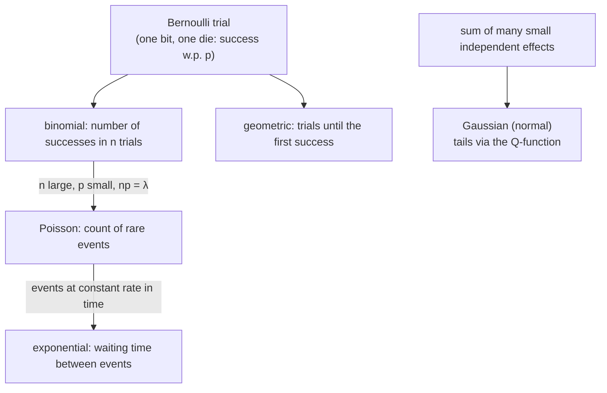
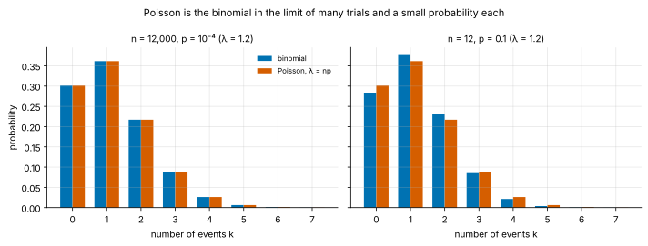
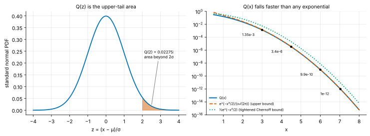
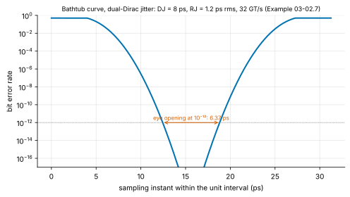

<!-- status: reviewed -->
# 03-02 · Random Variables and Distributions

| | |
|---|---|
| **Course** | [03 · Probability, Statistics and Random Variables for EE](../README.md) |
| **University equivalent** | The discrete and continuous random-variable units of a junior probability course for engineers (MIT 6.041/6.431 lectures 5–8, and 13–15 for the Bernoulli and Poisson processes: PMFs, the binomial, geometric and Poisson laws, PDFs and CDFs, the exponential and normal distributions; expectation is in 03-03; Bertsekas & Tsitsiklis, chapters 2 and 3; Leon-Garcia, chapters 3 and 4) |
| **Prerequisites** | [03-01 Probability in EE Language](03-01-probability-in-ee-language.md) (counting, independence, the $e^{-np}$ rule), [01-05 Integrals](../../01-calculus-for-engineers/chapters/01-05-integrals.md) and [01-10](../../01-calculus-for-engineers/chapters/01-10-multivariable-calculus-2.md) (double integrals in polar coordinates) |
| **Estimated study hours** | 8 |
| **Last verified** | 2026-11-18 |

**Learning objectives.** After this chapter you can:

1. Describe a random variable by its PMF, PDF or CDF, convert between them, and compute the probability of any interval.
2. Derive and use the Bernoulli, binomial, geometric and Poisson distributions, including the Poisson limit of the binomial, and choose the right one for an engineering count (errors, defective dies, retries, soft errors).
3. Use the uniform and exponential distributions, derive the exponential from a constant event rate, explain its memoryless property, and convert failure rates in FIT into probabilities.
4. Standardize a Gaussian random variable and compute tail probabilities with the Q-function, from tables, from its relation to erfc and from its bounds, in both directions.
5. Compute the bit error rate of a binary decision in Gaussian noise, and the total jitter of a serial link at a target bit error rate with the dual-Dirac model.
6. Judge when a distributional model fails: dependent events, changing rates, and tails that are not Gaussian.

## 1. Big picture

Chapter 03-01 asked "what is the probability of this event?". Engineers usually want more: the whole spread of a quantity. How many bit errors will a packet hold? How many dies on a wafer will fail? How long until a part wears out? How far will noise push a sample? A **random variable** turns an experiment's outcome into a number, and its **distribution** answers all those questions at once. A handful of distributions, each derived from a simple physical assumption, describe most of what an engineer meets.

- **Bit errors and defective dies:** the binomial and Poisson distributions count independent rare events ([17](../../17-communication-systems/README.md), [25](../../25-fabrication-packaging-test-and-reliability/README.md)).
- **Lifetimes and arrivals:** the exponential distribution models time to a random failure at a constant rate, and FIT ratings in datasheets assume it.
- **Noise:** thermal noise and the sum of many small disturbances are Gaussian, and the Q-function turns a signal-to-noise ratio into a bit error rate ([03-06](03-06-random-processes-preview.md), [17](../../17-communication-systems/README.md)).
- **Timing:** a serial link's jitter budget at $10^{-12}$ is a Gaussian tail calculation ([24](../../24-high-speed-io-signal-integrity-and-photonics/README.md)).

## 2. Intuition first

**A distribution is a histogram in the limit.** Repeat an experiment many times and histogram the result. For a count, such as errors per packet, the bars settle onto the **probability mass function**. For a continuous quantity, such as a noise voltage, make the bins narrower as the data grows; the bar heights, divided by the bin width, settle onto a smooth curve, the **probability density function**. The area under the curve over an interval is the probability of landing there.

**Each standard distribution is an assumption made precise.**

*Figure 1. Where the standard distributions come from.*

**A finance analogy, and its limit.** You have priced options under a normal model of log-returns and seen what fat tails do to the price of far out-of-the-money options. Engineers face the same issue at a far more extreme point. A bit error rate of $10^{-12}$ sits at 7 standard deviations of the noise, where a small departure from the Gaussian shape changes the answer by orders of magnitude. *Where the analogy breaks:* thermal noise really is Gaussian to high accuracy, because it is the sum of an enormous number of independent electron motions. Market returns are not. But crosstalk, power-supply noise and interference are bounded and non-Gaussian. That is why jitter analysis separates a Gaussian "random" part from a bounded "deterministic" part (§3.8), instead of trusting one Gaussian to $10^{-12}$.

## 3. Theory

### 3.1 Random variables, PMFs, PDFs and CDFs

A **random variable** $X$ is a function that assigns a number to each outcome of an experiment. "The number of errors in a packet" and "the noise voltage at the sampling instant" are random variables. Capital letters denote the random variable, lower case a value it might take.

**Discrete** random variables take countable values, and are described by a **probability mass function** (PMF)

$$
p_X(k) = P(X = k), \qquad p_X(k) \ge 0, \qquad \sum_kp_X(k) = 1 .
$$

**Continuous** random variables are described by a **probability density function** (PDF) $f_X(x) \ge 0$ with

$$
P(a < X \le b) = \int_a^bf_X(x)\,dx, \qquad \int_{-\infty}^{\infty}f_X(x)\,dx = 1 .
$$

A density is not a probability: $f_X$ has units of 1/(units of $x$), for example 1/V for a noise voltage, and it can exceed 1. Any single value has probability zero for a continuous variable; only intervals carry probability.

Both kinds have a **cumulative distribution function** (CDF), $F_X(x) = P(X \le x)$. It rises from 0 to 1, never decreases, and gives the probability of any interval:

$$
P(a < X \le b) = F_X(b) - F_X(a) .
$$

For a continuous variable $F_X$ is the integral of the density, so the density is its derivative (the fundamental theorem of calculus, [01-05](../../01-calculus-for-engineers/chapters/01-05-integrals.md)):

$$
F_X(x) = \int_{-\infty}^xf_X(u)\,du, \qquad f_X(x) = \frac{dF_X}{dx} .
$$

For a discrete variable the CDF is a staircase, jumping by $p_X(k)$ at each value $k$. The **complementary CDF**, $P(X > x) = 1 - F_X(x)$, is what reliability and error-rate work usually needs: the probability of exceeding a limit.

### 3.2 Bernoulli and binomial

A **Bernoulli** random variable is 1 with probability $p$ and 0 with probability $1 - p$: one bit in error or not, one die failing or not. The **binomial** random variable counts the 1s in $n$ independent Bernoulli trials. From the counting argument of [03-01](03-01-probability-in-ee-language.md) §3.3,

$$
p_X(k) = \binom{n}{k}p^k(1 - p)^{n - k}, \qquad k = 0, 1, \dots, n .
$$

The PMF sums to 1 by the binomial theorem: $\sum_k\binom{n}{k}p^k(1 - p)^{n - k} = \big(p + (1 - p)\big)^n = 1$. Its average is $np$ and its spread grows as $\sqrt{np(1 - p)}$; [03-03](03-03-expectation-and-functions-of-rvs.md) derives both.

The binomial model needs a fixed number of trials, the same probability for each, and independence. Dies on a wafer satisfy the first two; the third fails when defects cluster ([03-01](03-01-probability-in-ee-language.md) §3.6). Example 03-02.1 uses it to price a multi-die package.

### 3.3 Geometric

How many attempts until the first success? If each attempt succeeds independently with probability $q$, the first success comes on attempt $k$ when the first $k - 1$ fail and the $k$th succeeds:

$$
p_K(k) = (1 - q)^{k - 1}q, \qquad k = 1, 2, \dots, \qquad P(K > k) = (1 - q)^k .
$$

The tail is a geometric series, and $\sum_{k\ge1}(1 - q)^{k - 1}q = q/\big(1 - (1 - q)\big) = 1$. Retransmission protocols live here: if a packet fails with probability $p_e$, the number of transmissions until success is geometric with $q = 1 - p_e$, and the probability of needing more than three is $p_e^3$.

The geometric distribution is **memoryless**: $P(K > m + k \mid K > m) = (1 - q)^{m + k}/(1 - q)^m = (1 - q)^k = P(K > k)$. After $m$ failures, the future looks exactly as it did at the start. Each attempt is a fresh coin toss.

### 3.4 Poisson: counts of rare events

Many counts involve a huge number of opportunities, each very unlikely: errors among $10^{12}$ bits, defects among the many sites on a die, neutron strikes on $10^8$ memory bits. Let $n \to \infty$ and $p \to 0$ with the average $np = \lambda$ held fixed. The binomial PMF becomes

$$
\binom{n}{k}p^k(1 - p)^{n - k} = \underbrace{\frac{n(n - 1)\cdots(n - k + 1)}{n^k}}_{\to\,1}\cdot\frac{\lambda^k}{k!}\cdot\underbrace{\left(1 - \frac{\lambda}{n}\right)^{n}}_{\to\,e^{-\lambda}}\cdot\underbrace{\left(1 - \frac{\lambda}{n}\right)^{-k}}_{\to\,1} .
$$

The first factor tends to 1 because $k$ is fixed while $n$ grows; the third is the limit $(1 + x/n)^n \to e^x$ of [01-02](../../01-calculus-for-engineers/chapters/01-02-limits-and-continuity.md). The result is the **Poisson** PMF:

$$
\boxed{p_X(k) = e^{-\lambda}\frac{\lambda^k}{k!}}, \qquad k = 0, 1, 2, \dots
$$

It sums to 1 because $\sum_k\lambda^k/k! = e^\lambda$ (the Taylor series of [01-08](../../01-calculus-for-engineers/chapters/01-08-sequences-series-and-taylor.md)). Its single parameter λ is the average count. Figure 2 shows how close the approximation is when $n$ is large, and how it degrades for small $n$.

*Figure 2. Binomial and Poisson with the same mean, λ = 1.2 (Example 03-02.3). With 12,000 trials the two agree to four digits; with 12 trials the binomial is narrower: its variance $np(1 - p) = 1.08$ is smaller than the Poisson's 1.2, because its trials are not rare.*

**The Poisson process.** If events occur independently at a constant average rate $r$ (per hour, per bit, per square centimeter), the number in an interval of length $t$ is Poisson with $\lambda = rt$. *Why:* slice $[0, t]$ into $n$ short slots, each holding an event with probability $rt/n$ independently; the count is binomial$(n, rt/n)$, and as $n \to \infty$ the limit just derived makes it Poisson with mean $rt$. Two consequences matter constantly:

- **Probability of none:** $P(0) = e^{-rt}$. For defects at density $D_0$ per unit area on a die of area $A$, the yield is $Y = P(\text{no defect}) = e^{-AD_0}$, the Poisson yield model used in [01-10](../../01-calculus-for-engineers/chapters/01-10-multivariable-calculus-2.md).
- **Counts add:** independent Poisson counts with means $\lambda_1$ and $\lambda_2$ add to a Poisson count with mean $\lambda_1 + \lambda_2$: the two event streams pool into one with the summed rate (03-04 §3.4 proves it by convolution). A fleet's soft-error count is Poisson with the fleet's total rate (Example 03-02.2).

**Failure rates in FIT.** Reliability engineers quote constant failure rates in **FIT**, failures per $10^9$ device-hours ([R-064](../../../reference/research-log.md#r-064--soft-error-rates-and-fit)). A part rated $F$ FIT fails at $r = F\times10^{-9}$ per hour, so in $t$ hours the expected number of failures is $rt$, and the probability of at least one is $1 - e^{-rt}$. Soft errors in SRAM are quoted in FIT per megabit.

### 3.5 Uniform and exponential

**Uniform.** A variable equally likely anywhere in $[a, b]$ has the flat density $f_X(x) = 1/(b - a)$ on that interval and zero outside. Its CDF rises linearly. The rounding error of an ideal quantizer with step Δ is the standard example: for an input that varies over many steps (or is dithered, 03-04), the error is well modeled as uniform on $[-\Delta/2, \Delta/2]$, as Course 01 assumed for ADC noise. (A constant input gives a constant error, not a uniform one.)

**Exponential: the waiting time of a Poisson process.** Let $T$ be the time to the first event of a Poisson process with rate $r$. "The first event comes after $t$" means "no event in $[0, t]$", so

$$
P(T > t) = e^{-rt}, \qquad F_T(t) = 1 - e^{-rt}, \qquad f_T(t) = \frac{dF_T}{dt} = re^{-rt}, \qquad t \ge 0 .
$$

This is the **exponential** distribution. Its average is $1/r$ (derived in [03-03](03-03-expectation-and-functions-of-rvs.md)), the **mean time to failure** (MTTF) when the events are failures.

**Memoryless.** For $s, t \ge 0$,

$$
P(T > s + t \mid T > s) = \frac{e^{-r(s + t)}}{e^{-rs}} = e^{-rt} = P(T > t) .
$$

A part with exponential lifetime that has survived 5 years is as good as new: it does not age. This is the continuous twin of the geometric distribution's memorylessness, and it is exactly the constant-rate assumption behind FIT numbers. Real parts are not like this over their whole lives. Early ("infant mortality") failures and late wear-out failures make the failure rate fall and then rise, the **bathtub curve** of reliability. A FIT rating describes the flat middle. Burn-in removes the early failures, and the Weibull distribution of [03-05](03-05-estimation-and-hypothesis-testing.md) handles the changing rate.

### 3.6 The Gaussian distribution and the Q-function

The **Gaussian** (normal) distribution with mean μ and standard deviation σ has density

$$
f_X(x) = \frac{1}{\sigma\sqrt{2\pi}}\,e^{-(x - \mu)^2/(2\sigma^2)} .
$$

It is the bell curve, centered at μ, with width set by σ. It describes thermal noise, the sum of many independent small effects (the central limit theorem of [03-04](03-04-joint-distributions-and-clt.md)), and the spread of many manufactured parameters.

**Why the constant is $\sqrt{2\pi}$.** The density must integrate to 1. With $z = (x - \mu)/\sigma$ that requires $I = \int_{-\infty}^{\infty}e^{-z^2/2}dz = \sqrt{2\pi}$. There is no elementary antiderivative, so square the integral and switch to polar coordinates ([01-10](../../01-calculus-for-engineers/chapters/01-10-multivariable-calculus-2.md)):

$$
I^2 = \int\!\!\int e^{-(x^2 + y^2)/2}\,dx\,dy = \int_0^{2\pi}\!\!\int_0^\infty e^{-r^2/2}\,r\,dr\,d\theta = 2\pi\Big[-e^{-r^2/2}\Big]_0^\infty = 2\pi .
$$

The factor $r$ from the area element $r\,dr\,d\theta$ is what makes the inner integral elementary.

**Standardizing.** If $X$ is Gaussian with mean μ and standard deviation σ, then $Z = (X - \mu)/\sigma$ is the **standard normal** (mean 0, standard deviation 1): substituting $x = \mu + \sigma z$ maps the density of $X$ onto $e^{-z^2/2}/\sqrt{2\pi}$. Every Gaussian probability is therefore a standard-normal probability. Its CDF is written $\Phi(z)$, and the upper tail is the **Q-function**:

$$
Q(x) = P(Z > x) = \frac{1}{\sqrt{2\pi}}\int_x^\infty e^{-z^2/2}\,dz = 1 - \Phi(x), \qquad P(X > a) = Q\!\left(\frac{a - \mu}{\sigma}\right) .
$$

By symmetry $Q(-x) = 1 - Q(x)$, so $P(|Z| > x) = 2Q(x)$. Calculators and software usually offer the **complementary error function** instead: $Q(x) = \tfrac12\operatorname{erfc}(x/\sqrt2)$. In Python, `scipy.stats.norm.sf(x)`, and for the inverse, `norm.isf(p)`.

*Figure 3. The Q-function. It falls faster and faster as $x$ grows, and the simple upper bound becomes accurate deep in the tail. The dotted curve is $\tfrac12e^{-x^2/2}$, a tightened form of the Chernoff bound $e^{-x^2/2}$.*

**Bounds that make the tail intuitive.** For $x > 0$,

$$
\frac{x}{1 + x^2}\cdot\frac{e^{-x^2/2}}{\sqrt{2\pi}} < Q(x) < \frac{e^{-x^2/2}}{x\sqrt{2\pi}}, \qquad Q(x) \le \tfrac12e^{-x^2/2} .
$$

*Upper bound, derived:* for $z > x > 0$, $z/x > 1$, so $\int_x^\infty e^{-z^2/2}dz < \int_x^\infty(z/x)e^{-z^2/2}dz = e^{-x^2/2}/x$. The two-sided bound shows that for large $x$, $Q(x) \approx e^{-x^2/2}/(x\sqrt{2\pi})$: within 2% at $x = 7$.

> **Going deeper — the other two bounds.** *Lower bound:* write $\phi(z) = e^{-z^2/2}/\sqrt{2\pi}$ and integrate by parts with $z\phi(z) = -\phi'(z)$: $Q(x) = \int_x^\infty\frac1z\,z\phi(z)\,dz = \frac{\phi(x)}{x} - \int_x^\infty\frac{\phi(z)}{z^2}dz > \frac{\phi(x)}{x} - \frac{Q(x)}{x^2}$, since $1/z^2 < 1/x^2$ on the range. Solving for $Q(x)$ gives $Q(x) > x\phi(x)/(1 + x^2)$. *The ½e^{−x²/2} bound:* substitute $z = x + u$: $Q(x) = \frac{e^{-x^2/2}}{\sqrt{2\pi}}\int_0^\infty e^{-xu}e^{-u^2/2}du \le \frac{e^{-x^2/2}}{\sqrt{2\pi}}\int_0^\infty e^{-u^2/2}du = \tfrac12e^{-x^2/2}$, using $e^{-xu} \le 1$ for $x, u \ge 0$ (Problem 03-02.19). The tail falls like $e^{-x^2/2}$, faster than any exponential in $x$. Each additional σ of margin buys more orders of magnitude than the last, and a small error in σ moves a $10^{-12}$ estimate a long way.

**Values to know.** $Q(1) = 0.1587$, $Q(2) = 0.02275$, $Q(3) = 1.350\times10^{-3}$, $Q(4.5) = 3.398\times10^{-6}$, $Q(6) = 9.866\times10^{-10}$, $Q(7) = 1.280\times10^{-12}$. Inverting: $Q(x) = 10^{-9}$ at $x = 5.998$, $10^{-12}$ at **7.034**, $10^{-15}$ at **7.941**.

### 3.7 Binary decisions in Gaussian noise

A receiver sends bits as $+A$ (for 1) or $-A$ (for 0) volts. The sampled value is $Y = \pm A + N$, where the noise $N$ is Gaussian with mean 0 and standard deviation σ. The MAP rule of [03-01](03-01-probability-in-ee-language.md) §3.5 extends to a continuous $Y$ with densities in place of probabilities (the common width $dy$ of a small interval around $y$ cancels from both sides): decide 1 when $P_1f(y \mid +A) > P_0f(y \mid -A)$. With Gaussian densities, taking logarithms and cancelling the $y^2$ terms leaves $2Ay/\sigma^2 > \ln(P_0/P_1)$, that is,

$$
y > y_{\text{th}} = \frac{\sigma^2}{2A}\ln\frac{P_0}{P_1} ,
$$

which is 0 for equally likely bits: the threshold sits midway between the levels, and with unequal priors it moves toward the less likely level (Problem 03-02.18). A sent 1 is misread when $N < -A$, and a sent 0 when $N > A$; by symmetry both have probability

$$
\boxed{\text{BER} = Q\!\left(\frac{A}{\sigma}\right)} .
$$

The ratio $A/\sigma$, the distance from each level to the threshold measured in noise standard deviations, is the whole story. A BER of $10^{-12}$ needs $A/\sigma = 7.034$; in decibels, $20\log_{10}7.034 = $ **16.94 dB**. Losing 1 dB of signal at that operating point drops $A/\sigma$ to 6.269 and raises the BER **181**-fold, to $1.811\times10^{-10}$ (Problem 03-02.12), which is why link budgets are fought over in tenths of a decibel. With more than two levels (PAM4) each pair of neighbors contributes its own Q term (Course 17).

### 3.8 Timing jitter at a target BER: the dual-Dirac model

A serial-link receiver (the receive half of a **SerDes**, the serializer–deserializer at each end of a high-speed link) samples each bit in the middle of its **unit interval** (UI), the bit period. Data edges arrive early or late by the **jitter**, and a bit is sampled wrongly when an edge crosses the sampling instant. Jitter has two kinds of parts:

- **Random jitter (RJ):** Gaussian, from thermal noise and the phase noise of the clock (generated by a phase-locked loop, PLL, that multiplies a reference clock), characterized by its rms value σ. Unbounded, so it sets the far tails.
- **Deterministic jitter (DJ):** bounded, from inter-symbol interference, duty-cycle distortion and crosstalk. It has a fixed peak-to-peak range.

The **dual-Dirac model** approximates the deterministic part by two spikes ("Dirac deltas") a distance $DJ(\delta\delta)$ apart, each blurred by the Gaussian RJ.

**Deriving the walls.** Put the sampling instant a time $t$ after the nominal edge position. A bit can be misread only where the data change, a fraction $\rho_T$ of bits (the **transition density**, ½ for random data). Such an edge sits at $-DJ/2$ or $+DJ/2$ with probability ½ each, plus Gaussian RJ, and the bit is misread if the edge lands after the sampling instant:

$$
\text{BER}(t) = \rho_T\Big[\tfrac12Q\Big(\frac{t + DJ/2}{\sigma}\Big) + \tfrac12Q\Big(\frac{t - DJ/2}{\sigma}\Big)\Big] \approx \frac{\rho_T}{2}\,Q\Big(\frac{t - DJ/2}{\sigma}\Big) ,
$$

because deep in the tail only the nearer spike matters. Each edge of the eye loses $DJ/2 + x\sigma$, where $(\rho_T/2)Q(x) = \text{BER}$.

**The industry convention.** Instruments and standards instead *define* the multiplier $Q_{\text{BER}}$ (a number of σ's, named after the Q-function it inverts) by $Q(Q_{\text{BER}}) = \text{BER}$, equivalently $\text{BER} = \rho_T\operatorname{erfc}(Q_{\text{BER}}/\sqrt2)$ at $\rho_T = 1/2$, dropping the factor $\rho_T/2$. The **total jitter** at a target BER is then

$$
TJ(\text{BER}) = DJ(\delta\delta) + 2\,Q_{\text{BER}}\,\sigma_{RJ} ,
$$

with $2Q_{\text{BER}} = $ **14.069** at $10^{-12}$ and **15.883** at $10^{-15}$ ([R-063](../../../reference/research-log.md#r-063--jitter-the-dual-dirac-model-and-the-q-scale)). The literal model at $\rho_T = 1/2$ needs $Q(x) = 4\times10^{-12}$, giving $2x = $ **13.68**: the convention is slightly conservative, by **0.47 ps** of eye in Example 03-02.7. Use 14.069 because specifications and instruments do, and state the convention when comparing numbers. (Some tools use the erfc form with $\rho_T = 1$, giving **14.26**.) Two composition rules follow from the model and the Gaussian's properties ([03-04](03-04-joint-distributions-and-clt.md)): independent random jitters add in quadrature, $\sigma = \sqrt{\sigma_1^2 + \sigma_2^2}$, while deterministic jitters add roughly linearly.

The eye's horizontal opening at the target BER is $1\,\text{UI} - TJ$. Plotting the BER against the sampling instant gives the **bathtub curve** (Figure 4), whose walls are Gaussian tails.

*Figure 4. A bathtub curve for DJ = 8 ps and RJ = 1.2 ps rms at 32 GT/s (Example 03-02.7), in the industry Q-scale convention. The walls are Gaussian tails: lowering the target BER from $10^{-12}$ to $10^{-15}$ costs 2.2 ps, only **7.0%** of the UI but **34.18%** of the remaining eye.*

> **Going deeper — why the model is a model.** The two Diracs are a fitting device, not physics: real deterministic jitter has a continuous distribution. Instruments fit the dual-Dirac form to the measured tails, so $DJ(\delta\delta)$ is usually smaller than the true peak-to-peak deterministic jitter, and the model is accurate only near the BER range it was fitted to. Standards specify jitter in this form because it gives well-defined, measurable quantities, though different instruments' fitting methods can still disagree ([R-063](../../../reference/research-log.md#r-063--jitter-the-dual-dirac-model-and-the-q-scale)).

## 4. Worked examples

### Example 03-02.1 — Known-good dies for a four-chiplet package (tier A)

**Setup.** A package holds 4 chiplets. Each die, if not individually tested, is bad with probability 0.1, independently. (a) Find the PMF of the number $X$ of bad dies in a package, and its CDF at 1. (b) What fraction of packages work (all four dies good)? (c) Why does this push designers toward testing each die before assembly?

**Solution.** (a) $X$ is binomial with $n = 4$, $p = 0.1$: $p_X(k) = \binom4k0.1^k0.9^{4 - k}$.

| $k$ | 0 | 1 | 2 | 3 | 4 |
|---|---|---|---|---|---|
| $p_X(k)$ | **0.6561** | **0.2916** | **0.0486** | **0.0036** | **0.0001** |

They sum to 1 ✓. $F_X(1) = 0.6561 + 0.2916 = $ **0.9477**.

(b) $P(X = 0) = 0.9^4 = 0.6561$, so **34.39%** of packages contain at least one bad die and are scrapped, along with the good dies inside them.

(c) The package yield is the product of die yields, so it falls geometrically with the number of dies. Testing each die before assembly ("known-good die") moves the yield loss to the cheap individual die instead of the expensive assembled package. The model assumes independent dies; dies from a bad wafer region fail together, which a real cost model must include.

### Example 03-02.2 — Soft errors in a fleet: Poisson counts (tier B)

**Setup.** A 7 nm FPGA family has an SRAM soft-error rate of 11.4 FIT/Mb (neutron-induced, normalized to New York City, as of Nov 2026, [R-064](../../../reference/research-log.md#r-064--soft-error-rates-and-fit)). A design uses 100 Mb of it. (a) Find the device's upset rate in FIT and the expected number of upsets per device-year. (b) Find the probability that one device sees no upset in a year, and at least one in 5 years. (c) A fleet of 10,000 devices runs for a year. What is the expected number of upsets, and the probability of 80 or fewer?

**Solution.** (a) $11.4\times100 = $ **1140 FIT**, a rate of $1.14\times10^{-6}$ per hour. Over a year of 8766 hours: $\lambda = $ **9.993×10⁻³** upsets.

(b) $P(0) = e^{-0.009993} = $ **0.9901**. Over 5 years, $\lambda = $ **0.04997** and $P(\ge1) = 1 - e^{-0.04997} = $ **0.04874**: about one device in 20.

(c) The fleet's count is Poisson with mean $10^4\times1.14\times10^{-6}\times8766 = $ **99.932** (use the unrounded λ: the tail below is sensitive to it). Summing the Poisson PMF from 0 to 80 gives $P(N \le 80) = $ **0.02300**. A year with 80 or fewer upsets would be unusual (about 2%) *against the point estimate*. But the vendor's 11.4 FIT/Mb carries a 90% interval of −32%/+50%, which puts the fleet's expected count anywhere from **67.95** to **149.9**, so 80 is fully consistent with the vendor's data. Alpha particles (from trace radioactivity in package materials) add 2.0 FIT/Mb more, for about **117.5** upsets a year. Testing a rate claim must carry the claim's own uncertainty (03-05).

**Units check.** FIT × hours × $10^{-9}$ = expected failures ✓. **Sanity check.** For small λ, $P(\ge1) \approx \lambda$: $0.04997$ against 0.04874 ✓.

### Example 03-02.3 — Poisson versus binomial, and retransmissions (tier B)

**Setup.** (a) A 12,000-bit packet crosses a link with BER $10^{-4}$. Compare the binomial and Poisson probabilities of 0, 1 and 2 errors, and of 2 or more. (b) At BER $10^{-5}$, a failed packet is resent until it arrives intact. What is the probability that it takes exactly two transmissions, and more than three?

**Solution.** (a) λ = $np = 1.2$.

| Errors | Binomial | Poisson |
|---|---|---|
| 0 | 0.3012 | **0.3012** |
| 1 | 0.3614 | **0.3614** |
| 2 | 0.2169 | **0.2169** |
| 2 or more | 0.3374 | **0.3374** |

They agree to four digits (Figure 2). A code that corrects one error per packet would still fail a third of packets here: this BER is far too high for such a code. **Check:** $P(0) + P(1) + P(\ge2) = 0.3012 + 0.3614 + 0.3374 = 1$ ✓.

(b) A packet fails with $p_e = 1 - e^{-0.12}$ (to excellent accuracy) $= $ **0.1131**. Transmissions are geometric with $q = 1 - p_e$: $P(K = 2) = p_e(1 - p_e) = $ **0.1003**, and $P(K > 3) = p_e^3 = $ **1.446×10⁻³**.

### Example 03-02.4 — Exponential lifetimes and FIT (tier B)

**Setup.** A part is rated 50 FIT. (a) What is the probability it fails within 10 years? (b) What is its MTTF, in hours and years? (c) A unit has survived 5 years. What is the probability it fails in the next 5? (d) How many failures should a fleet of one million units expect in its first year, if failed units are replaced?

**Solution.** $r = 50\times10^{-9} = 5\times10^{-8}$ per hour.

(a) $1 - e^{-5\times10^{-8}\times87{,}660} = $ **4.373×10⁻³**.

(b) $1/r = $ **2×10⁷ hours**, or **2282 years**. An MTTF far longer than any product life does not mean parts last that long. It means failures are rare and random during the flat part of the bathtub curve; wear-out mechanisms end the real life much sooner.

(c) Memoryless: $1 - e^{-5\times10^{-8}\times43{,}830} = $ **2.189×10⁻³**, the same as for a new part over 5 years.

(d) With replacement, each of the $10^6$ sockets sees a Poisson count with mean $rt$: $10^6\times5\times10^{-8}\times8766 = $ **438.3** failures. (Without replacement the expected count is $10^6(1 - e^{-rt}) = $ **438.2**.)

**Units check.** $r$ is per hour and $t$ in hours, so $rt$ is dimensionless ✓. **Sanity check.** $1 - e^{-rt} \approx rt$ for small $rt$, so (a) is close to $5\times10^{-8}\times87{,}660 = 4.383\times10^{-3}$ ✓.

### Example 03-02.5 — Gaussian tolerances (tier B)

**Setup.** (a) A resistor's value is Gaussian with mean 10 kΩ and σ = 50 Ω. What fraction fall outside ±1% (±100 Ω)? Outside ±1.5%? (b) A supply rail is Gaussian with mean 0.75 V and σ = 10 mV. What is the probability it is below 0.72 V at a given instant? Below what voltage does it fall only once per million samples?

**Solution.** (a) ±100 Ω is ±2σ: $2Q(2) = $ **0.04550**. ±150 Ω is ±3σ: $2Q(3) = $ **0.002700**.

(b) $(0.72 - 0.75)/0.01 = -3$, so $P(V < 0.72) = Q(3) = $ **1.350×10⁻³**. For $10^{-6}$: $Q^{-1}(10^{-6}) = $ **4.753**, so the level is $0.75 - 4.753\times0.01 = $ **0.7025 V**.

**Sanity check.** About 95% within 2σ and 99.7% within 3σ, the familiar rules ✓.

### Example 03-02.6 — Bit error rate from signal and noise (tier B)

**Setup.** A receiver sees ±100 mV levels with Gaussian noise of σ = 15 mV at the sampling instant. (a) Find the BER. (b) What amplitude would give $10^{-12}$, and what signal-to-noise ratio is that in dB?

**Solution.** (a) $A/\sigma = 100/15 = $ **6.667**, so $\text{BER} = Q(6.667) = $ **1.308×10⁻¹¹**.

(b) $Q^{-1}(10^{-12}) = 7.034$, so $A = 7.034\times15 = $ **105.5 mV**. In dB, $20\log_{10}7.034 = $ **16.94 dB**, against the present $20\log_{10}6.667 = $ **16.48 dB**. Less than half a decibel separates $1.3\times10^{-11}$ from $10^{-12}$.

**Units check.** $A$ and σ are both in mV, so $A/\sigma$ is dimensionless ✓. **Sanity check.** Raising $A/\sigma$ from 6.667 to 7.034 lowers the BER, as it must ✓.

### Example 03-02.7 — A 32 GT/s jitter budget (tier C)

**Setup.** A 32 GT/s link has deterministic jitter $DJ(\delta\delta) = 8$ ps and random jitter of 1.2 ps rms. (a) Find the unit interval and the total jitter at $10^{-12}$. (b) What eye opening remains, in ps and UI? (c) Find the total jitter at $10^{-15}$. (d) The receiver needs 0.3 UI of opening at $10^{-12}$. How much random jitter can the link tolerate?

**Solution.** (a) $1\text{ UI} = 1/(32\times10^9) = $ **31.25 ps**. $TJ = 8 + 14.069\times1.2 = $ **24.88 ps**.

(b) $31.25 - 24.88 = $ **6.367 ps**, or **0.2038 UI** (Figure 4).

(c) $TJ = 8 + 15.883\times1.2 = $ **27.06 ps**. Three more decades of BER cost only 2.2 ps, because the Gaussian walls are steep.

(d) $TJ \le 0.7\times31.25 = $ **21.875** ps, so $\sigma_{RJ} \le (21.875 - 8)/14.069 = $ **0.9862 ps**: the random jitter must fall by about 18%.

**Sanity check.** RJ's contribution here, $14.069\times1.2 = $ **16.88 ps**, exceeds DJ's 8 ps, and both are below the 31.25 ps UI ✓.

<!-- answer-key -->
| ID | Quantity | Value | Unit |
|---|---|---|---|
| Ex 03-02.1a | P(no bad die) | 0.6561 | — |
| Ex 03-02.1b | P(one bad die) | 0.2916 | — |
| Ex 03-02.1c | P(two bad dies) | 0.0486 | — |
| Ex 03-02.1d | P(three bad dies) | 0.0036 | — |
| Ex 03-02.1e | P(four bad dies) | 0.0001 | — |
| Ex 03-02.1f | CDF at 1 | 0.9477 | — |
| Ex 03-02.1g | packages scrapped | 34.39 | % |
| Ex 03-02.2a | device upset rate | 1140 | FIT |
| Ex 03-02.2b | expected upsets per device-year | 9.993×10^-3 | — |
| Ex 03-02.2c | P(no upset in a year) | 0.9901 | — |
| Ex 03-02.2d | P(at least one upset in 5 years) | 0.04874 | — |
| Ex 03-02.2e | fleet expected upsets per year | 99.932 | — |
| Ex 03-02.2f | P(80 or fewer fleet upsets) | 0.02300 | — |
| Ex 03-02.3a | Poisson P(0) | 0.3012 | — |
| Ex 03-02.3b | Poisson P(1) | 0.3614 | — |
| Ex 03-02.3c | Poisson P(2) | 0.2169 | — |
| Ex 03-02.3d | P(2 or more) | 0.3374 | — |
| Ex 03-02.3e | packet failure probability at 1e-5 | 0.1131 | — |
| Ex 03-02.3f | P(exactly two transmissions) | 0.1003 | — |
| Ex 03-02.3g | P(more than three transmissions) | 1.446×10^-3 | — |
| Ex 03-02.4a | P(fail within 10 years) | 4.373×10^-3 | — |
| Ex 03-02.4b | MTTF | 2×10^7 | h |
| Ex 03-02.4c | MTTF | 2282 | years |
| Ex 03-02.4d | P(fail in next 5 years, given 5 survived) | 2.189×10^-3 | — |
| Ex 03-02.4e | first-year fleet failures | 438.3 | — |
| Ex 03-02.4f | first-year fleet failures without replacement | 438.2 | — |
| Ex 03-02.4g | rt over 10 years (sanity check) | 4.383×10^-3 | — |
| Ex 03-02.2h | fleet expected upsets, low end of vendor interval | 67.95 | — |
| Ex 03-02.2i | fleet expected upsets, high end of vendor interval | 149.9 | — |
| Ex 03-02.2j | fleet expected upsets including alpha | 117.5 | — |
| Ex 03-02.7j | random-jitter contribution at 1e-12 | 16.88 | ps |
| Ex 03-02.5a | fraction outside ±2σ | 0.04550 | — |
| Ex 03-02.5b | fraction outside ±3σ | 0.002700 | — |
| Ex 03-02.5c | P(V < 0.72 V) | 1.350×10^-3 | — |
| Ex 03-02.5d | one-in-a-million low level | 0.7025 | V |
| Ex 03-02.6a | A/σ | 6.667 | — |
| Ex 03-02.6b | BER | 1.308×10^-11 | — |
| Ex 03-02.6c | amplitude for 1e-12 | 105.5 | mV |
| Ex 03-02.6d | required A/σ in dB | 16.94 | dB |
| Ex 03-02.6e | present A/σ in dB | 16.48 | dB |
| Ex 03-02.7a | unit interval | 31.25 | ps |
| Ex 03-02.7b | total jitter at 1e-12 | 24.88 | ps |
| Ex 03-02.7c | eye opening | 6.367 | ps |
| Ex 03-02.7d | eye opening | 0.2038 | UI |
| Ex 03-02.7e | total jitter at 1e-15 | 27.06 | ps |
| Ex 03-02.7f | maximum random jitter | 0.9862 | ps |

## 5. Simulate it

The lab ([labs/03-02-lab/](../labs/03-02-lab/README.md)) is a notebook of sampling experiments:

1. **Histograms become distributions.** Sample binomial, Poisson, exponential and Gaussian variables and overlay the theoretical PMF or PDF. *Predict first:* how many samples before the histogram of a Gaussian "looks right" at 3σ? At 5σ?
2. **The Poisson limit.** Compare binomial and Poisson PMFs as $n$ grows with $np$ fixed.
3. **A Poisson process.** Generate random event times at a constant rate, and check that the gaps are exponential and the counts per window are Poisson.
4. **Memorylessness.** Condition simulated exponential lifetimes on survival and compare the remaining-life histogram with the original.
5. **BER by Monte Carlo.** Simulate a binary link in Gaussian noise and compare the error count with $Q(A/\sigma)$. *Predict first:* how many bits must you simulate to see 100 errors at $A/\sigma = 4$?
6. **Jitter.** Build a dual-Dirac jitter distribution, compute its bathtub curve, and compare the eye opening with $1\text{ UI} - TJ$.

## 6. Engineering tradeoffs

| Knob | Improves | Costs | Typical decision owner |
|---|---|---|---|
| Signal amplitude or equalization (raise $A/\sigma$) | BER, exponentially: each dB near $10^{-12}$ is worth more than an order of magnitude | Power, swing limits, crosstalk to neighbors | SerDes and PHY designers |
| Lower random jitter (cleaner clocks, PLL design) | Eye opening, at 14× leverage at $10^{-12}$ | PLL power and area, clock distribution cost | Clocking and SerDes designers |
| Pre-assembly die test (known-good die) | Package yield, which otherwise falls as $Y^n$ | Test time and probe cost per die | Test and packaging engineering |
| Error-correcting codes (ECC) or memory scrubbing (rereading and correcting stored data before errors accumulate) | Tolerance of Poisson soft errors | Area, latency, background bandwidth | Memory and reliability architects |
| Burn-in | Removes early failures before shipment | Time, ovens, some wear on good parts | Reliability and manufacturing |
| Gaussian versus measured-tail models | Simple, analytic budgets | Can be badly wrong when tails are non-Gaussian (crosstalk, interference) | Signal-integrity and validation engineers |

## 7. Numbers to know

| Quantity | Value | Note |
|---|---|---|
| Within ±1σ, ±2σ, ±3σ of a Gaussian mean | 68.27%, 95.45%, 99.73% | $1 - 2Q(k)$ |
| $Q(3)$, $Q(4.5)$, $Q(6)$ | $1.350\times10^{-3}$, $3.398\times10^{-6}$, $9.866\times10^{-10}$ | $Q(4.5)$ is Six Sigma's "3.4 ppm" [R-065](../../../reference/research-log.md#r-065--six-sigma-34-ppm-and-the-15σ-shift) |
| $Q^{-1}$ at $10^{-9}$, $10^{-12}$, $10^{-15}$ | 5.998, 7.034, 7.941 | σ of margin needed |
| BER of ±A in Gaussian noise | $Q(A/\sigma)$; $10^{-12}$ needs 16.94 dB | Threshold midway |
| Total-jitter multiplier $2Q_{\text{BER}}$ | 14.069 at $10^{-12}$; 15.883 at $10^{-15}$ | Industry convention; literal model 13.68 [R-063](../../../reference/research-log.md#r-063--jitter-the-dual-dirac-model-and-the-q-scale) |
| 1 FIT | 1 failure per $10^9$ device-hours | [R-064](../../../reference/research-log.md#r-064--soft-error-rates-and-fit) |
| FPGA block-RAM soft-error rate, as of Nov 2026 | 692 FIT/Mb (65 nm planar) to 11.4 (7 nm FinFET); not monotone (90 nm: 484; 20 nm: 58); neutron-induced | AMD UG116 [R-064](../../../reference/research-log.md#r-064--soft-error-rates-and-fit) |
| Poisson: probability of none | $e^{-\lambda}$ | Poisson yield $e^{-AD_0}$ |

<!-- answer-key -->
| ID | Quantity | Value | Unit |
|---|---|---|---|
| N 03-02.a | within ±1σ | 68.27 | % |
| N 03-02.b | within ±2σ | 95.45 | % |
| N 03-02.c | within ±3σ | 99.73 | % |
| N 03-02.d | Q(3) | 1.350×10^-3 | — |
| N 03-02.e | Q(4.5) | 3.398×10^-6 | — |
| N 03-02.f | Q(6) | 9.866×10^-10 | — |
| N 03-02.g | inverse Q at 1e-9 | 5.998 | — |
| N 03-02.h | inverse Q at 1e-12 | 7.034 | — |
| N 03-02.i | inverse Q at 1e-15 | 7.941 | — |
| N 03-02.j | 2Q at 1e-12 | 14.069 | — |
| N 03-02.k | 2Q at 1e-15 | 15.883 | — |
| T 03-02.a | Q(1) | 0.1587 | — |
| T 03-02.b | Q(2) | 0.02275 | — |
| T 03-02.c | Q(7) | 1.280×10^-12 | — |
| T 03-02.d | multiplier at 1e-12 with transition density 1 | 14.26 | — |
| T 03-02.m | literal dual-Dirac multiplier at 1e-12, transition density 1/2 | 13.68 | — |
| T 03-02.n | extra eye margin of the convention, Example 03-02.7 | 0.47 | ps |
| T 03-02.o | eye cost of 1e-15 over 1e-12, share of UI | 7.0 | % |
| T 03-02.p | eye cost of 1e-15 over 1e-12, share of remaining eye | 34.18 | % |
| T 03-02.q | block-RAM SER ratio, 65 nm to 7 nm | 60.70 | — |
| T 03-02.r | sum of two 1 ps rms jitters | 1.414 | ps |
| T 03-02.e | upper bound over Q at x = 7, excess | 2 | % |
| T 03-02.f | Q(8) | 6.221×10^-16 | — |
| T 03-02.g | Q(7)/Q(8) | 2057 | — |
| T 03-02.h | A/σ after losing 1 dB from 7.034 | 6.269 | — |
| T 03-02.i | BER after losing 1 dB | 1.811×10^-10 | — |
| T 03-02.j | BER penalty factor for 1 dB | 181 | — |
| T 03-02.k | annual failure probability at 1000 FIT | 0.9 | % |
| T 03-02.l | one million hours | 114 | years |
| Ex 03-02.7g | extra jitter from 1e-12 to 1e-15 | 2.2 | ps |
| Ex 03-02.7h | required cut in random jitter | 18 | % |
| Ex 03-02.2g | expected upsets per device in 5 years | 0.04997 | — |
| Ex 03-02.5e | inverse Q at 1e-6 | 4.753 | — |
| Ex 03-02.7i | allowed total jitter | 21.875 | ps |

## 8. Common mistakes

1. **Reading a density as a probability.** $f_X(x)$ can exceed 1 and has units; only its integral over an interval is a probability.
2. **Forgetting the factor 2 for two-sided tails.** $P(|X - \mu| > k\sigma) = 2Q(k)$, but a one-sided limit is $Q(k)$.
3. **Using the Poisson approximation when trials are few or not rare.** It needs large $n$ and small $p$; with $n = 12$ and $p = 0.1$ it is visibly off (Figure 2).
4. **Applying a constant failure rate to wear-out.** FIT and the exponential model describe random failures in mid-life, not infant mortality or wear-out.
5. **Reading MTTF as typical life.** A 2000-year MTTF means rare random failures, not 2000-year parts.
6. **Trusting a Gaussian far into its tail.** At $10^{-12}$ the answer depends on the tail shape; bounded crosstalk or interference is not Gaussian.
7. **Mixing jitter conventions.** Total-jitter multipliers differ by convention (14.069 versus 14.26 at $10^{-12}$); check the transition density and whether DJ is the dual-Dirac value.
8. **Adding rms jitters linearly.** Independent random components add in quadrature; deterministic components add (roughly) linearly.

## 9. Practitioner lens

### State of the art (as of Nov 2026)

- **Serial-link jitter is budgeted with the dual-Dirac model.** Measurement vendors define total jitter as $TJ(\text{BER}) = DJ(\delta\delta) + 2Q_{\text{BER}}\sigma$, with $Q_{\text{BER}} = 7.0$ at $10^{-12}$ for transition density 1/2 (Keysight), and tabulate the rms-to-peak multiplier as 14.069 at $10^{-12}$ (Renesas). The same sources state the composition rules: random jitter adds in quadrature, deterministic jitter approximately linearly ([R-063](../../../reference/research-log.md#r-063--jitter-the-dual-dirac-model-and-the-q-scale)) **[Established]**.
- **Per bit, block-RAM soft-error rates have fallen about 60-fold, mostly with FinFETs.** AMD's device reliability report (UG116, v10.22, 13 Nov 2026) lists real-time soft-error rates (neutrons and their secondaries; alpha particles excluded) for its block RAM, normalized to New York City per JEDEC JESD89A: 484 FIT/Mb at 90 nm, 692 at 65 nm, 72 (Artix-7 class) and 42 (Kintex-7 and Virtex-7) at 28 nm, 58 at 20 nm planar, 15 at 16 nm and 11.4 at 7 nm, both FinFET (FinFETs are 3-D transistors, used below 20 nm). From 65 nm to 7 nm that is a factor of **60.70**, but the decline is not monotone, and most of it came with the move to FinFETs. The figures are revised as field data accumulate (the 16 nm value was 20 FIT/Mb in 2018) ([R-064](../../../reference/research-log.md#r-064--soft-error-rates-and-fit)) **[Established for these values; vendor-measured and revised]**. Per-device totals still grow, because devices hold more bits.
- **"Six Sigma" quality is a Gaussian tail claim.** Motorola's quality program, credited to engineer Bill Smith, quotes 3.4 defects per million: the one-sided tail $Q(4.5)$ of a ±6σ specification after allowing the process mean to drift by 1.5σ. The 1.5σ shift is a convention, and it remains controversial ([R-065](../../../reference/research-log.md#r-065--six-sigma-34-ppm-and-the-15σ-shift)) **[Established for the arithmetic; the shift is Contested]**.

### Why it matters commercially

Distributions turn into money through their tails. A SerDes design's power and area are set by the margin it needs at $10^{-12}$ or $10^{-15}$, which is a Q-function calculation, so a vendor whose clocking has 20% less random jitter can trade it for lower power or a longer reach. Soft-error rates decide how much error-correcting code a datacenter or automotive chip needs, which costs area and latency. Multi-die packages multiply die yields, which is why known-good-die testing and chiplet test strategy are business decisions. And FIT and MTTF arithmetic rests on a constant-rate exponential model, which is only valid in mid-life.

### Marketing vs Reality

- **"MTTF of 1 million hours."** *Reality:* that is a failure rate of 1000 FIT, about 0.9% per year, not a 114-year life. Ask for the annualized failure rate, and for the wear-out life, which the exponential model does not describe.
- **"Our link has 0.4 UI of eye margin."** *Reality:* at which BER, and with which jitter convention? An eye measured on a short capture shows the core of the distribution; the $10^{-12}$ eye is set by extrapolated Gaussian tails. Ask how the extrapolation was done and validated.
- **"Six Sigma quality."** *Reality:* 3.4 ppm only if the process is Gaussian into its far tail and drifts no more than 1.5σ. Ask for measured defect rates.
- **"Soft errors are negligible at FinFET nodes."** *Reality:* per bit, yes, much lower; per chip, a large AI accelerator with hundreds of megabytes of SRAM still sees upsets, and the alpha-particle contribution (from trace radioactivity in package materials) depends on the package. Ask for the FIT per chip and the ECC strategy.

### Questions for engineering leaders

1. **"What is your total jitter at the target BER, and how much of it is random?"** *Strong:* DJ, RJ and TJ with the convention stated, measured across corners, with the margin. *Evasive:* only an eye diagram from an oscilloscope capture.
2. **"How do you extrapolate BER below what you can measure?"** *Strong:* bathtub fits with a stated model, validated against direct BER counts at reachable levels. *Evasive:* "the eye is wide open".
3. **"What is the soft-error FIT of the whole chip, and what does ECC leave uncorrected?"** *Strong:* per-array FIT, ECC coverage, the residual silent-error rate and scrubbing intervals. *Evasive:* a per-bit FIT with no chip-level roll-up.
4. **"What failure rate do your field returns show over time?"** *Strong:* a failure-rate curve showing infant mortality, the flat region and early wear-out, with burn-in policy. *Evasive:* a single MTTF number.
5. **"How much does each die cost you at package test if it was bad?"** *Strong:* the known-good-die test coverage and the economics of package-level yield loss. *Evasive:* "our die yield is high".

## 10. Concept check

1. A noise voltage has density $f(v) = 50$ V⁻¹ near 0. Is that a problem?

   

Answer

   No. A density is not a probability and can exceed 1. Only $\int f\,dv$ over an interval is a probability: here about $50\times\Delta v$ for a small interval $\Delta v$ around 0.

   

2. When is the Poisson distribution a good model for a count?

   

Answer

   When the count comes from many independent opportunities, each with a small probability, so that the binomial's $n$ is large and $p$ small with $np = \lambda$ moderate; or when events occur independently at a constant rate in time or space.

   

3. A part has survived 10 years. Under the exponential model, is it more likely to fail next year than a new part?

   

Answer

   No: the exponential is memoryless, so the probability is the same. That is exactly why the model fails for wear-out, where old parts are more likely to fail.

   

4. Why does the BER of a binary link depend only on $A/\sigma$?

   

Answer

   Standardizing the noise, an error needs the noise to exceed $A$, which is the event $Z > A/\sigma$ for a standard normal $Z$. Scaling both signal and noise together changes nothing.

   

5. Roughly how much does each extra σ of margin buy deep in the Gaussian tail, near $10^{-12}$?

   

Answer

   More than three orders of magnitude: $Q(7) = 1.280\times10^{-12}$ and $Q(8) = 6.221\times10^{-16}$, a factor of 2057 for one σ. The tail falls like $e^{-x^2/2}$, so each σ buys more than the last.

   

6. Two independent random jitters of 1 ps rms combine to how much?

   

Answer

   $\sqrt{1^2 + 1^2} = 1.414$ ps rms, not 2 ps: independent random components add in quadrature.

   

7. Why does a four-chiplet package with 90% die yield have only 66% package yield?

   

Answer

   The package works only if all four dies are good: $0.9^4 = 0.656$ for independent dies. Yield multiplies across dies, which is why each die is tested before assembly.

   

Problem set: [03-02 problems](../problems/03-02-problems.md) · [solutions](../solutions/03-02-solutions.md).

## 11. Key terms

[Random variable](../../../reference/glossary.md#random-variable) ·
[Probability mass function (PMF)](../../../reference/glossary.md#probability-mass-function-pmf) ·
[Probability density function](../../../reference/glossary.md#probability-density-function) ·
[Cumulative distribution function (CDF)](../../../reference/glossary.md#cumulative-distribution-function-cdf) ·
[Binomial distribution](../../../reference/glossary.md#binomial-distribution) ·
[Geometric distribution](../../../reference/glossary.md#geometric-distribution) ·
[Poisson distribution](../../../reference/glossary.md#poisson-distribution) ·
[Poisson process](../../../reference/glossary.md#poisson-process) ·
[Exponential distribution](../../../reference/glossary.md#exponential-distribution) ·
[Memoryless property](../../../reference/glossary.md#memoryless-property) ·
[FIT (failures in time)](../../../reference/glossary.md#fit-failures-in-time) ·
[Gaussian distribution](../../../reference/glossary.md#gaussian-distribution) ·
[Q-function](../../../reference/glossary.md#q-function) ·
[Jitter](../../../reference/glossary.md#jitter) ·
[Dual-Dirac model](../../../reference/glossary.md#dual-dirac-model) ·
[Bathtub curve](../../../reference/glossary.md#bathtub-curve) ·
[Soft error](../../../reference/glossary.md#soft-error)

## 12. Connections

- **Previous:** [03-01](03-01-probability-in-ee-language.md) (counting, independence, MAP decisions), [01-10](../../01-calculus-for-engineers/chapters/01-10-multivariable-calculus-2.md) (polar double integrals, Poisson yield).
- **Next:** [03-03 Expectation, Variance and Functions of Random Variables](03-03-expectation-and-functions-of-rvs.md) derives the means and variances quoted here, and the power of random signals.
- **Used in:**
  - [03-04](03-04-joint-distributions-and-clt.md) (why sums become Gaussian);
  - [03-05](03-05-estimation-and-hypothesis-testing.md) (testing whether a measured rate matches a claim; Weibull lifetimes);
  - [17 Communication Systems](../../17-communication-systems/README.md) (error rates of modulation schemes);
  - [24 High-Speed I/O, Signal Integrity and Photonics](../../24-high-speed-io-signal-integrity-and-photonics/README.md) (jitter budgets and bathtub curves).

## 13. Further study

- Bertsekas, D. P. and Tsitsiklis, J. N., *Introduction to Probability*, 2nd ed., chapters 2 (discrete random variables) and 3 (continuous random variables).
- Leon-Garcia, A., *Probability, Statistics, and Random Processes for Electrical Engineering*, 3rd ed., chapters 3 and 4.
- MIT OpenCourseWare 6.041SC, lectures 5–8.
- Keysight white paper 5989-3206EN, *Jitter Analysis: The dual-Dirac Model, RJ/DJ, and Q-Scale*, for the jitter conventions used in industry.

## 14. Sources

1. Bertsekas, D. P. and Tsitsiklis, J. N., *Introduction to Probability*, 2nd ed., Athena Scientific, 2008.
2. Leon-Garcia, A., *Probability, Statistics, and Random Processes for Electrical Engineering*, 3rd ed., Pearson, 2008.
3. Stephens, R., *Jitter Analysis: The dual-Dirac Model, RJ/DJ, and Q-Scale*, Keysight white paper 5989-3206EN; Renesas (IDT) AN-815, *Understanding Jitter Units*. [R-063]
4. AMD, *Device Reliability Report* (UG116), v10.22, 13 Nov 2026, soft-error rate tables. [R-064]
5. Ramberg, J. S., "Six Sigma: Fad or Fundamental?", *Quality Digest*, May 2000. [R-065]
