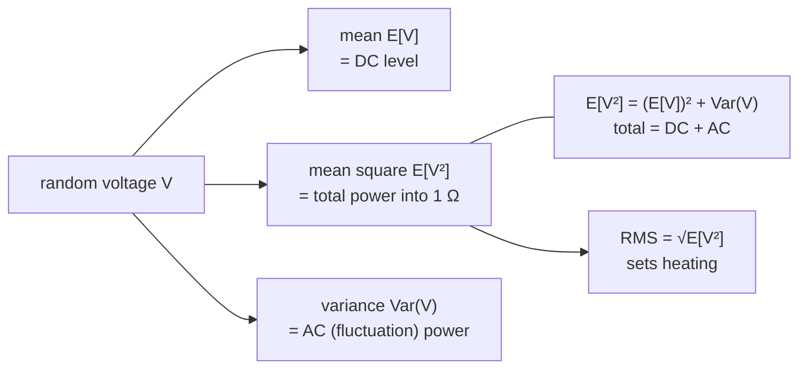
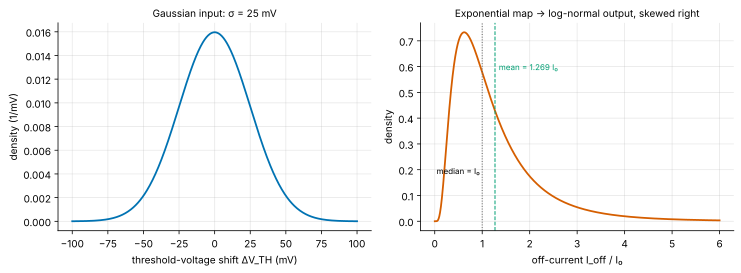
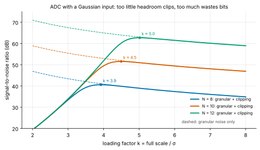

<!-- status: reviewed -->
# 03-03 · Expectation, Variance and Functions of Random Variables

| | |
|---|---|
| **Course** | [03 · Probability, Statistics and Random Variables for EE](../README.md) |
| **University equivalent** | The expectation, variance and derived-distribution units of a junior probability course for engineers (MIT 6.041/6.431: expectation and variance of discrete and continuous random variables, derived distributions; Bertsekas & Tsitsiklis, chapters 2–4; Leon-Garcia, chapters 3 and 4, including the Markov and Chebyshev inequalities) |
| **Prerequisites** | [03-02 Random Variables and Distributions](03-02-random-variables-and-distributions.md), [01-07 Applications of Integration](../../01-calculus-for-engineers/chapters/01-07-applications-of-integration.md) (RMS, crest factor, quantization noise), [01-06 Techniques of Integration](../../01-calculus-for-engineers/chapters/01-06-techniques-of-integration.md) (integration by parts) |
| **Estimated study hours** | 6 |
| **Last verified** | 2026-11-18 |

**Learning objectives.** After this chapter you can:

1. Compute the expectation of a discrete or continuous random variable and of any function of it, and use linearity and indicator variables to find expected counts without knowing the full distribution.
2. Compute variance, standard deviation and higher moments, and derive the mean and variance of the binomial, geometric, Poisson, uniform, exponential and Gaussian distributions.
3. Interpret the mean, mean square and variance of a random voltage or current as its DC level, total power and AC power, and compute RMS values and conduction losses.
4. Find the distribution of a function of a random variable by the CDF method and the change-of-variables formula, including non-monotonic functions (square-law detectors) and exponentials (log-normal leakage).
5. Bound tail probabilities with the Markov and Chebyshev inequalities, and use Jensen's inequality to predict which way an average shifts when it passes through a nonlinear function.
6. Compute the crest factor and peak-to-average power ratio of sinusoids and noise-like signals at a stated probability, and size the headroom of a power amplifier or an ADC against clipping.

## 1. Big picture

Engineers need numbers from distributions: good dies per wafer, the power of a noisy signal, the leakage of a billion transistors, an OFDM signal's headroom. Two summaries answer most of these: the **expectation** (the long-run average) and the **variance** (the spread around it). This chapter derives both, shows that for a voltage they are DC level and AC power, and asks what a function (a square-law detector, an exponential device law, a clipping amplifier) does to a distribution.

- **Yield economics:** expected good dies per wafer follow from linearity of expectation, even when defects cluster ([25](../../25-fabrication-packaging-test-and-reliability/README.md)).
- **Power and heating:** the RMS current, not the average, sets conduction loss ([22](../../22-power-electronics-and-energy-conversion/README.md)).
- **Leakage:** an exponential device law turns Gaussian threshold spread into log-normal leakage whose mean exceeds its median ([19](../../19-digital-vlsi-design/README.md)).
- **Radios and converters:** peak-to-average power ratio sets amplifier back-off, and ADC loading trades clipping against quantization noise ([20](../../20-analog-and-mixed-signal-ic-design/README.md), [21](../../21-rf-and-microwave-engineering/README.md)).

## 2. Intuition first

**The expectation is a center of mass** (put mass $p_X(k)$ at each value $k$; the balance point is $\mathbb{E}[X]$) and the long-run average of many repetitions: no package holds 0.4 bad dies, but a million packages average 0.4. **The variance is a moment of inertia**, and its square root, the standard deviation, measures a typical deviation in the units of $X$. **For a voltage, these are power:** into 1 Ω, the average power $\mathbb{E}[V^2]$ splits into DC and fluctuation power:

*Figure 1. The moments of a random voltage are its DC level and its power.*

**A finance analogy, and its limit.** The expected square of a return is the squared mean plus the variance, and an option's convex payoff gains value from uncertainty. Leakage is likewise convex (exponential) in threshold voltage, so variability *raises* average leakage (Jensen's inequality, §3.7). *Where the analogy breaks:* in finance variance is a risk to be paid for; in signals it is often the signal itself, and what matters is the ratio of signal to noise variance.

## 3. Theory

### 3.1 Expectation

The **expectation** (mean, expected value) of a discrete random variable is the probability-weighted sum of its values; for a continuous one it is the density-weighted integral:

$$
\mathbb{E}[X] = \sum_kk\,p_X(k), \qquad \mathbb{E}[X] = \int_{-\infty}^{\infty}x\,f_X(x)\,dx .
$$

It has the units of $X$, is often written $\mu$ or $\mu_X$, and need not be a value $X$ can take (Example 03-02.1's four-chiplet package averages 0.4 bad dies). The expectation of a constant is the constant, and $X \ge 0$ implies $\mathbb{E}[X] \ge 0$.

### 3.2 Functions of a random variable, linearity and indicators

To find the expectation of $Y = g(X)$ you do not need the distribution of $Y$. Group the outcomes by the value of $X$:

$$
\mathbb{E}[g(X)] = \sum_kg(k)\,p_X(k), \qquad \mathbb{E}[g(X)] = \int_{-\infty}^{\infty}g(x)\,f_X(x)\,dx .
$$

(In the discrete case, $P(Y = y)$ is the sum of $p_X(k)$ over all $k$ with $g(k) = y$, so $\sum_yy\,P(Y = y)$ regroups into the formula; the continuous case is the limit.)

**Linearity.** With $g(x) = ax + b$,

$$
\mathbb{E}[aX + b] = \int(ax + b)f_X(x)\,dx = a\,\mathbb{E}[X] + b .
$$

More importantly, **the expectation of a sum is the sum of the expectations, whether or not the terms are independent.** For two discrete random variables with joint PMF $p_{XY}(x, y)$,

$$
\mathbb{E}[X + Y] = \sum_x\sum_y(x + y)\,p_{XY}(x, y) = \sum_xx\sum_yp_{XY}(x, y) + \sum_yy\sum_xp_{XY}(x, y) = \mathbb{E}[X] + \mathbb{E}[Y],
$$

because summing the joint PMF over one variable leaves the other's PMF. No independence was used. (Joint distributions are developed in [03-04](03-04-joint-distributions-and-clt.md); the continuous version replaces sums by integrals.)

**Indicator variables.** The **indicator** $I_A$ of an event $A$ is 1 if $A$ occurs and 0 otherwise, so $\mathbb{E}[I_A] = P(A)$. Any count is a sum of indicators, so its expectation is a sum of probabilities:

$$
N = \sum_{i=1}^nI_{A_i} \quad\Longrightarrow\quad \mathbb{E}[N] = \sum_{i=1}^nP(A_i) .
$$

This gives expected good dies or failing bits without any distribution, exactly, even for correlated events; for a binomial count, $\mathbb{E}[N] = np$.

**Expectation from the survival function.** For a nonnegative lifetime $T$ with survival function $R(t) = P(T > t)$, swapping the order of integration gives

$$
\mathbb{E}[T] = \int_0^\infty\Big(\int_0^tds\Big)f_T(t)\,dt = \int_0^\infty\Big(\int_s^\infty f_T(t)\,dt\Big)ds = \int_0^\infty R(s)\,ds .
$$

The **mean time to failure** is the area under the reliability curve: $1/r$ for an exponential part. For two such parts in parallel (the system survives while either does), $R(t) = 1 - (1 - e^{-rt})^2 = 2e^{-rt} - e^{-2rt}$, so

$$
\text{MTTF}_{\text{pair}} = \frac{2}{r} - \frac{1}{2r} = \frac{1.5}{r} .
$$

Redundancy buys only 50% more mean life, since the survivor of the first failure is unprotected: with $r = 10^{-5}$ per hour, 100,000 h becomes **150,000 h**. (Problem 03-03.8 shows that triple modular redundancy *lowers* the MTTF.)

### 3.3 Variance, standard deviation and moments

The **variance** is the expected squared deviation from the mean, and the **standard deviation** is its square root:

$$
\operatorname{Var}(X) = \mathbb{E}\big[(X - \mu)^2\big], \qquad \sigma_X = \sqrt{\operatorname{Var}(X)} .
$$

Expanding the square and using linearity gives the form used for computation:

$$
\operatorname{Var}(X) = \mathbb{E}[X^2] - 2\mu\,\mathbb{E}[X] + \mu^2 = \mathbb{E}[X^2] - \mu^2 .
$$

The variance has units of $X$ squared (V², A²). Since it cannot be negative, $\mathbb{E}[X^2] \ge (\mathbb{E}[X])^2$, with equality only for a constant.

**Shifting and scaling.** $\operatorname{Var}(aX + b) = a^2\operatorname{Var}(X)$, so the **standardized** variable $Z = (X - \mu)/\sigma$ has mean 0 and variance 1, the step behind every Gaussian probability in 03-02.

Variances add only for uncorrelated terms ([03-04](03-04-joint-distributions-and-clt.md)); clustered defects and common-mode noise add covariance terms.

$\mathbb{E}[X^n]$ is the $n$th **moment** and $\mathbb{E}[(X - \mu)^n]$ the $n$th central moment. The first two describe location and spread; higher ones describe shape.

> **Going deeper — skewness and kurtosis.** $\mathbb{E}[(X - \mu)^3]/\sigma^3$ is the **skewness**: zero for symmetric distributions, positive for a long right tail (leakage, §3.6). $\mathbb{E}[(X - \mu)^4]/\sigma^4$ is the **kurtosis**: 3 for any Gaussian (Example 03-03.5). A measured kurtosis well above 3 flags heavier-than-Gaussian tails, a reason to distrust Q-function extrapolations to $10^{-12}$.

### 3.4 Means and variances of the standard distributions

**Bernoulli** ($X = 1$ with probability $p$): $\mathbb{E}[X] = p$, and since $X^2 = X$, $\mathbb{E}[X^2] = p$, so $\operatorname{Var}(X) = p - p^2 = p(1 - p)$.

**Binomial** ($n$, $p$). The mean is $np$ by indicators. For the variance, compute the *factorial moment* $\mathbb{E}[X(X - 1)]$, in which $k(k - 1)$ cancels the first two factors of $k!$:

$$
\mathbb{E}[X(X - 1)] = \sum_{k=2}^nk(k - 1)\frac{n!}{k!\,(n - k)!}p^k(1 - p)^{n-k} = n(n - 1)p^2\sum_{j=0}^{n-2}\binom{n-2}{j}p^j(1 - p)^{n-2-j} = n(n - 1)p^2 ,
$$

where $j = k - 2$ and the last sum is the total probability of a binomial$(n - 2, p)$, which is 1. Then $\mathbb{E}[X^2] = n(n - 1)p^2 + np$ and $\operatorname{Var}(X) = n(n - 1)p^2 + np - n^2p^2 = np(1 - p)$.

**Poisson** (λ). The same trick: $\mathbb{E}[X] = \lambda\sum_{k\ge1}\lambda^{k-1}e^{-\lambda}/(k - 1)! = \lambda$, and likewise $\mathbb{E}[X(X - 1)] = \lambda^2$, so $\operatorname{Var}(X) = \lambda^2 + \lambda - \lambda^2 = \lambda$: **mean and variance are equal**. A variance well above the mean ("overdispersion") signals clustering (Lab 03-02, Part 3).

> **Math refresher — differentiating a power series.** For $|x| < 1$, $\sum_{k\ge0}x^k = 1/(1 - x)$. A power series can be differentiated term by term inside its radius of convergence ([01-08](../../01-calculus-for-engineers/chapters/01-08-sequences-series-and-taylor.md)), so $\sum_{k\ge1}kx^{k-1} = 1/(1 - x)^2$ and $\sum_{k\ge2}k(k - 1)x^{k-2} = 2/(1 - x)^3$.

**Geometric** (trials until the first success, success probability $q$, failure probability $x = 1 - q$): $p_K(k) = x^{k-1}q$. By the refresher,

$$
\mathbb{E}[K] = q\sum_{k\ge1}kx^{k-1} = \frac{q}{(1 - x)^2} = \frac1q, \qquad \mathbb{E}[K(K - 1)] = qx\sum_{k\ge2}k(k - 1)x^{k-2} = \frac{2x}{q^2},
$$

so $\operatorname{Var}(K) = 2x/q^2 + 1/q - 1/q^2 = (2x + q - 1)/q^2 = (1 - q)/q^2$.

**Uniform** on $[a, b]$: $\mathbb{E}[X] = (a + b)/2$ by symmetry, and $\operatorname{Var}(X) = (b - a)^2/12$ (integrated in 01-07).

**Exponential** (rate $r$): $\mathbb{E}[T] = \int_0^\infty e^{-rt}dt = 1/r$ by the survival formula. Integrating by parts twice, $\mathbb{E}[T^2] = \int_0^\infty t^2re^{-rt}dt = 2/r^2$, so $\operatorname{Var}(T) = 1/r^2$: **the standard deviation equals the mean.** So an MTTF says little about any one unit.

**Gaussian** $\mathcal{N}(\mu, \sigma^2)$: by symmetry about $\mu$, $\mathbb{E}[X] = \mu$. For the variance, take the standard normal $Z$ and integrate by parts with $u = z$ and $dv = z\,e^{-z^2/2}dz$ (so $v = -e^{-z^2/2}$):

$$
\mathbb{E}[Z^2] = \frac{1}{\sqrt{2\pi}}\int_{-\infty}^{\infty}z\cdot z\,e^{-z^2/2}dz = \frac{1}{\sqrt{2\pi}}\Big[-z\,e^{-z^2/2}\Big]_{-\infty}^{\infty} + \frac{1}{\sqrt{2\pi}}\int_{-\infty}^{\infty}e^{-z^2/2}dz = 0 + 1 .
$$

Then $X = \mu + \sigma Z$ has variance $\sigma^2$: the parameters of the Gaussian are its mean and variance.

| Distribution | Mean | Variance |
|---|---|---|
| Bernoulli($p$) | $p$ | $p(1 - p)$ |
| Binomial($n$, $p$) | $np$ | $np(1 - p)$ |
| Geometric($q$), trials to first success | $1/q$ | $(1 - q)/q^2$ |
| Poisson(λ) | λ | λ |
| Uniform$[a, b]$ | $(a + b)/2$ | $(b - a)^2/12$ |
| Exponential (rate $r$) | $1/r$ | $1/r^2$ |
| Gaussian $\mathcal{N}(\mu, \sigma^2)$ | $\mu$ | $\sigma^2$ |

### 3.5 Power of a random signal

Let $V$ be a voltage at a random instant (or across identically built circuits). Into $R$ the average power is $\mathbb{E}[V^2]/R$, and the variance identity becomes a power decomposition:

$$
\underbrace{\mathbb{E}[V^2]}_{\text{total}} = \underbrace{(\mathbb{E}[V])^2}_{\text{DC}} + \underbrace{\operatorname{Var}(V)}_{\text{AC}}, \qquad V_{\text{rms}} = \sqrt{\mathbb{E}[V^2]} .
$$

The AC power is the variance, and the **AC RMS** value (what an AC-coupled true-RMS meter reads) is the standard deviation.

- **Uncorrelated powers add.** For a DC level plus zero-mean noise $N$, linearity gives $\mathbb{E}[(V_0 + N)^2] = V_0^2 + 2V_0\mathbb{E}[N] + \mathbb{E}[N^2] = V_0^2 + \sigma_N^2$. For two independent zero-mean signals the cross term $\mathbb{E}[XY]$ also vanishes ([03-04](03-04-joint-distributions-and-clt.md)): noise powers, not noise voltages, add.
- **A periodic waveform sampled at a random time** is a random variable whose moments are its time averages. A sinusoid $A\cos\Theta$ with Θ uniform on $[0, 2\pi)$ has mean 0 and mean square $A^2/2$; a triangle wave of peak $A$ is uniform on $[-A, A]$, with mean square $A^2/3$. When time and ensemble averages agree in general is **ergodicity** ([03-06](03-06-random-processes-preview.md)).

ADC quantization error, uniform on $\pm\Delta/2$ with power $\Delta^2/12$, gave the ideal $6.02N + 1.76$ dB in [01-07](../../01-calculus-for-engineers/chapters/01-07-applications-of-integration.md); §3.9 redoes it for noise-like signals, where clipping enters.

### 3.6 The distribution of a function of a random variable

Sometimes you need the whole distribution of $Y = g(X)$: the chance a detector output crosses a threshold, or the 99.9th percentile of leakage.

**The CDF method** always works. Write the event $\{Y \le y\}$ as an event about $X$, compute its probability, and differentiate:

$$
F_Y(y) = P\big(g(X) \le y\big), \qquad f_Y(y) = \frac{dF_Y}{dy} .
$$

**The change-of-variables formula** packages the CDF method for differentiable $g$. If $g$ is strictly increasing with inverse $x = g^{-1}(y)$, then $F_Y(y) = F_X(g^{-1}(y))$, and the chain rule gives $f_Y(y) = f_X(x)\,dx/dy$. For a decreasing $g$ the inequality flips and a minus sign appears, so in both cases $f_Y(y) = f_X(x)/|g'(x)|$. If several points $x_i$ map to the same $y$, their contributions add:

$$
f_Y(y) = \sum_i\frac{f_X(x_i)}{|g'(x_i)|}, \qquad g(x_i) = y .
$$

*Physical picture:* probability is conserved; where $g$ stretches the axis the density thins, where it compresses the axis the density piles up.

**Linear functions keep the Gaussian shape:** $Y = aX + b$ has $f_Y(y) = f_X((y - b)/a)/|a|$, so $\mathcal{N}(\mu, \sigma^2)$ becomes $\mathcal{N}(a\mu + b, a^2\sigma^2)$.

**A square law is not one-to-one.** $Y = X^2$ (the output of an ideal power detector, or the instantaneous power of a noise voltage in 1 Ω) has two preimages, $x = \pm\sqrt{y}$, each with $|g'(x)| = 2\sqrt{y}$:

$$
f_Y(y) = \frac{f_X(\sqrt{y}) + f_X(-\sqrt{y})}{2\sqrt{y}}, \qquad y > 0 .
$$

For zero-mean Gaussian $X$ this is a scaled **chi-square density with one degree of freedom** (Example 03-03.5), strongly skewed: most samples have power below the mean, a few much more.

**An exponential law makes a log-normal.** If $X \sim \mathcal{N}(\mu, \sigma_\ell^2)$ (so $\sigma_\ell$ is the standard deviation of $\ln Y$) and $Y = e^X$, then $g'(x) = e^x = y$ and

$$
f_Y(y) = \frac{1}{y\,\sigma_\ell\sqrt{2\pi}}\exp\Big[-\frac{(\ln y - \mu)^2}{2\sigma_\ell^2}\Big], \qquad y > 0 .
$$

$Y$ is **log-normal**: its logarithm is Gaussian. Because $e^x$ is increasing, percentiles map directly: the median of $Y$ is $e^\mu$. Its mean, from the expectation rule with completing the square in the exponent, is

$$
\mathbb{E}[e^X] = \int_{-\infty}^{\infty}e^x\frac{e^{-(x - \mu)^2/(2\sigma_\ell^2)}}{\sigma_\ell\sqrt{2\pi}}dx = e^{\mu + \sigma_\ell^2/2}\int_{-\infty}^{\infty}\frac{e^{-(x - \mu - \sigma_\ell^2)^2/(2\sigma_\ell^2)}}{\sigma_\ell\sqrt{2\pi}}dx = e^{\mu + \sigma_\ell^2/2} ,
$$

since the last integrand is a Gaussian density centered at $\mu + \sigma_\ell^2$. **The mean exceeds the median by the factor $e^{\sigma_\ell^2/2}$.** Applying the same rule to $e^{2X}$ gives $\mathbb{E}[Y^2] = e^{2\mu + 2\sigma_\ell^2}$, so $\operatorname{Var}(Y) = e^{2\mu + \sigma_\ell^2}(e^{\sigma_\ell^2} - 1)$.

This matters for every chip. Subthreshold drain current is exponential in gate overdrive, $I \propto e^{(V_{GS} - V_{TH})/(nV_T)}$, with $V_T = kT/q$ the thermal voltage and slope factor $n$ somewhat above 1 (derived in [09](../../09-semiconductor-devices/README.md)). Random dopant and line-edge variation make $V_{TH}$ roughly Gaussian across devices, so off-state leakage is roughly log-normal (Figure 2, Example 03-03.6).

*Figure 2. A Gaussian threshold-voltage spread passes through the exponential subthreshold law and comes out log-normal: skewed right, with its mean above its median.*

**Inverse transform sampling.** For $U$ uniform on $[0, 1]$ and a continuous, strictly increasing CDF $F$, $Y = F^{-1}(U)$ has CDF $P(U \le F(y)) = F(y)$; for the exponential, $T = -\ln(1 - U)/r$. Simulators build distributions this way (Problem 03-03.12).

### 3.7 Inequalities: Markov, Chebyshev and Jensen

With only a mean and a variance, two inequalities still bound the tails, and a third gives the direction in which a nonlinear function biases an average.

**Markov's inequality.** For $X \ge 0$ and $a > 0$, $P(X \ge a) \le \mathbb{E}[X]/a$. *Proof:* $X \ge a\,I_{\{X\ge a\}}$ for every outcome (when the indicator is 1, $X \ge a$; when it is 0, $X \ge 0$). Take expectations: $\mathbb{E}[X] \ge a\,P(X \ge a)$. A useful special case: for a count $N$, $P(N \ge 1) \le \mathbb{E}[N]$, the union bound of 03-01 in disguise.

**Chebyshev's inequality.** For any $X$ with mean μ and standard deviation σ, and any $k > 0$,

$$
P(|X - \mu| \ge k\sigma) \le \frac{1}{k^2} .
$$

*Proof:* apply Markov to the nonnegative variable $(X - \mu)^2$ with $a = k^2\sigma^2$: $P((X - \mu)^2 \ge k^2\sigma^2) \le \sigma^2/(k^2\sigma^2)$.

Chebyshev holds for every distribution, so it is loose for any particular one:

| Deviation | Chebyshev bound (any distribution) | Gaussian, $2Q(k)$ |
|---|---|---|
| ±2σ | 25% | 4.550% |
| ±3σ | 11.11% | 0.2700% |
| 1 ppm two-sided | $k = 1000$ | $k = 4.892$ |

A distribution-free 1 ppm guarantee needs 1000σ of margin; a trusted Gaussian model needs 4.892σ. The gap is the value of distributional knowledge, and the risk of distributional error.

**Jensen's inequality.** If $g$ is convex (curving upward, $g'' \ge 0$), then

$$
\mathbb{E}[g(X)] \ge g(\mathbb{E}[X]) .
$$

*Proof:* a convex function lies above its tangent at $\mu = \mathbb{E}[X]$: $g(x) \ge g(\mu) + g'(\mu)(x - \mu)$. Take expectations; the last term averages to zero. Concave $g$ reverses it. Examples:

- $g(x) = x^2$: the variance is nonnegative.
- $g(x) = e^x$: the log-normal factor $e^{\sigma_\ell^2/2}$ above; leakage at the median threshold voltage underestimates the average.
- Arrhenius failure rates $e^{-E_a/(kT)}$ are convex in temperature over the operating range, so temperature cycling raises the average rate (Problem 03-03.14).

### 3.8 Crest factor and peak-to-average power ratio of random signals

The **crest factor** is the peak value divided by the RMS value; the **peak-to-average power ratio** (PAPR) is peak power over average power, the square of the crest factor, so the two are the same number in dB. For deterministic periodic waveforms the peak is well defined ([01-07](../../01-calculus-for-engineers/chapters/01-07-applications-of-integration.md)): a sinusoid has crest factor $\sqrt2$, a PAPR of **3.010 dB**; a triangle wave $\sqrt3$, or **4.771 dB**.

**Two conventions.** For a radio signal, "power" can mean two things. The *instantaneous power of the real waveform*, $x(t)^2$, swings twice per carrier cycle; by this measure a sinusoid peaks 3.010 dB above its average. The *envelope power*, $|z(t)|^2$ for the complex baseband signal $z$ (the carrier's amplitude squared, averaged over one cycle), is what CCDF instruments, crest-factor specifications and amplifier back-off use; by this measure a constant-envelope carrier has a PAPR of **0 dB**. Compare waveforms only within one convention.

A Gaussian model has no peak: any level is eventually exceeded. Its PAPR is defined **at a stated probability** $p$, read from the complementary CDF (CCDF) of its power ([R-066](../../../reference/research-log.md#r-066--papr-ccdf-and-crest-factor-of-communication-signals)). (A real OFDM symbol of $N$ subcarriers with bounded constellations cannot exceed about $10\log_{10}N$ dB, **24.08 dB** for $N = 256$, but such peaks are so improbable that the Gaussian CCDF governs practical levels.)

- **Real Gaussian noise** (real-waveform convention; the up-converted OFDM waveform at the carrier looks like this), $X \sim \mathcal{N}(0, \sigma^2)$: the power exceeds $x\sigma^2$ when $|X| > \sqrt{x}\,\sigma$, with probability $2Q(\sqrt{x})$. At $p = 10^{-4}$, $\sqrt{x} = Q^{-1}(5\times10^{-5}) = 3.891$ and the PAPR is **11.80 dB**.
- **A complex Gaussian signal** (envelope convention), the many-subcarrier limit of OFDM at baseband: by the central limit theorem ([03-04](03-04-joint-distributions-and-clt.md)) a sum of many independently modulated subcarriers has independent Gaussian real and imaginary parts, and 03-04 shows that its envelope power $P$ is then **exponential**, $\Pr(P > x\bar P) = e^{-x}$ for average power $\bar P$. The PAPR at probability $p$ is $10\log_{10}\ln(1/p)$ dB: **6.632 dB** at $10^{-2}$, **8.393** at $10^{-3}$, **9.643** at $10^{-4}$ and **11.40** at $10^{-6}$ (Figure 3). Like for like, OFDM needs 9.643 dB more headroom than a constant-envelope carrier at $10^{-4}$, or \$11.80 - 3.010 = \$ **8.790 dB** more in the real-waveform convention.

*Figure 3. CCDFs of power above average. Real waveforms (sinusoid, real Gaussian) use instantaneous power; the complex Gaussian uses envelope power, the instrument convention, in which a constant envelope sits at 0 dB. Noise-like signals have no hard peak, so PAPR is quoted at a probability.*

**Clipping: lost power and distortion.** If an amplifier limits the envelope power at $c = x\bar P$, the power it fails to deliver (the *lost*, or clipped-off, power) is $\mathbb{E}[(P - c)^+]$, with $(u)^+ = \max(u, 0)$. Given $P > c$, the excess of an exponential is again exponential with mean $\bar P$ (03-02), so

$$
\mathbb{E}[(P - c)^+] = \Pr(P > c)\,\mathbb{E}[P - c \mid P > c] = e^{-x}\,\bar P :
$$

the lost fraction equals the clipping probability. Spectrum and error-vector limits constrain something else: the power of the *error signal*, the difference between the clipped and unclipped envelopes, $\mathbb{E}\big[(R - \sqrt c)^2;\ R > \sqrt c\big] \approx \bar P\,e^{-x}/(2x)$ to leading order for large $x$. It is roughly 10 dB below the lost power at practical back-offs (Example 03-03.7, Problem 03-03.16).

The **envelope** $R = \sqrt{P}$ of the complex signal follows by change of variables: $f_R(r) = f_P(r^2)\cdot2r = (2r/\bar P)\,e^{-r^2/\bar P}$, the **Rayleigh** distribution, with $\mathbb{E}[R] = \sqrt{\pi\bar P}/2$ (Problem 03-03.13). Example 03-03.7 uses it to find the average efficiency of a power amplifier.

### 3.9 Loading an ADC with a noise-like signal

An $N$-bit ADC spans $\pm V_{FS}$ with step $\Delta = 2V_{FS}/2^N$. A noise-like input (OFDM at baseband, a sensor's noise floor) has no peak, so the designer chooses a **loading factor** $k = V_{FS}/\sigma$ (a pure number; not Boltzmann's constant). Two noise sources compete.

**Granular noise.** Inside the range, the error is uniform with power $\Delta^2/12 = (2k\sigma)^2/(12\cdot4^N) = k^2\sigma^2/(3\cdot4^N)$, so the granular SNR is

$$
\text{SNR}_{\text{gran}} = \frac{3\cdot4^N}{k^2} \;\Longrightarrow\; 10\log_{10}\text{SNR}_{\text{gran}} = 6.02N + 4.77 - 20\log_{10}k\ \text{dB}.
$$

The constants are $20\log_{10}2 = 6.02$ and $10\log_{10}3 = 4.77$; each doubling of headroom costs a full bit.

**Clipping noise.** Beyond $\pm V_{FS}$ the output sticks at full scale. For a standard normal input clipped at $\pm k$, the error power (in units of σ²) is an expectation of a function of a Gaussian:

$$
D_{\text{clip}} = 2\int_k^\infty(z - k)^2\phi(z)\,dz = 2\big[(1 + k^2)Q(k) - k\,\phi(k)\big],
$$

with $\phi(z) = e^{-z^2/2}/\sqrt{2\pi}$. (Expand $(z - k)^2$ and use $\int_k^\infty z\phi\,dz = \phi(k)$ and, by parts, $\int_k^\infty z^2\phi\,dz = k\phi(k) + Q(k)$; Problem 03-03.15.) Clipping noise falls like a Gaussian tail as $k$ grows while granular noise grows like $k^2$, so the total SNR, $1/(k^2/(3\cdot4^N) + D_{\text{clip}})$, has a maximum (Figure 4).

*Figure 4. Loading an ADC with a Gaussian signal. Left of the peak, clipping dominates; right of it, headroom costs 6 dB per doubling. More bits shrink granular noise, moving the optimum to more headroom.*

Numerically, the optimum is \$k = \$ **3.924** for 8 bits (SNR **40.60 dB**) and \$k = \$ **5.013** for 12 bits (SNR **62.71 dB**). A 12-bit converter loaded at $k = 4$ reaches only **51.87 dB**: clipping wastes **1.80** bits. More resolution deserves more headroom.

## 4. Worked examples

### Example 03-03.1 — Means and variances from a PMF (tier A)

**Setup.** (a) For the number $X$ of bad dies in the four-chiplet package of Example 03-02.1 ($n = 4$, $p = 0.1$), compute $\mathbb{E}[X]$, $\mathbb{E}[X^2]$, $\operatorname{Var}(X)$ and $\sigma_X$ from the PMF, and check them against the binomial formulas. (b) A 12,000-bit packet fails with probability $p_e = 0.1131$ (Example 03-02.3) and is resent until intact. Find the mean and standard deviation of the number of transmissions $K$, and the link's efficiency (useful packets per transmission).

**Solution.** (a) From the PMF (0.6561, 0.2916, 0.0486, 0.0036, 0.0001 for $k = 0$ to 4):

$$
\mathbb{E}[X] = 0.2916 + 2(0.0486) + 3(0.0036) + 4(0.0001) = 0.4, \qquad \mathbb{E}[X^2] = 0.2916 + 4(0.0486) + 9(0.0036) + 16(0.0001) = 0.52 .
$$

So \$\mathbb{E}[X] = \$ **0.4**, \$\mathbb{E}[X^2] = \$ **0.52**, \$\operatorname{Var}(X) = 0.52 - 0.16 = \$ **0.36** and \$\sigma_X = \$ **0.6** dies. The formulas agree: $np = 0.4$ and $np(1 - p) = 0.36$.

(b) $K$ is geometric with \$q = 1 - p_e = \$ **0.8869** (from the unrounded $p_e = 0.11308$). \$\mathbb{E}[K] = 1/q = \$ **1.1275** transmissions, \$\operatorname{Var}(K) = p_e/q^2 = \$ **0.1438** and \$\sigma_K = \$ **0.3791**. The efficiency, $1/\mathbb{E}[K] = q$, so retransmission costs **11.31%** of capacity.

**Sanity check.** Mean 0.4, σ = 0.6: most packages have none ✓.

### Example 03-03.2 — Expected good dies on a wafer, with or without clustering (tier A)

**Setup.** A wafer holds 400 center dies with yield 0.95 and 200 edge dies with yield 0.80; a good die sells for \$50. (a) Find the expected good dies, wafer yield and revenue. (b) If dies fail independently, what is the standard deviation of the good-die count? (c) Defects actually cluster. Which answers still hold?

**Solution.** (a) The count is a sum of 600 indicators, so by linearity

$$
\mathbb{E}[N_{\text{good}}] = 400(0.95) + 200(0.80) = 380 + 160 = 540 .
$$

So **540** good dies on average, a yield of $540/600 = $ **0.9** (90%), and an expected revenue of $540\times\$50 = $ **\$27,000** per wafer.

(b) With independence the variances add ([03-04](03-04-joint-distributions-and-clt.md)), each die contributing $p(1 - p)$: \$400(0.95)(0.05) + 200(0.80)(0.20) = 19 + 32 = \$ **51** dies², so \$\sigma = \$ **7.141** dies.

(c) The expectations in (a) hold exactly, since linearity needs no independence. The standard deviation in (b) does not: clustering makes dies fail together, adding positive covariance terms that widen the wafer-to-wafer spread (Lab 03-03, Part 2). Expected values suffice for planning average output; inventory buffers need the measured spread.

### Example 03-03.3 — RMS current and conduction loss in a buck converter (tier B)

**Setup.** A buck converter's inductor carries a 10 A average current with a triangular ripple of 3 A peak to peak. The inductor's winding resistance is 4 mΩ. (a) Find the RMS current and the conduction loss. (b) With a smaller inductor the ripple grows to the boundary of discontinuous conduction: the current ramps between 0 and 20 A, still averaging 10 A. Find the RMS current and the loss now.

**Solution.** (a) Sampled at a random time, a triangle wave is uniform over its range, so the ripple is uniform on $[-1.5, 1.5]$ A, with mean 0 and variance $3^2/12 = 0.75$ A². Then

$$
\mathbb{E}[I^2] = 10^2 + 0.75 = 100.75\ \text{A}^2, \qquad I_{\text{rms}} = \sqrt{100.75} = 10.04\ \text{A} .
$$

$I_{\text{rms}} = $ **10.04 A**, and the loss is $100.75\times0.004 = $ **0.4030 W**. The ripple adds only **0.75%** to the loss.

(b) Now the current is uniform on $[0, 20]$ A, with variance $20^2/12$ A², so $\mathbb{E}[I^2] = 100 + 33.33$ A², \$I_{\text{rms}} = \$ **11.55 A**, and the loss is **0.5333 W**: **33.33%** more than DC alone.

**Units check.** A² × Ω = W ✓. **Sanity check.** $I_{\text{rms}} \ge |\mathbb{E}[I]|$ always (Jensen), with equality only for pure DC ✓. Designers size inductors and switches by RMS current: large ripple saves inductance but costs efficiency ([22](../../22-power-electronics-and-energy-conversion/README.md)).

### Example 03-03.4 — What an average-responding meter reads on noise (tier B)

**Setup.** An average-responding voltmeter reports $\mathbb{E}[|V|]$ times the sine's form factor $\pi/(2\sqrt2) = 1.1107$ ([01-07](../../01-calculus-for-engineers/chapters/01-07-applications-of-integration.md)). What does it read on zero-mean Gaussian noise of RMS value σ, in dB?

**Solution.** By the expectation rule and symmetry,

$$
\mathbb{E}[|X|] = 2\int_0^\infty x\frac{e^{-x^2/(2\sigma^2)}}{\sigma\sqrt{2\pi}}dx = \frac{2\sigma^2}{\sigma\sqrt{2\pi}}\Big[-e^{-x^2/(2\sigma^2)}\Big]_0^\infty = \sigma\sqrt{\frac2\pi} = 0.7979\,\sigma .
$$

The meter reads \$1.1107\times0.7979\,\sigma = \$ **0.8862**σ (exactly $\sqrt\pi/2$), which is **−1.049 dB**: it underreads noise by **11.38%**. The same factor $\sqrt\pi/2$, and the same 1.05 dB, appears when an instrument averages the Rayleigh-distributed envelope of noise instead of its power (Problem 03-03.13).

**Sanity check.** Noise spends more time near zero than a sine, so its rectified average is a smaller fraction of its RMS ✓.

### Example 03-03.5 — A square-law detector on Gaussian noise (tier B)

**Setup.** A power detector outputs $Y = X^2$ for noise $X \sim \mathcal{N}(0, \sigma^2)$. (a) Find $f_Y$. (b) Find $\mathbb{E}[Y]$, $\operatorname{Var}(Y)$ and the standard deviation over the mean. (c) What fraction of samples exceed four times the average power?

**Solution.** (a) From §3.6 with the two roots $\pm\sqrt y$:

$$
f_Y(y) = \frac{2}{2\sqrt y}\cdot\frac{e^{-y/(2\sigma^2)}}{\sigma\sqrt{2\pi}} = \frac{1}{\sigma\sqrt{2\pi y}}e^{-y/(2\sigma^2)}, \qquad y > 0 .
$$

(b) $\mathbb{E}[Y] = \mathbb{E}[X^2] = \sigma^2$. For the variance, integrate by parts with $u = z^3$, $dv = z\,e^{-z^2/2}dz$ to get $\mathbb{E}[Z^4] = 3\,\mathbb{E}[Z^2] = 3$, so $\mathbb{E}[X^4] = 3\sigma^4$ and $\operatorname{Var}(Y) = 2\sigma^4$. The standard deviation is $\sqrt2\sigma^2$, **1.414** times the mean: one sample of noise power is a poor estimate, and many must be averaged ([03-05](03-05-estimation-and-hypothesis-testing.md)).

(c) $P(Y > 4\sigma^2) = P(|X| > 2\sigma) = 2Q(2) = $ **0.04550**.

**Checks.** $f_Y$ has units 1/V² ✓, and substituting $y = \sigma^2u^2$ turns $\int f_Y\,dy$ into the Gaussian integral, 1 ✓.

### Example 03-03.6 — Log-normal leakage: why the mean beats the median (tier C)

**Setup.** A transistor's off-current is $I_{\text{off}} = I_0\exp\big(-\Delta V_{TH}/(nV_T)\big)$, with threshold-voltage deviation $\Delta V_{TH} \sim \mathcal{N}(0, (25\text{ mV})^2)$, $n = 1.4$ and $V_T = kT/q$ at 300 K (illustrative values, not data for a specific process). (a) Find the distribution of $I_{\text{off}}/I_0$, its median and its mean. (b) What fraction of transistors leak more than twice the median? What is the 99.9th-percentile leakage? (c) A block has $10^8$ such transistors with $I_0 = 1$ nA. Estimate its total leakage, and the error of using the median device.

**Solution.** (a) \$V_T = 1.380649\times10^{-23}\times300/1.602177\times10^{-19} = \$ **25.85 mV**. The exponent $X = -\Delta V_{TH}/(nV_T)$ is Gaussian with mean 0 and standard deviation

$$
\sigma_\ell = \frac{25\text{ mV}}{1.4\times25.85\text{ mV}} = 0.6907 .
$$

So $I_{\text{off}}/I_0 = e^X$ is log-normal with median $e^0 = 1$ and mean \$e^{\sigma_\ell^2/2} = \$ **1.269**. The coefficient of variation (standard deviation over mean) is \$\sqrt{e^{\sigma_\ell^2} - 1} = \$ **0.7819**.

(b) $P(e^X > 2) = P(X > \ln2) = Q(\ln2/\sigma_\ell) = Q(1.0035) = $ **0.1578**: about one transistor in six leaks more than twice the median. The 99.9th percentile is $e^{\sigma_\ell\,Q^{-1}(10^{-3})} = e^{0.690745\times3.090232} = $ **8.453** times the median.

(c) The sum of $10^8$ independent leakages is very close to $10^8$ times the mean (the law of large numbers, 03-04): **0.1269 A**. The median device would predict 0.1 A, **21.22%** low; by Jensen's inequality the error always goes this way for a convex law.

**Units check.** $\Delta V_{TH}/(nV_T)$ is dimensionless ✓. **Sanity check.** The mean (1.269) lies between the median (1) and the 99.9th percentile (8.45), pulled right by the long tail ✓. *Practitioner note:* power estimates for large arrays must use the mean device, not the median one, and the right tail, not the typical device, drives standby-current limits and the parts a production test must screen out.

### Example 03-03.7 — OFDM headroom and power-amplifier efficiency (tier C)

**Setup.** An OFDM transmitter's complex baseband signal is well modeled as complex Gaussian, so its instantaneous power is exponential with mean $\bar P$. (a) Find the PAPR at a CCDF probability of $10^{-4}$ and compare it with a constant-envelope carrier. (b) If the power amplifier saturates only 8 dB above $\bar P$, how often does it clip, what fraction of the power is lost, and what is the power of the resulting error signal? (c) An ideal class-B amplifier delivering a sinusoid of amplitude $a$ from a supply allowing amplitude $a_{\max}$ has efficiency $\eta = (\pi/4)(a/a_{\max})$; its DC current is proportional to $a$ and its output power to $a^2$. With $a_{\max}$ set at the $10^{-4}$ PAPR, find its average efficiency for the OFDM signal.

**Solution.** (a) $\Pr(P > x\bar P) = e^{-x} = 10^{-4}$ gives $x = \ln10^4 = 9.210$, a PAPR of **9.643 dB** in the envelope convention, against 0 dB for a constant-envelope carrier. (In the real-waveform convention, 11.80 dB against **3.010 dB** for a sinusoid, a similar gap of 8.790 dB.)

(b) $x = 10^{0.8} = 6.310$: the clipping probability is \$e^{-6.310} = \$ **1.819×10⁻³**, and by the memoryless result of §3.8 the lost fraction of the power is also $1.819\times10^{-3}$, or **−27.40 dB** relative to the average. The error signal's power, integrating $(r - \sqrt x)^2$ against the Rayleigh density beyond $\sqrt x$, is **−39.25 dB**: about 12 dB lower, and the quantity that error-vector and spectrum limits constrain.

(c) Average efficiency is average output power over average DC power, both expectations over the envelope $R$:

$$
\bar\eta = \frac{\mathbb{E}[\text{output power}]}{\mathbb{E}[\text{DC power}]} = \frac{\pi}{4}\,\frac{\mathbb{E}[R^2]}{a_{\max}\,\mathbb{E}[R]} .
$$

$R$ is Rayleigh with $\mathbb{E}[R^2] = \bar P$ and $\mathbb{E}[R] = \sqrt{\pi\bar P}/2$, and $a_{\max} = \sqrt{x\bar P}$, so $\bar P$ cancels:

$$
\bar\eta = \frac{\pi}{4}\cdot\frac{1}{\sqrt{9.210}\cdot\sqrt\pi/2} = 0.2920 .
$$

The average efficiency is **29.20%**, against **78.54%** ($\pi/4$) for a full-scale sinusoid. (The $10^{-4}$ of samples above $a_{\max}$ are ignored here.)

**Units check.** The ratio of powers is dimensionless ✓. **Sanity check.** A constant-envelope sinusoid with the same average power, $a = \sqrt{\bar P}$, would give \$(\pi/4)/\sqrt{9.210} = \$ **25.88%**. The OFDM signal does slightly better because class-B DC power follows the average envelope $\mathbb{E}[R]$, which is below the RMS envelope $\sqrt{\bar P}$ (Jensen) ✓. This loss drives crest-factor reduction, predistortion and single-carrier-like uplinks (§9; [21](../../21-rf-and-microwave-engineering/README.md)).

<!-- answer-key -->
| ID | Quantity | Value | Unit |
|---|---|---|---|
| Ex 03-03.1a | mean bad dies | 0.4 | — |
| Ex 03-03.1b | mean square of bad dies | 0.52 | — |
| Ex 03-03.1c | variance of bad dies | 0.36 | — |
| Ex 03-03.1d | standard deviation of bad dies | 0.6 | — |
| Ex 03-03.1e | success probability per transmission | 0.8869 | — |
| Ex 03-03.1f | mean transmissions | 1.1275 | — |
| Ex 03-03.1g | variance of transmissions | 0.1438 | — |
| Ex 03-03.1h | standard deviation of transmissions | 0.3791 | — |
| Ex 03-03.2a | expected good dies | 540 | — |
| Ex 03-03.2b | expected wafer yield | 0.9 | — |
| Ex 03-03.2c | expected revenue per wafer | 27000 | $ |
| Ex 03-03.2d | variance of good dies, independent | 51 | — |
| Ex 03-03.2e | standard deviation of good dies | 7.141 | — |
| Ex 03-03.3a | RMS inductor current | 10.04 | A |
| Ex 03-03.3b | conduction loss | 0.4030 | W |
| Ex 03-03.3c | loss added by ripple | 0.75 | % |
| Ex 03-03.3d | RMS current at boundary conduction | 11.55 | A |
| Ex 03-03.3e | loss at boundary conduction | 0.5333 | W |
| Ex 03-03.3f | extra loss at boundary conduction | 33.33 | % |
| Ex 03-03.4a | sine form factor | 1.1107 | — |
| Ex 03-03.4b | mean absolute value over σ, Gaussian | 0.7979 | — |
| Ex 03-03.4c | average-meter reading over σ | 0.8862 | — |
| Ex 03-03.4d | average-meter error | −1.049 | dB |
| Ex 03-03.5a | standard deviation over mean of noise power | 1.414 | — |
| Ex 03-03.5b | P(power > 4 × average) | 0.04550 | — |
| Ex 03-03.6a | thermal voltage at 300 K | 25.85 | mV |
| Ex 03-03.6b | standard deviation of ln current | 0.6907 | — |
| Ex 03-03.6c | mean over median | 1.269 | — |
| Ex 03-03.6d | coefficient of variation | 0.7819 | — |
| Ex 03-03.6e | fraction above twice the median | 0.1578 | — |
| Ex 03-03.6f | 99.9th percentile over median | 8.453 | — |
| Ex 03-03.6g | block leakage | 0.1269 | A |
| Ex 03-03.7a | OFDM PAPR at 1e-4 | 9.643 | dB |
| Ex 03-03.7b | sinusoid PAPR | 3.010 | dB |
| Ex 03-03.7c | clipping probability at 8 dB | 1.819×10^-3 | — |
| Ex 03-03.7d | clipped power fraction at 8 dB | −27.40 | dB |
| Ex 03-03.7e | class-B average efficiency, OFDM | 29.20 | % |
| Ex 03-03.7f | class-B efficiency, full-scale sinusoid | 78.54 | % |
| Ex 03-03.7h | real-waveform PAPR gap | 8.790 | dB |
| Ex 03-03.7i | error-signal power at 8 dB back-off | −39.25 | dB |
| Ex 03-03.1i | capacity lost to retransmission | 11.31 | % |
| Ex 03-03.4e | average-meter underreading on noise | 11.38 | % |
| Ex 03-03.6h | median-device underestimate of block leakage | 21.22 | % |
| Ex 03-03.7g | class-B efficiency, sinusoid at the same average power | 25.88 | % |

## 5. Simulate it

The lab ([labs/03-03-lab/](../labs/03-03-lab/README.md)) is a notebook of sampling experiments:

1. **Averages converge to expectations** (retransmissions).
2. **Linearity survives clustering.** *Predict first:* with clustered defects, which changes, the mean or the spread of good dies per wafer?
3. **Power is DC plus AC** (inductor current, random-phase sinusoid).
4. **Functions of random variables:** chi-square and log-normal samples against their densities.
5. **Chebyshev versus reality** for several distributions with equal variance.
6. **PAPR.** Measure the CCDF of OFDM symbols against $e^{-x}$, and of a DFT-spread version. *Predict first:* how much does spreading lower the PAPR at $10^{-4}$?
7. **ADC loading:** find the best loading factor for 8 bits.

## 6. Engineering tradeoffs

| Knob | Improves | Costs | Typical decision owner |
|---|---|---|---|
| Power-amplifier back-off | Less clipping and distortion | Average efficiency (ideal class B falls with amplitude, class A with power) | RF system and PA designers |
| Crest-factor reduction and digital predistortion | Lets the PA run closer to saturation | Digital power, some in-band error (EVM), design effort | Transmitter architects |
| ADC loading factor | Clipping noise (more headroom) or granular noise (less headroom) | The other one; the optimum moves with resolution | Mixed-signal and receiver designers |
| Inductor ripple ratio | Smaller inductor, faster transients | Higher RMS current and loss | Power-electronics designers |
| Statistical (mean) leakage models | Correct power for large arrays | Variability data, statistical libraries | Power sign-off engineers |

## 7. Numbers to know

| Quantity | Value | Note |
|---|---|---|
| Power decomposition | $\mathbb{E}[V^2] = (\mathbb{E}[V])^2 + \operatorname{Var}(V)$ | total = DC + AC |
| Gaussian mean absolute value | $0.7979\sigma$ ($\sqrt{2/\pi}$) | Average meters read noise 1.049 dB low |
| Chebyshev at ±3σ | at most 11.11% outside | Gaussian: 0.2700% |
| Log-normal mean over median | $e^{\sigma_\ell^2/2}$ | Leakage, lifetimes |
| PAPR, real-waveform convention: sine, triangle | 3.010 dB, 4.771 dB | Crest factor $\sqrt2$, $\sqrt3$ |
| PAPR, envelope convention: constant envelope; complex Gaussian (OFDM limit) at $10^{-4}$ | 0 dB; 9.643 dB | $10\log_{10}\ln(1/p)$; instruments use this convention |
| Measured LTE crest factors (20 MHz; R&S measurement June 2016, checked Nov 2026) | 11.65 dB; uplink SC-FDMA 5.15–6.03 dB | Rohde & Schwarz [R-066](../../../reference/research-log.md#r-066--papr-ccdf-and-crest-factor-of-communication-signals) |
| ADC SNR with Gaussian input, granular only | $6.02N + 4.77 - 20\log_{10}k$ dB | Optimum $k$: 3.924 (8 bits), 5.013 (12 bits) |

<!-- answer-key -->
| ID | Quantity | Value | Unit |
|---|---|---|---|
| T 03-03.a | MTTF of a single part, r = 1e-5/h | 100000 | h |
| T 03-03.b | MTTF of a parallel pair | 150000 | h |
| T 03-03.c | Chebyshev bound at ±2σ | 25 | % |
| T 03-03.d | Gaussian outside ±2σ | 4.550 | % |
| T 03-03.e | Chebyshev bound at ±3σ | 11.11 | % |
| T 03-03.f | Gaussian outside ±3σ | 0.2700 | % |
| T 03-03.g | Chebyshev k for 1 ppm | 1000 | — |
| T 03-03.h | Gaussian k for 1 ppm two-sided | 4.892 | — |
| T 03-03.i | triangle-wave PAPR | 4.771 | dB |
| T 03-03.j | inverse Q at 5e-5 | 3.891 | — |
| T 03-03.k | real Gaussian PAPR at 1e-4 | 11.80 | dB |
| T 03-03.l | complex Gaussian PAPR at 1e-2 | 6.632 | dB |
| T 03-03.m | complex Gaussian PAPR at 1e-3 | 8.393 | dB |
| T 03-03.o | complex Gaussian PAPR at 1e-6 | 11.40 | dB |
| T 03-03.p | 20 log10 2 | 6.02 | dB |
| T 03-03.q | 10 log10 3 | 4.77 | dB |
| T 03-03.r | optimum loading, 8 bits | 3.924 | — |
| T 03-03.s | optimum SNR, 8 bits | 40.60 | dB |
| T 03-03.t | optimum loading, 12 bits | 5.013 | — |
| T 03-03.u | optimum SNR, 12 bits | 62.71 | dB |
| T 03-03.v | 12-bit SNR at k = 4 | 51.87 | dB |
| T 03-03.w | complex Gaussian exceedance at 11.65 dB | 4.5×10^-7 | — |
| T 03-03.x | real-waveform PAPR gap at 1e-4 | 8.790 | dB |
| T 03-03.y | bound on OFDM peak, 256 subcarriers | 24.08 | dB |
| T 03-03.z | bits wasted by k = 4 at 12 bits | 1.80 | — |

## 8. Common mistakes

1. **Assuming variances add without independence.** Means always add; variances add only for uncorrelated terms. Clustered defects and common-mode noise break the variance sum.
2. **Computing $g(\mathbb{E}[X])$ instead of $\mathbb{E}[g(X)]$.** For any nonlinear $g$ they differ, and Jensen tells you the direction: leakage at the median $V_{TH}$, power at the average current and failure rate at the average temperature all underestimate.
3. **Confusing RMS with the mean.** Heating follows $\mathbb{E}[I^2]$; an average reading understates loss whenever there is ripple.
4. **Forgetting the $1/|g'|$ factor (or a branch) in a change of variables.** A non-monotonic $g$ such as $x^2$ has several preimages, and each contributes.
5. **Quoting a PAPR without a probability or a convention.** State the CCDF level and whether envelope or real-waveform power; a capture's "crest factor" grows with its length.
6. **Reading a single noise-power sample as the average.** Its standard deviation is $\sqrt2$ times the mean; average many samples.
7. **Using the mean of a skewed quantity as "typical".** For log-normal leakage or exponential lifetimes, state whether a specification uses the median or the mean.

## 9. Practitioner lens

### State of the art (as of Nov 2026)

- **PAPR is measured as a CCDF** of power relative to average; multi-tone signals approach the Gaussian-noise curve as tones are added (Keysight application note 5968-6875E, current printing July 2024) ([R-066](../../../reference/research-log.md#r-066--papr-ccdf-and-crest-factor-of-communication-signals)) **[Established]**.
- **OFDM downlinks and single-carrier-like uplinks.** Rohde & Schwarz measured a crest factor of 11.65 dB on a 20 MHz LTE downlink (OFDMA) test signal, against 5.15 dB (QPSK), 5.60 dB (16QAM) and 6.03 dB (64QAM) for a fully allocated SC-FDMA uplink, and about 4 dB for single-carrier WCDMA (application note 1MA271, June 2016). The lower PAPR, which allows efficient handset amplifiers, is why LTE chose SC-FDMA for the uplink. 5G NR offers DFT-spread OFDM as a single-layer uplink option (Darsena et al., 2020, summarizing 3GPP TS 38.211) ([R-066](../../../reference/research-log.md#r-066--papr-ccdf-and-crest-factor-of-communication-signals)) **[Established]**.
- **Crest-factor reduction plus digital predistortion** is the typical OFDM transmitter approach (same R&S note) ([R-066](../../../reference/research-log.md#r-066--papr-ccdf-and-crest-factor-of-communication-signals)) **[Established]**.

### Why it matters commercially

Expected good dies set cost per die; RMS current sets converter loss; mean leakage sets standby power and battery life in wearables and IoT parts. PAPR links a waveform choice to amplifier efficiency, and so to battery life and base-station electricity cost (ideal class B: 3 dB less back-off is worth a factor of $\sqrt2$). ADC loading decides whether extra bits are real.

### Marketing vs Reality

- **"Our waveform has a PAPR of 7 dB."** *Reality:* at which CCDF probability and convention, over how long a capture, after which processing? (11.65 dB on the LTE capture corresponds to a probability of about $4.5\times10^{-7}$ for an ideal complex Gaussian.) Ask for the CCDF curve.
- **"Typical standby current: 1 µA."** *Reality:* "typical" usually means a median part at room temperature; log-normal spread and exponential temperature dependence make the mean and hot maximum several times higher. Ask for the maximum over temperature.
- **"16-bit ADC."** *Reality:* resolution is not performance; loading, clipping, noise and distortion set the delivered SNR. Ask for SNR and SINAD (signal to noise-and-distortion ratio) with a realistic signal.

### Questions for engineering leaders

1. **"How much back-off does your PA run, and at what CCDF level is that set?"** *Strong:* the CCDF after crest-factor reduction, the resulting efficiency, and the error-vector magnitude (EVM) and adjacent-channel leakage ratio (ACLR) met. *Evasive:* "plenty of margin".
2. **"Is your power model based on the median device or on statistical leakage?"** *Strong:* mean leakage for arrays, corners for maxima, correlated with silicon. *Evasive:* "typical corner".
3. **"How did you choose the ADC full-scale for this signal?"** *Strong:* the signal's distribution, the clipping rate and SNR trade, and the automatic gain control (AGC) strategy. *Evasive:* "full scale".

## 10. Concept check

1. A count is the sum of 1000 strongly correlated indicators, each with probability 0.01. What is its expectation?

   

Answer

   Ten. Linearity of expectation holds regardless of correlation: $\mathbb{E}[N] = \sum P(A_i) = 1000\times0.01$. The correlation changes the variance, not the mean.

   

2. A Poisson count has mean 100. What is its standard deviation, and what would a measured variance of 400 suggest?

   

Answer

   $\sqrt{100} = 10$. A variance four times the mean signals clustering (overdispersion): the Poisson model would understate the bad cases.

   

3. Leakage is $I_0e^X$ with Gaussian $X$. Is the mean leakage above or below $I_0e^{\mathbb{E}[X]}$, and why?

   

Answer

   Above, by the factor $e^{\sigma_\ell^2/2}$. The exponential is convex, so by Jensen's inequality $\mathbb{E}[e^X] \ge e^{\mathbb{E}[X]}$.

   

4. Why must a noise-like signal's PAPR be quoted at a probability?

   

Answer

   Its power has no practical upper bound (the Gaussian model's tail goes on forever, and a real OFDM symbol's bound of about $10\log_{10}N$ dB is essentially never reached). Only "exceeded a fraction $p$ of the time", with the convention stated, defines a useful number.

   

5. Why does a standby-power estimate for a large SRAM array use the mean leakage, not the median device's?

   

Answer

   The array's leakage is a sum, so by linearity its expectation is $N$ times the mean, and a sum of many is close to its expectation. Log-normal leakage has its mean above its median, so a median-based estimate is low.

   

Problem set: [03-03 problems](../problems/03-03-problems.md) · [solutions](../solutions/03-03-solutions.md).

## 11. Key terms

[Expectation](../../../reference/glossary.md#expectation) ·
[Linearity of expectation](../../../reference/glossary.md#linearity-of-expectation) ·
[Indicator variable](../../../reference/glossary.md#indicator-variable) ·
[Variance](../../../reference/glossary.md#variance) ·
[Standard deviation](../../../reference/glossary.md#standard-deviation) ·
[Moment](../../../reference/glossary.md#moment) ·
[Mean time to failure (MTTF)](../../../reference/glossary.md#mean-time-to-failure-mttf) ·
[RMS value](../../../reference/glossary.md#rms-value) ·
[Change of variables](../../../reference/glossary.md#change-of-variables) ·
[Chi-square distribution](../../../reference/glossary.md#chi-square-distribution) ·
[Log-normal distribution](../../../reference/glossary.md#log-normal-distribution) ·
[Rayleigh distribution](../../../reference/glossary.md#rayleigh-distribution) ·
[Markov's inequality](../../../reference/glossary.md#markovs-inequality) ·
[Chebyshev's inequality](../../../reference/glossary.md#chebyshevs-inequality) ·
[Jensen's inequality](../../../reference/glossary.md#jensens-inequality) ·
[Crest factor](../../../reference/glossary.md#crest-factor) ·
[Peak-to-average power ratio (PAPR)](../../../reference/glossary.md#peak-to-average-power-ratio-papr) ·
[CCDF](../../../reference/glossary.md#ccdf) ·
[Loading factor](../../../reference/glossary.md#loading-factor) ·
[Quantization noise](../../../reference/glossary.md#quantization-noise)

## 12. Connections

- **Previous:** [03-02](03-02-random-variables-and-distributions.md) (the distributions whose moments are derived here), [01-07](../../01-calculus-for-engineers/chapters/01-07-applications-of-integration.md) (RMS, crest factor and quantization noise for deterministic waveforms).
- **Next:** [03-04](03-04-joint-distributions-and-clt.md) proves that independent variances add, that complex-Gaussian power is exponential, and that sums become Gaussian.
- **Used in:** [03-05](03-05-estimation-and-hypothesis-testing.md) (estimating moments from data), [03-06](03-06-random-processes-preview.md) (noise power), [17](../../17-communication-systems/README.md) and [21](../../21-rf-and-microwave-engineering/README.md) (PAPR, back-off), [20](../../20-analog-and-mixed-signal-ic-design/README.md) (ADC loading), [22](../../22-power-electronics-and-energy-conversion/README.md) (RMS currents).

## 13. Further study

- Bertsekas, D. P. and Tsitsiklis, J. N., *Introduction to Probability*, 2nd ed., chapters 2 and 3 (expectation and variance) and 4 (derived distributions).
- Leon-Garcia, A., *Probability, Statistics, and Random Processes for Electrical Engineering*, 3rd ed., chapters 3 and 4.
- MIT OpenCourseWare 6.041SC lectures on these topics.
- Keysight application note 5968-6875E, *Characterizing Digitally Modulated Signals with CCDF Curves*, for how PAPR is measured in practice.

## 14. Sources

1. Bertsekas, D. P. and Tsitsiklis, J. N., *Introduction to Probability*, 2nd ed., Athena Scientific, 2008.
2. Leon-Garcia, A., *Probability, Statistics, and Random Processes for Electrical Engineering*, 3rd ed., Pearson, 2008.
3. Keysight Technologies, *Characterizing Digitally Modulated Signals with CCDF Curves*, application note 5968-6875E (published July 2024). [R-066]
4. Rohde & Schwarz, *5G Waveform Candidates*, application note 1MA271_0e (June 2016); *RF Chipset Verification for LTE*, application note 1MA138_0E (Dec 2008). [R-066]
5. Darsena, D., Gelli, G. and Verde, F., "Beamforming and precoding techniques", Wiley 5G Ref (arXiv:2004.05079, 2020). [R-066]
6. Taur, Y. and Ning, T. H., *Fundamentals of Modern VLSI Devices*, 2nd ed., Cambridge University Press, 2009 (subthreshold current and its exponential dependence on threshold voltage).
