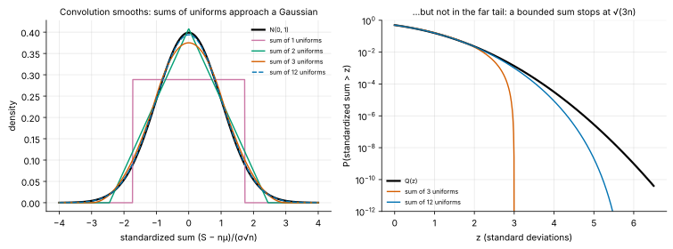
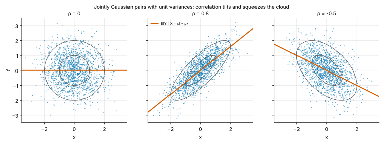
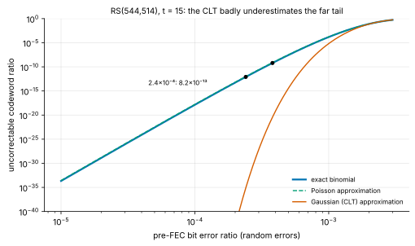

<!-- status: reviewed -->
# 03-04 · Joint Distributions, Correlation and the CLT

| | |
|---|---|
| **Course** | [03 · Probability, Statistics and Random Variables for EE](../README.md) |
| **University equivalent** | The multiple-random-variable and limit-theorem units of a junior probability course for engineers (MIT 6.041/6.431: joint PMFs and PDFs, conditioning and conditional expectation, covariance and correlation, sums of independent and of random numbers of random variables, the law of large numbers and the central limit theorem; Bertsekas & Tsitsiklis, chapters 2–5, with transforms only in outline; Leon-Garcia, chapters 5–7) |
| **Prerequisites** | [03-03 Expectation, Variance and Functions of Random Variables](03-03-expectation-and-functions-of-rvs.md), [01-10 Multivariable Calculus II](../../01-calculus-for-engineers/chapters/01-10-multivariable-calculus-2.md) (double integrals, change of variables with a Jacobian), [02-06](../../02-complex-numbers-des-and-linear-algebra/chapters/02-06-vectors-matrices-and-linear-systems.md) (matrices) |
| **Estimated study hours** | 8 |
| **Last verified** | 2026-11-18 |

**Learning objectives.** After this chapter you can:

1. Describe two random variables by a joint PMF or PDF, find marginal and conditional distributions, test for independence, and find means and variances by conditioning (iterated expectations, total variance).
2. Compute covariance and the correlation coefficient, and use $\operatorname{Var}(X + Y) = \operatorname{Var}(X) + \operatorname{Var}(Y) + 2\operatorname{Cov}(X, Y)$ for noise, jitter, timing and tolerance budgets.
3. Find the distribution of a sum of independent random variables by convolution, and recognize the sums that stay in the same family (Poisson, Gaussian).
4. State and apply the law of large numbers and the central limit theorem, including the $1/\sqrt n$ law of averaging, and judge when the Gaussian approximation fails.
5. Work with jointly Gaussian variables: their density, conditional means and variances, and the Rayleigh and exponential laws for the magnitude and power of a complex Gaussian.
6. Compute the failure probability of a block of independent errors (an error-correcting codeword), and explain why dependence and far tails defeat simple approximations.

## 1. Big picture

Engineering quantities rarely come alone: neighboring dies share a defect environment, the two wires of a differential pair pick up the same interference, and the gates of a timing path share a process corner. A **joint distribution** says how several random variables move together, **covariance** measures it in one number, and sums of many obey two limit laws: averages settle down (**law of large numbers**), and their fluctuations become Gaussian (**central limit theorem**). These explain why thermal noise and OFDM signals are Gaussian, why averaging works, and why a Gaussian estimate can be wrong by twenty orders of magnitude in the tail.

- **Noise and signaling:** correlated noise cancels in differential receivers; independent noise powers add ([12](../../12-electronics-2/README.md), [24](../../24-high-speed-io-signal-integrity-and-photonics/README.md)).
- **Timing and variability:** path delay is a sum of gate delays with shared and local variation ([19](../../19-digital-vlsi-design/README.md)).
- **Measurement:** averaging $n$ samples cuts noise by $\sqrt n$ ([03-05](03-05-estimation-and-hypothesis-testing.md)).
- **Error correction:** codeword failure is a binomial tail beyond the CLT's reach ([17](../../17-communication-systems/README.md)).

## 2. Intuition first

**A joint distribution is a scatter plot in the limit.** Measure two quantities on many units and plot one against the other. If the cloud is round, knowing one tells you nothing about the other. If it is tilted, they are correlated: a high $X$ makes a high (or low) $Y$ more likely, and the tilt and thinness of the cloud measure how strongly (Figure 2).

**Sums smooth.** Add two independent dice and the flat distribution of each becomes a triangle; add many and it becomes a bell. Each addition is a convolution, and repeated blurring of almost anything converges to the same Gaussian shape.

**A finance analogy, and its limits.** Portfolio variance is $\sum_iw_i^2\sigma_i^2 + \sum_{i\ne j}w_iw_j\rho_{ij}\sigma_i\sigma_j$, and noise, timing and tolerance budgets use exactly this formula. *Where the analogy breaks:* engineers often *design* the correlation; a differential pair makes the noise on its two wires highly correlated so that subtraction removes it, the opposite of diversification. And as in a market crisis, errors that are usually independent can become correlated exactly when it matters (bursts after an equalizer error, defects from a bad tool).

## 3. Theory

### 3.1 Joint, marginal and conditional distributions

Two discrete random variables have a **joint PMF** $p_{XY}(x, y) = P(X = x, Y = y)$, nonnegative and summing to 1. Two continuous ones have a **joint PDF** $f_{XY}(x, y)$ whose integral over a region of the plane is the probability of landing there:

$$
P\big((X, Y) \in A\big) = \iint_Af_{XY}(x, y)\,dx\,dy .
$$

The distribution of one variable alone, its **marginal**, follows by summing or integrating out the other, because the events $\{X = x, Y = y\}$ for all $y$ partition $\{X = x\}$:

$$
p_X(x) = \sum_yp_{XY}(x, y), \qquad f_X(x) = \int_{-\infty}^{\infty}f_{XY}(x, y)\,dy .
$$

The **conditional** distribution of $Y$ given $X = x$ is the joint one renormalized along the slice $X = x$:

$$
p_{Y\mid X}(y \mid x) = \frac{p_{XY}(x, y)}{p_X(x)}, \qquad f_{Y\mid X}(y \mid x) = \frac{f_{XY}(x, y)}{f_X(x)} ,
$$

wherever the denominator is positive: 03-01's conditional probability applied to every value at once.

$X$ and $Y$ are **independent** when the joint distribution factors, $f_{XY}(x, y) = f_X(x)f_Y(y)$ for all $x, y$ (or the PMF version). Equivalently, every conditional distribution of $Y$ equals its marginal. Marginals alone never determine the joint distribution (Example 03-04.1).

### 3.2 Expectations of functions of two variables

The expectation rule of 03-03 extends directly: $\mathbb{E}[g(X, Y)] = \iint g(x, y)f_{XY}(x, y)\,dx\,dy$. With $g = x + y$ this gave linearity of expectation in 03-03. With $g = xy$ and independent variables, the integral factors:

$$
\mathbb{E}[XY] = \iint xy\,f_X(x)f_Y(y)\,dx\,dy = \Big(\int xf_X\,dx\Big)\Big(\int yf_Y\,dy\Big) = \mathbb{E}[X]\,\mathbb{E}[Y] .
$$

**For independent variables, the expectation of a product is the product of the expectations.** In particular, two independent zero-mean signals have $\mathbb{E}[XY] = 0$, the cross term that 03-03 needed for noise powers to add.

**Minimum and maximum.** A series system fails at its first failure, a redundant pair at its last. For independent lifetimes, $\{\min(T_1, T_2) > t\} = \{T_1 > t\} \cap \{T_2 > t\}$, so survival functions multiply, $R_{\min}(t) = R_1(t)R_2(t)$; for exponential parts this is $e^{-(r_1 + r_2)t}$: **the failure rates of a series system add.** Likewise $P(\max(T_1, T_2) \le t) = F_1(t)F_2(t)$, which gave 03-03's parallel-pair MTTF (Problem 03-04.18).

### 3.3 Covariance, correlation and the variance of a sum

The **covariance** measures how two variables move together:

$$
\operatorname{Cov}(X, Y) = \mathbb{E}\big[(X - \mu_X)(Y - \mu_Y)\big] = \mathbb{E}[XY] - \mu_X\mu_Y .
$$

It is positive when large $X$ tends to come with large $Y$, negative when with small $Y$, and zero for independent variables (§3.2). The dimensionless **correlation coefficient** compares across units:

$$
\rho_{XY} = \frac{\operatorname{Cov}(X, Y)}{\sigma_X\sigma_Y}, \qquad -1 \le \rho_{XY} \le 1 .
$$

*Proof of the bound.* For any real $a$, $0 \le \operatorname{Var}(Y - aX) = \sigma_Y^2 - 2a\operatorname{Cov}(X, Y) + a^2\sigma_X^2$. A quadratic in $a$ that never goes negative has a nonpositive discriminant: $4\operatorname{Cov}^2 - 4\sigma_X^2\sigma_Y^2 \le 0$, so $|\rho| \le 1$ (the Cauchy–Schwarz inequality). Equality holds only if $Y - aX$ is constant: $|\rho| = 1$ means an exact straight-line relationship.

**Uncorrelated is not independent.** Correlation measures only *linear* association. If $X$ is uniform on $[-1, 1]$ and $Y = X^2$, then $Y$ is completely determined by $X$, yet $\operatorname{Cov}(X, Y) = \mathbb{E}[X^3] - \mathbb{E}[X]\mathbb{E}[X^2] = 0$ by symmetry. A detector that squares a symmetric, zero-mean signal produces an output uncorrelated with its input, but hardly independent of it.

**The variance of a sum.** Expanding the square,

$$
\operatorname{Var}(X + Y) = \mathbb{E}\big[((X - \mu_X) + (Y - \mu_Y))^2\big] = \sigma_X^2 + \sigma_Y^2 + 2\operatorname{Cov}(X, Y) ,
$$

and for many terms with weights $a_i$,

$$
\operatorname{Var}\Big(\sum_ia_iX_i\Big) = \sum_ia_i^2\sigma_i^2 + \sum_{i\ne j}a_ia_j\operatorname{Cov}(X_i, X_j) .
$$

For uncorrelated terms the cross terms vanish and **variances add**: standard deviations combine as a **root sum of squares** (RSS), which is why independent jitters and noise sources add in quadrature. With $n$ identical terms, the sum's standard deviation grows like $\sqrt n$ if they are uncorrelated and like $n$ if perfectly correlated: the whole story of statistical timing (Example 03-04.5) and tolerance stacking.

**Differences remove shared noise.** For $D = X - Y$ with equal variances σ² and correlation ρ,

$$
\operatorname{Var}(D) = 2\sigma^2(1 - \rho) .
$$

A differential receiver subtracts the voltages on two wires: interference coupled equally onto both (ρ near 1) nearly cancels, while the signal, driven oppositely, doubles (Example 03-04.2).

### 3.4 Sums of independent variables: convolution

Let $Z = X + Y$ with $X$ and $Y$ independent. For integer-valued variables, $Z = z$ happens when $X = k$ and $Y = z - k$ for some $k$:

$$
p_Z(z) = \sum_kp_X(k)\,p_Y(z - k) .
$$

For continuous ones, $P(Z \le z) = \int f_X(x)\,F_Y(z - x)\,dx$, and differentiating under the integral,

$$
f_Z(z) = \int_{-\infty}^{\infty}f_X(x)\,f_Y(z - x)\,dx = (f_X * f_Y)(z) .
$$

**The density of a sum of independent variables is the convolution of their densities**, the same operation that gives a linear time-invariant system's output ([11](../../11-signals-and-systems/README.md)). Three cases recur.

- **Uniform plus uniform.** Two independent $U(-\Delta/2, \Delta/2)$ errors sum to a **triangular** density on $[-\Delta, \Delta]$ with variance $\Delta^2/6$. Audio and measurement systems add such triangular-PDF ("TPDF") **dither**, a small random signal injected before a quantizer, on purpose: a triangle 2Δ wide is the smallest dither that makes the mean and the power of the total error independent of the signal, at the price of tripling the error power, $\Delta^2/12 + \Delta^2/6 = \Delta^2/4$, or **4.771 dB** (Lipshitz et al., 1992; Example 03-04.3).
- **Poisson plus Poisson.** For independent Poisson counts with means $\lambda_1$, $\lambda_2$,

  $$
  p_Z(z) = \sum_{k=0}^z\frac{\lambda_1^ke^{-\lambda_1}}{k!}\cdot\frac{\lambda_2^{z-k}e^{-\lambda_2}}{(z - k)!} = \frac{e^{-(\lambda_1 + \lambda_2)}}{z!}\sum_{k=0}^z\binom zk\lambda_1^k\lambda_2^{z-k} = \frac{(\lambda_1 + \lambda_2)^ze^{-(\lambda_1 + \lambda_2)}}{z!}
  $$

  by the binomial theorem: soft errors from two memories merge into one Poisson stream with the summed rate.
- **Gaussian plus Gaussian.** Independent $\mathcal{N}(\mu_1, \sigma_1^2)$ and $\mathcal{N}(\mu_2, \sigma_2^2)$ sum to $\mathcal{N}(\mu_1 + \mu_2, \sigma_1^2 + \sigma_2^2)$: the convolution integral of two Gaussians, after completing the square in the exponent, is another Gaussian. Means and variances add, as they must, and the shape is preserved.

> **Going deeper — transforms turn convolution into multiplication.** The **moment-generating function** $M_X(s) = \mathbb{E}[e^{sX}]$ of an independent sum is the product $M_X(s)M_Y(s)$, by §3.2 applied to $e^{sX}e^{sY}$. For a Gaussian, $M(s) = e^{\mu s + \sigma^2s^2/2}$, and the product of two such is visibly another. Because an MGF that is finite on an interval around $s = 0$ determines its distribution uniquely (a theorem beyond this course), that proves the Gaussian case in one line. This is the probabilistic twin of the Laplace transform ([02-05](../../02-complex-numbers-des-and-linear-algebra/chapters/02-05-laplace-transform-for-odes.md)), and the standard proof of the central limit theorem expands $\ln M$ of a standardized sum to second order.

### 3.5 Conditioning on a random variable: iterated expectations and total variance

Often the easiest route to a mean or variance is to condition, solve the simpler problem, then average. The **conditional expectation** of $Y$ given $X = x$ is the mean of the conditional distribution,

$$
\mathbb{E}[Y \mid X = x] = \sum_yy\,p_{Y\mid X}(y \mid x), \qquad \mathbb{E}[Y \mid X = x] = \int_{-\infty}^{\infty}y\,f_{Y\mid X}(y \mid x)\,dy ,
$$

a number for each $x$: a function $g(x)$. Evaluated at the random $X$, **$\mathbb{E}[Y \mid X] = g(X)$ is itself a random variable**, the best guess of $Y$ once $X$ is revealed. Likewise $\operatorname{Var}(Y \mid X)$ is the variance of the conditional distribution, evaluated at $X$.

**Law of iterated expectations.** Averaging the conditional means recovers the mean:

$$
\mathbb{E}\big[\mathbb{E}[Y \mid X]\big] = \sum_xp_X(x)\sum_yy\,\frac{p_{XY}(x, y)}{p_X(x)} = \sum_x\sum_yy\,p_{XY}(x, y) = \mathbb{E}[Y] .
$$

This is 03-01's total-probability theorem applied to means (the continuous case swaps sums for integrals). The same steps with an extra factor $h(x)$ give $\mathbb{E}[h(X)\,Y] = \mathbb{E}\big[h(X)\,\mathbb{E}[Y \mid X]\big]$: a function of $X$ can be pulled outside the conditioning.

**Law of total variance.** Apply 03-03's identity to each conditional distribution, $\operatorname{Var}(Y \mid X) = \mathbb{E}[Y^2 \mid X] - (\mathbb{E}[Y \mid X])^2$, and take expectations, using iterated expectations on the first term:

$$
\mathbb{E}\big[\operatorname{Var}(Y \mid X)\big] = \mathbb{E}[Y^2] - \mathbb{E}\big[(\mathbb{E}[Y \mid X])^2\big] .
$$

The random variable $\mathbb{E}[Y \mid X]$ has mean $\mathbb{E}[Y]$, so $\operatorname{Var}(\mathbb{E}[Y \mid X]) = \mathbb{E}\big[(\mathbb{E}[Y \mid X])^2\big] - (\mathbb{E}[Y])^2$. Adding the two, the middle terms cancel:

$$
\operatorname{Var}(Y) = \underbrace{\mathbb{E}\big[\operatorname{Var}(Y \mid X)\big]}_{\text{within groups}} + \underbrace{\operatorname{Var}\big(\mathbb{E}[Y \mid X]\big)}_{\text{between groups}} .
$$

Total spread is the average spread within each group plus the spread of the group means. (In finance: idiosyncratic plus systematic risk.)

**Clustered wafers.** Lab 03-03 (Part 2) models the wafer of Example 03-03.2 (400 center and 200 edge dies) as a mixture: one wafer in ten is bad, with center and edge yields 0.75 and 0.50, and the rest have 0.9722 and 0.8333, keeping the overall yields at 0.95 and 0.80. Given the wafer type $W$, dies fail independently. A good wafer then has mean $400(0.9722) + 200(0.8333) = 555.6$ and variance $400(0.9722)(0.0278) + 200(0.8333)(0.1667) = 38.58$ dies²; a bad wafer, mean 400 and variance $75 + 50 = 125$ dies². So

$$
\mathbb{E}\big[\operatorname{Var}(N \mid W)\big] = 0.9(38.58) + 0.1(125) = 47.22, \qquad \operatorname{Var}\big(\mathbb{E}[N \mid W]\big) = 0.9\times0.1\times(555.6 - 400)^2 = 2177.8 ,
$$

using the variance $p(1 - p)(a - b)^2$ of a variable that equals $a$ with probability $p$ and $b$ otherwise. The total, 2225.0 dies², is a standard deviation of **47.17** dies against 7.141 for independent dies, almost all of it between wafers.

**Random sums.** Let $N$ events each contribute an independent amount $X_i$ with mean μ and variance σ², independent of $N$, and let $S = X_1 + \dots + X_N$. Given $N$, $\mathbb{E}[S \mid N] = N\mu$ and $\operatorname{Var}(S \mid N) = N\sigma^2$, so

$$
\mathbb{E}[S] = \mathbb{E}[N]\,\mu, \qquad \operatorname{Var}(S) = \mathbb{E}[N]\,\sigma^2 + \operatorname{Var}(N)\,\mu^2 .
$$

Both the size and the number of events add spread. For Poisson $N$ with mean λ, $\operatorname{Var}(S) = \lambda(\sigma^2 + \mu^2) = \lambda\,\mathbb{E}[X^2]$ (Problem 03-04.17, multi-bit soft errors).

**The best predictor.** For any predictor $g(X)$, add and subtract $\mathbb{E}[Y \mid X]$ and expand:

$$
\mathbb{E}\big[(Y - g(X))^2\big] = \mathbb{E}\big[\operatorname{Var}(Y \mid X)\big] + \mathbb{E}\big[(\mathbb{E}[Y \mid X] - g(X))^2\big] .
$$

The cross term $2\,\mathbb{E}\big[h(X)\,(Y - \mathbb{E}[Y \mid X])\big]$, with $h(X) = \mathbb{E}[Y \mid X] - g(X)$, vanishes by the pull-out rule, and the first term is $\mathbb{E}[(Y - \mathbb{E}[Y \mid X])^2]$ by iterated expectations. Only the second term depends on $g$, and it is zero for $g(X) = \mathbb{E}[Y \mid X]$: **the conditional mean is the minimum mean-square-error (MMSE) predictor**, with error $\mathbb{E}[\operatorname{Var}(Y \mid X)]$.

### 3.6 The law of large numbers and the arithmetic of averaging

Let $X_1, \dots, X_n$ be independent with common mean μ and variance σ², and let $\bar X_n = (X_1 + \dots + X_n)/n$ be their **sample mean**. By linearity and the variance-of-a-sum rule,

$$
\mathbb{E}[\bar X_n] = \mu, \qquad \operatorname{Var}(\bar X_n) = \frac{n\sigma^2}{n^2} = \frac{\sigma^2}{n}, \qquad \sigma_{\bar X_n} = \frac{\sigma}{\sqrt n} .
$$

The **standard error** $\sigma/\sqrt n$ shrinks with the square root of the sample count. Chebyshev's inequality (03-03) then gives, for any ε > 0,

$$
P\big(|\bar X_n - \mu| \ge \varepsilon\big) \le \frac{\sigma^2}{n\varepsilon^2} \longrightarrow 0 ,
$$

the **weak law of large numbers**: the sample mean converges to the expectation. It is why a fab's long-run yield equals the probability of a good die.

**Averaging buys SNR at 10 dB per decade.** Averaging $n$ independent noisy measurements of the same signal leaves the signal unchanged and divides the noise power by $n$: the SNR improves by $10\log_{10}n$ dB. An oscilloscope averaging 64 acquisitions gains **18.06 dB**. The price is time, and the gain assumes independent noise; drift and 1/f noise average down much more slowly ([03-06](03-06-random-processes-preview.md)).

### 3.7 The central limit theorem

The law of large numbers says where $\bar X_n$ goes; the **central limit theorem** (CLT) says what its fluctuations look like on the way. For independent, identically distributed $X_i$ with finite mean μ and variance σ², the standardized sum

$$
Z_n = \frac{X_1 + \dots + X_n - n\mu}{\sigma\sqrt n}
$$

satisfies $P(Z_n \le z) \to \Phi(z) = 1 - Q(z)$ for every $z$ as $n \to \infty$, whatever the distribution of the $X_i$. Versions exist for terms that are not identically distributed, provided no single term dominates the variance.

*Why it is true, in one picture:* each added term convolves the density with another, and the Gaussian is the shape that survives repeated smoothing unchanged (§3.4). Figure 1 shows sums of uniforms converging; $\sum_{i=1}^{12}U_i - 6$ was once a standard way to generate approximately normal numbers.

*Figure 1. The CLT governs the center of the distribution. In the far tail, a sum of bounded terms cannot exceed its maximum, and the Gaussian approximation is wrong by orders of magnitude.*

**Why so much is Gaussian.**

- **Thermal noise** sums an enormous number of independent electron motions ([03-06](03-06-random-processes-preview.md)).
- **An OFDM signal** sums hundreds of independently modulated subcarriers, so its real and imaginary parts are nearly Gaussian (§3.8).
- **Random jitter** and **parameter variation** collect many small independent contributions.

**Where the CLT fails.** Three failure modes matter in practice.

1. **The far tail.** The CLT is a statement about fixed $z$ as $n$ grows. Its error near the center shrinks like $1/\sqrt n$, but the *relative* error far out can be enormous. The standardized sum of 12 uniforms can never exceed 6 in magnitude, while a Gaussian puts \$2Q(6) = \$ **1.973×10⁻⁹** beyond ±6 (Figure 1). Example 03-04.7 shows a Gaussian approximation that is wrong by 23 orders of magnitude.
2. **Dependence.** Correlated terms (bursts of errors, a shared process corner) add variance faster than $n$ and can keep a non-Gaussian shape.
3. **Heavy tails or a dominant term.** With infinite variance there is no CLT. The **Cauchy** density $1/(\pi(1 + x^2))$, the ratio of two independent standard Gaussians or the tangent of a uniformly random angle, has tails so heavy that even its mean does not exist, and the average of $n$ independent Cauchy samples has the same Cauchy distribution for every $n$: averaging does not help at all. With one term much larger than the rest, the sum looks like that term.

### 3.8 Jointly Gaussian variables

$X$ and $Y$ are **jointly Gaussian** with means $\mu_X, \mu_Y$, standard deviations $\sigma_X, \sigma_Y$ and correlation ρ (with $|\rho| < 1$) if, in terms of the standardized $u = (x - \mu_X)/\sigma_X$ and $w = (y - \mu_Y)/\sigma_Y$,

$$
f_{XY}(x, y) = \frac{1}{2\pi\sigma_X\sigma_Y\sqrt{1 - \rho^2}}\exp\Big[-\frac{u^2 - 2\rho uw + w^2}{2(1 - \rho^2)}\Big] .
$$

Its contours of equal density are ellipses, tilted when ρ ≠ 0 (Figure 2). Everything about the family follows from completing the square in $w$:

$$
u^2 - 2\rho uw + w^2 = (w - \rho u)^2 + (1 - \rho^2)u^2 .
$$

The exponent splits in two, and since $\sigma_Y(w - \rho u) = y - \mu_Y - \rho\sigma_Yu$, the density factors (multiply the prefactors and add the exponents to check):

$$
f_{XY}(x, y) = \underbrace{\frac{e^{-u^2/2}}{\sigma_X\sqrt{2\pi}}}_{\text{(i)}}\cdot\underbrace{\frac{1}{\sigma_Y\sqrt{2\pi(1 - \rho^2)}}\exp\Big[-\frac{(y - \mu_Y - \rho\sigma_Yu)^2}{2\sigma_Y^2(1 - \rho^2)}\Big]}_{\text{(ii)}} .
$$

For fixed $x$, factor (ii) is a Gaussian density in $y$ and integrates to 1. Four properties follow, and make the family the workhorse of signal processing and statistics.

1. **Marginals are Gaussian.** Integrating out $y$ leaves factor (i): $X \sim \mathcal{N}(\mu_X, \sigma_X^2)$, and by symmetry $Y \sim \mathcal{N}(\mu_Y, \sigma_Y^2)$.
2. **Conditioning is linear.** Dividing by $f_X(x)$ leaves factor (ii), so given $X = x$, $Y$ is Gaussian with

   $$
   \mathbb{E}[Y \mid X = x] = \mu_Y + \rho\frac{\sigma_Y}{\sigma_X}(x - \mu_X), \qquad \operatorname{Var}(Y \mid X = x) = \sigma_Y^2(1 - \rho^2) .
   $$

   With $U$ and $W$ the standardized variables, iterated expectations confirm that ρ is the correlation: $\operatorname{Cov}(X, Y) = \sigma_X\sigma_Y\mathbb{E}\big[U\,\mathbb{E}[W \mid U]\big] = \sigma_X\sigma_Y\rho\,\mathbb{E}[U^2] = \rho\sigma_X\sigma_Y$.
3. **Uncorrelated means independent.** With ρ = 0, factor (ii) no longer depends on $x$; it is $f_Y(y)$, and the density factors. This is special to jointly Gaussian variables; in general (§3.3) it is false.
4. **Linear combinations are Gaussian.** The factorization is a recipe: with $Z_1$, $Z_2$ independent standard normals, $X = \mu_X + \sigma_XZ_1$ and $Y = \mu_Y + \sigma_Y\big(\rho Z_1 + \sqrt{1 - \rho^2}\,Z_2\big)$ have exactly the densities (i) and (ii). So $aX + bY + c$ is a constant plus $(a\sigma_X + b\rho\sigma_Y)Z_1 + b\sigma_Y\sqrt{1 - \rho^2}\,Z_2$, a sum of independent Gaussians, Gaussian by §3.4. A linear circuit fed Gaussian noise produces Gaussian noise at every node, and simulators generate correlated pairs this way (Lab 03-04, Part 2).

The conditional mean is a straight line, the **regression line**, and knowing $X$ shrinks the uncertainty in $Y$ by the factor $\sqrt{1 - \rho^2}$ whatever value $X$ takes. Since the conditional mean is the MMSE predictor (§3.5), for jointly Gaussian variables the best predictor of any form is linear: the idea behind linear regression ([03-05](03-05-estimation-and-hypothesis-testing.md)) and the Kalman filter ([15](../../15-control-systems/README.md)). Example 03-04.6 uses it to predict a die's speed from an early test.

*Figure 2. Correlation tilts and squeezes the cloud. The regression line E[Y | X = x] = ρx is flatter than the ellipse's long axis: an extreme X predicts a less extreme Y ("regression to the mean").*

> **Math refresher — changing variables in a double integral.** If $(x, y) = (r\cos\theta, r\sin\theta)$, a small rectangle $dr\,d\theta$ maps to an area $r\,dr\,d\theta$ in the plane; $r$ is the absolute value of the Jacobian determinant $\partial(x, y)/\partial(r, \theta)$ ([01-10](../../01-calculus-for-engineers/chapters/01-10-multivariable-calculus-2.md)). A joint density transforms by the same factor: $f_{R\Theta}(r, \theta) = f_{XY}(r\cos\theta, r\sin\theta)\cdot r$.

**The magnitude of a complex Gaussian.** Let the in-phase and quadrature parts $X_I$ and $X_Q$ of a complex baseband signal be independent $\mathcal{N}(0, \sigma^2)$, as the CLT makes them for OFDM or for narrowband noise. In polar form $X_I = R\cos\Theta$, $X_Q = R\sin\Theta$, the refresher gives

$$
f_{R\Theta}(r, \theta) = \frac{1}{2\pi\sigma^2}e^{-r^2/(2\sigma^2)}\cdot r = \underbrace{\frac{r}{\sigma^2}e^{-r^2/(2\sigma^2)}}_{f_R(r)}\cdot\underbrace{\frac{1}{2\pi}}_{f_\Theta(\theta)}, \qquad r \ge 0,\ 0 \le \theta < 2\pi .
$$

The density factors, so **the envelope $R$ and the phase Θ are independent; the phase is uniform and the envelope is Rayleigh.** The power $P = R^2$ then has, by the change of variables of 03-03, $f_P(p) = f_R(\sqrt p)/(2\sqrt p) = e^{-p/(2\sigma^2)}/(2\sigma^2)$: **exponential with mean $\bar P = 2\sigma^2$**. This proves the two facts 03-03 borrowed: OFDM power is exponential, with $\Pr(P > x\bar P) = e^{-x}$, and its envelope is Rayleigh. The same mathematics describes multipath fading in radio channels ([17](../../17-communication-systems/README.md)).

### 3.9 Errors in a block: why error-correcting codes need the exact tail

Modern links protect data with **forward error correction** (FEC). A Reed–Solomon code RS($n$, $k$) groups bits into $m$-bit symbols and sends codewords of $n$ symbols, $k$ of them data; it corrects up to $t = (n - k)/2$ wrong symbols per codeword. The code adopted for 200 and 400 Gb/s Ethernet (IEEE 802.3bs) is RS(544,514) with 10-bit symbols, so $t = 15$. It is called "KP4" FEC because IEEE 802.3bj (2014) first specified it for the 100GBASE-KP4 backplane PHY (physical-layer device: the circuits that put bits on the medium), alongside the weaker RS(528,514) "KR4" code ($t = 7$) used at 25 Gb/s per lane ([R-067](../../../reference/research-log.md#r-067--rs544514-kp4-fec-and-pre-fec-ber)).

If bit errors are independent with probability $p$, a symbol is wrong with probability $p_s = 1 - (1 - p)^m$, symbols are wrong independently, and the number of wrong symbols in a codeword is binomial$(n, p_s)$. The codeword is uncorrectable when more than $t$ are wrong:

$$
\text{UCR} = P(N > t) = \sum_{i=t+1}^n\binom ni p_s^i(1 - p_s)^{n-i} ,
$$

the **uncorrectable codeword ratio**, the formula used in IEEE 802.3 task-force analyses ([R-067](../../../reference/research-log.md#r-067--rs544514-kp4-fec-and-pre-fec-ber)). Its mean $np_s$ is about 1.3 symbols at the planned BER, while failure needs 16: deep in a tail where the CLT fails but the exact binomial, or its Poisson approximation, works (Figure 3, Example 03-04.7).

*Figure 3. The FEC "waterfall". At the planned pre-FEC BER of 2.4×10⁻⁴ the exact uncorrectable rate is about 10⁻¹²; a Gaussian approximation would claim about 10⁻³⁵.*

Independence is the other fragile assumption. A **decision-feedback equalizer** (DFE) cancels the interference of earlier symbols using its own past decisions ([24](../../24-high-speed-io-signal-integrity-and-photonics/README.md)), so one wrong decision can cause a short burst of errors, concentrating them into fewer codewords. **Precoding** at the transmitter limits the damage, typically leaving about two bit errors per burst, at its start and end. IEEE analyses therefore require a lower pre-FEC BER when bursts are present (§9).

## 4. Worked examples

### Example 03-04.1 — Two neighboring dies: joint, marginal and conditional (tier A)

**Setup.** Let $X$ and $Y$ indicate that two neighboring dies are defective (1) or good (0). From wafer maps, $p_{XY}(0, 0) = 0.85$, $p_{XY}(1, 0) = p_{XY}(0, 1) = 0.05$ and $p_{XY}(1, 1) = 0.05$. (a) Find the marginals and test independence. (b) Find $P(Y = 1 \mid X = 1)$. (c) Find $\operatorname{Cov}(X, Y)$, ρ, and the variance of the number of bad dies in the pair. (d) What fraction of pairs are both good, compared with independent dies of the same marginal yield?

**Solution.** (a) \$P(X = 1) = 0.05 + 0.05 = \$ **0.1**, and likewise $P(Y = 1) = 0.1$. Independence would require $p_{XY}(1, 1) = 0.1\times0.1 = 0.01$; the actual 0.05 is five times larger, so the dies are **dependent**: defects cluster.

(b) $P(Y = 1 \mid X = 1) = 0.05/0.1 = $ **0.5**: five times the unconditional 0.1.

(c) $\mathbb{E}[XY] = p_{XY}(1, 1) = 0.05$, so \$\operatorname{Cov}(X, Y) = 0.05 - 0.1^2 = \$ **0.04**. Each variance is $0.1\times0.9 = 0.09$, so \$\rho = 0.04/0.09 = \$ **0.4444**. The number of bad dies has mean 0.2 (linearity) and variance \$0.09 + 0.09 + 2(0.04) = \$ **0.26**, against 0.18 for independent dies.

(d) $p_{XY}(0, 0) = $ **0.85**, against $0.9^2 = $ **0.81** if independent. Clustering leaves more defect-free pairs.

**Sanity check.** The joint PMF sums to 1 ✓. This is why yield models for large dies include a clustering parameter: independent-defect models are pessimistic for large areas ([25](../../25-fabrication-packaging-test-and-reliability/README.md)).

### Example 03-04.2 — Differential signaling and correlated noise (tier B)

**Setup.** Each wire of a pair carries interference with σ = 10 mV rms. A single-ended receiver sees one wire's signal amplitude $A$ plus its noise. A differential receiver drives $+A$ and $-A$ on the two wires and subtracts them. Find the differential noise and the SNR advantage of differential over single-ended signaling when the two wires' noise has correlation (a) ρ = 0.9 (interference coupling onto both) and (b) ρ = 0 (independent noise).

**Solution.** The differential signal is $A - (-A) = 2A$ and its noise has $\sigma_d = \sigma\sqrt{2(1 - \rho)}$ (§3.3). The amplitude ratio of differential to single-ended SNR is $(2A/\sigma_d)/(A/\sigma) = 2\sigma/\sigma_d$.

(a) $\sigma_d = 10\sqrt{0.2} = $ **4.472 mV**; advantage $20\log_{10}(2\times10/4.472) = $ **13.01 dB**.

(b) $\sigma_d = 10\sqrt2 = $ **14.14 mV**; advantage $20\log_{10}(2/\sqrt2) = $ **3.010 dB**, from the doubled signal alone.

**Sanity check.** With ρ = 1 the noise cancels completely; with ρ = −1 it doubles ✓ ([24](../../24-high-speed-io-signal-integrity-and-photonics/README.md)).

### Example 03-04.3 — Convolution: triangular dither (tier B)

**Setup.** $X$ and $Y$ are independent and uniform on $[-\Delta/2, \Delta/2]$. (a) Find the density of $Z = X + Y$ by convolution. (b) Find its variance two ways. (c) Find $P(|Z| > \Delta/2)$. (d) The sum of three such variables has density $3/(4\Delta)$ at 0. Compare with a Gaussian of the same variance.

**Solution.** (a) $f_Z(z) = \int f_X(x)f_Y(z - x)\,dx$ is $1/\Delta^2$ times the length of the overlap of $[-\Delta/2, \Delta/2]$ with $[z - \Delta/2, z + \Delta/2]$, which is $\Delta - |z|$ for $|z| \le \Delta$. So

$$
f_Z(z) = \frac{\Delta - |z|}{\Delta^2}, \qquad |z| \le \Delta ,
$$

a triangle of height $1/\Delta$ and base $2\Delta$ (area 1 ✓).

(b) By the variance-of-a-sum rule, $\Delta^2/12 + \Delta^2/12 = \Delta^2/6$. Directly, $2\int_0^\Delta z^2(\Delta - z)/\Delta^2\,dz = 2\Delta^2(1/3 - 1/4) = \Delta^2/6$ ✓. In units of Δ², **0.1667**.

(c) $P(|Z| > \Delta/2) = 2\int_{\Delta/2}^{\Delta}(\Delta - z)/\Delta^2\,dz = 2\cdot\tfrac12(\Delta/2)^2/\Delta^2 = $ **0.25**.

(d) Three terms give variance $\Delta^2/4$, and a Gaussian with that variance has peak $1/\sqrt{2\pi\Delta^2/4} = 0.7979/\Delta$, against the exact **0.75**/Δ: within 6% after three terms.

### Example 03-04.4 — How many samples to average? (tier B)

**Setup.** A test system measures a supply voltage with noise σ = 2 mV per sample, independent between samples. (a) How many samples make the standard error of the mean 0.1 mV? (b) With that many samples, what probability does Chebyshev guarantee that the mean is within ±0.3 mV of the truth, and what does the CLT predict? (c) What SNR gain does averaging 64 oscilloscope traces give?

**Solution.** (a) $\sigma/\sqrt n = 0.1$ mV gives \$n = (2/0.1)^2 = \$ **400** samples.

(b) ±0.3 mV is ±3 standard errors. Chebyshev guarantees at least $1 - 1/9 = $ **88.89%**; the CLT predicts $1 - 2Q(3) = $ **99.73%**, reliable at 3σ with 400 independent samples; Chebyshev is the fallback if you doubt the model.

(c) $10\log_{10}64 = $ **18.06 dB**: halving the noise voltage (6.02 dB) costs four times the samples.

### Example 03-04.5 — Statistical timing: shared and local variation (tier B)

**Setup.** A logic path has 20 gates. Each gate's delay is $D_i = 10\text{ ps} + G + L_i$, where $G \sim \mathcal{N}(0, (0.6\text{ ps})^2)$ is shared by all gates on the die (global variation) and the $L_i \sim \mathcal{N}(0, (0.8\text{ ps})^2)$ are independent (local variation). (a) Find each gate's delay standard deviation and the correlation between two gates. (b) Find the mean and standard deviation of the path delay. (c) Compare the path's 3σ delay with a worst-case analysis that puts every gate at its own 3σ, and with a model that ignores correlation.

**Solution.** (a) $\operatorname{Var}(D_i) = 0.36 + 0.64 = 1$ ps², so σ = 1 ps per gate. For $i \ne j$, $\operatorname{Cov}(D_i, D_j) = \operatorname{Var}(G) = 0.36$ ps², so ρ = **0.36**.

(b) The mean is $20\times10 = 200$ ps. The path delay is $200 + 20G + \sum L_i$, so

$$
\operatorname{Var} = 20^2(0.36) + 20(0.64) = 144 + 12.8 = 156.8\ \text{ps}^2, \qquad \sigma = 12.52\ \text{ps} .
$$

So **156.8 ps²** and **12.52 ps**.

(c) The path's 3σ delay is $200 + 3(12.52) = $ **237.6 ps**. Every gate at its own +3σ gives $20\times13 = $ **260 ps**, too pessimistic: local variations partly cancel. Ignoring correlation gives $\sigma = \sqrt{20}\times1 = $ **4.472 ps** and a 3σ delay of 213.4 ps, dangerously optimistic: the shared term does not average out.

**Sanity check.** Global variation contributes 144 of 156.8 ps²: on long paths local variation averages away and the shared corner dominates ✓. This is the reasoning behind statistical timing and on-chip-variation derating ([19](../../19-digital-vlsi-design/README.md)).

### Example 03-04.6 — Predicting die speed from an early test (tier C)

**Setup.** A ring-oscillator test structure is measured at wafer sort, before a die's maximum frequency $F$ can be tested. Across dies, the standardized ring-oscillator reading $X$ and $F$ are jointly Gaussian with correlation ρ = 0.8; $F$ has mean 3.0 GHz and σ = 100 MHz. A die reads $X = 1.5$ (1.5σ above its mean). (a) Find the conditional mean and standard deviation of its $F$. (b) Find the probability it reaches the 3.2 GHz speed bin, and compare with a die about which nothing is known.

**Solution.** (a) From §3.8, with $X$ standardized,

$$
\mathbb{E}[F \mid X = 1.5] = 3.0 + 0.8\times1.5\times0.1 = 3.12\ \text{GHz}, \qquad \sigma_{F\mid X} = 0.1\sqrt{1 - 0.64} = 0.06\ \text{GHz} .
$$

So **3.12 GHz** and **60 MHz**.

(b) $P(F > 3.2 \mid X = 1.5) = Q\big((3.2 - 3.12)/0.06\big) = Q(4/3) = $ **0.09121**. Unconditionally, $P(F > 3.2) = Q(2) = $ **0.02275**. The early measurement quadruples the chance of the top bin, which is why screens route dies early; but ρ = 0.8 still leaves a 60 MHz spread, so final test must confirm.

**Sanity check.** The conditional mean moves only 0.8 × 1.5 = 1.2σ, less than the 1.5σ of the predictor: regression to the mean (Figure 2) ✓.

### Example 03-04.7 — When a codeword fails: RS(544,514) (tier C)

**Setup.** A 400G Ethernet optical link delivers bits to an RS(544,514) decoder ($n = 544$, $t = 15$, $m = 10$) with independent bit errors at the planned pre-FEC BER $p = 2.4\times10^{-4}$. (a) Find the symbol error probability and the mean number of wrong symbols per codeword. (b) Find the uncorrectable codeword ratio exactly, with the Poisson approximation, and with the Gaussian (CLT) approximation. (c) Estimate the post-FEC BER using $\text{BER}_{\text{out}} \approx \frac{t + 1}{nm}\text{UCR}$ (each failed codeword carries about $t + 1$ wrong symbols, each with about one wrong bit). (d) Repeat (b) at $p = 3.8\times10^{-4}$.

**Solution.** (a) $p_s = 1 - (1 - 2.4\times10^{-4})^{10} = $ **2.397×10⁻³** and $np_s = $ **1.304** symbols.

(b) Exactly, $\text{UCR} = P(N \ge 16)$ for $N \sim$ binomial(544, $p_s$): **8.152×10⁻¹³**. The Poisson approximation with λ = 1.304 gives **9.839×10⁻¹³**, about 21% high but the right order of magnitude. The Gaussian approximation uses σ = $\sqrt{np_s(1 - p_s)}$ = **1.141**, so 15.5 symbols is \$(15.5 - np_s)/\sigma = \$ **12.4455** standard deviations out (keep the digits: this far out, $Q$ drops about 5% per 0.004σ), and \$Q(12.4455) = \$ **7.4×10⁻³⁶**: wrong by about 23 orders of magnitude. The binomial tail decays roughly like $\lambda^k/k!$, far more slowly than a Gaussian's $e^{-z^2/2}$.

(c) \$\text{BER}_{\text{out}} \approx (16/5440)\times8.152\times10^{-13} = \$ **2.398×10⁻¹⁵**, comfortably below the $10^{-13}$ Ethernet target ([R-059](../../../reference/research-log.md#r-059--serial-link-bit-error-rate-targets-pcie-and-ethernet)).

(d) At $p = 3.8\times10^{-4}$, \$\text{UCR} = \$ **6.304×10⁻¹⁰**. Raising the input BER by 58% raises the failure rate 773-fold: the steep "waterfall" of Figure 3, which is why links are run with margin.

**Sanity check.** Poisson works because $n$ is large and $p_s$ small (03-02); the CLT fails 16 errors deep in the tail of a count with mean 1.3 ✓.

<!-- answer-key -->
| ID | Quantity | Value | Unit |
|---|---|---|---|
| Ex 03-04.1a | P(X = 1) | 0.1 | — |
| Ex 03-04.1b | P(Y = 1 given X = 1) | 0.5 | — |
| Ex 03-04.1c | covariance | 0.04 | — |
| Ex 03-04.1d | correlation coefficient | 0.4444 | — |
| Ex 03-04.1e | variance of bad dies in the pair | 0.26 | — |
| Ex 03-04.1f | P(both good) | 0.85 | — |
| Ex 03-04.1g | P(both good) if independent | 0.81 | — |
| Ex 03-04.2a | differential noise, ρ = 0.9 | 4.472 | mV |
| Ex 03-04.2b | differential advantage, ρ = 0.9 | 13.01 | dB |
| Ex 03-04.2c | differential noise, ρ = 0 | 14.14 | mV |
| Ex 03-04.2d | differential advantage, ρ = 0 | 3.010 | dB |
| Ex 03-04.3a | variance of triangular sum over Δ² | 0.1667 | — |
| Ex 03-04.3b | P(abs Z > Δ/2) | 0.25 | — |
| Ex 03-04.3c | density at 0, three uniforms, times Δ | 0.75 | — |
| Ex 03-04.3d | Gaussian density at 0, same variance, times Δ | 0.7979 | — |
| Ex 03-04.4a | samples for 0.1 mV standard error | 400 | — |
| Ex 03-04.4b | Chebyshev guarantee at ±3 standard errors | 88.89 | % |
| Ex 03-04.4c | CLT probability at ±3 standard errors | 99.73 | % |
| Ex 03-04.4d | SNR gain from 64 averages | 18.06 | dB |
| Ex 03-04.5a | correlation between two gates | 0.36 | — |
| Ex 03-04.5b | path delay variance | 156.8 | ps² |
| Ex 03-04.5c | path delay standard deviation | 12.52 | ps |
| Ex 03-04.5d | path 3σ delay | 237.6 | ps |
| Ex 03-04.5e | worst-case stacked delay | 260 | ps |
| Ex 03-04.5f | standard deviation ignoring correlation | 4.472 | ps |
| Ex 03-04.5g | 3σ delay ignoring correlation | 213.4 | ps |
| Ex 03-04.6a | conditional mean frequency | 3.12 | GHz |
| Ex 03-04.6b | conditional standard deviation | 60 | MHz |
| Ex 03-04.6c | P(top bin given the test) | 0.09121 | — |
| Ex 03-04.6d | P(top bin) unconditionally | 0.02275 | — |
| Ex 03-04.7a | symbol error probability | 2.397×10^-3 | — |
| Ex 03-04.7b | mean wrong symbols per codeword | 1.304 | — |
| Ex 03-04.7c | uncorrectable codeword ratio, exact | 8.152×10^-13 | — |
| Ex 03-04.7d | uncorrectable codeword ratio, Poisson | 9.839×10^-13 | — |
| Ex 03-04.7e | standard deviation of wrong symbols | 1.141 | — |
| Ex 03-04.7f | standardized distance of 15.5 symbols | 12.4455 | — |
| Ex 03-04.7g | uncorrectable codeword ratio, Gaussian | 7.4×10^-36 | — |
| Ex 03-04.7h | post-FEC BER estimate | 2.398×10^-15 | — |
| Ex 03-04.7i | uncorrectable codeword ratio at 3.8e-4 | 6.304×10^-10 | — |
| Ex 03-04.7j | increase in failure rate | 773 | — |

<!-- answer-key -->
| ID | Quantity | Value | Unit |
|---|---|---|---|
| T 03-04.a | 2Q(6), Gaussian probability beyond ±6 | 1.973×10^-9 | — |
| T 03-04.b | differential noise factor at ρ = 0.9 | 0.447 | — |
| T 03-04.c | RSS of ten 1 mV sources | 3.16 | mV |
| T 03-04.d | remaining spread at ρ = 0.6 | 0.8 | — |
| T 03-04.e | remaining spread at ρ = 0.8 | 0.6 | — |
| T 03-04.f | TPDF dither: error power increase | 4.771 | dB |
| T 03-04.g | wafer mixture: mean within-wafer variance | 47.22 | dies² |
| T 03-04.h | wafer mixture: variance of wafer means | 2177.8 | dies² |
| T 03-04.i | wafer mixture: total variance | 2225.0 | dies² |
| T 03-04.j | wafer mixture: standard deviation | 47.17 | dies |
| T 03-04.k | good-wafer mean | 555.6 | dies |
| T 03-04.l | good-wafer variance | 38.58 | dies² |
| T 03-04.m | good-wafer center yield | 0.9722 | — |
| T 03-04.n | good-wafer edge yield | 0.8333 | — |
| T 03-04.o | two-tool overall standard deviation | 50.49 | dies |

## 5. Simulate it

The lab ([labs/03-04-lab/](../labs/03-04-lab/README.md)) is a notebook of sampling experiments:

1. **Joint distributions from data:** joint PMF, marginals and covariance of simulated clustered dies.
2. **Correlated noise:** correlated Gaussian pairs (a Cholesky factor, [02-06](../../02-complex-numbers-des-and-linear-algebra/chapters/02-06-vectors-matrices-and-linear-systems.md)) and differential noise against ρ.
3. **Convolution:** histograms of sums of uniforms against numerical convolutions.
4. **The CLT and its tails:** standardized sums of exponentials. *Predict first:* with $n = 30$, is $P(Z > 3)$ above or below $Q(3)$?
5. **Polar Gaussians:** envelope and phase of complex Gaussian samples.
6. **FEC by Monte Carlo:** RS(544,514) failures at a high BER against the binomial formula, then with bursts.

## 6. Engineering tradeoffs

| Knob | Improves | Costs | Typical decision owner |
|---|---|---|---|
| Differential signaling | Rejects correlated interference; doubles swing | Two wires and pins per signal; matching | I/O and signal-integrity engineers |
| Averaging more samples | SNR, at 10 dB per decade, if noise is independent | Test time, latency; useless against drift and correlated noise | Test and measurement engineers |
| Statistical rather than worst-case timing | Less pessimism: frequency or power | Variation models, correlation data, complexity | Timing sign-off teams |
| Stronger FEC (more parity, larger $t$) | Tolerates a higher pre-FEC BER: cheaper optics and SerDes | Overhead bandwidth, decoder latency and power | Standards bodies, PHY architects |
| Interleaving codewords | Spreads error bursts across codewords | Latency and buffering | PHY designers |
| Early (wafer-sort) speed prediction | Earlier binning and routing of dies | Misclassification risk set by $\sqrt{1 - \rho^2}$ | Product and test engineering |

## 7. Numbers to know

| Quantity | Value | Note |
|---|---|---|
| Variance of a sum | $\sigma_X^2 + \sigma_Y^2 + 2\rho\sigma_X\sigma_Y$ | RSS when uncorrelated |
| Total variance | within-group mean variance + variance of group means | Mixtures |
| Standard error of a mean of $n$ | $\sigma/\sqrt n$ | 4× samples for 2× precision |
| SNR gain from averaging $n$ | $10\log_{10}n$ dB | 64 averages: 18.06 dB |
| Differential noise | $\sigma\sqrt{2(1 - \rho)}$ | ρ = 0.9 gives 0.447σ |
| Conditional spread, jointly Gaussian | $\sigma_Y\sqrt{1 - \rho^2}$ | ρ = 0.8 leaves 60% |
| Complex Gaussian with $X_I$, $X_Q$ each $\mathcal{N}(0, \sigma^2)$ | envelope Rayleigh, phase uniform, power exponential with mean $2\sigma^2$ | OFDM, fading, narrowband noise |
| Ethernet KP4 FEC, as of Nov 2026 | RS(544,514), 10-bit symbols, $t = 15$; planned pre-FEC BER about $2.4\times10^{-4}$ for 400G optics | [R-067](../../../reference/research-log.md#r-067--rs544514-kp4-fec-and-pre-fec-ber) |

## 8. Common mistakes

1. **Assuming marginals determine the joint distribution.** Two dies with 10% defect rates can be independent or clustered; only joint data tells.
2. **Treating "uncorrelated" as "independent".** True only for jointly Gaussian variables.
3. **Adding standard deviations instead of variances** for independent sources, or adding variances for correlated ones.
4. **Ignoring the shared component.** Global variation, drift and common-mode terms do not average away.
5. **Using the CLT in the far tail.** Error rates at $10^{-12}$ need the exact distribution.
6. **Assuming errors are independent after a DFE.** Bursts defeat the binomial model.
7. **Expecting a strong correlation to predict individual units precisely.** With ρ = 0.8, 60% of the spread remains.
8. **Pooling groups by their within-group spread alone.** Total variance adds the spread of the group means; wafers from two tools, lots or corners can be far more variable than either group.

## 9. Practitioner lens

### State of the art (as of Nov 2026)

- **Ethernet FEC is engineered from binomial tails.** The IEEE 802.3bs task force (200 and 400 Gb/s Ethernet) adopted RS(544,514) with 10-bit symbols, and later projects analyze the same code for faster lanes. Task-force analyses compute the uncorrectable codeword ratio from the binomial formula of §3.9, and found that with random errors a pre-FEC BER of 3.8×10⁻⁴ meets the frame-loss target equivalent to a BER of 10⁻¹² used in that analysis (Anslow, IEEE P802.3cd, July 2016; 802.3bs and later projects set 10⁻¹³, [R-059](../../../reference/research-log.md#r-059--serial-link-bit-error-rate-targets-pcie-and-ethernet)). The optical sub-link is allotted a BER of 2.4×10⁻⁴ ([R-067](../../../reference/research-log.md#r-067--rs544514-kp4-fec-and-pre-fec-ber)) **[Established]**.
- **Bursts tighten the requirement.** The same analysis models DFE error propagation by the probability $a$ that a wrong decision is followed by another; with $a = 0.75$ the requirement falls from 3.8×10⁻⁴ to 2.3×10⁻⁴ in the draft-standard configuration. A 2022 analysis for 200 Gb/s-per-lane PHYs (IEEE P802.3df) adds precoding, under which each error event costs about two bit errors (so it doubles the event rate to count bit errors). In its worst-case lane multiplexing, the FEC-input BER that meets the 10⁻¹³ objective falls from about 2.9–3.1×10⁻⁴ for random errors to about 1.8–1.9×10⁻⁴ with $a = 0.75$ ([R-067](../../../reference/research-log.md#r-067--rs544514-kp4-fec-and-pre-fec-ber)) **[Established]**.

### Why it matters commercially

Correlation is money. FEC turns a raw BER of about 10⁻⁴ into a delivered BER below 10⁻¹³ (Example 03-04.7). Since 802.3bs, RS FEC has been always on in 200 and 400 Gb/s Ethernet, and the pre-FEC error budget it creates is allotted to the optical and electrical sub-links, which can then run with less margin, at the cost of decoder latency and power ([R-067](../../../reference/research-log.md#r-067--rs544514-kp4-fec-and-pre-fec-ber)) **[Established]**. Statistical timing recovers frequency that worst-case corners give away, defect clustering shapes the economics of large dies and chiplets, and every "averaging" claim is only as good as its independence.

### Marketing vs Reality

- **"Post-FEC error-free."** *Reality:* the post-FEC tail is extrapolated, not measured, and holds only if errors stay random. Ask for pre-FEC BER across units and conditions, and the burst model.
- **"We average away the noise."** *Reality:* only the independent part. Ask how much of the noise is drift, 1/f or shared, which averaging does not remove.
- **"Statistical timing recovers 10% frequency."** *Reality:* only if the correlation structure is right. Ask how global and local variation were measured on silicon.

### Questions for engineering leaders

1. **"What is the pre-FEC BER margin, and how was error correlation measured?"** *Strong:* BER histograms across lanes, temperature and units; burst statistics. *Evasive:* "post-FEC is zero".
2. **"How do you split variation into global and local for sign-off?"** *Strong:* silicon-correlated models, validated on measured critical paths. *Evasive:* a single derate factor.
3. **"What does your early screen get wrong?"** *Strong:* correlation to final test, misclassification rate, handling of borderline dies. *Evasive:* "it's highly correlated".
4. **"Which of your noise sources are correlated?"** *Strong:* supply, substrate and common-mode paths, and how the design exploits them. *Evasive:* an RSS of everything.

## 10. Concept check

1. Two dies each fail with probability 0.1. What else must you know to find the probability that both fail?

   

Answer

   Their joint distribution (equivalently, their covariance). If independent, 0.01; if clustered as in Example 03-04.1, 0.05.

   

2. $X$ is uniform on $[-1, 1]$ and $Y = X^2$. Are they correlated? Independent?

   

Answer

   Uncorrelated ($\operatorname{Cov} = \mathbb{E}[X^3] = 0$) but not independent: $Y$ is a function of $X$.

   

3. Ten independent noise sources each contribute 1 mV rms. What is the total? What if they were perfectly correlated?

   

Answer

   $\sqrt{10} = 3.16$ mV rms if independent (variances add); 10 mV if perfectly correlated (amplitudes add).

   

4. Why is averaging 100 measurements worth 20 dB, and when is it worth less?

   

Answer

   Independent noise variance falls by 100 ($10\log_{10}100 = 20$ dB). Drift, 1/f noise and correlated interference average down more slowly.

   

5. A codeword fails with 16 or more symbol errors when the mean is 1.3. Why not use the Gaussian approximation?

   

Answer

   Sixteen errors is over 12 standard deviations out, where the CLT is unreliable: the binomial tail is about 10⁻¹², the Gaussian about 10⁻³⁵.

   

6. Jointly Gaussian speed and test reading have ρ = 0.6. By how much does the test reading shrink the uncertainty in speed?

   

Answer

   To $\sqrt{1 - 0.36} = 0.8$ of the original standard deviation: only a 20% reduction. Correlations must be high to predict individual units well.

   

7. Half the wafers come from each of two tools. Within each tool the good-die count has standard deviation 7, but the tools' means differ by 100 dies. What is the overall standard deviation?

   

Answer

   By total variance, $49 + 0.5\times0.5\times100^2 = 2549$ dies², so σ = 50.49 dies: the difference between tools, not the spread within them, dominates.

   

Problem set: [03-04 problems](../problems/03-04-problems.md) · [solutions](../solutions/03-04-solutions.md).

## 11. Key terms

[Joint distribution](../../../reference/glossary.md#joint-distribution) ·
[Marginal distribution](../../../reference/glossary.md#marginal-distribution) ·
[Conditional distribution](../../../reference/glossary.md#conditional-distribution) ·
[Statistical independence](../../../reference/glossary.md#statistical-independence) ·
[Conditional expectation](../../../reference/glossary.md#conditional-expectation) ·
[Law of total variance](../../../reference/glossary.md#law-of-total-variance) ·
[Covariance](../../../reference/glossary.md#covariance) ·
[Correlation coefficient](../../../reference/glossary.md#correlation-coefficient) ·
[Root sum of squares (RSS)](../../../reference/glossary.md#root-sum-of-squares-rss) ·
[Convolution](../../../reference/glossary.md#convolution) ·
[Dither](../../../reference/glossary.md#dither) ·
[Moment-generating function](../../../reference/glossary.md#moment-generating-function) ·
[Law of large numbers](../../../reference/glossary.md#law-of-large-numbers) ·
[Standard error](../../../reference/glossary.md#standard-error) ·
[Central limit theorem](../../../reference/glossary.md#central-limit-theorem) ·
[Cauchy distribution](../../../reference/glossary.md#cauchy-distribution) ·
[Jointly Gaussian](../../../reference/glossary.md#jointly-gaussian) ·
[Regression line](../../../reference/glossary.md#regression-line) ·
[Rayleigh distribution](../../../reference/glossary.md#rayleigh-distribution) ·
[Differential signaling](../../../reference/glossary.md#differential-signaling) ·
[Forward error correction (FEC)](../../../reference/glossary.md#forward-error-correction-fec) ·
[Decision-feedback equalizer (DFE)](../../../reference/glossary.md#decision-feedback-equalizer-dfe) ·
[Reed–Solomon code](../../../reference/glossary.md#reed-solomon-code) ·
[Uncorrectable codeword ratio](../../../reference/glossary.md#uncorrectable-codeword-ratio)

## 12. Connections

- **Previous:** [03-03](03-03-expectation-and-functions-of-rvs.md) (expectation, variance, change of variables), [03-02](03-02-random-variables-and-distributions.md) (binomial, Poisson, Gaussian), [01-10](../../01-calculus-for-engineers/chapters/01-10-multivariable-calculus-2.md) (Jacobians).
- **Next:** [03-05](03-05-estimation-and-hypothesis-testing.md) turns the standard error and the CLT into confidence intervals and tests.
- **Used in:** [03-06](03-06-random-processes-preview.md) (correlation over time), [11](../../11-signals-and-systems/README.md) (convolution), [17](../../17-communication-systems/README.md) (error rates, fading, coding), [19](../../19-digital-vlsi-design/README.md) (statistical timing), [24](../../24-high-speed-io-signal-integrity-and-photonics/README.md) (differential links, FEC).

## 13. Further study

- Bertsekas, D. P. and Tsitsiklis, J. N., *Introduction to Probability*, 2nd ed., chapters 2–4 (joint distributions, covariance, sums, conditional expectation and total variance) and 5 (limit theorems).
- Leon-Garcia, A., *Probability, Statistics, and Random Processes for Electrical Engineering*, 3rd ed., chapters 5–7.
- MIT OpenCourseWare 6.041SC lectures on these topics.
- The IEEE 802.3 contributions in Sources 3, 4 and 6, for the binomial tail in a real standard.

## 14. Sources

1. Bertsekas, D. P. and Tsitsiklis, J. N., *Introduction to Probability*, 2nd ed., Athena Scientific, 2008.
2. Leon-Garcia, A., *Probability, Statistics, and Random Processes for Electrical Engineering*, 3rd ed., Pearson, 2008.
3. Anslow, P., "RS(544,514) FEC performance including precoding", IEEE P802.3cd Task Force, July 2016. [R-067]
4. Wang, X., He, X. and Ren, H., FEC performance with bit and symbol multiplexing for 200 Gb/s-per-lane PHYs, IEEE P802.3df contribution, 28 Sept 2022. [R-067]
5. Ethernet BER targets: [R-059].
6. Gustlin, M., "802.3bj FEC overview and status", IEEE 802.3 100GSR study group, Jan 2020. [R-067]
7. Lipshitz, S. P., Wannamaker, R. A. and Vanderkooy, J., "Quantization and dither: a theoretical survey", *J. Audio Eng. Soc.* 40(5):355–375, 1992.
