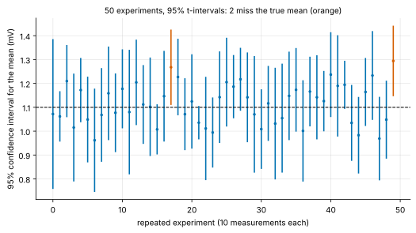
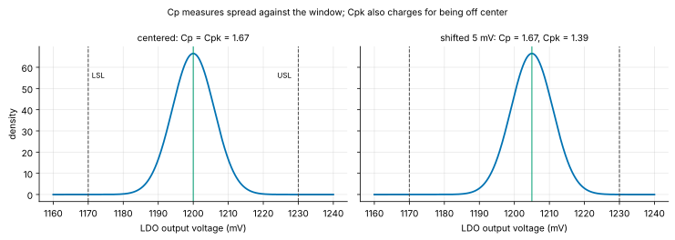
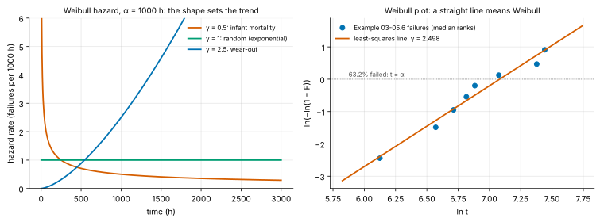

<!-- status: reviewed -->
# 03-05 · Estimation and Hypothesis Testing for Engineers

| | |
|---|---|
| **Course** | [03 · Probability, Statistics and Random Variables for EE](../README.md) |
| **University equivalent** | The statistics units of a junior probability and statistics course for engineers (MIT 6.041/6.431 classical statistics: estimators, confidence intervals, hypothesis testing; Montgomery & Runger, *Applied Statistics and Probability for Engineers*, chapters on estimation, tests, process capability and reliability; Leon-Garcia, chapter 8) |
| **Prerequisites** | [03-04 Joint Distributions, Correlation and the CLT](03-04-joint-distributions-and-clt.md) (standard error, CLT, regression line), [03-02](03-02-random-variables-and-distributions.md) (Q-function, Poisson, exponential lifetimes), [03-01](03-01-probability-in-ee-language.md) (zero-error tests, LTPD) |
| **Estimated study hours** | 6 |
| **Last verified** | 2026-11-18 |

**Learning objectives.** After this chapter you can:

1. Estimate a mean, a variance and a proportion from data, explain bias and why the sample variance divides by $n - 1$, and compute standard errors.
2. Construct and correctly interpret confidence intervals for a mean (z and Student-t), a proportion, a variance or noise power (chi-square), and an upper bound on a failure rate from a count of failures.
3. Run a hypothesis test with a stated significance level, compute a p-value, compare two groups (independent or paired), and size a test for a required power, while avoiding the multiple-testing trap.
4. Compute Cp and Cpk, convert them to defect rates, judge them against automotive thresholds, and account for the sampling error of an estimated Cpk.
5. Model lifetimes with the Weibull distribution, fit it on a Weibull plot by least squares, and convert an accelerated life test into a field failure rate with the Arrhenius model.

## 1. Big picture

Chapters 03-01 to 03-04 ran forward: given a model, predict the data. Engineering usually runs backward: given data, what can we say about the process that produced it, and how sure are we? That is **statistics**. A characterization engineer has 30 parts and must state an offset voltage. A product team has 231 parts that survived 1000 hours at 125 °C and must state a field failure rate. A fab has a process with a measured Cpk of 1.5 and a customer that requires 1.33. Each needs an **estimate**, an honest statement of its **uncertainty**, and sometimes a **decision** with known error rates.

- **Characterization and datasheets:** typical and guaranteed values are estimates with confidence levels ([20](../../20-analog-and-mixed-signal-ic-design/README.md)).
- **Manufacturing:** process capability (Cp, Cpk) and outlier screening govern automotive and industrial supply ([25](../../25-fabrication-packaging-test-and-reliability/README.md)).
- **Reliability:** FIT claims rest on accelerated tests, Arrhenius extrapolation and Poisson confidence bounds ([25](../../25-fabrication-packaging-test-and-reliability/README.md)).
- **Diligence:** almost every performance or quality claim you will evaluate is a statistic; knowing what it assumes is the skeptic's main tool ([28](../../28-technical-diligence-and-leadership-fluency/README.md)).

## 2. Intuition first

**An estimate is a random variable.** Measure 10 parts, average them, and you get a number. Measure 10 different parts and you get a different number. The **estimator** (the recipe) has a distribution, the **sampling distribution**, and its spread is the uncertainty of any single estimate. Everything in this chapter follows from computing that distribution with the tools of 03-02 to 03-04.

**A confidence interval is a net thrown at a fixed target.** The true mean does not move; the interval does, from experiment to experiment. A "95% confidence interval" is a recipe whose nets catch the true value in 95% of experiments (Figure 1). It is not a 95% probability that the true value lies in *this particular* interval. *Where the picture breaks:* a real thrower could walk over and check each net; you never learn which of your intervals missed.

*Figure 1. Fifty experiments, fifty different intervals: about 95% of them catch the fixed true mean. Any single interval either contains it or does not.*

**A hypothesis test is a court with a presumption.** The null hypothesis is presumed (the process has not changed, the vendor's rate is right), and data must be surprising enough under it to convict. The significance level is the conviction rate of the innocent, and the power is the conviction rate of the guilty. *Where it breaks:* a court weighs evidence qualitatively and never states its error rates; a test fixes α in advance, and its verdict says nothing about the probability that $H_0$ is true.

**A finance analogy, and its limits.** You estimate expected returns and volatilities from history, and you know that a Sharpe ratio from three years of data is noisy and that backtests overfit. The same disciplines apply. *Where the analogy breaks:* engineers can usually run new, controlled experiments and design them for the precision they need (sample size, stress level), while markets offer one history. And engineering processes, unlike markets, are often stable enough that the independent, identically distributed assumption is reasonable, if it is checked.

## 3. Theory

### 3.1 Estimators, bias and the sample variance

Let $X_1, \dots, X_n$ be independent measurements from a distribution with mean μ and variance σ². An **estimator** is a function of the data used to guess a parameter. Its **bias** is $\mathbb{E}[\hat\theta] - \theta$ and its quality is often summarized by the **mean square error**, $\text{MSE} = \mathbb{E}[(\hat\theta - \theta)^2] = \text{bias}^2 + \operatorname{Var}(\hat\theta)$.

The **sample mean** $\bar X = \frac1n\sum X_i$ is unbiased with standard error $\sigma/\sqrt n$ (03-04).

The **sample variance** is

$$
S^2 = \frac{1}{n - 1}\sum_{i=1}^n(X_i - \bar X)^2 .
$$

*Why $n - 1$?* Expand around the true mean, using $\sum(X_i - \mu) = n(\bar X - \mu)$ for the cross term:

$$
\sum\big[(X_i - \mu) - (\bar X - \mu)\big]^2 = \sum(X_i - \mu)^2 - 2(\bar X - \mu)\cdot n(\bar X - \mu) + n(\bar X - \mu)^2 = \sum(X_i - \mu)^2 - n(\bar X - \mu)^2 .
$$

 Taking expectations, $\mathbb{E}\big[\sum(X_i - \bar X)^2\big] = n\sigma^2 - n\cdot\sigma^2/n = (n - 1)\sigma^2$. The deviations are measured from $\bar X$, which is fitted to the same data and so sits closer to them than μ does; one of the $n$ "degrees of freedom" is used up estimating the mean. Dividing by $n - 1$ makes $\mathbb{E}[S^2] = \sigma^2$. (The sample standard deviation $S$ is still slightly biased low, because the square root is concave; for $n \ge 10$ the bias is under 3% and usually ignored.)

A **proportion**, such as a yield, is a mean of indicators: $\hat p = (\text{number of successes})/n$, unbiased with standard error $\sqrt{p(1 - p)/n}$.

### 3.2 Confidence intervals

**Mean, σ known.** By the CLT, $\bar X$ is approximately $\mathcal{N}(\mu, \sigma^2/n)$, so $P\big(|\bar X - \mu| \le z\sigma/\sqrt n\big) = 1 - 2Q(z)$. Choosing $z = z_{\alpha/2}$ with $Q(z_{\alpha/2}) = \alpha/2$ (an *upper-tail* critical value: $z_a$ and $t_{a,\nu}$ leave probability $a$ above them) gives the $100(1 - \alpha)\%$ interval

$$
\bar X \pm z_{\alpha/2}\frac{\sigma}{\sqrt n}, \qquad z_{0.025} = 1.960 \text{ for 95\%} .
$$

**Mean, σ unknown: Student's t.** Replacing σ by $S$ adds uncertainty. For Gaussian data the ratio $T = (\bar X - \mu)/(S/\sqrt n)$ follows the **Student t distribution** with $\nu = n - 1$ degrees of freedom, which has heavier tails than the Gaussian and approaches it as ν grows. The interval becomes $\bar X \pm t_{\alpha/2, \nu}S/\sqrt n$. The 95% multiplier $t_{0.025,\nu}$ is **2.776** for ν = 4, **2.262** for ν = 9, **2.045** for ν = 29 and **1.984** for ν = 99, against 1.960 for the Gaussian: with fewer than about 30 samples, using 1.96 noticeably overstates your precision.

**Proportions.** For large $n$, $\hat p \pm z_{\alpha/2}\sqrt{\hat p(1 - \hat p)/n}$. With zero failures in $n$ trials this formula collapses to zero width, which is absurd. Use the exact bound of 03-01 instead: $p_U = 1 - \alpha^{1/n} \approx -\ln\alpha/n$, which is the "**rule of three**": with no failures in $n$ trials, the 95% upper bound on the failure probability is about $3/n$.

**Variance and noise power: the chi-square interval.** For Gaussian data, $\nu S^2/\sigma^2$ has the **chi-square distribution** with ν = n − 1 degrees of freedom (the sum of ν squared standard normals, 03-03). If the mean is known to be zero, as for AC-coupled noise, use the mean square $\hat\sigma_0^2 = \frac1n\sum X_i^2$ in place of $S^2$, with ν = n. Then

$$
\frac{\nu S^2}{\chi^2_{1-\alpha/2,\nu}} \le \sigma^2 \le \frac{\nu S^2}{\chi^2_{\alpha/2,\nu}} ,
$$

where $\chi^2_{q,\nu}$ is the *lower-tail* $q$ quantile (probability $q$ below it). Beware: many texts, Montgomery and Runger among them, write the same number as $\chi^2_{1-q,\nu}$. Unlike the t-interval, this interval fails badly for non-Gaussian data (heavy tails, deterministic components), so check the shape first. Variances are hard to pin down: with 50 samples the 95% interval spans more than a factor of two (Example 03-05.3). This is 03-03's warning about noise-power samples made quantitative.

> **Going deeper — where Student's t comes from.** For Gaussian data, $\bar X$ and $S^2$ are independent (a special property of the Gaussian), $Z = (\bar X - \mu)/(\sigma/\sqrt n)$ is standard normal, and $V = \nu S^2/\sigma^2$ is chi-square with ν degrees of freedom. Then $T = Z/\sqrt{V/\nu}$, a standard normal divided by an independent estimate of its own scale. Working out its density by the methods of 03-03 and 03-04 gives $f_T(t) \propto (1 + t^2/\nu)^{-(\nu+1)/2}$, whose polynomial tails explain the larger multipliers. W. S. Gosset derived it in 1908 while working on small-sample quality control at a brewery, publishing as "Student".

### 3.3 Counting failures: Poisson confidence bounds

Reliability tests count failures $c$ in a known number of device-hours $D$. If failures are Poisson with rate $r$ per device-hour, the **one-sided upper confidence bound** at confidence $1 - \alpha$ is the rate at which seeing $c$ or fewer failures would have probability only α:

$$
P(N \le c;\ \lambda = rD) = \alpha \quad\Longrightarrow\quad r_U = \frac{\lambda_U(c)}{D}, \qquad \lambda_U(c) = \tfrac12\chi^2_{1-\alpha,\,2c+2} .
$$

*Why chi-square?* Think of failures as a unit-rate Poisson process in "λ-time". Seeing $c$ or fewer by time λ means the $(c + 1)$th arrival came later: $\{N \le c\} = \{T_{c+1} > \lambda\}$. The arrival time $T_{c+1}$ is a sum of $c + 1$ independent unit exponential gaps (03-02; Problem 03-04.8 builds its density by convolution). Twice a unit exponential is chi-square with 2 degrees of freedom, because 03-04 showed that $Z_1^2 + Z_2^2$ is exponential with mean 2. So $2T_{c+1}$ is chi-square with $2c + 2$ degrees of freedom, $P(N \le c;\ \lambda) = P(\chi^2_{2c+2} > 2\lambda)$, and setting this to α gives the formula. For $c = 0$ it reduces to $e^{-\lambda_U} = \alpha$, or $\lambda_U = -\ln\alpha$, the zero-error rule of 03-01. Values of $\lambda_U$:

| Failures $c$ | 60% confidence | 90% confidence | 95% confidence |
|---|---|---|---|
| 0 | 0.9163 | 2.303 | 2.996 |
| 1 | 2.022 | 3.890 | 4.744 |
| 2 | 3.105 | 5.322 | 6.296 |

Each failure observed raises the bound, and higher confidence raises it further: a FIT number means nothing without its confidence level.

### 3.4 Hypothesis testing

A test has five parts.

1. **Null hypothesis** $H_0$, the presumption (for example, mean leakage is still 100 nA), and an **alternative** $H_1$ (it has fallen).
2. A **test statistic** whose distribution under $H_0$ is known, for example $Z = (\bar X - \mu_0)/(\sigma/\sqrt n)$.
3. A **significance level** α, the accepted probability of rejecting a true $H_0$ (a **type I error**, false alarm), commonly 0.05.
4. The **p-value**: the probability, under $H_0$, of a statistic at least as extreme as the one observed. Reject $H_0$ if $p \le \alpha$.
5. The **power** $1 - \beta$: the probability of rejecting $H_0$ when a specified alternative is true; β is the **type II error** (missed detection) rate.

**One-sided or two-sided.** If only a decrease matters, the p-value counts one tail; if any change matters, both tails, which doubles it.

**Sizing a test.** To detect a fall δ in a mean, reject when $\bar X \le \mu_0 - z_\alpha\sigma/\sqrt n$, which has probability α under $H_0$. Under $H_1$ the sample mean is centered at $\mu_0 - \delta$ with the same standard error, so the power is $\Phi(\delta\sqrt n/\sigma - z_\alpha)$. Picture two Gaussians δ apart with the threshold between them, $z_\alpha$ standard errors from one center and $z_\beta$ from the other. Setting the power to $1 - \beta$ means $\delta\sqrt n/\sigma - z_\alpha = z_\beta$, so

$$
n = \Big(\frac{(z_\alpha + z_\beta)\,\sigma}{\delta}\Big)^2 .
$$

Halving the detectable shift quadruples the sample size, the $1/\sqrt n$ law again.

**Comparing two groups.** Most real questions compare: vendor A with vendor B, a split lot before and after a process change. For independent samples the variances of the two means add (03-04), so the difference $\bar X_1 - \bar X_2$ has standard error

$$
\text{SE} = \sqrt{\frac{s_1^2}{n_1} + \frac{s_2^2}{n_2}}, \qquad \nu \approx \frac{\text{SE}^4}{(s_1^2/n_1)^2/(n_1 - 1) + (s_2^2/n_2)^2/(n_2 - 1)} ,
$$

and $(\bar X_1 - \bar X_2)/\text{SE}$ is compared with $z$ for large samples, or with Student's t on ν degrees of freedom (the **Welch t-test**). **Paired data**, the same units measured twice, reduce to one sample: test the mean of the differences, whose spread excludes the unit-to-unit variation and is often far smaller (Problem 03-05.17). For **two proportions**, such as yields, use $\hat p_1 - \hat p_2$ with standard error $\sqrt{\hat p(1 - \hat p)(1/n_1 + 1/n_2)}$, where $\hat p$ pools both samples under $H_0$ (Example 03-05.8).

**Statistical versus engineering significance.** With enough data, any trivially small change becomes "statistically significant"; with too little, important changes go undetected. Report the estimated effect with its confidence interval, not just the verdict.

**The multiple-testing trap.** Test 20 independent parameters at α = 0.05 on a process that has not changed, and the chance that at least one "fails" is $1 - 0.95^{20} = $ **0.6415**. Characterization across many corners, bins and parameters will always find something unless the significance level is adjusted (the simplest adjustment, Bonferroni, tests each at α/m).

### 3.5 Process capability: Cp and Cpk

A characteristic with specification limits LSL and USL, produced by a stable process with mean μ and standard deviation σ, has **capability indices**

$$
C_p = \frac{\text{USL} - \text{LSL}}{6\sigma}, \qquad C_{pk} = \min\Big(\frac{\text{USL} - \mu}{3\sigma},\ \frac{\mu - \text{LSL}}{3\sigma}\Big) .
$$

$C_p$ compares the window with the process's ±3σ spread; $C_{pk}$ measures the distance from the mean to the *nearer* limit in units of 3σ, so it also charges for being off center (Figure 2). For a Gaussian process the fraction outside is $Q(3C_{pu}) + Q(3C_{pl})$; the nearer limit alone contributes $Q(3C_{pk})$. Centered processes give the following (03-02):

| $C_p$ (centered) | Window | Out of specification |
|---|---|---|
| 1.00 | ±3σ | 2700 ppm |
| 1.33 (exactly 4/3) | ±4σ | 63.34 ppm |
| 1.67 (exactly 5/3) | ±5σ | 0.5733 ppm |
| 2.00 | ±6σ | 1.973 ppb |

The NIST/SEMATECH e-Handbook tabulates these as 0.27%, 64 ppm, 0.6 ppm and 2 ppb ([R-068](../../../reference/research-log.md#r-068--process-capability-and-outlier-screening)).

*Figure 2. The same spread centered and shifted by 5 mV. Cp is unchanged; Cpk falls because the mean moved toward the upper limit. (The out-of-specification tails, a few ppm, are too thin to see at this scale.)*

**Cpk versus Ppk, and control charts.** $P_p$ and $P_{pk}$ use the same formulas with the *overall* σ of all the data, including drift and lot-to-lot shifts; $C_p$ and $C_{pk}$ use the short-term, *within-subgroup* σ (for example, within each hourly sample). By 03-04's total variance, overall variance = within + between, so the two agree only for a process **in statistical control**, one whose subgroup means stay inside limits at ±3 standard errors around the grand mean on a **control chart**, the basic tool of **statistical process control** (SPC). A Cpk well above Ppk says the process drifts.

**Automotive thresholds.** The AIAG manuals (1995 editions, as quoted by Steiner et al.; current editions not checked) set a default of $C_{pk} \ge 1.33$ for stable ongoing production, and judge preliminary studies, unstable but predictable processes and significant characteristics on $P_{pk}$, expecting ≥ 1.67, unless the customer specifies otherwise. AEC-Q100 applies $C_{pk} > 1.67$ to electrical distributions where applicable ([R-068](../../../reference/research-log.md#r-068--process-capability-and-outlier-screening)).

**An estimated Cpk is itself uncertain.** With $\bar x$ and $s$ in place of μ and σ, $\hat C_{pk}$ scatters around the truth. A widely used normal approximation (Bissell, 1990; the NIST/SEMATECH e-Handbook states it for the one-sided indices $C_{pu}$ and $C_{pl}$, the smaller of which is $C_{pk}$) for its standard error is

$$
\text{SE}(\hat C_{pk}) \approx \sqrt{\frac{1}{9n} + \frac{\hat C_{pk}^2}{2(n - 1)}} .
$$

With 30 parts and $\hat C_{pk} = 1.5$, the standard error is about 0.21: a measured 1.5 does not demonstrate 1.33 (Example 03-05.5, Problem 03-05.12). Capability claims from small samples deserve their confidence bound.

**Outlier screening with robust statistics.** Automotive suppliers also screen parts that pass specification but sit far from their population, on the theory that "abnormal" parts are more likely to fail early. AEC-Q001 Part Average Testing sets static limits at the **robust mean** (the median) ± 6 **robust sigma**, where robust sigma is the interquartile range divided by 1.35 ([R-068](../../../reference/research-log.md#r-068--process-capability-and-outlier-screening)). The 1.35 is the Gaussian's interquartile range in units of σ, $2Q^{-1}(0.25) = $ **1.349**, and median and quartiles barely move when a few outliers are present, whereas the ordinary mean and standard deviation are dragged toward them.

### 3.6 Reliability statistics and the Weibull distribution

For a lifetime $T$ with density $f$ and reliability $R(t) = P(T > t)$, the **hazard rate** is the failure rate among survivors:

$$
h(t) = \frac{f(t)}{R(t)} = -\frac{d}{dt}\ln R(t), \qquad R(t) = \exp\Big(-\int_0^th(u)\,du\Big) .
$$

The exponential has constant hazard (03-02). The **Weibull distribution** lets the hazard rise or fall:

$$
R(t) = e^{-(t/\alpha)^\gamma}, \qquad h(t) = \frac{\gamma}{\alpha}\Big(\frac{t}{\alpha}\Big)^{\gamma - 1} ,
$$

with **characteristic life** α (the time by which 63.2% have failed, since $R(\alpha) = e^{-1}$) and **shape** γ (Figure 3). With γ < 1 the hazard falls, the signature of infant mortality; γ = 1 is the exponential; γ > 1 is wear-out. These are the three regions of the bathtub curve. Its mean is $\alpha\Gamma(1 + 1/\gamma)$ and its median $\alpha(\ln2)^{1/\gamma}$. The NIST/SEMATECH e-Handbook notes that the Weibull can be derived as an extreme-value ("weakest link") distribution, the time to the first of many competing failure processes, which suits dielectric breakdown and other weakest-link mechanisms ([R-069](../../../reference/research-log.md#r-069--weibull-model-and-arrhenius-acceleration)). Not every mechanism is Weibull: electromigration lifetimes are conventionally **lognormal** (03-03), described by a median life $t_{50}$ and the standard deviation of $\ln t$ ([R-072](../../../reference/research-log.md#r-072--lifetime-distributions-by-failure-mechanism)). (Here α is the Weibull scale, following the NIST handbook, not a significance level; many reliability texts write η.)

*Figure 3. Left: the shape parameter decides whether risk falls, stays constant or rises with age. Right: on Weibull axes the data fall on a line whose slope is γ (Example 03-05.6).*

**Engineers quote percentile lives.** The $B_p$ life is the time by which $p$% of units fail: $B_{10} = \alpha(-\ln0.9)^{1/\gamma}$. For wear-out mechanisms a $B_{0.1}$ or $B_{0.01}$ life matters more than the MTTF.

**The Weibull plot.** Taking logarithms twice linearizes the CDF:

$$
\ln\big(-\ln(1 - F(t))\big) = \gamma\ln t - \gamma\ln\alpha .
$$

Sort $n$ failure times, assign each the plotting position $F_i \approx (i - 0.3)/(n + 0.4)$ (Bernard's median-rank approximation), and plot $y_i = \ln(-\ln(1 - F_i))$ against $x_i = \ln t_i$. A straight line confirms the model; its least-squares slope estimates γ and its intercept gives α. The recipe assumes every unit failed. With survivors (suspensions), the normal case in reliability testing, the ranks must be adjusted or the fit done by maximum likelihood ([25](../../25-fabrication-packaging-test-and-reliability/README.md)).

> **Math refresher — least squares.** To fit $y = a + bx$ to points $(x_i, y_i)$, minimize $\sum(y_i - a - bx_i)^2$. Setting both partial derivatives to zero gives $b = \sum(x_i - \bar x)(y_i - \bar y)/\sum(x_i - \bar x)^2$ and $a = \bar y - b\bar x$: the sample version of 03-04's regression line, with slope $\widehat{\operatorname{Cov}}/\widehat{\operatorname{Var}}$. [01-09](../../01-calculus-for-engineers/chapters/01-09-multivariable-calculus-1.md) derived it as an optimization problem.

### 3.7 Accelerated life testing and the Arrhenius model

Parts are designed to last years, so reliability is demonstrated by stressing them harder: higher temperature, voltage or humidity. For thermally activated mechanisms the **Arrhenius model** gives a rate proportional to $e^{-E_a/(kT)}$, with activation energy $E_a$ (eV), Boltzmann's constant $k = 8.617\times10^{-5}$ eV/K and absolute temperature $T$. The **acceleration factor** between stress and use temperatures is

$$
AF = \frac{r(T_{\text{stress}})}{r(T_{\text{use}})} = \exp\Big[\frac{E_a}{k}\Big(\frac{1}{T_{\text{use}}} - \frac{1}{T_{\text{stress}}}\Big)\Big] .
$$

JEDEC's qualification standard JESD47 (Rev G, 2009) runs high-temperature operating life (HTOL) at a junction temperature of at least 125 °C for 1000 hours on three lots of 77 units with zero failures ([R-061](../../../reference/research-log.md#r-061--qualification-sample-sizes-aec-q100-and-jedec-jesd47)). Its explanatory note works the example of $E_a = 0.7$ eV, 125 °C stress and 55 °C use, giving "78.6", so that 1000 h of stress is "equivalent to 9 years of use" ([R-069](../../../reference/research-log.md#r-069--weibull-model-and-arrhenius-acceleration)). With the exact constants ($k = 8.617333\times10^{-5}$ eV/K, kelvin = °C + 273.15) the factor is **77.65**, about 8.9 years; the note's 78.6 comes from rounding $k$ to $8.6\times10^{-5}$ and the offset to 273. The point is not the third digit: the factor is exponential in $E_a$, which is often uncertain by ±0.2 eV, so the field rate inferred from a test is uncertain by much more than the test's statistics suggest (Problem 03-05.16).

Combining §3.3 and §3.7: zero failures in $N$ units for $t$ hours at acceleration $AF$ bounds the use-condition failure rate at

$$
r_U = \frac{\lambda_U(0)}{N\,t\,AF}, \qquad \text{FIT}_U = 10^9\,r_U .
$$

## 4. Worked examples

### Example 03-05.1 — Characterizing an offset voltage (tier A)

**Setup.** Ten amplifiers have input offsets (mV) 1.2, 0.8, 1.5, 0.9, 1.1, 1.4, 0.7, 1.3, 1.0, 1.1. Find the sample mean, the sample standard deviation, the standard error and a 95% confidence interval for the mean offset. How much narrower would a (wrong) z-interval be?

**Solution.** \$\bar x = 11.0/10 = \$ **1.1 mV**. The squared deviations sum to 0.60 mV², so $s^2 = 0.60/9$ and \$s = \$ **0.2582 mV**. The standard error is \$s/\sqrt{10} = \$ **0.08165 mV**. With $t_{0.025,9} = 2.262$, the interval is $1.1 \pm 0.1847$: **[0.9153, 1.285] mV**. A z-interval would use 1.960, a half-width of **0.1600 mV**, 13% too narrow.

**Interpretation.** The interval describes the *mean* offset of the population. Individual parts spread about $\pm2s$, roughly 0.6 to 1.6 mV, which is what a datasheet's maximum must cover: a confidence interval for the mean is not a tolerance interval for parts.

### Example 03-05.2 — Yield with a confidence interval, and a zero-failure bound (tier B)

**Setup.** (a) A test floor passes 912 of 1000 dies. Find the yield estimate, its standard error and a 95% confidence interval. (b) A different lot ships 300 parts to a customer with zero returns. What is the 95% upper bound on the return rate?

**Solution.** (a) \$\hat p = \$ **0.912**, standard error \$\sqrt{0.912\times0.088/1000} = \$ **0.008959**, and the 95% interval is $0.912 \pm 0.01756$: **[0.8944, 0.9296]**. Distinguishing yields that differ by one point takes thousands of dies per group (Example 03-05.8).

(b) \$p_U = 1 - 0.05^{1/300} = \$ **0.009936**, close to the rule of three, $3/300 = 0.01$. Zero returns from 300 parts cannot demonstrate better than about 1%.

### Example 03-05.3 — How well can you measure noise power? (tier B)

**Setup.** A designer records 50 independent samples of AC-coupled (zero-mean) Gaussian noise and finds a mean square of 1.00 mV². Find a 95% confidence interval for the true noise power, in mV² and in dB relative to the estimate.

**Solution.** With the mean known to be zero, ν = 50 and $50\hat\sigma^2/\sigma^2$ is chi-square with 50 degrees of freedom, whose 2.5% and 97.5% quantiles are **32.36** and **71.42**. So

$$
\frac{50\times1.00}{71.42} \le \sigma^2 \le \frac{50\times1.00}{32.36} ,
$$

that is, **[0.7001, 1.545] mV²**, or **−1.549 dB to +1.890 dB** around the estimate. Fifty samples pin the noise power only to within about ±1.7 dB; resolving 0.1 dB needs on the order of $10^4$ independent samples, which is why noise measurements average over long records and wide bandwidths.

### Example 03-05.4 — Testing a vendor's soft-error rate (tier B)

**Setup.** A vendor's rate predicts a mean of λ₀ = $10^4\times1140\text{ FIT}\times8766\text{ h} = 99.932$ upsets per year across a fleet (Example 03-02.2). A year of operation records 80. (a) Test $H_0$: the vendor's rate is right, against $H_1$: the true rate is lower, at α = 0.05. (b) If the true rate were 20% lower, how likely is this test to detect it?

**Solution.** (a) Under $H_0$ the count is Poisson(99.932). The one-sided p-value is \$P(N \le 80) = \$ **0.02300** (03-02). Since 0.023 < 0.05, reject $H_0$: the fleet's rate is significantly below the vendor's figure, perhaps because of altitude, shielding or conservative vendor data.

(b) The rejection region is $N \le k$ with $P(N \le k \mid H_0) \le 0.05$; the largest such $k$ is **83** (probability **0.04696**). If the true mean is $0.8\times99.932 = 79.946$, the power is \$P(N \le 83 \mid 79.946) = \$ **0.6602**: a one-year, fleet-wide test misses a 20% reduction a third of the time.

**Practitioner note.** Before acting on (a), ask whether the fleet's logging catches every upset (an undercount looks like a lower rate) and whether conditions match the vendor's normalization (03-02's rates are normalized to a New York City reference flux).

### Example 03-05.5 — Capability of an LDO output (tier B)

**Setup.** An LDO's output specification is 1.200 V ± 30 mV. The process has mean 1.205 V and σ = 6 mV. (a) Find Cp, Cpk and the expected out-of-specification rate. (b) Judge it against the AIAG thresholds. (c) The numbers came from a 30-part study. Find an approximate 95% lower confidence bound on Cpk.

**Solution.** (a) $C_p = 60/36 = $ **1.667**. $C_{pu} = (1.230 - 1.205)/0.018 = $ **1.389** and $C_{pl} = (1.205 - 1.170)/0.018 = $ **1.944**, so $C_{pk} = $ **1.389**. The out-of-specification rate is $Q(25/6) + Q(35/6) = $ **15.46 ppm**, almost all from the upper limit.

(b) It meets the 1.33 default for stable ongoing production. A preliminary study or a significant characteristic is judged on Ppk against 1.67; if this σ already includes lot-to-lot drift, Ppk = 1.389 falls short. Centering the process (moving 5 mV) would raise the index to 1.667 without touching the spread, usually the cheaper fix.

(c) $\text{SE} \approx \sqrt{1/270 + 1.389^2/58} = $ **0.1923**, so the one-sided 95% lower bound is $1.389 - 1.645\times0.1923 = $ **1.073**. Thirty parts do not even demonstrate 1.33 with confidence.

### Example 03-05.6 — A Weibull fit to stress-test failures (tier C)

**Setup.** Eight gate-oxide test capacitors fail on an accelerated time-dependent dielectric breakdown (TDDB) stress, in which a sustained electric field eventually shorts the oxide, at 457, 714, 823, 912, 976, 1182, 1600 and 1706 hours. Fit a Weibull distribution on a Weibull plot, and find the $B_{10}$ life and the MTTF at stress.

**Solution.** Plotting positions $F_i = (i - 0.3)/8.4$ run from **0.08333** to **0.9167**. With $x_i = \ln t_i$ and $y_i = \ln(-\ln(1 - F_i))$, the means are $\bar x = 6.875$ and $\bar y = -0.5141$, and the least-squares slope is \$\hat\gamma = \$ **2.498** (Figure 3). The intercept $\bar y - \hat\gamma\bar x$ equals $-\hat\gamma\ln\hat\alpha$, giving \$\hat\alpha = \$ **1189 h**.

$B_{10} = 1189\times(-\ln0.9)^{1/2.498} = $ **483.1 h** and $\text{MTTF} = 1189\,\Gamma(1 + 1/2.498) = $ **1055 h**.

**Interpretation.** γ ≈ 2.5 means wear-out: the hazard rises with age, so an MTTF or a FIT rate from this mechanism would be meaningless; the low percentiles matter. With eight failures the estimates are uncertain: Lab 03-05 shows γ̂ from repeated eight-unit tests ranging from about 1.3 to 4.2 (5th to 95th percentile) when the true value is 2.5. Field lifetimes follow by scaling α with an acceleration model for voltage and temperature ([25](../../25-fabrication-packaging-test-and-reliability/README.md)).

### Example 03-05.7 — From an HTOL test to a field FIT bound (tier C)

**Setup.** A qualification runs 231 units (3 lots × 77) for 1000 h at a junction temperature of 125 °C with zero failures. Assume a single mechanism with $E_a = 0.7$ eV and use at 55 °C, and a year of 8766 h. (a) Find the acceleration factor and the equivalent field time. (b) Find upper bounds on the field failure rate at 60% and 90% confidence. (c) What bound at 90% if one unit had failed? (d) How many units would a zero-failure, 1000 h test need to demonstrate 10 FIT at 90% confidence?

**Solution.** (a) \$AF = \exp\big[(0.7/8.617333\times10^{-5})(1/328.15 - 1/398.15)\big] = \$ **77.65**, so 1000 h of stress represents $77{,}650$ h, or **8.858 years**, of use per unit.

(b) Equivalent device-hours $D = 231\times1000\times77.65 = 1.794\times10^7$. At 60%, $\lambda_U = 0.9163$ gives **51.09 FIT**; at 90%, $\lambda_U = 2.303$ gives **128.4 FIT**.

(c) With one failure, $\lambda_U = 3.890$: **216.9 FIT** at 90%.

(d) $D \ge 2.303\times10^9/10 = 2.303\times10^8$ equivalent hours, so $N \ge 2.303\times10^8/(1000\times77.65)$: **2966** units.

**Interpretation.** A standard qualification demonstrates only tens to a hundred FIT; single-digit FIT claims rest on far larger data sets (accumulated qualification and field data across products) or on longer tests, and every one rests on the assumed $E_a$. Ask for the confidence level, the device-hours and the activation energy behind any FIT number.

### Example 03-05.8 — A split-lot yield comparison (tier B)

**Setup.** A split lot runs 1000 dies through the old recipe A (912 pass) and 1000 through a new recipe B (931 pass). (a) At α = 0.05, one-sided, is B better? (b) How many dies per arm would detect a true improvement from 0.91 to 0.92 with 80% power?

**Solution.** (a) Under $H_0$ (equal yields) the pooled estimate is \$\hat p = 1843/2000 = \$ **0.9215**, so

$$
\text{SE} = \sqrt{0.9215\times0.0785\times\big(\tfrac1{1000} + \tfrac1{1000}\big)} = 0.01203, \qquad z = \frac{0.931 - 0.912}{0.01203} = 1.580 .
$$

So SE = **0.01203** and $z = $ **1.580**, with p-value $Q(1.580) = $ **0.05710**: not significant at 5%, although B's yield is 1.9 points higher.

(b) The sizing argument of §3.4, with each arm's variance $p(1 - p)$ and $z_{0.2} = 0.8416$, gives

$$
n = \frac{(z_{0.05} + z_{0.2})^2\,\big(0.91\times0.09 + 0.92\times0.08\big)}{0.01^2} = 9613.9 ,
$$

so **9614** dies per arm. **Sanity check.** At 1000 per arm, the standard error of a difference (about 1.2 points) exceeds the 1-point effect: small yield gains need large splits, or paired designs that cancel wafer-to-wafer variation.

<!-- answer-key -->
| ID | Quantity | Value | Unit |
|---|---|---|---|
| Ex 03-05.1a | sample mean | 1.1 | mV |
| Ex 03-05.1b | sample standard deviation | 0.2582 | mV |
| Ex 03-05.1c | standard error | 0.08165 | mV |
| Ex 03-05.1d | t multiplier, 9 degrees of freedom | 2.262 | — |
| Ex 03-05.1e | lower 95% limit | 0.9153 | mV |
| Ex 03-05.1f | upper 95% limit | 1.285 | mV |
| Ex 03-05.1g | z-interval half-width | 0.1600 | mV |
| Ex 03-05.2a | yield estimate | 0.912 | — |
| Ex 03-05.2b | standard error | 0.008959 | — |
| Ex 03-05.2c | lower 95% limit | 0.8944 | — |
| Ex 03-05.2d | upper 95% limit | 0.9296 | — |
| Ex 03-05.2e | 95% upper bound, zero in 300 | 0.009936 | — |
| Ex 03-05.3a | chi-square 2.5% quantile, 50 df | 32.36 | — |
| Ex 03-05.3b | chi-square 97.5% quantile, 50 df | 71.42 | — |
| Ex 03-05.3c | lower limit of noise power | 0.7001 | mV² |
| Ex 03-05.3d | upper limit of noise power | 1.545 | mV² |
| Ex 03-05.3e | lower limit relative to estimate | −1.549 | dB |
| Ex 03-05.3f | upper limit relative to estimate | 1.890 | dB |
| Ex 03-05.4a | p-value | 0.02300 | — |
| Ex 03-05.4b | critical count | 83 | — |
| Ex 03-05.4c | actual significance level | 0.04696 | — |
| Ex 03-05.4d | power against a 20% lower rate | 0.6602 | — |
| Ex 03-05.4e | fleet mean under the vendor's rate | 99.932 | — |
| Ex 03-05.4f | fleet mean 20% lower | 79.946 | — |
| Ex 03-05.5a | Cp | 1.667 | — |
| Ex 03-05.5b | Cpu | 1.389 | — |
| Ex 03-05.5c | Cpk | 1.389 | — |
| Ex 03-05.5g | Cpl | 1.944 | — |
| Ex 03-05.5d | out-of-specification rate | 15.46 | ppm |
| Ex 03-05.5e | standard error of Cpk, n = 30 | 0.1923 | — |
| Ex 03-05.5f | 95% lower bound on Cpk | 1.073 | — |
| Ex 03-05.6a | Weibull shape estimate | 2.498 | — |
| Ex 03-05.6b | characteristic life estimate | 1189 | h |
| Ex 03-05.6c | B10 life | 483.1 | h |
| Ex 03-05.6d | MTTF at stress | 1055 | h |
| Ex 03-05.6e | mean of ln t | 6.875 | — |
| Ex 03-05.6f | mean of y | −0.5141 | — |
| Ex 03-05.6g | first plotting position | 0.08333 | — |
| Ex 03-05.6h | last plotting position | 0.9167 | — |
| Ex 03-05.7a | acceleration factor | 77.65 | — |
| Ex 03-05.7b | equivalent field time per unit | 8.858 | years |
| Ex 03-05.7c | equivalent device-hours | 1.794×10^7 | h |
| Ex 03-05.7d | FIT bound at 60% | 51.09 | FIT |
| Ex 03-05.7e | FIT bound at 90% | 128.4 | FIT |
| Ex 03-05.7f | FIT bound at 90%, one failure | 216.9 | FIT |
| Ex 03-05.7g | units for 10 FIT at 90% | 2966 | — |
| Ex 03-05.8a | pooled yield | 0.9215 | — |
| Ex 03-05.8b | standard error of the difference | 0.01203 | — |
| Ex 03-05.8c | z statistic | 1.580 | — |
| Ex 03-05.8d | one-sided p-value | 0.05710 | — |
| Ex 03-05.8e | dies per arm, exact | 9613.9 | — |
| Ex 03-05.8f | dies per arm | 9614 | — |
| Ex 03-05.8g | z for 80% power | 0.8416 | — |

## 5. Simulate it

The lab ([labs/03-05-lab/](../labs/03-05-lab/README.md)) is a notebook of sampling experiments:

1. **Why $n - 1$.** Average the two variance estimators over many small samples. *Predict first:* how biased is dividing by $n$ when $n = 5$?
2. **Coverage.** Repeat Figure 1's experiment 20,000 times with z and t intervals at $n = 5$ and $n = 30$, and count misses.
3. **Noise power.** Check the chi-square interval's coverage for 50-sample noise measurements.
4. **Power curves.** Simulate the one-sided test of Example 03-05.4 across true rates.
5. **Cpk scatter.** Estimate Cpk from repeated 30-part and 125-part studies of the same process.
6. **Weibull plots.** Fit γ from repeated eight-unit tests and watch the scatter.
7. **FIT-bound coverage.** Simulate HTOL tests at a known rate and count how often the 90% bound covers it.

## 6. Engineering tradeoffs

| Knob | Improves | Costs | Typical decision owner |
|---|---|---|---|
| Sample size | Precision ($\propto 1/\sqrt n$), test power, demonstrable Cpk | Parts, tester time, schedule | Characterization and quality engineers |
| Confidence level (90% vs 60%) | Strength of a claim | Larger bounds for the same data, or more data | Reliability engineering, with customers |
| Significance level α | Fewer false alarms (smaller α) | Lower power: more missed real changes | Test and product engineering |
| Stress level in accelerated tests | Shorter tests, more failures to analyze | Risk of activating mechanisms absent in use; heavier reliance on $E_a$ | Reliability engineering |
| Centering versus reducing variation | Cpk (centering is often cheap) | Reducing σ needs process or design changes | Process and design engineers |
| Tight outlier screens (PAT) | Fewer latent field failures | Yield loss of good-but-unusual parts | Product and test engineering |

## 7. Numbers to know

| Quantity | Value | Note |
|---|---|---|
| 95% two-sided multipliers | z: 1.960; t: 2.776 (ν = 4), 2.262 (9), 2.045 (29), 1.984 (99) | Use t when σ is estimated |
| Zero failures in $n$ | 95% upper bound ≈ $3/n$ | Rule of three |
| Poisson upper bounds, $c = 0$ | 0.9163 (60%), 2.303 (90%), 2.996 (95%) | $-\ln\alpha$ |
| False alarms in 20 tests at 5% | 64.15% | Adjust α for many tests |
| Cp → ppm (centered) | 1.00: 2700; 1.33: 63; 1.67: 0.57; 2.00: 0.002 | [R-068](../../../reference/research-log.md#r-068--process-capability-and-outlier-screening) |
| AIAG default capability (1995 manuals; current editions not checked) | Cpk ≥ 1.33 stable ongoing; Ppk ≥ 1.67 preliminary or significant | Customer requirements override |
| Robust sigma | interquartile range / 1.349 | AEC-Q001 PAT uses 1.35 |
| Weibull shape | < 1 infant mortality; 1 random; > 1 wear-out | 63.2% failed at α |
| Arrhenius, 0.7 eV, 125 °C → 55 °C | AF = 77.65 (JEDEC's note: 78.6) | 1000 h ≈ 8.9 years |

<!-- answer-key -->
| ID | Quantity | Value | Unit |
|---|---|---|---|
| T 03-05.a | z multiplier for 95% | 1.960 | — |
| T 03-05.b | t multiplier, 4 df | 2.776 | — |
| T 03-05.c | t multiplier, 29 df | 2.045 | — |
| T 03-05.d | t multiplier, 99 df | 1.984 | — |
| T 03-05.e | 60% Poisson bound, c = 0 | 0.9163 | — |
| T 03-05.f | 60% Poisson bound, c = 1 | 2.022 | — |
| T 03-05.g | 60% Poisson bound, c = 2 | 3.105 | — |
| T 03-05.h | 90% Poisson bound, c = 0 | 2.303 | — |
| T 03-05.i | 90% Poisson bound, c = 1 | 3.890 | — |
| T 03-05.j | 90% Poisson bound, c = 2 | 5.322 | — |
| T 03-05.k | 95% Poisson bound, c = 0 | 2.996 | — |
| T 03-05.l | 95% Poisson bound, c = 1 | 4.744 | — |
| T 03-05.m | 95% Poisson bound, c = 2 | 6.296 | — |
| T 03-05.n | false-alarm probability, 20 tests | 0.6415 | — |
| T 03-05.o | out of spec at Cp = 1 | 2700 | ppm |
| T 03-05.p | out of spec at Cp = 4/3 | 63.34 | ppm |
| T 03-05.q | out of spec at Cp = 5/3 | 0.5733 | ppm |
| T 03-05.r | out of spec at Cp = 2 | 1.973 | ppb |
| T 03-05.s | Gaussian interquartile range in σ | 1.349 | — |
| T 03-05.t | standard error of Cpk 1.5 at n = 30 | 0.21 | — |
| T 03-05.u | fraction failed at the characteristic life | 63.2 | % |
| T 03-05.v | Arrhenius factor with rounded constants | 78.6 | — |
| T 03-05.w | equivalent years, rounded | 8.9 | years |
| T 03-05.x | exact 95% bound, zero failures in 1000 | 0.2991 | % |

## 8. Common mistakes

1. **Reading a 95% confidence interval as a 95% probability for this interval.** The procedure has 95% coverage; any one interval either contains the truth or not.
2. **Using z = 1.96 with a handful of samples.** With σ estimated from 5 samples the multiplier is 2.776.
3. **Confusing a confidence interval for the mean with the spread of parts.** Datasheet limits need tolerance intervals or distribution tails, not the mean's interval.
4. **Quoting a FIT rate without its confidence level, device-hours and activation energy.**
5. **Treating "not significant" as "no effect".** A weak test cannot see real changes; report the interval.
6. **Running many tests at 5% and believing every hit.**
7. **Reporting Cpk from 30 parts as if exact.** Its standard error is about 0.21 at Cpk ≈ 1.5.
8. **Using MTTF for a wear-out mechanism.** With γ > 1, low percentiles ($B_{0.1}$, $B_1$) govern field returns.

## 9. Practitioner lens

### State of the art (as of Nov 2026)

- **Capability targets come from the automotive supply chain.** AIAG's QS-9000-era manuals set default targets of $C_{pk} \ge 1.33$ for stable ongoing processes and $P_{pk} \ge 1.67$ for chronically unstable but predictable ones, and the PPAP manual ties approval to $P_{pk} > 1.67$ with interim actions between 1.33 and 1.67 (quoted by Steiner, Abraham and MacKay, University of Waterloo, 1998). A NASA NEPP comparison of AEC-Q100 with MIL-PRF-38535 (2020) lists $C_{pk} > 1.67$ for AEC-Q100 electrical distributions where applicable ([R-068](../../../reference/research-log.md#r-068--process-capability-and-outlier-screening)) **[Established; current AIAG editions are paywalled and were not read]**.
- **Outlier screening.** AEC-Q001's static Part Average Testing sets limits at the median ± 6 robust sigma (interquartile range/1.35) from a reference population of at least 30 parts per lot, with dynamic per-lot variants (described in US patent 10,118,200 quoting AEC-Q001 Rev-C) ([R-068](../../../reference/research-log.md#r-068--process-capability-and-outlier-screening)) **[Established]**.
- **Qualification and acceleration.** JEDEC JESD47G (2009) specifies 1000 h HTOL on 3 × 77 units with zero failures and explains Arrhenius acceleration with its 0.7 eV example; a standards-store listing checked in Nov 2026 shows Rev N (Aug 2026) as current, and its HTOL row was not checked ([R-061](../../../reference/research-log.md#r-061--qualification-sample-sizes-aec-q100-and-jedec-jesd47), [R-069](../../../reference/research-log.md#r-069--weibull-model-and-arrhenius-acceleration)). The NIST/SEMATECH e-Handbook of Statistical Methods (last updated 2022) remains a standard free reference for capability, Weibull and reliability methods **[Established]**.

### Why it matters commercially

Quality is sold as statistics. An automotive design-in requires capability and qualification data before a part is considered, and a supplier with Cpk 1.2 on a critical parameter is not in the running. Reliability claims (FIT, ppm, years of life) shape warranty reserves, which a finance-trained reader will recognize as real money on a balance sheet. In diligence, the gap between a target's claimed and demonstrable quality is a valuation and integration risk: a claimed "<1 ppm" backed by a few hundred units, or a "10 FIT" backed by one HTOL run, signals either undisclosed data or marketing.

### Marketing vs Reality

- **"Our part is 1 FIT."** *Reality:* a standard qualification demonstrates about 50 FIT at 60% and 130 FIT at 90% (Example 03-05.7). Ask for the device-hours, failures, confidence level and activation energy.
- **"Cpk of 2."** *Reality:* from how many parts, over what period, and is the process stable (in statistical control)? A short study on one lot overstates long-term capability. Ask for Ppk over many lots and the confidence bound.
- **"Statistically significant improvement."** *Reality:* of what size, with what interval, and after how many comparisons? Ask for the effect and its confidence interval.
- **"Zero field failures."** *Reality:* in how many unit-years, with what return and failure-analysis process? Zero in a small or poorly tracked population demonstrates little.

### Questions for engineering leaders

1. **"How many device-hours and failures stand behind your FIT, at what confidence and activation energy?"** *Strong:* the numbers, the mechanisms covered, field-return correlation. *Evasive:* a single FIT figure.
2. **"What are your Cpk values on critical parameters, from how many lots, and are the processes in control?"** *Strong:* control charts, Cpk and Ppk across lots with confidence bounds. *Evasive:* "all above 1.67".
3. **"What screens do you apply to parts that pass but look unusual?"** *Strong:* PAT or other outlier screens, their yield cost and their measured effect on returns. *Evasive:* "we test to the datasheet".
4. **"Which failure mechanisms wear out, and what are their B-lives at the mission profile?"** *Strong:* Weibull or lognormal fits per mechanism, acceleration models, and the margin to the required life. *Evasive:* an MTTF.

## 10. Concept check

1. Why does the sample variance divide by $n - 1$?

   

Answer

   Deviations are measured from the sample mean, which is fitted to the same data, so their sum of squares averages $(n - 1)\sigma^2$, not $n\sigma^2$. Dividing by $n - 1$ makes the estimator unbiased.

   

2. A 95% confidence interval for mean offset is [0.92, 1.28] mV. Is there a 95% chance the true mean is in it?

   

Answer

   Not in the frequentist sense: the true mean is fixed and either inside or not. The procedure that produced the interval catches the true mean in 95% of repeated experiments.

   

3. No failures occurred in 1000 units. What can you claim at 95% confidence?

   

Answer

   That the failure probability is below about 3/1000 = 0.3% (exactly $1 - 0.05^{1/1000} = 0.2991\%$). Not that it is zero.

   

4. A change "passed" a test at α = 0.05 with p = 0.20. Does that show the change has no effect?

   

Answer

   No. It shows the data were not surprising under "no effect"; the test may simply lack power. Look at the confidence interval for the effect.

   

5. A process has Cp = 2.0 but Cpk = 1.0. What is wrong, and what is the cheapest fix?

   

Answer

   The spread is small but the mean sits close to one limit (only 3σ away). Re-centering the mean restores Cpk toward 2.0 without reducing variation.

   

6. A Weibull fit to failures gives γ = 0.6. What does that suggest, and what would you do?

   

Answer

   A falling hazard: infant mortality from defects. Burn-in or tighter screening removes the weak population before shipment.

   

7. Why is a FIT number from an HTOL test uncertain even with many units?

   

Answer

   Besides the Poisson statistics, it rests on the Arrhenius extrapolation, which is exponential in an activation energy that is usually uncertain, and on the assumption that the stress activates the same mechanisms as use.

   

Problem set: [03-05 problems](../problems/03-05-problems.md) · [solutions](../solutions/03-05-solutions.md).

## 11. Key terms

[Estimator](../../../reference/glossary.md#estimator) ·
[Bias](../../../reference/glossary.md#bias) ·
[Sample variance](../../../reference/glossary.md#sample-variance) ·
[Standard error](../../../reference/glossary.md#standard-error) ·
[Confidence interval](../../../reference/glossary.md#confidence-interval) ·
[Student t distribution](../../../reference/glossary.md#student-t-distribution) ·
[Chi-square distribution](../../../reference/glossary.md#chi-square-distribution) ·
[Rule of three](../../../reference/glossary.md#rule-of-three) ·
[Hypothesis test](../../../reference/glossary.md#hypothesis-test) ·
[p-value](../../../reference/glossary.md#p-value) ·
[Type I and type II errors](../../../reference/glossary.md#type-i-and-type-ii-errors) ·
[Statistical power](../../../reference/glossary.md#statistical-power) ·
[Process capability (Cp, Cpk)](../../../reference/glossary.md#process-capability-cp-cpk) ·
[Ppk](../../../reference/glossary.md#ppk) ·
[Statistical process control (SPC)](../../../reference/glossary.md#statistical-process-control-spc) ·
[Welch t-test](../../../reference/glossary.md#welch-t-test) ·
[Part Average Testing (PAT)](../../../reference/glossary.md#part-average-testing-pat) ·
[Hazard rate](../../../reference/glossary.md#hazard-rate) ·
[Weibull distribution](../../../reference/glossary.md#weibull-distribution) ·
[B10 life](../../../reference/glossary.md#b10-life) ·
[Accelerated life test](../../../reference/glossary.md#accelerated-life-test) ·
[Arrhenius model](../../../reference/glossary.md#arrhenius-model) ·
[HTOL](../../../reference/glossary.md#htol) ·
[Least squares](../../../reference/glossary.md#least-squares)

## 12. Connections

- **Previous:** [03-04](03-04-joint-distributions-and-clt.md) (standard error, CLT, regression line), [03-02](03-02-random-variables-and-distributions.md) (Poisson, exponential lifetimes, bathtub curve), [03-01](03-01-probability-in-ee-language.md) (zero-error tests, LTPD sampling).
- **Next:** [03-06 Random Processes Preview: Noise](03-06-random-processes-preview.md) estimates power spectra and correlation over time.
- **Used in:** [20](../../20-analog-and-mixed-signal-ic-design/README.md) (characterization and datasheet limits), [25](../../25-fabrication-packaging-test-and-reliability/README.md) (qualification, burn-in, Weibull and Arrhenius models, PAT), [28](../../28-technical-diligence-and-leadership-fluency/README.md) (evaluating quality and reliability claims).

## 13. Further study

- Montgomery, D. C. and Runger, G. C., *Applied Statistics and Probability for Engineers*, the chapters on point estimation, confidence intervals, hypothesis tests and process capability.
- NIST/SEMATECH *e-Handbook of Statistical Methods*, chapters 6 (process capability) and 8 (reliability, including the Weibull and Arrhenius models); free online.
- Bertsekas, D. P. and Tsitsiklis, J. N., *Introduction to Probability*, 2nd ed., chapter 9 (classical statistical inference).
- MIT OpenCourseWare 6.041SC, the lectures on classical statistics.

## 14. Sources

1. Montgomery, D. C. and Runger, G. C., *Applied Statistics and Probability for Engineers*, Wiley (any recent edition).
2. Bertsekas, D. P. and Tsitsiklis, J. N., *Introduction to Probability*, 2nd ed., Athena Scientific, 2008.
3. NIST/SEMATECH *e-Handbook of Statistical Methods*, §6.1.6 (process capability) and §8.1.6.2 (Weibull). [R-068], [R-069]
4. Steiner, S., Abraham, B. and MacKay, J., "Understanding Process Capability Indices", University of Waterloo IIQP, 1998 (quoting AIAG QS-9000, APQP and PPAP manuals, 1995). [R-068]
5. JEDEC JESD47G, *Stress-Test-Driven Qualification of Integrated Circuits*, March 2009, Table 1 and note (a). [R-061], [R-069]
6. AEC-Q001 Part Average Testing, as described in US patent 10,118,200 B2; NASA NEPP, "MIL-PRF-38535 vs. AEC-Q100", 2020. [R-068]
7. Lifetime distributions by mechanism: Najm, F. N., IEEE IRPS 2019 (electromigration, lognormal); Costa, U. M. S. et al., *Physica A*, 2006 (oxide breakdown, Weibull). [R-072]
