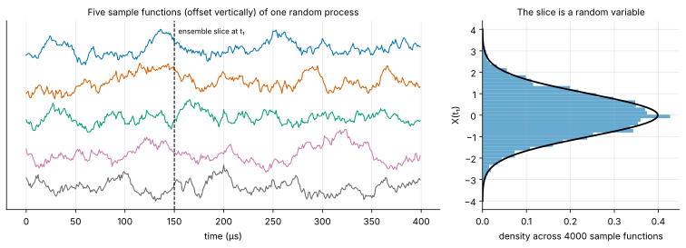
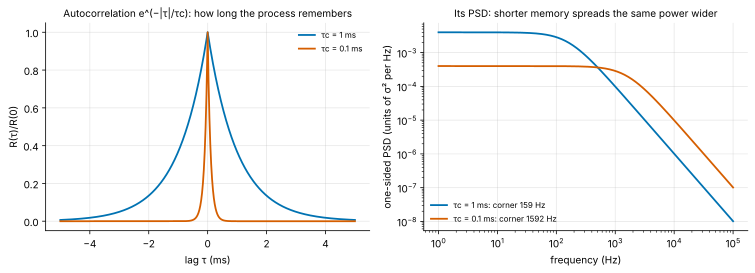
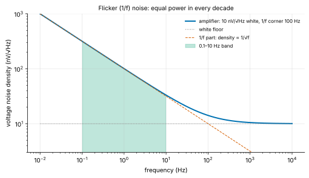

<!-- status: reviewed -->
# 03-06 · Random Processes Preview: Noise

| | |
|---|---|
| **Course** | [03 · Probability, Statistics and Random Variables for EE](../README.md) |
| **University equivalent** | The introductory random-processes unit of a junior probability course for electrical engineers (Leon-Garcia, chapters 9–10: random processes, stationarity, autocorrelation, power spectral density, white noise; the noise lectures of an introductory analog-circuits course: thermal, shot and flicker noise) |
| **Prerequisites** | [03-04 Joint Distributions, Correlation and the CLT](03-04-joint-distributions-and-clt.md) (covariance, averaging, the CLT), [03-03](03-03-expectation-and-functions-of-rvs.md) (power of a random signal), [01-06](../../01-calculus-for-engineers/chapters/01-06-techniques-of-integration.md) (noise bandwidth and kT/C), [02-01](../../02-complex-numbers-des-and-linear-algebra/chapters/02-01-complex-numbers-euler-and-phasors.md) (sinusoids and phasors) |
| **Estimated study hours** | 6 |
| **Last verified** | 2026-11-18 |

**Learning objectives.** After this chapter you can:

1. Describe a random process as an ensemble of waveforms, compute its mean and autocorrelation functions, and test for wide-sense stationarity.
2. Distinguish ensemble averages from time averages, explain ergodicity, and compute how much a time average of correlated noise improves with averaging time.
3. Interpret the power spectral density as the Fourier transform of the autocorrelation, compute noise power in a bandwidth, and use white noise and equivalent noise bandwidth.
4. Derive and use the thermal-noise density $4kTR$, the reference density $kT_0 = -174$ dBm/Hz, kT/C noise and the shot-noise density $2qI$, and add independent noise sources.
5. Explain flicker (1/f) noise and random walks, why averaging fails against them, and how they appear in datasheets.

## 1. Big picture

Every measurement and every link ends at a noise floor. Chapters 03-02 to 03-05 treated noise as a random *variable*: its value at one instant. Real noise is a random *waveform*, and the questions engineers ask are about time: how fast does it fluctuate, how much of its power falls in my bandwidth, does averaging for longer help? A **random process** answers them. Its **autocorrelation** says how long the noise remembers its past; its **power spectral density** says where its power sits in frequency; and **ergodicity** says when one long recording tells you about the whole population. This chapter previews those ideas, which [17-01](../../17-communication-systems/chapters/17-01-random-processes-and-psd.md) develops for signals and [12-10](../../12-electronics-2/chapters/12-10-noise-in-circuits.md) for circuits, and uses them on the three physical noises every chip designer budgets: thermal, shot and flicker.

- **Receivers:** sensitivity starts from $kT_0 = -174$ dBm/Hz plus bandwidth plus noise figure ([17](../../17-communication-systems/README.md), [21](../../21-rf-and-microwave-engineering/README.md)).
- **Data converters and sensors:** kT/C noise sizes sampling capacitors; 1/f noise limits precision DC measurement ([20](../../20-analog-and-mixed-signal-ic-design/README.md)).
- **Clocks and links:** jitter is a random process; free-running oscillators accumulate it as a random walk ([24](../../24-high-speed-io-signal-integrity-and-photonics/README.md)).
- **Measurement practice:** averaging, spectrum analyzers and datasheet noise specifications all assume properties of the process.

## 2. Intuition first

**A random process is a bag of waveforms.** Imagine recording the noise at the output of 4000 identical amplifiers at once (Figure 1). Each recording is a **sample function**. Freeze time at $t_1$ and look across the bag: the 4000 values form a random variable, $X(t_1)$, with a distribution. Look along one recording instead and you see how one amplifier's noise wanders in time. The process is the whole bag, with its statistics across waveforms (the **ensemble**) and along them (time).

*Figure 1. A random process: an ensemble of waveforms. Slicing it at one time gives a random variable; following one waveform gives a time series.*

**Memory and bandwidth are two sides of one coin.** Noise that changes slowly (long memory) has its power at low frequencies; noise that changes fast (short memory) spreads its power over a wide band. The autocorrelation measures memory, the spectrum measures bandwidth, and the Fourier transform links them.

**A finance analogy, and its limits.** A price series is a single sample function of a random process; analysts estimate its volatility and autocorrelation from its history, implicitly assuming that the history is representative (stationarity) and that one path tells you about the distribution of paths (ergodicity). A random walk, in which returns are white and prices accumulate them, is the canonical model. *Where the analogy breaks:* in electronics the physics often tells you the process exactly (thermal noise is white and Gaussian with a density fixed by temperature and resistance), and you can usually record many independent waveforms, not just one history.

## 3. Theory

### 3.1 Random processes, mean and autocorrelation

A **random process** $X(t)$ assigns a waveform to each outcome of an experiment. For each fixed $t$, $X(t)$ is a random variable, and for any set of times the values have a joint distribution. Two functions summarize most of what engineers need:

$$
\mu_X(t) = \mathbb{E}[X(t)], \qquad R_X(t_1, t_2) = \mathbb{E}[X(t_1)X(t_2)] .
$$

The **mean function** is the ensemble average at each time; the **autocorrelation function** is the expected product of values at two times, so $R_X(t, t) = \mathbb{E}[X(t)^2]$ is the average power at time $t$ (into 1 Ω), and the **autocovariance** $R_X(t_1, t_2) - \mu_X(t_1)\mu_X(t_2)$ is the covariance of 03-04 between two samples of the same waveform.

### 3.2 Stationarity

A process is **wide-sense stationary** (WSS) if its mean is constant and its autocorrelation depends only on the time difference τ = $t_2 - t_1$:

$$
\mu_X(t) = \mu_X, \qquad R_X(t, t + \tau) = R_X(\tau) .
$$

Its statistics then look the same whenever you start observing. (Strict-sense stationarity requires every joint distribution to be shift-invariant; for Gaussian processes the two coincide.) A WSS autocorrelation has three properties that follow from 03-03 and 03-04:

1. $R_X(0) = \mathbb{E}[X^2]$, the total average power.
2. $R_X(-\tau) = R_X(\tau)$: it is even.
3. $|R_X(\tau)| \le R_X(0)$: by Cauchy–Schwarz (03-04), no lag can be more correlated than zero lag.

**The random-phase sinusoid.** $X(t) = A\cos(\omega t + \Theta)$ with Θ uniform on $[0, 2\pi)$ has mean 0 for every $t$ (03-03) and, using $\cos a\cos b = \tfrac12[\cos(a - b) + \cos(a + b)]$,

$$
R_X(t, t + \tau) = \frac{A^2}{2}\mathbb{E}\big[\cos\omega\tau + \cos(2\omega t + \omega\tau + 2\Theta)\big] = \frac{A^2}{2}\cos\omega\tau ,
$$

because the second cosine averages to zero over the uniform phase. The process is WSS, and its autocorrelation never decays: a sinusoid remembers its phase forever (Example 03-06.1).

**Exponentially correlated noise.** White noise passed through an RC low-pass filter has ([17-01](../../17-communication-systems/chapters/17-01-random-processes-and-psd.md) derives it)

$$
R_X(\tau) = \sigma^2e^{-|\tau|/\tau_c}, \qquad \tau_c = RC .
$$

Samples closer than about $\tau_c$ are strongly correlated; samples much farther apart are nearly independent. The **correlation time** $\tau_c$ is the process's memory.

### 3.3 Ergodicity: when one waveform tells you about the ensemble

In practice you usually have one instrument and one long recording, so you compute **time averages**:

$$
\langle x\rangle_T = \frac1T\int_0^Tx(t)\,dt, \qquad \langle x^2\rangle_T = \frac1T\int_0^Tx(t)^2\,dt .
$$

A stationary process is **ergodic** (in the mean, or in power) if these converge to the ensemble values μ and $R_X(0)$ as $T \to \infty$. Ergodicity is what licenses a spectrum analyzer, an oscilloscope's averaging or a noise measurement on one unit to stand for the process.

**A non-ergodic process.** Let each amplifier in a population have a fixed random offset $V_{os}$, Gaussian across units, plus white noise. The ensemble mean is zero, but a time average on one unit converges to *that unit's* offset, however long you wait (Example 03-06.2). Statistics across units (offset spread, yield) can only be learned by measuring many units: the distinction between 03-05's sample of parts and a long recording of one part.

**How fast does a time average converge?** For a WSS process with covariance $C_X(\tau) = R_X(\tau) - \mu^2$, the variance of the time average follows from the variance-of-a-sum rule of 03-04 with the sum replaced by an integral. In the $T\times T$ square of time pairs $(s, t)$, the pairs with lag $\tau = t - s$ form a diagonal strip of length $T - |\tau|$, and $C_X$ is even, so

$$
\operatorname{Var}\big(\langle x\rangle_T\big) = \frac{1}{T^2}\int_0^T\!\!\int_0^TC_X(t - s)\,ds\,dt = \frac2T\int_0^T\Big(1 - \frac\tau T\Big)C_X(\tau)\,d\tau .
$$

For exponentially correlated noise with $T \gg \tau_c$, the integral approaches $\sigma^2\tau_c$ and

$$
\operatorname{Var}\big(\langle x\rangle_T\big) \approx \frac{2\sigma^2\tau_c}{T}, \qquad N_{\text{eff}} = \frac{T}{2\tau_c} .
$$

**The ergodicity test.** The exact formula shows when the variance goes to zero: exactly when the time-averaged covariance $\frac1T\int_0^TC_X(\tau)\,d\tau$ does. A covariance that decays, or that oscillates (the random-phase sinusoid), averages to zero, and the process is ergodic in the mean. A covariance with a constant floor, the signature of a random DC component such as a unit's own offset, does not, and the process is not ergodic.

A recording of length $T$ is worth only about $T/(2\tau_c)$ independent samples, **however fast you sample it**. Sampling faster than the correlation time adds numbers but not information (Example 03-06.6). This is the continuous-time version of 03-04's warning about averaging correlated data.

### 3.4 Power spectral density

The **power spectral density** (PSD) of a WSS process is the Fourier transform of its autocorrelation (the **Wiener–Khinchin theorem**):

$$
S_X(f) = \int_{-\infty}^{\infty}R_X(\tau)\,e^{-j2\pi f\tau}d\tau, \qquad R_X(\tau) = \int_{-\infty}^{\infty}S_X(f)\,e^{j2\pi f\tau}df .
$$

Setting τ = 0 in the second form shows what it means: $\mathbb{E}[X^2] = R_X(0) = \int S_X(f)\,df$. **The PSD distributes the average power over frequency**, in units of power per hertz (V²/Hz into 1 Ω), and the power in a band is the area under the PSD over that band.

**One-sided and two-sided conventions.** $S_X(f)$ above is **two-sided**: defined for negative and positive frequencies, even in $f$. Circuit designers and datasheets use the **one-sided** density $G_X(f) = 2S_X(f)$ for $f \ge 0$, so the same power is $\int_0^\infty G_X\,df$. Thermal noise's $4kTR$ and shot noise's $2qI$ below are one-sided; the communications convention $N_0/2$ is two-sided (notation sheet). Mixing them causes factor-of-two errors.

**Two transform pairs.** The exponential autocorrelation has a Lorentzian spectrum, here written one-sided:

$$
R_X(\tau) = \sigma^2e^{-|\tau|/\tau_c} \quad\Longleftrightarrow\quad G_X(f) = \frac{4\sigma^2\tau_c}{1 + (2\pi f\tau_c)^2} ,
$$

flat up to a corner at $f_L = 1/(2\pi\tau_c)$ and falling as $1/f^2$ above it (Figure 2). Shorter memory pushes the corner up and lowers the flat level: the same power spread wider. The random-phase sinusoid's $\tfrac{A^2}{2}\cos\omega\tau$ transforms into two spectral lines of $A^2/4$ each at $\pm f_0$: all its power at one frequency.

*Figure 2. Memory in time is bandwidth in frequency. Both processes have the same total power.*

**White noise and filtering.** **White noise** has a flat PSD, $S_X(f) = N_0/2$ for all $f$, so its autocorrelation is $(N_0/2)\delta(\tau)$: samples at any two distinct times are uncorrelated. It is an idealization (it would have infinite power), justified because physical noise is flat far beyond any circuit's bandwidth. Passing a WSS process through a linear time-invariant filter $H(f)$ shapes its spectrum:

$$
S_Y(f) = |H(f)|^2S_X(f) .
$$

([17-01](../../17-communication-systems/chapters/17-01-random-processes-and-psd.md) proves it; intuitively, each frequency component is scaled in amplitude by $|H|$, so in power by $|H|^2$.) The output power of white noise is then $(N_0/2)\int|H|^2df$, so a filter's effect on white noise is captured by its **equivalent noise bandwidth**, the width of an ideal brick-wall filter of the same peak gain that passes the same noise power. For a first-order RC low-pass filter it is

$$
B_N = \int_0^\infty\frac{df}{1 + (f/f_{3\text{dB}})^2} = \frac{\pi}{2}f_{3\text{dB}} = \frac{1}{4RC} ,
$$

57% wider than its −3 dB bandwidth, as [01-06](../../01-calculus-for-engineers/chapters/01-06-techniques-of-integration.md) computed.

> **Going deeper — why the PSD is the transform of the autocorrelation.** Record $x(t)$ over $[0, T]$ and form the "periodogram" $|X_T(f)|^2/T$, the energy spectrum per unit time. Writing $|X_T|^2 = X_TX_T^*$ as a double integral and taking expectations gives $\int_{-T}^{T}(1 - |\tau|/T)R_X(\tau)e^{-j2\pi f\tau}d\tau$, which tends to $S_X(f)$ as $T \to \infty$ when $R_X$ decays fast enough. The expected periodogram converges to the PSD, but a single periodogram does not: each frequency bin of one record is as noisy as its own mean (an exponential, chi-square with 2 degrees of freedom). Spectrum analyzers therefore average many records (Problem 03-06.15).

### 3.5 Thermal noise

Every resistor at absolute temperature $T$ (in this section $T$ is temperature; elsewhere in the chapter it is an averaging time) generates a random open-circuit voltage from the thermal motion of its electrons (Johnson–Nyquist noise). It is Gaussian (a sum of enormous numbers of tiny contributions, 03-04), zero-mean and white up to frequencies far beyond electronics (terahertz at room temperature), with one-sided density

$$
\overline{v_n^2}/\Delta f = 4kTR \quad (\text{V}^2/\text{Hz}), \qquad \text{or a current } \overline{i_n^2}/\Delta f = 4kT/R .
$$

*A derivation from one physical fact.* Statistical mechanics (equipartition, [04](../../04-physics-for-ee/README.md)) gives every energy-storage degree of freedom an average thermal energy $\tfrac12kT$. For a capacitor $C$ fed by a resistor $R$, the stored energy is $\tfrac12C\overline{v^2}$, so

$$
\tfrac12C\,\overline{v^2} = \tfrac12kT \quad\Longrightarrow\quad \overline{v^2} = \frac{kT}{C} ,
$$

independent of $R$. The RC filter's noise bandwidth is $1/(4RC)$, so if the resistor's density is $G$, the capacitor sees $G/(4RC)$. Setting this equal to $kT/C$ forces $G = 4kTR$. Thermal noise and kT/C are the same physics seen in frequency and in total.

**Available noise power and $kT_0$.** A resistor delivers its maximum noise power to a matched load (resistance $R$): the voltage $\sqrt{4kTR\Delta f}$ divides in half across the load, giving $(4kTR\Delta f/4)/R = kT\Delta f$, independent of $R$. Radio engineering takes the reference temperature $T_0 = 290$ K, adopted by the IRE (the IEEE's forerunner), so the reference noise density is

$$
kT_0 = 1.380649\times10^{-23}\times290 = 4.004\times10^{-21}\ \text{W/Hz} = -173.98\ \text{dBm/Hz},
$$

the "−174 dBm/Hz" every RF engineer knows ([R-070](../../../reference/research-log.md#r-070--thermal-noise-reference-kt0-and-290-k)). A receiver with bandwidth $B$ and noise figure NF (the dB ratio by which its own noise raises the input noise, Course 21) has a noise floor of

$$
P_{\text{floor}} = -174\ \text{dBm/Hz} + 10\log_{10}B + \text{NF} .
$$

### 3.6 Shot noise

Current is carried by discrete charges whose arrivals are random. If electrons cross a barrier (a diode junction, a photodiode) independently at average rate $I/q$, the number $N_T$ in a time $T$ is Poisson with mean $\bar N = IT/q$ and variance equal to its mean (03-02). The current measured by averaging over $T$, $\hat I = qN_T/T$, then has

$$
\operatorname{Var}(\hat I) = \frac{q^2}{T^2}\cdot\frac{IT}{q} = \frac{qI}{T} .
$$

Averaging over $T$ is a filter with gain $|H(f)| = |\sin(\pi fT)/(\pi fT)|$ (a rectangular window), whose one-sided noise bandwidth is, with $u = \pi fT$ and the standard integral $\int_0^\infty\sin^2u/u^2\,du = \pi/2$,

$$
B_N = \int_0^\infty\frac{\sin^2(\pi fT)}{(\pi fT)^2}\,df = \frac{1}{\pi T}\cdot\frac\pi2 = \frac{1}{2T} ,
$$

so the one-sided density is the variance divided by the bandwidth:

$$
\overline{i_n^2}/\Delta f = \frac{qI/T}{1/(2T)} = 2qI .
$$

Shot noise is white and, for large currents, Gaussian (a Poisson count with a large mean, 03-04). Its *relative* size falls as $1/\sqrt I$: small currents are noisier in proportion. Resistors carrying current do not show full shot noise; it arises where charges cross a barrier independently, as in diodes, bipolar transistors and photodiodes.

### 3.7 Flicker noise and random walks: why averaging can fail

**Flicker noise.** Almost every electronic device also shows noise whose density rises at low frequency roughly as $1/f$, from slow trapping and release of carriers (MOSFETs are notorious, [09](../../09-semiconductor-devices/README.md)). An amplifier's input noise is commonly modeled as

$$
e_n^2(f) = e_w^2\Big(1 + \frac{f_c}{f}\Big) ,
$$

with white density $e_w$ and **1/f corner** $f_c$, where the two parts are equal (Figure 3). The power between $f_1$ and $f_2$ is

$$
\int_{f_1}^{f_2}e_n^2\,df = e_w^2\Big[f_c\ln\frac{f_2}{f_1} + (f_2 - f_1)\Big] .
$$

The 1/f part contributes **the same power in every decade**, $e_w^2f_c\ln10$. Averaging for longer lowers the lowest frequency you are sensitive to, $f_1 \approx 1/T$, and so *adds* decades of 1/f noise instead of removing it: the time average of 1/f noise does not converge the way white noise's does. This is why precision DC measurements specify noise over a fixed band (commonly 0.1 to 10 Hz) and why designers remove 1/f noise by **chopping** or **auto-zeroing**, modulating the signal above the 1/f corner (Example 03-06.7, [20](../../20-analog-and-mixed-signal-ic-design/README.md)).

*Figure 3. Flicker noise rises as 1/√f in density (1/f in power). Each decade below the corner holds the same power, so longer observation finds more of it.*

**Random walks.** Integrate white noise and you get a **random walk** (Brownian motion): $W(t) = \int_0^tw(s)\,ds$ with $w$ white of two-sided density $N_0/2$. Increments over non-overlapping intervals are independent, so variances add and

$$
\operatorname{Var}\big(W(t)\big) = \frac{N_0}{2}\,t .
$$

The spread grows like $\sqrt t$ without bound. A random walk is not stationary, and its time average does not converge. The phase of a free-running oscillator behaves this way: white frequency noise integrates into phase, so timing error accumulates as $\sqrt t$, which is why clocks are locked to references by phase-locked loops ([24](../../24-high-speed-io-signal-integrity-and-photonics/README.md), Problem 03-06.13).

**Adding noise sources.** Independent noise sources add in power (03-04), so their densities add: $e_{\text{tot}}^2 = e_1^2 + e_2^2 + \dots$ at each frequency. Refer every source to one point (usually the input) before adding, using the circuit's gains, and remember that a current noise $i_n$ flowing through a source resistance $R_s$ becomes a voltage noise $i_nR_s$ (Problem 03-06.9).

## 4. Worked examples

### Example 03-06.1 — The random-phase sinusoid: stationary and ergodic (tier A)

**Setup.** $X(t) = A\cos(2\pi f_0t + \Theta)$ with $A = 2$ V, $f_0 = 1$ MHz and Θ uniform on $[0, 2\pi)$. (a) Find the mean, the autocorrelation and the average power. (b) Evaluate $R_X(\tau)$ at τ = 250 ns and at τ = 1/6 µs. (c) Show that a time average of $x^2$ over one period of any single sample function equals the ensemble power.

**Solution.** (a) From §3.2, $\mu_X = 0$ and $R_X(\tau) = (A^2/2)\cos(2\pi f_0\tau)$, so the power is $R_X(0) = $ **2 V²** (into 1 Ω).

(b) At 250 ns, $2\pi f_0\tau = \pi/2$ and $R_X = $ **0**: samples a quarter period apart are uncorrelated (but not independent: one determines the other up to sign). At 1/6 µs, $2\pi f_0\tau = \pi/3$ and $R_X = 2\cos(\pi/3) = $ **1 V²**.

(c) $\frac{1}{T_0}\int_0^{T_0}A^2\cos^2(2\pi f_0t + \theta)\,dt = A^2/2$ for every phase θ, the same as the ensemble power: the process is ergodic in power. Its spectrum is two lines of $A^2/4 = $ **1 V²** each at ±1 MHz.

### Example 03-06.2 — A non-ergodic population of offsets (tier B)

**Setup.** Each amplifier in a population has a fixed offset $V_{os} \sim \mathcal{N}(0, (1\text{ mV})^2)$ across units, plus independent white noise of 0.1 mV rms in the measurement bandwidth. (a) Find the ensemble mean, the ensemble power at one instant and $R_X(\tau)$ for τ well beyond the noise's correlation time. (b) What does a long time average on one unit converge to? (c) What fraction of units have a time-averaged output beyond ±2 mV?

**Solution.** (a) The ensemble mean is 0 and the ensemble power is $1^2 + 0.1^2 = $ **1.01 mV²**. For large τ the noise terms decorrelate but the offset is common to both samples: $R_X(\tau) = \mathbb{E}[V_{os}^2] = $ **1 mV²**, which does not decay.

(b) To that unit's own $V_{os}$, not to the ensemble mean 0. The process is stationary but not ergodic: its covariance has a constant floor, $C_X(\tau) \to 1$ mV², so its time average (§3.3) never goes to zero.

(c) $P(|V_{os}| > 2\text{ mV}) = 2Q(2) = $ **0.04550**. Only measurements across many units, not a longer recording of one, reveal this spread.

### Example 03-06.3 — Resistor noise and a receiver's noise floor (tier B)

**Setup.** (a) Find the thermal-noise density of a 1 kΩ resistor at 300 K and its rms noise in a 20 MHz bandwidth. (b) Find $kT_0$ in dBm/Hz, and the noise floor of a 20 MHz receiver with a 7 dB noise figure. (c) What input power gives an SNR of 10 dB?

**Solution.** (a) $\sqrt{4kTR} = \sqrt{4\times1.380649\times10^{-23}\times300\times1000} = $ **4.070 nV/√Hz**, and over 20 MHz, $4.070\text{ nV}\times\sqrt{2\times10^7} = $ **18.20 µV** rms.

(b) $kT_0 = $ **−173.98 dBm/Hz**. $10\log_{10}(2\times10^7) = $ **73.01 dB**, so the thermal floor is **−100.96 dBm**, and with NF = 7 dB the receiver's floor is **−93.96 dBm**.

(c) $-93.96 + 10 = $ **−83.96 dBm**. Every decibel of noise figure or bandwidth comes straight off the sensitivity; halving the bandwidth gains 3 dB.

### Example 03-06.4 — Noise of an RC filter, in time and frequency (tier B)

**Setup.** A 10 kΩ resistor at 300 K drives a 10 pF capacitor. (a) Find the −3 dB bandwidth and the noise bandwidth. (b) Find the noise density at low frequency and the total rms noise on the capacitor. (c) Find the correlation time, and the correlation between two samples 50 ns apart. Confirm (b) with ngspice.

**Solution.** (a) $f_{3\text{dB}} = 1/(2\pi RC) = $ **1.592 MHz**; $B_N = 1/(4RC) = $ **2.5 MHz**.

(b) $\sqrt{4kTR} = $ **12.87 nV/√Hz**, and the total is $\sqrt{4kTR\,B_N} = \sqrt{kT/C} = $ **20.35 µV** rms. A 1 MΩ resistor would raise the density tenfold and shrink the bandwidth a hundredfold, leaving the total unchanged.

(c) $\tau_c = RC = $ **100 ns**, so samples 50 ns apart have correlation $e^{-0.5} = $ **0.6065**. A sampler that takes successive samples faster than about $RC$ sees strongly correlated noise.

**Simulation.** The netlist [labs/03-06-lab/rc_noise.cir](../labs/03-06-lab/rc_noise.cir) runs an ngspice noise analysis: the 10 kΩ output density at 1 kHz is 12.87 nV/√Hz, and the integrated noise is 20.35 µV for both 10 kΩ and 1 MΩ.

### Example 03-06.5 — Shot noise against thermal noise (tier B)

**Setup.** (a) Find the shot-noise density of a 1 mA diode current, its rms value in 1 GHz, and the ratio of the DC current to that noise in dB. (b) Compare with the current-noise density of a 1 kΩ resistor at 300 K, and find the current at which the two are equal.

**Solution.** (a) $\sqrt{2qI} = \sqrt{2\times1.602\times10^{-19}\times10^{-3}} = $ **17.90 pA/√Hz**; over 1 GHz, **0.5661 µA** rms. The ratio is $10^{-3}/0.5661\times10^{-6} = $ **1767**, or **64.94 dB**.

(b) $\sqrt{4kT/R} = $ **4.070 pA/√Hz**. Setting $2qI = 4kT/R$ gives $I = 2kT/(qR) = 2V_T/R = $ **51.70 µA**. Below about 52 µA the 1 kΩ resistor's thermal noise dominates; above it, shot noise does. The crossover $2V_T/R$ falls as $R$ rises: with a 1 MΩ transimpedance resistor it is only **51.70 nA**. That is why photodiode receivers, which use large resistors for gain, are often shot-noise limited even at nanoamp currents.

### Example 03-06.6 — Averaging correlated noise: how many independent samples? (tier C)

**Setup.** A sensor's output noise has σ = 1 mV and an exponential autocorrelation with $\tau_c = 1$ ms. A test averages it for $T = 1$ s, sampling at 100 kHz. (a) Find the standard deviation of the average, exactly and with the $2\sigma^2\tau_c/T$ approximation. (b) How many independent samples is the record worth? (c) What would a naive $\sigma/\sqrt n$ with all $10^5$ samples claim?

**Solution.** (a) Evaluating §3.3's integral for the exponential gives

$$
\operatorname{Var} = \frac{2\sigma^2\tau_c}{T}\Big[1 - \frac{\tau_c}{T}\big(1 - e^{-T/\tau_c}\big)\Big] ,
$$

so σ of the average is **44.70 µV** exactly and **44.72 µV** approximately.

(b) $N_{\text{eff}} = T/(2\tau_c) = $ **500**.

(c) $1\text{ mV}/\sqrt{10^5} = $ **3.162 µV**, fourteen times too optimistic. The extra samples are almost copies of their neighbors. To halve the uncertainty you must quadruple the *time*, not the sample rate.

### Example 03-06.7 — Flicker noise in a precision measurement (tier C)

**Setup.** An amplifier has white noise $e_w = 10$ nV/√Hz with a 1/f corner at 100 Hz. (a) Find its rms noise in the 0.1–10 Hz band, and compare with the white part alone. (b) Extend the band down to 1 mHz (a measurement lasting about 1000 s). (c) How much does each decade below the corner contribute? (d) A chopper-stabilized ("zero-drift") amplifier has flat noise of 5.2 nV/√Hz. Find its 0.1–10 Hz noise.

**Solution.** (a) $e^2 = (10^{-8})^2[100\ln100 + 9.9] = 4.704\times10^{-14}$ V², so **216.9 nV** rms. The white part alone would give $10\sqrt{9.9} = $ **31.46 nV**: flicker noise dominates by a factor of seven.

(b) Down to 1 mHz: $(10^{-8})^2[100\ln10^4 + 10]$ gives **305.1 nV** rms. Observing longer made the noise *larger*.

(c) $e_w^2f_c\ln10$ per decade, an rms contribution of **151.7 nV** per decade.

(d) $5.2\sqrt{9.9} = $ **16.36 nV** rms: with a higher white floor but no 1/f noise, the zero-drift amplifier is more than ten times quieter at DC. This matches the published specification of one such part, 17 nV rms in 0.1–10 Hz with 5.2 nV/√Hz flat from 10 Hz to 10 kHz (§9).

<!-- answer-key -->
| ID | Quantity | Value | Unit |
|---|---|---|---|
| Ex 03-06.1a | average power | 2 | V² |
| Ex 03-06.1b | R at 250 ns | 0 | V² |
| Ex 03-06.1c | R at 1/6 µs | 1 | V² |
| Ex 03-06.1d | power in each spectral line | 1 | V² |
| Ex 03-06.2a | ensemble power | 1.01 | mV² |
| Ex 03-06.2b | autocorrelation at long lag | 1 | mV² |
| Ex 03-06.2c | fraction of units beyond ±2 mV | 0.04550 | — |
| Ex 03-06.3a | 1 kΩ noise density at 300 K | 4.070 | nV/√Hz |
| Ex 03-06.3b | rms noise in 20 MHz | 18.20 | µV |
| Ex 03-06.3c | kT0 | −173.98 | dBm/Hz |
| Ex 03-06.3d | 10 log10 of 20 MHz | 73.01 | dB |
| Ex 03-06.3e | thermal floor in 20 MHz | −100.96 | dBm |
| Ex 03-06.3f | receiver floor with 7 dB NF | −93.96 | dBm |
| Ex 03-06.3g | input for 10 dB SNR | −83.96 | dBm |
| Ex 03-06.4a | −3 dB bandwidth | 1.592 | MHz |
| Ex 03-06.4b | noise bandwidth | 2.5 | MHz |
| Ex 03-06.4c | total rms noise | 20.35 | µV |
| Ex 03-06.4d | low-frequency density | 12.87 | nV/√Hz |
| Ex 03-06.4e | correlation time | 100 | ns |
| Ex 03-06.4f | correlation at 50 ns | 0.6065 | — |
| Ex 03-06.5a | shot-noise density at 1 mA | 17.90 | pA/√Hz |
| Ex 03-06.5b | rms shot noise in 1 GHz | 0.5661 | µA |
| Ex 03-06.5c | DC-to-noise ratio | 1767 | — |
| Ex 03-06.5d | DC-to-noise ratio | 64.94 | dB |
| Ex 03-06.5e | 1 kΩ current-noise density | 4.070 | pA/√Hz |
| Ex 03-06.5f | crossover current | 51.70 | µA |
| Ex 03-06.5g | crossover current, 1 MΩ | 51.70 | nA |
| Ex 03-06.6a | σ of the average, exact | 44.70 | µV |
| Ex 03-06.6b | σ of the average, approximate | 44.72 | µV |
| Ex 03-06.6c | effective independent samples | 500 | — |
| Ex 03-06.6d | naive σ/√n | 3.162 | µV |
| Ex 03-06.7a | 0.1–10 Hz noise with flicker | 216.9 | nV |
| Ex 03-06.7b | 0.1–10 Hz white part alone | 31.46 | nV |
| Ex 03-06.7c | 1 mHz–10 Hz noise | 305.1 | nV |
| Ex 03-06.7d | rms per decade of 1/f noise | 151.7 | nV |
| Ex 03-06.7e | zero-drift 0.1–10 Hz noise | 16.36 | nV |

## 5. Simulate it

The lab ([labs/03-06-lab/](../labs/03-06-lab/README.md)) combines a notebook with the ngspice netlist of Example 03-06.4:

1. **Ensembles and time averages.** Generate the random-phase sinusoid and the offset population of Example 03-06.2, and compare ensemble and time averages.
2. **Autocorrelation and PSD.** Estimate both from RC-filtered noise and compare with $e^{-|\tau|/\tau_c}$ and the Lorentzian. *Predict first:* where is the PSD's corner for $\tau_c$ = 1 ms?
3. **kT/C.** Simulate discrete-time thermal noise through an RC filter and recover $kT/C$; run `rc_noise.cir` in ngspice.
4. **Shot noise.** Generate Poisson electron arrivals and measure the current noise against $2qI$.
5. **Averaging.** Average correlated noise for increasing times and sample rates. *Predict first:* does sampling ten times faster help?
6. **1/f noise and random walks.** Synthesize 1/f noise and a random walk, and watch their time averages fail to settle.

## 6. Engineering tradeoffs

| Knob | Improves | Costs | Typical decision owner |
|---|---|---|---|
| Measurement or receiver bandwidth | Narrower: less noise (10 dB per decade) | Slower response, lower data rate | System and RF designers |
| Larger sampling capacitor | Lower kT/C noise | Area, power to drive it, slower settling | ADC and analog designers |
| Lower resistances in signal paths | Lower thermal noise ($\propto\sqrt R$) | More current, more power | Analog designers |
| Chopping or auto-zeroing | Removes offset and 1/f noise | Switching artifacts, higher white noise, bandwidth limits | Precision-analog designers |
| Longer averaging time | Lower white-noise error ($1/\sqrt T$) | Time; no help against 1/f noise and drift | Test and measurement engineers |
| Cooling | Lower thermal noise ($\propto\sqrt T$) | Cost and complexity; used in instruments and radio astronomy, rarely in products | System architects |

## 7. Numbers to know

| Quantity | Value | Note |
|---|---|---|
| Thermal noise of 1 kΩ at 300 K | 4.07 nV/√Hz (scale as $\sqrt R$) | 50 Ω at 290 K: 0.895 nV/√Hz |
| $kT_0$ at 290 K | −174 dBm/Hz (4.00×10⁻²¹ W/Hz) | [R-070](../../../reference/research-log.md#r-070--thermal-noise-reference-kt0-and-290-k) |
| Receiver noise floor | −174 + 10 log₁₀ B + NF dBm | 1 MHz adds 60 dB |
| kT/C at 300 K | 64.4 µV for 1 pF; 20.35 µV for 10 pF | Independent of R |
| Shot noise | $\sqrt{2qI}$: 17.9 pA/√Hz at 1 mA | Exceeds 1 kΩ's thermal noise above 51.7 µA |
| RC noise bandwidth | $(\pi/2)f_{3\text{dB}}$ | 57% wider than −3 dB |
| Effective samples in a record | $T/(2\tau_c)$ | Faster sampling does not help |
| 1/f noise | equal power per decade, $e_w^2f_c\ln10$ | Datasheets quote 0.1–10 Hz |
| Op-amp noise, as of Nov 2026 | bipolar low-noise: 1.1 nV/√Hz at 1 kHz, 80 nVpp in 0.1–10 Hz; zero-drift: 5.2 nV/√Hz flat, 17 nV rms in 0.1–10 Hz | TI datasheets [R-071](../../../reference/research-log.md#r-071--op-amp-noise-specifications-1f-and-zero-drift) |

<!-- answer-key -->
| ID | Quantity | Value | Unit |
|---|---|---|---|
| T 03-06.a | kT0 | 4.004×10^-21 | W/Hz |
| T 03-06.b | 50 Ω noise density at 290 K | 0.895 | nV/√Hz |
| T 03-06.c | kT/C at 1 pF, 300 K | 64.4 | µV |
| T 03-06.d | RC noise bandwidth over −3 dB bandwidth | 1.571 | — |
| T 03-06.e | white-only 0.1–10 Hz noise at 5.2 nV/√Hz | 16.36 | nV |
| T 03-06.f | 1 MHz bandwidth in dB | 60 | dB |

## 8. Common mistakes

1. **Mixing one-sided and two-sided PSDs.** $4kTR$ and $2qI$ are one-sided; $N_0/2$ is two-sided. A factor of 2 (3 dB) hides here.
2. **Adding noise voltages instead of powers.** Independent sources add as squares.
3. **Using the −3 dB bandwidth for noise.** Use the noise bandwidth: $(\pi/2)f_{3\text{dB}}$ for one RC pole.
4. **Assuming a time average on one unit describes the population.** Offsets and other unit-to-unit variations are not ergodic.
5. **Counting samples instead of correlation times.** A long record sampled fast has about $T/(2\tau_c)$ independent samples.
6. **Expecting averaging to beat 1/f noise and drift.** Longer averages reach lower frequencies, where these noises live.
7. **Treating white noise literally.** It is flat only within the bandwidth of interest; its total power is finite because real bandwidths are.
8. **Quoting peak-to-peak noise without a convention.** Gaussian noise has no peak; peak-to-peak values depend on record length and the multiplier used (about 6 times rms in one datasheet below).

## 9. Practitioner lens

### State of the art (as of Nov 2026)

- **The −174 dBm/Hz reference.** Keysight's noise-figure application note 5952-8255E (May 2026) states that Friis suggested $T_0 = 290$ K, that "the power spectral density kT0 … is the even number 4.00 x 10⁻²¹ watts per hertz of bandwidth (–174 dBm/Hz)", and that the IRE adopted 290 K as the standard temperature for noise figure ([R-070](../../../reference/research-log.md#r-070--thermal-noise-reference-kt0-and-290-k)) **[Established]**.
- **Op-amp noise specifications show the 1/f tradeoff.** Texas Instruments' OPA211 (bipolar, datasheet SBOS377L, revised Jan 2020) specifies 1.1 nV/√Hz at 1 kHz and 80 nV peak-to-peak from 0.1 to 10 Hz. The zero-drift OPA189 (SBOS830I, revised Oct 2021) specifies 5.2 nV/√Hz flat from 10 Hz to 10 kHz, and 17 nV rms (0.1 µV peak-to-peak) from 0.1 to 10 Hz, consistent with essentially no 1/f noise: $5.2\sqrt{9.9} = 16.36$ nV ([R-071](../../../reference/research-log.md#r-071--op-amp-noise-specifications-1f-and-zero-drift)) **[Established for these parts]**. The bipolar part is about five times quieter at audio frequencies; at DC, the comparison depends on the 1/f corner.

### Why it matters commercially

Noise sets the physical limit of almost every product the learner covers. Sensor front ends for wearables and IoT trade noise against microamps of supply current; base-station and handset receivers fight for each decibel of noise figure because it converts directly to range or cell capacity; data converters size capacitors (and so area and power) by kT/C; and precision analog vendors differentiate on 1/f noise and drift with chopper and auto-zero architectures. Understanding which noise dominates in which band is how you tell a genuine architectural advantage from a better-chosen specification.

### Marketing vs Reality

- **"Ultra-low noise: 1 nV/√Hz."** *Reality:* at which frequency? A density quoted at 1 kHz says nothing about 1/f noise near DC. Ask for the noise density curve and the 0.1–10 Hz specification.
- **"Noise floor of −120 dBm."** *Reality:* in what bandwidth? A floor is $-174 + 10\log B + \text{NF}$; quoting it in a narrow resolution bandwidth makes any receiver look quiet. Ask for the noise figure and the channel bandwidth.
- **"We averaged a million samples."** *Reality:* over how long, relative to the noise's correlation time and the 1/f corner? Ask for the effective number of independent samples.
- **"Zero-drift means no noise."** *Reality:* chopping removes offset and 1/f noise but adds switching artifacts and often raises the white floor. Ask for the noise spectrum around the chopping frequency and the settling behavior.

### Questions for engineering leaders

1. **"What dominates your noise floor, and in which band?"** *Strong:* a budget listing thermal, shot and flicker contributions referred to the input, by frequency band. *Evasive:* a single noise number.
2. **"What is your noise figure, and what sets it?"** *Strong:* the front-end device, matching losses and gain distribution, with measured NF across frequency and temperature. *Evasive:* sensitivity without the bandwidth.
3. **"How do you handle 1/f noise and drift in your precision paths?"** *Strong:* chopping, auto-zeroing or correlated double sampling, with their costs in ripple, bandwidth and power. *Evasive:* "we average".
4. **"How was the noise measured?"** *Strong:* bandwidth, averaging, record length, and the one- or two-sided convention used. *Evasive:* screenshots of a spectrum analyzer without settings.

## 10. Concept check

1. A process has constant mean but a variance that grows with time. Is it wide-sense stationary?

   

Answer

   No: WSS requires $R_X(t, t) = \mathbb{E}[X^2]$ to be constant, which fails when the variance grows. A random walk is the standard example.

   

2. Why is a population of amplifier offsets stationary but not ergodic?

   

Answer

   Its statistics do not change with time, but each unit's time average converges to its own offset, not to the population mean. The covariance has a constant floor (the offset variance), so its time average does not go to zero. A sinusoid's covariance never decays either, but it oscillates and averages to zero, so that process is ergodic.

   

3. What does the area under a PSD represent?

   

Answer

   The average power, $R_X(0) = \mathbb{E}[X^2]$. Over a band, the power in that band.

   

4. Why does kT/C noise not depend on R?

   

Answer

   A larger R raises the noise density ($4kTR$) but lowers the noise bandwidth ($1/(4RC)$) by the same factor; equipartition fixes the stored energy at $\tfrac12kT$.

   

5. A receiver's bandwidth grows from 1 MHz to 100 MHz. What happens to its thermal noise floor?

   

Answer

   It rises by $10\log_{10}100 = 20$ dB.

   

6. Why does averaging longer not reduce 1/f noise the way it reduces white noise?

   

Answer

   A longer average reaches lower frequencies, and 1/f noise has equal power in every decade, so each extra decade of observation brings in as much noise as it averages away.

   

7. Where does $2qI$ come from?

   

Answer

   From Poisson statistics of independent charge arrivals: the count in time $T$ has variance equal to its mean, so the averaged current has variance $qI/T$; dividing by the averaging filter's noise bandwidth $1/(2T)$ gives $2qI$.

   

Problem set: [03-06 problems](../problems/03-06-problems.md) · [solutions](../solutions/03-06-solutions.md).

## 11. Key terms

[Random process](../../../reference/glossary.md#random-process) ·
[Sample function](../../../reference/glossary.md#sample-function) ·
[Autocorrelation function](../../../reference/glossary.md#autocorrelation-function) ·
[Wide-sense stationary](../../../reference/glossary.md#wide-sense-stationary) ·
[Ergodicity](../../../reference/glossary.md#ergodicity) ·
[Correlation time](../../../reference/glossary.md#correlation-time) ·
[Power spectral density](../../../reference/glossary.md#power-spectral-density) ·
[Wiener–Khinchin theorem](../../../reference/glossary.md#wiener-khinchin-theorem) ·
[White noise](../../../reference/glossary.md#white-noise) ·
[Equivalent noise bandwidth (ENBW)](../../../reference/glossary.md#equivalent-noise-bandwidth-enbw) ·
[Thermal noise](../../../reference/glossary.md#thermal-noise) ·
[kT/C noise](../../../reference/glossary.md#ktc-noise) ·
[Noise figure](../../../reference/glossary.md#noise-figure) ·
[Shot noise](../../../reference/glossary.md#shot-noise) ·
[Flicker (1/f) noise](../../../reference/glossary.md#flicker-1-f-noise) ·
[Random walk](../../../reference/glossary.md#random-walk) ·
[Chopper stabilization](../../../reference/glossary.md#chopper-stabilization)

## 12. Connections

- **Previous:** [03-05](03-05-estimation-and-hypothesis-testing.md) (chi-square intervals for noise power), [03-04](03-04-joint-distributions-and-clt.md) (covariance, averaging, the CLT), [01-06](../../01-calculus-for-engineers/chapters/01-06-techniques-of-integration.md) (noise bandwidth, kT/C).
- **Next:** this completes Course 03. [04 · Physics for EE](../../04-physics-for-ee/README.md) supplies the statistical-mechanics background (equipartition) assumed in §3.5.
- **Used in:** [17-01](../../17-communication-systems/chapters/17-01-random-processes-and-psd.md) (random processes, $S_Y = |H|^2S_X$), [12-10](../../12-electronics-2/chapters/12-10-noise-in-circuits.md) (noise in circuits), [16 Digital Signal Processing](../../16-digital-signal-processing/README.md) (spectral estimation), [17 Communication Systems](../../17-communication-systems/README.md) (noise in receivers), [20 Analog and Mixed-Signal IC Design](../../20-analog-and-mixed-signal-ic-design/README.md) (circuit noise, chopping), [21 RF and Microwave](../../21-rf-and-microwave-engineering/README.md) (noise figure), [24](../../24-high-speed-io-signal-integrity-and-photonics/README.md) (jitter and phase noise).

## 13. Further study

- Leon-Garcia, A., *Probability, Statistics, and Random Processes for Electrical Engineering*, 3rd ed., chapters 9 and 10 (random processes, power spectral density, linear systems with random inputs).
- Razavi, B., *Design of Analog CMOS Integrated Circuits*, the chapter on noise (thermal, flicker and shot noise in circuits).
- Keysight application note 5952-8255E, *Fundamentals of RF and Microwave Noise Figure Measurements*, for $kT_0$ and noise figure in practice.

## 14. Sources

1. Leon-Garcia, A., *Probability, Statistics, and Random Processes for Electrical Engineering*, 3rd ed., Pearson, 2008.
2. Razavi, B., *Design of Analog CMOS Integrated Circuits*, 2nd ed., McGraw-Hill, 2017.
3. Keysight Technologies, *Fundamentals of RF and Microwave Noise Figure Measurements*, application note 5952-8255E (published 15 May 2026). [R-070]
4. Texas Instruments, OPAx211 datasheet SBOS377L (revised Jan 2020); OPAx189 datasheet SBOS830I (revised Oct 2021). [R-071]
5. kT/C noise: [R-009].
