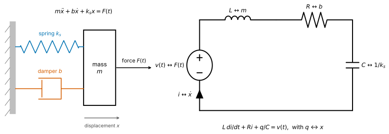

<!-- status: reviewed -->
# 04-01 · Mechanics Essentials for EE

| | |
|---|---|
| **Course** | [04 · Physics for EE](../README.md) |
| **University equivalent** | The mechanics essentials of a first university physics course (Halliday, Resnick & Walker, chapters on units, Newton's laws, work and energy, momentum, rotation and oscillations; MIT 8.01 selected topics), taught as the mechanical twin of circuit theory |
| **Prerequisites** | [01-01 Functions, Models and Units](../../01-calculus-for-engineers/chapters/01-01-functions-models-and-units.md) (dimensional analysis), [01-05 Integrals](../../01-calculus-for-engineers/chapters/01-05-integrals.md), [02-03 Second-Order Linear ODEs](../../02-complex-numbers-des-and-linear-algebra/chapters/02-03-second-order-linear-odes.md) and [02-04 Forced Response and Resonance](../../02-complex-numbers-des-and-linear-algebra/chapters/02-04-forced-response-and-resonance.md) (damping ratio, Q), [03-06](../../03-probability-statistics-and-random-variables/chapters/03-06-random-processes-preview.md) (thermal noise) |
| **Estimated study hours** | 8 |
| **Last verified** | 2026-11-18 |

**Learning objectives.** After this chapter you can:

1. Express mechanical and electrical quantities in SI base units, check equations by dimensional analysis, and convert between joules, electronvolts, watt-hours and kilowatt-hours.
2. Apply Newton's laws, impulse and momentum to particles and simple systems, including shocks and drop tests.
3. Compute work, kinetic and potential energy and power, use energy conservation with and without dissipation, and do the same for rotation (torque, moment of inertia, $P = \tau\omega$).
4. Analyze a mass–spring–damper: natural frequency, damping ratio, quality factor (as an energy ratio), ring-down and resonance, and map it onto a series RLC circuit with the force–voltage analogy.
5. Model a MEMS accelerometer: its sensitivity–bandwidth tradeoff, its response to shocks, and its thermomechanical (Brownian) noise floor.

## 1. Big picture

Electrical engineering is energy and information carried by charges, but every chip lives in a mechanical world. Batteries are rated in watt-hours, motors deliver torque, packages must survive being dropped, and the phone in your pocket knows which way is up because a few micrograms of silicon move a few nanometers. More deeply, the mathematics of mechanics *is* the mathematics of circuits: a mass on a spring obeys the same equation as an inductor and a capacitor, so everything you learn about one transfers to the other. This chapter collects the mechanics an electrical engineer actually uses, and builds it toward one device that sits in almost every wearable, phone and car: the MEMS (micro-electro-mechanical system) accelerometer.

- **Energy and power bookkeeping:** joules, watts and efficiency connect a battery's watt-hours to a motor's torque and speed ([22](../../22-power-electronics-and-energy-conversion/README.md)).
- **Sensors and timing:** accelerometers, gyroscopes, microphones and quartz or MEMS resonators are mechanical oscillators read out by circuits ([20](../../20-analog-and-mixed-signal-ic-design/README.md)).
- **The universal oscillator:** the mass–spring–damper and the RLC circuit are one equation; resonance, Q and ring-down carry over exactly ([07](../../07-circuit-analysis-2-transient-and-ac/README.md)).
- **Reliability:** drop shocks, vibration and thermal stresses are mechanical loads on packages and solder joints ([25](../../25-fabrication-packaging-test-and-reliability/README.md)).

## 2. Intuition first

**Force changes motion; it does not maintain it.** Newton's insight was that a moving object keeps moving unless something pushes on it. A force does not set a velocity; it sets the *rate of change* of momentum. This is the mechanical version of an inductor: a voltage does not set the current, it sets the current's rate of change.

**Energy is a conserved currency.** Work moves energy into a system, potential energy stores it, kinetic energy is the energy of motion, and friction converts it to heat. In an oscillator, energy sloshes back and forth between two stores: the spring (potential) and the moving mass (kinetic), just as it sloshes between a capacitor's electric field and an inductor's magnetic field (Figure 1). Damping drains a fraction of the energy each cycle, and the **quality factor** Q counts how many cycles it takes.

**An accelerometer is a mass that lags behind.** Bolt a box to a car and hang a small mass inside it on a spring. When the car accelerates, the box moves first and the mass lags until the spring stretches enough to pull it along. The stretch is proportional to the acceleration. A MEMS accelerometer is exactly this, with a proof mass of micrograms and a spring etched from silicon, and its stretch per *g* is measured in nanometers.

**A finance analogy, and its limits.** Energy conservation is double-entry bookkeeping: every joule spent is a joule received somewhere, and heat is the account where losses are booked. *Where the analogy breaks:* money can be created by a central bank and destroyed in a default, but energy cannot be created or destroyed at all. And bookkeeping does not care about timing, while physics charges for speed: the same energy delivered faster is more power, which costs larger motors, thicker wires and more heat.

## 3. Theory

> **Notation for this chapter.** $v$ is speed (the magnitude of velocity), except in the circuit analogy where it is voltage; velocity in the oscillator is $\dot x = dx/dt$. Power is $P$ and momentum $\vec p$. The spring constant is $k_s$, because $k$ is Boltzmann's constant. In §3.5 only, τ is torque.

### 3.1 SI units and dimensional analysis

The SI has seven base units: the second (s), metre (m), kilogram (kg), ampere (A), kelvin (K), mole (mol) and candela (cd). Since 2019 they are defined by fixing the exact numerical values of seven constants, among them the speed of light $c = 299\,792\,458$ m/s, Planck's constant $h = 6.626\,070\,15\times10^{-34}$ J·s, the elementary charge $e = 1.602\,176\,634\times10^{-19}$ C and Boltzmann's constant $k = 1.380\,649\times10^{-23}$ J/K (BIPM SI Brochure, 9th edition, 2019). Every other unit is a product of base units:

| Quantity | Unit | In base units |
|---|---|---|
| Force | newton (N) | kg·m/s² |
| Energy, work | joule (J) = N·m | kg·m²/s² |
| Power | watt (W) = J/s | kg·m²/s³ |
| Charge | coulomb (C) = A·s | A·s |
| Voltage | volt (V) = W/A | kg·m²/(s³·A) |
| Resistance | ohm (Ω) = V/A | kg·m²/(s³·A²) |

So every electrical unit is mechanics plus the ampere. **Dimensional analysis** uses this to check and even derive equations: both sides of a valid equation must have the same dimensions, and a quantity added to another must share its dimensions.

*Example of derivation by dimensions.* A mass $m$ (kg) on a spring of stiffness $k_s$ (N/m = kg/s²) oscillates at some angular frequency ω (1/s). The only combination of $m$ and $k_s$ with dimensions of 1/s is $\sqrt{k_s/m}$, so $\omega = C\sqrt{k_s/m}$ for some pure number $C$. The full analysis (§3.6) shows $C = 1$. Dimensions cannot give the constant, but they rule out every wrong form, which is why engineers check them first.

**Energy units engineers mix.** One **electronvolt** (eV) is the energy an electron gains crossing 1 V: $e\times1\text{ V} = 1.602\,176\,634\times10^{-19}$ J, the natural unit for bandgaps and photon energies ([04-10](04-10-intro-quantum-mechanics.md)). One **watt-hour** is $3600$ J, and one **kilowatt-hour** is **3.6 MJ**: the unit of electricity bills and battery packs. A battery's charge rating in ampere-hours times its voltage gives watt-hours (Example 04-01.1).

**Standard gravity** $g_n = 9.806\,65$ m/s² is a defined value; accelerometers and shock ratings quote acceleration in multiples of it, written *g*.

### 3.2 Kinematics and Newton's laws

A particle's position $\vec r(t)$ has velocity $\vec v = d\vec r/dt$ and acceleration $\vec a = d\vec v/dt = d^2\vec r/dt^2$: the derivatives of [01-03](../../01-calculus-for-engineers/chapters/01-03-derivatives.md). Going the other way, velocity is the integral of acceleration and position the integral of velocity. For constant acceleration $a$ from rest, $v = at$ and $x = \tfrac12at^2$; eliminating $t$ gives $v^2 = 2ax$, so an object falling from height $h$ arrives at $v = \sqrt{2gh}$.

**Newton's laws.**

1. A body with no net force on it keeps a constant velocity (possibly zero).
2. The net force equals the rate of change of momentum $\vec p = m\vec v$: $\vec F_{\text{net}} = d\vec p/dt$, which for constant mass is $\vec F_{\text{net}} = m\vec a$.
3. Forces come in pairs: if A pushes on B with $\vec F$, B pushes on A with $-\vec F$.

The second law is a differential equation: given forces that depend on position and velocity, it determines the motion. A spring exerts $F = -k_sx$ (Hooke's law, valid for small stretches), a viscous damper $F = -b\dot x$ with damping coefficient $b$ (N·s/m), and gravity $F = -mg$. The second law with these forces is the mass–spring–damper equation of §3.6.

**Weight is not mass.** Mass (kg) measures inertia; weight is the gravitational force $mg$ (N). An accelerometer measures neither directly: it measures the force needed to make its proof mass follow the package, divided by the mass. At rest on a table that force is the table's push upward, so a resting accelerometer reads **+1 *g* upward**, and in free fall it reads zero. Accelerometers measure *specific force* (acceleration minus gravity), which is why a phone can tell which way is down.

### 3.3 Work, energy and power

The **work** done by a force along a path is

$$
W = \int\vec F\cdot d\vec r ,
$$

which for a constant force along a straight line is force times displacement (J = N·m). Only the component of force along the motion does work.

**The work–energy theorem.** For a particle moving along $x$ under net force $F$, use the chain rule $a = dv/dt = (dv/dx)(dx/dt) = v\,dv/dx$:

$$
W_{\text{net}} = \int_{x_1}^{x_2}F\,dx = \int_{x_1}^{x_2}m\,v\frac{dv}{dx}\,dx = \int_{v_1}^{v_2}mv\,dv = \tfrac12mv_2^2 - \tfrac12mv_1^2 .
$$

Net work equals the change in **kinetic energy** $K = \tfrac12mv^2$.

**Potential energy.** A force is **conservative** if the work it does depends only on the endpoints, not the path; then it can be written $F = -dU/dx$ for a **potential energy** $U(x)$. Gravity near the Earth gives $U = mgh$. A spring gives

$$
U = -\int_0^x(-k_sx')\,dx' = \tfrac12k_sx^2 .
$$

With only conservative forces, $E = K + U$ is constant: energy is conserved. A damper is not conservative. It converts mechanical energy to heat at the rate $P = b\dot x^2$, just as a resistor dissipates $i^2R$.

**Power** is the rate of doing work. For a force acting on a moving body,

$$
P = \frac{dW}{dt} = \vec F\cdot\vec v ,
$$

the mechanical twin of $P = vi$ (force ↔ voltage, velocity ↔ current; §3.7). Efficiency is useful output power over input power. A mechanical horsepower is about **745.7 W**.

### 3.4 Momentum and impulse

Integrating the second law over time gives the **impulse–momentum theorem**:

$$
\vec J = \int_{t_1}^{t_2}\vec F\,dt = \vec p_2 - \vec p_1 .
$$

The impulse is the area under the force–time curve. In a short collision the force can be huge but brief; what is fixed is its area, the momentum change. Spreading the same impulse over a longer time lowers the force, which is the whole idea of packaging foam, airbags and crumple zones.

**Drop tests.** An object dropped from height $h$ hits at $v = \sqrt{2gh}$ and is stopped in a short time $\Delta t$. Its average deceleration is $v/\Delta t$. Impact pulses are often modeled as a **half-sine**, $a(t) = a_{\text{pk}}\sin(\pi t/\Delta t)$, whose area $\tfrac{2}{\pi}a_{\text{pk}}\Delta t$ must equal $v$, so

$$
a_{\text{pk}} = \frac{\pi}{2}\cdot\frac{v}{\Delta t},
$$

a peak **1.571** times the average. Shock specifications for devices are written as a peak in *g* and a pulse duration (Example 04-01.3).

**Conservation.** If no external force acts on a system, its total momentum is constant. In a collision momentum is conserved; kinetic energy is conserved only if the collision is **elastic**. In a perfectly **inelastic** collision the bodies stick, and the lost kinetic energy becomes heat and deformation (Problem 04-01.7).

### 3.5 Rotation in brief

Motors, fans, disk drives and gyroscopes rotate, and each linear quantity has a rotational twin.

| Linear | Rotational | Relation |
|---|---|---|
| position $x$ (m) | angle θ (rad) | |
| velocity $v$ (m/s) | angular velocity ω (rad/s) | $v = \omega r$ on a circle of radius $r$ |
| mass $m$ (kg) | moment of inertia $I$ (kg·m²) | $I = \sum m_ir_i^2$; a uniform disk: $\tfrac12mR^2$ |
| force $F$ (N) | torque τ (N·m) | τ = $rF_\perp$ |
| $F = ma$ | $\tau = I\alpha_\theta$ | $\alpha_\theta = d\omega/dt$ |
| $K = \tfrac12mv^2$ | $K = \tfrac12I\omega^2$ | |
| $P = Fv$ | $P = \tau\omega$ | |

The last row is the one electrical engineers use most: a motor's mechanical output power is its torque times its speed in rad/s (Example 04-01.4), and a speed in revolutions per minute converts as $\omega = 2\pi\times\text{rpm}/60$. Angular momentum $L_\theta = I\omega$ is conserved when no external torque acts; MEMS gyroscopes sense rotation through a related effect, the Coriolis force on a vibrating mass (Course 20).

### 3.6 The simple harmonic oscillator

A mass on a spring with no damping obeys $m\ddot x = -k_sx$, or

$$
\ddot x + \omega_0^2x = 0, \qquad \omega_0 = \sqrt{\frac{k_s}{m}} .
$$

As in [02-03](../../02-complex-numbers-des-and-linear-algebra/chapters/02-03-second-order-linear-odes.md), the solution is $x(t) = A\cos(\omega_0t + \phi)$: an oscillation at the **natural frequency** $f_0 = \omega_0/(2\pi)$, with amplitude $A$ and phase φ set by the initial position and velocity. The velocity is $\dot x = -A\omega_0\sin(\omega_0t + \phi)$, so

$$
K + U = \tfrac12m A^2\omega_0^2\sin^2(\cdot) + \tfrac12k_sA^2\cos^2(\cdot) = \tfrac12k_sA^2 ,
$$

using $m\omega_0^2 = k_s$ and $\sin^2 + \cos^2 = 1$. The total is constant, and averaged over a cycle each store holds half of it (Figure 1). The peak speed is $A\omega_0$ and the peak acceleration $A\omega_0^2$.

*Figure 1. Left: in an undamped oscillator energy sloshes between the spring and the moving mass, at twice the oscillation frequency, while the total stays constant. Right: with damping (Example 04-01.5, Q = 7.906), each cycle loses a fixed fraction of the energy.*

**Adding damping and a driving force.** With a damper and an external force,

$$
m\ddot x + b\dot x + k_sx = F(t) .
$$

Dividing by $m$ puts it in the standard form of 02-03, $\ddot x + 2\zeta\omega_0\dot x + \omega_0^2x = F/m$, with

$$
\zeta = \frac{b}{2\sqrt{k_sm}}, \qquad Q = \frac{1}{2\zeta} = \frac{\sqrt{k_sm}}{b} = \frac{m\omega_0}{b}, \qquad \alpha = \frac{b}{2m} = \frac{\omega_0}{2Q} .
$$

An underdamped oscillator released from rest rings at $\omega_d = \sqrt{\omega_0^2 - \alpha^2}$ inside the envelope $e^{-\alpha t}$.

**Q as an energy ratio.** The energy is proportional to the amplitude squared, so it decays as $e^{-2\alpha t}$. For light damping, the fraction lost in one cycle (duration $2\pi/\omega_0$) is about $2\alpha\cdot2\pi/\omega_0$, and

$$
2\pi\,\frac{\text{energy stored}}{\text{energy lost per cycle}} = 2\pi\cdot\frac{1}{2\alpha\cdot2\pi/\omega_0} = \frac{\omega_0}{2\alpha} = Q .
$$

This is the physical meaning of Q, the same for a crystal, a MEMS resonator or an RLC tank: a resonator with Q = 10,000 loses only $2\pi/10{,}000$ of its stored energy per cycle. The amplitude falls by $e$ in $Q/\pi$ cycles. Driven at $\omega_0$, the displacement is Q times the static deflection $F/k_s$; the half-power bandwidth of the velocity response is $f_0/Q$ ([02-04](../../02-complex-numbers-des-and-linear-algebra/chapters/02-04-forced-response-and-resonance.md)).

### 3.7 The force–voltage analogy

Compare the mass–spring–damper with a series RLC circuit driven by a voltage source:

$$
m\ddot x + b\dot x + k_sx = F(t), \qquad L\ddot q + R\dot q + \frac{1}{C}q = v(t) .
$$

They are the same equation under the substitutions in the table, where $q$ is the capacitor's charge and $\dot q = i$ the loop current.

| Mechanical | Electrical (force–voltage analogy) |
|---|---|
| force $F$ (N) | voltage $v$ (V) |
| velocity $\dot x$ (m/s) | current $i$ (A) |
| displacement $x$ (m) | charge $q$ (C) |
| mass $m$ (kg) | inductance $L$ (H) |
| damping $b$ (N·s/m) | resistance $R$ (Ω) |
| compliance $1/k_s$ (m/N) | capacitance $C$ (F) |
| kinetic energy $\tfrac12m\dot x^2$ | magnetic energy $\tfrac12Li^2$ |
| spring energy $\tfrac12k_sx^2$ | electric energy $q^2/(2C)$ |
| power $F\dot x$ | power $vi$ |
| damper loss $b\dot x^2$ | resistor loss $i^2R$ |

*Figure 2. The force–voltage analogy. Elements that share one velocity (the mass, the damper's moving end, the spring's moving end) become circuit elements in series sharing one current.*

Every result transfers: $\omega_0 = 1/\sqrt{LC}$ ↔ $\sqrt{k_s/m}$, $Q = (1/R)\sqrt{L/C}$ ↔ $\sqrt{k_sm}/b$. With the scale "1 V per newton and 1 A per m/s", a mechanical system becomes a circuit you can simulate in SPICE with $L = m$ henries, $R = b$ ohms and $C = 1/k_s$ farads (Example 04-01.5). The analogy also runs the other way in real devices: a quartz crystal or MEMS resonator coupled to electrodes appears to the circuit as a series RLC, its *motional* branch, whose L, R and C are its mass, loss and compliance seen through the electromechanical coupling (Course 20). Topology needs care: two springs in series share one force, so their compliances add, which maps to capacitors in *parallel* (Problem 04-01.11). (The alternative **mobility analogy**, force ↔ current, preserves topology instead.)

### 3.8 The MEMS accelerometer

A proof mass $m$ hangs on a spring $k_s$ inside a package, with damping $b$ from the surrounding gas. Let the package move with acceleration $a(t)$, and let $x$ be the mass's displacement *relative to the package*. The spring and damper act on the relative motion, while Newton's law applies to the mass's absolute acceleration $\ddot x + a$:

$$
m(\ddot x + a) = -k_sx - b\dot x \quad\Longrightarrow\quad m\ddot x + b\dot x + k_sx = -ma(t) .
$$

The package's acceleration acts on the mass like a force $-ma$. At frequencies well below $\omega_0$ the mass follows quasi-statically, and the deflection is

$$
x = -\frac{ma}{k_s} = -\frac{a}{\omega_0^2} .
$$

The **sensitivity** $|x/a| = 1/\omega_0^2$ (m per m/s², or s²) depends only on the resonant frequency. With $f_0 = 4$ kHz, 1 *g* deflects the mass by only **15.53 nm**, and 1 m*g* by 15.53 pm, a fraction of an atomic diameter. Readout circuits detect these motions as tiny capacitance changes ([04-04](04-04-potential-capacitance-and-dielectrics.md)).

**The sensitivity–bandwidth tradeoff.** The frequency response from acceleration to deflection is a second-order low-pass,

$$
\frac{X}{A} = \frac{-1}{\omega_0^2 - \omega^2 + j\omega\omega_0/Q} ,
$$

flat below $f_0$ and falling as $1/f^2$ above it. With $Q = 1/\sqrt2$ (maximally flat, the choice of 02-04) the −3 dB bandwidth equals $f_0$. Raising $f_0$ widens the bandwidth but shrinks the signal as $1/f_0^2$: four times the bandwidth costs sixteen times the deflection (Figure 3). Every accelerometer design starts from this trade.

*Figure 3. The accelerometer's sensitivity–bandwidth tradeoff: a stiffer spring (higher $f_0$) gives more bandwidth and much less deflection.*

**The thermomechanical noise floor.** The damper is the mechanical twin of a resistor, and like a resistor it is noisy. The gas molecules that cause damping also kick the mass randomly, producing a random force with one-sided spectral density $4kTb$ (N²/Hz), the twin of the resistor's $4kTR$ ([03-06](../../03-probability-statistics-and-random-variables/chapters/03-06-random-processes-preview.md)). *Why that value:* equipartition gives the spring an average energy $\tfrac12k_s\overline{x^2} = \tfrac12kT$, so $\overline{x^2} = kT/k_s$; and passing a white force density $G_F$ through the oscillator gives $\overline{x^2} = G_F/(4k_sb)$ (Problem 04-01.14), so $G_F = 4kTb$, exactly as $4kTR$ followed from $kT/C$. Referred to the input, the force noise is an acceleration noise density

$$
a_n = \frac{\sqrt{4kTb}}{m} = \sqrt{\frac{4kT\omega_0}{mQ}} \qquad (\text{m/s}^2/\sqrt{\text{Hz}}) ,
$$

using $b = m\omega_0/Q$. It falls with a heavier proof mass and a higher Q, and rises with resonant frequency. This mechanical floor is set by physics alone; the readout electronics add their own noise on top (Examples 04-01.6 and 04-01.7).

> **Going deeper — the noise integral.** Problem 04-01.14 uses $\int_0^\infty\frac{d\omega}{(k_s - m\omega^2)^2 + b^2\omega^2} = \frac{\pi}{2k_sb}$. The integrand is $|H(j\omega)|^2$ for the displacement response $H = 1/(k_s - m\omega^2 + jb\omega)$ to a force, and Parseval's theorem turns the frequency integral into a time integral of the impulse response squared: $\int_{-\infty}^{\infty}|H|^2\,d\omega = 2\pi\int_0^\infty h(t)^2\,dt$. For an underdamped oscillator $h(t) = e^{-\alpha t}\sin(\omega_dt)/(m\omega_d)$ with $\alpha = b/2m$ and $\omega_d^2 = \omega_0^2 - \alpha^2$. Using $\sin^2 = \tfrac12(1 - \cos2\omega_dt)$, $\int_0^\infty e^{-2\alpha t}\sin^2(\omega_dt)\,dt = \frac{1}{4\alpha} - \frac{\alpha}{4(\alpha^2 + \omega_d^2)} = \frac{\omega_d^2}{4\alpha\omega_0^2}$, so $\int_0^\infty h^2\,dt = \frac{1}{4\alpha m^2\omega_0^2} = \frac{1}{2bk_s}$. The integrand is even in ω, so the integral from 0 to ∞ is half of $2\pi/(2bk_s)$: $\pi/(2k_sb)$.

## 4. Worked examples

### Example 04-01.1 — Battery energy in mechanical terms (tier A)

**Setup.** A phone battery is rated 4.5 Ah at a nominal 3.87 V (illustrative values). (a) Find its energy in Wh, J and kWh. (b) How high could that energy lift the 0.2 kg phone against gravity? (c) How many electrons does a full discharge move, and how much energy does each deliver, in eV?

**Solution.** (a) $4.5\text{ Ah}\times3.87\text{ V} = $ **17.415 Wh**; times 3600 s/h, **62,694 J**; divided by $3.6\times10^6$, **0.017415 kWh**.

(b) $h = E/(mg) = 62{,}694/(0.2\times9.80665) = $ **31,965 m**, about 32 km: a battery stores a surprising amount of mechanical energy.

(c) The charge is $4.5\text{ A}\times3600\text{ s} = $ **16,200 C**, or $16{,}200/1.602176634\times10^{-19} = $ **1.011×10²³** electrons, each delivering **3.87 eV** (the battery voltage in volts is the energy per electron in eV).

**Units check.** A·h × V = W·h; (W·h)(3600 s/h) = J; J/(kg·m/s²) = m ✓. **Sanity check.** $1.011\times10^{23}\times3.87\text{ eV}\times1.602\times10^{-19}$ J/eV = 62,694 J ✓.

### Example 04-01.2 — Resonator frequency from dimensions alone (tier A)

**Setup.** (a) A mechanical resonator is a structure of size $L$ made from a material with Young's modulus $E$ (Pa, a stiffness per unit area) and density ρ (kg/m³). Use dimensional analysis to find how its resonant frequency depends on them. (b) Evaluate $\sqrt{E/\rho}$ for silicon with $E = 169$ GPa (the ⟨110⟩ direction) and $\rho = 2329$ kg/m³. (c) If every dimension of a MEMS resonator shrinks tenfold, what happens to its frequency? (d) Why do watch crystals run at 32,768 Hz?

**Solution.** (a) Pa = kg/(m·s²), so $E/\rho$ has units m²/s², and $\sqrt{E/\rho}$ is a speed. The only way to make 1/s from $E$, ρ and $L$ is

$$
\omega_0 = C\,\frac{1}{L}\sqrt{\frac{E}{\rho}} ,
$$

with a pure number $C$ set by the shape and the mode.

(b) $\sqrt{169\times10^9/2329} = $ **8518 m/s**: this is the speed of extensional sound waves along a thin silicon bar in that direction (bulk longitudinal waves, which also feel the material's resistance to sideways squeezing, travel somewhat faster).

(c) The frequency rises **tenfold**: small structures are stiff for their mass, which is why MEMS resonators reach tens of megahertz while a guitar string sits at hundreds of hertz.

(d) $32{,}768 = 2^{15}$: halving it fifteen times with flip-flops gives exactly 1 Hz, a seconds tick.

**Units check.** (m/s)/m = 1/s ✓.

### Example 04-01.3 — A phone drop test (tier B)

**Setup.** A 0.2 kg phone falls 1.5 m onto concrete and stops in 0.2 ms with a half-sine deceleration pulse. (a) Find the impact speed and the kinetic energy at impact. (b) Find the average and peak deceleration, in m/s² and *g*. (c) Find the impulse and the average and peak force on the phone.

**Solution.** (a) $v = \sqrt{2gh} = \sqrt{2\times9.80665\times1.5} = $ **5.424 m/s**, and $K = \tfrac12mv^2 = $ **2.942 J**, equal to $mgh$ as energy conservation requires.

(b) Average: $v/\Delta t = 5.424/0.0002 = $ **27,120 m/s²**, or **2765** *g*. Peak: $(\pi/2)\times27{,}120 = $ **42,600 m/s²**, or **4344** *g*.

(c) The impulse is the momentum change, $0.2\times5.424 = $ **1.085 N·s**. The average force is $1.085/0.0002 = $ **5424 N**, and the peak force $0.2\times42{,}600 = $ **8520 N**: the weight of almost 900 kg, for a fifth of a millisecond.

**Sanity check.** A softer surface that stretches the stop to 2 ms divides every force and acceleration by 10 with the same impulse ✓: packaging buys time, not momentum.

### Example 04-01.4 — Torque, speed and electrical power (tier B)

**Setup.** An electric-vehicle traction motor delivers 310 N·m at 4500 rpm (illustrative values). (a) Find its mechanical output power in kW and horsepower. (b) The motor and inverter together are 94% efficient and the battery is at 400 V. Find the battery current.

**Solution.** (a) $\omega = 2\pi\times4500/60 = $ **471.2 rad/s**, so $P = \tau\omega = 310\times471.24 = $ **146.1 kW**, or $146{,}084/745.7 = $ **195.9 hp**.

(b) Electrical input $146.1/0.94$ kW, so $I = 146{,}084/(0.94\times400) = $ **388.5 A**.

**Units check.** N·m × rad/s = J/s = W ✓ (the radian is dimensionless). **Sanity check.** Hundreds of amperes at hundreds of volts is the regime of EV power electronics ([22](../../22-power-electronics-and-energy-conversion/README.md)) ✓.

### Example 04-01.5 — A mass–spring–damper and its RLC twin (tier B)

**Setup.** A 10 g mass on a spring of $k_s = 1000$ N/m with damping $b = 0.4$ N·s/m (roughly a small loudspeaker cone). (a) Find $\omega_0$, $f_0$, ζ and Q. (b) Find the decay rate α, the time for the amplitude to fall by $e$, and how many cycles that takes. (c) Find the equivalent series RLC at 1 V per newton and 1 A per m/s, and the half-power frequencies of its current. (d) Driven at $f_0$, how large is the displacement compared with the static deflection? Confirm (c) and (d) with ngspice.

**Solution.** (a) $\omega_0 = \sqrt{1000/0.01} = $ **316.2 rad/s**, $f_0 = $ **50.33 Hz**; $\zeta = 0.4/(2\sqrt{1000\times0.01}) = $ **0.06325**, so $Q = 1/(2\zeta) = $ **7.906**.

(b) $\alpha = b/(2m) = $ **20 s⁻¹**: the amplitude falls by $e$ in $1/\alpha = $ **50 ms**, which is $Q/\pi = $ **2.516** cycles of the natural frequency (2.511 cycles of the slightly slower damped ringing; Figure 1, right).

(c) $L = 0.01$ H, $R = 0.4$ Ω and $C = 1/1000$ F = 1 mF. The current's half-power frequencies are $\omega = \sqrt{\alpha^2 + \omega_0^2} \mp \alpha$ (02-04), giving **47.25 Hz** and **53.61 Hz**, a bandwidth of **6.366 Hz** = $f_0/Q$.

(d) The capacitor voltage, which is the spring force $k_sx$, is Q = **7.906** times the drive at $f_0$: the displacement is about eight times the static deflection $F/k_s$.

**Simulation.** The netlist [labs/04-01-lab/msd_analog.cir](../labs/04-01-lab/msd_analog.cir) sweeps the RLC twin in ngspice and measures both half-power frequencies and the resonant gain.

### Example 04-01.6 — Sizing a MEMS accelerometer (tier C)

**Setup.** A proof mass of 5 µg is to have a resonant frequency of 4 kHz with $Q = 1/\sqrt2$ (illustrative values of the right order for a consumer part). (a) Find the spring constant and the damping coefficient. (b) Find the deflection per *g* and per m*g*. (c) Find the −3 dB bandwidth, and how flat the response is at 1 kHz. (d) What resonant frequency would double the deflection per *g*, and what bandwidth would remain?

**Solution.** (a) $k_s = m\omega_0^2 = 5\times10^{-9}\times(2\pi\times4000)^2 = $ **3.158 N/m**, and $b = m\omega_0/Q = $ **1.777×10⁻⁴ N·s/m**.

(b) $x = g/\omega_0^2 = 9.80665/(2\pi\times4000)^2 = $ **15.53 nm** per *g*, and **15.53 pm** per m*g*.

(c) With $Q = 1/\sqrt2$, the −3 dB bandwidth is $f_0$ = **4 kHz**. At $r = f/f_0 = 0.25$ the magnitude relative to DC is $1/\sqrt{(1 - r^2)^2 + (r/Q)^2} = $ **0.9981**: flat within 0.2%.

(d) Deflection scales as $1/f_0^2$, so doubling it needs $f_0 = 4/\sqrt2 = $ **2.828 kHz**, and the bandwidth falls to that value.

**Units check.** kg × (1/s)² = kg/s² = N/m ✓; (m/s²)/(1/s²) = m ✓.

### Example 04-01.7 — The thermomechanical noise floor (tier C)

**Setup.** For the accelerometer of Example 04-01.6 at 300 K: (a) find the thermal force noise density and the equivalent acceleration noise density in µ*g*/√Hz; (b) find the rms acceleration noise in a 100 Hz noise bandwidth; (c) find the rms thermal motion of the proof mass from equipartition; (d) what proof mass would bring the floor to 10 µ*g*/√Hz at the same $f_0$ and Q?

**Solution.** (a) $\sqrt{4kTb} = \sqrt{4\times1.380649\times10^{-23}\times300\times1.777\times10^{-4}} = $ **1.716×10⁻¹² N/√Hz**. Dividing by $m$: $a_n = $ **3.432×10⁻⁴ m/s²/√Hz**, or $3.432\times10^{-4}/9.80665 = $ **34.99 µ*g*/√Hz**.

(b) $34.99\times\sqrt{100} = $ **349.9 µ*g*** rms, about 0.35 m*g*.

(c) $\sqrt{kT/k_s} = \sqrt{4.142\times10^{-21}/3.158} = $ **36.21 pm** rms: the proof mass jiggles thermally by a few times the motion that 1 m*g* produces.

(d) $a_n \propto 1/\sqrt m$, so $m = 5\text{ µg}\times(a_n/10\text{ µ}g/\sqrt{\text{Hz}})^2 = $ **61.23 µg** (using the unrounded $a_n$), twelve times heavier. The alternatives are a higher Q (vacuum packaging, at the cost of a peaky response that needs electronic damping) or a lower $f_0$ (at the cost of bandwidth).

**Units check.** $\sqrt{\text{J/K}\cdot\text{K}\cdot\text{N·s/m}} = \sqrt{\text{N}^2\cdot\text{s}} = \text{N}/\sqrt{\text{Hz}}$ ✓.

<!-- answer-key -->
| ID | Quantity | Value | Unit |
|---|---|---|---|
| Ex 04-01.1a | battery energy | 17.415 | Wh |
| Ex 04-01.1b | battery energy | 62694 | J |
| Ex 04-01.1c | battery energy | 0.017415 | kWh |
| Ex 04-01.1d | lifting height | 31965 | m |
| Ex 04-01.1e | charge moved | 16200 | C |
| Ex 04-01.1f | electrons moved | 1.011×10^23 | — |
| Ex 04-01.1g | energy per electron | 3.87 | eV |
| Ex 04-01.2a | speed of sound in silicon, ⟨110⟩ | 8518 | m/s |
| Ex 04-01.2b | frequency factor for tenfold shrink | 10 | — |
| Ex 04-01.2c | watch-crystal frequency | 32768 | Hz |
| Ex 04-01.3a | impact speed | 5.424 | m/s |
| Ex 04-01.3b | kinetic energy at impact | 2.942 | J |
| Ex 04-01.3c | average deceleration | 27120 | m/s² |
| Ex 04-01.3d | average deceleration | 2765 | g |
| Ex 04-01.3e | peak deceleration | 42600 | m/s² |
| Ex 04-01.3f | peak deceleration | 4344 | g |
| Ex 04-01.3g | impulse | 1.085 | N·s |
| Ex 04-01.3h | average force | 5424 | N |
| Ex 04-01.3i | peak force | 8520 | N |
| Ex 04-01.4a | angular speed | 471.2 | rad/s |
| Ex 04-01.4b | mechanical power | 146.1 | kW |
| Ex 04-01.4c | mechanical power | 195.9 | hp |
| Ex 04-01.4d | battery current | 388.5 | A |
| Ex 04-01.5a | angular natural frequency | 316.2 | rad/s |
| Ex 04-01.5b | natural frequency | 50.33 | Hz |
| Ex 04-01.5c | damping ratio | 0.06325 | — |
| Ex 04-01.5d | quality factor | 7.906 | — |
| Ex 04-01.5e | decay rate | 20 | 1/s |
| Ex 04-01.5f | amplitude 1/e time | 50 | ms |
| Ex 04-01.5g | cycles to 1/e | 2.516 | — |
| Ex 04-01.5h | lower half-power frequency | 47.25 | Hz |
| Ex 04-01.5i | upper half-power frequency | 53.61 | Hz |
| Ex 04-01.5j | half-power bandwidth | 6.366 | Hz |
| Ex 04-01.6a | spring constant | 3.158 | N/m |
| Ex 04-01.6b | damping coefficient | 1.777×10^-4 | N·s/m |
| Ex 04-01.6c | deflection per g | 15.53 | nm |
| Ex 04-01.6d | deflection per mg | 15.53 | pm |
| Ex 04-01.6e | −3 dB bandwidth | 4 | kHz |
| Ex 04-01.6f | relative response at 1 kHz | 0.9981 | — |
| Ex 04-01.6g | resonance for twice the deflection | 2.828 | kHz |
| Ex 04-01.7a | thermal force noise density | 1.716×10^-12 | N/√Hz |
| Ex 04-01.7b | acceleration noise density | 3.432×10^-4 | m/s²/√Hz |
| Ex 04-01.7c | acceleration noise density | 34.99 | µg/√Hz |
| Ex 04-01.7d | rms noise in 100 Hz | 349.9 | µg |
| Ex 04-01.7e | rms thermal motion | 36.21 | pm |
| Ex 04-01.7f | proof mass for 10 µg/√Hz | 61.23 | µg |

<!-- answer-key -->
| ID | Quantity | Value | Unit |
|---|---|---|---|
| T 04-01.a | one electronvolt | 1.602176634×10^-19 | J |
| T 04-01.b | one kilowatt-hour | 3.6 | MJ |
| T 04-01.c | standard gravity | 9.80665 | m/s² |
| T 04-01.d | half-sine peak over average | 1.571 | — |
| T 04-01.e | one mechanical horsepower | 745.7 | W |
| T 04-01.f | deflection per g at 4 kHz | 15.53 | nm |
| T 04-01.g | BMI270 noise over the Example 04-01.7 floor | 4.6 | — |
| T 04-01.h | quartz error at 85 °C | 126 | ppm |
| T 04-01.i | quartz motional inductance | 6376 | H |
| T 04-01.j | quartz motional Q | 2.63×10^4 | — |
| T 04-01.k | 160 µg/√Hz in 80 Hz | 1.4 | mg |

## 5. Simulate it

The lab ([labs/04-01-lab/](../labs/04-01-lab/README.md)) is a notebook plus an ngspice netlist:

1. **Integrating Newton's law:** forward Euler versus a good ODE solver on an undamped oscillator. *Predict first:* does Euler's energy drift up or down?
2. **Energy sloshing and Q:** kinetic, potential and total energy of the damped oscillator of Example 04-01.5; Q from the energy lost per cycle.
3. **Two ways to measure Q:** from ring-down (logarithmic decrement) and from the resonance width of a frequency sweep.
4. **The accelerometer's frequency response:** sensitivity against bandwidth for several resonant frequencies and values of Q.
5. **Brownian motion of a proof mass:** a Langevin simulation with the $4kTb$ force; check $\overline{x^2} = kT/k_s$.
6. **A drop-test shock:** the proof mass's response to Example 04-01.3's half-sine pulse.

The netlist `msd_analog.cir` simulates the RLC twin of Example 04-01.5.

## 6. Engineering tradeoffs

| Knob | Improves | Costs | Typical decision owner |
|---|---|---|---|
| Resonant frequency of a sensor | Bandwidth, shock robustness | Sensitivity, which falls as $1/f_0^2$ | MEMS and sensor architects |
| Proof-mass size | Lower thermomechanical noise ($\propto 1/\sqrt m$) | Die area, cost | MEMS designers, product managers |
| Damping (gas pressure, Q) | Low Q: flat, fast-settling response; high Q: lower noise, larger resonant signal | High Q rings and needs control; low Q adds noise | Sensor and packaging engineers |
| Cushioning and package compliance | Lower peak shock (longer stop time) | Size, mass, design complexity | Mechanical and reliability engineers |
| Motor torque versus speed | Power for a given motor size at high speed | Gearing, losses, noise | Drive-system architects |

## 7. Numbers to know

| Quantity | Value | Note |
|---|---|---|
| Standard gravity $g_n$ | 9.80665 m/s² | Defined value |
| 1 eV | $1.602\,176\,634\times10^{-19}$ J | Exact since 2019 |
| 1 kWh | 3.6 MJ | 1 Wh = 3600 J |
| 1 mechanical horsepower | ≈ 745.7 W | |
| Drop impact speed | $\sqrt{2gh}$: 5.42 m/s from 1.5 m | |
| Half-sine shock pulse | peak = (π/2) × average | |
| Oscillator | $\omega_0 = \sqrt{k_s/m}$; $Q = m\omega_0/b$ | Amplitude falls by $e$ in $Q/\pi$ cycles |
| Accelerometer sensitivity | $x/a = 1/\omega_0^2$: 15.53 nm per *g* at 4 kHz | |
| Thermomechanical noise | $a_n = \sqrt{4kT\omega_0/(mQ)}$ | 34.99 µ*g*/√Hz for 5 µg, 4 kHz, Q = 0.707 |
| Extensional (thin-bar) sound speed in silicon ⟨110⟩ | ≈ 8.5 km/s | $\sqrt{E/\rho}$; bulk waves are faster |
| Consumer MEMS accelerometer noise, as of Nov 2026 | 160–180 µ*g*/√Hz | Bosch BMI270, BMI323 [R-074](../../../reference/research-log.md#r-074--mems-inertial-sensors-datasheet-figures) |
| 32.768 kHz quartz parabola, as of Nov 2026 | ≈ −0.035 ppm/°C², turnover ≈ 25 °C | Micro Crystal, NDK [R-075](../../../reference/research-log.md#r-075--32768-khz-timing-quartz-crystals-and-mems-oscillators) |

## 8. Common mistakes

1. **Confusing mass and weight.** Mass is in kg; weight $mg$ is a force in N.
2. **Expecting an accelerometer at rest to read zero.** It reads +1 *g* upward; in free fall it reads zero.
3. **Mixing ω and f.** $\omega = 2\pi f$; using one for the other is an error of 6.28 in frequency and 39.5 in $\omega^2$.
4. **Applying energy conservation with friction or damping present.** Book the dissipated energy as heat.
5. **Forgetting the radian conversion for rotation.** Power is torque times ω in rad/s; rpm must be converted.
6. **Mapping topology naively in the force–voltage analogy.** Springs in series map to capacitors in parallel.
7. **Quoting a shock in *g* without its duration.** A 4000 *g* pulse lasting 0.2 ms and one lasting 2 ms are very different events.
8. **Treating a high Q as always good.** It lowers noise and sharpens resonance, but it also makes a sensor ring.

## 9. Practitioner lens

### State of the art (as of Nov 2026)

- **MEMS inertial sensors in wearables and phones.** Bosch Sensortec's BMI270 inertial measurement unit (an accelerometer plus a gyroscope; datasheet revision 1.6, March 2026) specifies an accelerometer output noise density of 160 µ*g*/√Hz at the ±8 *g* range, ranges of ±2 to ±16 *g*, about 685 µA for accelerometer and gyroscope at full data rate and 10 µA for the accelerometer alone in its 25 Hz low-power mode. The newer BMI323 (revision 1.7, April 2026) specifies 180 µ*g*/√Hz and about 790 µA ([R-074](../../../reference/research-log.md#r-074--mems-inertial-sensors-datasheet-figures)) **[Established]**. Those densities are about 4.6 times the thermomechanical floor of Example 04-01.7's illustrative 5 µg design; the readout electronics and the real structure's mass, Q and frequency set the rest.
- **Timing: quartz against MEMS.** A 32.768 kHz quartz tuning fork follows the parabola of Problem 04-01.16 with a coefficient of about −0.035 ppm/°C² (Micro Crystal CM7V-T1A: −0.035 ppm/°C² ± 10%, turnover 25 ± 5 °C; NDK NX2012SE: −0.04 ppm/°C² maximum), so it runs about 126 ppm slow at 85 °C. Its motional branch has $C_1$ = 3.7 fF and $R_S$ = 50 kΩ typical, which for the force–voltage analogy of §3.7 means a motional inductance of **6376 H** and a Q of **2.63×10⁴**. SiTime's SiT1532 MEMS oscillator for wearables specifies ±10 ppm at 25 °C, 100 ppm over −40 to +85 °C and 0.90 µA (April 2025); its SiT5356 temperature-compensated part holds ±0.1 ppm over −40 to +105 °C (2023). A SiTime paper reports a 48 MHz MEMS resonator Q of 144,000 (2012) ([R-075](../../../reference/research-log.md#r-075--32768-khz-timing-quartz-crystals-and-mems-oscillators)) **[Established]**.
- **Market.** Yole Group put MEMS revenue at \$15.4 billion in 2024 and forecast \$19.2 billion by 2030 (June 2025 release); its 2026 edition, as quoted by Bosch in August 2026, puts the market at about \$17.1 billion and heading to about \$24 billion by 2031. The two editions are not fully consistent about the 2024 base, so treat the trend, not the digits, as the signal ([R-076](../../../reference/research-log.md#r-076--mems-market-size)) **[Industry estimate]**.

### Why it matters commercially

Every wearable, phone and car carries several MEMS sensors and at least one timing reference, and their power budget is often the device's always-on floor: an accelerometer drawing 10 µA instead of 685 µA is the difference between waking the processor on motion and running sensor fusion continuously. Mechanical physics sets what the silicon can do (a heavier proof mass is quieter but larger; a stiffer one has more bandwidth but less signal), so cost, die area, power and noise trade against each other in ways the datasheet summarizes but does not explain. In timing, quartz is entrenched and cheap, while MEMS competes on size, shock tolerance, programmability and supply-chain flexibility; the comparison has to be made at the temperature range and stability the product actually needs.

### Marketing vs Reality

- **"160 µ*g*/√Hz: ultra-low noise."** *Reality:* a density must be integrated over the bandwidth you use: $160\times\sqrt{80}$ ≈ 1.4 m*g* rms in 80 Hz (the BMI270 datasheet quotes 1.51 m*g* rms for its 80 Hz setting). Ask for the rms noise in your bandwidth, and for offset drift over temperature, which often dominates slow measurements.
- **"MEMS timing beats quartz."** *Reality:* it depends on the specification. Over −40 to +85 °C an uncompensated quartz crystal's parabola drifts to about −148 ppm at the cold end, while a 32 kHz MEMS oscillator rated ±100 ppm stays within its band: comparable, with the MEMS part somewhat better at the extremes and the crystal far better near room temperature. Temperature-compensated MEMS parts reach ±0.1 ppm, and so do compensated quartz parts. Ask for stability over your temperature range, aging, supply current and start-up time.
- **"Survives a 10,000 *g* shock."** *Reality:* a shock rating is a survival test, not a measurement range (Lab 04-01 shows an ordinary drop pushing a proof mass into its stops). Ask for the pulse duration, the number of shocks, the post-shock offset shift and stiction testing.
- **"Always-on motion sensing at microamps."** *Reality:* only in the low-rate, low-power mode. Ask which mode and output data rate the quoted current applies to, and what the gyroscope adds.

### Questions for engineering leaders

1. **"Where does your sensor's noise floor come from?"** *Strong:* a split between thermomechanical noise (mass, Q, frequency) and readout electronics, with the design lever for each. *Evasive:* only the datasheet density.
2. **"How does the part behave after a drop?"** *Strong:* shock rating with pulse duration, post-shock offset statistics, stiction and stop design. *Evasive:* "it is rated to 10,000 *g*".
3. **"Why quartz (or MEMS) for this clock?"** *Strong:* stability over the product's temperature range, aging, current, start-up, size and second-source availability, compared side by side. *Evasive:* "MEMS is the future" or "quartz is proven".
4. **"What is the sensor subsystem's power at the data rate the product actually uses?"** *Strong:* currents per mode, duty cycles and the always-on budget. *Evasive:* the lowest datasheet current.

## 10. Concept check

1. Why does an accelerometer resting on a table read +1 *g*, and what does it read in free fall?

   

Answer

   It measures the force needed to make the proof mass follow the package, per unit mass. On the table that is the table's upward push, 1 *g*; in free fall nothing pushes, so it reads zero.

   

2. A battery is rated in ampere-hours. What else do you need to know its energy, and how do you convert?

   

Answer

   Its voltage: energy in Wh is Ah × V, and 1 Wh = 3600 J.

   

3. Why does packaging foam protect a dropped device if the momentum change is the same?

   

Answer

   The impulse (area under force–time) is fixed by the momentum change, but foam stretches the stopping time, so the force and the deceleration are proportionally smaller.

   

4. What does Q = 10,000 mean physically?

   

Answer

   The resonator loses only $2\pi/10{,}000$ of its stored energy per cycle; its amplitude falls by $e$ in about 3,200 cycles, and its resonance is 10,000 times narrower than its frequency.

   

5. Why does doubling an accelerometer's resonant frequency cut its sensitivity fourfold?

   

Answer

   The quasi-static deflection is $a/\omega_0^2$: the spring needed for twice the frequency is four times stiffer for the same mass.

   

6. Two springs connected end to end: does the combination get stiffer or softer, and what circuit connection represents it in the force–voltage analogy?

   

Answer

   Softer: they share one force and their stretches add, so compliances add. Compliance maps to capacitance, and capacitances add in parallel.

   

7. Name two ways to lower an accelerometer's thermomechanical noise floor, and the price of each.

   

Answer

   A heavier proof mass (die area and cost) or a higher Q through vacuum packaging (a ringing response that needs electronic damping). Lowering $f_0$ also helps, at the cost of bandwidth.

   

Problem set: [04-01 problems](../problems/04-01-problems.md) · [solutions](../solutions/04-01-solutions.md).

## 11. Key terms

[Newton's laws of motion](../../../reference/glossary.md#newtons-laws-of-motion) ·
[Work](../../../reference/glossary.md#work) ·
[Kinetic energy](../../../reference/glossary.md#kinetic-energy) ·
[Potential energy](../../../reference/glossary.md#potential-energy) ·
[Momentum](../../../reference/glossary.md#momentum) ·
[Impulse](../../../reference/glossary.md#impulse) ·
[Torque](../../../reference/glossary.md#torque) ·
[Moment of inertia](../../../reference/glossary.md#moment-of-inertia) ·
[Electronvolt](../../../reference/glossary.md#electron-volt) ·
[Simple harmonic oscillator](../../../reference/glossary.md#simple-harmonic-oscillator) ·
[Force–voltage analogy](../../../reference/glossary.md#force-voltage-analogy) ·
[MEMS](../../../reference/glossary.md#mems) ·
[Proof mass](../../../reference/glossary.md#proof-mass) ·
[Thermomechanical noise](../../../reference/glossary.md#thermomechanical-noise)

## 12. Connections

- **Previous:** [01-01](../../01-calculus-for-engineers/chapters/01-01-functions-models-and-units.md) (units), [02-03](../../02-complex-numbers-des-and-linear-algebra/chapters/02-03-second-order-linear-odes.md) and [02-04](../../02-complex-numbers-des-and-linear-algebra/chapters/02-04-forced-response-and-resonance.md) (the second-order equation, resonance and Q), [03-06](../../03-probability-statistics-and-random-variables/chapters/03-06-random-processes-preview.md) (thermal noise).
- **Next:** [04-02 Charge, Coulomb's Law and Electric Fields](04-02-charge-coulomb-and-electric-fields.md) replaces mechanical forces with electric ones; force, work and potential energy carry over directly.
- **Used in:** [04-04](04-04-potential-capacitance-and-dielectrics.md) (capacitive sensing of displacement), [07](../../07-circuit-analysis-2-transient-and-ac/README.md) (RLC circuits), [20](../../20-analog-and-mixed-signal-ic-design/README.md) (sensor interfaces and resonators), [22](../../22-power-electronics-and-energy-conversion/README.md) (motors and drives), [25](../../25-fabrication-packaging-test-and-reliability/README.md) (shock and vibration qualification).

## 13. Further study

- Halliday, D., Resnick, R. and Walker, J., *Fundamentals of Physics*, the chapters on Newton's laws, work and energy, momentum, rotation and oscillations.
- MIT OpenCourseWare 8.01 (Classical Mechanics), the lectures on energy, momentum and simple harmonic motion.
- Senturia, S. D., *Microsystem Design*, Kluwer, 2001, chapters on lumped modeling and the electromechanical analogies, for MEMS.
- Gabrielson, T. B., "Mechanical-thermal noise in micromachined acoustic and vibration sensors", *IEEE Transactions on Electron Devices* 40(5):903–909, 1993, the classic derivation of the $4kTb$ force noise.

## 14. Sources

1. BIPM, *The International System of Units (SI Brochure)*, 9th edition, 2019 (defining constants; the 2019 redefinition); NIST, 2022 CODATA recommended values. [R-073]
2. Halliday, D., Resnick, R. and Walker, J., *Fundamentals of Physics*, Wiley (any recent edition).
3. Hopcroft, M. A., Nix, W. D. and Kenny, T. W., "What is the Young's modulus of silicon?", *Journal of Microelectromechanical Systems* 19(2):229–238, 2010 (169 GPa along ⟨110⟩).
4. Gabrielson, T. B., "Mechanical-thermal noise in micromachined acoustic and vibration sensors", *IEEE Transactions on Electron Devices* 40(5):903–909, 1993.
5. Senturia, S. D., *Microsystem Design*, Kluwer Academic Publishers, 2001.
6. Bosch Sensortec, BMI270 datasheet rev. 1.6 (March 2026) and BMI323 datasheet rev. 1.7 (April 2026). [R-074]
7. Micro Crystal, CM7V-T1A datasheet; NDK, NX2012SE datasheet; SiTime, SiT1532 (Rev 2.0, 2025) and SiT5356 (Rev 1.08, 2023) datasheets; Melamud et al., Hilton Head Workshop 2012. [R-075]
8. Yole Group, *Status of the MEMS Industry* 2025 (press release, June 2025) and 2026 (as quoted by Bosch, August 2026). [R-076]
