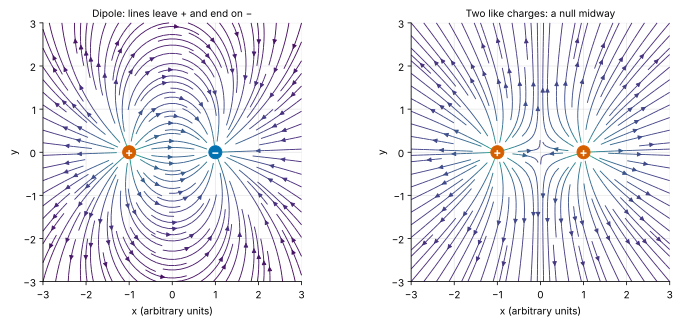
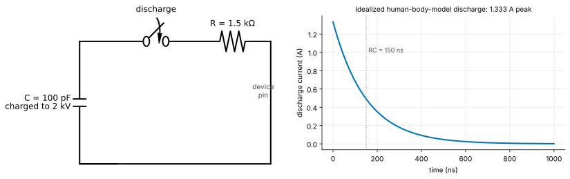

<!-- status: reviewed -->
# 04-02 · Charge, Coulomb's Law and Electric Fields

| | |
|---|---|
| **Course** | [04 · Physics for EE](../README.md) |
| **University equivalent** | The electrostatics opening of University Physics II (Halliday, Resnick & Walker, chapters on electric charge and electric fields; Purcell & Morin, chapters 1–2; MIT 8.02, weeks 1–2) |
| **Prerequisites** | [04-01 Mechanics Essentials](04-01-mechanics-essentials.md) (force, work, energy), [01-05 Integrals](../../01-calculus-for-engineers/chapters/01-05-integrals.md) and [01-06](../../01-calculus-for-engineers/chapters/01-06-techniques-of-integration.md) (substitution), [01-08](../../01-calculus-for-engineers/chapters/01-08-sequences-series-and-taylor.md) (binomial and Taylor expansions), [01-10](../../01-calculus-for-engineers/chapters/01-10-multivariable-calculus-2.md) (integrals in polar coordinates) |
| **Estimated study hours** | 10 |
| **Last verified** | 2026-11-18 |

**Learning objectives.** After this chapter you can:

1. Describe electric charge (quantized, conserved, carried by electrons and ions) and count the charges behind everyday circuit quantities.
2. Apply Coulomb's law and superposition, as vector sums, to systems of point charges.
3. Define the electric field and compute it for point charges and for continuous line, ring, disk and sheet distributions by integration, including their near and far limits.
4. Analyze an electric dipole: its far field, and the torque and energy in a uniform field.
5. Predict the motion of a charged particle in a uniform field, and connect field strength to dielectric breakdown and electrostatic discharge (ESD).

## 1. Big picture

Every electronic device moves electric charge, and every force that moves it begins with Coulomb's law: like charges repel, unlike charges attract, and the force falls as the inverse square of the distance. The **electric field** turns that action at a distance into a property of space, a force per unit charge waiting at every point, which is how engineers actually think about charges in a transistor channel, an oxide or a cable. This chapter builds the field from Coulomb's law by superposition and integration, and it introduces the hazard that every chip faces before it is ever powered: electrostatic discharge.

- **Devices:** a transistor's gate controls its channel through an electric field across an oxide a few nanometers thick ([09](../../09-semiconductor-devices/README.md)).
- **Reliability and ESD:** a person can charge to thousands of volts, and a spark into a pin can destroy a chip; every IC is qualified against ESD models ([25](../../25-fabrication-packaging-test-and-reliability/README.md)).
- **Manufacturing:** ion implanters and electron-beam tools accelerate charges in fields, and electrostatic chucks hold wafers by Coulomb attraction ([25](../../25-fabrication-packaging-test-and-reliability/README.md)).
- **Everything after:** potential and capacitance ([04-04](04-04-potential-capacitance-and-dielectrics.md)), current ([04-05](04-05-current-resistance-and-conduction.md)) and waves ([04-08](04-08-maxwell-preview.md)) all start here.

## 2. Intuition first

**Charge is bookkeeping with two signs.** Matter is normally neutral: each atom has as many electrons (negative) as protons (positive). Rub, contact or separate materials and electrons move from one to the other; nothing is created, so the total charge is conserved. A "charged" object has a tiny surplus or deficit of electrons, typically one part in $10^{12}$ or less.

**The field is a force map.** Place a small positive test charge anywhere near a set of charges and it feels a force. The **electric field** at that point is that force per unit test charge: an arrow attached to every point in space. Field lines follow the arrows; they start on positive charges, end on negative ones, crowd together where the field is strong, and never cross (Figure 1).

**Superposition makes it computable.** Electric forces simply add as vectors. The field of a billion charges is the sum of a billion simple fields, and for a smooth distribution the sum becomes an integral.

**A finance analogy, and its limits.** Superposition is like a portfolio's exposure: each position contributes linearly, and the total is the sum of the parts. *Where it breaks:* electric contributions are vectors that can cancel exactly (a symmetric arrangement can produce zero field at a point even though every piece pulls hard), and the inverse-square law means a near charge can dominate a far one a million times larger.

*Figure 1. Field lines start on positive charge and end on negative charge. Between two like charges the fields cancel at a null point.*

## 3. Theory

> **Notation for this chapter.** The Coulomb constant is $k_e = 1/(4\pi\varepsilon_0)$, because $k$ is Boltzmann's constant. Vectors carry arrows, unit vectors hats. $\vec p$ is the electric dipole moment (in 04-01 it was momentum). λ, σ and ρ are charge per unit length, area and volume.

### 3.1 Electric charge

Charge is measured in **coulombs** (C), one ampere flowing for one second. It comes in whole multiples of the elementary charge $e = 1.602\,176\,634\times10^{-19}$ C, exact by the SI definition: an electron carries $-e$ and a proton $+e$. One coulomb is therefore \$1/e = \$ **6.242×10¹⁸** elementary charges. Charge is **conserved**: in every process the total charge before equals the total after.

**Conductors** (metals) have electrons free to move through the material; **insulators** (glass, oxides, plastics) hold their electrons bound to atoms; **semiconductors** sit in between, and their free charge can be controlled ([04-11](04-11-intro-solid-state-physics.md)). A conductor can be charged by **contact** (electrons flow onto or off it) or by **induction**: bring a charged object near, let the conductor's free charges rearrange, ground the far side, then remove the ground. Rubbing two insulators together transfers charge by contact electrification, the origin of most ESD.

Circuit charges are small in coulombs but large in electrons. A 1 pF node at 1 V holds 1 pC, about **6.242 million** electrons, which is why charge looks continuous in circuits even though it is granular (Example 04-02.1).

### 3.2 Coulomb's law

Two point charges $q_1$ and $q_2$ a distance $r$ apart exert on each other a force of magnitude

$$
F = k_e\frac{|q_1q_2|}{r^2}, \qquad k_e = \frac{1}{4\pi\varepsilon_0} = 8.988\times10^9\ \text{N·m}^2/\text{C}^2 ,
$$

directed along the line joining them: repulsive for like signs, attractive for unlike. In vector form the force on charge 2 is $\vec F_{12} = k_eq_1q_2\,\hat r_{12}/r^2$, where $\hat r_{12}$ points from charge 1 to charge 2. The **vacuum permittivity** $\varepsilon_0 = 8.854\,187\,8188\times10^{-12}$ F/m is a measured constant since the 2019 SI redefinition ([R-073](../../../reference/research-log.md#r-073--codata-2022-fundamental-constants)). The force obeys Newton's third law: the two charges feel equal and opposite forces.

**How strong is it?** Between an electron and a proton the electric attraction exceeds their gravitational attraction by a factor of about $2.27\times10^{39}$, independent of distance, because both forces fall as $1/r^2$ (Example 04-02.2). Gravity dominates the universe only because matter is neutral and electric forces cancel; when they do not cancel, they are enormous. Two charges of 1 µC a centimeter apart push with about 90 N, the weight of 9 kg.

**Superposition.** The force on a charge from several others is the vector sum of the individual Coulomb forces. Electrostatics is linear: no charge changes the force another exerts.

### 3.3 The electric field

The **electric field** at a point is the force per unit charge a small test charge $q_0$ would feel there:

$$
\vec E = \frac{\vec F}{q_0}, \qquad \vec E_{\text{point}}(\vec r) = k_e\frac{q}{r^2}\,\hat r ,
$$

with $\hat r$ pointing from the source charge $q$ to the field point. Its units are newtons per coulomb, which equal **volts per meter** (V/m), the unit engineers use. A charge $q$ placed in a field feels $\vec F = q\vec E$: a positive charge is pushed along the field, an electron against it.

By superposition, the field of many point charges is $\vec E = \sum_ik_eq_i\hat r_i/r_i^2$, summed as vectors. The field is useful because it separates two questions: how sources create a field, and how a field acts on a charge.

### 3.4 Continuous charge distributions

When charge is spread smoothly, divide it into small pieces $dq$, treat each as a point charge, and integrate:

$$
\vec E = \int k_e\frac{dq}{r^2}\,\hat r, \qquad dq = \lambda\,dl,\ \ \sigma\,dA\ \text{ or }\ \rho\,dV .
$$

Symmetry usually cancels some components before you integrate; always look for it first. Four results recur.

**A finite line on its perpendicular bisector.** A straight line of length $L$ carries uniform λ along the $x$-axis from $-L/2$ to $L/2$; find the field at height $y$ above its center. The $x$-components from the left and right halves cancel. The $y$-component from the piece $dx$ is $k_e\lambda\,dx\cdot y/(x^2 + y^2)^{3/2}$ (the factor $y/\sqrt{x^2 + y^2}$ projects onto $y$), so

$$
E_y = k_e\lambda y\int_{-L/2}^{L/2}\frac{dx}{(x^2 + y^2)^{3/2}} = k_e\lambda y\Big[\frac{x}{y^2\sqrt{x^2 + y^2}}\Big]_{-L/2}^{L/2} = \frac{\lambda}{2\pi\varepsilon_0y}\cdot\frac{L/2}{\sqrt{y^2 + (L/2)^2}} .
$$

> **Math refresher — the integral $\int dx/(x^2 + y^2)^{3/2}$.** Substitute $x = y\tan\theta$, so $dx = y\sec^2\theta\,d\theta$ and $x^2 + y^2 = y^2\sec^2\theta$. The integral becomes $\int\cos\theta\,d\theta/y^2 = \sin\theta/y^2 = x/(y^2\sqrt{x^2 + y^2})$ ([01-06](../../01-calculus-for-engineers/chapters/01-06-techniques-of-integration.md)).

Close to the line ($y \ll L$) the last factor tends to 1 and $E = \lambda/(2\pi\varepsilon_0y)$: an **infinite line**'s field, falling as $1/y$. Far away ($y \gg L$) it tends to $L/(2y)$, so $E = k_e\lambda L/y^2$: a point charge $\lambda L$ (Figure 2).

**A ring on its axis.** A ring of radius $R$ carries total charge $Q$. At a point on its axis a distance $z$ from the center, every piece is the same distance $\sqrt{z^2 + R^2}$ away, and the components perpendicular to the axis cancel around the ring. The axial component of each piece carries the factor $z/\sqrt{z^2 + R^2}$, so

$$
E_z = k_e\frac{Qz}{(z^2 + R^2)^{3/2}} .
$$

It is zero at the center (everything cancels), maximum at $z = R/\sqrt2$, and becomes $k_eQ/z^2$ far away.

**A disk on its axis.** A disk of radius $R$ carries uniform surface charge σ. Build it from rings of radius $r$ and width $dr$, each with charge $dQ = \sigma\cdot2\pi r\,dr$, and add their axial fields:

$$
E_z = \int_0^Rk_e\frac{\sigma2\pi r\,z\,dr}{(z^2 + r^2)^{3/2}} = \frac{\sigma z}{2\varepsilon_0}\Big[-\frac{1}{\sqrt{z^2 + r^2}}\Big]_0^R = \frac{\sigma}{2\varepsilon_0}\Big(1 - \frac{z}{\sqrt{z^2 + R^2}}\Big) .
$$

**An infinite sheet, and two of them.** Let $R \to \infty$: the field of a uniformly charged infinite plane is

$$
E = \frac{\sigma}{2\varepsilon_0} ,
$$

independent of distance, pointing away from the sheet on both sides (for σ > 0). This is the limit of the disk when $z \ll R$: close to a large plate, the plate looks infinite (Figure 2). Two parallel sheets carrying $+\sigma$ and $-\sigma$ have fields that add between them and cancel outside: **a uniform field σ/ε₀ between the plates and none outside**. This is the parallel-plate capacitor of [04-04](04-04-potential-capacitance-and-dielectrics.md), and the reason uniform fields are easy to make.

*Figure 2. Every finite distribution looks like its idealization up close (an infinite sheet or line) and like a point charge far away. Engineering approximations live at one end or the other.*

### 3.5 The electric dipole

Two equal and opposite charges $\pm q$ a distance $d$ apart form an **electric dipole** with **dipole moment** $\vec p = q\vec d$ (C·m), pointing from $-q$ to $+q$. Molecules with lopsided charge (water), polarized insulators and the separated charges in a biased junction all behave as dipoles.

**Its far field falls as $1/r^3$.** On the axis, at distance $r$ from the center, the nearer positive charge and the farther negative one give

$$
E = k_eq\Big[\frac{1}{(r - d/2)^2} - \frac{1}{(r + d/2)^2}\Big] = k_eq\,\frac{2rd}{(r^2 - d^2/4)^2} \approx \frac{2k_ep}{r^3}\qquad(r \gg d) .
$$

On the perpendicular bisector each charge is a distance $s = \sqrt{r^2 + d^2/4}$ away and contributes $k_eq/s^2$. The components along the bisector cancel; the components parallel to the dipole axis, each $k_eq/s^2\times(d/2)/s$, add, both pointing from $+q$ toward $-q$. The field is therefore $2k_eq(d/2)/s^3 = k_ep/(r^2 + d^2/4)^{3/2} \approx k_ep/r^3$, pointing opposite to $\vec p$. The two charges nearly cancel at a distance, leaving a field one power of $r$ weaker than a point charge's. That is why neutral objects barely interact at a distance, and why a dipole's influence is local.

**Torque and energy in a uniform field.** In a uniform field the forces $+q\vec E$ and $-q\vec E$ cancel, so a dipole feels no net force, but they form a couple. Let θ be the angle between $\vec p$ and $\vec E$. Each force has magnitude $qE$ and acts at a lever arm $(d/2)\sin\theta$ about the center, and both turn the dipole the same way, so the torque is $2qE(d/2)\sin\theta$. Rotating the dipole against this torque through $d\theta$ takes work $\tau\,d\theta$, which is stored as potential energy: $dU = pE\sin\theta\,d\theta$, so $U = -pE\cos\theta$ (zero at θ = 90°). In summary,

$$
\tau = pE\sin\theta, \qquad U = -\vec p\cdot\vec E = -pE\cos\theta .
$$

The torque turns the dipole toward the field (θ = 0, the minimum of $U$), and rotating it from aligned to anti-aligned costs $2pE$. Polar molecules aligning with a field are the microscopic origin of a dielectric's permittivity ([04-04](04-04-potential-capacitance-and-dielectrics.md)). In a *nonuniform* field the two forces differ and a dipole is pulled toward the stronger field, which is why a charged comb picks up neutral bits of paper.

### 3.6 Charges moving in a uniform field

A charge $q$ of mass $m$ in a uniform field $E$ accelerates at $a = qE/m$: the constant-acceleration kinematics of 04-01. Released from rest and accelerated through a potential difference $V$ (§04-04 makes "potential difference" precise; here $V = Ed$ across a gap $d$), it gains kinetic energy $qV$:

$$
\tfrac12mv^2 = qV \quad\Longrightarrow\quad v = \sqrt{\frac{2qV}{m}} .
$$

An electron accelerated through 100 V reaches about $5.9\times10^6$ m/s, about 2% of the speed of light, so classical mechanics is accurate (Example 04-02.7); at tens of kilovolts relativity matters. Ion implanters use the same physics to drive dopant ions into silicon at energies of keV, and electron-beam lithography and microscopy at tens of keV.

**Fields large enough to break things.** A strong enough field rips electrons from atoms and starts an avalanche: dielectric **breakdown**. Dry air at sea level breaks down at about 3 MV/m (3 kV/mm), which is why a person charged to a few kilovolts can make a spark across a millimeter or so. Thermally grown SiO₂, the classic gate insulator, withstands more than 10 MV/cm, over three hundred times more ([R-077](../../../reference/research-log.md#r-077--esd-models-targets-and-dielectric-breakdown)); a gate oxide a couple of nanometers thick carrying about a volt is already within a factor of a few of that limit, which is why oxides need careful reliability engineering.

## 4. Worked examples

### Example 04-02.1 — Counting charges (tier A)

**Setup.** (a) How many elementary charges make one coulomb? (b) How many electrons does a 1 pF node hold at 1 V? (c) A 4.5 Ah phone battery (Example 04-01.1) moves how many coulombs in a full discharge?

**Solution.** (a) $1/1.602176634\times10^{-19} = $ **6.242×10¹⁸**.

(b) $Q = CV = 10^{-12}$ C, or \$10^{-12}/e = \$ **6.242×10⁶** electrons: about six million.

(c) $4.5\times3600 = $ **16,200 C**.

**Sanity check.** Six million electrons sounds like a lot, but thermal agitation makes any capacitor's charge fluctuate by $\sqrt{kTC}$ whatever its voltage (03-06's kT/C noise): about 400 electrons rms for 1 pF at 300 K, 0.006% of this charge but the whole signal of a node holding only a few thousand. That is why small capacitors are noisy.

### Example 04-02.2 — Electric force against gravity (tier A)

**Setup.** (a) An electron and a proton are 0.1 nm apart. Compare their electric and gravitational attraction ($m_e = 9.109\,383\,7139\times10^{-31}$ kg, $m_p = 1.672\,621\,925\,95\times10^{-27}$ kg, $G = 6.674\,30\times10^{-11}$ N·m²/kg²). (b) Find the force between two 1 µC charges 1 cm apart.

**Solution.** (a) $F_e = k_ee^2/r^2 = 8.988\times10^9\times(1.602\times10^{-19})^2/(10^{-10})^2 = $ **2.307×10⁻⁸ N**. $F_g = Gm_em_p/r^2 = $ **1.017×10⁻⁴⁷ N**. The ratio is **2.269×10³⁹**, the same at any distance.

(b) $F = 8.988\times10^9\times(10^{-6})^2/(0.01)^2 = $ **89.88 N**.

**Units check.** (N·m²/C²)(C²)/m² = N ✓.

### Example 04-02.3 — Superposition with three charges (tier B)

**Setup.** Charges of +2 nC at (0, 0) and −2 nC at (4 cm, 0) act on a +1 nC charge at (2 cm, 3 cm). Find the net force on the +1 nC charge.

**Solution.** Each source is $r = \sqrt{0.02^2 + 0.03^2} = $ **3.606 cm** from the test charge, so each force has magnitude

$$
F = k_e\frac{(2\times10^{-9})(1\times10^{-9})}{0.0013} = 1.383\times10^{-5}\ \text{N} .
$$

That is **13.83 µN**. The +2 nC charge repels along the direction from (0, 0) to (2, 3) cm, the unit vector (0.5547, 0.8321). The −2 nC charge attracts toward (4, 0) cm, along (0.5547, −0.8321). The $y$-components cancel and the $x$-components add: $F_{\text{net}} = 2\times13.83\times0.5547$ µN = **15.34 µN** along +$x$.

**Sanity check.** The test charge sits on the dipole's perpendicular bisector, where §3.5 says the field points opposite to $\vec p$ (from + toward −), here along +$x$ ✓.

### Example 04-02.4 — A charged line, near and far (tier B)

**Setup.** A 2 mm wire carries a uniform 10 nC/m. (a) Find the field 1 mm from its center, on the perpendicular bisector, and compare with the infinite-line formula. (b) Find the field 1 m away and compare with a point charge.

**Solution.** (a) With $L/2 = y = 1$ mm,

$$
E = \frac{\lambda}{2\pi\varepsilon_0y}\cdot\frac{L/2}{\sqrt{y^2 + (L/2)^2}} = \frac{10^{-8}}{2\pi\varepsilon_0\times10^{-3}}\times\frac{1}{\sqrt2} .
$$

That is **1.271×10⁵ V/m**. The infinite-line formula gives **1.798×10⁵ V/m**, 41% high: at a distance equal to the half-length, the line is not "infinite".

(b) At 1 m the exact formula gives **0.1797509 V/m**, and the point-charge formula $k_e(\lambda L)/y^2$, with $\lambda L$ = 20 pC, gives **0.1797510 V/m**: the two agree to six digits.

### Example 04-02.5 — Disks, sheets and parallel plates (tier B)

**Setup.** A surface charge density σ = 1 µC/m². (a) Find the field of an infinite sheet. (b) Find the field between two infinite sheets of ±σ. (c) Find the on-axis field 1 mm from a disk of radius 1 cm with the same σ, and its ratio to the sheet value.

**Solution.** (a) $\sigma/(2\varepsilon_0) = 10^{-6}/(2\times8.854\times10^{-12}) = $ **5.647×10⁴ V/m**.

(b) $\sigma/\varepsilon_0 = $ **1.129×10⁵ V/m**, and zero outside the pair.

(c) $E = \frac{\sigma}{2\varepsilon_0}\big(1 - 1/\sqrt{1 + 100}\big) = $ **5.085×10⁴ V/m**, a ratio of **0.9005**: at a tenth of its radius, a disk is 90% of an infinite sheet.

**Units check.** (C/m²)/(F/m) = C/(F·m) = V/m ✓.

### Example 04-02.6 — A dipole's field, torque and energy (tier C)

**Setup.** Charges of ±1 nC are 1 mm apart. (a) Find the dipole moment. (b) Find the on-axis field 10 cm away, exactly and with the $2k_ep/r^3$ approximation, and the relative error. (c) In a uniform field of $10^5$ V/m, find the maximum torque and the energy needed to turn the dipole from aligned to anti-aligned.

**Solution.** (a) $p = qd = $ **1×10⁻¹² C·m**.

(b) Exactly, \$E = k_eq[1/0.0995^2 - 1/0.1005^2] = \$ **17.976 V/m**; the approximation gives \$2k_ep/r^3 = \$ **17.975 V/m**. The relative error is **5.000×10⁻⁵**. It matches the first correction term: the exact expression equals the approximation times $1/(1 - d^2/4r^2)^2 \approx 1 + d^2/(2r^2)$, and $d^2/(2r^2) = 5\times10^{-5}$ here.

(c) $\tau_{\max} = pE = $ **1×10⁻⁷ N·m**; turning costs $2pE = $ **2×10⁻⁷ J**.

### Example 04-02.7 — An electron in a uniform field (tier C)

**Setup.** Two parallel plates 1 cm apart are at 100 V difference, giving a uniform field. An electron starts from rest at the negative plate. Find (a) the field and the electron's acceleration, (b) the time to cross, (c) its final speed and energy (in J and eV), and (d) its speed as a fraction of $c$.

**Solution.** (a) $E = V/d = $ **10⁴ V/m**; $a = eE/m_e = 1.602\times10^{-15}/9.109\times10^{-31} = $ **1.759×10¹⁵ m/s²**.

(b) $d = \tfrac12at^2$ gives \$t = \sqrt{2d/a} = \$ **3.372 ns**.

(c) $v = \sqrt{2eV/m_e} = $ **5.931×10⁶ m/s**; $K = eV = $ **1.602×10⁻¹⁷ J** = 100 eV.

(d) \$v/c = \$ **0.01978**: about 2%, so the classical treatment is accurate (the relativistic correction to the speed is about $\tfrac38(v/c)^2$, 0.015%).

**Sanity check.** $v = at = 1.759\times10^{15}\times3.372\times10^{-9} = 5.93\times10^6$ m/s ✓.

### Example 04-02.8 — The human-body model of ESD (tier B)

**Setup.** The human-body model (HBM) of electrostatic discharge represents a charged person as 100 pF discharged through 1.5 kΩ into a device pin ([R-077](../../../reference/research-log.md#r-077--esd-models-targets-and-dielectric-breakdown)). For a 2 kV event, find (a) the stored charge and energy, (b) the peak current and time constant of this idealized circuit, (c) the current 300 ns later, and (d) the field 1 cm from the stored charge if it sat on a small sphere, compared with air's breakdown field. Confirm (b) and (c) with ngspice.

**Solution.** (a) $Q = CV = $ **200 nC**; energy $\tfrac12CV^2 = $ **0.2 mJ**: tiny by human standards, enormous for a gate oxide.

(b) The current starts at $V/R = 2000/1500 = $ **1.333 A** and decays with time constant $RC = $ **150 ns** (an RC discharge, [07-02](../../07-circuit-analysis-2-transient-and-ac/chapters/07-02-first-order-rc-rl-transients.md); Figure 3).

(c) $1.333\,e^{-300/150} = $ **0.1804 A**.

(d) $E = k_eQ/r^2 = 8.988\times10^9\times2\times10^{-7}/10^{-4} = $ **1.798×10⁷ V/m**, six times air's roughly 3 MV/m: a charge this size cannot sit on a small object in air without sparking, which is exactly what an ESD event is.

*Figure 3. The idealized human-body model. Real testers add parasitic inductance and capacitance that shape the first nanoseconds of the pulse.*

**Simulation.** The netlist [labs/04-02-lab/hbm.cir](../labs/04-02-lab/hbm.cir) runs the discharge in ngspice and measures the peak current and the current at 300 ns.

<!-- answer-key -->
| ID | Quantity | Value | Unit |
|---|---|---|---|
| Ex 04-02.1a | elementary charges per coulomb | 6.242×10^18 | — |
| Ex 04-02.1b | electrons on 1 pF at 1 V | 6.242×10^6 | — |
| Ex 04-02.1c | charge of a 4.5 Ah discharge | 16200 | C |
| Ex 04-02.2a | electric force, electron and proton at 0.1 nm | 2.307×10^-8 | N |
| Ex 04-02.2b | gravitational force | 1.017×10^-47 | N |
| Ex 04-02.2c | ratio of electric to gravitational force | 2.269×10^39 | — |
| Ex 04-02.2d | force between two 1 µC charges 1 cm apart | 89.88 | N |
| Ex 04-02.3a | distance from each source | 3.606 | cm |
| Ex 04-02.3b | force from each source | 13.83 | µN |
| Ex 04-02.3c | net force | 15.34 | µN |
| Ex 04-02.4a | field of the finite line at 1 mm | 1.271×10^5 | V/m |
| Ex 04-02.4b | infinite-line field at 1 mm | 1.798×10^5 | V/m |
| Ex 04-02.4c | finite-line field at 1 m | 0.1797509 | V/m |
| Ex 04-02.4d | point-charge field at 1 m | 0.1797510 | V/m |
| Ex 04-02.5a | infinite sheet field | 5.647×10^4 | V/m |
| Ex 04-02.5b | field between ±σ sheets | 1.129×10^5 | V/m |
| Ex 04-02.5c | disk field at 1 mm | 5.085×10^4 | V/m |
| Ex 04-02.5d | disk over sheet | 0.9005 | — |
| Ex 04-02.6a | dipole moment | 1×10^-12 | C·m |
| Ex 04-02.6b | exact on-axis field | 17.976 | V/m |
| Ex 04-02.6c | approximate on-axis field | 17.975 | V/m |
| Ex 04-02.6d | relative error | 5.000×10^-5 | — |
| Ex 04-02.6e | maximum torque | 1×10^-7 | N·m |
| Ex 04-02.6f | energy to reverse | 2×10^-7 | J |
| Ex 04-02.7a | field between plates | 10000 | V/m |
| Ex 04-02.7b | electron acceleration | 1.759×10^15 | m/s² |
| Ex 04-02.7c | crossing time | 3.372 | ns |
| Ex 04-02.7d | final speed | 5.931×10^6 | m/s |
| Ex 04-02.7e | final energy | 1.602×10^-17 | J |
| Ex 04-02.7f | speed over c | 0.01978 | — |
| Ex 04-02.8a | HBM stored charge | 200 | nC |
| Ex 04-02.8b | HBM stored energy | 0.2 | mJ |
| Ex 04-02.8c | HBM peak current | 1.333 | A |
| Ex 04-02.8d | HBM time constant | 150 | ns |
| Ex 04-02.8e | HBM current at 300 ns | 0.1804 | A |
| Ex 04-02.8f | field 1 cm from 200 nC | 1.798×10^7 | V/m |

<!-- answer-key -->
| ID | Quantity | Value | Unit |
|---|---|---|---|
| T 04-02.a | Coulomb constant | 8.988×10^9 | N·m²/C² |
| T 04-02.b | ring field maximum at z/R | 0.7071 | — |
| T 04-02.c | air breakdown field | 3 | MV/m |
| T 04-02.d | electron speed after 100 V | 5.9×10^6 | m/s |
| T 04-02.e | relativistic speed correction at 100 V | 0.015 | % |

## 5. Simulate it

The lab ([labs/04-02-lab/](../labs/04-02-lab/README.md)) is a notebook plus an ngspice netlist:

1. **Superposition by computer:** a small Coulomb solver that reproduces Example 04-02.3 and maps the field of any set of charges.
2. **Fields from integrals:** the finite line, ring and disk by numerical integration, against the closed forms of §3.4. *Predict first:* how many segments does a line need for 0.1% accuracy at a distance equal to its half-length?
3. **The dipole's $1/r^3$:** fit the slope of the field against distance on log axes.
4. **The ring's maximum:** find where the on-axis field peaks.
5. **An electron's trajectory:** integrate the motion between deflection plates and compare with the parabola.
6. **ESD pulses:** the HBM and the IEC system-level gun compared.

The netlist `hbm.cir` simulates Example 04-02.8.

## 6. Engineering tradeoffs

| Knob | Improves | Costs | Typical decision owner |
|---|---|---|---|
| On-chip ESD protection size | Higher HBM and CDM ratings | Pin capacitance (signal bandwidth at high data rates), area, leakage | I/O and ESD designers |
| Factory ESD controls (grounding, ionizers) | Lets lower-rated parts be handled safely | Equipment, training, audits | Manufacturing and quality |
| Gate-oxide thickness | Lower field for a given voltage: reliability | Weaker gate control of the channel, slower transistors | Process and device engineers |
| Spacing between conductors | Lower field, less breakdown risk | Area and density | Layout and package designers |
| Accelerating voltage in implant and e-beam tools | Deeper implants, finer beams | Damage, cost, relativistic and charging effects | Process equipment engineers |

## 7. Numbers to know

| Quantity | Value | Note |
|---|---|---|
| Elementary charge | $e = 1.602\,176\,634\times10^{-19}$ C | Exact |
| Charges per coulomb | 6.242×10¹⁸ | |
| Coulomb constant | $k_e = 1/(4\pi\varepsilon_0)$ ≈ 8.988×10⁹ N·m²/C² | ε₀ = 8.854×10⁻¹² F/m |
| Field of an infinite sheet; between ±σ plates | σ/(2ε₀); σ/ε₀ | Uniform |
| Dipole far field | $2k_ep/r^3$ on axis, $k_ep/r^3$ broadside | Falls as $1/r^3$ |
| Electron after 100 V | ≈ 5.9×10⁶ m/s (2% of c) | $v = \sqrt{2eV/m_e}$ |
| Breakdown field | air ≈ 3 MV/m; thermal SiO₂ > 10 MV/cm | [R-077](../../../reference/research-log.md#r-077--esd-models-targets-and-dielectric-breakdown) |
| HBM network | 100 pF, 1.5 kΩ: 1.333 A peak per 2 kV | JS-001 |
| ESD qualification targets, as of Nov 2026 | 1 kV HBM, 250 V CDM (Industry Council) | [R-077](../../../reference/research-log.md#r-077--esd-models-targets-and-dielectric-breakdown) |

## 8. Common mistakes

1. **Adding field magnitudes instead of vectors.** Resolve into components; symmetric pieces often cancel.
2. **Getting the direction of $\hat r$ wrong.** It points from the source charge to the field point; the force on an electron is opposite to $\vec E$.
3. **Using the infinite-sheet or infinite-line formula too far away.** It holds only when the distance is small compared with the object's size.
4. **Forgetting that a dipole in a uniform field feels no net force,** only a torque.
5. **Expecting a large field to need a large voltage.** A volt across a nanometer is 10⁹ V/m, more than air or many insulators survive.
6. **Mixing ε₀ and $k_e$.** $k_e = 1/(4\pi\varepsilon_0)$; formulas written with one must not be "simplified" with the other's constant.
7. **Reading an ESD rating as the voltage the chip "withstands" in use.** It is a qualification test with a specific model (HBM, CDM, or the IEC gun), each with a different current waveform.

## 9. Practitioner lens

### State of the art (as of Nov 2026)

- **ESD qualification targets.** The Industry Council on ESD Target Levels, whose white papers JEDEC published as JEP155 (HBM) and JEP157 (CDM), concluded that 1 kV HBM and 250 V CDM are safe targets with basic factory ESD controls, and that advanced controls are needed below about 500 V HBM and 125 V CDM; JEP155 itself states that 500 V HBM allows safe manufacturing with a standard ESD control process. High-pin-count, high-speed designs are pushing CDM targets toward 125 V ([R-077](../../../reference/research-log.md#r-077--esd-models-targets-and-dielectric-breakdown)) **[Established]**.
- **Test models.** HBM testing to ANSI/ESDA/JEDEC JS-001 (2024 edition) uses 100 pF through 1.5 kΩ; its classes run from 0Z (under 50 V) to 3B (8 kV and above), with class 1C covering 1000 to 2000 V. CDM (JS-002) models a charged *device* discharging to ground, a much faster event. The system-level test of IEC 61000-4-2, applied to whole products, uses 150 pF through 330 Ω at 2 to 8 kV, so its peak current is several times an HBM pulse's at the same voltage: the idealized RC networks give 24 A against 5.3 A at 8 kV, and the standard actually specifies a sharper first peak of 3.75 A/kV, 30 A at 8 kV ([R-077](../../../reference/research-log.md#r-077--esd-models-targets-and-dielectric-breakdown)) **[Established]**.
- **Fields in manufacturing.** Electrostatic chucks clamp wafers with Coulomb force across a thin insulator (or, in the Johnsen–Rahbek type, a slightly conductive layer that gives a strong force at lower voltage); a peer-reviewed measurement on a 200 mm wafer at 1 kV found a holding force of about 40 N, matching a capacitor-pressure calculation that 04-04 explains ([R-077](../../../reference/research-log.md#r-077--esd-models-targets-and-dielectric-breakdown)) **[Established]**.

### Why it matters commercially

ESD is a cost and a constraint at once. Every pin of every IC carries protection that adds capacitance, and at tens of gigabits per second that capacitance limits bandwidth, so high-speed I/O designers push for lower ESD targets while customers and quality teams push for higher ones. The industry's move from 2 kV to 1 kV HBM and toward lower CDM targets is a negotiated tradeoff between chip performance and factory discipline. For products (phones, wearables, car electronics), system-level ESD at the connectors drives external protection components and board layout. In diligence, an ESD story reveals how mature a team's I/O and qualification practice is.

### Marketing vs Reality

- **"±15 kV ESD protection."** *Reality:* under which model? A system-level (IEC 61000-4-2) contact or air-discharge rating, a component HBM rating and a CDM rating are different tests with different currents. Ask for all three, with the classification.
- **"Qualified to 2 kV HBM."** *Reality:* fine, but CDM often limits modern parts, and an HBM number says nothing about a charged-device event in an automated handler. Ask for the CDM class.
- **"Our oxide easily handles the supply voltage."** *Reality:* at nanometer thicknesses, a volt is megavolts per centimeter. Ask for the field at the maximum supply and the lifetime model behind it.

### Questions for engineering leaders

1. **"What are your HBM and CDM classes, and what limits them?"** *Strong:* JS-001 and JS-002 classes per pin group, the protection scheme, and the tradeoff with I/O capacitance. *Evasive:* a single "2 kV" figure.
2. **"What ESD controls do your factories and your customers' factories need for this part?"** *Strong:* ties the component rating to ANSI/ESD S20.20 or IEC 61340-5-1 programs. *Evasive:* "standard handling".
3. **"How do you protect high-speed pins without killing bandwidth?"** *Strong:* capacitance budget per pin, low-capacitance protection devices, and system-level protection at the connector. *Evasive:* no number for pin capacitance.
4. **"What is the worst-case field across your thinnest dielectric?"** *Strong:* field at maximum voltage, the breakdown and lifetime data behind the margin. *Evasive:* "it is within spec".

## 10. Concept check

1. A balloon rubbed on hair holds −50 nC. How many extra electrons is that, and what fraction of its electrons might that be?

   

Answer

   $50\times10^{-9}/1.602\times10^{-19} \approx 3.1\times10^{11}$ extra electrons. A gram of matter holds about $10^{23}$ electrons, so this is a surplus of about one part in $10^{12}$: charged objects are only slightly unbalanced.

   

2. Why does the field of an infinite charged sheet not depend on distance?

   

Answer

   Moving away, each piece of the sheet is farther (weaker field), but more of the sheet contributes at a useful angle; for an infinite plane the two effects cancel exactly. Any finite plate shows the dependence once you are far compared with its size.

   

3. Where is the field zero between charges of +q and +4q placed 3 cm apart?

   

Answer

   Where $q/x^2 = 4q/(3 - x)^2$, so $3 - x = 2x$ and $x = 1$ cm from the +q charge: closer to the smaller charge.

   

4. Why does a dipole's field fall as $1/r^3$ while a point charge's falls as $1/r^2$?

   

Answer

   From far away the two opposite charges almost coincide, and their fields nearly cancel; what is left is the difference between two $1/r^2$ fields at slightly different distances, which is a derivative and carries an extra $1/r$.

   

5. Two parallel plates carry ±σ. What is the field outside them, and why?

   

Answer

   Zero: outside, the two sheets' fields (each σ/2ε₀) point in opposite directions and cancel; between the plates they point the same way and add to σ/ε₀.

   

6. A device survives 2 kV HBM. Will it survive a 2 kV discharge from the IEC 61000-4-2 gun?

   

Answer

   Not necessarily: the IEC network (150 pF, 330 Ω) delivers about 4.5 times the HBM peak current at the same voltage in the idealized RC model (the standard's specified first peak, 3.75 A/kV, is higher still) and more energy. Component and system ratings are different tests.

   

7. An electron and a proton are released in the same uniform field. Compare their accelerations.

   

Answer

   Equal and opposite forces, but the proton is 1836 times heavier, so its acceleration is 1836 times smaller, in the opposite direction.

   

Problem set: [04-02 problems](../problems/04-02-problems.md) · [solutions](../solutions/04-02-solutions.md).

## 11. Key terms

[Electric charge](../../../reference/glossary.md#electric-charge) ·
[Elementary charge](../../../reference/glossary.md#elementary-charge) ·
[Coulomb's law](../../../reference/glossary.md#coulombs-law) ·
[Vacuum permittivity](../../../reference/glossary.md#vacuum-permittivity) ·
[Electric field](../../../reference/glossary.md#electric-field) ·
[Superposition (electrostatics)](../../../reference/glossary.md#superposition-electrostatics) ·
[Charge density](../../../reference/glossary.md#charge-density) ·
[Electric dipole](../../../reference/glossary.md#electric-dipole) ·
[Dielectric breakdown](../../../reference/glossary.md#dielectric-breakdown) ·
[Electrostatic discharge (ESD)](../../../reference/glossary.md#electrostatic-discharge-esd) ·
[Human-body model (HBM)](../../../reference/glossary.md#human-body-model-hbm) ·
[Charged-device model (CDM)](../../../reference/glossary.md#charged-device-model-cdm)

## 12. Connections

- **Previous:** [04-01](04-01-mechanics-essentials.md) (force, work, kinematics), [01-06](../../01-calculus-for-engineers/chapters/01-06-techniques-of-integration.md) (the substitutions used in §3.4), [07-02](../../07-circuit-analysis-2-transient-and-ac/chapters/07-02-first-order-rc-rl-transients.md) (the RC discharge of Example 04-02.8).
- **Next:** [04-03 Gauss's Law](04-03-gauss-law.md) gets the sheet, line and sphere fields in one line each by exploiting symmetry, and explains why conductors shield.
- **Used in:** [04-04](04-04-potential-capacitance-and-dielectrics.md) (potential, capacitance, dielectrics), [09](../../09-semiconductor-devices/README.md) (fields in junctions and oxides), [13](../../13-electromagnetics/README.md) (fields in full generality), [25](../../25-fabrication-packaging-test-and-reliability/README.md) (ESD qualification).

## 13. Further study

- Halliday, D., Resnick, R. and Walker, J., *Fundamentals of Physics*, the chapters on Coulomb's law and electric fields.
- Purcell, E. M. and Morin, D. J., *Electricity and Magnetism*, 3rd ed., Cambridge University Press, 2013, chapters 1 and 2.
- MIT OpenCourseWare 8.02 (Physics II: Electricity and Magnetism), the lectures on charges, fields and dipoles.
- ESD Association, "Fundamentals of Electrostatic Discharge, Part Five: Device Sensitivity and Testing", 2024, for the HBM, CDM and system-level models.

## 14. Sources

1. Halliday, D., Resnick, R. and Walker, J., *Fundamentals of Physics*, Wiley (any recent edition) (air breakdown at about 3 MV/m).
2. Purcell, E. M. and Morin, D. J., *Electricity and Magnetism*, 3rd ed., Cambridge University Press, 2013.
3. NIST, 2022 CODATA recommended values (ε₀, $m_e$, $m_p$, $G$). [R-073]
4. ESD Association, Industry Council on ESD Target Levels summaries (one undated, 2010 or later; one June 2013); Texas Instruments TPS55288 datasheet (JEP155 and JEP157 statements). [R-077]
5. ESD Association, "Fundamentals of Electrostatic Discharge, Part Five: Device Sensitivity and Testing", 2024; ANSI/ESDA/JEDEC JS-001-2024; Murata, "Basic knowledge of ESD" (IEC 61000-4-2 network). [R-077]
6. Henkel, C. and Östling, M., KTH course IH2655, Lecture 5 (thermal oxidation; SiO₂ breakdown field), 2012. [R-077]
7. Shim, G. I. and Sugai, H., "Dechuck operation of Coulomb type and Johnsen–Rahbek type of electrostatic chuck used in plasma processing", *Plasma and Fusion Research* 3, 051, 2008. [R-077]
