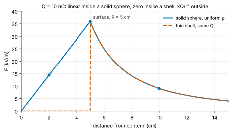

<!-- status: verified -->
# 04-03 · Gauss's Law

| | |
|---|---|
| **Course** | [04 · Physics for EE](../README.md) |
| **University equivalent** | Gauss's law in University Physics II (Halliday, Resnick & Walker, the chapter on Gauss's law; Purcell & Morin, chapters 1.10–1.13 and 3.1–3.3; MIT 8.02, weeks 2–3) |
| **Prerequisites** | [04-02 Charge, Coulomb's Law and Electric Fields](04-02-charge-coulomb-and-electric-fields.md), [01-10 Multivariable Calculus II](../../01-calculus-for-engineers/chapters/01-10-multivariable-calculus-2.md) (surface integrals and flux, spherical and cylindrical coordinates) |
| **Estimated study hours** | 8 |
| **Last verified** | 2026-11-18 |

**Learning objectives.** After this chapter you can:

1. Compute the electric flux through flat and curved surfaces, including the net flux out of a closed surface.
2. Derive Gauss's law from Coulomb's law using solid angle, and explain why it depends on the inverse-square law.
3. Choose Gaussian surfaces that exploit spherical, cylindrical and planar symmetry, and use them to find the fields of spheres, shells, lines, coaxial conductors, sheets and slabs; recognize when symmetry is not enough.
4. State and justify the properties of conductors in electrostatic equilibrium (zero interior field, surface charge, field σ/ε₀ just outside, shielding by closed conductors) and apply them to shells, plates and cavities.
5. Apply Gauss's law inside materials to the depletion region of a pn junction and to the fields in capacitive touch sensors.

## 1. Big picture

Coulomb's law plus superposition can give the field of any charge distribution, but the integrals of [04-02](04-02-charge-coulomb-and-electric-fields.md) are laborious even for a disk. **Gauss's law** is the same physics in another form: the field lines leaving a closed surface count the charge inside it. With symmetry, it turns a three-dimensional integral into one line of algebra. It also explains what integration hides: why a metal box shields its contents, why charge on a conductor sits on its surface and crowds onto sharp points, and why the field in a pn junction is a triangle.

- **Devices:** the field across a junction's depletion region and a transistor's gate oxide follow from Gauss's law applied to sheets and slabs of charge ([09-05](../../09-semiconductor-devices/chapters/09-05-pn-junction-electrostatics.md), [09-08](../../09-semiconductor-devices/chapters/09-08-mos-capacitor.md)).
- **Shielding and cables:** coaxial cables confine their field between the conductors, and grounded metal enclosures keep external fields out of sensitive circuits ([13](../../13-electromagnetics/README.md), [24](../../24-high-speed-io-signal-integrity-and-photonics/README.md)).
- **Sensors:** a capacitive touch sensor measures how a finger changes the charge needed to hold an electrode's voltage, which is the field arithmetic of this chapter ([18-10](../../18-embedded-systems-and-microcontrollers/chapters/18-10-sensors.md)).
- **High-voltage design:** fields concentrate on thin wires and sharp edges, where corona and breakdown begin.

## 2. Intuition first

**Field lines as a count of charge.** Picture field lines as threads: a fixed number leave each unit of positive charge and end on each unit of negative charge. Draw a closed surface, a "bag", around some charges. A thread that starts inside and ends outside crosses the bag once going out; a thread from outside that passes through crosses it twice, in and out, and contributes nothing net. So the net number of threads leaving the bag counts the charge inside, whatever its shape and wherever the outside charges sit. That count is the **flux**, and the statement is **Gauss's law**.

**Why the inverse square matters.** The thread picture works only because the number of threads never changes with distance: spread over a sphere of radius $r$ (area $4\pi r^2$), the density of threads falls as $1/r^2$, exactly like Coulomb's field. A force falling as $1/r^{2.1}$ would make threads "disappear" with distance, and Gauss's law would fail. It is a law of three-dimensional space plus an inverse-square force.

**Symmetry does the work.** Gauss's law gives one number, the total flux. To extract the field from it you need a surface over which the field is known to be constant and perpendicular (or parallel, carrying no flux). Spheres, infinite lines and infinite planes have such surfaces (Figure 1); a cube or a short rod does not.

**A finance analogy, and its limits.** Treat a closed surface as a firm's boundary and field lines as cash: net cash leaving equals what is generated inside, and flows that merely pass through (in from a customer, out to a supplier) net to zero. *Where it breaks:* accounting entries can create or destroy cash, while charge is strictly conserved; and Gauss's law holds at every instant for every surface, not just at period-end.

*Figure 1. The three symmetries that make Gauss's law useful. In each, the field is constant in magnitude and perpendicular to the part of the surface it crosses, and parallel to the rest.*

## 3. Theory

> **Notation for this chapter.** As in 04-02, $k_e = 1/(4\pi\varepsilon_0)$ and $e$ is the elementary charge, except in §3.5, which follows the device-physics convention of [Course 09](../../09-semiconductor-devices/README.md) and writes the elementary charge as $q$. $\hat n$ is a unit normal; on a closed surface it always points **outward**. λ, σ and ρ are charge per unit length, area and volume.

### 3.1 Electric flux

The **electric flux** through a small flat patch of area $dA$ with unit normal $\hat n$ is $d\Phi_E = \vec E\cdot\hat n\,dA = E\,dA\cos\theta$, where θ is the angle between the field and the normal. Through a whole surface $S$,

$$
\Phi_E = \iint_S\vec E\cdot\hat n\,dA ,
$$

measured in V·m (equivalently N·m²/C). For a uniform field crossing a flat area $A$, this is simply $\Phi_E = EA\cos\theta$: maximum when the surface faces the field, zero when it is edge-on (Example 04-03.1). Flux counts field lines with a sign: lines crossing along $\hat n$ count positive, lines crossing against it negative.

For a **closed** surface, the outward-normal convention makes the net flux $\oint_S\vec E\cdot\hat n\,dA$ the lines leaving minus the lines entering. In a uniform field, every line that enters a closed box also leaves it, so the net flux is zero.

> **Math refresher — surface integrals.** A surface integral adds a quantity over a surface patch by patch, as a double integral adds over a region of the plane; for flux, each patch contributes its normal field times its area ([01-10 §3.6](../../01-calculus-for-engineers/chapters/01-10-multivariable-calculus-2.md)). Here symmetry always reduces it to "field times area".

### 3.2 Gauss's law, derived from Coulomb's law

**Step 1: a sphere centered on a point charge.** Surround a point charge $q$ with a sphere of radius $r$ centered on it. Everywhere on the sphere the field $k_eq/r^2$ points radially outward, along $\hat n$, so $\vec E\cdot\hat n = k_eq/r^2$ is constant and

$$
\Phi_E = \frac{k_eq}{r^2}\cdot4\pi r^2 = 4\pi k_eq = \frac{q}{\varepsilon_0} .
$$

The radius cancels: the sphere's area grows as $r^2$ exactly as the field falls as $1/r^2$. This is also why Coulomb's constant is written $1/(4\pi\varepsilon_0)$: putting the $4\pi$ there makes Gauss's law free of it.

**Step 2: any closed surface around the charge.** Now take an arbitrary closed surface enclosing $q$. A small patch $dA$ at distance $r$, whose normal makes angle α with the radial direction, carries flux

$$
d\Phi_E = \frac{k_eq}{r^2}\cos\alpha\,dA = k_eq\,d\Omega, \qquad d\Omega = \frac{\cos\alpha\,dA}{r^2} ,
$$

where $d\Omega$ is the **solid angle** the patch subtends at the charge. A patch tilted away from the charge (large α) or far from it (large $r$) subtends a small solid angle and catches little flux, by exactly the right amounts. Adding all the patches of a surface that wraps once around the charge adds up the full solid angle, $4\pi$, so $\Phi_E = 4\pi k_eq = q/\varepsilon_0$ again.

> **Math refresher — solid angle.** A plane angle is arc over radius, $\theta = s/r$, with $2\pi$ in a full circle. A **solid angle** is the area a cone cuts from a sphere over the radius squared, $\Omega = A/r^2$, in steradians (sr); the whole sphere is $4\pi$ sr. A tilted patch is first projected onto the sphere, multiplying its area by $\cos\alpha$. It measures how big something looks from a point.

**Step 3: a charge outside the surface.** If $q$ lies outside, each thin cone from the charge pierces the surface an even number of times: in, out (and perhaps in, out again). At each piercing the patch subtends the same solid angle $d\Omega$, but the flux enters on one and leaves on the next, so the contributions cancel in pairs. A charge outside contributes **zero net flux**.

**Step 4: superposition.** Fields add (04-02), so fluxes add. For any collection of charges, those inside contribute $q_i/\varepsilon_0$ each and those outside contribute nothing:

$$
\boxed{\oint_S\vec E\cdot\hat n\,dA = \frac{Q_{\text{enc}}}{\varepsilon_0}}
$$

This is **Gauss's law**. Three points are easy to misread:

- $\vec E$ is the *total* field. Outside charges change the field on the surface; they only drop out of its net flux.
- It holds for *every* closed surface, but it yields $E$ only when symmetry lets you pull $E$ out of the integral.
- For static charges it is equivalent to Coulomb's law. Unlike Coulomb's law, it stays true when charges move: it is one of Maxwell's equations ([04-08](04-08-maxwell-preview.md)).

> **Going deeper — the differential form.** The divergence theorem of [01-10 §3.8](../../01-calculus-for-engineers/chapters/01-10-multivariable-calculus-2.md) converts the flux out of a surface into the volume integral of the divergence inside: $\oint\vec E\cdot\hat n\,dA = \iiint\nabla\cdot\vec E\,dV$. Since $Q_{\text{enc}} = \iiint\rho\,dV$ and the surface is arbitrary, the integrands must match point by point: $\nabla\cdot\vec E = \rho/\varepsilon_0$. Combined with $\vec E = -\nabla V$ (04-04), this becomes **Poisson's equation**, $\nabla^2V = -\rho/\varepsilon_0$, which device simulators solve for every transistor ([13-02](../../13-electromagnetics/chapters/13-02-electrostatics-boundary-value-problems.md)).

> **Going deeper — how exact is the inverse square?** If the field fell as $1/r^{2+\delta}$, the flux through a sphere would be $q\,r^{-\delta}/\varepsilon_0$, varying with radius, and a charged closed conductor would have a small field inside. Cavendish tested this in the 1770s; Williams, Faller and Hill (1971) found the exponent equals 2 to within a few parts in $10^{16}$ ([R-078](../../../reference/research-log.md#r-078--gauss-law-applications-silicon-permittivity-capacitive-sensing-and-coulombs-law-tests)). The lab lets you watch flux "leak" for δ ≠ 0.

### 3.3 Using Gauss's law: three symmetries

The recipe:

1. **Identify the symmetry** and argue the field's direction and what it can depend on.
2. **Choose a Gaussian surface** on which $\vec E$ is either perpendicular with constant magnitude, or parallel (no flux).
3. **Compute the flux** as $E$ times the relevant area.
4. **Find the enclosed charge.**
5. **Solve for $E$**, and check the limits.

**Why symmetry fixes the direction.** Rotating a spherically symmetric distribution about the axis through any point leaves the charges unchanged, so it cannot change the field there; a sideways component would rotate, so there is none. $\vec E$ is radial, with magnitude depending only on $r$. The same argument (rotate, slide, flip) makes an infinite line's field point straight away from the line, and an infinite plane's straight away from the plane.

**Spherical symmetry.** Take a sphere of radius $r$ concentric with the charge: $\Phi_E = E(r)\cdot4\pi r^2$.

- *Outside any spherically symmetric distribution* of total charge $Q$: $E = k_eQ/r^2$. The whole sphere acts as a point charge at its center (Newton's "shell theorem", in one line).
- *Inside a uniformly charged solid sphere* of radius $R$: the enclosed charge is the fraction of the volume inside $r$, $Q_{\text{enc}} = Q\,r^3/R^3$, so

  $$
  E\cdot4\pi r^2 = \frac{Qr^3}{\varepsilon_0R^3} \quad\Longrightarrow\quad E = \frac{k_eQr}{R^3}\qquad(r < R) ,
  $$

  rising linearly from zero at the center to $k_eQ/R^2$ at the surface (Figure 2).
- *Inside a thin spherical shell*: $Q_{\text{enc}} = 0$, so $E = 0$ everywhere inside, however close to the wall. The pull of the near wall is exactly cancelled by the larger, farther wall.

*Figure 2. Solid sphere against thin shell, both carrying 10 nC with a 5 cm radius (Example 04-03.3). Outside, only the total charge matters.*

**Cylindrical symmetry.** Around an infinitely long line or cylinder, use a coaxial cylinder of radius $r$ and length $\ell$. The field is radial, so it crosses only the curved side (area $2\pi r\ell$) and runs parallel to the end caps:

$$
E\cdot2\pi r\ell = \frac{\lambda_{\text{enc}}\ell}{\varepsilon_0} \quad\Longrightarrow\quad E = \frac{\lambda_{\text{enc}}}{2\pi\varepsilon_0r} ,
$$

where $\lambda_{\text{enc}}$ is the charge per unit length inside radius $r$. For a line charge this is the infinite-line field that 04-02 needed an integral to reach. Inside a solid cylinder of radius $a$ with uniform ρ, $\lambda_{\text{enc}} = \rho\pi r^2$ and $E = \rho r/(2\varepsilon_0)$.

The most important cylindrical structure in electronics is the **coaxial line**: an inner conductor of radius $a$ carrying $+\lambda$ inside an outer conductor, of inner radius $b$, carrying $-\lambda$. Between them $E = \lambda/(2\pi\varepsilon_0r)$; outside, the enclosed charge is $+\lambda - \lambda = 0$, so **the field is zero**. A coaxial cable keeps its field to itself (as far as its outer conductor is complete). The field is strongest at the thin inner conductor, where breakdown starts (Example 04-03.4).

**Planar symmetry.** For an infinite sheet with surface charge σ, use a **pillbox**: a short cylinder of face area $A$ straddling the sheet. The field is perpendicular to the sheet, so flux leaves through both faces and none through the side:

$$
2EA = \frac{\sigma A}{\varepsilon_0} \quad\Longrightarrow\quad E = \frac{\sigma}{2\varepsilon_0} ,
$$

the result of 04-02's disk integral in the limit $R \to \infty$. For a **slab** of thickness $t$ with uniform ρ, symmetry makes the field zero on the midplane; a pillbox with one face on the midplane and one at distance $x$ gives $EA = \rho xA/\varepsilon_0$, so $E = \rho x/\varepsilon_0$ inside, growing linearly to $\rho t/(2\varepsilon_0)$ at the surfaces and constant beyond them. Stack a slab of positive charge against a slab of negative charge and you have a pn junction (§3.5).

**When symmetry fails.** For a finite rod, a square plate or a dipole, Gauss's law is still true but no surface has a constant normal field, so you are back to 04-02's integrals or a numerical solver. A useful habit: apply Gauss's law to the idealized structure, then ask how far from the edges the idealization holds, as 04-02 did for the disk and the rod.

### 3.4 Conductors in electrostatic equilibrium

A conductor has charges free to move. Put it in a field and those charges move until they stop, which happens only when nothing pushes them. That simple fact, with Gauss's law, gives five properties.

**1. The field inside the conducting material is zero.** Otherwise free electrons would keep moving. They rearrange until their own field cancels the applied field inside the metal, far faster than any circuit event.

**2. Any net charge sits on the surface.** Draw a Gaussian surface entirely inside the material, just beneath the surface. The field is zero everywhere on it, so the flux is zero and the enclosed charge is zero. This holds for every such surface, so there is no net charge anywhere inside: it all resides on the outer surface, within about an atomic layer or two.

**3. Just outside, the field is perpendicular to the surface and equals σ/ε₀.** A component along the surface would push the surface charges along it, so in equilibrium there is none. For the magnitude, use a small pillbox with one face just outside and one face inside the metal. Flux leaves only through the outer face (the inner face sits where $E = 0$, and the field is parallel to the side walls):

$$
E\,A = \frac{\sigma A}{\varepsilon_0} \quad\Longrightarrow\quad E = \frac{\sigma}{\varepsilon_0} .
$$

This is twice an isolated sheet's field for the same σ. An isolated sheet sends half its flux each way; on a conductor the other charges arrange themselves to cancel the field inside the metal, so all of it goes outward. Check with a thin isolated metal plate of area $A$ carrying $Q$: the charge splits equally between its two faces, $\sigma = Q/(2A)$ on each, and the field outside is $\sigma/\varepsilon_0 = Q/(2A\varepsilon_0)$, exactly the isolated-sheet field of total charge $Q$ ✓.

**4. An empty cavity inside a conductor has no field: shielding.** A Gaussian surface in the metal around an empty cavity has zero flux, so the cavity wall carries zero net charge. It cannot carry $+$ in one place and $-$ in another either (Going deeper, below), so the cavity's field is zero whatever charges sit outside. A closed conducting box, a **Faraday cage**, shields its interior from external electrostatic fields; the metal can over a radio's front end is the same idea.

> **Going deeper — why no patches of opposite charge on a cavity wall.** If they existed, a field line would cross the cavity from the $+$ patch to the $-$ patch. Carry a charge along it, then back through the metal where $E = 0$: the field would do net work around a closed loop, impossible for an electrostatic (conservative) field ([04-04](04-04-potential-capacitance-and-dielectrics.md)). So the wall's charge is zero everywhere, not just on average.

**5. A charge inside a cavity is "seen" outside, unless the conductor is grounded.** Place $+q$ in a cavity of a neutral conductor. A Gaussian surface in the metal around the cavity encloses zero charge, so $-q$ gathers on the cavity wall, and, the conductor being neutral, $+q$ appears on its outer surface: outside, the field is as if the charge were unshielded. Connect the conductor to ground (a large charge reservoir, such as the earth or a ground plane) and the outer $+q$ flows away, leaving no field outside. **Shielding is two-way only for a grounded enclosure** (Example 04-03.5, Figure 3).

*Figure 3. A +2 nC charge inside a neutral conducting shell. Grounding the shell removes the outer charge and with it the field outside.*

**Charge crowds onto sharp points.** Surface charge density is highest where a conductor curves most sharply. A preview of 04-04: two distant conducting spheres of radii $R_1$ and $R_2$ joined by a thin wire sit at the same potential, $k_eQ_1/R_1 = k_eQ_2/R_2$, so $\sigma_1/\sigma_2 = (Q_1/R_1^2)/(Q_2/R_2^2) = R_2/R_1$: the smaller sphere has the larger σ and, by property 3, the larger field. Sharp points break down first, which is how lightning rods and ionizers work and why high-voltage hardware has rounded edges.

**Limits of shielding in practice.** These results are exact for static fields and closed conductors. Real enclosures leak through seams, slots and cable entries; time-varying fields penetrate to a skin depth set by frequency ([04-07](04-07-faraday-lenz-and-inductance.md), [13](../../13-electromagnetics/README.md)); and slowly varying magnetic fields pass straight through copper and aluminum.

### 3.5 Gauss's law inside materials, and the depletion region

Inside an insulator or a semiconductor, a field stretches each atom into a small dipole (04-02 §3.5). The aligned dipoles leave **bound charge** at the edges of any region that partly cancels the **free charge** placed there. In a uniform, linear material the field of a free charge is reduced by the **relative permittivity** $\varepsilon_r$, and Gauss's law can be written for free charge alone:

$$
\oint_S\varepsilon\vec E\cdot\hat n\,dA = Q_{\text{free,enc}}, \qquad \varepsilon = \varepsilon_r\varepsilon_0 .
$$

Silicon has $\varepsilon_r$ = 11.7 and thermal SiO₂ 3.9 ([R-078](../../../reference/research-log.md#r-078--gauss-law-applications-silicon-permittivity-capacitive-sensing-and-coulombs-law-tests), [R-077](../../../reference/research-log.md#r-077--esd-models-targets-and-dielectric-breakdown)); [04-04](04-04-potential-capacitance-and-dielectrics.md) derives this form and explains where $\varepsilon_r$ comes from. A pillbox straddling a boundary between two materials, with no free charge on it, gives the boundary rule $\varepsilon_1E_{1n} = \varepsilon_2E_{2n}$: the normal field jumps by the ratio of permittivities. At a silicon–oxide interface, the field in the oxide is 11.7/3.9 = 3 times the field in the silicon (Problem 04-03.13).

**The pn junction.** In this section $q$ is the elementary charge. Silicon doped with acceptor atoms (concentration $N_A$) is **p-type**: mobile positive holes balanced by fixed negative acceptor ions. Doped with donors ($N_D$) it is **n-type**: mobile electrons and fixed positive donor ions ([09-02](../../09-semiconductor-devices/chapters/09-02-carriers-doping-fermi-level.md)). Join the two and mobile carriers diffuse across the boundary and recombine, stripping a layer on each side of its mobile charge and leaving the fixed ions: a slab of negative charge $\rho = -qN_A$ of width $x_p$ on the p side, and a slab of positive charge $\rho = +qN_D$ of width $x_n$ on the n side. This is the **depletion region**. Outside it the material is neutral and the field is zero.

**Neutrality.** Take a pillbox whose faces lie in the neutral regions on either side. The flux through both faces is zero, so the enclosed charge must be zero:

$$
qN_Ax_p = qN_Dx_n \quad\Longrightarrow\quad \frac{x_p}{x_n} = \frac{N_D}{N_A} .
$$

The depletion region extends further into the more lightly doped side.

**The field profile.** Put the junction at $x = 0$ with the p side on the left. Take a pillbox of face area $A$ with its left face in the neutral p region (where $E = 0$) and its right face at position $x$. Only the right face carries flux, $\varepsilon_sE(x)A$, which equals the free charge enclosed, so $\varepsilon_sE(x) = \int_{-x_p}^x\rho\,dx'$:

$$
E(x) = \begin{cases} -\dfrac{qN_A}{\varepsilon_s}(x + x_p), & -x_p < x < 0,\\[2ex] -\dfrac{qN_D}{\varepsilon_s}(x_n - x), & 0 < x < x_n, \end{cases}
\qquad E_{\max} = \frac{qN_Ax_p}{\varepsilon_s} = \frac{qN_Dx_n}{\varepsilon_s} ,
$$

with $\varepsilon_s = 11.7\varepsilon_0$ for silicon. The field is negative, pointing from the positive donor ions toward the negative acceptor ions. Its magnitude rises linearly through the p-side slab, peaks at the junction and falls to zero at the far edge of the n-side slab: a **triangle** (Figure 4). The area of the triangle, $\tfrac12E_{\max}(x_n + x_p)$, is the voltage across the junction ([04-04](04-04-potential-capacitance-and-dielectrics.md)); [09-05](../../09-semiconductor-devices/chapters/09-05-pn-junction-electrostatics.md) turns this around and finds the widths from the voltage.

*Figure 4. Gauss's law applied to slabs of fixed charge gives the junction's triangular field (Example 04-03.6).*

The same reasoning sets the field in a gate oxide: a sheet of charge σ on the gate faces an equal and opposite charge in the silicon, and between them the field is $\sigma/\varepsilon_{\text{ox}}$ (04-02 Problem 15 used it in reverse).

### 3.6 Fields you can touch: capacitive sensing

A capacitive touch sensor is a metal pad on a circuit board under a plastic or glass **overlay**. The controller drives the pad to a known voltage and measures the charge that takes: the pad's **capacitance** $C = Q/V$ ([04-04](04-04-potential-capacitance-and-dielectrics.md)). Two capacitances are in play ([R-078](../../../reference/research-log.md#r-078--gauss-law-applications-silicon-permittivity-capacitive-sensing-and-coulombs-law-tests)):

- The **parasitic capacitance** $C_P$ from the pad to the board's ground through traces and nearby copper, always present.
- The **finger capacitance** $C_F$: a finger is a conductor loosely grounded through the body, a second plate above the pad. Both run from the pad to ground, so they add: $C_S = C_P + C_F$.

Gauss's law gives $C_F$ for the idealized case of a finger flat against the overlay over an area $A$. A charge $Q$ on the pad faces $-Q$ on the finger; the pillbox argument gives the field between them as $E = \sigma/\varepsilon = Q/(\varepsilon_r\varepsilon_0A)$, uniform across the overlay thickness $d$. The voltage across a uniform field is $V = Ed$ (04-02 §3.6), so

$$
C_F = \frac{Q}{V} = \frac{\varepsilon_r\varepsilon_0A}{d} .
$$

Thick overlays weaken the signal in proportion; higher-permittivity materials strengthen it. Since $C_F$ is a small change on a larger $C_P$, the controller must resolve a fraction of a percent (Example 04-03.7). A **mutual-capacitance** sensor instead measures the coupling between a transmit and a receive electrode; a finger diverts some of their field lines to ground, so the capacitance decreases. Ground planes and driven "shield" electrodes steer the field lines, using the conductor properties of §3.4.

## 4. Worked examples

### Example 04-03.1 — Flux through flat surfaces (tier A)

**Setup.** A uniform field of 2000 V/m points along $+x$. (a) Find the flux through a 10 cm × 20 cm rectangle whose normal makes 30° with the field. (b) A closed cube of side 10 cm sits in the field with two faces perpendicular to it. Find the flux through each of those faces and the net flux out of the cube.

**Solution.** (a) $\Phi = EA\cos\theta = 2000\times(0.1\times0.2)\times\cos30° = $ **34.64 V·m**.

(b) On the face where the field enters, the outward normal points along $-x$, so $\Phi = -EA = -2000\times0.01 = $ **−20 V·m**. On the opposite face it is **+20 V·m**. The other four faces are parallel to the field and carry none. The net flux is **0**, as it must be: the cube encloses no charge.

**Units check.** (V/m)(m²) = V·m ✓.

### Example 04-03.2 — Flux of a point charge (tier A)

**Setup.** A 1 nC charge sits at the center of a cube. (a) Find the net flux out of the cube. (b) Find the flux through one face. (c) Find the field 1 cm from the charge, and confirm that a 1 cm sphere carries the same flux.

**Solution.** (a) $\Phi = q/\varepsilon_0 = 10^{-9}/8.854\times10^{-12} = $ **112.9 V·m**, whatever the cube's size.

(b) By symmetry the six faces share it equally: **18.82 V·m** each, with no surface integral needed.

(c) $E = k_eq/r^2 = 8.988\times10^9\times10^{-9}/10^{-4} = $ **8.988×10⁴ V/m**. Times the sphere's area $4\pi(0.01)^2 = 1.2566\times10^{-3}$ m² it gives 112.9 V·m ✓.

### Example 04-03.3 — A uniformly charged sphere and a shell (tier B)

**Setup.** A solid sphere of radius 5 cm holds 10 nC spread uniformly through its volume. (a) Find the field 2 cm, 5 cm and 10 cm from its center. (b) Repeat at 2 cm for a thin shell of the same radius and charge.

**Solution.** (a) Inside, $E = k_eQr/R^3 = 8.988\times10^9\times10^{-8}\times0.02/(0.05)^3 = $ **1.438×10⁴ V/m**. At the surface, $k_eQ/R^2 = $ **3.595×10⁴ V/m**. At 10 cm, $k_eQ/r^2 = $ **8988 V/m**, a quarter of the surface value.

(b) Inside the shell the enclosed charge is zero: **0 V/m**.

**Sanity check.** The inside and outside formulas agree at $r = R$, where both give $k_eQ/R^2$; the field is continuous (Figure 2) ✓.

### Example 04-03.4 — The field in a coaxial line (tier B)

**Setup.** An air-filled coaxial line has an inner conductor of radius 0.5 mm and an outer conductor of inner radius 2 mm. The inner conductor carries +2 nC/m and the outer −2 nC/m. Find (a) the field at the surface of the inner conductor and (b) at the inner surface of the outer conductor, (c) the surface charge densities on those two surfaces, and (d) the field outside the cable. (e) Air breaks down at about 3 MV/m (04-02). What charge per meter would start breakdown, and where?

**Solution.** (a) $E = \lambda/(2\pi\varepsilon_0r) = 2\times10^{-9}/(2\pi\times8.854\times10^{-12}\times5\times10^{-4}) = $ **7.190×10⁴ V/m**.

(b) At $r$ = 2 mm the field is four times weaker: **1.798×10⁴ V/m**.

(c) The inner conductor's charge sits on its surface: $\sigma = \lambda/(2\pi a) = $ **6.366×10⁻⁷ C/m²**. The outer conductor's −λ sits on its *inner* surface (a Gaussian cylinder inside its metal must enclose zero charge): $\sigma = -\lambda/(2\pi b) = $ **−1.592×10⁻⁷ C/m²**. Check property 3: $\sigma/\varepsilon_0$ reproduces (a) and (b) ✓.

(d) A Gaussian cylinder outside encloses $+\lambda - \lambda = 0$: **0 V/m**.

(e) The field is largest at the inner conductor, so breakdown starts there when $\lambda = 3\times10^6\times2\pi\varepsilon_0a = $ **83.45 nC/m**.

**Interpretation.** Thin conductors concentrate the field; [04-04](04-04-potential-capacitance-and-dielectrics.md) finds the best inner radius for a fixed outer size.

### Example 04-03.5 — A charge inside a conducting shell (tier B)

**Setup.** A +2 nC point charge sits at the center of a neutral conducting spherical shell with inner radius 3 cm and outer radius 4 cm. Find (a) the field 2 cm from the charge, (b) the field inside the metal, (c) the surface charge densities on the inner and outer surfaces, (d) the field just outside the shell and at 10 cm. (e) The shell is then grounded. What changes?

**Solution.** (a) Inside the cavity only the point charge is enclosed: $E = k_eq/r^2 = $ **4.494×10⁴ V/m**.

(b) **0**: it is a conductor in equilibrium.

(c) A Gaussian sphere inside the metal encloses zero charge, so the inner wall carries −2 nC, spread uniformly by symmetry: $\sigma_{\text{in}} = -2\times10^{-9}/(4\pi\times0.03^2) = $ **−1.768×10⁻⁷ C/m²**. The shell is neutral, so +2 nC sits on the outer surface: $\sigma_{\text{out}} = 2\times10^{-9}/(4\pi\times0.04^2) = $ **9.947×10⁻⁸ C/m²**.

(d) Just outside, $E = \sigma_{\text{out}}/\varepsilon_0 = $ **1.123×10⁴ V/m**, the same as $k_eq/(0.04)^2$. At 10 cm, $k_eq/r^2 = $ **1798 V/m**: outside, the shell hides nothing.

(e) Grounding drains the outer +2 nC. The field outside becomes **0**, while the cavity field and the inner −2 nC are unchanged (Figure 3).

### Example 04-03.6 — The field in a pn junction (tier C)

**Setup.** An abrupt silicon junction has $N_A = 10^{17}$ cm⁻³ on the p side and $N_D = 10^{16}$ cm⁻³ on the n side; its depletion region extends $x_n$ = 0.30 µm into the n side. Using $\varepsilon_s = 11.7\varepsilon_0$, find (a) $\varepsilon_s$, (b) $x_p$ and the total width $W$, (c) the peak field in V/m and kV/cm, (d) the fixed charge per cm² on each side, and (e) the area under the field profile.

**Solution.** Convert to SI first: $N_A = 10^{23}$ m⁻³, $N_D = 10^{22}$ m⁻³.

(a) $\varepsilon_s = 11.7\times8.854\times10^{-12} = $ **1.036×10⁻¹⁰ F/m**.

(b) Neutrality: $x_p = x_nN_D/N_A = 0.30\times0.1 = $ **0.030 µm**, and $W = x_n + x_p = $ **0.33 µm**.

(c) $E_{\max} = qN_Dx_n/\varepsilon_s = 1.602\times10^{-19}\times10^{22}\times3\times10^{-7}/1.036\times10^{-10} = $ **4.640×10⁶ V/m**, which is **46.40 kV/cm**, pointing from the n side to the p side.

(d) $N_Dx_n = 10^{16}\times3\times10^{-5}$ cm = **3×10¹¹ cm⁻²** ionized donors per cm² of junction, matched by the same number of acceptors on the p side.

(e) $\tfrac12E_{\max}W = 0.5\times4.640\times10^6\times3.3\times10^{-7} = $ **0.7656 V**.

**Sanity check.** The 0.77 V is close to the "built-in" voltage that holds an unbiased junction of these dopings in equilibrium ([09-05](../../09-semiconductor-devices/chapters/09-05-pn-junction-electrostatics.md)), so this $x_n$ is realistic. The lightly doped side holds 91% of the width, which is why designers set breakdown voltage and capacitance mostly through the lighter doping.

### Example 04-03.7 — How much does a finger change a touch pad? (tier C)

**Setup.** Model a fingertip pressed on a touch sensor's overlay as a conducting disk of diameter 9 mm, parallel to the pad, through a 2 mm overlay with $\varepsilon_r = 3$ (a typical plastic; take it as given). (a) Find the contact area and $C_F$. (b) The pad's parasitic capacitance is 33 pF. By what percentage does a touch raise the total? (c) What is $C_F$ through a 4 mm overlay of the same material?

**Solution.** (a) $A = \pi(4.5\times10^{-3})^2 = 6.362\times10^{-5}$ m², which is **63.62 mm²**. Then $C_F = \varepsilon_r\varepsilon_0A/d = 3\times8.854\times10^{-12}\times6.362\times10^{-5}/2\times10^{-3} = $ **0.8449 pF**.

(b) $0.8449/33 = $ **2.560%**.

(c) Halving the field for the same charge doubles the voltage: $C_F$ halves to **0.4225 pF**.

**Sanity check, and a calibration.** Infineon's design guide benchmarks its hardware with $C_P$ ≈ 33 pF and a finger capacitance of only 0.1 pF ([R-078](../../../reference/research-log.md#r-078--gauss-law-applications-silicon-permittivity-capacitive-sensing-and-coulombs-law-tests)), about eight times below our estimate. The parallel-plate model is an upper bound: a real finger is curved, covers the pad only partly, and loses field lines to other conductors. Trust the model's scaling ($\propto\varepsilon_rA/d$) and the datasheet's magnitude: a touch changes the pad's capacitance by well under a percent.

<!-- answer-key -->
| ID | Quantity | Value | Unit |
|---|---|---|---|
| Ex 04-03.1a | flux through the tilted rectangle | 34.64 | V·m |
| Ex 04-03.1b | flux through the entry face | −20 | V·m |
| Ex 04-03.1c | flux through the exit face | 20 | V·m |
| Ex 04-03.1d | net flux out of the cube | 0 | V·m |
| Ex 04-03.2a | net flux of 1 nC | 112.9 | V·m |
| Ex 04-03.2b | flux through one face | 18.82 | V·m |
| Ex 04-03.2c | field 1 cm from 1 nC | 8.988×10^4 | V/m |
| Ex 04-03.3a | solid sphere, field at 2 cm | 1.438×10^4 | V/m |
| Ex 04-03.3b | solid sphere, field at 5 cm | 3.595×10^4 | V/m |
| Ex 04-03.3c | solid sphere, field at 10 cm | 8988 | V/m |
| Ex 04-03.3d | shell, field at 2 cm | 0 | V/m |
| Ex 04-03.4a | coax field at the inner conductor | 7.190×10^4 | V/m |
| Ex 04-03.4b | coax field at the outer conductor | 1.798×10^4 | V/m |
| Ex 04-03.4c | surface charge, inner conductor | 6.366×10^-7 | C/m² |
| Ex 04-03.4d | surface charge, outer conductor | −1.592×10^-7 | C/m² |
| Ex 04-03.4e | field outside the coax | 0 | V/m |
| Ex 04-03.4f | charge per meter for breakdown | 83.45 | nC/m |
| Ex 04-03.5a | cavity field at 2 cm | 4.494×10^4 | V/m |
| Ex 04-03.5b | field in the metal | 0 | V/m |
| Ex 04-03.5c | inner surface charge density | −1.768×10^-7 | C/m² |
| Ex 04-03.5d | outer surface charge density | 9.947×10^-8 | C/m² |
| Ex 04-03.5e | field just outside the shell | 1.123×10^4 | V/m |
| Ex 04-03.5f | field at 10 cm | 1798 | V/m |
| Ex 04-03.5g | field outside, grounded shell | 0 | V/m |
| Ex 04-03.6a | silicon permittivity | 1.036×10^-10 | F/m |
| Ex 04-03.6b | p-side width | 0.030 | µm |
| Ex 04-03.6c | depletion width | 0.33 | µm |
| Ex 04-03.6d | peak field | 4.640×10^6 | V/m |
| Ex 04-03.6e | peak field | 46.40 | kV/cm |
| Ex 04-03.6f | fixed charge per area, each side | 3×10^11 | cm⁻² |
| Ex 04-03.6g | area under the field | 0.7656 | V |
| Ex 04-03.7a | finger contact area | 63.62 | mm² |
| Ex 04-03.7b | finger capacitance, 2 mm overlay | 0.8449 | pF |
| Ex 04-03.7c | change in total capacitance | 2.560 | % |
| Ex 04-03.7d | finger capacitance, 4 mm overlay | 0.4225 | pF |

<!-- answer-key -->
| ID | Quantity | Value | Unit |
|---|---|---|---|
| T 04-03.a | flux per nanocoulomb enclosed | 112.9 | V·m |
| T 04-03.b | solid angle of a full sphere | 12.57 | sr |
| T 04-03.c | oxide-to-silicon field ratio at an interface | 3 | — |

## 5. Simulate it

The lab ([labs/04-03-lab/](../labs/04-03-lab/README.md)) is a notebook in five parts:

1. **Flux by brute force:** integrate $\vec E\cdot\hat n$ numerically over the six faces of a cube for charges placed inside and outside it. *Predict first:* what is the flux when the charge sits just outside one face?
2. **Breaking the inverse square:** repeat on spheres of different radii with a $1/r^{2+\delta}$ force and watch the "conserved" flux change with radius.
3. **Gauss's law from superposition:** scatter thousands of random point charges uniformly through a sphere, add their fields directly, and compare with the linear-inside, $1/r^2$-outside result.
4. **Charges flee to the surface:** let mutually repelling charges relax inside a sphere and watch them end up on its surface, property 2 of §3.4.
5. **The depletion region and the touch pad:** build the junction's field by integrating its charge density for any doping profile, and explore how a touch sensor's signal scales with overlay thickness and material.

## 6. Engineering tradeoffs

| Knob | Improves | Costs | Typical decision owner |
|---|---|---|---|
| Doping on the lightly doped side of a junction | Lower doping: wider depletion region, lower peak field, higher breakdown voltage, lower capacitance | Higher series resistance, larger device | Device and process engineers |
| Inner-conductor radius in a coaxial or high-voltage line | Thicker: lower peak field at the conductor, less corona | Narrower gap or larger cable; changes the line's impedance (13, 24) | Interconnect and cable designers |
| Shield enclosure completeness (seams, slots, grounding) | Better isolation from external fields | Cost, weight, heat removal, access for cables and connectors | EMC and mechanical engineers |
| Touch-sensor overlay thickness and material | Thicker: tougher, better-looking product | Signal falls as $\varepsilon_r/d$, so more sensitive (costlier, noisier) electronics | Industrial design with the touch firmware team |
| Rounding of edges and corners on high-voltage conductors | Lower peak field, less breakdown and ESD damage | Layout area, machining or plating cost | Layout, package and mechanical designers |

## 7. Numbers to know

| Quantity | Value | Note |
|---|---|---|
| Flux per nanocoulomb enclosed | $1\ \text{nC}/\varepsilon_0$ ≈ 112.9 V·m | Independent of surface shape |
| Solid angle of a sphere | 4π ≈ 12.57 sr | |
| Uniform solid sphere | $E = k_eQr/R^3$ inside, $k_eQ/r^2$ outside | Peak at the surface |
| Line or coax | $E = \lambda/(2\pi\varepsilon_0r)$ between conductors, 0 outside a coax | Peak at the inner conductor |
| Sheet; field just outside a conductor | σ/(2ε₀); σ/ε₀ | Factor of 2 from shielding by the metal |
| Relative permittivity | silicon 11.7, thermal SiO₂ 3.9 | [R-078](../../../reference/research-log.md#r-078--gauss-law-applications-silicon-permittivity-capacitive-sensing-and-coulombs-law-tests), [R-077](../../../reference/research-log.md#r-077--esd-models-targets-and-dielectric-breakdown) |
| Junction peak field | $qN_Dx_n/\varepsilon_s$: tens of kV/cm for 10¹⁶ cm⁻³ doping | Triangle profile |
| Capacitive touch, as of Nov 2026 | finger 0.1 pF on a 33 pF pad (benchmark); signals down to 10–15 fF; noise floors 100–500 aF | [R-078](../../../reference/research-log.md#r-078--gauss-law-applications-silicon-permittivity-capacitive-sensing-and-coulombs-law-tests) |

## 8. Common mistakes

1. **Using Gauss's law where there is no symmetry.** It is always true but gives the field only when $E$ is constant on part of the surface and zero (or parallel) on the rest. A cube of charge, a finite rod and a dipole have no such surface.
2. **Thinking outside charges do not affect the field on a Gaussian surface.** They change the field everywhere; they only drop out of the *net* flux.
3. **Counting flux with the wrong sign.** On a closed surface the normal points outward; flux entering is negative.
4. **Confusing σ/(2ε₀) with σ/ε₀.** The first is an isolated sheet; the second is the field just outside a conductor, or between two oppositely charged plates.
5. **Assuming a metal enclosure shields both ways.** An ungrounded shell around a charge passes the full field to the outside; only grounding removes it.
6. **Forgetting the material.** Inside silicon or an oxide, use $\varepsilon = \varepsilon_r\varepsilon_0$ for free charge; the field is weaker by $\varepsilon_r$ for the same charge.
7. **Mixing cm⁻³ and m⁻³ in device problems.** $10^{16}$ cm⁻³ is $10^{22}$ m⁻³; convert before using SI constants, or keep everything in cm with ε in F/cm.

## 9. Practitioner lens

### State of the art (as of Nov 2026)

- **Capacitive touch sensing.** Infineon's CAPSENSE design guide (revision of July 2026) describes self-capacitance sensing, where a finger adds $C_F$ in parallel with the pad's parasitic $C_P$, and mutual-capacitance sensing, where "the mutual capacitance between Rx and Tx electrodes decreases" when a finger arrives. Its generations of sensing hardware handle parasitic capacitance from a few pF up to 200 pF; the fifth generation needs signals of only 15 fF (self) or 10 fF (mutual), with rms noise floors of 500 aF and 100 aF, and the guide recommends a transmit–receive mutual capacitance above about 750 fF. Its benchmark conditions are $C_P$ ≈ 33 pF and $C_F$ = 0.1 pF ([R-078](../../../reference/research-log.md#r-078--gauss-law-applications-silicon-permittivity-capacitive-sensing-and-coulombs-law-tests)) **[Established]**. A 15 fF signal over a 500 aF noise floor is a signal-to-noise ratio of 30, which is the margin left for wet fingers, gloves and thick overlays.
- **Junction fields.** Every diode, transistor and image-sensor pixel holds a depletion region whose field profile is the Gauss's-law triangle of §3.5; its peak sets breakdown voltage and its width sets junction capacitance, both developed in Course 09 **[Established]**.
- **Shielding.** Coaxial and shielded cables, shield cans on RF front ends and grounded enclosures all use the conductor properties of §3.4; their effectiveness at high frequency depends on seams, apertures and skin depth, covered in Courses [13](../../13-electromagnetics/README.md) and [24](../../24-high-speed-io-signal-integrity-and-photonics/README.md) **[Established]**.

### Why it matters commercially

Capacitive sensing is the human interface of most consumer electronics: touchscreens, earbud and smartwatch controls, appliance panels and car interiors. Thicker or more beautiful overlays, water rejection and glove support all come down to measuring femtofarad changes against noise, so for low-power microcontrollers sold into wearables, touch and proximity sensing are differentiating peripherals. The same field reasoning governs every junction in every chip and every shielded cable and enclosure in a datacenter.

### Marketing vs Reality

- **"Works through 10 mm of glass."** *Reality:* the finger's capacitance falls in proportion to overlay thickness and rises with permittivity; a claim without the material, the signal-to-noise ratio at that thickness and the test conditions (wet finger, glove, electrical noise) is not a specification.
- **"Water-proof touch."** *Reality:* water is a conductor with high permittivity and couples strongly to the pad. Products rely on mutual-capacitance sensing and driven shield electrodes that make a water film look different from a finger. Ask how they distinguish the two, and what happens with a film of salty water.
- **"Fully shielded enclosure."** *Reality:* a closed conductor shields static electric fields perfectly. Real shields have seams, vents and cable entries, and low-frequency magnetic fields pass through non-magnetic metals. Ask for measured shielding effectiveness across frequency, not the word "shielded".

### Questions for engineering leaders

1. **"What is your touch signal-to-noise ratio at the thickest overlay you support, under conducted noise?"** *Strong:* a measured SNR against a stated threshold (with the overlay material and thickness), plus the noise test standard used. *Evasive:* "it works through thick glass".
2. **"How do you reject water and detect gloves?"** *Strong:* explains mutual- versus self-capacitance modes, shield electrodes and the firmware thresholds. *Evasive:* "our algorithm handles it".
3. **"What sets the breakdown voltage of this device, and what is the peak field at the rated voltage?"** *Strong:* the doping on the lightly doped side, the field profile and the margin to the critical field. *Evasive:* only a datasheet rating.
4. **"Where does your shielding leak, and how did you find out?"** *Strong:* near-field scans or chamber measurements identifying seams and apertures, with fixes. *Evasive:* "the can is grounded".

## 10. Concept check

1. A closed surface encloses no charge. Must the field be zero everywhere on it?

   

Answer

   No. Only the *net* flux is zero. A uniform field crossing a box enters through one face and leaves through the opposite face; the field on the surface is far from zero.

   

2. Why does Gauss's law fail to give the field of a uniformly charged cube, even though the cube's total charge is known?

   

Answer

   There is no closed surface on which the cube's field is constant in magnitude and perpendicular. The law gives the total flux, but you cannot pull $E$ out of the integral, so you cannot solve for it.

   

3. A thin spherical shell carries charge $Q$. Is the field zero only at its center, or everywhere inside?

   

Answer

   Everywhere inside. Any concentric sphere inside encloses no charge, and by symmetry the field on it would be radial and equal everywhere, so it must be zero. Off-center, the near part of the shell pulls harder but the far part is larger; they cancel exactly.

   

4. Why is the field just outside a conductor σ/ε₀, twice that of an isolated charged sheet?

   

Answer

   An isolated sheet sends half its flux to each side. On a conductor the other charges arrange themselves to cancel the field inside the metal, so all the flux from the local surface charge exits outward. A pillbox with one face inside the metal shows it directly.

   

5. You put a sensitive amplifier inside an ungrounded metal box. A charged object approaches the box. Is the amplifier affected? What if the amplifier itself carries net charge?

   

Answer

   The external charge redistributes charge on the box's outer surface, but the empty interior stays field-free (property 4), so the amplifier is unaffected. A charge inside, however, induces an equal charge on the outer surface and its field reaches the outside world, unless the box is grounded.

   

6. In a pn junction with $N_A = 10N_D$, which side holds most of the depletion region, and why?

   

Answer

   The n side. Neutrality requires equal charge on the two sides, $N_Ax_p = N_Dx_n$, so the lightly doped side must be ten times wider to hold the same charge.

   

Problem set: [04-03 problems](../problems/04-03-problems.md) · [solutions](../solutions/04-03-solutions.md).

## 11. Key terms

[Electric flux](../../../reference/glossary.md#electric-flux) ·
[Gauss's law](../../../reference/glossary.md#gausss-law) ·
[Gaussian surface](../../../reference/glossary.md#gaussian-surface) ·
[Solid angle](../../../reference/glossary.md#solid-angle) ·
[Electrostatic equilibrium](../../../reference/glossary.md#electrostatic-equilibrium) ·
[Surface charge density](../../../reference/glossary.md#surface-charge-density) ·
[Faraday cage](../../../reference/glossary.md#faraday-cage) ·
[Grounding](../../../reference/glossary.md#grounding) ·
[Relative permittivity](../../../reference/glossary.md#relative-permittivity) ·
[Depletion region](../../../reference/glossary.md#depletion-region) ·
[Capacitive sensing](../../../reference/glossary.md#capacitive-sensing) ·
[Coaxial line](../../../reference/glossary.md#coaxial-line)

## 12. Connections

- **Previous:** [04-02](04-02-charge-coulomb-and-electric-fields.md) (Coulomb's law, superposition and the fields that Gauss's law now reproduces in one line), [01-10](../../01-calculus-for-engineers/chapters/01-10-multivariable-calculus-2.md) (surface integrals, the divergence theorem, and a first look at Gauss's law).
- **Next:** [04-04 Electric Potential, Capacitance and Dielectrics](04-04-potential-capacitance-and-dielectrics.md) introduces the potential, proves that conductors are equipotentials, derives capacitance and explains the permittivity used in §3.5.
- **Used in:** [09-05](../../09-semiconductor-devices/chapters/09-05-pn-junction-electrostatics.md) and [09-08](../../09-semiconductor-devices/chapters/09-08-mos-capacitor.md) (junction and MOS electrostatics), [13-02](../../13-electromagnetics/chapters/13-02-electrostatics-boundary-value-problems.md) (boundary conditions and Poisson's equation), [18-10](../../18-embedded-systems-and-microcontrollers/chapters/18-10-sensors.md) (capacitive sensors), [24](../../24-high-speed-io-signal-integrity-and-photonics/README.md) (shielding and cables).

## 13. Further study

- Halliday, D., Resnick, R. and Walker, J., *Fundamentals of Physics*, the chapter on Gauss's law.
- Purcell, E. M. and Morin, D. J., *Electricity and Magnetism*, 3rd ed., Cambridge University Press, 2013, sections 1.10–1.13 (flux and Gauss's law) and 3.1–3.3 (conductors).
- MIT OpenCourseWare 8.02 (Physics II: Electricity and Magnetism), the lectures on Gauss's law and conductors.
- Pierret, R. F., *Semiconductor Device Fundamentals*, Addison-Wesley, 1996, the chapter on pn-junction electrostatics, for the depletion approximation developed further.

## 14. Sources

1. Halliday, D., Resnick, R. and Walker, J., *Fundamentals of Physics*, Wiley (any recent edition).
2. Purcell, E. M. and Morin, D. J., *Electricity and Magnetism*, 3rd ed., Cambridge University Press, 2013.
3. NIST, 2022 CODATA recommended values (ε₀). [R-073]
4. Williams, E. R., Faller, J. E. and Hill, H. A., "New experimental test of Coulomb's law: a laboratory upper limit on the photon rest mass", *Physical Review Letters* 26, 721–724, 1971. [R-078]
5. Honsberg, C. and Bowden, S., *PVEducation*, "General Properties of Silicon" (relative permittivity 11.7). [R-078]
6. Henkel, C. and Östling, M., KTH course IH2655, Lecture 5 (SiO₂ dielectric constant 3.9), 2012. [R-077]
7. Infineon Technologies, *AN85951: PSOC 4 and PSOC 6 MCU CAPSENSE design guide*, document 001-85951 Rev. AJ, 29 July 2026. [R-078]
