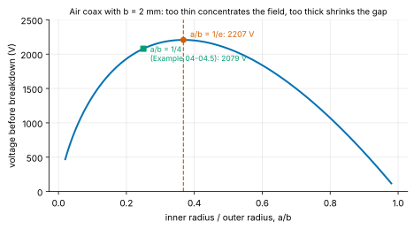
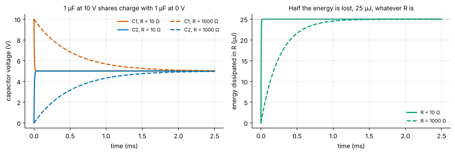

<!-- status: reviewed -->
# 04-04 · Electric Potential, Capacitance and Dielectrics

| | |
|---|---|
| **Course** | [04 · Physics for EE](../README.md) |
| **University equivalent** | Electric potential, capacitance and dielectrics in University Physics II (Halliday, Resnick & Walker, the chapters on electric potential and capacitance; Purcell & Morin, chapters 2, 3 and 10; MIT 8.02, weeks 3–5) |
| **Prerequisites** | [04-03 Gauss's Law](04-03-gauss-law.md), [04-02](04-02-charge-coulomb-and-electric-fields.md), [01-09](../../01-calculus-for-engineers/chapters/01-09-multivariable-calculus-1.md) (gradient), [01-10](../../01-calculus-for-engineers/chapters/01-10-multivariable-calculus-2.md) (line integrals, conservative fields) |
| **Estimated study hours** | 10 |
| **Last verified** | 2026-11-18 |

**Learning objectives.** After this chapter you can:

1. Show that the electrostatic field is conservative, define potential energy and electric potential, and compute potentials of point charges and continuous distributions.
2. Find the field from the potential as its negative gradient, use equipotentials, and explain why a conductor is an equipotential with its strongest fields at its sharpest points.
3. Define capacitance and derive it for parallel-plate, coaxial and spherical geometries, and combine capacitors in series and parallel.
4. Explain how dielectrics polarize, derive Gauss's law with $\varepsilon = \varepsilon_r\varepsilon_0$, and use it for layered dielectrics, equivalent oxide thickness and real capacitor materials.
5. Compute stored energy, energy density and electrostatic forces, including the energy lost in charge sharing and the clamping force of an electrostatic chuck.

## 1. Big picture

**Voltage** is the quantity every circuit is built on, and this chapter is where it comes from: the work per unit charge done by the electric field, well defined because the electrostatic field is conservative. From voltage follows **capacitance**, the charge a structure stores per volt, which depends only on geometry and on the insulating material between the conductors. Every transistor gate, every wire on a chip, every DRAM cell and every decoupling capacitor on a board is a capacitor. The physics of the insulator, its **permittivity**, is one of the main levers of the semiconductor roadmap: high-permittivity materials for transistor gates and memory cells, low-permittivity materials between wires.

- **Transistors:** a MOSFET's gate is a capacitor; its oxide capacitance per area sets how strongly the gate controls the channel ([09-08](../../09-semiconductor-devices/chapters/09-08-mos-capacitor.md)).
- **Wires:** on-chip interconnect delay and switching power scale with wire capacitance, hence low-k dielectrics ([19](../../19-digital-vlsi-design/README.md)).
- **Memory:** a DRAM bit is charge on a capacitor of a few femtofarads, read by sharing that charge with a bit line ([23](../../23-memory-and-storage-technology/README.md)).
- **Power delivery:** multilayer ceramic capacitors (MLCCs) decouple every supply rail; their capacitance drops with DC bias ([22](../../22-power-electronics-and-energy-conversion/README.md)).
- **Energy and force:** stored energy $\tfrac12CV^2$ sets switching power ($CV^2f$), and electrostatic pressure holds wafers in etch and deposition tools.

## 2. Intuition first

**Potential is height; field is slope.** Imagine a landscape whose height at each point is the potential energy a unit positive charge would have there. The electric field is the downhill slope: it points the way a positive charge would roll, and it is steep where the contour lines crowd together. Contour lines are **equipotentials**: moving along one costs no work. A positive charge rolls from high potential to low; an electron, carrying negative charge, rolls "uphill" in voltage.

**Why voltage is well defined.** Height on a hill does not depend on the path you climbed, only on where you stand. The same is true of electrostatic potential because the force comes from charges at rest, which produce a field with no swirl: carrying a charge around any closed loop returns zero net work. That is Kirchhoff's voltage law in its physical form.

**Capacitance is a tank's width.** Charge is like water and voltage like the water level: a wide tank (large capacitance) holds a lot of water for a small rise in level. Two big plates close together make a wide tank; a dielectric between them widens it further, because the material's own dipoles cancel part of the field, so the same charge produces less voltage.

**A finance analogy, and its limits.** Capacitance resembles market depth: a deep order book (large $C$) absorbs a large order (charge) with little price movement (voltage). *Where it breaks:* market depth changes with sentiment, while a linear capacitor's $C$ is fixed by geometry and material; and the energy stored, $\tfrac12CV^2$, rises with the square of the "price", which has no clean market counterpart. Real ceramic capacitors do lose "depth" as voltage rises (§3.5), so the analogy improves there.

*Figure 1. Equipotentials and field lines are perpendicular everywhere. A conductor is a single equipotential: no field inside, and its potential falls off outside.*

## 3. Theory

> **Notation for this chapter.** $V$ is electric potential (volts), $U$ potential energy (joules), $k_e = 1/(4\pi\varepsilon_0)$ and $e$ the elementary charge. Everything here is static, so voltages are written $V$; circuit chapters distinguish total, DC and small-signal values ([notation.md](../../../reference/notation.md)).

### 3.1 The electrostatic field is conservative

Move a test charge $q_0$ from point $a$ to point $b$ in the field of a point charge $q$. The work done by the field along a path is $W = \int_a^bq_0\vec E\cdot d\vec l$. Break the path into small steps. Each step has a radial part $dr$ and a part perpendicular to the radius; the field is radial, so only $dr$ contributes:

$$
W_{a\to b} = \int_{r_a}^{r_b}q_0\frac{k_eq}{r^2}\,dr = k_eqq_0\Big(\frac{1}{r_a} - \frac{1}{r_b}\Big) .
$$

The result depends only on the endpoints' distances, not on the path. By superposition the same holds for any collection of static charges: each contributes a path-independent piece. Equivalently, the work around any closed loop is zero:

$$
\oint\vec E\cdot d\vec l = 0 .
$$

A field with this property is **conservative** ([01-10 §3.5](../../01-calculus-for-engineers/chapters/01-10-multivariable-calculus-2.md)). Two consequences carry the rest of the chapter: a potential function exists, and (as 04-03 claimed) field lines cannot form closed loops or run from one point of a conductor to another (the return path through the field-free metal would close a loop with nonzero circulation). When magnetic fields change, the loop integral is no longer zero (Faraday's law, [04-07](04-07-faraday-lenz-and-inductance.md)), and "voltage between two points" starts to depend on the path. That is the physics behind ground bounce and inductive pickup.

### 3.2 Potential energy and electric potential

Because the work is path-independent, we can define a **potential energy** $U$ whose drop equals the work done by the field: $U_a - U_b = W_{a\to b}$. For two point charges, choosing $U = 0$ at infinite separation,

$$
U = k_e\frac{q_1q_2}{r} ,
$$

positive for like charges (work was needed to push them together) and negative for unlike ones.

The **electric potential** is potential energy per unit test charge, $V = U/q_0$, measured in volts (1 V = 1 J/C). Only differences are physical:

$$
V_b - V_a = -\int_a^b\vec E\cdot d\vec l .
$$

The minus sign says the potential falls along the field. In a uniform field $E$ along $x$, $V$ drops by $Ed$ over a distance $d$, the relation $V = Ed$ used informally in 04-02. A charge $q$ moving through a potential difference $\Delta V$ changes its potential energy by $q\Delta V$; for an electron through one volt this is one **electron-volt**, 1 eV = $1.602\times10^{-19}$ J ([glossary](../../../reference/glossary.md#electron-volt)).

**Point charges and superposition.** With $V = 0$ at infinity, a point charge has $V = k_eq/r$. Potentials of several charges add as plain numbers:

$$
V(\vec r) = \sum_i\frac{k_eq_i}{|\vec r - \vec r_i|}, \qquad V = \int\frac{k_e\,dq}{r}\ \text{ for continuous charge} .
$$

This is the great practical advantage of the potential: a scalar sum, with no components to resolve.

**Three continuous results.** On the axis of a ring of charge $Q$ and radius $R$, every piece is the same distance away, so $V = k_eQ/\sqrt{z^2 + R^2}$. On the axis of a disk with surface charge σ, adding rings of radius $r$ and charge $\sigma2\pi r\,dr$:

$$
V(z) = \int_0^R\frac{k_e\sigma2\pi r\,dr}{\sqrt{z^2 + r^2}} = \frac{\sigma}{2\varepsilon_0}\Big(\sqrt{z^2 + R^2} - z\Big) .
$$

For a dipole $p$, at distance $r \gg d$ and angle θ from its axis, the two charges' potentials nearly cancel and leave $V = k_ep\cos\theta/r^2$, one power of $r$ faster than a point charge, as the dipole field was one power faster than the point-charge field.

### 3.3 The field from the potential

If $V$ falls by $dV$ over a small step $d\vec l$, then $dV = -\vec E\cdot d\vec l$. In Cartesian components, $E_x = -\partial V/\partial x$ and so on:

$$
\vec E = -\nabla V .
$$

The field points down the steepest slope of the potential, with magnitude equal to that slope.

> **Math refresher — the gradient.** For a function $f(x, y, z)$, the gradient $\nabla f = (\partial f/\partial x, \partial f/\partial y, \partial f/\partial z)$ points in the direction of fastest increase, and its magnitude is the rate of increase in that direction ([01-09](../../01-calculus-for-engineers/chapters/01-09-multivariable-calculus-1.md)). It is perpendicular to the level surfaces of $f$. For the potential, the level surfaces are the equipotentials, so **field lines cross equipotentials at right angles** (Figure 1).

For the ring, $E_z = -dV/dz = k_eQz/(z^2 + R^2)^{3/2}$, the result 04-02 obtained by integrating vector components; differentiating one scalar is much easier (Example 04-04.2). Note that at the ring's center $V = k_eQ/R$ is nonzero while $E = 0$: a large potential does not imply a large field. Field is about *changes* in potential.

**Conductors are equipotentials.** Inside a conductor in equilibrium $\vec E = 0$, so no work is done moving through it and every point, including the surface, is at the same potential. The surface is an equipotential, which is why the field just outside is perpendicular to it (04-03 §3.4).

**The field at a conductor's surface depends on its curvature.** An isolated conducting sphere of radius $R$ carrying $Q$ has $V = k_eQ/R$ at its surface, so its surface field is

$$
E_{\text{surface}} = \frac{k_eQ}{R^2} = \frac{V}{R} .
$$

At a given voltage, a small radius means a large field. Two spheres joined by a wire share one potential, so the smaller one has the larger field: the "sharp points" result previewed in 04-03, now proved. A 1 mm sphere at 1 kV already carries 1 MV/m at its surface (Example 04-04.3).

### 3.4 Capacitance

Two conductors carrying $+Q$ and $-Q$ have a potential difference $V$ proportional to $Q$: double every charge and, by superposition, every field and every potential doubles. The ratio is the **capacitance**,

$$
C = \frac{Q}{V} ,
$$

in farads (1 F = 1 C/V). It depends only on the conductors' sizes, shapes and separation, and on the insulator between them. Three geometries recur; each follows the same recipe: assume charges $\pm Q$, find $E$ by Gauss's law, integrate to get $V$, divide.

**Parallel plates** of area $A$, gap $d$, with $d$ much smaller than the plates' width: the field between them is uniform, $E = \sigma/\varepsilon_0 = Q/(\varepsilon_0A)$ (04-03), so $V = Ed = Qd/(\varepsilon_0A)$ and

$$
C = \frac{\varepsilon_0A}{d} .
$$

**Coaxial conductors** of radii $a < b$ and length $\ell$, with charge λ per unit length: $E = \lambda/(2\pi\varepsilon_0r)$ between them, so

$$
V = \int_a^b\frac{\lambda\,dr}{2\pi\varepsilon_0r} = \frac{\lambda}{2\pi\varepsilon_0}\ln\frac ba, \qquad \frac{C}{\ell} = \frac{2\pi\varepsilon_0}{\ln(b/a)} .
$$

**Concentric spheres** of radii $a < b$: $E = k_eQ/r^2$ between them, $V = k_eQ(1/a - 1/b)$, and $C = 4\pi\varepsilon_0ab/(b - a)$. Letting $b \to \infty$ gives an **isolated sphere**, $C = 4\pi\varepsilon_0R$: about 0.11 pF for a 1 mm sphere and 0.7 mF for the whole Earth. The farad is a very large unit.

**Combining capacitors.** In **parallel**, capacitors share one voltage and their charges add: $C = C_1 + C_2 + \cdots$. In **series**, the same charge $Q$ sits on each (the inner plates between capacitors form an isolated, neutral conductor, so they hold $-Q$ and $+Q$), and their voltages add: $V = Q/C_1 + Q/C_2 + \cdots$, so

$$
\frac1C = \frac{1}{C_1} + \frac{1}{C_2} + \cdots .
$$

Series capacitors divide voltage in inverse proportion to capacitance: the smallest capacitor takes the largest share.

**The best coax for high voltage.** With the outer radius $b$ fixed and air breaking down at a field $E_{\text{bd}}$, how thick should the inner conductor be? The field peaks at $r = a$, so the largest safe voltage is $V_{\max} = E_{\text{bd}}\,a\ln(b/a)$. A very thin inner conductor concentrates the field; a very thick one leaves no gap. Setting $dV_{\max}/da = E_{\text{bd}}[\ln(b/a) - 1] = 0$ gives

$$
\ln\frac ba = 1, \qquad \frac ba = e \approx 2.718, \qquad V_{\max} = \frac{E_{\text{bd}}b}{e} .
$$

This is the best inner radius 04-03 promised (Figure 3, Example 04-04.5). High-voltage cables and bushings are designed near this ratio; RF cables use other ratios, chosen for low loss or a standard impedance ([13](../../13-electromagnetics/README.md)).

### 3.5 Dielectrics

Fill the gap of a capacitor with an insulator and, at the same charge, the voltage falls by a factor $\varepsilon_r$, the material's **relative permittivity** (or **dielectric constant**, often written $k$ or κ in the semiconductor industry): $C = \varepsilon_r\varepsilon_0A/d$. Why?

**Polarization.** A field pulls an atom's electron cloud one way and its nucleus the other (electronic polarization); it shifts positive and negative ions in a crystal (ionic polarization); and it rotates molecules that already carry dipoles, such as water (orientational polarization). Each makes small dipoles aligned with the field. The **polarization** $\vec P$ is the dipole moment per unit volume (C/m²). Inside a uniformly polarized slab, the dipoles' ends cancel, but at the slab's faces they do not: a layer of **bound charge** $\sigma_b = P$ appears on each face, negative on the face toward the positive plate and positive on the other (Figure 2).

**Deriving Gauss's law with ε.** In a linear dielectric, $P$ is proportional to the field inside, $P = \varepsilon_0\chi E$, where χ (dimensionless) is the **susceptibility**. Between plates carrying free charge $\pm\sigma_f$, the bound charge $\mp\sigma_b$ on the dielectric's faces partly cancels it, and the field inside is set by the net charge:

$$
E = \frac{\sigma_f - \sigma_b}{\varepsilon_0} = \frac{\sigma_f - \varepsilon_0\chi E}{\varepsilon_0}
\quad\Longrightarrow\quad E = \frac{\sigma_f}{(1 + \chi)\varepsilon_0} = \frac{\sigma_f}{\varepsilon_r\varepsilon_0} ,
$$

with $\varepsilon_r = 1 + \chi$. The field is $\varepsilon_r$ times weaker for the same free charge, the voltage is $\varepsilon_r$ times smaller and the capacitance $\varepsilon_r$ times larger. Defining the **electric displacement** $\vec D = \varepsilon_0\vec E + \vec P = \varepsilon\vec E$ (with $\varepsilon = \varepsilon_r\varepsilon_0$) packages this as Gauss's law for free charge alone,

$$
\oint\vec D\cdot\hat n\,dA = Q_{\text{free,enc}} ,
$$

the form 04-03 §3.5 used. Across a boundary with no free charge, the normal component of $\vec D$ is continuous, $\varepsilon_1E_{1n} = \varepsilon_2E_{2n}$.

> **Going deeper — what ε_r hides.** Each polarization mechanism has a response time. Electronic polarization follows fields up to optical frequencies; ionic polarization up to infrared; orientational polarization only up to microwave frequencies or lower. So $\varepsilon_r$ depends on frequency: water's is about 80 at low frequency but under 2 at optical frequencies, where its refractive index is $\sqrt{\varepsilon_r} \approx 1.33$. Lag behind the field also absorbs energy (dielectric loss), which is what a microwave oven exploits and what limits high-speed circuit boards ([24](../../24-high-speed-io-signal-integrity-and-photonics/README.md)).

**Layered dielectrics are capacitors in series.** Two slabs of thicknesses $t_1, t_2$ and permittivities $\varepsilon_1, \varepsilon_2$ between plates carry the same $D$ (it is continuous), so the voltages add: $V = D(t_1/\varepsilon_1 + t_2/\varepsilon_2)$, and

$$
\frac{C}{A} = \frac{1}{t_1/\varepsilon_1 + t_2/\varepsilon_2} .
$$

The field is strongest in the low-permittivity layer. This is the arithmetic of modern transistor gates. At the 1–2 nm thicknesses that scaling demanded, electrons tunnel directly through SiO₂ and the gate leaks, so gates now use a thicker layer of a **high-k** material such as HfO₂ ($\varepsilon_r$ = 25), usually on a thin SiO₂ interface layer. Engineers compare stacks by their **equivalent oxide thickness** (EOT), the SiO₂ thickness that would give the same capacitance per area:

$$
\text{EOT} = \sum_i t_i\frac{3.9}{\varepsilon_{r,i}} .
$$

A 2 nm HfO₂ layer counts as only 0.312 nm of SiO₂ (Example 04-04.6).

**Real materials.** Figure 2 shows the range: air and vacuum at 1; low-k interconnect dielectrics below SiO₂'s 3.9; Al₂O₃ around 9; HfO₂ and ZrO₂ around 25; silicon 11.7. Ceramic capacitors use ferroelectric barium titanate (BaTiO₃) ceramics with $\varepsilon_r$ in the thousands, which pack microfarads into millimeter-sized parts but are *nonlinear*: their permittivity falls with applied DC field and changes with temperature ([R-079](../../../reference/research-log.md#r-079--dielectric-constants-capacitor-materials-and-dram-cells)). Every dielectric also has a **breakdown** field above which it fails (04-02 §3.6): ultimately a capacitor's energy is limited by $\tfrac12\varepsilon E_{\text{bd}}^2$ per unit volume.

*Figure 2. Bound charge explains why a dielectric raises capacitance. The industry uses low-k materials between wires and high-k materials in gates, DRAM cells and ceramic capacitors.*

### 3.6 Energy, energy density and force

**Energy stored.** Charge a capacitor by moving small amounts $dq$ from one plate to the other against the voltage $v = q/C$ already built up. The work is

$$
U = \int_0^Q\frac{q}{C}\,dq = \frac{Q^2}{2C} = \frac12CV^2 = \frac12QV .
$$

The factor ½ appears because the early charge moved through a small voltage. A digital gate charging a load capacitance $C$ to $V$ draws charge $CV$ from the supply, which delivers $CV^2$: half is dissipated in the pull-up transistor (the same loss as charge sharing, below) and half is stored, then dumped to ground on the falling edge. Each full 0→1→0 cycle therefore costs $CV^2$, and at clock rate $f$ with activity factor α that is the dynamic power $\alpha CV^2f$ of [19](../../19-digital-vlsi-design/README.md).

**Energy lives in the field.** For a parallel-plate capacitor, $\tfrac12CV^2 = \tfrac12(\varepsilon A/d)(Ed)^2 = \tfrac12\varepsilon E^2\cdot(Ad)$. The volume between the plates is $Ad$, so the energy per unit volume is

$$
u = \frac12\varepsilon E^2 .
$$

This holds for any field configuration: integrate $u$ over all space and you get the stored energy (Problem 04-04.10). The field is not bookkeeping; it carries energy, and in [04-08](04-08-maxwell-preview.md) it carries that energy across space as light.

**Charge sharing loses energy.** Connect a charged capacitor to an uncharged one. Charge is conserved, so the final common voltage is $V_f = C_1V_1/(C_1 + C_2)$; but the final energy is less than the initial. For equal capacitors, half the energy disappears, dissipated in the connecting resistance whatever its value (a small resistance passes a large current briefly; a large one a small current for longer). This is also how a DRAM cell is read: its few femtofarads share charge with a bit line ten or more times larger, producing a signal of tens of millivolts that a sense amplifier must detect (Example 04-04.7).

**Force from energy.** To find the force between a capacitor's plates, imagine increasing the gap by $dx$ with the charge fixed (isolated plates). The field, and hence $u$, is unchanged, but the field-filled volume grows by $A\,dx$, so the stored energy rises by $\tfrac12\varepsilon_0E^2A\,dx$. That energy came from the work you did against the attraction, so the plates attract with force $F = \tfrac12\varepsilon_0E^2A$, a **pressure**

$$
p = \frac12\varepsilon_0E^2 = \frac{D^2}{2\varepsilon_0} \qquad \text{(field in a vacuum or air gap)} .
$$

At air's breakdown field of 3 MV/m this is only about 40 Pa, a reason electrostatic motors are confined to the micro scale, where gaps are tiny and breakdown fields higher.

**The electrostatic chuck.** A wafer resting on a dielectric layer (thickness $l$, permittivity $\varepsilon_r$) over an electrode at voltage $V$ is a capacitor whose top plate is the wafer. The wafer never touches perfectly; model a thin vacuum gap $g$ between it and the dielectric. The two layers are in series: $C(g) = \varepsilon_0S/(g + l/\varepsilon_r)$. At fixed voltage the force is $F = \tfrac12V^2\,|dC/dg|$ (see the Going-deeper note below), so

$$
F = \frac{\varepsilon_0SV^2}{2(g + l/\varepsilon_r)^2} \;\xrightarrow{g\to0}\; \frac{D^2S}{2\varepsilon_0}, \qquad D = \frac{\varepsilon_r\varepsilon_0V}{l} .
$$

The pressure is set by the field in the gap, $D/\varepsilon_0$, which is $\varepsilon_r$ times stronger than the field inside the dielectric. A published measurement on a 200 mm wafer agrees with this formula (Example 04-04.8).

> **Going deeper — force at fixed voltage.** At fixed charge, $F = -dU/dx$ with $U = Q^2/2C$, giving $F = \tfrac{Q^2}{2C^2}\,dC/dx = \tfrac12V^2\,dC/dx$ toward larger $C$. At fixed voltage, a battery also does work $V\,dQ = V^2dC$ as the gap changes, twice the change in stored energy, and the net result is the same force, $\tfrac12V^2\,dC/dx$. The force on the conductors is the same either way because it depends only on the charges and fields at that instant.

## 4. Worked examples

### Example 04-04.1 — Potentials of point charges (tier A)

**Setup.** Charges of +2 nC at (0, 0) and −2 nC at (4 cm, 0). Find (a) the potential at (2 cm, 3 cm), (b) the potential at (0, 3 cm), (c) the work needed to bring a +1 nC charge from infinity to (0, 3 cm), and (d) the potential energy of the original pair.

**Solution.** (a) The point is 3.606 cm from both charges, so their potentials cancel: **0 V**, even though the field there is 15.34 kV/m (Example 04-02.3). Zero potential does not mean zero field.

(b) $V = k_e(2\times10^{-9})/0.03 - k_e(2\times10^{-9})/0.05 = 599.2 - 359.5 = $ **239.7 V**.

(c) $W = q\Delta V = 10^{-9}\times239.7 = $ **2.397×10⁻⁷ J**.

(d) $U = k_eq_1q_2/r = 8.988\times10^9\times(2\times10^{-9})(-2\times10^{-9})/0.04 = $ **−8.988×10⁻⁷ J**: negative, because the unlike charges attract and it would take that much work to pull them apart.

**Units check.** (N·m²/C²)(C)/m = N·m/C = J/C = V ✓.

### Example 04-04.2 — Field from potential: the ring (tier B)

**Setup.** A ring of radius 5 cm carries 10 nC. (a) Find the potential on its axis 5 cm from the center. (b) Find the field there from $E_z = -dV/dz$. (c) Find the potential and the field at the center.

**Solution.** (a) $V = k_eQ/\sqrt{z^2 + R^2} = 8.988\times10^9\times10^{-8}/\sqrt{0.005} = $ **1271 V**.

(b) $E_z = -\dfrac{d}{dz}\dfrac{k_eQ}{(z^2 + R^2)^{1/2}} = \dfrac{k_eQz}{(z^2 + R^2)^{3/2}} = $ **1.271×10⁴ V/m**, agreeing with the direct integration of 04-02.

(c) At $z = 0$: \$V = k_eQ/R = \$ **1798 V**, the highest potential on the axis, while $E = 0$: the potential has a maximum along the axis there, so its slope is zero.

### Example 04-04.3 — Conducting spheres at high voltage (tier B)

**Setup.** Isolated conducting spheres of radius 1 mm and 10 cm are each held at 1 kV. For each find (a) the capacitance, (b) the charge, (c) the surface field, and (d) the highest voltage before the surface reaches air's breakdown field of 3 MV/m. (e) Find the capacitance of the Earth (radius 6371 km) treated as an isolated sphere.

**Solution.** (a) $C = 4\pi\varepsilon_0R$: **0.1113 pF** and **11.13 pF**.

(b) $Q = CV$: **1.113×10⁻¹⁰ C** and **1.113×10⁻⁸ C**.

(c) $E = V/R$: **1×10⁶ V/m** and **1×10⁴ V/m**.

(d) $V_{\max} = E_{\text{bd}}R$: **3 kV** and **300 kV**. This is why Van de Graaff generators have large, smooth domes and why thin wires and sharp points discharge first.

(e) $4\pi\varepsilon_0\times6.371\times10^6 = $ **0.7089 mF**.

### Example 04-04.4 — A parallel-plate capacitor, with and without a dielectric (tier B)

**Setup.** Plates of 10 cm² are 1 mm apart in air with 100 V across them. Find (a) $C$, (b) the charge, (c) the field, (d) the stored energy, and (e) the energy density times the volume between the plates. (f) Find $C$ when the gap is filled with SiO₂ ($\varepsilon_r$ = 3.9).

**Solution.** (a) $C = \varepsilon_0A/d = 8.854\times10^{-12}\times10^{-3}/10^{-3} = $ **8.854 pF**.

(b) $Q = CV = $ **885.4 pC**.

(c) $E = V/d = $ **10⁵ V/m**.

(d) $U = \tfrac12CV^2 = $ **44.27 nJ**.

(e) $u = \tfrac12\varepsilon_0E^2 = 0.04427$ J/m³, times $Ad = 10^{-6}$ m³ gives **44.27 nJ** ✓: the energy is in the field.

(f) $3.9\times8.854 = $ **34.53 pF**.

### Example 04-04.5 — Coax capacitance and the best inner radius (tier B)

**Setup.** The air-filled coax of Example 04-03.4 has $a$ = 0.5 mm and $b$ = 2 mm. Find (a) its capacitance per meter, (b) the voltage between the conductors at 2 nC/m, and (c) the largest voltage before air (3 MV/m) breaks down at the inner conductor. (d) With $b$ fixed, find the inner radius that maximizes the breakdown voltage, and that voltage.

**Solution.** (a) $C/\ell = 2\pi\varepsilon_0/\ln4 = 5.563\times10^{-11}/1.3863 = $ **40.13 pF/m**.

(b) $V = \lambda/(C/\ell) = 2\times10^{-9}/40.13\times10^{-12} = $ **49.84 V**.

(c) $V_{\max} = E_{\text{bd}}a\ln(b/a) = 3\times10^6\times5\times10^{-4}\times1.3863 = $ **2079 V**.

(d) $a = b/e = $ **0.7358 mm**, giving $V_{\max} = E_{\text{bd}}b/e = $ **2207 V**, 6% more (Figure 3).

*Figure 3. The optimum is broad: a/b anywhere from about 0.22 to 0.54 stays within 10% of the best.*

### Example 04-04.6 — A high-k gate stack (tier C)

**Setup.** A hypothetical gate stack has 0.5 nm of SiO₂ ($\varepsilon_r$ = 3.9) under 2 nm of HfO₂ ($\varepsilon_r$ = 25). Find (a) the capacitance per area of each layer and of the stack, in µF/cm², (b) the EOT, and (c) with 0.7 V across the stack, the field and voltage in each layer.

**Solution.** (a) $C_1/A = 3.9\varepsilon_0/0.5\ \text{nm} = 6.906\times10^{-2}$ F/m² = **6.906 µF/cm²**; $C_2/A = 25\varepsilon_0/2\ \text{nm}$ = **11.07 µF/cm²**. In series: $1/(1/6.906 + 1/11.07)$ = **4.253 µF/cm²**.

(b) $\text{EOT} = 0.5 + 2\times3.9/25 = $ **0.812 nm**, for a physical thickness of 2.5 nm. Tunneling depends on the physical thickness, capacitance on the EOT: that is the point of high-k.

(c) $D = (C/A)V = 4.253\times10^{-2}\times0.7 = 2.977\times10^{-2}$ C/m², the same in both layers. In the SiO₂, \$E = D/(3.9\varepsilon_0) = \$ **8.621 MV/cm** across 0.5 nm, a drop of **0.4310 V**; in the HfO₂, \$E = D/(25\varepsilon_0) = \$ **1.345 MV/cm** across 2 nm, a drop of **0.2690 V**.

**Sanity check.** The voltages add to 0.7 V ✓. The thin low-k interface layer carries the strongest field, within a factor of about 1.2 of SiO₂'s breakdown field of about 10 MV/cm: the interface layer is where reliability engineers look first.

### Example 04-04.7 — Charge sharing, and reading a DRAM cell (tier B)

**Setup.** (a) A 1 µF capacitor at 10 V is connected through a resistor to an uncharged 1 µF capacitor. Find the final voltage, the energies before and after, and the energy dissipated. Confirm in ngspice for 10 Ω and 1 kΩ. (b) A DRAM cell of 10 fF holding 1 V is connected to a bit line of 100 fF precharged to 0.5 V. Find the bit line's voltage change, and the stored charge in electrons.

**Solution.** (a) Charge is conserved: $10\ \mu\text{C}$ shared over $2\ \mu\text{F}$ gives **5 V**. The energy before is \$\tfrac12(10^{-6})(10^2) = \$ **50 µJ**; after, \$2\times\tfrac12(10^{-6})(5^2) = \$ **25 µJ**. The resistor dissipated **25 µJ**, the same for both resistors (Figure 4): $\int i^2R\,dt$ with $i = (10/R)e^{-t/\tau}$ and $\tau = RC/2$ gives $(100/R)(\tau/2) = 25$ µJ, independent of $R$.

(b) $V_f = (10\times1 + 100\times0.5)/110 = 0.5455$ V, so the bit line rises by **45.45 mV** (a stored 0 would lower it by the same amount). The cell held $Q = 10$ fC = **6.242×10⁴ electrons**.

*Figure 4. The resistor sets how fast charge sharing happens, never how much energy it costs.*

**Simulation.** The netlist [labs/04-04-lab/charge_sharing.cir](../labs/04-04-lab/charge_sharing.cir) runs both resistances and the DRAM read, integrating the resistor power with `.meas INTEG`.

### Example 04-04.8 — Holding a wafer with an electrostatic chuck (tier C)

**Setup.** Shim and Sugai measured a Coulomb-type chuck: a 200 mm wafer on alumina ($\varepsilon_r$ = 8.8) 0.54 mm thick, at 1 kV ([R-077](../../../reference/research-log.md#r-077--esd-models-targets-and-dielectric-breakdown)). Find (a) the capacitance and the charge, (b) $D$, (c) the field inside the alumina and in a thin gap above it, (d) the clamping pressure and force at zero gap.

**Solution.** The area is $S = \pi(0.1)^2 = 0.03142$ m².

(a) \$C = \varepsilon_r\varepsilon_0S/l = 8.8\times8.854\times10^{-12}\times0.03142/5.4\times10^{-4} = \$ **4.533 nF**, so $Q = CV$ = **4.533 µC**.

(b) $D = Q/S = \varepsilon_r\varepsilon_0V/l = $ **1.443×10⁻⁴ C/m²**.

(c) In the alumina, $E = V/l = $ **1.852×10⁶ V/m**; in the gap, $E = D/\varepsilon_0 = $ **1.630×10⁷ V/m**, 8.8 times more.

(d) $p = D^2/(2\varepsilon_0) = $ **1176 Pa**, and $F = pS = $ **36.94 N**. The paper reports the same calculation (4.53 nF, 36.9 N) and a measured holding force of about 40 N: agreement within 10%.

**Interpretation.** About 37 N is ample: a 200 mm silicon wafer under 1 mm thick has a mass below 75 g, so it weighs less than 1 N. The force falls quickly if particles or warpage open a gap comparable to $l/\varepsilon_r$ = 61 µm (Problem 04-04.15). Johnsen–Rahbek chucks use a slightly conductive dielectric so that charge migrates to the top surface, putting nearly the full voltage across the tiny gap and giving large forces at lower voltage.

<!-- answer-key -->
| ID | Quantity | Value | Unit |
|---|---|---|---|
| Ex 04-04.1a | potential at (2 cm, 3 cm) | 0 | V |
| Ex 04-04.1b | potential at (0, 3 cm) | 239.7 | V |
| Ex 04-04.1c | work to bring 1 nC from infinity | 2.397×10^-7 | J |
| Ex 04-04.1d | potential energy of the pair | −8.988×10^-7 | J |
| Ex 04-04.2a | ring potential at z = 5 cm | 1271 | V |
| Ex 04-04.2b | ring field at z = 5 cm | 1.271×10^4 | V/m |
| Ex 04-04.2c | ring potential at the center | 1798 | V |
| Ex 04-04.3a | capacitance, 1 mm sphere | 0.1113 | pF |
| Ex 04-04.3b | capacitance, 10 cm sphere | 11.13 | pF |
| Ex 04-04.3c | charge, 1 mm sphere at 1 kV | 1.113×10^-10 | C |
| Ex 04-04.3d | charge, 10 cm sphere at 1 kV | 1.113×10^-8 | C |
| Ex 04-04.3e | surface field, 1 mm sphere | 1×10^6 | V/m |
| Ex 04-04.3f | surface field, 10 cm sphere | 1×10^4 | V/m |
| Ex 04-04.3g | breakdown voltage, 1 mm sphere | 3 | kV |
| Ex 04-04.3h | breakdown voltage, 10 cm sphere | 300 | kV |
| Ex 04-04.3i | capacitance of the Earth | 0.7089 | mF |
| Ex 04-04.4a | parallel-plate capacitance | 8.854 | pF |
| Ex 04-04.4b | charge at 100 V | 885.4 | pC |
| Ex 04-04.4c | field | 1×10^5 | V/m |
| Ex 04-04.4d | stored energy | 44.27 | nJ |
| Ex 04-04.4e | energy density times volume | 44.27 | nJ |
| Ex 04-04.4f | capacitance with SiO₂ | 34.53 | pF |
| Ex 04-04.5a | coax capacitance per meter | 40.13 | pF/m |
| Ex 04-04.5b | coax voltage at 2 nC/m | 49.84 | V |
| Ex 04-04.5c | coax breakdown voltage | 2079 | V |
| Ex 04-04.5d | optimum inner radius | 0.7358 | mm |
| Ex 04-04.5e | optimum breakdown voltage | 2207 | V |
| Ex 04-04.6a | SiO₂ layer capacitance | 6.906 | µF/cm² |
| Ex 04-04.6b | HfO₂ layer capacitance | 11.07 | µF/cm² |
| Ex 04-04.6c | stack capacitance | 4.253 | µF/cm² |
| Ex 04-04.6d | equivalent oxide thickness | 0.812 | nm |
| Ex 04-04.6e | field in the SiO₂ | 8.621 | MV/cm |
| Ex 04-04.6f | voltage across the SiO₂ | 0.4310 | V |
| Ex 04-04.6g | field in the HfO₂ | 1.345 | MV/cm |
| Ex 04-04.6h | voltage across the HfO₂ | 0.2690 | V |
| Ex 04-04.7a | final voltage after sharing | 5 | V |
| Ex 04-04.7b | energy before | 50 | µJ |
| Ex 04-04.7c | energy after | 25 | µJ |
| Ex 04-04.7d | energy dissipated | 25 | µJ |
| Ex 04-04.7e | bit-line signal | 45.45 | mV |
| Ex 04-04.7f | electrons in the cell | 6.242×10^4 | — |
| Ex 04-04.8a | chuck capacitance | 4.533 | nF |
| Ex 04-04.8b | chuck charge | 4.533 | µC |
| Ex 04-04.8c | displacement field | 1.443×10^-4 | C/m² |
| Ex 04-04.8d | field in the alumina | 1.852×10^6 | V/m |
| Ex 04-04.8e | field in the gap | 1.630×10^7 | V/m |
| Ex 04-04.8f | clamping pressure | 1176 | Pa |
| Ex 04-04.8g | clamping force | 36.94 | N |

<!-- answer-key -->
| ID | Quantity | Value | Unit |
|---|---|---|---|
| T 04-04.a | one electron-volt | 1.602×10^-19 | J |
| T 04-04.b | optimum coax ratio b/a | 2.718 | — |
| T 04-04.c | electrostatic pressure at 3 MV/m in air | 39.84 | Pa |
| T 04-04.d | EOT of 2 nm of HfO₂ | 0.312 | nm |

## 5. Simulate it

The lab ([labs/04-04-lab/](../labs/04-04-lab/README.md)) is a notebook plus an ngspice netlist:

1. **Potential maps:** compute $V$ on a grid for any set of charges, draw equipotentials, and recover $\vec E = -\nabla V$ by finite differences. *Predict first:* where on the dipole's map is $V = 0$, and is $E$ zero there?
2. **Path independence:** integrate $\vec E\cdot d\vec l$ along a straight path and a wiggly one between the same two points.
3. **Capacitance from field energy:** integrate $\tfrac12\varepsilon_0E^2$ around a charged sphere and a coax, and recover $C$ from $U = Q^2/2C$.
4. **Gate stacks:** explore EOT and the field in each layer as the high-k thickness and permittivity vary.
5. **The chuck's sensitivity to a gap:** plot clamping force against gap.

The netlist `charge_sharing.cir` simulates Example 04-04.7.

## 6. Engineering tradeoffs

| Knob | Improves | Costs | Typical decision owner |
|---|---|---|---|
| Gate dielectric permittivity (SiO₂ → HfO₂) | More gate capacitance (stronger channel control) at a physical thickness thick enough to limit tunneling | New materials, interface defects, threshold-voltage control, reliability qualification | Process integration and device engineers |
| Interconnect dielectric permittivity (low-k, air gaps) | Lower wire capacitance: less delay and switching power | Weaker, more porous films; integration damage; cost | Back-end-of-line process engineers |
| MLCC dielectric class (C0G vs X7R/X5R) | Class 2: far more capacitance per volume | DC-bias and temperature loss of capacitance, aging, acoustic noise | Power-integrity and board designers |
| DRAM cell capacitance | More signal and retention margin | Taller, harder-to-etch capacitor structures or exotic high-k films, area | Memory process and array designers |
| Supply voltage | Speed and noise margin | Dynamic power $\propto CV^2$, oxide field and reliability | Architects with circuit and process teams |
| Electrostatic chuck voltage and dielectric | Clamping force, thermal contact | Breakdown risk, residual charge and slow dechucking (J-R type) | Process-equipment engineers |

## 7. Numbers to know

| Quantity | Value | Note |
|---|---|---|
| One electron-volt | 1.602×10⁻¹⁹ J | Energy of $e$ through 1 V |
| Parallel plates; coax; sphere | $\varepsilon A/d$; $2\pi\varepsilon\ell/\ln(b/a)$; $4\pi\varepsilon_0R$ | |
| $\varepsilon_0$ in practical units | 8.854 pF/m = 8.854 fF/mm | 1 cm² at 1 mm in air ≈ 0.885 pF |
| Isolated 1 mm sphere; Earth | 0.111 pF; 0.709 mF | |
| Energy density; pressure in air at 3 MV/m | $\tfrac12\varepsilon E^2$; about 40 Pa | |
| Best coax for breakdown | $b/a = e$ | |
| Relative permittivity | SiO₂ 3.9; Si 11.7; HfO₂, ZrO₂ 25; Al₂O₃ 9; SiOCH low-k 2.7–2.9; class 2 ceramics 1000–4000 | [R-079](../../../reference/research-log.md#r-079--dielectric-constants-capacitor-materials-and-dram-cells), [R-078](../../../reference/research-log.md#r-078--gauss-law-applications-silicon-permittivity-capacitive-sensing-and-coulombs-law-tests) |
| DRAM cell capacitance (TechInsights, about 2021–22; checked Nov 2026) | below 10 fF in recent generations (from about 25 fF earlier) | [R-079](../../../reference/research-log.md#r-079--dielectric-constants-capacitor-materials-and-dram-cells) **[Industry estimate]** |

## 8. Common mistakes

1. **Confusing potential with field.** $V$ can be large where $E$ is zero (the ring's center) and zero where $E$ is large (midway between a dipole's charges).
2. **Dropping the minus sign.** $V_b - V_a = -\int_a^b\vec E\cdot d\vec l$: potential falls along the field.
3. **Adding potentials as vectors, or fields as scalars.** Potentials add as numbers; fields add as vectors.
4. **Treating capacitance as depending on charge or voltage.** For a linear capacitor it depends only on geometry and material. (Ferroelectric ceramics are nonlinear, and then "capacitance" must be quoted at a bias.)
5. **Mixing up series and parallel formulas.** Capacitors combine like resistors' conductances: parallel adds, series adds reciprocals.
6. **Forgetting that layered dielectrics put the biggest field in the lowest-ε layer.**
7. **Expecting a smaller (or zero) resistance to save the energy in charge sharing.** Half the energy is lost whatever the resistance; only inductors or switched converters avoid it.
8. **Reading an MLCC's nominal capacitance as its working capacitance.** Check the DC-bias and temperature curves at the operating point.

## 9. Practitioner lens

### State of the art (as of Nov 2026)

- **Gate dielectrics.** SiO₂ ($\varepsilon_r$ = 3.9) gave way to hafnium-based high-k gate dielectrics: a 2019 review with an Intel co-author lists HfO₂ and ZrO₂ at 25 and Al₂O₃ at 9, and a 2012 review puts the useful high-k range at 10–30 ([R-079](../../../reference/research-log.md#r-079--dielectric-constants-capacitor-materials-and-dram-cells)) **[Established]**.
- **Interconnect low-k.** The same review traces the low-k path: fluorinated oxide (SiOF, $k$ ≈ 3.7–3.9), then carbon-doped oxides (SiOCH) at about 3.0 and then 2.7–2.9, then porous films below 2.5, with films at $k \le 2.3$ hitting "a breaking point" by the mid-2010s. The 2022 IEEE roadmap (IRDS) says reduction of the inter-metal dielectric's κ "is slowing down because of problems with manufacturability" and points to air gaps as the alternative ([R-079](../../../reference/research-log.md#r-079--dielectric-constants-capacitor-materials-and-dram-cells)) **[Established]**.
- **DRAM cells.** A 2017 dissertation gives the long-standing rule of about 25 fF per cell; TechInsights reports that recent generations (D1z, D1a, around 2021–22) are below 10 fF per cell and that keeping above about 7 fF will need dielectrics with $k > 50$. Stacks of ZrO₂/Al₂O₃/ZrO₂ are widely used ([R-079](../../../reference/research-log.md#r-079--dielectric-constants-capacitor-materials-and-dram-cells)) **[Industry estimate]**.
- **Ceramic capacitors.** EIA codes: C0G (class 1) holds 0 ± 30 ppm/°C from −55 to +125 °C; X7R and X5R (class 2, BaTiO₃-based with $\varepsilon_r$ of 1000–4000) allow ±15% over −55 to +125 °C and −55 to +85 °C. Murata's own example: a 100 µF, 6.3 V part at 1.8 V DC loses about 10% if X5R and about 40% if Y5V, while C0G shows almost no DC-bias effect ([R-079](../../../reference/research-log.md#r-079--dielectric-constants-capacitor-materials-and-dram-cells)) **[Established]**.
- **Electrostatic chucks.** Coulomb-type chucks use an insulating layer; Johnsen–Rahbek types use a slightly conductive one to reach strong force at lower voltage, at the cost of slower release ([R-077](../../../reference/research-log.md#r-077--esd-models-targets-and-dielectric-breakdown)) **[Established]**.

### Why it matters commercially

Permittivity is a materials lever on three of the industry's biggest cost and performance curves. High-k gates kept transistor scaling going when SiO₂ ran out; low-k and air-gap interconnect fight the wire delay and energy that now dominate many chips; and DRAM density depends on keeping a few femtofarads per cell as cells shrink. For a corporate-development team, these are where equipment, materials and IP companies compete (deposition tools for high-k films, precursor chemicals, porous-film integration). On the board, MLCC supply and DC-bias derating drive power-integrity designs in phones, servers and cars.

### Marketing vs Reality

- **"100 µF in an 0603."** *Reality:* that is the nominal value at 0 V. At the working DC bias and temperature, a class 2 part can deliver a fraction of it. Ask for the effective capacitance at the operating point.
- **"Ultra-low-k k = 2.2 dielectric."** *Reality:* the bulk film may be 2.2, but liners, etch stops and process damage raise the *effective* k of the wiring stack. Ask for effective k measured on wiring, and the mechanical strength.
- **"Our DRAM node shrinks the cell by 15%."** *Reality:* a smaller cell must keep enough capacitance (several fF) to be read reliably and to hold charge between refreshes. Ask how cell capacitance and retention changed.
- **"Sub-nanometer gate oxide."** *Reality:* almost certainly EOT, not physical thickness. Ask for both.

### Questions for engineering leaders

1. **"What effective capacitance do your decoupling MLCCs have at the operating bias and temperature?"** *Strong:* derating curves at the actual rail voltage, plus how the board's impedance target was checked. *Evasive:* the nominal BOM value.
2. **"What is the effective k of your interconnect, and where are you on air gaps?"** *Strong:* effective-k numbers per metal level and the reliability data on porous films. *Evasive:* the bulk film's k.
3. **"How much DRAM cell capacitance and sense margin do you keep at the next node?"** *Strong:* fF per cell, bit-line capacitance ratio, signal in millivolts, retention at temperature. *Evasive:* "the same as before".
4. **"What are the EOT and the physical thickness of your gate stack, and the field in each layer?"** *Strong:* both thicknesses and the interface layer's field and lifetime model. *Evasive:* one thickness number.

## 10. Concept check

1. Can the potential be zero at a point where the field is not? Give an example.

   

Answer

   Yes. Midway between equal and opposite charges, $V = 0$ (the two potentials cancel) while the field points from + to − and is strong. Potential and field measure different things: level and slope.

   

2. Why can't electrostatic field lines form closed loops?

   

Answer

   Around a closed field line, $\oint\vec E\cdot d\vec l$ would be positive, but a conservative field has zero loop integral. (Changing magnetic fields *can* produce looped electric fields, 04-07.)

   

3. Two conducting spheres of radii 1 cm and 5 cm are joined by a long wire and charged. Which has the stronger surface field, and by what factor?

   

Answer

   They share one potential $V$, and $E = V/R$, so the 1 cm sphere's field is five times stronger.

   

4. A capacitor connected to a battery has a dielectric slab inserted. What happens to $C$, $Q$, $V$ and $U$? What if the capacitor is isolated instead?

   

Answer

   Connected: $V$ fixed, $C$ rises by $\varepsilon_r$, so $Q$ and $U = \tfrac12CV^2$ rise by $\varepsilon_r$. Isolated: $Q$ fixed, $C$ rises by $\varepsilon_r$, so $V$ and $U = Q^2/2C$ fall by $\varepsilon_r$ (the field does work pulling the slab in).

   

5. Why do engineers quote equivalent oxide thickness rather than physical thickness for a high-k gate?

   

Answer

   Transistor behavior depends on gate capacitance per area, which EOT captures in familiar SiO₂ terms. The physical thickness (several times larger) matters for tunneling leakage. High-k's whole purpose is to decouple the two.

   

6. Two identical capacitors, one charged, are connected. Where does the missing half of the energy go if the wires are superconducting?

   

Answer

   With no resistance, the circuit's inductance makes the charge slosh back and forth, and the energy leaves as electromagnetic radiation (and eventually as heat in whatever small resistance remains). Some mechanism always takes exactly half when the voltages finally equalize.

   

7. Why does an electrostatic chuck's force depend on the field in a micrometer-scale gap rather than in the much thicker dielectric?

   

Answer

   The force on the wafer is set by the field at its surface, which lies in the gap. Continuity of $D$ makes the gap field $\varepsilon_r$ times the dielectric's, and the pressure goes as the square of that field. Equivalently, the force is $\tfrac12V^2\,dC/dg$, and $C$ is most sensitive to the gap.

   

Problem set: [04-04 problems](../problems/04-04-problems.md) · [solutions](../solutions/04-04-solutions.md).

## 11. Key terms

[Conservative field](../../../reference/glossary.md#conservative-field) ·
[Electric potential](../../../reference/glossary.md#electric-potential) ·
[Electron-volt](../../../reference/glossary.md#electron-volt) ·
[Equipotential](../../../reference/glossary.md#equipotential) ·
[Capacitance](../../../reference/glossary.md#capacitance) ·
[Dielectric](../../../reference/glossary.md#dielectric) ·
[Polarization (dielectric)](../../../reference/glossary.md#polarization-dielectric) ·
[Electric displacement](../../../reference/glossary.md#electric-displacement) ·
[Equivalent oxide thickness (EOT)](../../../reference/glossary.md#equivalent-oxide-thickness-eot) ·
[High-k dielectric](../../../reference/glossary.md#high-k-dielectric) ·
[Low-k dielectric](../../../reference/glossary.md#low-k-dielectric) ·
[Multilayer ceramic capacitor (MLCC)](../../../reference/glossary.md#multilayer-ceramic-capacitor-mlcc) ·
[Electric energy density](../../../reference/glossary.md#electric-energy-density) ·
[Charge sharing](../../../reference/glossary.md#charge-sharing)

## 12. Connections

- **Previous:** [04-03](04-03-gauss-law.md) (fields from Gauss's law, which this chapter integrates into potentials), [04-02](04-02-charge-coulomb-and-electric-fields.md) (the ring, disk and dipole), [01-10](../../01-calculus-for-engineers/chapters/01-10-multivariable-calculus-2.md) (line integrals and conservative fields), [01-05](../../01-calculus-for-engineers/chapters/01-05-integrals.md) (energy lost charging a capacitor through a resistor).
- **Next:** [04-05 Current, Resistance and Conduction](04-05-current-resistance-and-conduction.md) lets charge flow, and [04-07](04-07-faraday-lenz-and-inductance.md) shows when voltage stops being path-independent.
- **Used in:** [06](../../06-circuit-analysis-1-dc/README.md) and [07](../../07-circuit-analysis-2-transient-and-ac/README.md) (capacitors in circuits), [09-06](../../09-semiconductor-devices/chapters/09-06-pn-junction-iv-and-capacitance.md) and [09-08](../../09-semiconductor-devices/chapters/09-08-mos-capacitor.md) (junction and MOS capacitance), [13-02](../../13-electromagnetics/chapters/13-02-electrostatics-boundary-value-problems.md) (Laplace's equation and capacitance of real structures), [19](../../19-digital-vlsi-design/README.md) (wire capacitance and $CV^2f$ power), [23](../../23-memory-and-storage-technology/README.md) (DRAM).

## 13. Further study

- Halliday, D., Resnick, R. and Walker, J., *Fundamentals of Physics*, the chapters on electric potential and capacitance.
- Purcell, E. M. and Morin, D. J., *Electricity and Magnetism*, 3rd ed., Cambridge University Press, 2013, chapters 2 (potential), 3 (conductors and capacitance) and 10 (dielectrics).
- MIT OpenCourseWare 8.02 (Physics II: Electricity and Magnetism), the lectures on potential, capacitors and dielectrics.
- Jenkins, M. et al., "Review—Beyond the highs and lows: a perspective on the future of dielectrics research for nanoelectronic devices", *ECS Journal of Solid State Science and Technology* 8, N159, 2019, for high-k and low-k materials in depth.

## 14. Sources

1. Halliday, D., Resnick, R. and Walker, J., *Fundamentals of Physics*, Wiley (any recent edition).
2. Purcell, E. M. and Morin, D. J., *Electricity and Magnetism*, 3rd ed., Cambridge University Press, 2013.
3. NIST, 2022 CODATA recommended values (ε₀). [R-073]
4. Shim, G. I. and Sugai, H., "Dechuck operation of Coulomb type and Johnsen–Rahbek type of electrostatic chuck used in plasma processing", *Plasma and Fusion Research* 3, 051, 2008. [R-077]
5. Jenkins, M. et al., "Review—Beyond the highs and lows", *ECS J. Solid State Sci. Technol.* 8(11), N159–N185, 2019; Zhu, H. et al., *Journal of Materials Science*, 2012 (high-k range). [R-079]
6. IEEE, *International Roadmap for Devices and Systems, 2022 Update: More Moore*. [R-079]
7. Nair, P. J., *Architectural Techniques to Enable Reliable and Scalable Memory Systems*, Ph.D. dissertation, Georgia Tech, 2017; Choe, J., "DRAM Scaling Trend and Beyond", TechInsights (undated, about 2021–22). [R-079]
8. Murata, Capacitor Guide articles on DC-bias and temperature characteristics (2011, 2012, revised 2023); Knowles Capacitors, Class II dielectric characteristics. [R-079]
