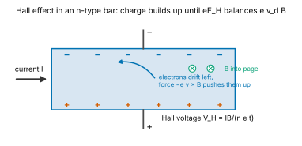

<!-- status: reviewed -->
# 04-06 · Magnetic Fields and Forces

| | |
|---|---|
| **Course** | [04 · Physics for EE](../README.md) |
| **University equivalent** | Magnetic fields and their sources in University Physics II (Halliday, Resnick & Walker, the chapters on magnetic fields and magnetic fields due to currents; Purcell & Morin, chapters 6 and 11; MIT 8.02, weeks 7–9) |
| **Prerequisites** | [04-05 Current, Resistance and Conduction](04-05-current-resistance-and-conduction.md), [04-03](04-03-gauss-law.md) (symmetry arguments, Gauss's law), [04-01](04-01-mechanics-essentials.md) (circular motion, torque), [01-10](../../01-calculus-for-engineers/chapters/01-10-multivariable-calculus-2.md) (line integrals, cross products) |
| **Estimated study hours** | 10 |
| **Last verified** | 2026-11-18 |

**Learning objectives.** After this chapter you can:

1. Apply the Lorentz force to moving charges (circular orbits, cyclotron frequency, velocity selectors, mass analyzers) and to currents (force on a wire, torque on a coil, magnetic moment).
2. Compute magnetic fields of currents with the Biot–Savart law: straight segments, infinite wires, loops and parallel conductors.
3. Use Ampère's law with symmetry (wires, solenoids, toroids, coaxial cables) and Gauss's law for magnetism.
4. Explain the Hall effect, extract carrier density, sign and mobility from it, and analyze Hall sensors.
5. Describe magnetic materials (permeability, saturation, hysteresis, soft and hard magnets) and their uses in cores and magnetic memory.

## 1. Big picture

Electric charges at rest produce electric fields; charges in motion also produce **magnetic fields**, and moving charges feel magnetic forces. Magnetism is not a separate phenomenon but the other half of electromagnetism, the part that depends on velocity. It is how motors turn, how loudspeakers move, how ion implanters pick one dopant out of a beam, how a phone knows its case is closed and how a power supply measures its own current without touching it. This chapter covers static magnetic fields: the force they exert and the currents that make them. [04-07](04-07-faraday-lenz-and-inductance.md) then lets them change, which gives induction, inductors and transformers.

- **Motion and power:** motors, actuators and loudspeakers turn current into force through $I\vec L\times\vec B$ ([22](../../22-power-electronics-and-energy-conversion/README.md)).
- **Sensing:** Hall-effect switches and current sensors are in phones, laptops and cars ([18-10](../../18-embedded-systems-and-microcontrollers/chapters/18-10-sensors.md)).
- **Fabrication:** implanters sort ions by mass in a magnetic field; magnetrons confine sputtering plasmas ([25-03](../../25-fabrication-packaging-test-and-reliability/chapters/25-03-deposition-etch-cmp-implant-metrology.md)).
- **Devices:** the Hall effect measures carrier density and mobility in semiconductors ([09-03](../../09-semiconductor-devices/chapters/09-03-drift-and-diffusion.md)); magnetic tunnel junctions store bits in MRAM ([23](../../23-memory-and-storage-technology/README.md)).

## 2. Intuition first

**A sideways force.** The electric force pushes a charge along the field. The magnetic force is stranger: it acts only on a *moving* charge, and it pushes *perpendicular* to both the velocity and the field. Because it is always sideways, it never changes a charge's speed, only its direction. A charge moving across a uniform magnetic field therefore goes round in a circle, like a ball on a string.

**Currents make fields that circle them.** The field of a straight current wraps around the wire in circles (right-hand rule: thumb along the current, fingers curl along the field). Wind the wire into a coil and the circles from each turn add up inside into a strong, nearly uniform field along the coil's axis: an electromagnet.

**Field lines with no ends.** Electric field lines start and end on charges. Magnetic field lines never end: there are no magnetic charges (monopoles), so every line closes on itself. A bar magnet's lines run out of the north pole, around the outside, and back through the magnet.

**A finance analogy, and its limits.** The magnetic force is like a regulator that can redirect capital flows but never add to or subtract from them: it changes the direction of motion, never the kinetic energy. *Where it breaks:* a real regulator can impose costs; the magnetic force does exactly zero work on a free charge, always. (Motors still do work because the magnetic force on the *wire* is transmitted through the lattice, while the battery supplies the energy, [04-07](04-07-faraday-lenz-and-inductance.md).)

*Figure 1. A magnetic field bends ions into circles whose radius depends on mass, the principle of an implanter's analyzer magnet (Example 04-06.2). Fields of ordinary currents are comparable to the Earth's.*

## 3. Theory

> **Notation for this chapter.** $\vec B$ is the magnetic field (flux density) in tesla (T); 1 T = 1 N/(A·m), and 1 gauss = $10^{-4}$ T. $\mu_0 = 1.256\,637\,061\,27\times10^{-6}$ N/A² is the vacuum permeability (CODATA 2022, [R-073](../../../reference/research-log.md#r-073--codata-2022-fundamental-constants)), within one part in $10^9$ of the pre-2019 exact value $4\pi\times10^{-7}$. $\vec m$ is a magnetic dipole moment (A·m²). Cross products follow the right-hand rule.

### 3.1 The force on a moving charge

A charge $q$ moving with velocity $\vec v$ through a magnetic field $\vec B$ feels

$$
\vec F = q\vec v\times\vec B, \qquad F = |q|vB\sin\theta ,
$$

perpendicular to both $\vec v$ and $\vec B$. With an electric field too, the total is the **Lorentz force**, $\vec F = q(\vec E + \vec v\times\vec B)$. Because the magnetic part is always perpendicular to $\vec v$, its power $\vec F\cdot\vec v$ is zero: **a magnetic field does no work on a free charge**.

> **Math refresher — the cross product.** $\vec a\times\vec b$ is perpendicular to both vectors, with magnitude $ab\sin\theta$ and direction given by the right-hand rule (fingers from $\vec a$ toward $\vec b$, thumb along the product). In components, $\hat x\times\hat y = \hat z$, $\hat y\times\hat z = \hat x$, $\hat z\times\hat x = \hat y$, and reversing the order flips the sign. Parallel vectors have zero cross product.

**Circular orbits.** A charge moving perpendicular to a uniform field moves in a circle, the magnetic force supplying the centripetal force of 04-01: $|q|vB = mv^2/r$, so

$$
r = \frac{mv}{|q|B}, \qquad \omega_c = \frac{v}{r} = \frac{|q|B}{m}, \qquad f_c = \frac{|q|B}{2\pi m} .
$$

The **cyclotron frequency** $f_c$ does not depend on speed: faster charges travel bigger circles in the same time. For an electron it is 28.0 GHz per tesla. A velocity component along $\vec B$ is unaffected, so the general path is a helix.

**Velocity selector.** Crossed fields $\vec E\perp\vec B$, both perpendicular to the beam, push in opposite directions; the forces balance for one speed, $v = E/B$. Only charges at that speed go straight through.

**Mass analysis.** Ions of charge $q$ accelerated from rest through $V$ have $\tfrac12mv^2 = qV$, so in a field $B$ they circle with radius

$$
r = \frac{mv}{qB} = \frac1B\sqrt{\frac{2mV}{q}} .
$$

Radius grows as $\sqrt m$, so different masses separate: the principle of the mass spectrometer and of the **analyzer magnet** in every ion implanter, which selects ¹¹B⁺ from the mixture of ions a boron source produces (Example 04-06.2).

### 3.2 The force on a current

A wire is full of moving charges. A segment of length $L$ and area $A$ holds $nAL$ carriers, each feeling $q\vec v_d\times\vec B$; the total is $nALq\vec v_d\times\vec B = I\vec L\times\vec B$, since $I = nqv_dA$ (04-05):

$$
\vec F = I\vec L\times\vec B .
$$

**Torque on a coil.** In a uniform field, the forces on opposite sides of a current loop are equal and opposite: no net force, but a torque. For a flat coil of $N$ turns, area $A$ and current $I$, define the **magnetic dipole moment** $\vec m = NIA\,\hat n$, with $\hat n$ normal to the coil by the right-hand rule. Then

$$
\vec\tau = \vec m\times\vec B, \qquad U = -\vec m\cdot\vec B ,
$$

exactly parallel to an electric dipole in an electric field (04-02). The torque turns the coil to align $\vec m$ with $\vec B$. Keep reversing the current every half turn (with a commutator or electronically) and the coil keeps turning: a **DC motor**. Atoms, electrons and permanent magnets have magnetic moments too, which is the root of magnetic materials (§3.6).

### 3.3 Fields of currents: the Biot–Savart law

A short element $d\vec l$ of a wire carrying current $I$ contributes a field at displacement $\vec r$ from it of

$$
d\vec B = \frac{\mu_0}{4\pi}\,\frac{I\,d\vec l\times\hat r}{r^2} ,
$$

the **Biot–Savart law**: inverse-square like Coulomb's law, but perpendicular to both the current and the line to the field point. The total field is the integral along the wire.

**A straight segment.** Put the wire on the $x$-axis and the field point at distance $y$ from it. Every element's contribution points the same way (around the wire), with magnitude $\frac{\mu_0I}{4\pi}\frac{dx\,\sin\phi}{r^2}$, where φ is the angle between the wire and the line to the point, $\sin\phi = y/r$ and $r^2 = x^2 + y^2$:

$$
B = \frac{\mu_0Iy}{4\pi}\int_{x_1}^{x_2}\frac{dx}{(x^2 + y^2)^{3/2}} = \frac{\mu_0I}{4\pi y}\Big[\frac{x}{\sqrt{x^2 + y^2}}\Big]_{x_1}^{x_2} ,
$$

the same integral as 04-02's finite line of charge. For an infinitely long wire the bracket is 2:

$$
B = \frac{\mu_0I}{2\pi r} ,
$$

circling the wire. One ampere gives 20 µT at 1 cm, comparable to the Earth's field (roughly 50 µT): this is why a compass near a power cable misreads, and why paired supply and return conductors (whose fields cancel) are good practice.

**A circular loop on its axis.** Every element of a loop of radius $R$ is at distance $\sqrt{R^2 + z^2}$ from a point on the axis, and each $d\vec\ell$ is perpendicular to the line joining it to that point, so Biot–Savart gives $dB = \mu_0I\,d\ell/\big(4\pi(R^2 + z^2)\big)$. The components perpendicular to the axis cancel around the loop; the axial component is the fraction $R/\sqrt{R^2 + z^2}$ of each $dB$, and the elements add up to $\oint d\ell = 2\pi R$, leaving

$$
B_z = \frac{\mu_0IR^2}{2(R^2 + z^2)^{3/2}}, \qquad B_{\text{center}} = \frac{\mu_0I}{2R} .
$$

Far away ($z \gg R$) this becomes $\mu_0m/(2\pi z^3)$ with $m = I\pi R^2$: a **magnetic dipole** field, falling as $1/r^3$ like the electric dipole (Problem 04-06.16).

**Parallel wires.** Wire 1's field at wire 2, a distance $d$ away, is $\mu_0I_1/(2\pi d)$, so wire 2 feels a force per unit length

$$
\frac FL = \frac{\mu_0I_1I_2}{2\pi d} ,
$$

attractive for currents in the same direction, repulsive for opposite currents. Until 2019 this equation *defined* the ampere. In power equipment it matters: busbars carrying fault currents of tens of kiloamperes are bolted down against kilonewtons per meter (Example 04-06.3).

### 3.4 Ampère's law and Gauss's law for magnetism

The Biot–Savart law is the magnetic analogue of Coulomb's law; **Ampère's law** is the analogue of Gauss's law. For any closed loop,

$$
\oint\vec B\cdot d\vec l = \mu_0I_{\text{enc}} ,
$$

where $I_{\text{enc}}$ is the net current through any surface bounded by the loop (signed by the right-hand rule). Check it on a circle of radius $r$ around a long wire: $B\cdot2\pi r = \mu_0I$ ✓. Like Gauss's law, it is always true for steady currents and useful only with symmetry. The magnetic counterpart of Gauss's law has zero on the right, because no magnetic charges exist:

$$
\oint\vec B\cdot\hat n\,dA = 0 .
$$

> **Going deeper — differential forms and the missing term.** The theorems of [01-10](../../01-calculus-for-engineers/chapters/01-10-multivariable-calculus-2.md) turn these into $\nabla\times\vec B = \mu_0\vec J$ and $\nabla\cdot\vec B = 0$. Taking the divergence of the first gives $\nabla\cdot\vec J = 0$, which contradicts charge conservation whenever charge accumulates (a charging capacitor, 04-05). Maxwell's fix, the displacement current $\mu_0\varepsilon_0\,\partial\vec E/\partial t$, completes Ampère's law and predicts electromagnetic waves ([04-08](04-08-maxwell-preview.md)).

**Inside a wire.** A wire of radius $a$ carrying current $I$ uniformly: a circle of radius $r < a$ encloses $I r^2/a^2$, so $B = \mu_0Ir/(2\pi a^2)$, rising linearly to the surface and falling as $1/r$ outside (Figure 2).

**A solenoid.** A long coil with $n$ turns per meter carrying $I$ has a uniform axial field inside and almost none outside. A rectangular loop with one long side of length $\ell$ inside along the axis and the other far outside encloses $n\ell$ turns; only the inside side contributes, so $B\ell = \mu_0n\ell I$ and

$$
B = \mu_0nI .
$$

**A toroid.** $N$ turns wound on a doughnut: a circle of radius $r$ inside the windings encloses $NI$, so $B = \mu_0NI/(2\pi r)$, confined entirely within the core, the reason toroidal inductors leak little field.

**A coaxial cable.** Equal and opposite currents in the inner and outer conductors give $B = \mu_0I/(2\pi r)$ between them and **zero outside** (enclosed current zero), just as the electric field was confined in 04-03 (Figure 2). Coax keeps both its electric and magnetic fields to itself.

*Figure 2. Ampère's law at work. Coaxial and twisted conductors cancel their external fields because the enclosed current is zero.*

### 3.5 The Hall effect

Pass a current $I$ along a conducting bar of thickness $t$ (along $\vec B$) in a perpendicular field $\vec B$ (Figure 3). The moving carriers are pushed sideways by $q\vec v_d\times\vec B$ and pile up on one side, leaving the opposite charge on the other. The pile-up creates a transverse electric field $E_H$ that grows until it cancels the magnetic push: $qE_H = qv_dB$. Across the bar's width $w$ this is a **Hall voltage** $V_H = E_Hw = v_dBw$. With $I = nqv_dwt$,

$$
V_H = \frac{IB}{nqt}, \qquad R_H = \frac{1}{nq} ,
$$

where $R_H$ is the **Hall coefficient**. Three consequences make this one of the most useful effects in electronics:

- **The sign of $V_H$ reveals the sign of the carriers.** For the same current direction, electrons and holes pile up on the *same* side (both are pushed the same way, since reversing both $q$ and $\vec v_d$ leaves the force unchanged), giving opposite Hall voltages. This is how holes were shown to be real positive carriers.
- **The size of $V_H$ measures carrier density**, and combined with resistivity it gives mobility, $\mu = |R_H|\sigma$. Hall measurements characterize every new semiconductor material ([09-03](../../09-semiconductor-devices/chapters/09-03-drift-and-diffusion.md)).
- **Few carriers mean a big signal.** In copper, $n$ is so large that 1 A in 1 T in a strip 0.1 mm thick gives under a microvolt; a lightly doped semiconductor gives millivolts from a milliampere (Example 04-06.6). Hall *sensors* are therefore semiconductor devices, integrated with amplifiers on ordinary CMOS chips.

*Figure 3. Charge piles up until the transverse electric force balances the magnetic force.*

**Hall sensors in products.** A **Hall switch** compares $B$ with a threshold and outputs a logic level: it detects a phone's cover or a laptop's lid via a small magnet, wakes briefly a few times a second, and averages under a microampere ([R-081](../../../reference/research-log.md#r-081--hall-sensors-magnetic-core-materials-and-mram)). A **Hall current sensor** routes the current through a copper path inside the package and senses the field it makes; the output is galvanically isolated from the current path, with no series resistor to waste power (Example 04-06.7).

### 3.6 Magnetic materials

Electrons carry magnetic moments, from their orbital motion and from their intrinsic **spin**. In most materials these cancel or respond weakly:

- **Diamagnetic** materials (copper, water, silicon) develop a tiny moment *opposing* an applied field.
- **Paramagnetic** materials (aluminum, oxygen) have atomic moments that align weakly with the field, opposed by thermal agitation.
- **Ferromagnetic** materials (iron, nickel, cobalt, many alloys and ferrite ceramics) have neighboring moments locked parallel by a quantum-mechanical exchange interaction, forming **domains** that are fully magnetized. An applied field grows the aligned domains and rotates the others, multiplying the field enormously.

The material's response is summarized by the **magnetization** $\vec M$ (moment per volume), and the field becomes $\vec B = \mu_0(\vec H + \vec M)$, where $\vec H$ is set by free currents alone: $\oint\vec H\cdot d\vec l = I_{\text{free}}$. For a linear material $\vec B = \mu_r\mu_0\vec H$, with relative permeability $\mu_r$ near 1 for most materials but hundreds to tens of thousands for ferromagnets. That is why a coil wound on an iron or ferrite core has a far larger field, and inductance (04-07), than an air coil.

**Saturation and hysteresis.** Ferromagnets are not linear. Once all domains are aligned, the material **saturates**: $B$ stops growing beyond the **saturation flux density** $B_s$, and the core behaves like air for any extra current. Removing the field does not fully undo the alignment, so $B$ depends on history (**hysteresis**, Figure 4). **Soft** magnetic materials (ferrites, silicon steel, powder cores) have narrow loops and switch with little energy lost per cycle: cores for inductors and transformers. **Hard** materials (NdFeB, ferrite magnets) have wide loops and stay magnetized: permanent magnets for motors, speakers and Hall-switch targets.

Saturation is a design limit for every power inductor: a MnZn ferrite such as TDK's N87 saturates near 0.49 T at 25 °C but only 0.39 T at 100 °C, while iron-based powder cores and silicon steel reach 1–1.8 T at the cost of higher losses at high frequency ([R-081](../../../reference/research-log.md#r-081--hall-sensors-magnetic-core-materials-and-mram); Example 04-06.8).

*Figure 4. Soft materials for cores, hard materials for magnets. Ferrite's low, temperature-sensitive saturation is the price of its low high-frequency loss.*

**Spintronics and MRAM.** In a **magnetic tunnel junction**, two ferromagnetic layers sandwich an oxide barrier about a nanometer thick; electrons tunnel through more easily when the layers' magnetizations are parallel than antiparallel, so the junction's resistance stores a bit. Writing uses a spin-polarized current that flips the free layer (spin-transfer torque). Embedded MRAM is nonvolatile, much faster to write than embedded flash, and built in the back end of standard CMOS; foundries have offered it on 28 nm, 22 nm and 16 nm processes ([R-081](../../../reference/research-log.md#r-081--hall-sensors-magnetic-core-materials-and-mram), [23](../../23-memory-and-storage-technology/README.md)).

## 4. Worked examples

### Example 04-06.1 — An electron's orbit (tier A)

**Setup.** An electron moves at $10^6$ m/s perpendicular to a 0.1 T field. Find (a) the force, (b) the orbit radius, (c) the cyclotron frequency and period, and (d) the radius for a proton at the same speed.

**Solution.** (a) $F = evB = 1.602\times10^{-19}\times10^6\times0.1 = $ **1.602×10⁻¹⁴ N**.

(b) $r = m_ev/(eB) = 9.109\times10^{-31}\times10^6/(1.602\times10^{-20}) = $ **56.86 µm**.

(c) $f_c = eB/(2\pi m_e) = $ **2.799 GHz**, period **0.3572 ns**.

(d) $r = m_pv/(eB) = $ **104.4 mm**, 1836 times larger.

**Units check.** (kg·m/s)/(C·T) = (kg·m/s)/(C·N/(A·m)) = (kg·m/s)(A·m)/(C·kg·m/s²) = m ✓.

### Example 04-06.2 — The implanter's analyzer magnet (tier B)

**Setup.** A boron ion source produces singly charged ¹⁰B⁺, ¹¹B⁺ and BF₂⁺ (masses 10, 11 and 49 u; 1 u = 1.66054×10⁻²⁷ kg). They are accelerated through 10 kV and enter a 0.5 T analyzer field. Find (a) the speed and orbit radius of ¹¹B⁺, (b) the radii of the other two, and (c) the separation of the two boron isotopes after a half circle.

**Solution.** (a) $v = \sqrt{2eV/m} = \sqrt{2\times1.602\times10^{-15}/(11\times1.66054\times10^{-27})} = $ **4.188×10⁵ m/s**, so $r = mv/(eB) = $ **9.550 cm**.

(b) Since $r\propto\sqrt m$: ¹⁰B⁺ **9.106 cm**, BF₂⁺ **20.16 cm**.

(c) After a half circle the beams land $2\Delta r = 2(9.550 - 9.106) = $ **0.8889 cm** apart, so a resolving slit a few millimeters wide passes only ¹¹B⁺ (Figure 1).

**Interpretation.** Implanters can also deliberately select BF₂⁺, whose heavier mass carries each boron atom in at lower energy for shallow junctions: the energy splits among the three atoms in proportion to their mass.

### Example 04-06.3 — Forces on busbars and coils (tier B)

**Setup.** (a) Two parallel busbars 1 cm apart carry 1 kA in opposite directions. Find the force per meter, and its value during a 10 kA fault. (b) A 100-turn coil of 2 cm × 2 cm carries 0.1 A in a 0.5 T field. Find its magnetic moment, its maximum torque, and the energy to turn it from aligned to anti-aligned.

**Solution.** (a) $F/L = \mu_0I^2/(2\pi d) = $ **20 N/m**, repulsive (opposite currents). During the fault, with 10 times the current: **2000 N/m**, a hundred times more, because force goes as current squared.

(b) \$m = NIA = 100\times0.1\times4\times10^{-4} = \$ **0.004 A·m²**; \$\tau_{\max} = mB = \$ **0.002 N·m**; turning it over costs $2mB$ = **0.004 J**.

### Example 04-06.4 — Loops: circle against square (tier B)

**Setup.** (a) A circular loop of radius 5 cm carries 2 A. Find the field at its center and on its axis 5 cm away. (b) A square loop of side 10 cm carries 2 A. Find the field at its center by adding four finite segments. (c) Compare the two centers.

**Solution.** (a) \$B_{\text{center}} = \mu_0I/(2R) = \$ **25.13 µT**. At $z = R$: \$B = \mu_0IR^2/(2(2R^2)^{3/2}) = B_{\text{center}}/2^{3/2} = \$ **8.886 µT**.

(b) Each side is a segment at distance $a = 5$ cm from the center, extending from −45° to +45° as seen from it, so its contribution is $\frac{\mu_0I}{4\pi a}(2\sin45°)$; all four add. One side gives $10^{-7}\times2/0.05\times1.4142 = 5.657$ µT, so the total is **22.63 µT**.

(c) The square's center field is **0.9003** times the circle's, although the square encloses more area: its corners are far from the center.

### Example 04-06.5 — Solenoids and toroids (tier B)

**Setup.** (a) A long solenoid has 1000 turns per 10 cm and carries 0.5 A. Find its internal field. (b) A toroid of 200 turns, inner radius 2 cm and outer radius 3 cm, carries 1 A. Find the field at its inner and outer radii.

**Solution.** (a) $n = 10^4$ turns/m, so \$B = \mu_0nI = \$ **6.283 mT**.

(b) $B = \mu_0NI/(2\pi r)$: **2 mT** at 2 cm and **1.333 mT** at 3 cm; the field is 50% stronger at the inside edge, which is where a toroidal core saturates first.

### Example 04-06.6 — Hall voltages in copper and silicon (tier B)

**Setup.** (a) A copper strip 0.1 mm thick carries 1 A in a 1 T field. Find the Hall voltage. (b) A silicon Hall plate 10 µm thick with $10^{16}$ electrons per cm³ carries 1 mA in 0.1 T. Find the Hall voltage. (c) A measurement on the silicon plate gives 6.242 mV; find $n$. (d) Its resistivity is measured as 0.4458 Ω·cm; find the electron mobility.

**Solution.** (a) $V_H = IB/(net) = 1\times1/(8.491\times10^{28}\times1.602\times10^{-19}\times10^{-4}) = $ **0.7351 µV**.

(b) $n = 10^{22}$ m⁻³: \$V_H = 10^{-3}\times0.1/(10^{22}\times1.602\times10^{-19}\times10^{-5}) = \$ **6.242 mV**, about 8500 times copper's at a thousandth of the current, a tenth of the field and a tenth of the thickness.

(c) $n = IB/(etV_H)$ = **1.000×10¹⁶ cm⁻³**.

(d) $\mu = 1/(en\rho) = 1/(1.602\times10^{-19}\times10^{16}\times0.4458) = $ **1400 cm²/V·s**.

### Example 04-06.7 — A Hall current sensor (tier C)

**Setup.** The Allegro ACS724 routes the measured current through a 1.2 mΩ copper path in its package; its ±5 A version has a sensitivity of 400 mV/A ([R-081](../../../reference/research-log.md#r-081--hall-sensors-magnetic-core-materials-and-mram)). (a) Modeling the path as a long wire with the Hall element 0.5 mm away (an assumption; the datasheet does not give the geometry), find the field at 5 A and at 50 A. (b) Find the output swing at 5 A. (c) Find the power lost in the current path at 5 A and at 50 A.

**Solution.** (a) $B = \mu_0I/(2\pi d) = 2\times10^{-7}\times5/5\times10^{-4} = $ **2 mT** at 5 A and **20 mT** at 50 A.

(b) $0.4\times5 = $ **2 V** above or below the zero-current output.

(c) $I^2R$: **30 mW** at 5 A and **3 W** at 50 A.

**Interpretation.** A 5 A current makes only millitesla-level fields, so the sensor needs high-gain, low-offset electronics, and it subtracts the signals of two Hall plates on opposite sides of the current path so a uniform stray field cancels (Problem 04-06.14). The payoff: isolation between the high-current path and the low-voltage output, and far less loss than a shunt resistor large enough to give a comparable voltage.

### Example 04-06.8 — When does an inductor core saturate? (tier B)

**Setup.** A toroidal ferrite core has a mean path length of 5 cm and is wound with 20 turns. Take $\mu_r$ = 2000 and $B = \mu_r\mu_0H$ up to saturation (real ferrites curve before saturating). With $B_s$ = 0.49 T at 25 °C and 0.39 T at 100 °C (TDK N87), find (a) the flux density per ampere, (b) the saturation current at each temperature, and (c) the percentage loss of saturation current when hot.

**Solution.** (a) Ampère's law for $\vec H$: $Hl = NI$, so $B = \mu_r\mu_0NI/l = 2000\times1.2566\times10^{-6}\times20/0.05$ = **1.005 T/A**.

(b) $I_{\text{sat}} = B_s/(1.005\ \text{T/A})$: **0.4874 A** at 25 °C and **0.3879 A** at 100 °C.

(c) **20.41%** lower when hot.

**Interpretation.** An ungapped ferrite core saturates at well under an ampere: power inductors add a small air gap, which lowers the effective permeability and raises the saturation current many-fold (Problem 04-06.15, [04-07](04-07-faraday-lenz-and-inductance.md)). Designing to the hot $B_s$ is essential, or the inductance collapses exactly when the converter is working hardest.

<!-- answer-key -->
| ID | Quantity | Value | Unit |
|---|---|---|---|
| Ex 04-06.1a | force on the electron | 1.602×10^-14 | N |
| Ex 04-06.1b | electron orbit radius | 56.86 | µm |
| Ex 04-06.1c | cyclotron frequency | 2.799 | GHz |
| Ex 04-06.1d | cyclotron period | 0.3572 | ns |
| Ex 04-06.1e | proton orbit radius | 104.4 | mm |
| Ex 04-06.2a | ¹¹B⁺ speed | 4.188×10^5 | m/s |
| Ex 04-06.2b | ¹¹B⁺ radius | 9.550 | cm |
| Ex 04-06.2c | ¹⁰B⁺ radius | 9.106 | cm |
| Ex 04-06.2d | BF₂⁺ radius | 20.16 | cm |
| Ex 04-06.2e | isotope separation after a half circle | 0.8889 | cm |
| Ex 04-06.3a | busbar force at 1 kA | 20 | N/m |
| Ex 04-06.3b | busbar force at 10 kA | 2000 | N/m |
| Ex 04-06.3c | coil magnetic moment | 0.004 | A·m² |
| Ex 04-06.3d | maximum torque | 0.002 | N·m |
| Ex 04-06.3e | energy to turn over | 0.004 | J |
| Ex 04-06.4a | circular loop, center | 25.13 | µT |
| Ex 04-06.4b | circular loop, on axis at 5 cm | 8.886 | µT |
| Ex 04-06.4c | square loop, center | 22.63 | µT |
| Ex 04-06.4d | square over circle | 0.9003 | — |
| Ex 04-06.5a | solenoid field | 6.283 | mT |
| Ex 04-06.5b | toroid field, inner radius | 2 | mT |
| Ex 04-06.5c | toroid field, outer radius | 1.333 | mT |
| Ex 04-06.6a | Hall voltage in copper | 0.7351 | µV |
| Ex 04-06.6b | Hall voltage in silicon | 6.242 | mV |
| Ex 04-06.6c | electron density from the Hall voltage | 1.000×10^16 | cm⁻³ |
| Ex 04-06.6d | electron mobility | 1400 | cm²/V·s |
| Ex 04-06.7a | field at 5 A | 2 | mT |
| Ex 04-06.7b | field at 50 A | 20 | mT |
| Ex 04-06.7c | output swing at 5 A | 2 | V |
| Ex 04-06.7d | path loss at 5 A | 30 | mW |
| Ex 04-06.7e | path loss at 50 A | 3 | W |
| Ex 04-06.8a | flux density per ampere | 1.005 | T/A |
| Ex 04-06.8b | saturation current at 25 °C | 0.4874 | A |
| Ex 04-06.8c | saturation current at 100 °C | 0.3879 | A |
| Ex 04-06.8d | loss of saturation current when hot | 20.41 | % |

<!-- answer-key -->
| ID | Quantity | Value | Unit |
|---|---|---|---|
| T 04-06.a | field 1 cm from 1 A | 20.00 | µT |
| T 04-06.b | electron cyclotron frequency per tesla | 27.99 | GHz/T |
| T 04-06.c | µ₀ over 4π×10⁻⁷ | 1.000 | — |

## 5. Simulate it

The lab ([labs/04-06-lab/](../labs/04-06-lab/README.md)) is a notebook in five parts:

1. **Charges in fields:** integrate the Lorentz force for a charge in a magnetic field, then add an electric field and discover the $\vec E\times\vec B$ drift. *Predict first:* in crossed fields, does a charge released from rest drift along $\vec E$, along $\vec B$, or perpendicular to both?
2. **Biot–Savart by computer:** chop loops into segments and add their fields; design a Helmholtz pair for a uniform field.
3. **Ampère's law checked numerically:** integrate the computed field around closed loops that do and do not enclose the current.
4. **Hall sensors:** Hall voltage against carrier density, thickness and current; why semiconductors win.
5. **Core saturation:** saturation current of a ferrite core against temperature and air gap.

## 6. Engineering tradeoffs

| Knob | Improves | Costs | Typical decision owner |
|---|---|---|---|
| Analyzer field and radius (implanters) | Mass resolution and ion-energy range | Magnet size, weight, power | Equipment designers |
| Hall-sensor sampling rate (switches) | Faster response | Average supply current | Product and firmware teams |
| Hall current-sensor path resistance | Less loss and heat | Lower field per ampere, more gain and offset error | Analog IC and package designers |
| Core material (ferrite, powder, steel) | Ferrite: low loss at high frequency. Powder and steel: high saturation | Ferrite: low, temperature-sensitive saturation. Others: higher high-frequency loss | Power-magnetics designers |
| Air gap in an inductor core | Saturation current, stability against µ variation | Inductance per turn, fringing loss, stray field | Power-magnetics designers |
| Conductor arrangement (paired, twisted, coax) | Cancels external magnetic fields and pickup | Routing constraints, cost | Board and cable designers |

## 7. Numbers to know

| Quantity | Value | Note |
|---|---|---|
| µ₀ | 1.2566×10⁻⁶ N/A² ≈ 4π×10⁻⁷ | Measured since 2019 |
| Field 1 cm from 1 A | 20 µT | $\mu_0I/(2\pi r)$ |
| Earth's field | roughly 50 µT | Varies with location |
| Electron cyclotron frequency | 28.0 GHz per tesla | Independent of speed |
| Force between parallel wires | 2×10⁻⁷ N/m per A² at 1 m | Defined the ampere until 2019 |
| Solenoid; toroid | $\mu_0nI$; $\mu_0NI/(2\pi r)$ | |
| Hall voltage | $IB/(nqt)$ | Millivolts in semiconductors, sub-µV in metals |
| Saturation flux density, as of Nov 2026 | MnZn ferrite (N87) 0.49 T at 25 °C, 0.39 T at 100 °C; powder cores 1.05–1.5 T; Si steel 1.5–1.8 T | [R-081](../../../reference/research-log.md#r-081--hall-sensors-magnetic-core-materials-and-mram) |
| Hall switch average current, as of Nov 2026 | about 0.5 µA (5 Hz sampling) | [R-081](../../../reference/research-log.md#r-081--hall-sensors-magnetic-core-materials-and-mram) |

## 8. Common mistakes

1. **Expecting a magnetic field to speed up or slow down a charge.** It only turns it; kinetic energy is unchanged.
2. **Getting the cross-product direction wrong,** especially for negative charges: compute $\vec v\times\vec B$, then flip it for an electron.
3. **Forgetting that the cyclotron frequency is independent of speed** (non-relativistically).
4. **Using Ampère's law without symmetry.** Like Gauss's law, it gives $B$ only when $B$ is constant along the loop.
5. **Assuming coaxial or paired conductors still radiate a field outside.** With equal and opposite currents, the external field cancels.
6. **Treating a ferromagnetic core as linear to any current.** Above saturation, the core contributes nothing more; inductance collapses.
7. **Reading the Hall voltage's sign without knowing the geometry.** The sign identifies the carrier only with current, field and contact orientations specified.

## 9. Practitioner lens

### State of the art (as of Nov 2026)

- **Hall switches.** TI's DRV5032 targets "cell phone, laptop, or tablet case sensing": the 5 Hz-sampling version averages 0.54 µA, with operate-point options from 3.4 mT to 63 mT and a 1.65–5.5 V supply ([R-081](../../../reference/research-log.md#r-081--hall-sensors-magnetic-core-materials-and-mram)) **[Established]**.
- **Hall current sensors.** Allegro's automotive-grade ACS724 (datasheet revision of March 2026) has a 1.2 mΩ primary conductor, 120 kHz bandwidth, sensitivities from 40 to 800 mV/A depending on range (400 mV/A for ±5 A, 40 mV/A for ±50 A at 5 V) and a 2400 V rms isolation test rating ([R-081](../../../reference/research-log.md#r-081--hall-sensors-magnetic-core-materials-and-mram)) **[Established]**.
- **Core materials.** TDK's N87 MnZn ferrite (datasheet of June 2025) saturates at 490 mT at 25 °C and 390 mT at 100 °C and is optimized for 25–500 kHz; Magnetics Inc. lists 1.5 T for its High Flux (NiFe) powder cores, 1.05 T for Kool Mµ (FeSiAl) and 1.5–1.8 T for grain-oriented silicon steel ([R-081](../../../reference/research-log.md#r-081--hall-sensors-magnetic-core-materials-and-mram)) **[Established]**.
- **Embedded MRAM.** Samsung began commercial shipment of eMRAM on its 28 nm FD-SOI process in March 2019; GlobalFoundries put eMRAM on 22FDX into production in February 2020 (100,000-cycle endurance, 10-year retention from −40 to 125 °C); NXP and TSMC announced automotive 16 nm FinFET eMRAM in May 2023 with one-million-cycle endurance and 20-year retention at 150 °C, with first products planned to sample from early 2025 ([R-081](../../../reference/research-log.md#r-081--hall-sensors-magnetic-core-materials-and-mram)) **[Established for the announcements; performance figures are vendor claims]**.

### Why it matters commercially

Magnetic sensing and magnetics are large, steady businesses inside the semiconductor industry. Hall and other magnetic sensors ride on automotive electrification (current sensing in inverters and battery packs, position sensing in motors) and on consumer devices (lid and case detection). Magnetic components (inductors and transformers) often set the size and efficiency of power supplies, which is why power-converter progress is as much about magnetics and switching frequency as about transistors. eMRAM competes to replace embedded flash in microcontrollers at advanced nodes, where flash scales poorly, a live question for MCU roadmaps in wearables, IoT and automotive.

### Marketing vs Reality

- **"Lossless current sensing."** *Reality:* a Hall sensor's primary path still has resistance (1.2 mΩ in the ACS724 is 3 W at 50 A); the claim is lower loss than a comparable shunt, plus isolation. Ask for path resistance and the error budget (offset, gain drift, stray-field rejection).
- **"High-saturation inductor."** *Reality:* at what temperature? Ferrite loses about 20% of its saturation flux from 25 to 100 °C. Ask for the saturation current at maximum operating temperature.
- **"MRAM replaces flash."** *Reality:* for code storage in microcontrollers at advanced nodes, increasingly; but endurance, retention at temperature, magnetic immunity and cost per bit are trade-offs. Ask for qualified endurance and retention at the application's temperature, and the magnetic-field immunity.
- **"Ultra-low-power position sensing."** *Reality:* sub-microampere averages come from sampling a few times a second. Ask about response latency.

### Questions for engineering leaders

1. **"What sets your current sensor's accuracy over temperature, and how do you reject stray fields?"** *Strong:* offset and gain drift numbers, differential sensing, calibration strategy. *Evasive:* only the room-temperature typical.
2. **"Where does your inductor saturate at maximum temperature and peak current?"** *Strong:* the saturation current at hot $B_s$, the gap design and the margin. *Evasive:* the room-temperature rating.
3. **"What are your eMRAM's qualified endurance, retention and magnetic immunity, and at what temperature?"** *Strong:* qualification data against the application (for example AEC-Q100 grade), and how write energy and speed compare with flash. *Evasive:* "it's nonvolatile and fast".
4. **"How much of your power supply's volume and loss is in the magnetics?"** *Strong:* a breakdown by component, and the plan (frequency, material, integration) to shrink it. *Evasive:* no breakdown.

## 10. Concept check

1. An electron and a proton enter the same magnetic field with the same speed. Compare their orbits.

   

Answer

   They circle in opposite senses (opposite charges). The proton's radius and period are 1836 times larger (radius $\propto m$, period $\propto m$ at the same speed).

   

2. Why can a static magnetic field never change a free charge's kinetic energy?

   

Answer

   The force $q\vec v\times\vec B$ is always perpendicular to $\vec v$, so it does no work ($\vec F\cdot\vec v = 0$). It changes direction only.

   

3. Two long wires carry currents in the same direction. Do they attract or repel? What about the two conductors of a coaxial cable?

   

Answer

   Same-direction currents attract. The coax's conductors carry opposite currents, so they repel, and with equal currents the field outside the cable is zero.

   

4. Why is a Hall sensor made of a semiconductor rather than copper?

   

Answer

   $V_H = IB/(nqt)$: the Hall voltage is inversely proportional to carrier density. A semiconductor has $10^6$ or more times fewer carriers than copper, so it gives a millivolt signal instead of a sub-microvolt one.

   

5. How does the sign of the Hall voltage reveal whether carriers are electrons or holes?

   

Answer

   For a given current direction, electrons (moving backward, negative) and holes (moving forward, positive) are both deflected to the same side, but they carry opposite charge there, so the transverse voltage has opposite sign.

   

6. What happens to an inductor's inductance when its core saturates?

   

Answer

   Above saturation, extra current no longer increases the core's magnetization, so the flux per ampere (and the inductance, 04-07) drops toward the air-core value: current then rises steeply and can destroy the converter's switches.

   

7. Why do toroidal cores leak less field than straight solenoids?

   

Answer

   By Ampère's law, the field of an ideal toroid is confined to the inside of its windings; outside, any loop encloses zero net current. A straight solenoid's field must return around the outside.

   

Problem set: [04-06 problems](../problems/04-06-problems.md) · [solutions](../solutions/04-06-solutions.md).

## 11. Key terms

[Magnetic field](../../../reference/glossary.md#magnetic-field) ·
[Lorentz force](../../../reference/glossary.md#lorentz-force) ·
[Cyclotron frequency](../../../reference/glossary.md#cyclotron-frequency) ·
[Magnetic dipole moment](../../../reference/glossary.md#magnetic-dipole-moment) ·
[Biot–Savart law](../../../reference/glossary.md#biot-savart-law) ·
[Vacuum permeability](../../../reference/glossary.md#vacuum-permeability) ·
[Ampère's law](../../../reference/glossary.md#amperes-law) ·
[Solenoid](../../../reference/glossary.md#solenoid) ·
[Hall effect](../../../reference/glossary.md#hall-effect) ·
[Relative permeability](../../../reference/glossary.md#relative-permeability) ·
[Ferromagnetism](../../../reference/glossary.md#ferromagnetism) ·
[Saturation flux density](../../../reference/glossary.md#saturation-flux-density) ·
[Hysteresis (magnetic)](../../../reference/glossary.md#hysteresis-magnetic) ·
[Magnetic tunnel junction](../../../reference/glossary.md#magnetic-tunnel-junction)

## 12. Connections

- **Previous:** [04-05](04-05-current-resistance-and-conduction.md) (current and drift, which the magnetic force acts on), [04-03](04-03-gauss-law.md) (the symmetry arguments reused for Ampère's law), [04-02](04-02-charge-coulomb-and-electric-fields.md) (dipoles; the finite-line integral reused for Biot–Savart).
- **Next:** [04-07 Faraday's Law, Lenz's Law and Inductance](04-07-faraday-lenz-and-inductance.md): changing magnetic flux induces voltage, giving inductors, transformers and generators.
- **Used in:** [04-08](04-08-maxwell-preview.md) (Maxwell's equations), [13-03](../../13-electromagnetics/chapters/13-03-magnetostatics-and-inductance.md) (magnetostatics in full), [18-10](../../18-embedded-systems-and-microcontrollers/chapters/18-10-sensors.md) (Hall and magnetic sensors), [22](../../22-power-electronics-and-energy-conversion/README.md) (magnetics and motors), [23](../../23-memory-and-storage-technology/README.md) (MRAM), [25-03](../../25-fabrication-packaging-test-and-reliability/chapters/25-03-deposition-etch-cmp-implant-metrology.md) (ion implantation).

## 13. Further study

- Halliday, D., Resnick, R. and Walker, J., *Fundamentals of Physics*, the chapters on magnetic fields and on magnetic fields due to currents.
- Purcell, E. M. and Morin, D. J., *Electricity and Magnetism*, 3rd ed., Cambridge University Press, 2013, chapters 6 (the magnetic field) and 11 (magnetic fields in matter).
- MIT OpenCourseWare 8.02 (Physics II: Electricity and Magnetism), the lectures on magnetic forces, Biot–Savart and Ampère's law.
- Allegro MicroSystems and Texas Instruments application notes on Hall-effect sensing, for practical sensor design.

## 14. Sources

1. Halliday, D., Resnick, R. and Walker, J., *Fundamentals of Physics*, Wiley (any recent edition).
2. Purcell, E. M. and Morin, D. J., *Electricity and Magnetism*, 3rd ed., Cambridge University Press, 2013.
3. NIST, 2022 CODATA recommended values (µ₀, $m_e$, $m_p$). [R-073]
4. Texas Instruments, DRV5032 datasheet, SLVSDC7H, revised December 2024. [R-081]
5. Allegro MicroSystems, ACS724 datasheet, revision 25, 31 March 2026. [R-081]
6. TDK Electronics, SIFERRIT material N87 datasheet, June 2025; Magnetics Inc., High Flux, Kool Mµ and Magnesil product pages (accessed November 2026). [R-081]
7. Samsung Newsroom, 6 March 2019; GlobalFoundries press release, 27 February 2020; NXP press release, 16 May 2023. [R-081]
