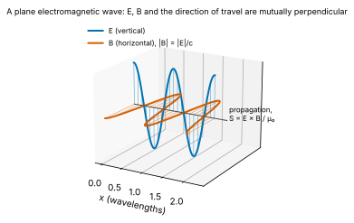

<!-- status: reviewed -->
# 04-08 · Energy in Fields and Maxwell's Equations (Preview)

| | |
|---|---|
| **Course** | [04 · Physics for EE](../README.md) |
| **University equivalent** | Maxwell's equations and electromagnetic waves in University Physics II (Halliday, Resnick & Walker, the chapters on Maxwell's equations and electromagnetic waves; Purcell & Morin, chapter 9; MIT 8.02, weeks 11–13) |
| **Prerequisites** | [04-07 Faraday's Law, Lenz's Law and Inductance](04-07-faraday-lenz-and-inductance.md), [04-03](04-03-gauss-law.md) and [04-06](04-06-magnetic-fields-and-forces.md) (Gauss's and Ampère's laws), [04-04](04-04-potential-capacitance-and-dielectrics.md) (energy in electric fields), [01-09](../../01-calculus-for-engineers/chapters/01-09-multivariable-calculus-1.md) (partial derivatives) |
| **Estimated study hours** | 6 |
| **Last verified** | 2026-11-18 |

**Learning objectives.** After this chapter you can:

1. Compute electric and magnetic energy densities and the energy stored in a field.
2. Explain why Ampère's law needs the displacement current, and compute it and the magnetic field it produces.
3. State Maxwell's equations in integral form and explain what each one says physically.
4. Derive the wave equation from Faraday's and the Ampère–Maxwell laws, and compute the speed, wavelength and impedance of electromagnetic waves in vacuum and in dielectrics.
5. Use the Poynting vector to find where energy flows, and apply it to signal propagation on boards, dielectric loss and RF exposure limits.

## 1. Big picture

Four chapters of laws (Gauss, Gauss for magnetism, Faraday, Ampère) almost complete classical electromagnetism. Maxwell found the missing piece in 1861–62 (and in 1865 showed that it predicts waves): a changing *electric* field acts like a current and makes a magnetic field, just as a changing magnetic field makes an electric field. With that one term the equations predict self-sustaining waves of electric and magnetic field travelling at $1/\sqrt{\mu_0\varepsilon_0}$, which turned out to be the measured speed of light. Light, radio, Wi-Fi, 5G and the signals on every circuit-board trace are the same phenomenon. This chapter previews the result; [Course 13](../../13-electromagnetics/README.md) develops it fully.

- **Signals on boards and chips:** fast signals travel as electromagnetic waves guided by traces, at speed $c/\sqrt{\varepsilon_{\text{eff}}}$, which sets delay budgets and timing ([24](../../24-high-speed-io-signal-integrity-and-photonics/README.md)).
- **Wireless:** antennas launch and capture these waves; 5G uses bands from below 1 GHz to 71 GHz ([17](../../17-communication-systems/README.md), [21](../../21-rf-and-microwave-engineering/README.md)).
- **Energy flow:** the Poynting vector shows energy travelling through the fields, not the wires, explaining power delivery and radiation.
- **Materials and loss:** circuit-board dielectrics absorb energy at high frequency, a central constraint on 100+ Gb/s links.
- **Photonics:** optical interconnects and lasers ([24](../../24-high-speed-io-signal-integrity-and-photonics/README.md)) are the same equations at 200 THz.

## 2. Intuition first

**Fields that sustain each other.** A changing magnetic field creates a circulating electric field (Faraday). Maxwell added the converse: a changing electric field creates a circulating magnetic field. Put the two together and a disturbance can feed itself: a changing E makes a changing B, which makes a changing E further along, and so on. The disturbance travels away at a speed fixed by the two constants that measure how strongly space responds to electric and magnetic fields, ε₀ and µ₀. No medium is needed; the fields themselves are the wave.

**Energy lives in fields and travels with them.** 04-04 and 04-07 put energy densities in fields: $\tfrac12\varepsilon E^2$ and $B^2/2\mu$. A wave carries that energy along at the speed of light. Even a DC circuit's energy reaches its resistor through the fields around the wires, not inside them.

**A finance analogy, and its limits.** Think of the electric and magnetic fields as two accounts that pay into each other: a change in one credits the other, so a pulse of value can propagate down a chain without anything physically moving. *Where it breaks:* a financial chain loses or amplifies value at every link and moves at the speed of settlement; an electromagnetic wave in vacuum keeps all its energy and always moves at exactly $c$.

*Figure 1. Between the plates no charge flows, yet the magnetic field is there. Maxwell's displacement current accounts for it (Example 04-08.2).*

## 3. Theory

> **Notation for this chapter.** $\Phi_E = \iint\vec E\cdot\hat n\,dA$ is electric flux and $\Phi_B$ magnetic flux. $c = 299\,792\,458$ m/s exactly. $\eta_0 = \sqrt{\mu_0/\varepsilon_0}$ is the impedance of free space. $\vec S$ is the Poynting vector (W/m²). Sinusoidal amplitudes are written $E_0$, $B_0$.

### 3.1 Energy in fields

Chapters 04-04 and 04-07 found the energy per unit volume stored in electric and magnetic fields:

$$
u = \frac12\varepsilon E^2 + \frac{B^2}{2\mu} .
$$

Both came from circuit arguments (charging a capacitor, ramping an inductor), but they are properties of the fields, true wherever fields exist. The magnetic term is far larger in practice: 1 T stores about 0.4 MJ/m³, while air at its breakdown field of 3 MV/m stores only 40 J/m³ (Example 04-08.1). This is why motors and transformers are magnetic, and why a capacitor bank's energy density depends on dielectrics that withstand enormous fields.

### 3.2 The displacement current

Apply Ampère's law, $\oint\vec B\cdot d\vec l = \mu_0I_{\text{enc}}$, to a loop around the wire feeding a charging capacitor. "Current enclosed" means current through any surface bounded by the loop. A flat surface cut by the wire encloses $i$. A surface that balloons out to pass *between* the plates encloses no current at all, since no charge crosses the gap. Same loop, two answers: Ampère's law, as stated, is inconsistent whenever charge accumulates.

Maxwell's resolution: the electric flux through the gap is changing. With charge $q$ on plates of area $A$, the field between them is $E = q/(\varepsilon_0A)$, so the flux is $\Phi_E = EA = q/\varepsilon_0$ and

$$
\varepsilon_0\frac{d\Phi_E}{dt} = \frac{dq}{dt} = i .
$$

The quantity $i_d = \varepsilon_0\,d\Phi_E/dt$, the **displacement current**, equals the conduction current in the wire. Adding it to Ampère's law makes the two surfaces agree:

$$
\oint\vec B\cdot d\vec l = \mu_0\Big(I_{\text{enc}} + \varepsilon_0\frac{d\Phi_E}{dt}\Big) .
$$

The displacement current is not moving charge, but it makes a magnetic field just as a real current does: between circular plates it circles the axis, growing linearly with radius to the plates' edge and falling as $1/r$ outside, exactly like the field of the wire (Figure 1, Example 04-08.2). It also restores charge conservation, which the uncorrected law contradicted (04-06's Going-deeper note).

### 3.3 Maxwell's equations

In vacuum, with charges and currents as sources, all of classical electromagnetism is four statements plus the Lorentz force:

$$
\begin{aligned}
&\oint\vec E\cdot\hat n\,dA = \frac{Q_{\text{enc}}}{\varepsilon_0} && \text{(Gauss: charges are sources of E)}\\
&\oint\vec B\cdot\hat n\,dA = 0 && \text{(no magnetic charges; B lines close)}\\
&\oint\vec E\cdot d\vec l = -\frac{d\Phi_B}{dt} && \text{(Faraday: changing B makes circulating E)}\\
&\oint\vec B\cdot d\vec l = \mu_0I_{\text{enc}} + \mu_0\varepsilon_0\frac{d\Phi_E}{dt} && \text{(Ampère–Maxwell: currents and changing E make circulating B)}
\end{aligned}
$$

and $\vec F = q(\vec E + \vec v\times\vec B)$. Everything in Course 04 so far is a special case: electrostatics (04-02 to 04-04) is the first and third with nothing changing; magnetostatics (04-06) is the second and fourth with steady currents; induction (04-07) is the third. In materials, the free-charge forms use $\vec D = \varepsilon\vec E$ and $\vec H = \vec B/\mu$ (04-04, 04-06).

> **Going deeper — the differential form.** Applying the divergence and Stokes theorems ([01-10](../../01-calculus-for-engineers/chapters/01-10-multivariable-calculus-2.md)) to arbitrarily small surfaces gives $\nabla\cdot\vec E = \rho/\varepsilon_0$, $\nabla\cdot\vec B = 0$, $\nabla\times\vec E = -\partial\vec B/\partial t$ and $\nabla\times\vec B = \mu_0\vec J + \mu_0\varepsilon_0\,\partial\vec E/\partial t$. This local form is what field solvers discretize, and the form [13-04](../../13-electromagnetics/chapters/13-04-maxwells-equations.md) uses.

### 3.4 Electromagnetic waves

Look for a wave in empty space travelling along $x$, with $\vec E$ along $y$ and $\vec B$ along $z$, each depending only on $x$ and $t$.

**Faraday on a thin rectangle in the $xy$-plane** (width $dx$, height $h$): the line integral of $\vec E$ is $[E_y(x + dx) - E_y(x)]h = \frac{\partial E_y}{\partial x}dx\,h$, and the flux through it is $B_z\,dx\,h$. Faraday's law gives

$$
\frac{\partial E_y}{\partial x} = -\frac{\partial B_z}{\partial t} .
$$

**Ampère–Maxwell on a thin rectangle in the $xz$-plane** (no current): the line integral of $\vec B$ is $-\frac{\partial B_z}{\partial x}dx\,h$ (its orientation follows the right-hand rule around $+y$), and the electric flux is $E_y\,dx\,h$, so

$$
-\frac{\partial B_z}{\partial x} = \mu_0\varepsilon_0\frac{\partial E_y}{\partial t} .
$$

**Combine.** Differentiate the first with respect to $x$ and the second with respect to $t$, and eliminate $B_z$:

$$
\frac{\partial^2E_y}{\partial x^2} = \mu_0\varepsilon_0\frac{\partial^2E_y}{\partial t^2} .
$$

This is the **wave equation** (04-09): any shape $E_y = f(x - vt)$ satisfies it, provided

$$
v = \frac{1}{\sqrt{\mu_0\varepsilon_0}} = c = 299\,792\,458\ \text{m/s} .
$$

Maxwell computed this from electrical measurements, found it matched the measured speed of light, and concluded that light is an electromagnetic wave. ($c$ has been exact by definition since 1983, when the metre was defined from it; since 2019 $\mu_0$ and $\varepsilon_0$ are measured, but their product is fixed at $1/c^2$.)

**Properties of the wave.** Substituting $E_y = E_0\cos(kx - \omega t)$ into the first equation gives $B_z = (E_0/c)\cos(kx - \omega t)$:

- $\vec E$, $\vec B$ and the direction of travel are mutually perpendicular, and $E = cB$ at every instant (Figure 2).
- $\omega/k = c$, so wavelength and frequency satisfy $\lambda f = c$: 30 cm at 1 GHz, 1 cm at 30 GHz, 1.55 µm at 193 THz (optical fiber).
- The ratio $E/H = E/(B/\mu_0) = \mu_0c = \sqrt{\mu_0/\varepsilon_0} = \eta_0 \approx 376.7$ Ω, the **impedance of free space**: the ratio of voltage-like to current-like quantities in a wave, just as $Z_0$ is for a cable.

**In a dielectric**, replace $\varepsilon_0$ by $\varepsilon_r\varepsilon_0$: the speed drops to $v = c/\sqrt{\varepsilon_r}$, the wavelength shrinks by the same factor, and the wave impedance falls to $\eta_0/\sqrt{\varepsilon_r}$. The optical refractive index is $n = \sqrt{\varepsilon_r}$ (at optical frequencies). On a circuit board with $\varepsilon_r$ = 4.6, signals travel at 0.466$c$: 7.15 ps per millimeter of buried (stripline) trace (Example 04-08.3). That is also exactly the wave speed $1/\sqrt{LC}$ per unit length of 04-07 Problem 8: a transmission line guides a wave whose speed is set by the material, not the geometry.

*Figure 2. A plane wave: E and B in phase, perpendicular to each other and to the direction of travel, with E = cB.*

### 3.5 The Poynting vector: where energy flows

Energy flows wherever there are crossed electric and magnetic fields. The power per unit area crossing a surface is the **Poynting vector**

$$
\vec S = \frac{1}{\mu_0}\vec E\times\vec B \qquad (\text{W/m}^2) .
$$

(It follows from Maxwell's equations by computing the rate at which field energy in a volume changes; [13](../../13-electromagnetics/README.md) does this as Poynting's theorem.) For a plane wave, $\vec S$ points along the direction of travel with magnitude $EB/\mu_0 = E^2/\eta_0$; averaged over a cycle, the **intensity** is

$$
\langle S\rangle = \frac{E_0^2}{2\eta_0} = \frac{E_{\text{rms}}^2}{\eta_0} ,
$$

which equals the average energy density times $c$ (Example 04-08.4).

**Energy flows into a resistor from outside.** Take a straight resistive wire carrying current $I$ with voltage $V$ across length $L$. Inside and at the surface, the electric field points along the wire ($E = V/L$) and the magnetic field circles it ($B = \mu_0I/2\pi a$ at radius $a$). Their cross product points radially *inward*: energy enters the wire through its surface. The total inflow is

$$
S\cdot2\pi aL = \frac{V}{L}\cdot\frac{\mu_0I}{2\pi a\mu_0}\cdot2\pi aL = VI ,
$$

exactly the Joule heating $I^2R$ (Example 04-08.5). In every circuit, energy travels from source to load through the fields in the space around and between the conductors; the wires guide it. This is why the geometry of traces and their return paths, not just their resistance, governs high-speed power and signal delivery.

*Figure 3. Energy enters a resistor from the surrounding field; on a board, the dielectric around the trace absorbs part of every high-frequency signal.*

### 3.6 Lossy dielectrics and signals on boards

Real insulators absorb a little energy each cycle as their dipoles lag the field (04-04's Going-deeper note). This is summarized by the **loss tangent** $\tan\delta$: the permittivity becomes complex, $\varepsilon(1 - j\tan\delta)$. Putting it into the wave's propagation constant $k = \omega\sqrt{\mu\varepsilon(1 - j\tan\delta)} \approx \omega\sqrt{\mu\varepsilon}(1 - \tfrac j2\tan\delta)$ gives an amplitude decaying as $e^{-\alpha x}$ with

$$
\alpha = \frac{\omega\sqrt{\mu\varepsilon}}{2}\tan\delta = \frac{\pi f\sqrt{\varepsilon_r}}{c}\tan\delta \quad\text{(nepers/m)},\qquad 1\ \text{Np} = 8.686\ \text{dB} .
$$

Loss grows in proportion to frequency, so it dominates at tens of gigahertz. A common FR-4-class laminate has $\tan\delta$ about 0.025 at 10 GHz, losing about 45 dB per meter from the dielectric alone, while a low-loss hydrocarbon-ceramic laminate at 0.0037 loses about 6.4 dB per meter (Example 04-08.6, [R-083](../../../reference/research-log.md#r-083--board-dielectrics-propagation-5g-bands-and-rf-exposure)). That factor of seven is why 56–112 Gb/s links, radar and millimeter-wave radios use premium laminates, and why the industry pays for them. (Conductor loss, from the skin effect of 04-07, adds to this and grows as $\sqrt f$.)

### 3.7 Radiation, spectrum and exposure

Accelerating charges radiate: an oscillating current in an antenna launches waves whose power spreads over an expanding sphere, so far from a source radiating power $P$ equally in all directions the intensity is $P/(4\pi r^2)$. Wireless systems divide the spectrum into bands; 5G New Radio's frequency range 1 spans 410 MHz to 7.125 GHz and its millimeter-wave ranges reach 71 GHz ([R-083](../../../reference/research-log.md#r-083--board-dielectrics-propagation-5g-bands-and-rf-exposure)). Higher frequencies carry more bandwidth but suffer more loss in materials and air, and need smaller antennas, which is why millimeter-wave phones use antenna arrays.

Radio waves at these frequencies heat tissue (they are non-ionizing; [04-10](04-10-intro-quantum-mechanics.md) explains why only ultraviolet and above can break chemical bonds directly). Regulators limit exposure by the **specific absorption rate** (SAR, W/kg) below 6 GHz and by power density above: the US FCC sets 1.6 W/kg averaged over any 1 g of tissue for the general public, while the ICNIRP guidelines used in much of the world set 2 W/kg averaged over 10 g, and 20 W/m² absorbed power density above 6 GHz. The two are not directly comparable, because averaging over 1 g captures sharper hot spots than over 10 g ([R-083](../../../reference/research-log.md#r-083--board-dielectrics-propagation-5g-bands-and-rf-exposure), Example 04-08.7).

## 4. Worked examples

### Example 04-08.1 — Energy densities (tier A)

**Setup.** Find the energy density of (a) a 1 MV/m field in air, (b) a 5 MV/cm field in SiO₂ ($\varepsilon_r$ = 3.9), (c) a 1 T field in air, and (d) a 1 mT field in air.

**Solution.** (a) $\tfrac12\varepsilon_0E^2 = 0.5\times8.854\times10^{-12}\times10^{12} = $ **4.427 J/m³**.

(b) $\tfrac12\times3.9\varepsilon_0\times(5\times10^8)^2 = $ **4.316×10⁶ J/m³**: a gate oxide stores megajoules per cubic meter, in a volume measured in cubic nanometers.

(c) $B^2/(2\mu_0) = $ **3.979×10⁵ J/m³**.

(d) **0.3979 J/m³**.

### Example 04-08.2 — The field of a displacement current (tier B)

**Setup.** A capacitor with circular plates of radius 5 cm is charged by a steady 1 A. Find (a) the rate of change of the field between the plates, (b) the displacement current, and the magnetic field (c) 3 cm from the axis between the plates, (d) at the plates' edge and (e) 10 cm from the axis.

**Solution.** (a) $E = q/(\varepsilon_0A)$, so \$dE/dt = i/(\varepsilon_0A) = 1/(8.854\times10^{-12}\times7.854\times10^{-3}) = \$ **1.438×10¹³ V/(m·s)**.

(b) $i_d = \varepsilon_0A\,dE/dt = $ **1 A**, equal to the wire current.

(c) A circle of radius $r < R$ encloses displacement current $i\,r^2/R^2$, so \$B = \mu_0ir/(2\pi R^2) = \$ **2.4 µT**.

(d) At $r = R$: \$\mu_0i/(2\pi R) = \$ **4 µT**.

(e) Outside, all the displacement current is enclosed: $\mu_0i/(2\pi r) = $ **2 µT**, the same as 10 cm from the wire.

### Example 04-08.3 — Speed of light, impedance and board delay (tier B)

**Setup.** (a) Compute $1/\sqrt{\mu_0\varepsilon_0}$ and $\eta_0 = \sqrt{\mu_0/\varepsilon_0}$ from their CODATA values. (b) For a stripline in FR-4 with $\varepsilon_r$ = 4.6, find the signal speed, the delay per millimeter and the delay of a 100 mm trace. (c) Find the wavelength at 10 GHz in that material and in air. Confirm (b) in ngspice.

**Solution.** (a) $1/\sqrt{1.25663706127\times10^{-6}\times8.8541878188\times10^{-12}} = $ **2.998×10⁸ m/s**; $\eta_0 = $ **376.7 Ω**.

(b) $v = c/\sqrt{4.6} = $ **1.398×10⁸ m/s**, which is **7.154 ps/mm**, so 100 mm takes **715.4 ps**. (TI's layout guide tabulates 715.3 ps from a rounded speed, [R-083](../../../reference/research-log.md#r-083--board-dielectrics-propagation-5g-bands-and-rf-exposure).)

(c) $\lambda = v/f$: **13.98 mm** in FR-4, **29.98 mm** in air.

**Simulation.** The netlist [labs/04-08-lab/stripline_delay.cir](../labs/04-08-lab/stripline_delay.cir) drives a matched 50 Ω line with this delay and measures 715.4 ps between the near- and far-end crossings.

**Interpretation.** A 10 cm trace at 10 GHz is seven wavelengths long: the trace is no longer a "wire" but a transmission line, and the lumped-circuit view of [00-02](../../00-orientation/chapters/00-02-the-abstraction-stack.md) no longer holds.

### Example 04-08.4 — A plane wave's fields and intensity (tier B)

**Setup.** A plane wave has an electric-field amplitude of 100 V/m. Find (a) the magnetic-field amplitude, (b) the intensity, (c) the average energy density, and (d) check that intensity equals energy density times $c$.

**Solution.** (a) $B_0 = E_0/c = $ **333.6 nT**.

(b) $\langle S\rangle = E_0^2/(2\eta_0) = 10^4/753.5 = $ **13.27 W/m²**.

(c) The electric and magnetic energies are equal in a plane wave; each averages $\tfrac14\varepsilon_0E_0^2$, so \$\langle u\rangle = \tfrac12\varepsilon_0E_0^2 = \$ **4.427×10⁻⁸ J/m³**.

(d) $4.427\times10^{-8}\times2.998\times10^8 = 13.27$ W/m² ✓.

### Example 04-08.5 — Energy flowing into a wire and into a capacitor (tier C)

**Setup.** (a) A copper wire 1 m long and 0.5 mm in radius carries 10 A. Find its resistance, the voltage along it, the magnetic field at its surface, the Poynting vector there, and the total power flowing in through its surface. (b) The capacitor of Example 04-08.2 has a 1 mm gap; at the instant its voltage is 100 V (still charged at 1 A), find the Poynting vector at the rim of the gap and the power flowing into the gap.

**Solution.** (a) \$R = \rho L/(\pi a^2) = \$ **21.39 mΩ**; \$V = IR = \$ **0.2139 V**, so $E = 0.2139$ V/m. \$B = \mu_0I/(2\pi a) = \$ **4 mT**. \$S = EB/\mu_0 = \$ **680.9 W/m²**, pointing inward. Over the surface $2\pi aL = 3.142\times10^{-3}$ m²: **2.139 W**, which is $I^2R$ ✓.

(b) $E = V/d = 10^5$ V/m between the plates; at the rim $B = \mu_0i/(2\pi R) = 4$ µT, circling; \$S = EB/\mu_0 = \$ **3.183×10⁵ W/m²**, pointing inward through the rim. Over the rim area $2\pi Rd = 3.142\times10^{-4}$ m²: **100 W**, which is $VI$, the rate at which the capacitor's stored energy grows ✓.

**Interpretation.** In both cases energy enters from the sides, through the field outside the conductors, not along the wires. The wires shape the field; the field carries the energy.

### Example 04-08.6 — Dielectric loss on a board (tier C)

**Setup.** At 10 GHz, compare the dielectric attenuation of a trace in an FR-4-class laminate (Isola 370HR: $\varepsilon_r$ = 3.92, $\tan\delta$ = 0.025) and a low-loss laminate (Rogers RO4350B: design $\varepsilon_r$ = 3.66, $\tan\delta$ = 0.0037), in Np/m, dB/m and dB per 10 cm of trace ([R-083](../../../reference/research-log.md#r-083--board-dielectrics-propagation-5g-bands-and-rf-exposure)). Treat the trace as fully embedded in the dielectric.

**Solution.** $\alpha = \pi f\sqrt{\varepsilon_r}\tan\delta/c$.

370HR: $\pi\times10^{10}\times1.980\times0.025/2.998\times10^8 = $ **5.187 Np/m** = **45.05 dB/m**, so **4.505 dB** per 10 cm.

RO4350B: **0.7418 Np/m** = **6.443 dB/m**, so **0.6443 dB** per 10 cm.

**Interpretation.** A 10 cm FR-4 trace loses 4.5 dB at 10 GHz to the dielectric alone, about two thirds of the signal power. A 100 Gb/s link's budget is a few tens of dB end to end, so material choice, trace length and equalization (Course 24) are traded against each other. Data-sheet $\varepsilon_r$ and $\tan\delta$ also vary with frequency and resin content, so designers use values measured at the operating frequency.

### Example 04-08.7 — Power density from a radiating source (tier B)

**Setup.** A source radiates 1 W equally in all directions. Find (a) the intensity and rms electric field at 1 m and at 10 cm, and (b) compare the 10 cm value with the FCC's general-population power-density limit of 1 mW/cm² (1.5–100 GHz, averaged over 30 minutes).

**Solution.** (a) $\langle S\rangle = P/(4\pi r^2)$: **79.58 mW/m²** at 1 m and **7.958 W/m²** at 10 cm. $E_{\text{rms}} = \sqrt{\langle S\rangle\eta_0}$: **5.475 V/m** and **54.75 V/m**.

(b) 1 mW/cm² = **10 W/m²**; the 10 cm value is about 80% of it.

**Interpretation.** This far-field formula is only a rough guide: at 10 cm from a phone the field pattern is not yet a simple spherical wave, the antenna is not isotropic, and phones transmit far below 1 W on average. That is why phones are certified by measuring SAR in tissue-equivalent models rather than by this calculation.

<!-- answer-key -->
| ID | Quantity | Value | Unit |
|---|---|---|---|
| Ex 04-08.1a | energy density, 1 MV/m in air | 4.427 | J/m³ |
| Ex 04-08.1b | energy density, 5 MV/cm in SiO₂ | 4.316×10^6 | J/m³ |
| Ex 04-08.1c | energy density, 1 T | 3.979×10^5 | J/m³ |
| Ex 04-08.1d | energy density, 1 mT | 0.3979 | J/m³ |
| Ex 04-08.2a | rate of change of E | 1.438×10^13 | V/(m·s) |
| Ex 04-08.2b | displacement current | 1 | A |
| Ex 04-08.2c | B at 3 cm | 2.4 | µT |
| Ex 04-08.2d | B at the plates' edge | 4 | µT |
| Ex 04-08.2e | B at 10 cm | 2 | µT |
| Ex 04-08.3a | 1/√(µ₀ε₀) | 2.998×10^8 | m/s |
| Ex 04-08.3b | impedance of free space | 376.7 | Ω |
| Ex 04-08.3c | signal speed in FR-4 | 1.398×10^8 | m/s |
| Ex 04-08.3d | delay per millimeter | 7.154 | ps/mm |
| Ex 04-08.3e | delay of 100 mm | 715.4 | ps |
| Ex 04-08.3f | wavelength at 10 GHz in FR-4 | 13.98 | mm |
| Ex 04-08.3g | wavelength at 10 GHz in air | 29.98 | mm |
| Ex 04-08.4a | magnetic-field amplitude | 333.6 | nT |
| Ex 04-08.4b | intensity | 13.27 | W/m² |
| Ex 04-08.4c | average energy density | 4.427×10^-8 | J/m³ |
| Ex 04-08.5a | wire resistance | 21.39 | mΩ |
| Ex 04-08.5b | voltage along the wire | 0.2139 | V |
| Ex 04-08.5c | B at the wire surface | 4 | mT |
| Ex 04-08.5d | Poynting vector at the wire | 680.9 | W/m² |
| Ex 04-08.5e | power into the wire | 2.139 | W |
| Ex 04-08.5f | Poynting vector at the capacitor rim | 3.183×10^5 | W/m² |
| Ex 04-08.5g | power into the capacitor | 100 | W |
| Ex 04-08.6a | attenuation, 370HR | 5.187 | Np/m |
| Ex 04-08.6b | attenuation, 370HR | 45.05 | dB/m |
| Ex 04-08.6c | loss per 10 cm, 370HR | 4.505 | dB |
| Ex 04-08.6d | attenuation, RO4350B | 0.7418 | Np/m |
| Ex 04-08.6e | attenuation, RO4350B | 6.443 | dB/m |
| Ex 04-08.6f | loss per 10 cm, RO4350B | 0.6443 | dB |
| Ex 04-08.7a | intensity at 1 m | 79.58 | mW/m² |
| Ex 04-08.7b | intensity at 10 cm | 7.958 | W/m² |
| Ex 04-08.7c | rms field at 1 m | 5.475 | V/m |
| Ex 04-08.7d | rms field at 10 cm | 54.75 | V/m |
| Ex 04-08.7e | FCC limit in W/m² | 10 | W/m² |

<!-- answer-key -->
| ID | Quantity | Value | Unit |
|---|---|---|---|
| T 04-08.a | wavelength at 1 GHz in vacuum | 29.98 | cm |
| T 04-08.b | nepers to decibels | 8.686 | dB |

## 5. Simulate it

The lab ([labs/04-08-lab/](../labs/04-08-lab/README.md)) is a notebook plus an ngspice netlist:

1. **Maxwell's equations on a grid:** a one-dimensional finite-difference time-domain (FDTD) simulation launches a pulse that propagates on its own. *Predict first:* how fast does it go in a region with $\varepsilon_r$ = 4, and how much reflects at the boundary?
2. **Energy bookkeeping:** track the total field energy as the pulse moves, reflects and transmits.
3. **Lossy dielectric:** add conductivity to the grid and compare the measured decay with the loss-tangent formula.
4. **Board materials:** loss per meter against frequency for different laminates.

The netlist `stripline_delay.cir` simulates the 100 mm trace of Example 04-08.3.

## 6. Engineering tradeoffs

| Knob | Improves | Costs | Typical decision owner |
|---|---|---|---|
| Laminate loss tangent (FR-4 vs low-loss) | Lower dielectric loss at high frequency | Material cost, processing, availability | SI engineers with board procurement |
| Laminate permittivity | Lower ε: faster propagation, lower loss, wider traces at a given impedance | Higher ε: smaller circuits and antennas (shorter wavelengths) | RF and SI engineers |
| Trace routing (stripline vs microstrip) | Stripline: shielded, less radiation and crosstalk | Slower (full ε) and harder to access | Board designers |
| Operating frequency of a radio link | More bandwidth and smaller antennas | Path, material and air loss; tighter tolerances | System architects and standards bodies |
| Transmit power and antenna placement | Range and link margin | Exposure (SAR) compliance, battery life, interference | RF and regulatory teams |

## 7. Numbers to know

| Quantity | Value | Note |
|---|---|---|
| Speed of light | $c = 299\,792\,458$ m/s = 1/√(µ₀ε₀) | ≈ 30 cm/ns, 0.3 mm/ps |
| Impedance of free space | η₀ ≈ 376.7 Ω | E/H in a plane wave |
| Wave in a dielectric | $v = c/\sqrt{\varepsilon_r}$, $\eta = \eta_0/\sqrt{\varepsilon_r}$ | |
| PCB stripline, ε_r = 4.6 | 7.15 ps/mm (about 180 ps/inch) | [R-083](../../../reference/research-log.md#r-083--board-dielectrics-propagation-5g-bands-and-rf-exposure) |
| Plane-wave intensity | $E_0^2/(2\eta_0)$ | 100 V/m → 13.3 W/m² |
| Dielectric attenuation | $\pi f\sqrt{\varepsilon_r}\tan\delta/c$ Np/m | ∝ f |
| Laminate loss tangents at 10 GHz, as of Nov 2026 | FR-4 class ≈ 0.025; low-loss ≈ 0.004 | [R-083](../../../reference/research-log.md#r-083--board-dielectrics-propagation-5g-bands-and-rf-exposure) |
| 5G NR ranges, as of Nov 2026 | FR1 410–7125 MHz; FR2-1 24.25–52.6 GHz; FR2-2 52.6–71 GHz | 3GPP TS 38.104 v19.6.0 |
| RF exposure, general public | FCC 1.6 W/kg (1 g); ICNIRP 2 W/kg (10 g), 20 W/m² above 6 GHz | [R-083](../../../reference/research-log.md#r-083--board-dielectrics-propagation-5g-bands-and-rf-exposure) |

## 8. Common mistakes

1. **Thinking the displacement current is a flow of charge.** It is a changing electric field; it makes magnetic fields like a current but carries no charge.
2. **Treating a fast trace as a wire.** Once its length is a noticeable fraction of a wavelength (or its delay a fraction of the edge time), it is a transmission line.
3. **Using $c$ on a board.** Signals travel at $c/\sqrt{\varepsilon_{\text{eff}}}$, roughly half of $c$ in FR-4.
4. **Confusing amplitude and rms in intensity.** $\langle S\rangle = E_0^2/(2\eta_0) = E_{\text{rms}}^2/\eta_0$.
5. **Assuming energy flows inside the wires.** It flows through the fields around them.
6. **Using a single datasheet $\varepsilon_r$ and $\tan\delta$ at all frequencies.** Both vary with frequency and resin content.
7. **Comparing SAR limits without the averaging mass.** 1.6 W/kg over 1 g and 2 W/kg over 10 g are different tests.

## 9. Practitioner lens

### State of the art (as of Nov 2026)

- **Board materials.** An FR-4-class epoxy laminate, Isola 370HR (2021 datasheet), lists $\varepsilon_r$ falling from 4.24 at 100 MHz to 3.92 at 10 GHz and loss tangent rising from 0.0150 to 0.0250; Rogers' RO4350B (2022 datasheet) lists a design $\varepsilon_r$ of 3.66 (8–40 GHz) and a loss tangent of 0.0037 at 10 GHz, about 6.8 times lower ([R-083](../../../reference/research-log.md#r-083--board-dielectrics-propagation-5g-bands-and-rf-exposure)) **[Established]**.
- **Propagation on boards.** Texas Instruments' high-speed layout guide (revised 2017) works through FR-4 at $\varepsilon_r$ = 4.6: 715.3 ps per 100 mm of stripline and about 582–593 ps per 100 mm of microstrip, whose field is partly in air ([R-083](../../../reference/research-log.md#r-083--board-dielectrics-propagation-5g-bands-and-rf-exposure)) **[Established]**.
- **5G spectrum.** 3GPP TS 38.104 (version 19.6.0, September 2026) defines FR1 as 410–7125 MHz, FR2-1 as 24.25–52.6 GHz and FR2-2 as 52.6–71 GHz, with millimeter-wave bands such as n257 (26.5–29.5 GHz) and n263 (57–71 GHz) ([R-083](../../../reference/research-log.md#r-083--board-dielectrics-propagation-5g-bands-and-rf-exposure)) **[Established]**.
- **Exposure limits.** The FCC (47 CFR §1.1310) limits general-population SAR to 0.08 W/kg whole-body and 1.6 W/kg peak over any 1 g, with a 1 mW/cm² power-density limit from 1.5 to 100 GHz; ICNIRP's 2020 guidelines set 0.08 W/kg whole-body, 2 W/kg local (10 g, head and torso) up to 6 GHz, and 20 W/m² absorbed power density above 6 GHz ([R-083](../../../reference/research-log.md#r-083--board-dielectrics-propagation-5g-bands-and-rf-exposure)) **[Established]**.

### Why it matters commercially

Every gain in data rate pushes signals to higher frequency, where the physics of this chapter (propagation delay, dielectric and conductor loss, radiation) becomes the binding constraint. AI-cluster networking at 200 Gb/s per lane and beyond, server boards, and millimeter-wave radios are all designed against these losses, driving demand for premium laminates, shorter reaches, retimers and, ultimately, optical links ([24](../../24-high-speed-io-signal-integrity-and-photonics/README.md)). Spectrum policy and exposure rules shape what wireless products can do. For corporate development, a team's command of loss budgets and materials is a good proxy for whether its high-speed roadmap is credible.

> **Deeper:** see companion repo *Datacenter Networking* for how these physical limits shape link reach, SerDes and optical-interconnect choices.

### Marketing vs Reality

- **"Our laminate has Dk 3.0."** *Reality:* at what frequency and resin content, and is it the "process" or "design" value? Ask for Dk and Df measured at the operating frequency.
- **"Signals travel at the speed of light."** *Reality:* on a board, at roughly half of it; in silicon waveguides, slower still. Ask for the delay budget in ps/mm.
- **"5G millimeter wave everywhere."** *Reality:* higher bands suffer far more path and material loss and are blocked by walls and hands; coverage needs dense cells and beamforming. Ask for coverage and link-budget data, not peak rates.
- **"Below the SAR limit."** *Reality:* under which standard (1 g or 10 g averaging), at what position and power? Ask for the test configuration.

### Questions for engineering leaders

1. **"What is your channel's loss budget at the Nyquist frequency, and how is it split between dielectric, conductor and connectors?"** *Strong:* a measured or simulated breakdown in dB, with the laminate's measured Df. *Evasive:* "we use a low-loss material".
2. **"How long can this link be on your chosen laminate before you need a retimer or optics?"** *Strong:* reach from the loss budget, with margin. *Evasive:* no number.
3. **"How did you validate Dk and Df at operating frequency?"** *Strong:* test coupons and measurement method. *Evasive:* datasheet values.
4. **"Which exposure standard drives your antenna placement and power limits?"** *Strong:* the regulatory regimes by market and the measured SAR margin. *Evasive:* "we pass certification".

## 10. Concept check

1. Why does Ampère's law without the displacement current give two different answers for the same loop around a charging capacitor's wire?

   

Answer

   A surface through the wire encloses current $i$; a surface passing between the plates encloses none. The changing electric flux in the gap, $\varepsilon_0\,d\Phi_E/dt = i$, restores agreement.

   

2. What sets the speed of electromagnetic waves in vacuum, and why was this a surprise in 1865?

   

Answer

   $1/\sqrt{\mu_0\varepsilon_0}$, constants measured with capacitors and coils in the laboratory. That this matched the measured speed of light showed light is electromagnetic.

   

3. In a plane wave, how are E and B related in direction, phase and magnitude?

   

Answer

   Perpendicular to each other and to the direction of travel, in phase, with $E = cB$ (equivalently $E/H = \eta_0$).

   

4. Energy reaches a resistor through its surface, not along it. How does the Poynting vector show this?

   

Answer

   Along the wire $\vec E$ is parallel to it and $\vec B$ circles it, so $\vec E\times\vec B$ points radially inward; integrating over the surface gives exactly $VI$.

   

5. Why does dielectric loss matter more at 50 GHz than at 1 GHz?

   

Answer

   Attenuation per meter is proportional to frequency times the loss tangent (and the loss tangent itself often rises with frequency), so the same trace loses at least 50 times more decibels at 50 GHz.

   

6. A 15 cm board trace carries a signal with a 30 ps rise time. Should it be treated as a lumped wire or a transmission line?

   

Answer

   A transmission line: its delay is about 150 mm × 7.15 ps/mm ≈ 1.07 ns (in FR-4), some 35 times the rise time, so reflections and termination matter.

   

Problem set: [04-08 problems](../problems/04-08-problems.md) · [solutions](../solutions/04-08-solutions.md).

## 11. Key terms

[Displacement current](../../../reference/glossary.md#displacement-current) ·
[Maxwell's equations](../../../reference/glossary.md#maxwells-equations) ·
[Electromagnetic wave](../../../reference/glossary.md#electromagnetic-wave) ·
[Impedance of free space](../../../reference/glossary.md#impedance-of-free-space) ·
[Poynting vector](../../../reference/glossary.md#poynting-vector) ·
[Loss tangent](../../../reference/glossary.md#loss-tangent) ·
[Characteristic impedance](../../../reference/glossary.md#characteristic-impedance) ·
[Specific absorption rate (SAR)](../../../reference/glossary.md#specific-absorption-rate-sar)

## 12. Connections

- **Previous:** [04-07](04-07-faraday-lenz-and-inductance.md) (Faraday's law, coax $L$ and $C$), [04-06](04-06-magnetic-fields-and-forces.md) (Ampère's law, now completed), [04-03](04-03-gauss-law.md) and [04-04](04-04-potential-capacitance-and-dielectrics.md) (Gauss's law, energy in electric fields).
- **Next:** [04-09 Waves and Optics Basics](04-09-waves-and-optics.md) develops the wave equation, interference, diffraction, reflection and refraction for all waves, including light.
- **Used in:** [13-04](../../13-electromagnetics/chapters/13-04-maxwells-equations.md) and [13-05](../../13-electromagnetics/chapters/13-05-plane-waves.md) (Maxwell's equations and plane waves in full), [13-07](../../13-electromagnetics/chapters/13-07-transmission-lines-time-domain.md) (transmission lines), [17](../../17-communication-systems/README.md) and [21](../../21-rf-and-microwave-engineering/README.md) (wireless links and RF), [24](../../24-high-speed-io-signal-integrity-and-photonics/README.md) (signal integrity and photonics).

## 13. Further study

- Halliday, D., Resnick, R. and Walker, J., *Fundamentals of Physics*, the chapters on Maxwell's equations and electromagnetic waves.
- Purcell, E. M. and Morin, D. J., *Electricity and Magnetism*, 3rd ed., Cambridge University Press, 2013, chapter 9.
- MIT OpenCourseWare 8.02 (Physics II: Electricity and Magnetism), the lectures on displacement current, Maxwell's equations and electromagnetic waves.
- Texas Instruments, *High-Speed Layout Guidelines* (SCAA082A), for a practitioner's view of propagation on boards.

## 14. Sources

1. Halliday, D., Resnick, R. and Walker, J., *Fundamentals of Physics*, Wiley (any recent edition).
2. Purcell, E. M. and Morin, D. J., *Electricity and Magnetism*, 3rd ed., Cambridge University Press, 2013.
3. NIST, 2022 CODATA recommended values (µ₀, ε₀; exact $c$). [R-073]
4. Isola Group, 370HR datasheet, Rev. C, 2021; Rogers Corporation, RO4000 Series datasheet, 2022. [R-083]
5. Texas Instruments, "High-Speed Layout Guidelines", SCAA082A, revised August 2017. [R-083]
6. ETSI TS 138 104 V19.6.0 (3GPP TS 38.104 Release 19), September 2026. [R-083]
7. US Code of Federal Regulations, 47 CFR §1.1310 (as read November 2026); ICNIRP, "Guidelines for limiting exposure to electromagnetic fields (100 kHz to 300 GHz)", *Health Physics* 118(5), 2020. [R-083]
