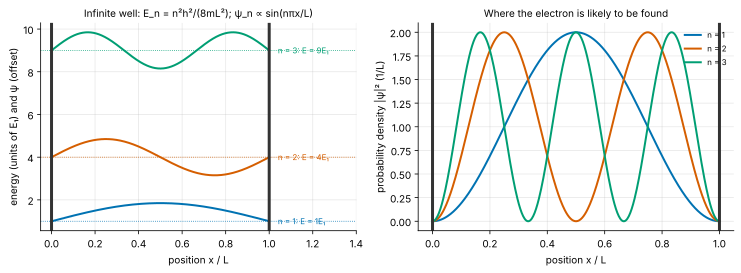

<!-- status: reviewed -->
# 04-10 · Introduction to Quantum Mechanics

| | |
|---|---|
| **Course** | [04 · Physics for EE](../README.md) |
| **University equivalent** | Modern physics for engineers (Halliday, Resnick & Walker, the chapters on photons and matter waves and on more about matter waves; MIT 8.04, Quantum Physics I, first weeks; Hu, *Modern Semiconductor Devices*, ch. 1) |
| **Prerequisites** | [04-09 Waves and Optics Basics](04-09-waves-and-optics.md), [04-08](04-08-maxwell-preview.md) (electromagnetic waves), [02-03](../../02-complex-numbers-des-and-linear-algebra/chapters/02-03-second-order-linear-odes.md) (second-order ODEs), [02-08](../../02-complex-numbers-des-and-linear-algebra/chapters/02-08-eigenvalues-and-eigenvectors.md) (eigenvalues), [03-02](../../03-probability-statistics-and-random-variables/chapters/03-02-random-variables-and-distributions.md) (probability densities) |
| **Estimated study hours** | 10 |
| **Last verified** | 2026-11-18 |

**Learning objectives.** After this chapter you can:

1. Compute photon energies and momenta, explain the photoelectric effect, and relate photon energy to photodetector responsivity and to which radiation can break bonds.
2. Compute de Broglie wavelengths, interpret the wavefunction as a probability amplitude, and apply the uncertainty principle to estimate confinement energies.
3. Solve the time-independent Schrödinger equation for an infinite well, and use the result to explain quantized energy levels in atoms, quantum wells and quantum dots.
4. Compute tunneling probabilities through a rectangular barrier and explain their exponential sensitivity to thickness, with applications to gate leakage and flash memory.
5. Describe qubits, superposition and measurement at survey level, and evaluate quantum-computing claims skeptically.

## 1. Big picture

Classical physics, everything in this course so far, works beautifully for circuits, fields and waves. It fails at the scale of atoms and electrons in solids, and modern semiconductors live at that scale. Around 1900–1930 physicists found that light comes in lumps of energy (**photons**), that electrons behave as waves, that confined particles can only have certain energies, and that particles can pass through barriers they classically could not climb. This is **quantum mechanics**. It explains why silicon has a band gap and copper does not (04-11), why a transistor's gate leaks through a 1.2 nm oxide, how flash memory writes a bit, how a photodiode converts light to current, and what a quantum computer is.

- **Optoelectronics:** photodiodes, image sensors, LEDs and lasers all exchange energy with light one photon at a time ([09-14](../../09-semiconductor-devices/chapters/09-14-optoelectronic-devices.md)).
- **Transistor scaling:** quantum tunneling through ultrathin gate oxides forced the industry's switch to high-k gate dielectrics ([09-10](../../09-semiconductor-devices/chapters/09-10-short-channel-effects-and-leakage.md)).
- **Memory:** flash programs and erases by tunneling electrons through an oxide ([23](../../23-memory-and-storage-technology/README.md)).
- **Materials:** quantized energy levels in atoms broaden into the energy bands of solids, the foundation of semiconductor physics ([04-11](04-11-intro-solid-state-physics.md), [09](../../09-semiconductor-devices/README.md)).
- **Quantum computing:** the same mathematics, used deliberately, underlies qubits and their error correction.

## 2. Intuition first

**Light comes in packets.** A dim beam of light is not a weak continuous wave but a sparse stream of photons, each carrying energy $hf$. Whether light can knock an electron out of a metal, or across silicon's band gap, depends on the energy of each photon (its color), not on how bright the beam is. A bright infrared beam may do nothing that a faint ultraviolet one does easily.

**Electrons are waves too.** An electron has a wavelength $h/p$. For the electrons in a chip that wavelength is a few nanometers, comparable to the structures they move through. When a wave is confined, only wavelengths that fit are allowed (04-09's standing waves); for an electron, that means only certain energies are allowed. Confinement creates **quantization**.

**Waves leak.** A wave hitting a barrier it cannot classically cross does not stop dead at the wall; it decays exponentially inside. If the barrier is thin enough, some of the wave emerges on the other side: **tunneling**. The probability falls exponentially with thickness, so a fraction of a nanometer changes it many-fold.

**Probability is built in.** Quantum mechanics predicts probabilities, not certainties. The wavefunction's squared magnitude is a probability density (03-02); measurement picks one outcome. That is not ignorance of hidden details; it is how nature works at this scale, as experiments have confirmed many times.

**A finance analogy, and its limits.** A wavefunction is like a probability distribution over outcomes before a trade settles; settlement (measurement) picks one. *Where it breaks:* quantum amplitudes are complex numbers that can cancel, so two "paths" to the same outcome can interfere and make it impossible, something no classical probability distribution does. That interference is the resource quantum computers exploit.

*Figure 1. Photon energy is set by wavelength. Radio photons carry far less than thermal energy; near-infrared photons can cross silicon's band gap; ultraviolet and beyond can ionize atoms.*

## 3. Theory

> **Notation for this chapter.** $h = 6.626\,070\,15\times10^{-34}$ J·s is Planck's constant and $\hbar = h/2\pi$; both, with $c$, $e$ and $k$, are exact in the SI ([R-073](../../../reference/research-log.md#r-073--codata-2022-fundamental-constants)). A convenient combination is $hc = 1239.84$ eV·nm. ψ is a wavefunction, $E$ an energy (often in eV), $V(x)$ a potential energy, $m$ a particle's mass (or effective mass).

### 3.1 Photons

**Planck and Einstein.** Light of frequency $f$ exchanges energy with matter only in units of

$$
E = hf = \frac{hc}{\lambda}, \qquad E\,[\text{eV}] = \frac{1239.84}{\lambda\,[\text{nm}]} \approx \frac{1.24}{\lambda\,[\mu\text{m}]} .
$$

Each photon also carries momentum $p = E/c = h/\lambda$. A beam of power $P$ carries $P/(hf)$ photons per second: a 1 mW laser at 1550 nm emits about $7.8\times10^{15}$ per second (Example 04-10.1), so in most engineering, light looks continuous; at low light levels (single-photon detectors, image sensors in the dark), the graininess appears as **shot noise** (03-06).

**The photoelectric effect.** Light shining on a metal ejects electrons only if each photon's energy exceeds the metal's **work function** φ, the energy binding an electron to the surface. The ejected electrons' maximum kinetic energy is

$$
K_{\max} = hf - \varphi ,
$$

independent of intensity; brighter light ejects more electrons, not faster ones. Below the threshold frequency $\varphi/h$, nothing happens however bright the light. Classical wave theory predicted the opposite on every count; Einstein's photon explanation (1905) is where quantum physics began. Measuring the stopping voltage $K_{\max}/e$ against frequency gives a line of slope $h/e$ (Figure 1).

**Photons in semiconductors.** In a semiconductor the relevant threshold is the **band gap** $E_g$ (04-11): a photon with $E > E_g$ can lift an electron into the conduction band and create a mobile electron–hole pair; one with $E < E_g$ passes through. Silicon's gap of about 1.12 eV means it absorbs only wavelengths shorter than $1239.84/1.12 \approx 1107$ nm. Silicon detects 850 nm (1.46 eV photons) but is transparent at the telecom wavelengths 1310 and 1550 nm (0.95 and 0.80 eV), which is why optical receivers there use germanium or InGaAs ([R-085](../../../reference/research-log.md#r-085--quantum-effects-in-devices-and-quantum-computing)). A photodiode producing one electron per photon at quantum efficiency η has **responsivity**

$$
\mathcal R = \frac{I}{P} = \frac{\eta e}{hf} = \eta\frac{\lambda\,[\mu\text{m}]}{1.24}\ \text{A/W} .
$$

**Ionizing and non-ionizing.** Breaking a chemical bond or ionizing an atom takes a few to tens of eV per event. Radio and microwave photons carry microelectronvolts (a 5 GHz photon has 21 µeV), far below even the thermal energy $kT$ ≈ 26 meV at room temperature. Their only biological effect at high power is heating, which is what 04-08's SAR limits address; ultraviolet light, X-rays and EUV photons (92 eV at 13.5 nm) can break bonds one photon at a time.

### 3.2 Matter waves and the wavefunction

**De Broglie (1924).** If light waves have particle properties, particles might have wave properties. A particle of momentum $p$ has wavelength

$$
\lambda = \frac hp .
$$

An electron accelerated through $V$ volts has $p = \sqrt{2meV}$, so $\lambda = h/\sqrt{2meV} = 1.226\ \text{nm}/\sqrt{V}$: 0.123 nm at 100 V, comparable to atomic spacings, so electrons diffract from crystals exactly as X-rays do (Davisson and Germer, 1927). Electron microscopes exploit the short wavelength to resolve atoms. A baseball's wavelength is around $10^{-34}$ m, which is why everyday objects never show it (Example 04-10.3).

**The wavefunction.** A particle is described by a complex **wavefunction** $\psi(x, t)$. Its squared magnitude is a probability density (03-02): the probability of finding the particle between $x$ and $x + dx$ is $|\psi|^2dx$, and $\int|\psi|^2dx = 1$. Fire electrons one at a time at two slits and each arrives at a single point on the detector, but after thousands, the points form 04-09's interference fringes: each electron's wavefunction passes through both slits and interferes with itself, and the pattern is the probability distribution of where it lands.

**The uncertainty principle.** A wave localized to a region Δx must contain a spread of wavelengths, and so of momenta. Heisenberg's precise statement is

$$
\Delta x\,\Delta p \ge \frac\hbar2 ,
$$

with Δ the standard deviations (03-03). It is not a statement about measurement clumsiness but a property of waves: a short pulse needs a wide bandwidth (Course 11 shows the same trade for signals). Confining an electron to 1 nm forces a momentum spread whose kinetic energy is about 10 meV; to 0.1 nm, about 1 eV (Example 04-10.4). That **confinement energy** is why atoms have sizes and energies they do.

### 3.3 The Schrödinger equation

Combine the de Broglie relation $p = \hbar k$ with energy conservation $E = p^2/2m + V$. For a wave $\psi = e^{ikx}$, $-d^2\psi/dx^2 = k^2\psi$, so $p^2/2m$ becomes the operator $-(\hbar^2/2m)\,d^2/dx^2$. This motivates the **time-independent Schrödinger equation** (1926):

$$
-\frac{\hbar^2}{2m}\frac{d^2\psi}{dx^2} + V(x)\psi = E\psi .
$$

It is an eigenvalue problem (02-08): only certain energies $E$ give physically acceptable ψ (finite, and continuous with continuous slope). Where $E > V$ the solutions oscillate with wavenumber $k = \sqrt{2m(E - V)}/\hbar$ (02-03's oscillatory case); where $E < V$, a region classically forbidden, they grow or decay exponentially with $\kappa = \sqrt{2m(V - E)}/\hbar$.

**The infinite well ("particle in a box").** Let $V = 0$ for $0 < x < L$ and infinite outside. ψ must vanish at both walls. Inside, $\psi = A\sin kx + B\cos kx$; $\psi(0) = 0$ forces $B = 0$, and $\psi(L) = 0$ forces $kL = n\pi$. So

$$
\psi_n = \sqrt{\frac2L}\sin\frac{n\pi x}{L}, \qquad E_n = \frac{\hbar^2k^2}{2m} = \frac{n^2h^2}{8mL^2}, \qquad n = 1, 2, 3, \dots
$$

(the $\sqrt{2/L}$ normalizes $\int|\psi|^2 = 1$). These are 04-09's standing waves on a string, with energy instead of frequency. Three lessons:

- **Energies are discrete.** The lowest energy is not zero: a confined particle always has kinetic energy (the uncertainty principle again).
- **Smaller boxes mean bigger spacings**, $\propto1/L^2$. An electron in a 1 nm box has $E_1$ = 0.376 eV; in 10 nm, 3.76 meV, smaller than $kT$ at room temperature, so the quantization washes out (Example 04-10.5).
- **Lighter particles mean bigger spacings**, $\propto1/m$. In a semiconductor, electrons behave as if they had an **effective mass** (04-11) often a fraction of $m_0$, which strengthens confinement effects.

**Engineered quantum wells and dots.** Sandwiching a thin layer of a smaller-gap semiconductor between larger-gap ones confines electrons in a **quantum well**: the emission wavelength of a laser can be tuned by the well's thickness. Confine in all three dimensions and you have a **quantum dot**, whose color is set by its size; quantum-dot films convert blue backlight to pure red and green in displays. A transistor's inversion layer, a few nanometers thick, is also quantum-confined, which shifts its threshold voltage and effective oxide thickness (09-08).

**Atoms.** Solving Schrödinger's equation for an electron in a proton's Coulomb potential gives levels $E_n = -13.6\ \text{eV}/n^2$, with the 13.6 eV equal to $me^4/(8\varepsilon_0^2h^2)$ (Example 04-10.6). Transitions between levels emit or absorb photons of exactly the energy difference, which is why each element has a fingerprint spectrum, and why lasers emit at sharp wavelengths. Bring many atoms together in a crystal and their levels broaden into **bands**, the subject of 04-11.

*Figure 2. A particle in a box: standing waves with quantized energies. The probability of finding the particle varies across the box, with nodes where it is never found.*

### 3.4 Tunneling

Send a particle of energy $E$ at a rectangular barrier of height $V_0 > E$ and width $d$. Classically it reflects. Quantum mechanically, inside the barrier $\psi\propto e^{-\kappa x}$ with

$$
\kappa = \frac{\sqrt{2m(V_0 - E)}}{\hbar} ,
$$

so the wave's amplitude decays by $e^{-\kappa d}$ across the barrier, and a weak wave emerges on the far side (Figure 3). Matching ψ and $d\psi/dx$ at both edges (four equations, solved below and numerically in the lab) gives the exact transmission probability

$$
T = \Big[1 + \frac{V_0^2\sinh^2(\kappa d)}{4E(V_0 - E)}\Big]^{-1} \approx 16\frac E{V_0}\Big(1 - \frac E{V_0}\Big)e^{-2\kappa d}\qquad(\kappa d \gg 1) .
$$

The exponential dominates. For an electron 2.1 eV below the top of a barrier (free-electron mass), $\kappa$ = 7.4 nm⁻¹, so each extra 0.1 nm of barrier cuts $T$ by $e^{2\times0.742} \approx 4.4$: a factor of about 140,000 between 1.2 nm and 2.0 nm (Example 04-10.7). Real oxides need the electron's effective mass in the oxide and a barrier tilted by the applied field, but the exponential sensitivity remains.

> **Going deeper — deriving the transmission formula.** Let $k = \sqrt{2mE}/\hbar$ outside and κ inside. With unit incident amplitude, $\psi = e^{ikx} + re^{-ikx}$ for $x < 0$, $\psi = Ce^{\kappa x} + De^{-\kappa x}$ in the barrier and $\psi = te^{ikx}$ for $x > d$. Continuity of ψ and $\psi'$ at $x = d$ gives two equations, which solve to
>
> $$
> C = \tfrac12te^{ikd}\big(1 + \tfrac{ik}{\kappa}\big)e^{-\kappa d}, \qquad D = \tfrac12te^{ikd}\big(1 - \tfrac{ik}{\kappa}\big)e^{\kappa d} .
> $$
>
> At $x = 0$, $1 + r = C + D$ and $ik(1 - r) = \kappa(C - D)$; dividing the second by $ik$ and adding eliminates $r$: $2 = C(1 - i\kappa/k) + D(1 + i\kappa/k)$. Substituting $C$ and $D$ and multiplying out, with $\delta = k/\kappa - \kappa/k$,
>
> $$
> \frac{e^{-ikd}}{t} = \cosh\kappa d - \frac{i\delta}{2}\sinh\kappa d, \qquad \frac{1}{|t|^2} = \cosh^2\kappa d + \frac{\delta^2}{4}\sinh^2\kappa d = 1 + \Big(1 + \frac{\delta^2}{4}\Big)\sinh^2\kappa d .
> $$
>
> Now $1 + \delta^2/4 = (k/\kappa + \kappa/k)^2/4 = (k^2 + \kappa^2)^2/(4k^2\kappa^2)$, and $k^2 + \kappa^2 = 2mV_0/\hbar^2$, so $1 + \delta^2/4 = V_0^2/\big(4E(V_0 - E)\big)$. Because the wave has the same $k$ on both sides, the transmitted fraction of the probability current is $T = |t|^2$, which is the formula above. When $\kappa d \gg 1$, $\sinh\kappa d \approx e^{\kappa d}/2$ and the 1 is negligible, giving $T \approx 16(E/V_0)(1 - E/V_0)e^{-2\kappa d}$. The lab solves the same four equations numerically and checks them against this result.

**Gate leakage.** By its 65 nm generation, Intel had thinned the silicon dioxide gate insulator to about 1.2 nm, roughly five atomic layers, and leakage current tunneling through it had become a serious power problem. At 45 nm (2007) it replaced the SiO₂ with a *thicker* hafnium-based high-k dielectric (04-04's equivalent oxide thickness), cutting gate leakage more than tenfold; Intel's engineers attributed the leakage at 1.2 nm to "quantum effects" ([R-085](../../../reference/research-log.md#r-085--quantum-effects-in-devices-and-quantum-computing)). Tunneling set a floor on oxide thickness that only a material change could get around.

**Flash memory.** A flash cell stores charge on a floating gate surrounded by oxide. To write it, a strong field (around 8–10 MV/cm) tilts the oxide's barrier into a triangle thin enough for electrons to tunnel through it (**Fowler–Nordheim tunneling**); the current is extraordinarily sensitive to field: raising it from 7 to 10 MV/cm increases the current by four to five orders of magnitude in simple tunneling models (the lab computes one) and by about seven in real cells, according to a 1997 review. Remove the field and the barrier is thick again, holding the charge for years. A 1997 review put the practical tunnel-oxide thickness near 10 nm, with direct tunneling setting a floor around 6 nm and aging pushing it to 7–8 nm ([R-085](../../../reference/research-log.md#r-085--quantum-effects-in-devices-and-quantum-computing)).

**More tunneling devices.** The scanning tunneling microscope images individual atoms because its tip-to-surface current changes about tenfold per 0.1 nm of gap. Magnetic tunnel junctions (04-06) store bits in MRAM; Josephson junctions, tunneling of superconducting pairs, are the heart of superconducting qubits.

*Figure 3. Tunneling through a gate-oxide-like barrier (Example 04-10.7). The effective mass changes the slope; the exponential dependence on thickness stays.*

### 3.5 Superposition, measurement and qubits

Because the Schrödinger equation is linear, any sum of solutions is a solution: a particle can be in a **superposition** of states, like a wave on a string vibrating in two modes at once. A two-level system (an electron spin, two energy levels of an atom or a superconducting circuit) can be in state $\alpha|0\rangle + \beta|1\rangle$ with complex amplitudes and $|\alpha|^2 + |\beta|^2 = 1$. Measuring it gives 0 with probability $|\alpha|^2$ and 1 with probability $|\beta|^2$, and leaves it in the state found. Such a system used to store information is a **qubit**.

$N$ qubits have $2^N$ amplitudes, all evolving together; describing 50 qubits classically takes about $10^{15}$ complex numbers (Example 04-10.8). Quantum algorithms arrange interference so that wrong answers cancel and right ones reinforce. The catch is **decoherence**: interaction with the environment scrambles the amplitudes, so qubits must be isolated, cooled and controlled with extraordinary precision, and errors corrected by encoding one logical qubit in many physical ones. Whether a machine is useful depends on error rates and how they scale, not on raw qubit counts (§9).

> **Deeper:** see companion repo *Quantum Computing* for qubit technologies, error correction and the state of the field.

## 4. Worked examples

### Example 04-10.1 — Photon energies and photon counts (tier A)

**Setup.** (a) Find the photon energy at 850, 1310 and 1550 nm and at 13.5 nm. (b) Find a 5 GHz photon's energy in µeV and compare it with $kT$ at 300 K. (c) How many photons per second does a 1 mW, 1550 nm laser emit? (d) Find silicon's absorption edge for $E_g$ = 1.12 eV.

**Solution.** (a) $E = 1239.84/\lambda$: **1.459 eV**, **0.9464 eV**, **0.7999 eV** and **91.84 eV**.

(b) $hf = 6.626\times10^{-34}\times5\times10^9/1.602\times10^{-19}$ = **20.68 µeV**, against $kT$ = **25.85 meV**: over a thousand times smaller.

(c) $P/(hc/\lambda) = 10^{-3}/(1.282\times10^{-19})$ = **7.803×10¹⁵ s⁻¹**.

(d) $1239.84/1.12 = $ **1107 nm**.

### Example 04-10.2 — The photoelectric effect and a photodiode (tier B)

**Setup.** (a) A metal has a work function of 4.5 eV (illustrative). Find its threshold wavelength, and the maximum kinetic energy and stopping voltage under 200 nm light. (b) A silicon photodiode has 80% quantum efficiency at 850 nm. Find its responsivity. (c) Why does it give no signal at 1310 nm?

**Solution.** (a) \$\lambda_{\text{th}} = 1239.84/4.5 = \$ **275.5 nm**. At 200 nm, $hf = 6.199$ eV, so \$K_{\max} = \$ **1.699 eV** and the stopping voltage is **1.699 V**.

(b) $\mathcal R = \eta\lambda/1239.84\ \text{nm} = 0.8\times850/1239.84$ = **0.5485 A/W**.

(c) A 1310 nm photon has **0.9464 eV**, below silicon's 1.12 eV gap: it cannot create an electron–hole pair, so silicon is transparent there.

### Example 04-10.3 — De Broglie wavelengths (tier A)

**Setup.** Find the de Broglie wavelength of (a) an electron accelerated through 100 V, (b) an electron with 1 eV of kinetic energy, and (c) a 0.145 kg baseball at 40 m/s.

**Solution.** $\lambda = h/\sqrt{2meV}$: (a) **0.1226 nm**, (b) **1.226 nm**. (c) $h/(mv) = 6.626\times10^{-34}/5.8$ = **1.142×10⁻³⁴ m**, about $10^{-19}$ of a proton's diameter: no experiment could detect it.

### Example 04-10.4 — Confinement energy from the uncertainty principle (tier B)

**Setup.** An electron is confined to a region 1 nm wide. (a) Find the minimum momentum spread, taking Δx = 1 nm. (b) Estimate its kinetic energy as $(\Delta p)^2/2m$. (c) Repeat (b) for 0.1 nm, the size of an atom.

**Solution.** (a) $\Delta p = \hbar/(2\Delta x) = 1.0546\times10^{-34}/2\times10^{-9}$ = **5.273×10⁻²⁶ kg·m/s**.

(b) $(\Delta p)^2/(2m_e)$ = **9.525 meV**.

(c) Ten times smaller region, a hundred times more energy: **0.9525 eV**.

**Interpretation.** These are lower-bound estimates; the exact box ground state (Example 5) is about 40 times higher than (b) because the uncertainty relation with Δx equal to the full width is a loose bound. Both show the scaling $\propto1/L^2$, and that atom-sized confinement implies electronvolt energies, the scale of chemistry and band gaps.

### Example 04-10.5 — Electrons in boxes (tier B)

**Setup.** (a) For an electron in an infinite well 1 nm wide, find $E_1$, the $E_2 - E_1$ spacing, and the wavelength of a photon emitted in the 2→1 transition. (b) Repeat for 10 nm, and compare the spacing with $kT$ at 300 K. (c) In GaAs, conduction electrons have an effective mass of 0.067 $m_0$ (take as given). Find $E_1$ for a 10 nm well.

**Solution.** $E_n = n^2h^2/(8mL^2)$; $E_2 - E_1 = 3E_1$.

(a) $E_1 = (6.626\times10^{-34})^2/(8\times9.109\times10^{-31}\times10^{-18})$ = **0.3760 eV**; spacing **1.128 eV**; $\lambda = 1239.84/1.128$ = **1.099 µm**.

(b) $E_1$ = **3.760 meV**; spacing **11.28 meV**, below $kT$ = 25.85 meV, so thermal agitation mixes the levels at room temperature; $\lambda$ = **109.9 µm** (far infrared).

(c) $E_1 = 3.760/0.067$ meV = **56.12 meV**: the light effective mass makes the same well strongly quantized.

### Example 04-10.6 — The hydrogen atom from constants (tier C)

**Setup.** Using $E_n = -\dfrac{me^4}{8\varepsilon_0^2h^2}\dfrac{1}{n^2}$ and the Bohr radius $a_0 = \dfrac{\varepsilon_0h^2}{\pi me^2}$, find (a) the ground-state binding energy, (b) the energy and wavelength of the photon emitted in the 2→1 transition, and (c) $a_0$.

**Solution.** (a) $\dfrac{9.109\times10^{-31}\times(1.602\times10^{-19})^4}{8\times(8.854\times10^{-12})^2\times(6.626\times10^{-34})^2}$ = **13.61 eV** (13.60 eV with the proton's recoil included).

(b) $13.61\times(1 - \tfrac14)$ = **10.20 eV**, so $\lambda = 1239.84/10.20$ = **121.5 nm**, in the vacuum ultraviolet (the Lyman-α line).

(c) $a_0$ = **0.05292 nm**.

**Interpretation.** Electronvolts and fractions of a nanometer emerge from nothing but $h$, $e$, $m_e$ and ε₀: the scales of chemistry and of semiconductor band gaps are fixed by fundamental constants.

### Example 04-10.7 — Tunneling through a gate oxide (tier C)

**Setup.** Model an electron at 1 eV meeting a rectangular barrier 3.1 eV high (illustrative values for an electron at the silicon–oxide interface), with the free-electron mass. Find (a) κ, (b) the exact transmission through 1.2 nm and 2.0 nm, and their ratio, (c) the factor per 0.1 nm, and (d) the 1.2-to-2.0 nm ratio if the effective mass in the oxide is 0.5 $m_0$.

**Solution.** (a) $\kappa = \sqrt{2m_e\times2.1\ \text{eV}}/\hbar = $ **7.424×10⁹ m⁻¹**.

(b) $T(1.2\ \text{nm}) = $ **6.388×10⁻⁸**; $T(2.0\ \text{nm}) = $ **4.431×10⁻¹³**; ratio **1.442×10⁵**.

(c) $e^{2\kappa\times0.1\ \text{nm}} = $ **4.414**.

(d) With half the mass, κ falls by $\sqrt2$: ratio **4445**.

**Interpretation.** Thinning an oxide by less than a nanometer multiplies tunneling current by four or five orders of magnitude. That exponential is why gate oxides stopped thinning near 1.2 nm, why equivalent oxide thickness (04-04) replaced physical thickness as the scaling metric, and why the exact effective mass and barrier height matter so much in device models.

### Example 04-10.8 — Counting qubits and errors (tier B)

**Setup.** (a) How many complex amplitudes describe 50 qubits, and how much memory do they take at 16 bytes each? (b) Google's Willow reported a distance-7 surface-code memory with 0.143% error per cycle, with errors falling by Λ = 2.14 each time the distance rose by two ([R-085](../../../reference/research-log.md#r-085--quantum-effects-in-devices-and-quantum-computing)). If that factor held, what would the error per cycle be at distance 13? (c) A surface code of distance $d$ uses roughly $2d^2$ physical qubits; how many at $d$ = 13?

**Solution.** (a) $2^{50}$ = **1.126×10¹⁵** amplitudes, about **18.01 PB**.

(b) Three more steps: $0.143\%/2.14^3$ = **0.01459%** (an extrapolation, not a measurement).

(c) $2\times13^2$ = **338** physical qubits for one logical qubit.

**Interpretation.** Useful fault-tolerant algorithms need many logical qubits at far lower error rates, so physical-qubit counts in the hundreds of thousands to millions are commonly discussed. The figure of merit is the error-suppression factor and its stability, not the qubit count on a press release.

<!-- answer-key -->
| ID | Quantity | Value | Unit |
|---|---|---|---|
| Ex 04-10.1a | photon energy at 850 nm | 1.459 | eV |
| Ex 04-10.1b | photon energy at 1310 nm | 0.9464 | eV |
| Ex 04-10.1c | photon energy at 1550 nm | 0.7999 | eV |
| Ex 04-10.1d | photon energy at 13.5 nm | 91.84 | eV |
| Ex 04-10.1e | 5 GHz photon energy | 20.68 | µeV |
| Ex 04-10.1f | kT at 300 K | 25.85 | meV |
| Ex 04-10.1g | photons per second, 1 mW at 1550 nm | 7.803×10^15 | s⁻¹ |
| Ex 04-10.1h | silicon absorption edge | 1107 | nm |
| Ex 04-10.2a | threshold wavelength | 275.5 | nm |
| Ex 04-10.2b | maximum kinetic energy at 200 nm | 1.699 | eV |
| Ex 04-10.2c | stopping voltage | 1.699 | V |
| Ex 04-10.2d | responsivity at 850 nm | 0.5485 | A/W |
| Ex 04-10.2e | photon energy at 1310 nm | 0.9464 | eV |
| Ex 04-10.3a | electron after 100 V | 0.1226 | nm |
| Ex 04-10.3b | 1 eV electron | 1.226 | nm |
| Ex 04-10.3c | baseball | 1.142×10^-34 | m |
| Ex 04-10.4a | minimum momentum spread | 5.273×10^-26 | kg·m/s |
| Ex 04-10.4b | confinement energy, 1 nm | 9.525 | meV |
| Ex 04-10.4c | confinement energy, 0.1 nm | 0.9525 | eV |
| Ex 04-10.5a | E₁, 1 nm well | 0.3760 | eV |
| Ex 04-10.5b | E₂ − E₁, 1 nm well | 1.128 | eV |
| Ex 04-10.5c | 2→1 wavelength, 1 nm well | 1.099 | µm |
| Ex 04-10.5d | E₁, 10 nm well | 3.760 | meV |
| Ex 04-10.5e | E₂ − E₁, 10 nm well | 11.28 | meV |
| Ex 04-10.5f | 2→1 wavelength, 10 nm well | 109.9 | µm |
| Ex 04-10.5g | E₁, 10 nm GaAs well | 56.12 | meV |
| Ex 04-10.6a | hydrogen binding energy | 13.61 | eV |
| Ex 04-10.6b | 2→1 photon energy | 10.20 | eV |
| Ex 04-10.6c | Lyman-α wavelength | 121.5 | nm |
| Ex 04-10.6d | Bohr radius | 0.05292 | nm |
| Ex 04-10.7a | decay constant κ | 7.424×10^9 | m⁻¹ |
| Ex 04-10.7b | transmission, 1.2 nm | 6.388×10^-8 | — |
| Ex 04-10.7c | transmission, 2.0 nm | 4.431×10^-13 | — |
| Ex 04-10.7d | ratio | 1.442×10^5 | — |
| Ex 04-10.7e | factor per 0.1 nm | 4.414 | — |
| Ex 04-10.7f | ratio with 0.5 m₀ | 4445 | — |
| Ex 04-10.8a | amplitudes for 50 qubits | 1.126×10^15 | — |
| Ex 04-10.8b | memory at 16 bytes each | 18.01 | PB |
| Ex 04-10.8c | extrapolated error at distance 13 | 0.01459 | % |
| Ex 04-10.8d | physical qubits at distance 13 | 338 | — |

<!-- answer-key -->
| ID | Quantity | Value | Unit |
|---|---|---|---|
| T 04-10.a | hc | 1239.84 | eV·nm |
| T 04-10.b | reduced Planck constant | 1.0546×10^-34 | J·s |

## 5. Simulate it

The lab ([labs/04-10-lab/](../labs/04-10-lab/README.md)) is a notebook in five parts:

1. **Schrödinger's equation as a matrix:** discretize $-\frac{\hbar^2}{2m}\psi''$ on a grid and find energies as eigenvalues, for the infinite well and a finite well. *Predict first:* how many bound states does a 1 eV-deep, 2 nm-wide well hold?
2. **Tunneling by matching:** solve the boundary conditions numerically for a rectangular barrier and compare with the exact formula; then a field-tilted (Fowler–Nordheim) barrier.
3. **A wavepacket hits a barrier:** evolve the time-dependent equation and watch part of the packet tunnel.
4. **The photoelectric line:** recover $h/e$ from stopping voltages.
5. **Measuring qubits:** sample measurement outcomes of superposition states and watch probabilities emerge.

## 6. Engineering tradeoffs

| Knob | Improves | Costs | Typical decision owner |
|---|---|---|---|
| Gate-dielectric physical thickness | Thicker: exponentially less tunneling leakage | Less gate control unless permittivity rises (hence high-k) | Process and device engineers |
| Flash tunnel-oxide thickness | Thinner: faster, lower-voltage programming | Retention and endurance (charge leaks back) | Memory process engineers |
| Detector material (Si vs Ge/InGaAs) | Si: cheap, CMOS-compatible, good below 1.1 µm | Blind at 1310/1550 nm; Ge/InGaAs cost more and integrate harder | Optical-module designers |
| Quantum-well thickness in lasers | Tunes emission wavelength, lowers threshold | Growth precision, temperature sensitivity | Laser designers |
| Qubit count versus error rate | More qubits: bigger problems in principle | Without lower error rates, more qubits add noise faster than capability | Quantum-hardware leadership |

## 7. Numbers to know

| Quantity | Value | Note |
|---|---|---|
| Planck's constant | $h = 6.626\times10^{-34}$ J·s (exact); $\hbar = 1.055\times10^{-34}$ | |
| Photon energy | 1239.84 eV·nm / λ (≈ 1.24/λ in µm) | 1550 nm ≈ 0.80 eV; 850 nm ≈ 1.46 eV |
| Thermal energy at 300 K | $kT$ ≈ 25.9 meV | |
| Silicon absorption edge | ≈ 1.1 µm ($E_g$ ≈ 1.12 eV) | [R-085](../../../reference/research-log.md#r-085--quantum-effects-in-devices-and-quantum-computing) |
| Electron wavelength | 1.226 nm / √V | 0.12 nm at 100 V |
| Box energies | $E_n = n^2h^2/(8mL^2)$; 0.376 eV for 1 nm | ∝ 1/L², ∝ 1/m |
| Hydrogen ground state | −13.6 eV; Bohr radius 0.0529 nm | |
| Tunneling | $T\sim e^{-2\kappa d}$; ≈ 4× per 0.1 nm for a 2 eV barrier | |
| Thinnest SiO₂ gate in production, as of Nov 2026 | ≈ 1.2 nm (Intel 65 nm), then high-k | [R-085](../../../reference/research-log.md#r-085--quantum-effects-in-devices-and-quantum-computing) |

## 8. Common mistakes

1. **Thinking brighter light gives more energetic photoelectrons.** Intensity sets the number; frequency sets each photon's energy.
2. **Using the wrong unit chain for photon energy.** Keep $hc$ = 1239.84 eV·nm handy and check units.
3. **Treating |ψ| or ψ as the probability.** The probability density is $|\psi|^2$, and ψ itself is complex.
4. **Expecting zero ground-state energy in a box.** A confined particle always has kinetic energy.
5. **Forgetting the effective mass.** In semiconductors, use $m^*$, which changes energies and tunneling rates substantially.
6. **Treating tunneling as linear in thickness.** It is exponential: tenths of a nanometer matter enormously.
7. **Equating qubit count with capability.** Error rates, connectivity and error-correction overhead decide what a quantum computer can do.

## 9. Practitioner lens

### State of the art (as of Nov 2026)

- **Tunneling and the gate.** Intel's 2007 announcement of its 45 nm high-k/metal-gate process stated that its 65 nm SiO₂ gate dielectric had been shrunk "to as little as 1.2nm thick -- equal to five atomic layers", and that the thicker hafnium-based replacement cut leakage "by more than 10 times"; its process leads wrote that "at 1.2 nm, the quantum nature of particles starts to play a big role" ([R-085](../../../reference/research-log.md#r-085--quantum-effects-in-devices-and-quantum-computing)) **[Established]**.
- **Flash.** A 1997 *Proceedings of the IEEE* review described Fowler–Nordheim programming through a tunnel oxide of about 10 nm, with fields of at least 8–9 MV/cm, and direct tunneling setting a 6 nm floor raised to 7–8 nm in practice by oxide aging ([R-085](../../../reference/research-log.md#r-085--quantum-effects-in-devices-and-quantum-computing)) **[Established; thicknesses are 1997-era values]**.
- **Quantum computing.**
  - Google reported (December 2024; *Nature* 2025) that its 105-qubit Willow chip suppressed surface-code errors by a factor of 2.14 per step in code distance, reaching 0.143% error per cycle at distance 7 **[Established for the error-correction result; Contested for the accompanying "10²⁵ years" random-circuit-sampling comparison, a benchmark with no known application]**.
  - IBM announced its 120-qubit Nighthawk and experimental Loon processors in November 2025, targeting quantum advantage by the end of 2026 and fault tolerance by 2029; in November 2026 it reported Nighthawk r2 running more than 7,500 operations on 120 qubits and plans to link chips beyond 1,000 qubits in 2027 **[Industry estimate: roadmap; "advantage" claims are posted for community verification]**.
  - Quantinuum's Helios (November 2025) has 98 trapped-ion qubits with reported 99.921% two-qubit fidelity; the same post counts both "94 logical qubits" (in an error-detected GHZ state) and "48 fully error-corrected logical qubits" **[Contested: logical-qubit counts depend on the code and on detection versus correction]** ([R-085](../../../reference/research-log.md#r-085--quantum-effects-in-devices-and-quantum-computing)).

### Why it matters commercially

Quantum effects are not exotic for the semiconductor industry; they are daily engineering. Tunneling sets the leakage floor of every transistor and the write mechanism of every NAND flash cell; photon energy sets which materials can detect which wavelengths, shaping the optical-transceiver supply chain (silicon for 850 nm, germanium and InGaAs for telecom bands); quantum confinement sets laser wavelengths and display colors. Quantum computing is a separate, longer-dated bet whose progress is measured in error rates and logical qubits, and whose supply chain (cryogenics, control electronics, specialty fabrication) is itself a semiconductor opportunity.

### Marketing vs Reality

- **"Our quantum computer has 1,000 qubits."** *Reality:* physical qubits without error rates are not a capability. Ask for two-qubit gate fidelity, connectivity, the error-suppression factor with code distance, and logical-qubit error rates.
- **"94 logical qubits."** *Reality:* error-*detected* qubits in a specific entangled state are not the same as error-*corrected* logical qubits usable in arbitrary algorithms; the same vendor post also reports 48 error-corrected ones. Ask which code, and whether errors were corrected or only flagged.
- **"10²⁵ years for a classical computer."** *Reality:* for random-circuit sampling, a benchmark with no known use, under assumptions about the best classical algorithm that have repeatedly been improved. Ask what useful problem is accelerated.
- **"Our detector works across the spectrum."** *Reality:* photon energy versus band gap decides; a silicon detector cannot see 1550 nm. Ask for responsivity versus wavelength.

### Questions for engineering leaders

1. **"What sets your gate-leakage floor, and how does it scale with the next node's EOT?"** *Strong:* leakage mechanisms (direct and trap-assisted tunneling), the high-k stack and interface-layer limits, with data. *Evasive:* "we meet the leakage spec".
2. **"What is your quantum processor's error-suppression factor, and is it stable as you scale?"** *Strong:* Λ with uncertainty, logical error per cycle, and how it changed with chip size. *Evasive:* qubit counts.
3. **"What useful workload do you expect to accelerate, by when, and against which classical baseline?"** *Strong:* a specific problem, resource estimates in logical qubits and gate counts, and an honest classical comparison. *Evasive:* "quantum advantage".
4. **"How does your flash cell's retention change as tunnel oxides thin or as the cell cycles?"** *Strong:* retention and endurance data at temperature, and the mechanism (trap-assisted leakage). *Evasive:* datasheet minimums only.

## 10. Concept check

1. Why can't a very bright infrared beam eject electrons from a metal that a dim ultraviolet beam easily does?

   

Answer

   Each electron absorbs one photon. If a single infrared photon's energy is below the work function, no number of them ejects an electron; each ultraviolet photon has enough on its own.

   

2. What does |ψ(x)|² mean physically?

   

Answer

   The probability per unit length of finding the particle at $x$ when its position is measured; integrated over all space it is 1.

   

3. Why does a particle in a box have nonzero energy even in its lowest state?

   

Answer

   Confinement to width $L$ forces a momentum spread of order $h/L$ (the wave must fit with nodes at the walls), and that momentum carries kinetic energy $\sim h^2/(8mL^2)$.

   

4. Why is tunneling so sensitive to barrier thickness?

   

Answer

   Inside the barrier the wavefunction decays exponentially, so transmission goes as $e^{-2\kappa d}$: each additional thickness $1/(2\kappa)$ (about 0.07 nm for a 2 eV barrier) cuts it by $e$.

   

5. Why do telecom photodetectors use germanium or InGaAs rather than silicon?

   

Answer

   Photons at 1310 and 1550 nm carry 0.95 and 0.80 eV, less than silicon's 1.12 eV band gap, so silicon cannot absorb them; Ge and InGaAs have smaller gaps.

   

6. Why does making a quantum dot smaller shift its emitted light toward blue?

   

Answer

   Confinement energies grow as $1/L^2$, so a smaller dot has more widely spaced levels and emits higher-energy, shorter-wavelength photons.

   

7. Why is a qubit count alone a poor measure of a quantum computer?

   

Answer

   Errors accumulate with every gate; without low error rates and error correction, more qubits do not enable longer, useful computations. Fidelity, connectivity and logical error rates matter more.

   

Problem set: [04-10 problems](../problems/04-10-problems.md) · [solutions](../solutions/04-10-solutions.md).

## 11. Key terms

[Photon](../../../reference/glossary.md#photon) ·
[Photoelectric effect](../../../reference/glossary.md#photoelectric-effect) ·
[Work function](../../../reference/glossary.md#work-function) ·
[Responsivity](../../../reference/glossary.md#responsivity) ·
[De Broglie wavelength](../../../reference/glossary.md#de-broglie-wavelength) ·
[Wavefunction](../../../reference/glossary.md#wavefunction) ·
[Uncertainty principle](../../../reference/glossary.md#uncertainty-principle) ·
[Schrödinger equation](../../../reference/glossary.md#schrodinger-equation) ·
[Quantum confinement](../../../reference/glossary.md#quantum-confinement) ·
[Quantum tunneling](../../../reference/glossary.md#quantum-tunneling) ·
[Fowler–Nordheim tunneling](../../../reference/glossary.md#fowler-nordheim-tunneling) ·
[Qubit](../../../reference/glossary.md#qubit)

## 12. Connections

- **Previous:** [04-09](04-09-waves-and-optics.md) (standing waves, interference, diffraction, the spectrum), [04-08](04-08-maxwell-preview.md) (electromagnetic waves), [04-04](04-04-potential-capacitance-and-dielectrics.md) (EOT and high-k), [04-05](04-05-current-resistance-and-conduction.md) (the Fermi speed Drude needed).
- **Next:** [04-11 Introduction to Solid-State Physics](04-11-intro-solid-state-physics.md): atoms in a crystal turn discrete levels into energy bands, separating metals, semiconductors and insulators.
- **Used in:** [09-01](../../09-semiconductor-devices/chapters/09-01-crystals-and-energy-bands.md) and [09-02](../../09-semiconductor-devices/chapters/09-02-carriers-doping-fermi-level.md) (bands and carriers), [09-10](../../09-semiconductor-devices/chapters/09-10-short-channel-effects-and-leakage.md) (gate tunneling leakage), [09-14](../../09-semiconductor-devices/chapters/09-14-optoelectronic-devices.md) (photodetectors, LEDs, lasers), [23](../../23-memory-and-storage-technology/README.md) (flash), [24-07](../../24-high-speed-io-signal-integrity-and-photonics/chapters/24-07-photonics-fundamentals.md) (photonics).

## 13. Further study

- Halliday, D., Resnick, R. and Walker, J., *Fundamentals of Physics*, the chapters on photons and matter waves.
- Griffiths, D. J. and Schroeter, D. F., *Introduction to Quantum Mechanics*, 3rd ed., Cambridge University Press, 2018, chapters 1–2, for the full treatment.
- Hu, C., *Modern Semiconductor Devices for Integrated Circuits*, Pearson, 2010, chapter 1 (free from the author's site), for quantum ideas in device language.
- MIT OpenCourseWare 8.04 (Quantum Physics I), the opening lectures.

## 14. Sources

1. Halliday, D., Resnick, R. and Walker, J., *Fundamentals of Physics*, Wiley (any recent edition).
2. Griffiths, D. J. and Schroeter, D. F., *Introduction to Quantum Mechanics*, 3rd ed., Cambridge University Press, 2018.
3. NIST, 2022 CODATA recommended values (exact $h$, $e$, $c$, $k$; measured $m_e$, ε₀). [R-073]
4. Hu, C., *Modern Semiconductor Devices for Integrated Circuits*, Pearson, 2010, chapters 1 and 4; PVEducation, "Energy of Photon". [R-085]
5. Intel press release, 27 January 2007; Bohr, M. T., Chau, R. S., Ghani, T. and Mistry, K., "The high-k solution", *IEEE Spectrum*, October 2007. [R-085]
6. Pavan, P., Bez, R., Olivo, P. and Zanoni, E., "Flash memory cells—an overview", *Proceedings of the IEEE* 85(8), 1248–1271, 1997. [R-085]
7. Google Quantum AI, "Quantum error correction below the surface code threshold", *Nature* 638, 920–926, 2025 (arXiv:2408.13687); IBM press releases of 12 November 2025 and 11 November 2026; Quantinuum blog, 5 November 2025. [R-085]
