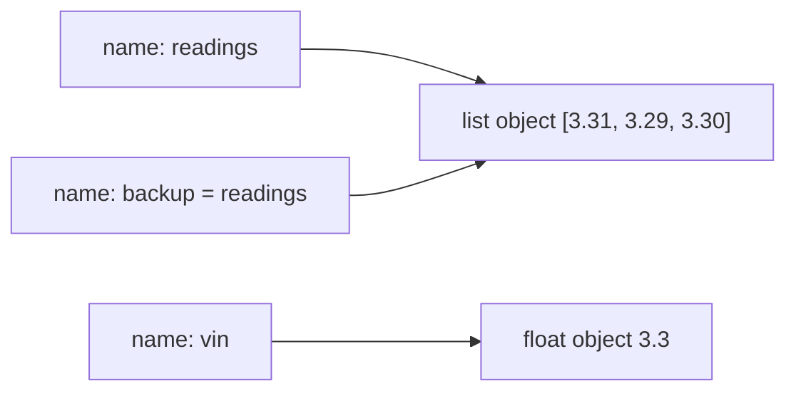

<!-- status: reviewed -->
# 05-01 · Python Fundamentals for Engineers

| | |
|---|---|
| **Course** | [05 · Programming for Engineers](../README.md) |
| **University equivalent** | Introduction to programming in Python, first half (MIT 6.0001 lectures 1–8; Downey, *Think Python*, chs. 1–11 and 14) |
| **Prerequisites** | [00-04 Toolchain Walkthrough](../../00-orientation/chapters/00-04-toolchain-walkthrough.md) (installing Python and running a notebook); algebra |
| **Estimated study hours** | 8 |
| **Last verified** | 2026-11-19 |

**Learning objectives.** After this chapter you can:

1. Run Python code in a notebook, a script and the interactive interpreter, inside a virtual environment, and explain what each does.
2. Use Python's core types (int, float, complex, bool, str, None, list, tuple, dict, set) correctly, including floor division, floating-point equality and aliasing of mutable objects.
3. Write programs with conditionals, loops and comprehensions, and functions with parameters, defaults, return values and docstrings.
4. Organize code into modules, read and write text and CSV files, and handle errors with exceptions instead of silent failures.
5. Predict the output of short programs before running them, and debug a program from its traceback.

## 1. Big picture

Every lab in this curriculum is a Python notebook, every published number is checked by a Python script, and much of an engineer's working day outside the design tools is spent in Python: pulling test data off instruments, cleaning it, fitting models, plotting results and automating the boring parts. Python is not the fastest language (C, in 05-05, is), but it is the fastest one to *think* in, and its scientific libraries hand the heavy arithmetic to compiled code. This chapter teaches the core language from zero, using engineering and finance examples, so that the next three chapters (NumPy, SciPy and plotting, testing) and every lab after them are readable.

- **Labs and verification:** the notebooks in every course and the `verify/` scripts that check this curriculum's numbers are plain Python of the kind taught here ([05-04](05-04-reproducible-workflows.md) shows how they work).
- **Test and characterization:** lab instruments are commonly scripted from Python to sweep a part across voltage and temperature and log the results.
- **Data and yield analysis:** wafer-test, reliability and field-return data are cleaned and analyzed with Python's data libraries ([05-02](05-02-numpy-and-vectorization.md), [05-03](05-03-scipy-sympy-matplotlib.md)).
- **Design flows:** electronic-design-automation tools expose scripting interfaces, and machine-learning work runs almost entirely in Python.

## 2. Intuition first

**A program is a spreadsheet you can read top to bottom.** In a spreadsheet, a cell holds a value or a formula referring to other cells, and recalculation updates everything at once. A Python program is a list of instructions run in order: `vin = 3.3` gives the *name* `vin` to the value 3.3; `vout = vin * 0.32` computes a new value from it *at that moment*. *Where the analogy breaks:* a spreadsheet recomputes dependents automatically when an input changes; Python does not. Change `vin` later and `vout` keeps its old value until you run the line that computes it again. Programs have *state* that evolves step by step, which is both their power (loops, decisions) and the source of most bugs.

**Names point at objects; they are not boxes.** In Python every value is an *object* living in memory (a number, a list, a function), and a name is a label tied to an object. Two names can be tied to the same object. For an immutable object like a number this is harmless; for a mutable one like a list, a change made through one name is visible through the other. Figure 1 shows the picture; §3.4 shows the consequences.



*Figure 1. Names are labels on objects. `backup = readings` attaches a second label to the same list; it does not copy it.*

**Exactness has limits.** Integers in Python are exact at any size. Real numbers (floats) are stored in binary with about 16 significant digits, so a decimal like 0.1 is stored as the nearest binary fraction, and tiny rounding errors appear (Figure 2). They almost never matter in engineering results, but they matter enormously for *equality tests*: never ask whether two computed floats are exactly equal.

## 3. Theory

> **Notation for this chapter.** Code appears in `monospace`. A block of code is followed, where it prints something, by a second block showing exactly what it prints; this curriculum's verify script runs every block and checks those outputs. `>>>` is not used: blocks are written as they would appear in a script or notebook cell.

### 3.1 Running Python

There are three ways to run the same code:

- **A notebook** (Jupyter, used by every lab) mixes code cells, their output and text. Cells run in the order you execute them, not the order on the page, which is convenient for exploration and dangerous for reproducibility: always finish with *Restart & Run All*.
- **A script** is a `.py` text file run from a terminal with `python analysis.py`. Scripts run top to bottom every time, which is why production code and this repository's verify scripts are scripts.
- **The interactive interpreter** (type `python` with no file) evaluates one line at a time: good for quick checks.

Python is an **interpreted** language: the `python` program reads your source, compiles the whole file to an intermediate form (bytecode) and then executes it, statement by statement. A syntax error anywhere in the file is therefore reported before anything runs, but everything else (a misspelled variable, a wrong type, a missing file) surfaces only when the offending line actually runs. There is no separate build step as in C (05-05), which makes experimenting fast.

**Virtual environments.** Projects depend on specific versions of libraries. A **virtual environment** is a private folder holding a Python interpreter and its own installed packages, so one project's upgrade cannot break another. The standard workflow, which [SETUP.md](../../../SETUP.md) follows for this repository, is:

```bash
python -m venv .venv
```

```bash
source .venv/bin/activate
```

```bash
pip install -r requirements.txt
```

The first command creates the environment, the second activates it (on Windows, `.venv\Scripts\activate`), and the third installs the libraries the project lists. A `requirements.txt` can state minimum versions (`numpy>=2.0`, as this repository's does) or exact ones (`numpy==2.5.4`, as `pip freeze` writes them); only exact versions let someone else reproduce your results bit for bit a year later, at the price of missing later fixes (05-04, Problem 05-01.16).

### 3.2 Values, types and names

Every object has a **type** that determines what you can do with it. The built-in types you will use constantly:

| Type | Example | Notes |
|---|---|---|
| `int` | `42`, `-7`, `10**30` | Exact, unlimited size |
| `float` | `3.3`, `1e-9`, `float("inf")` | IEEE 754 binary64: about 16 significant digits |
| `complex` | `3 + 4j` | `j` is the imaginary unit, as in EE ([02-01](../../02-complex-numbers-des-and-linear-algebra/chapters/02-01-complex-numbers-euler-and-phasors.md)) |
| `bool` | `True`, `False` | Results of comparisons |
| `str` | `"R1"`, `'4.7k'` | Text, immutable |
| `NoneType` | `None` | "No value" |

**Assignment binds a name to an object.** `x = 5` creates (or reuses) the integer object 5 and attaches the name `x`. Python is **dynamically typed**: the type belongs to the object, not the name, so `x = "five"` later is legal. Optional **type hints** such as `def gain(db: float) -> float:` document intent for readers and tools but do not change what runs.

```python
import math
import cmath
import sys

vin = 3.3
n_samples = 1024
z = 3 + 4j
label = "VDD_core"
print(type(vin).__name__, type(n_samples).__name__, type(z).__name__, type(label).__name__)
print(abs(z), z.real, z.imag, label.lower(), len(label))
print(int("42") + 1, float("2.5e3"), str(7) + "V")
```

```text
float int complex str
5.0 3.0 4.0 vdd_core 8
43 2500.0 7V
```

**Conversions are explicit.** `int("42")` turns text into a number; `"3" + 4` is an error (Python will not guess whether you meant 7 or "34"), and `str(7) + "V"` builds text. Reading numbers from files or user input always involves such conversions.

### 3.3 Operators and expressions

Arithmetic follows the usual precedence (`**` first, then `*`, `/`, `//`, `%`, then `+`, `-`), and parentheses override it.

- `/` is **true division** and always returns a float: `7 / 2` is `3.5`.
- `//` is **floor division**: it rounds *down* (toward −∞), so `7 // 2` is `3` but `-7 // 2` is `-4`.
- `%` is the **remainder** that goes with it, chosen so that `a == (a // b) * b + a % b` always holds; with a positive divisor it is never negative, which makes it the right tool for wrap-around indices (a ring buffer, 05-08).
- `**` is exponentiation: `2 ** 10` is 1024, `2 ** 0.5` is √2.

**Integers never overflow.** `2 ** 100` is computed exactly. This is unlike C (05-05), where overflowing a 32-bit signed `int` is undefined behavior and unsigned types wrap around modulo $2^{32}$, and it makes Python a safe place to check integer arithmetic.

**Floats are approximations.** A `float` is an IEEE 754 binary64 number: a sign, an 11-bit exponent and a 52-bit fraction, giving 53 significant bits, about 15–17 decimal digits ([R-087](../../../reference/research-log.md#r-087--python-releases-floating-point-and-developer-usage)). Decimal fractions like 0.1 have no exact binary form (just as 1/3 has no exact decimal form), so `0.1` is stored as the nearest binary fraction, and arithmetic results are rounded to the nearest representable value. The gap between 1.0 and the next larger float is **machine epsilon**, $2^{-52} \approx 2.2\times10^{-16}$; near a number $x$ the gap is about $x$ times that (Figure 2).

> **Math refresher — binary fractions.** Just as 0.375 means 3/10 + 7/100 + 5/1000, the binary 0.011 means 0/2 + 1/4 + 1/8 = 0.375. A fraction has a finite binary form only if its denominator, in lowest terms, is a power of 2. 1/10 has a factor of 5, so in binary it repeats forever (0.000110011001100…), and a float must cut it off.

The consequences, which Example 05-01.2 makes concrete:

- **Never test floats with `==`.** Use `math.isclose(a, b)` (defaults: relative tolerance $10^{-9}$, absolute tolerance 0, so it never accepts a nonzero difference from 0.0; pass `abs_tol` for values near zero) or compare `abs(a - b)` with a tolerance that means something physically (05-04 compares the common tolerance functions).
- **Rounding error accumulates** in long running sums (Figure 2, right), which is why libraries provide careful summation (`math.fsum`).
- **Subtracting nearly equal numbers loses digits** (catastrophic cancellation, [02-10](../../02-complex-numbers-des-and-linear-algebra/chapters/02-10-numerical-methods.md)).

![Left: on log-log axes, the spacing between adjacent float64 values grows in proportion to their magnitude, from about 10 to the minus 22 near one millionth to 2 at 2 to the 53, following x times 2 to the minus 52. Right: the error when adding 0.1 N times: the rounding error of the running sum rises roughly as N squared, because each rounding is proportional to the growing total, reaching about one millionth at N equals a million, well above the separate representation error of 0.1, which grows as N times 5.6 times 10 to the minus 18.](../../../assets/figures/05-01/float-spacing.svg)

*Figure 2. Left: float64 spacing grows with magnitude, so relative precision (about 16 digits) is constant. Right: in a running sum the rounding of each addition, not the representation of 0.1, dominates the error.*

**Comparisons and logic.** `==`, `!=`, `<`, `<=` return `bool`. Comparisons chain: `0 <= duty <= 1` means what it says. `and`, `or` and `not` combine conditions and **short-circuit**: in `n > 0 and total / n > 3`, the division never runs when `n` is 0.

**Libraries for math.** `math` provides real functions (`sqrt`, `log10`, `exp`, `pi`); `cmath` provides their complex versions (`cmath.polar`, `cmath.exp`). `math.sqrt(-1)` raises an error, while `cmath.sqrt(-1)` returns `1j`.

### 3.4 Collections and mutability

Four built-in collections hold many values:

- A **list**, `[3.31, 3.29, 3.30]`, is an ordered, *mutable* sequence: you can change, add and remove items.
- A **tuple**, `(1920, 1080)`, is an ordered, *immutable* sequence: good for fixed records and function results.
- A **dict**, `{"R1": 1000, "C1": 1e-9}`, maps unique *keys* to values, with fast look-up by key.
- A **set**, `{"R1", "R2"}`, holds unique items with fast membership tests.

**Indexing and slicing.** Sequences are indexed from 0; negative indices count from the end. A **slice** `s[start:stop:step]` takes items from `start` up to *but not including* `stop`, so `s[0:3]` has three items and `len(s[a:b]) == b - a`. The half-open convention avoids off-by-one errors once you are used to it.

```python
samples = [0, 7, 14, 21, 28, 35, 42]
print(samples[0], samples[-1], samples[2:5], samples[::3], len(samples))
gains = {"stage1": 20.0, "stage2": 14.5}
gains["stage3"] = 6.0
print(sum(gains.values()), "stage2" in gains, sorted(gains))
```

```text
0 42 [14, 21, 28] [0, 21, 42] 7
40.5 True ['stage1', 'stage2', 'stage3']
```

**Aliasing.** Assignment never copies. After `backup = readings`, both names refer to the *same* list (Figure 1), so appending through one name changes what the other sees. To get an independent list, copy it explicitly.

```python
readings = [3.31, 3.29]
backup = readings          # a second name for the same list
copy = list(readings)      # a new list with the same items
readings.append(3.30)
print(backup, copy, backup is readings, copy is readings)
```

```text
[3.31, 3.29, 3.3] [3.31, 3.29] True False
```

`is` asks whether two names refer to the same object; `==` asks whether two objects have equal values. Immutable objects (numbers, strings, tuples) can never change, so aliasing them is harmless; mutable ones (lists, dicts, sets) are where aliasing bites. A list of lists copied with `list()` still shares its inner lists (a *shallow* copy); `copy.deepcopy` copies all the way down.

### 3.5 Control flow

**Decisions.** `if`, `elif` and `else` choose between blocks. Python marks blocks by **indentation** (four spaces by convention), not braces: the indentation *is* the structure.

```python
def classify(vdd):
    if vdd < 0.9:
        return "brown-out"
    elif vdd <= 1.1:
        return "in range"
    else:
        return "overvoltage"

print([classify(v) for v in (0.85, 1.0, 1.2)])
```

```text
['brown-out', 'in range', 'overvoltage']
```

**Loops.** A `for` loop runs its block once for each item of any *iterable* (a list, a string, a dict's keys, a file's lines). `range(n)` produces 0, 1, …, n−1 without building a list; `enumerate` supplies an index alongside each item; `zip` walks several sequences in step. A `while` loop repeats as long as a condition holds; `break` leaves a loop early and `continue` skips to the next pass.

**Comprehensions** build a list, dict or set from a loop in one expression: `[r * 1000 for r in e12]` is a list of scaled values, and `{ref: v for ref, v in pairs if v > 0}` a filtered dict. Use them for simple transformations; write an ordinary loop when the logic needs more than one line.

```python
total = 0
for i, v in enumerate([2.5, 3.0, 2.0]):
    total += (i + 1) * v
print(total, [n * n for n in range(5) if n % 2 == 0], list(zip("abc", [1, 2, 3])))
```

```text
14.5 [0, 4, 16] [('a', 1), ('b', 2), ('c', 3)]
```

### 3.6 Functions

A **function** packages a computation behind a name so it can be reused, tested and reasoned about on its own. `def` defines one; `return` sends back a result (a function without `return` returns `None`).

```python
def divider(vin, r_top, r_bottom):
    """Output voltage of an unloaded resistive divider."""
    return vin * r_bottom / (r_top + r_bottom)

print(round(divider(5.0, 10e3, 10e3), 3), round(divider(vin=12.0, r_bottom=1e3, r_top=11e3), 3))
```

```text
2.5 1.0
```

- **Parameters** can be passed by position or by name (keyword arguments), and can have **defaults** (`def adc(v, bits=12)`). Keywords make calls self-documenting.
- The **docstring**, the string on the first line of the body, is what `help(divider)` shows. Write one for every function you keep.
- `*args` collects any number of positional arguments into a tuple; `**kwargs` collects keyword arguments into a dict.
- **Scope.** Names assigned inside a function are local to it; the function can read, but not rebind, names from the enclosing module unless declared otherwise. Functions that use only their parameters and return a result (no hidden state) are the easiest to test.
- **Functions are objects.** You can pass a function to another function, as Example 05-01.7 does with a root-finder. A `lambda` writes a one-line function inline: `lambda r: npv(r, flows)`.

**The mutable-default trap.** A default value is evaluated *once*, when the function is defined. A mutable default is therefore shared across calls:

```python
def log_bad(msg, history=[]):
    history.append(msg)
    return history

def log_good(msg, history=None):
    if history is None:
        history = []
    history.append(msg)
    return history

log_bad("a"); log_bad("b")
print(log_bad("c"), log_good("c"))
```

```text
['a', 'b', 'c'] ['c']
```

Use `None` as the default and create the list inside, as `log_good` does.

### 3.7 Modules and packages

A **module** is a `.py` file; `import` loads it once and makes its names available: `import math` then `math.pi`, or `from math import pi`. A **package** is a folder of modules. The standard library ships with many you will use: `math`, `cmath`, `statistics`, `pathlib` (file paths), `csv`, `json`, `datetime`, `random`. Third-party packages (NumPy, SciPy, Matplotlib) are installed with `pip` into the virtual environment.

Put reusable functions in your own module and import them from notebooks and scripts instead of copying code between cells. A module's top-level code runs when it is imported; code that should run only when the file is executed as a script goes under

```python
# not run
if __name__ == "__main__":
    main()
```

### 3.8 Files

Data comes from and goes to files. Open them with a `with` block, which closes the file even if an error occurs; `pathlib.Path` builds paths that work on every operating system. Text files are read line by line; the `csv` module handles comma-separated values (quoting, delimiters) correctly, so never split CSV lines by hand.

```python
from pathlib import Path

path = Path("vdd_log.txt")
path.write_text("0.98\n1.02\n1.01\n")
with path.open() as f:
    values = [float(line) for line in f]
print(values, round(sum(values) / len(values), 4))
```

```text
[0.98, 1.02, 1.01] 1.0033
```

`json` reads and writes nested dicts and lists, the usual format for configuration files and instrument settings.

### 3.9 Errors and exceptions

When something goes wrong, Python **raises an exception**: an object describing the error, which stops the program unless something handles it. The **traceback** it prints names the exception type, the message, and the chain of calls that led there, ending with the line that failed: read it from the bottom up.

- `try`/`except` catches an exception you can do something about; `else` runs if nothing was raised; `finally` always runs (for cleanup).
- `raise ValueError("…")` signals that a caller passed something invalid. Raising early with a clear message beats returning a wrong number silently.
- `assert condition, "message"` states something that must be true; it is for catching *your own* bugs during development and testing (05-04), not for validating user input.

```python
def parse_ohms(text):
    """Convert '4.7k', '220' or '1M' to ohms."""
    scale = {"k": 1e3, "M": 1e6}
    try:
        if text[-1] in scale:
            return float(text[:-1]) * scale[text[-1]]
        return float(text)
    except (ValueError, IndexError):
        raise ValueError(f"not a resistance: {text!r}") from None

for t in ("4.7k", "1M", "4k7"):
    try:
        print(parse_ohms(t))
    except ValueError as err:
        print("error:", err)
```

```text
4700.0
1000000.0
error: not a resistance: '4k7'
```

Catch specific exceptions. A bare `except:` that swallows everything hides real bugs: the most dangerous code is code that fails silently and returns plausible numbers.

**Reading a traceback.** When nothing catches an exception, Python prints the chain of calls that led to it. This four-function script (`bench.py`) computes currents from a table whose second resistor was typed in the "4k7" style:

```python
# not run
def parse_ohms(text):
    return float(text)


def current_ma(volts, r_text):
    return volts / parse_ohms(r_text) * 1e3


def report(rows):
    for volts, r_text in rows:
        print(f"{current_ma(volts, r_text):.3f} mA")


report([(5.0, "1000"), (3.3, "4k7")])
```

Running `python bench.py` with Python 3.13 prints (the full path of the file appears where `...` is shown here):

```text
5.000 mA
Traceback (most recent call last):
  File ".../bench.py", line 14, in <module>
    report([(5.0, "1000"), (3.3, "4k7")])
    ~~~~~~^^^^^^^^^^^^^^^^^^^^^^^^^^^^^^^
  File ".../bench.py", line 11, in report
    print(f"{current_ma(volts, r_text):.3f} mA")
             ~~~~~~~~~~^^^^^^^^^^^^^^^
  File ".../bench.py", line 6, in current_ma
    return volts / parse_ohms(r_text) * 1e3
                   ~~~~~~~~~~^^^^^^^^
  File ".../bench.py", line 2, in parse_ohms
    return float(text)
ValueError: could not convert string to float: '4k7'
```

Read it from the bottom up. The last line is the exception and its message: `float` cannot read `'4k7'`. The frame above it is where the exception was raised (line 2, inside `parse_ohms`), and each frame above that is the caller one level out, back to the top-level call on line 14. The `^` markers (Python 3.11 and later) point at the sub-expression being evaluated. The first row printed fine, so the data, not the formula, is at fault: the fix belongs either in the data or in a `parse_ohms` that understands the "4k7" notation, like the version above.

> **Going deeper — what an exception really is.** Exceptions are objects of classes arranged in a hierarchy (`ValueError` and `ZeroDivisionError` both derive from `Exception`), and `except ValueError` also catches its subclasses. You can define your own, for example `class CalibrationError(Exception): pass`, so callers can catch exactly your failure mode. The mechanism unwinds the call stack until a matching `except` is found; if none is, the interpreter prints the traceback and exits.

## 4. Worked examples

Every example's code is run by the verify script, and its printed output must match the block shown. The blocks of a chapter run in order as one session, like the cells of a notebook: a later block may use names defined in an earlier one, so run them in order if you type them in yourself.

### Example 05-01.1 · Arithmetic you can trust

**Setup.** (a) A 3.3 V supply feeds a divider with $R_{\text{top}}$ = 10 kΩ and $R_{\text{bottom}}$ = 4.7 kΩ; compute $V_{\text{out}} = V_{\text{in}}R_{\text{bottom}}/(R_{\text{top}} + R_{\text{bottom}})$. (b) Express 2 mW in dBm, $10\log_{10}(P/1\ \text{mW})$. (c)–(f) Evaluate `1000 // 7`, `1000 % 7`, `-7 // 2` and `-7 % 2`, and explain the last two.

**Solution.**

```python
r_top, r_bottom, vin = 10e3, 4.7e3, 3.3
vout = vin * r_bottom / (r_top + r_bottom)
p_dbm = 10 * math.log10(2.0 / 1.0)
print(f"Vout = {vout:.4f} V, P = {p_dbm:.4f} dBm")
print(1000 // 7, 1000 % 7, -7 // 2, -7 % 2)
```

```text
Vout = 1.0551 V, P = 3.0103 dBm
142 6 -4 1
```

(a) **1.0551 V**; (b) **3.0103 dBm**; (c) **142** and (d) **6**, since $142\times7 + 6 = 1000$. (e) `-7 // 2` is **−4**: floor division rounds *down*, and −3.5 rounds down to −4. (f) The remainder is then **1**, because $(-4)\times2 + 1 = -7$.

**Check.** $3.3\times4.7/14.7 = 1.0551$ ✓; doubling a power adds $10\log_{10}2 \approx 3.01$ dB ✓. In C, `-7 / 2` truncates toward zero and gives −3 (05-05): code ported between the languages must watch this.

### Example 05-01.2 · Why 0.1 + 0.2 is not 0.3

**Setup.** Print `0.1 + 0.2`, test it against 0.3 with `==` and with `math.isclose`, and find the size of the discrepancy, machine epsilon, and the exact value Python stores for 0.1.

**Solution.**

```python
from fractions import Fraction

s = 0.1 + 0.2
print(s, s == 0.3, math.isclose(s, 0.3))
print(f"{s - 0.3:.4e}", sys.float_info.epsilon == 2.0**-52, f"{sys.float_info.epsilon:.4e}")
print(Fraction(0.1))
```

```text
0.30000000000000004 False True
5.5511e-17 True 2.2204e-16
3602879701896397/36028797018963968
```

The stored 0.1 is exactly $3602879701896397/2^{55}$, slightly more than 0.1. Each of 0.1, 0.2 and 0.3 is rounded to its nearest float, and the rounded sum of the first two lands one step (**5.551×10⁻¹⁷**, one unit in the last place for numbers between 0.25 and 0.5, which is $2^{-54} = \varepsilon/4$) above the float nearest 0.3. Machine epsilon is **2.220×10⁻¹⁶**.

**Check.** The relative difference, $5.55\times10^{-17}/0.3 = 1.85\times10^{-16}$, is of the order of machine epsilon; it slightly exceeds the $2^{-53} = 1.11\times10^{-16}$ bound for a *single* rounding because three roundings (of 0.1, of 0.2 and of their sum) combine. *Engineering lesson:* compare with a tolerance. A resistor value computed two different ways may differ in the 16th digit; a test written as `==` will fail at random.

### Example 05-01.3 · Complex arithmetic for an impedance

**Setup.** Python's `j` is the engineer's imaginary unit. A 50 Ω resistor in series with a 10 nH inductor has impedance $Z = R + j\omega L$ at $\omega = 2\pi f$ (02-01 and 07-05 explain why). At $f$ = 1 GHz, find the reactance $\omega L$, $|Z|$ and the angle of $Z$ in degrees.

**Solution.**

```python
f, r, l_h = 1e9, 50.0, 10e-9
z = r + 1j * 2 * math.pi * f * l_h
mag, ang = cmath.polar(z)
print(f"Z = {z.real:.2f} + j{z.imag:.2f} ohm, |Z| = {mag:.2f} ohm, angle = {math.degrees(ang):.2f} deg")
```

```text
Z = 50.00 + j62.83 ohm, |Z| = 80.30 ohm, angle = 51.49 deg
```

$\omega L$ = **62.83 Ω**, $|Z|$ = **80.30 Ω**, angle **51.49°**.

**Check.** $|Z| = \sqrt{50^2 + 62.83^2} = \sqrt{6447.8} = 80.30$ ✓, and $\tan^{-1}(62.83/50) = 51.49°$ ✓. Note `1j`, not `j` alone: a bare `j` would be read as a variable name.

### Example 05-01.4 · A function that refuses bad input

**Setup.** Write `parallel(*resistances)` returning the equivalent resistance $1/\sum(1/R_i)$ of resistors in parallel, raising `ValueError` for an empty call or a non-positive value. Evaluate it for 100, 220 and 330 Ω, show that it rejects −5 Ω, and build the 12 values of one decade of the E12 preferred-value series (1.0, 1.2, …, 8.2) scaled to kilohms, in ohms.

**Solution.**

```python
def parallel(*resistances):
    """Equivalent resistance of resistors in parallel, in ohms."""
    if not resistances:
        raise ValueError("need at least one resistor")
    if any(r <= 0 for r in resistances):
        raise ValueError("resistances must be positive")
    return 1 / sum(1 / r for r in resistances)

print(f"{parallel(100, 220, 330):.2f} ohm")
try:
    parallel(100, -5)
except ValueError as err:
    print("rejected:", err)
e12 = [1.0, 1.2, 1.5, 1.8, 2.2, 2.7, 3.3, 3.9, 4.7, 5.6, 6.8, 8.2]
decade = [round(x * 1000) for x in e12]
print(decade[:4], len(decade))
```

```text
56.90 ohm
rejected: resistances must be positive
[1000, 1200, 1500, 1800] 12
```

The parallel combination is **56.90 Ω**, and the decade has **12** values.

**Check.** The result is below the smallest resistor (100 Ω), as any parallel combination must be ✓. *Design note:* a negative resistance would have produced a plausible-looking wrong number; raising an error turns a silent bug into an obvious one. `round(x * 1000)` rather than `int(x * 1000)` matters: `int` truncates, and products such as `8.2 * 100` (819.9999999999999) or `0.29 * 100` (28.999999999999996) land just below the integer, so `int` gives 819 and 28.

### Example 05-01.5 · A loop that answers a business question

**Setup.** A market grows 7% a year. Using a `while` loop, find the first whole year in which it has at least doubled and its multiple then; compare with the exact doubling time $\ln2/\ln1.07$ and the rule of 72.

**Solution.**

```python
growth, multiple, years = 0.07, 1.0, 0
while multiple < 2.0:
    multiple *= 1 + growth
    years += 1
print(years, round(multiple, 4), round(math.log(2) / math.log(1 + growth), 3), round(72 / 7, 3))
```

```text
11 2.1049 10.245 10.286
```

The market first doubles in year **11** (multiple **2.1049**); the exact doubling time is **10.245** years and the rule of 72 gives **10.286**.

**Check.** $1.07^{10} = 1.967 < 2 \le 1.07^{11} = 2.105$ ✓. The loop answers "in which whole year", the logarithm "after how much time": state which question you are asking.

### Example 05-01.6 · Reading measurements from a file

**Setup.** A test station writes resistor measurements to a CSV file. Write the file, read it back, and report every part more than 1% from nominal, with its error in percent.

**Solution.**

```python
import csv

rows = [("R1", 1000, 1012.0), ("R2", 1000, 993.0), ("R3", 4700, 4790.0), ("R4", 4700, 4680.0)]
with Path("measurements.csv").open("w", newline="") as f:
    writer = csv.writer(f)
    writer.writerow(["ref", "nominal_ohm", "measured_ohm"])
    writer.writerows(rows)

out_of_tolerance = {}
with Path("measurements.csv").open(newline="") as f:
    for rec in csv.DictReader(f):
        nominal, measured = float(rec["nominal_ohm"]), float(rec["measured_ohm"])
        error_pct = 100 * (measured - nominal) / nominal
        if abs(error_pct) > 1.0:
            out_of_tolerance[rec["ref"]] = round(error_pct, 2)
print(out_of_tolerance, len(out_of_tolerance))
```

```text
{'R1': 1.2, 'R3': 1.91} 2
```

**2** parts fail: R1 at **+1.20%** and R3 at **+1.91%**.

**Check.** R2 is −0.70% and R4 −0.43%, inside ±1% ✓. CSV stores text, so every number read back must be converted with `float`; forgetting this gives a `TypeError` when you subtract strings, or, worse, a wrong sort order ("1000" sorts before "993" as text).

### Example 05-01.7 · Functions as arguments: an internal rate of return

**Setup.** A project costs 1000 now and returns 300, 400 and 500 over the next three years. Its net present value at rate $r$ is $\text{NPV}(r) = \sum_t C_t/(1+r)^t$, and the internal rate of return (IRR) is the $r$ where NPV = 0. Write a general **bisection** root-finder that takes a function as an argument, and use it to find the IRR; also report the NPV at 10%.

**Solution.** Bisection keeps an interval $[lo, hi]$ on which the function changes sign and halves it until it is shorter than a tolerance: each step keeps the half where the sign change is.

```python
def npv(rate, cashflows):
    return sum(c / (1 + rate) ** t for t, c in enumerate(cashflows))

def bisect(f, lo, hi, tol=1e-10):
    """Root of f in [lo, hi], where f(lo) and f(hi) have opposite signs."""
    f_lo = f(lo)
    if f_lo * f(hi) > 0:
        raise ValueError("root not bracketed")
    steps = 0
    while hi - lo > tol:
        mid = (lo + hi) / 2
        f_mid = f(mid)
        if f_lo * f_mid <= 0:
            hi = mid
        else:
            lo, f_lo = mid, f_mid
        steps += 1
    return (lo + hi) / 2, steps

flows = [-1000, 300, 400, 500]
irr, steps = bisect(lambda r: npv(r, flows), 0.0, 1.0)
print(f"IRR = {irr:.4%} after {steps} halvings; NPV at 10% = {npv(0.10, flows):.2f}")
```

```text
IRR = 8.8963% after 34 halvings; NPV at 10% = -21.04
```

IRR = **8.8963%** after **34** halvings; NPV at 10% = **−21.04**.

**Check.** NPV is negative at 10%, above the IRR, as it must be when the IRR is 8.90% ✓. Each halving shrinks the interval by 2, so reaching $10^{-10}$ from width 1 takes $\lceil\log_2 10^{10}\rceil = 34$ steps ✓. The same `bisect` will later find a diode's operating point or a filter's corner frequency: the function is the argument.

### Answer key

<!-- answer-key -->
| ID | Quantity | Value | Unit |
|---|---|---|---|
| Ex 05-01.1a | divider output | 1.0551 | V |
| Ex 05-01.1b | 2 mW in dBm | 3.0103 | dBm |
| Ex 05-01.1c | 1000 // 7 | 142 | — |
| Ex 05-01.1d | 1000 % 7 | 6 | — |
| Ex 05-01.1e | −7 // 2 | −4 | — |
| Ex 05-01.1f | −7 % 2 | 1 | — |
| Ex 05-01.2a | 0.1 + 0.2 − 0.3 | 5.551×10^-17 | — |
| Ex 05-01.2b | machine epsilon | 2.220×10^-16 | — |
| Ex 05-01.3a | reactance ωL | 62.83 | Ω |
| Ex 05-01.3b | impedance magnitude | 80.30 | Ω |
| Ex 05-01.3c | impedance angle | 51.49 | ° |
| Ex 05-01.4a | 100 ∥ 220 ∥ 330 Ω | 56.90 | Ω |
| Ex 05-01.4b | values in an E12 decade | 12 | — |
| Ex 05-01.5a | first year at double | 11 | years |
| Ex 05-01.5b | multiple in that year | 2.1049 | — |
| Ex 05-01.5c | exact doubling time | 10.245 | years |
| Ex 05-01.5d | rule-of-72 estimate | 10.286 | years |
| Ex 05-01.6a | parts out of tolerance | 2 | — |
| Ex 05-01.6b | R1 error | 1.20 | % |
| Ex 05-01.6c | R3 error | 1.91 | % |
| Ex 05-01.7a | internal rate of return | 8.8963 | % |
| Ex 05-01.7b | bisection halvings | 34 | — |
| Ex 05-01.7c | NPV at 10% | −21.04 | — |

## 5. Simulate it

The lab ([labs/05-01-lab/](../labs/05-01-lab/README.md)) is a notebook in five parts, each with a *predict, then run* step:

1. **Predict the output:** twenty short expressions (division, slicing, `is` against `==`, string methods). Write your answer for each before running.
2. **Floats under the microscope:** add 0.1 a million times, compare with `math.fsum`, and find the smallest power of two `x` for which `1.0 + x != 1.0`.
3. **Aliasing:** build a 3 × 3 grid the wrong way (`[[0] * 3] * 3`) and the right way, and see why one change appears in every row.
4. **A resistor color-code decoder:** write it as a function with input validation and test it with `assert` statements.
5. **Timing:** compare a Python loop, the built-in `sum` and a comprehension on a million numbers with `time.perf_counter`, and predict the ranking.

## 6. Engineering tradeoffs

| Knob | Improves | Costs | Typical decision owner |
|---|---|---|---|
| Python versus a compiled language (C) | Development speed, readability, rich libraries | Raw speed of pure-Python loops; run-time rather than compile-time errors | Team lead or architect |
| Notebook versus script | Exploration, plots beside code, teaching | Hidden state from out-of-order execution; harder to test and review | Individual engineer, with team conventions |
| Type hints and checkers | Catch mistakes before running; self-documenting code | Extra writing; no effect at run time | Team conventions |
| Pinning library versions | Reproducible results months later | Missing fixes and features; deliberate upgrade work | Project owner |
| Raising exceptions versus returning error values | Errors cannot be ignored silently | Callers must handle them; more code paths | Library author |
| Exact types (int, `Fraction`, `Decimal`) versus float | No rounding surprises | Much slower; only some operations available | Whoever owns the numerical result (finance code often uses `Decimal`) |

## 7. Numbers to know

| Quantity | Value | Note |
|---|---|---|
| Current Python feature release, as of Nov 2026 | 3.15 (released 9 Oct 2026) | New release every October, supported 5 years ([R-087](../../../reference/research-log.md#r-087--python-releases-floating-point-and-developer-usage)) |
| float64 precision | 53 significant bits ≈ 15–17 decimal digits | IEEE 754-2019 binary64 |
| Machine epsilon | $2^{-52} \approx 2.22\times10^{-16}$ | Gap from 1.0 to the next float |
| Largest float | ≈ 1.8×10³⁰⁸ | Beyond it, float arithmetic gives `inf`; `2.0 ** 1024` and `math.exp(1000)` raise `OverflowError` |
| Integers that floats store exactly | up to $2^{53} \approx 9.0\times10^{15}$ | Above that, gaps exceed 1 |
| Python's `int` | unlimited size | Contrast: C's `int32_t` overflows (undefined behavior) above about 2.1×10⁹ (05-05) |
| Developers using Python (self-selected survey, 2026) | 58% of those answering the language question | Stack Overflow ([R-087](../../../reference/research-log.md#r-087--python-releases-floating-point-and-developer-usage)) |

## 8. Common mistakes

1. **Testing floats with `==`.** Use `math.isclose` or an explicit tolerance.
2. **Assuming assignment copies.** `b = a` makes a second name for the same list; use `list(a)` or `copy.deepcopy(a)`.
3. **Mutable default arguments.** `def f(x, acc=[])` shares one list across calls; default to `None`.
4. **Off-by-one with ranges and slices.** `range(1, 10)` stops at 9; `s[2:5]` has three items.
5. **Floor division with negatives.** `-7 // 2` is −4 in Python (and −3 in C).
6. **Forgetting conversions.** Text read from files must be converted with `int` or `float` before arithmetic or numeric sorting.
7. **Bare `except:` clauses** that hide real errors and let a program continue with wrong data.
8. **Shadowing built-in names.** Naming a variable `list`, `sum` or `max` breaks those functions for the rest of the program.
9. **Trusting notebook state.** A notebook that works only when cells run in a particular order is not reproducible: restart and run all before believing it.

## 9. Practitioner lens

### State of the art (as of Nov 2026)

- **Releases.** Python 3.15.0 was released on 9 October 2026 and 3.15.2 later that month. Under PEP 602, a new feature release arrives every October and gets two years of bug fixes and three more of security fixes; a proposal to switch to calendar version numbers was rejected, so the next release is 3.16 ([R-087](../../../reference/research-log.md#r-087--python-releases-floating-point-and-developer-usage)) **[Established]**.
- **The global interpreter lock (GIL).** Standard CPython lets only one thread execute Python code at a time. A "free-threaded" build without the lock became officially supported but optional in 3.14, with a single-thread speed penalty its developers put at roughly 5–10%; no decision had been made to make it the default ([R-087](../../../reference/research-log.md#r-087--python-releases-floating-point-and-developer-usage)) **[Established for status; Industry estimate for the penalty]**.
- **Usage.** In Stack Overflow's 2026 survey (self-selected respondents), 58.0% reported doing extensive work in Python, against 21.8% for C and 24.3% for C++; Python adoption jumped 7 points between the 2024 and 2025 surveys ([R-087](../../../reference/research-log.md#r-087--python-releases-floating-point-and-developer-usage)) **[Industry estimate]**.
- **Floating point.** IEEE 754-2019 is the active floating-point standard; Python's `float` is its binary64 format with 53 significant bits ([R-087](../../../reference/research-log.md#r-087--python-releases-floating-point-and-developer-usage)) **[Established]**.

### Why it matters commercially

Python is the glue of modern engineering organizations: characterization benches, yield-analysis pipelines, design-flow automation and essentially all machine-learning work run on it. Two consequences matter for an investor or acquirer. First, an engineering team's Python practices (pinned environments, tests, code review) determine whether its analyses are reproducible, and therefore whether the numbers in a data room can be trusted. Second, Python's speed limits are real but usually irrelevant, because heavy computation runs inside compiled libraries (05-02); a team rewriting working Python in C "for speed" without profiling first is spending money on the wrong problem.

### Marketing vs Reality

- **"Our analysis is fully automated in Python."** *Reality:* automation without pinned versions and tests can quietly change results when a library upgrades. NumPy 2.0 (June 2024), for example, changed how mixed-precision arithmetic is promoted, which can change output types and precision ([R-087](../../../reference/research-log.md#r-087--python-releases-floating-point-and-developer-usage)). Ask how environments are pinned and how results are regression-tested.
- **"Python is too slow for our workload."** *Reality:* pure-Python loops are slow; vectorized NumPy and compiled extensions often run within a small factor of C. Ask where the time is actually spent (profiling data), not which language is used.
- **"Free-threading makes Python multicore."** *Reality:* it is optional, carries a single-thread penalty, and needs thread-safe libraries; most numerical code already parallelizes inside compiled libraries. Ask what fraction of run time is in Python code at all.

### Questions for engineering leaders

1. **"Can someone outside your team rerun last quarter's yield analysis and get the same numbers?"** *Strong:* pinned environment files, version control, tests on known data, a documented run command. *Evasive:* "the notebook is on the shared drive".
2. **"How do you test your data-processing code?"** *Strong:* unit tests for parsing and calculations, checks against hand-computed cases, continuous integration (05-04). *Evasive:* "we look at the plots".
3. **"Which Python versions do you run in production, and when do they reach end of life?"** *Strong:* a supported version and an upgrade plan (3.10 reached end of life in October 2026). *Evasive:* "whatever is on the server".
4. **"When your scripts meet bad data, what happens?"** *Strong:* validation that raises clear errors and logs rejected records. *Evasive:* "it skips them" (silently).

## 10. Concept check

1. What do `7 / 2`, `7 // 2` and `-7 // 2` return, and why?

   <details><summary>Answer</summary>

   `3.5` (true division always gives a float), `3` and `-4` (floor division rounds toward −∞).

   </details>

2. Why does `0.1 + 0.2 == 0.3` evaluate to `False`, and what should you write instead?

   <details><summary>Answer</summary>

   0.1, 0.2 and 0.3 are each rounded to the nearest binary float, and the rounded sum of the first two differs from the float nearest 0.3 by one step (5.55×10⁻¹⁷). Use `math.isclose(0.1 + 0.2, 0.3)` or compare the difference with a tolerance.

   </details>

3. After `a = [1, 2]; b = a; b.append(3)`, what is `a`? How do you avoid this?

   <details><summary>Answer</summary>

   `[1, 2, 3]`: `b` is another name for the same list. Copy explicitly, `b = list(a)` (or `copy.deepcopy` for nested data).

   </details>

4. Why is `def f(x, items=[])` a bug?

   <details><summary>Answer</summary>

   The default list is created once, when the function is defined, and shared by every call that uses the default, so items accumulate across calls. Use `items=None` and create a new list inside.

   </details>

5. What is a virtual environment for?

   <details><summary>Answer</summary>

   It gives a project its own interpreter and installed packages, so library versions can be pinned per project and one project's upgrade cannot break another, making results reproducible.

   </details>

6. When should a function raise an exception rather than return a value?

   <details><summary>Answer</summary>

   When it cannot produce a correct result (invalid input, missing data). Raising stops the program or forces the caller to handle the problem, instead of letting a plausible but wrong number flow on.

   </details>

7. Why does Python's `int` never overflow, while a float loses exactness above about 9×10¹⁵?

   <details><summary>Answer</summary>

   `int` grows its storage as needed. A float has a fixed 53-bit significand, so above $2^{53}$ consecutive integers can no longer all be represented.

   </details>

Problem set: [05-01 problems](../problems/05-01-problems.md) · [solutions](../solutions/05-01-solutions.md).

## 11. Key terms

[Interpreter](../../../reference/glossary.md#interpreter) ·
[Virtual environment](../../../reference/glossary.md#virtual-environment) ·
[Dynamic typing](../../../reference/glossary.md#dynamic-typing) ·
[Floor division](../../../reference/glossary.md#floor-division) ·
[Floating-point number](../../../reference/glossary.md#floating-point-number) ·
[Machine epsilon](../../../reference/glossary.md#machine-epsilon) ·
[Mutable object](../../../reference/glossary.md#mutable-object) ·
[Aliasing (programming)](../../../reference/glossary.md#aliasing-programming) ·
[List comprehension](../../../reference/glossary.md#list-comprehension) ·
[Exception](../../../reference/glossary.md#exception) ·
[Traceback](../../../reference/glossary.md#traceback) ·
[Module (Python)](../../../reference/glossary.md#module-python)

## 12. Connections

- **Previous:** [00-04](../../00-orientation/chapters/00-04-toolchain-walkthrough.md) (installing the toolchain and opening a notebook).
- **Next:** [05-02 NumPy, Vectorization and Numerical Computing](05-02-numpy-and-vectorization.md): arrays that make numerical Python fast.
- **Used in:** every lab notebook from [02-01](../../02-complex-numbers-des-and-linear-algebra/chapters/02-01-complex-numbers-euler-and-phasors.md) onward; [05-04](05-04-reproducible-workflows.md) (testing and the verify scripts); [02-10](../../02-complex-numbers-des-and-linear-algebra/chapters/02-10-numerical-methods.md) (root-finding and rounding error); [05-05](05-05-c-fundamentals.md) and [05-07](05-07-bit-manipulation.md) (C's different integer rules).

## 13. Further study

- Downey, A. B., *Think Python*, 2nd or 3rd ed., Green Tea Press / O'Reilly (free online), chapters 1–11 and 14.
- The official Python Tutorial, docs.python.org, sections 3–9, especially §15, "Floating-Point Arithmetic: Issues and Limitations".
- MIT OpenCourseWare 6.0001, *Introduction to Computer Science and Programming in Python*, lectures 1–8.

## 14. Sources

1. Downey, A. B., *Think Python*, Green Tea Press.
2. Python Software Foundation, *The Python Tutorial* and *The Python Standard Library* (docs.python.org, version 3.15). [R-087]
3. Langa, Ł., PEP 602, "Annual Release Cycle for Python"; python.org downloads and the Python Developer's Guide, "Status of Python versions". [R-087]
4. PEP 703 and PEP 779 (free-threaded CPython); "What's New in Python 3.14". [R-087]
5. IEEE 754-2019, *IEEE Standard for Floating-Point Arithmetic* (IEEE SA standard page). [R-087]
6. Stack Overflow Developer Surveys 2025 and 2026. [R-087]
7. NumPy 2.0.0 release notes and NEP 50. [R-087]
