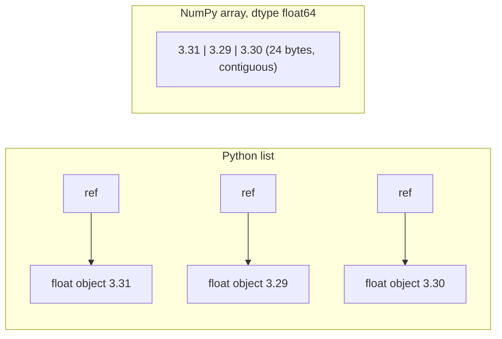

<!-- status: verified -->
# 05-02 · NumPy, Vectorization and Numerical Computing

| | |
|---|---|
| **Course** | [05 · Programming for Engineers](../README.md) |
| **University equivalent** | Scientific computing with Python, first weeks (VanderPlas, *Python Data Science Handbook*, ch. 2; MIT 6.0002's numerical lectures); floating-point arithmetic as taught in an introductory numerical-methods course |
| **Prerequisites** | [05-01 Python Fundamentals for Engineers](05-01-python-fundamentals.md) |
| **Estimated study hours** | 8 |
| **Last verified** | 2026-11-18 |

**Learning objectives.** After this chapter you can:

1. Create NumPy arrays of a chosen type and shape, and explain why array operations are much faster than Python loops.
2. Apply elementwise operations, aggregations along an axis and broadcasting to compute whole tables of results without loops.
3. Select data with slices, boolean masks and index arrays, and predict when the result is a view or a copy.
4. Choose integer and floating-point types deliberately, and predict overflow, rounding, NaN propagation and type-promotion results.
5. Recognize and repair catastrophic cancellation, and use complex arrays and least-squares fits for simple engineering data.

## 1. Big picture

A Python loop handles one number at a time, and each step pays the interpreter's overhead. **NumPy** stores numbers in compact, typed blocks of memory and runs whole-array operations in compiled code, typically tens to hundreds of times faster. Nearly every scientific Python library (SciPy, pandas, Matplotlib, machine-learning frameworks) is built on NumPy arrays, so learning to "think in arrays" is learning the working language of numerical engineering. This chapter also goes deeper into floating point, because once you compute with millions of numbers, its rounding, overflow and special values stop being curiosities.

- **Signals:** a sampled waveform is an array; filtering, spectra and statistics are array operations (Courses [11](../../11-signals-and-systems/README.md) and [16](../../16-digital-signal-processing/README.md)).
- **Test data:** a wafer map or a parametric test log is a 2-D array; yield is a boolean mask and a sum.
- **Simulation:** circuit and device simulators reduce to matrix equations solved by array libraries.
- **AI hardware:** the low-precision number formats that dominate AI accelerators are the same floating-point idea with fewer bits ([R-056](../../../reference/research-log.md#r-056--low-precision-floating-point-formats)).

## 2. Intuition first

**An array is a spreadsheet column with one formula.** In a spreadsheet you write a formula once and fill it down a whole column. NumPy works the same way: `v = vin * rb / (rt + rb)` applied to arrays computes every row at once. This is **vectorization**: writing the computation for whole arrays and letting compiled code do the looping. *Where the analogy breaks:* every element of an array has the same type, fixed when it is created (all 64-bit floats, say), and an array's size is fixed. A spreadsheet column happily mixes text and numbers; an array refuses, which is exactly what makes it fast.

**Why it is fast.** A Python list holds *references* to separate number objects scattered around memory, each carrying its type and bookkeeping. A NumPy array holds the raw numbers back to back, like a C array (05-06). An operation on it is one call into compiled code that streams through memory, so the interpreter's overhead is paid once per array instead of once per element.



*Figure 1. A list stores references to objects; an array stores raw values contiguously.*

**Broadcasting is "repeat to fit".** Add a column of 12 values to a row of 12 values and NumPy produces the full 12 × 12 table, as if each had been copied to match the other, without actually copying. Whole design tables (every resistor pair, every frequency) become one line of code.

## 3. Theory

> **Notation for this chapter.** `np` is the conventional name for NumPy (`import numpy as np`). An array's **shape** is its size along each axis, e.g. `(12, 12)`; its **dtype** is the element type. Code blocks are run by the verify script and their outputs checked, as in 05-01. Printed arrays use NumPy 2's formatting.

### 3.1 Creating arrays

```python
import math
import numpy as np

a = np.array([3.31, 3.29, 3.30])
print(a, a.dtype, a.shape, a.nbytes)
print(np.arange(0, 10, 2), np.linspace(0, 1, 5), np.zeros((2, 3)).shape)
rng = np.random.default_rng(2026)          # a seeded generator: the same numbers every run
print(rng.integers(0, 10, size=5), rng.random(2).round(4))
```

```text
[3.31 3.29 3.3 ] float64 (3,) 24
[0 2 4 6 8] [0.   0.25 0.5  0.75 1.  ] (2, 3)
[8 1 0 6 3] [0.3705 0.3549]
```

- `np.array` converts a list; `np.arange(start, stop, step)` is the array version of `range` (stop excluded); `np.linspace(a, b, n)` gives `n` evenly spaced points *including* both ends, which is usually what you want for floats.
- `np.zeros`, `np.ones` and `np.full` create arrays of a given shape.
- **Random numbers** come from a `Generator` created with `np.random.default_rng(seed)`. Seeding makes a simulation reproducible: the same seed gives the same numbers on every machine, which is how this curriculum's labs produce checkable results.

### 3.2 Types: dtypes and what they can hold

Every array has one **dtype**. The common ones:

| dtype | Bits | Range or precision | Typical use |
|---|---|---|---|
| `int8`, `uint8` | 8 | −128…127; 0…255 | Image pixels, ADC samples, raw bytes |
| `int32`, `int64` | 32, 64 | about ±2.1×10⁹; ±9.2×10¹⁸ | Counts, indices |
| `float32` | 32 | 24 significant bits, about 7 digits | Graphics, AI, large data sets |
| `float64` | 64 | 53 significant bits, about 16 digits | Default for science and engineering |
| `complex128` | 128 | two float64s | Phasors, spectra |
| `bool` | 8 | `True`/`False` | Masks, pass/fail |

**Fixed-size integers wrap around.** Python's own `int` never overflows (05-01), but an array element has a fixed number of bits, so arithmetic beyond its range wraps modulo $2^n$, usually without an error: 200 + 100 in `uint8` is $300 - 256 = 44$. This is the behavior of C and of hardware (05-07), and it is the classic way image-processing code produces garbage. Convert to a wider type first (`a.astype(np.int16)`).

**Type promotion.** When an operation mixes dtypes, NumPy picks the result's dtype from the operands' dtypes. Since NumPy 2.0 (rules known as NEP 50), a plain Python number is "weak": it adapts to the array's dtype rather than widening it. So `np.float32` data plus the Python float `0.1` stays `float32`, and `uint8` data plus the Python int `100` stays `uint8` (and can overflow). Before 2.0 the result could depend on the *values* involved, a source of surprises; the change also means old code can give different dtypes and precision after an upgrade ([R-087](../../../reference/research-log.md#r-087--python-releases-floating-point-and-developer-usage)).

### 3.3 Elementwise operations and aggregations

Arithmetic operators and the functions in NumPy (`np.sin`, `np.exp`, `np.log10`, `np.abs`, …) act **elementwise**: on every element independently, returning an array of the same shape. These compiled elementwise functions are called **ufuncs** (universal functions). **Aggregations** (`sum`, `mean`, `std`, `max`, `argmax`) reduce an array to one value, or, with `axis=`, reduce along one axis of a multidimensional array: `table.mean(axis=0)` averages each column.

```python
fs, f0 = 48_000, 1_000                    # sample rate and tone frequency, Hz
t = np.arange(480) / fs                   # 10 ms of sample times
v = np.sin(2 * np.pi * f0 * t)            # 1 V amplitude sine, all 480 samples at once
print(v.size, round(float(np.sqrt(np.mean(v ** 2))), 4), float(v.max()), abs(float(v.mean())) < 1e-15)
table = np.arange(12).reshape(3, 4)
print(table.sum(), table.sum(axis=0), table.sum(axis=1))
```

```text
480 0.7071 1.0 True
66 [12 15 18 21] [ 6 22 38]
```

The root-mean-square value of the sine, $\sqrt{\overline{v^2}}$, is $1/\sqrt2$ of its amplitude, computed here without a loop (Example 05-02.1 interprets it).

> **Math refresher — the sine wave.** A sinusoid of amplitude $A$ and frequency $f$ is $v(t) = A\sin(2\pi ft)$: it repeats every $1/f$ seconds and swings between $-A$ and $+A$. Sampling it at rate $f_s$ means evaluating it at $t = n/f_s$ for $n = 0, 1, 2, \dots$, which is exactly the array `np.arange(N) / fs`. Course 02 and Course 11 develop sinusoids fully.

### 3.4 Shapes and broadcasting

An array's shape can be changed without copying data with `reshape`, and a new axis of length 1 inserted with `None` (or `np.newaxis`): a 1-D array `x` of shape `(12,)` becomes a column with `x[:, None]` (shape `(12, 1)`) or a row with `x[None, :]` (shape `(1, 12)`).

**Broadcasting rules.** To combine two arrays elementwise, NumPy compares their shapes from the *last* axis backwards. Two sizes are compatible if they are equal or one of them is 1; a size-1 axis is stretched (without copying) to match. Missing leading axes count as 1. So `(12, 1)` with `(1, 12)` gives `(12, 12)`, `(3, 4)` with `(4,)` gives `(3, 4)`, and `(3, 4)` with `(3,)` is an error (4 and 3 are incompatible).

```python
col = np.array([1.0, 2.0, 3.0])[:, None]     # shape (3, 1)
row = np.array([10.0, 20.0])[None, :]        # shape (1, 2)
print((col * row).shape)
print(col * row)
try:
    np.ones((3, 4)) + np.ones(3)
except ValueError as err:
    print("ValueError:", str(err).split(":")[0])
```

```text
(3, 2)
[[10. 20.]
 [20. 40.]
 [30. 60.]]
ValueError: operands could not be broadcast together with shapes (3,4) (3,)
```

Broadcasting turns design-space exploration into single expressions: every combination of two component values (Example 05-02.2), every frequency at every temperature, every die at every test condition.

### 3.5 Indexing: views, copies and masks

Arrays index like lists (from 0, with slices), with one index per axis: `table[1, 2]`, `table[:, 0]` (first column), `table[::2]` (every other row).

**Slices are views.** A basic slice does not copy: it returns a **view** onto the same memory, so writing through the view changes the original. This is fast (decimating a long recording by `x[::4]` costs nothing) but is the array version of 05-01's aliasing. Use `.copy()` when you need independence; `np.shares_memory(a, b)` tells you whether two arrays overlap.

**Boolean masks select by condition.** A comparison on an array gives a `bool` array of the same shape (a **mask**); indexing with it selects the elements where the mask is `True`. Combine masks with `&` (and), `|` (or) and `~` (not), with parentheses because of operator precedence. `mask.sum()` counts `True` values and `mask.mean()` gives the fraction: one line for a yield calculation. **Index arrays** (`x[[0, 3, 7]]`) select specific positions. Both mask and index-array selection return **copies**.

```python
x = np.arange(10.0)
every_other = x[::2]                 # a view
every_other[0] = 99.0                # also changes x[0]
picked = x[x > 5]                    # a copy, selected by a mask
picked[0] = -1.0                     # does not change x
print(x[:3], np.shares_memory(x, every_other), np.shares_memory(x, picked), picked)
```

```text
[99.  1.  2.] True False [-1.  6.  7.  8.  9.]
```

### 3.6 Floating point, in depth

05-01 introduced the float. With arrays you meet all of its corners, so here is the full picture.

**The format.** An IEEE 754 binary64 number stores a sign bit $s$, an 11-bit exponent $e$ and a 52-bit fraction $f$, and (for normal numbers) represents

$$
x = (-1)^s \times 1.f_2 \times 2^{\,e - 1023},
$$

where $1.f_2$ is the binary number "1." followed by the 52 fraction bits. The implicit leading 1 gives 53 significant bits. `float32` has 1 + 8 + 23 bits (24 significant), and the 16-bit formats used in AI have fewer still: IEEE binary16 has 5 exponent and 10 fraction bits, and bfloat16 keeps float32's 8-bit exponent with only 7 fraction bits ([R-056](../../../reference/research-log.md#r-056--low-precision-floating-point-formats)).

**Relative precision is constant.** Every number is rounded to the nearest representable value, so the relative error of one rounding is at most half of machine epsilon, $\varepsilon/2$: $2^{-53}\approx1.1\times10^{-16}$ for float64 and $2^{-24}\approx6\times10^{-8}$ for float32. A float32 cannot distinguish 16,777,216 from 16,777,217: integers are exact only up to $2^{24}$.

**Special values.** Operations that overflow the largest float (about $1.8\times10^{308}$) give `inf`; $0/0$, $\infty - \infty$ and similar give `nan` ("not a number"). NumPy issues a warning rather than an error, and NaN *propagates*: any arithmetic with a NaN gives NaN, and every comparison with NaN, even `nan == nan`, is `False`. One missing reading stored as NaN turns a whole `mean` into NaN; `np.nanmean` and `np.isnan` exist for that reason. Values too small to represent normally become **subnormal** (losing precision gradually) and then 0 (**underflow**).

**Catastrophic cancellation.** Subtracting two nearly equal numbers cancels their leading digits, leaving the rounding errors as a large share of what remains. For example $1 - \cos x$ for small $x$: $\cos(10^{-8})$ rounds to exactly 1.0 in float64, so the subtraction gives 0, although the true value is $5\times10^{-17}$. The cure is algebra: rewrite the expression so it does not subtract nearly equal quantities. Here $1 - \cos x = 2\sin^2(x/2)$ exactly, and the right side is computed accurately for any $x$ (Example 05-02.6). Variance formulas, small differences of large measurements and quadratic-formula roots all have stable rewrites; Course 02's numerical-methods chapter ([02-10](../../02-complex-numbers-des-and-linear-algebra/chapters/02-10-numerical-methods.md)) collects them.

**Summation.** `np.sum` adds in a tree (pairwise) rather than strictly left to right, so its rounding error grows roughly like $\log_2 n$ rather than $n$, which is why it is more accurate than a Python loop on long float32 arrays (the lab measures this). `math.fsum` is exact to the last bit but slow.

> **Going deeper — why pairwise summation helps.** In a running sum, every addition adds a rounding error proportional to the *running total*, so $n$ additions accumulate up to about $n\varepsilon$ relative error. Pairwise summation adds numbers in pairs, then the pair sums in pairs, and so on: each original number passes through only $\log_2n$ additions, so the bound becomes about $\varepsilon\log_2n$. For $n = 10^6$ that is $20\varepsilon$ instead of $10^6\varepsilon$.

### 3.7 Complex arrays and a first look at linear algebra

Arrays can be complex: `np.exp(1j * phi)` gives unit phasors for a whole array of angles, `np.abs` and `np.angle` give magnitudes and phases, and impedance sweeps over a frequency array are one expression. The `@` operator multiplies matrices, `np.linalg.solve(A, b)` solves the linear system $A\mathbf x = \mathbf b$, and `np.polyfit(x, y, 1)` fits a straight line by least squares (Example 05-02.7). Course 02 ([02-06](../../02-complex-numbers-des-and-linear-algebra/chapters/02-06-vectors-matrices-and-linear-systems.md)) explains the mathematics; here they are tools.

> **Going deeper — memory layout and strides.** A 2-D array is stored as one flat block. Its **strides** record how many bytes to skip to move one step along each axis: for a 3 × 4 float64 array in the default row-major ("C") order, 32 bytes per row and 8 per column. Transposing or slicing with a step just changes the strides, which is why those operations are free views. Code that walks memory in stride order runs faster because it uses the processor's caches well (Course 14).

## 4. Worked examples

### Example 05-02.1 · A sampled sine wave

**Setup.** A 1 kHz, 1 V-amplitude sine is sampled at 48 kHz for 10 ms. Using arrays, find the number of samples, the RMS value, the peak and the mean, and say what the RMS means.

**Solution.**

```python
n = int(10e-3 * 48_000)
samples = np.sin(2 * np.pi * 1_000 * np.arange(n) / 48_000)
rms = float(np.sqrt(np.mean(samples ** 2)))
print(n, f"{rms:.4f}", f"{1 / math.sqrt(2):.4f}", f"{samples.max():.4f}", f"{abs(samples.mean()):.1e}")
```

```text
480 0.7071 0.7071 1.0000 2.8e-16
```

There are **480** samples; the RMS is **0.7071 V**, equal to $1/\sqrt2$ times the amplitude, and the peak is 1 V. The mean is zero to within rounding because 10 ms holds exactly 10 whole periods.

**Check.** RMS is the DC voltage that would deliver the same average power to a resistor, which is why mains and audio levels are quoted as RMS (Course 07). If the window held a fraction of a period, the mean would not vanish: sampling whole periods matters (Course 16).

### Example 05-02.2 · A design table by broadcasting

**Setup.** From a 3.3 V supply you need 1.2 V from an unloaded divider, using one E12 value in the 10 kΩ decade (10 k, 12 k, …, 82 k) for each resistor. Compute all 144 combinations at once, count those within 1% of 1.2 V, and find the best pair.

**Solution.**

```python
e12 = np.array([1.0, 1.2, 1.5, 1.8, 2.2, 2.7, 3.3, 3.9, 4.7, 5.6, 6.8, 8.2]) * 10e3
r_top, r_bottom = e12[:, None], e12[None, :]            # shapes (12, 1) and (1, 12)
vout = 3.3 * r_bottom / (r_top + r_bottom)              # broadcast to (12, 12)
rel_err = np.abs(vout - 1.2) / 1.2
i, j = np.unravel_index(np.argmin(rel_err), rel_err.shape)
print(vout.shape, int((rel_err < 0.01).sum()))
print(f"best: top {e12[i]:.0f}, bottom {e12[j]:.0f}, Vout {vout[i, j]:.4f} V, error {100 * rel_err[i, j]:.3f}%")
```

```text
(12, 12) 4
best: top 82000, bottom 47000, Vout 1.2023 V, error 0.194%
```

**4** of the 144 pairs land within 1%, and the best is 82 kΩ over 47 kΩ, giving **1.2023 V**, **0.194%** high.

**Check.** The ideal ratio $R_b/(R_t + R_b) = 1.2/3.3 = 0.3636$ needs $R_t/R_b = 1.75$; 82/47 = 1.745 is the closest E12 ratio ✓. `np.argmin` returns a position in the flattened array, and `np.unravel_index` converts it back to a (row, column) pair.

### Example 05-02.3 · Yield with a boolean mask

**Setup.** A reference-voltage output is normally distributed with mean 1.000 V and standard deviation 20 mV. Simulate 10,000 parts with the seeded generator `default_rng(2026)`, count the parts outside 1.000 V ± 3%, and compare the fraction with the theoretical $2Q(1.5)$ of 03-02.

**Solution.**

```python
from statistics import NormalDist

rng = np.random.default_rng(2026)
vref = rng.normal(loc=1.000, scale=0.020, size=10_000)
fail = (vref < 0.97) | (vref > 1.03)
theory = 2 * (1 - NormalDist().cdf(1.5))
print(int(fail.sum()), f"{fail.mean():.4f}", f"{theory:.4f}", f"{vref[~fail].std():.4f}")
```

```text
1326 0.1326 0.1336 0.0151
```

**1326** parts fail, a fraction of **0.1326**, against the theoretical **0.1336**.

**Check.** The limits are 1.5 standard deviations from the mean, so $2Q(1.5)$ applies ✓. With 10,000 parts the sampling standard error of a fraction near 0.13 is $\sqrt{0.13\times0.87/10^4} \approx 0.0034$, so the 0.0010 difference is well within chance (03-05). The passing parts have a smaller standard deviation than 20 mV, because the mask cut off the tails.

### Example 05-02.4 · When the type is too small

**Setup.** (a) Two 8-bit image pixels hold 200 and 250; add 100 to each, first in `uint8` and then after converting to `int16`. (b) Store 16,777,217 in `float32`. (c) Add 1e-8 to 1.0 in `float32` and in `float64`.

**Solution.**

```python
pixels = np.array([200, 250], dtype=np.uint8)
print(pixels + 100, pixels.astype(np.int16) + 100)
print(f"{np.float32(16_777_217):.1f}", float(np.float32(16_777_217)) == 16_777_216.0)
print(np.float32(1.0) + 1e-8 == np.float32(1.0), 1.0 + 1e-8 == 1.0)
```

```text
[44 94] [300 350]
16777216.0 True
True False
```

(a) In `uint8`, $300 - 256 =$ **44** and $350 - 256 =$ **94**, silently; widened first, the sums are 300 and 350. (b) `float32` stores **16,777,216**: $2^{24} + 1$ needs 25 significant bits. (c) In `float32`, $10^{-8}$ is below half the gap above 1.0 ($2^{-24}\approx6\times10^{-8}$), so the sum is still 1.0; `float64` keeps it.

**Check.** NEP 50 keeps `pixels + 100` in `uint8` because the Python `100` is "weak"; the result wraps. Brightening an image by adding a constant is the classic bug this causes: bright pixels turn dark.

### Example 05-02.5 · Views and copies in a signal chain

**Setup.** A recording `x` is decimated by keeping every fourth sample with a slice, then "cleaned" by zeroing negative values in the decimated array. Show what happens to the original, and fix it.

**Solution.**

```python
x = np.array([1.0, -2.0, 3.0, -4.0, 5.0, -6.0, 7.0, -8.0, -9.0, 10.0, 11.0, -12.0])
decimated = x[::4]                     # a view: indices 0, 4, 8
decimated[decimated < 0] = 0.0         # modifies x through the view
print(x[[0, 4, 8]], np.shares_memory(x, decimated))
x[8] = -9.0                            # restore the sample
safe = x[::4].copy()                   # an independent array
safe[safe < 0] = 0.0
print(x[[0, 4, 8]], safe, np.shares_memory(x, safe))
```

```text
[1. 5. 0.] True
[ 1.  5. -9.] [1. 5. 0.] False
```

Through the view, the original sample at index 8 was zeroed (it printed **0.0**). With `.copy()` the original keeps −9.0 while the cleaned copy has 0.0.

**Check.** Views are the right default for speed with read-only processing; take a copy whenever you modify a selection that the rest of the program still needs.

### Example 05-02.6 · Repairing catastrophic cancellation

**Setup.** Evaluate $g(x) = (1 - \cos x)/x^2$, whose true value approaches ½ as $x \to 0$, at $x = 10^{-2}, 10^{-4}, 10^{-6}$ and $10^{-8}$, directly and with the identity $1 - \cos x = 2\sin^2(x/2)$.

**Solution.**

```python
xs = np.array([1e-2, 1e-4, 1e-6, 1e-8])
naive = (1 - np.cos(xs)) / xs ** 2
stable = 2 * np.sin(xs / 2) ** 2 / xs ** 2
for x_, a_, b_ in zip(xs, naive, stable):
    print(f"x = {x_:.0e}: naive {a_:.10f}, stable {b_:.10f}")
```

```text
x = 1e-02: naive 0.4999958333, stable 0.4999958333
x = 1e-04: naive 0.4999999970, stable 0.4999999996
x = 1e-06: naive 0.5000444503, stable 0.5000000000
x = 1e-08: naive 0.0000000000, stable 0.5000000000
```

The direct formula drifts at $10^{-4}$, is badly wrong at $10^{-6}$ (**0.5000444503** instead of 0.5) and returns **0** at $10^{-8}$; the rewritten form gives **0.5000000000** throughout.

**Check.** At $x = 10^{-6}$ the true $1 - \cos x$ is $5\times10^{-13}$, while $\cos x$ itself is stored with an absolute error near $10^{-16}$: a relative error of about $10^{-4}$ in the difference, as seen ✓. At $10^{-8}$, $\cos x$ rounds to exactly 1.

### Example 05-02.7 · Calibrating a sensor with a least-squares line

**Setup.** A temperature sensor is checked against a reference at 0, 10, …, 50 °C and reads 0.52, 10.31, 20.18, 30.47, 40.29 and 50.62 °C. Fit a straight line (reading = gain × reference + offset) by least squares, and find the gain, the offset and the largest residual.

**Solution.**

```python
ref = np.arange(0.0, 60.0, 10.0)
reading = np.array([0.52, 10.31, 20.18, 30.47, 40.29, 50.62])
gain, offset = np.polyfit(ref, reading, 1)
residual = reading - (gain * ref + offset)
print(f"gain {gain:.5f}, offset {offset:.4f} C, max |residual| {np.abs(residual).max():.4f} C")
```

```text
gain 1.00209, offset 0.3462 C, max |residual| 0.2079 C
```

Gain **1.00209**, offset **0.3462 °C**, largest residual **0.2079 °C**.

**Check.** The gain is within 0.21% of 1 and the offset about a third of a degree, a plausible uncalibrated sensor. A residual of 0.2 °C, scattered rather than trending, suggests noise rather than nonlinearity; a curve in the residuals would call for a higher-order fit. To correct readings, invert the line: $T = (\text{reading} - \text{offset})/\text{gain}$.

### Answer key

<!-- answer-key -->
| ID | Quantity | Value | Unit |
|---|---|---|---|
| Ex 05-02.1a | number of samples | 480 | — |
| Ex 05-02.1b | RMS value | 0.7071 | V |
| Ex 05-02.2a | pairs within 1% | 4 | — |
| Ex 05-02.2b | best divider output | 1.2023 | V |
| Ex 05-02.2c | best-pair error | 0.194 | % |
| Ex 05-02.3a | failing parts | 1326 | — |
| Ex 05-02.3b | failing fraction | 0.1326 | — |
| Ex 05-02.3c | theoretical fraction 2Q(1.5) | 0.1336 | — |
| Ex 05-02.4a | 200 + 100 in uint8 | 44 | — |
| Ex 05-02.4b | 250 + 100 in uint8 | 94 | — |
| Ex 05-02.4c | 16 777 217 stored in float32 | 16777216 | — |
| Ex 05-02.6a | naive g at x = 10⁻⁶ | 0.5000444503 | — |
| Ex 05-02.6b | naive g at x = 10⁻⁸ | 0 | — |
| Ex 05-02.6c | stable g at x = 10⁻⁸ | 0.5000000000 | — |
| Ex 05-02.7a | sensor gain | 1.00209 | — |
| Ex 05-02.7b | sensor offset | 0.3462 | °C |
| Ex 05-02.7c | largest residual | 0.2079 | °C |

## 5. Simulate it

The lab ([labs/05-02-lab/](../labs/05-02-lab/README.md)) is a notebook in five parts:

1. **Loop versus array:** time a Python loop and the NumPy equivalent on a million-sample RMS calculation. *Predict first:* how large is the speedup?
2. **Broadcasting a design space:** tabulate the RC time constant for every E12 resistor and capacitor in one decade and find the pairs within 2% of 1 ms.
3. **Number formats:** inspect `np.finfo` for float16, float32 and float64 (epsilon, largest value, digits) and `np.iinfo` for the integer types.
4. **NaN and summation:** see a single NaN poison a mean, then compare a Python loop, `np.sum` and `math.fsum` on a million float32 values.
5. **Reproducible randomness:** show that a seeded generator reproduces a simulation exactly, and that an unseeded one does not.

## 6. Engineering tradeoffs

| Knob | Improves | Costs | Typical decision owner |
|---|---|---|---|
| Vectorized NumPy versus Python loops | Speed (often 10–100×), shorter code | Memory for intermediate arrays; some logic is awkward to vectorize | Individual engineer |
| float32 (or 16-bit) versus float64 | Half (or a quarter) the memory and bandwidth; faster on GPUs and AI hardware | Precision: about 7 (or 2–3) digits; overflow and cancellation sooner | Algorithm owner; hardware architect for accelerators |
| Small integer types (uint8, int16) | Compact storage, matches hardware | Silent wrap-around on overflow | Data-format designer |
| Views versus copies | No copying cost | Aliasing bugs when a view is modified | Individual engineer |
| Seeded versus unseeded random numbers | Reproducible results and tests | Must vary seeds deliberately to explore variation | Whoever owns the simulation |
| Pinning the NumPy version | Results do not change on upgrade | Misses fixes; NumPy 2's promotion change shows the stakes | Project owner |

## 7. Numbers to know

| Quantity | Value | Note |
|---|---|---|
| float64 | 53-bit significand, ε = 2.2×10⁻¹⁶, max ≈ 1.8×10³⁰⁸ | Default float |
| float32 | 24-bit significand, ε = 1.2×10⁻⁷, max ≈ 3.4×10³⁸, integers exact to 2²⁴ ≈ 1.7×10⁷ | Graphics, AI |
| float16 (IEEE binary16) | 11-bit significand, ε ≈ 9.8×10⁻⁴, max 65504 | [R-056](../../../reference/research-log.md#r-056--low-precision-floating-point-formats) |
| bfloat16 | 8 exponent bits, 7 fraction bits: float32's range, about 3 digits | AI training [R-056](../../../reference/research-log.md#r-056--low-precision-floating-point-formats) |
| int32 / int64 ranges | ±2.1×10⁹ / ±9.2×10¹⁸ | Wrap around beyond |
| RMS of a sine | amplitude/√2 ≈ 0.7071 × amplitude | Example 05-02.1 |
| NumPy releases, as of Nov 2026 | 2.0 (June 2024, NEP 50 promotion rules); 2.5 current (June 2026) | [R-087](../../../reference/research-log.md#r-087--python-releases-floating-point-and-developer-usage) |

## 8. Common mistakes

1. **Looping over array elements in Python.** It works, but defeats the purpose; look for the vectorized operation.
2. **Assuming a slice is a copy.** Modifying a slice modifies the original; use `.copy()`.
3. **Using `and`/`or` with arrays.** Use `&`, `|` and `~`, with parentheses: `(v > 0.97) & (v < 1.03)`.
4. **Integer overflow in small dtypes.** `uint8` and `int16` wrap silently; widen before arithmetic.
5. **Comparing floats with `==`.** Use `np.isclose` / `np.allclose`.
6. **Letting NaN spread.** Check `np.isnan(x).any()` on loaded data; use `np.nan*` functions deliberately.
7. **Shape mismatches.** Print `.shape` when broadcasting surprises you; add axes with `None`.
8. **Unseeded randomness in tests.** A test that passes "most of the time" is a broken test; seed the generator.

## 9. Practitioner lens

### State of the art (as of Nov 2026)

- **NumPy 2.** NumPy 2.0 (June 2024) was its first major release since 2006, with an ABI break and the NEP 50 type-promotion rules, which "can lead to changes in output dtypes and lower precision results" for mixed-type code; NumPy 2.5 (June 2026) is current ([R-087](../../../reference/research-log.md#r-087--python-releases-floating-point-and-developer-usage)) **[Established]**.
- **Low precision in AI.** bfloat16 (one sign, eight exponent and seven fraction bits) and the 8-bit FP8 formats standardized by the Open Compute Project in 2023 (E4M3 with a maximum of 448 and E5M2 with 57,344) trade precision for throughput in AI accelerators ([R-056](../../../reference/research-log.md#r-056--low-precision-floating-point-formats)) **[Established]**.
- **Mixed precision in supercomputing.** The HPL-MxP benchmark solves a linear system with low-precision factorization and then refines the answer back to 64-bit accuracy; on the November 2026 list, El Capitan reached 16.68 EFlop/s this way against 1.809 EFlop/s in the standard 64-bit HPL benchmark, and FP8 results are no longer admissible ([R-055](../../../reference/research-log.md#r-055--hpl-mxp-mixed-precision-benchmark)) **[Established]**.

### Why it matters commercially

Number formats are a hardware strategy. Halving the bits per number roughly halves memory traffic and lets more arithmetic units fit on a die, so AI accelerators advertise performance at 16, 8 and even fewer bits, and the "FLOPS" a vendor quotes depends entirely on the format. The HPL-MxP numbers show the upside (an order of magnitude more throughput) and the condition (an algorithm that recovers full accuracy). For anyone comparing chips, the first question about any performance figure is "at what precision, and does the workload tolerate it?"

### Marketing vs Reality

- **"10× the FLOPS of the previous generation."** *Reality:* check the format. A figure in FP8 or FP4 is not comparable with one in FP16 or FP64, and not every workload can use the lower precision. Ask for performance at the precision your workload needs.
- **"Our analytics pipeline is vectorized."** *Reality:* one Python loop over rows inside it can dominate the run time. Ask for a profile.
- **"Results are reproducible."** *Reality:* only with pinned library versions and seeded randomness; NumPy 2's promotion change shows that upgrades can change numerical results. Ask how versions and seeds are controlled.

### Questions for engineering leaders

1. **"What numerical precision does each stage of your pipeline (or chip) use, and how did you validate that it is enough?"** *Strong:* per-stage formats, error analysis or comparison against float64 references, accuracy metrics. *Evasive:* "we use mixed precision".
2. **"How do you detect missing or invalid data before it reaches a mean or a model?"** *Strong:* explicit NaN checks, validation rules, counts of rejected records. *Evasive:* "the library handles it".
3. **"Is your benchmark result at the same precision as your competitors'?"** *Strong:* like-for-like numbers with the format stated. *Evasive:* peak numbers at the lowest precision.
4. **"How long does your test-data analysis take, and where does the time go?"** *Strong:* profiling data and a vectorized design. *Evasive:* "it runs overnight".

## 10. Concept check

1. Why is a NumPy operation on a million floats much faster than a Python loop over a list?

   <details><summary>Answer</summary>

   The array stores raw values contiguously with one dtype, and the operation runs as one call into compiled code; a list stores references to separate objects and the loop pays the interpreter's overhead for every element.

   </details>

2. What shapes result from combining `(5, 1)` with `(1, 3)`, `(4, 3)` with `(3,)`, and `(4, 3)` with `(4,)`?

   <details><summary>Answer</summary>

   `(5, 3)`; `(4, 3)`; an error, because the trailing sizes 3 and 4 differ and neither is 1 (use `x[:, None]` to make it `(4, 1)`).

   </details>

3. After `y = x[::2]; y[0] = 7`, has `x` changed? What about after `z = x[x > 0]; z[0] = 7`?

   <details><summary>Answer</summary>

   Yes: a basic slice is a view. No: boolean-mask selection returns a copy.

   </details>

4. What is `np.array([200], dtype=np.uint8) + 100`, and why?

   <details><summary>Answer</summary>

   `[44]`: the result stays `uint8` (the Python 100 adapts to the array's type under NumPy 2's rules) and 300 wraps modulo 256.

   </details>

5. Why does `np.nan == np.nan` give `False`, and how do you find NaNs?

   <details><summary>Answer</summary>

   IEEE 754 defines every comparison with NaN as false, so NaN is not equal even to itself. Use `np.isnan(x)`.

   </details>

6. Why does $(1 - \cos x)/x^2$ fail for small $x$, and how is it fixed?

   <details><summary>Answer</summary>

   $\cos x$ is so close to 1 that the subtraction cancels all the significant digits, leaving rounding error (or exactly 0). Rewriting $1 - \cos x = 2\sin^2(x/2)$ avoids subtracting nearly equal numbers.

   </details>

Problem set: [05-02 problems](../problems/05-02-problems.md) · [solutions](../solutions/05-02-solutions.md).

## 11. Key terms

[Vectorization](../../../reference/glossary.md#vectorization) ·
[dtype](../../../reference/glossary.md#dtype) ·
[Broadcasting](../../../reference/glossary.md#broadcasting) ·
[View (NumPy)](../../../reference/glossary.md#view-numpy) ·
[Boolean mask](../../../reference/glossary.md#boolean-mask) ·
[NaN](../../../reference/glossary.md#nan) ·
[Integer overflow](../../../reference/glossary.md#integer-overflow) ·
[Catastrophic cancellation](../../../reference/glossary.md#catastrophic-cancellation) ·
[Machine epsilon](../../../reference/glossary.md#machine-epsilon) ·
[Random seed](../../../reference/glossary.md#random-seed)

## 12. Connections

- **Previous:** [05-01](05-01-python-fundamentals.md) (types, floats and aliasing in plain Python).
- **Next:** [05-03 SciPy, SymPy and Matplotlib](05-03-scipy-sympy-matplotlib.md): solving equations, symbolic algebra and plotting on top of arrays.
- **Used in:** every lab notebook; [02-06](../../02-complex-numbers-des-and-linear-algebra/chapters/02-06-vectors-matrices-and-linear-systems.md) and [02-10](../../02-complex-numbers-des-and-linear-algebra/chapters/02-10-numerical-methods.md) (linear systems and numerical error); [03-02](../../03-probability-statistics-and-random-variables/chapters/03-02-random-variables-and-distributions.md) (simulating distributions); [05-07](05-07-bit-manipulation.md) (integer overflow in C); [16](../../16-digital-signal-processing/README.md) (signal arrays).

## 13. Further study

- VanderPlas, J., *Python Data Science Handbook*, 2nd ed., O'Reilly (free online), chapter 2, "Introduction to NumPy".
- The NumPy User Guide, numpy.org: "NumPy: the absolute basics for beginners" and "Broadcasting".
- Goldberg, D., "What every computer scientist should know about floating-point arithmetic", *ACM Computing Surveys* 23(1), 1991, sections 1–2.

## 14. Sources

1. VanderPlas, J., *Python Data Science Handbook*, O'Reilly.
2. NumPy documentation and NumPy 2.0.0 release notes; NEP 50. [R-087]
3. IEEE 754-2019, *IEEE Standard for Floating-Point Arithmetic*. [R-087]
4. Open Compute Project, OCP 8-bit Floating Point Specification (OFP8), 2023; Google Cloud blog on bfloat16, 2019. [R-056]
5. HPL-MxP benchmark rules and November 2026 results. [R-055]
6. Goldberg, D., "What every computer scientist should know about floating-point arithmetic", *ACM Computing Surveys* 23(1), 5–48, 1991.
