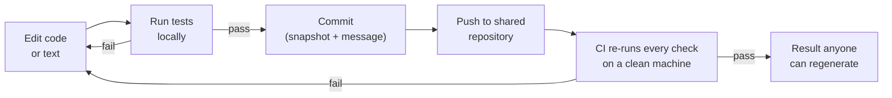

<!-- status: verified -->
# 05-04 · Jupyter, Testing and Reproducible Workflows

| | |
|---|---|
| **Course** | [05 · Programming for Engineers](../README.md) |
| **University equivalent** | The "research software" practices taught alongside a first computing course (Software Carpentry's Git and testing lessons; MIT's "Missing Semester" lectures on version control; Wilson et al., "Best Practices for Scientific Computing", *PLOS Biology*, 2014) |
| **Prerequisites** | [05-01 Python Fundamentals](05-01-python-fundamentals.md), [05-03 SciPy, SymPy and Matplotlib](05-03-scipy-sympy-matplotlib.md); for Example 05-04.5, [03-05 Estimation and Hypothesis Testing](../../03-probability-statistics-and-random-variables/chapters/03-05-estimation-and-hypothesis-testing.md) |
| **Estimated study hours** | 6 |
| **Last verified** | 2026-11-19 |

**Learning objectives.** After this chapter you can:

1. Use a Jupyter notebook safely: explain what the kernel remembers, recognize out-of-order execution, and confirm that a notebook runs from top to bottom.
2. Record work with git (commit, inspect differences and history, recover an earlier version) and explain how content hashes identify every version.
3. Write unit tests with pytest, including tests of floating-point results with tolerances chosen from the problem's scale and tests that invalid input is rejected.
4. Choose between an assertion and an exception, and design a test for randomized code with a known false-failure rate.
5. Make an analysis reproducible (recorded environment, seeds, scripted steps, data fingerprints) and explain how this curriculum's verify scripts and continuous integration check every published number.

## 1. Big picture

The first three chapters of this course taught you to compute. This one teaches you to trust what you computed, and to let someone else trust it too. Three habits do most of the work. **Notebooks** mix code, results and explanation, which makes them superb for exploring and dangerous for reporting, because what you see on screen may not be what the code produces when run afresh. **Version control** (git) records every state of a project, so you can see exactly what changed, when and why, and return to any earlier version. **Automated tests** turn "I checked it once" into "the computer checks it every time anything changes". Together they make a result *reproducible*: anyone with the files can regenerate it with one command and get the same numbers.

- **Chip design runs on these habits.** RTL code, testbenches, simulation scripts and layout setups live under version control, and every change triggers regression tests; "the regression is green" is the daily heartbeat of a chip team ([19-13](../../19-digital-vlsi-design/chapters/19-13-verification-methods.md)).
- **Characterization and test labs** turn raw measurements into datasheet numbers through scripts; a number that cannot be regenerated from raw data cannot be defended.
- **This curriculum** is itself built this way: every number you read is recomputed by a script on every change (Section 3.6).
- **Diligence:** "can you regenerate this result?" is one of the most revealing questions you can ask an engineering team (Section 9).

## 2. Intuition first

**A notebook is a whiteboard with a memory you cannot see.** When you run a cell, its code goes to a separate program, the **kernel**, which keeps every variable in memory until it is restarted. The page shows cells in order from top to bottom, but the kernel remembers them in the order you *ran* them, including cells you have since edited or deleted. Most of the time the two orders agree. When they do not, the page shows results that its own code no longer produces. The cure is mechanical: restart the kernel and run every cell from the top before you believe or share anything.

**Version control is a ledger, not an eraser.** An accountant never erases a booked entry; a mistake is corrected by a new, dated entry, and the full history stays auditable. Git works the same way: each **commit** is a dated, signed-off snapshot of the whole project with a note explaining why, and history only grows. *Where the analogy breaks:* a ledger records transactions (changes), while git records complete snapshots and computes the changes when you ask; and unlike a ledger, git lets you start parallel versions of the project (branches) and later combine them.

**Tests are reconciliation controls.** A reconciliation compares two independently produced totals; it catches every error that makes them disagree and none that it does not look at. A test compares what code produces with what it should produce, for chosen cases. Passing tests do not prove code correct (Edsger Dijkstra's famous point is that testing can show the presence of bugs, never their absence), but a good suite catches the errors that matter, every time, automatically.

The workflow that ties these together looks like this:



The key step is the last check: a clean machine, which has none of your hidden state, installed-by-hand packages or unsaved files, reproduces the result from what was committed.

## 3. Theory

### 3.1 Notebooks: cells, kernels and hidden state

A **Jupyter notebook** is a document of **cells**. *Markdown cells* hold formatted text and equations; *code cells* hold code and, after they run, its outputs. The browser page (or VS Code) is only a front end: it sends each code cell to the **kernel**, a running Python process that executes the code and sends back the output. The number in `In [7]` is the **execution count**, the order in which the kernel ran that cell. Counts that do not increase from top to bottom are the visible trace of out-of-order execution.

On disk, a notebook (`.ipynb`) is a JSON text file holding the cells *and their saved outputs*. You can open it as data:

```python
import json
import nbformat

nb = nbformat.v4.new_notebook()
nb.cells = [nbformat.v4.new_markdown_cell("# RC check"),
            nbformat.v4.new_code_cell("tau = 1e3 * 1e-6\ntau")]
raw = nbformat.writes(nb)                 # the text that would be saved as an .ipynb file
data = json.loads(raw)
print(sorted(data))
print([cell["cell_type"] for cell in data["cells"]], data["cells"][1]["execution_count"])
```

```text
['cells', 'metadata', 'nbformat', 'nbformat_minor']
['markdown', 'code'] None
```

Three consequences follow.

1. **Saved outputs are claims, not facts.** An output stored in the file was produced by *some* past state of the kernel. Nothing guarantees the current code still produces it. A study that re-ran over 860,000 notebooks from GitHub found that fewer than a quarter ran without error (Section 9).
2. **Hidden state** is any variable the kernel remembers that the visible code does not explain: a value from a deleted cell, or one cell run twice. Example 05-04.1 shows a time constant silently doubling.
3. **Diffs are noisy.** Because outputs, execution counts and images are stored in the JSON, a one-character code change can produce a large file difference. Many teams clear outputs before committing, or keep reusable code in `.py` modules that notebooks import.

**The rule:** before you trust or share a notebook, choose *Restart & Run All*. In automation the equivalent is executing the notebook from a clean kernel, which is what `jupyter nbconvert --execute` does and what this repository's [`tools/run_notebooks.py`](../../../tools/run_notebooks.py) does for every lab on every change.

**When to use what.** Notebooks are best for exploration, teaching and reports that show their working. Scripts and modules (`.py` files) are best for code that other code depends on, that must be tested, or that runs unattended. A healthy pattern is to explore in a notebook, move anything reused into a module with tests, and keep the notebook as a thin, re-runnable story on top.

### 3.2 Version control with git

**Git** is a version-control system: a program that records snapshots of a folder (a **repository**) and the history connecting them. It was written in 2005 by Linus Torvalds for Linux kernel development and is now the near-universal standard (Section 9). The concepts you need:

- **Working tree:** the files you edit.
- **Staging area (index):** the set of changes you have marked for the next snapshot with `git add`.
- **Commit:** a snapshot of the staged project plus metadata (author, date, message, and a pointer to the previous commit). Commits form a chain, the **history**.
- **Hash:** every commit, and every file version inside it, is named by a 40-hex-digit fingerprint of its content (Example 05-04.4). The short form (first 7 digits) is what you usually see.
- **Branch:** a movable name for a line of commits (`main` is the usual default); creating a branch lets you try something without disturbing the main line.
- **Remote:** a copy of the repository elsewhere (for example on GitHub) that you `push` commits to and `pull` commits from.

The session below runs real git commands from Python, in a fresh folder, with a fixed author name and clock so that the hashes are identical on every machine. In daily work you would type the same commands in a terminal (`git init`, `git status`, and so on).

```python
import os
import subprocess
from pathlib import Path

# A fixed identity and clock make the commit hashes below reproducible on any machine.
GIT_ENV = {**os.environ,
           "GIT_AUTHOR_NAME": "Ada Learner", "GIT_AUTHOR_EMAIL": "ada@example.com",
           "GIT_COMMITTER_NAME": "Ada Learner", "GIT_COMMITTER_EMAIL": "ada@example.com",
           "GIT_AUTHOR_DATE": "2026-11-18T09:00:00+00:00", "GIT_COMMITTER_DATE": "2026-11-18T09:00:00+00:00",
           "GIT_CONFIG_GLOBAL": os.devnull, "GIT_CONFIG_NOSYSTEM": "1"}

def git(*args):
    """Run a git command in the current folder and return what it prints."""
    result = subprocess.run(["git", *args], capture_output=True, text=True, env=GIT_ENV)
    return (result.stdout + result.stderr).rstrip()

Path("rc-project").mkdir()
os.chdir("rc-project")
git("init", "-q", "-b", "main")
Path("rc.py").write_text("tau = 1e3 * 1e-6\n")
print(git("status", "--short"))           # ?? means "untracked": git sees the file but is not recording it
git("add", "rc.py")
git("commit", "-q", "-m", "Add RC time constant")
print(git("log", "--oneline"))
```

```text
?? rc.py
c153851 Add RC time constant
```

Now change the resistor, look at the difference, and record a second snapshot:

```python
Path("rc.py").write_text("tau = 2e3 * 1e-6\n")
print(git("diff"))                        # what changed since the last commit
git("commit", "-q", "-am", "Double R")    # -a stages every tracked file that changed
print(git("log", "--oneline"))
print(git("show", "HEAD~1:rc.py"))        # the file as it was one commit ago
os.chdir("..")
```

```text
diff --git a/rc.py b/rc.py
index a62fe87..5993ebf 100644
--- a/rc.py
+++ b/rc.py
@@ -1 +1 @@
-tau = 1e3 * 1e-6
+tau = 2e3 * 1e-6
51c5d8a Double R
c153851 Add RC time constant
tau = 1e3 * 1e-6
```

Read the diff from the top: it compares `a/rc.py` (before) with `b/rc.py` (after); the `index` line names the two file versions by their short hashes; `@@ -1 +1 @@` says line 1 was replaced; `-` marks the removed line and `+` the added one. `HEAD` means "the current commit" and `HEAD~1` "one before it", so `git show HEAD~1:rc.py` recovers the old file without disturbing the new one.

The everyday commands, for a terminal:

```bash
git clone <url>                 # copy a repository, with its full history
git status                      # what changed, what is staged
git add <file>                  # stage a change
git commit -m "Why, not what"   # record a snapshot with a message
git log --oneline               # history, newest first
git diff                        # unstaged changes (git diff --staged for staged ones)
git switch -c try-4k7           # create and move to a new branch
git switch main                 # return to main
git merge try-4k7               # bring the branch's commits into main
git pull                        # fetch and merge others' commits
git push                        # send your commits to the remote
git restore <file>              # discard uncommitted edits to a file (careful)
```

**What not to commit.** Secrets (passwords, API keys: once pushed they must be assumed public, even after deletion, because history keeps them), large binary data that changes often, and files that are generated from others (they go stale and inflate diffs). A `.gitignore` file lists patterns git should not track. **Commit messages** should say *why* a change was made; the diff already says *what*.

### 3.3 Automated testing with pytest

A **unit test** is a small function that runs a piece of code on a chosen input and *asserts* something about the result. At its simplest a test is nothing more than an `assert` statement in a function:

```python
def parallel(r1, r2):
    """Resistance of r1 and r2 in parallel, in ohms."""
    return r1 * r2 / (r1 + r2)

def test_equal_resistors_halve():
    assert parallel(10e3, 10e3) == 5e3

def test_order_does_not_matter():
    assert parallel(4.7e3, 10e3) == parallel(10e3, 4.7e3)

def test_result_below_smaller_resistor():
    assert parallel(4.7e3, 10e3) < 4.7e3

for test in (test_equal_resistors_halve, test_order_does_not_matter, test_result_below_smaller_resistor):
    test()                                # silent when every assertion holds
print("all three tests passed")
```

```text
all three tests passed
```

Notice what these tests check: a **known case** worked by hand, a **symmetry** the physics demands, and a **bound** (a parallel combination is always smaller than either resistor). None needs a second implementation of the formula. Good tests are mostly of these kinds, plus **edge cases** (zero, very large, invalid inputs) and **regression tests**, each of which pins down a bug that once happened so that it can never silently return.

**pytest** is the standard Python test runner. It finds files named `test_*.py` (or `*_test.py`), runs every function whose name starts with `test`, and reports which passed and which failed, with the values involved. Its main tools:

- **Plain `assert`.** On failure pytest shows the values on both sides, so you rarely need custom messages.
- **`pytest.approx(expected, rel=1e-6, abs=1e-12)`** for floating-point comparisons: `x == pytest.approx(y)` passes when $|x - y| \le \max(\text{rel}\cdot|y|,\ \text{abs})$. The values shown are pytest's defaults.
- **`pytest.raises(ValueError)`** as a `with` block asserts that the code inside raises that exception: the test of error handling.
- **`@pytest.mark.parametrize`** runs one test function over a table of inputs, each reported as a separate test.
- **Fixtures** such as `tmp_path` hand a test a fresh temporary folder, so tests never depend on or damage your real files.

**Testing floating-point results.** Section 05-01 showed that `0.1 + 0.2 == 0.3` is false. A computed float should almost never be compared with `==`. The question is *how close is close enough*, and it has a principled answer: the tolerance should come from the scale of the problem and the accuracy you need, not from habit. Three common functions behave differently:

| Function | Passes when | Default tolerances |
|---|---|---|
| `math.isclose(a, b)` | $\lvert a-b\rvert \le \max(r\cdot\max(\lvert a\rvert,\lvert b\rvert),\ t)$ | $r = 10^{-9}$, $t = 0$ |
| `a == pytest.approx(b)` | $\lvert a-b\rvert \le \max(r\cdot\lvert b\rvert,\ t)$ | $r = 10^{-6}$, $t = 10^{-12}$ |
| `numpy.isclose(a, b)` | $\lvert a-b\rvert \le t + r\cdot\lvert b\rvert$ | $r = 10^{-5}$, $t = 10^{-8}$ |

A purely relative tolerance fails for quantities whose correct value is zero (a relative tolerance of zero is zero), which is why `math.isclose(1e-17, 0.0)` is false. Example 05-04.3 works through choosing an absolute tolerance from the physical scale.

> **Going deeper — property-based testing.** Instead of hand-picking inputs, a property-based test states a rule that must hold for *all* inputs ("the parallel resistance is below both resistors") and lets a library (Hypothesis, for Python) generate hundreds of random cases, including nasty ones such as zero, huge values and NaN, and then shrink any failure to the simplest input that still fails. It finds bugs that hand-chosen examples miss. Hardware verification's constrained-random testing ([19-13](../../19-digital-vlsi-design/chapters/19-13-verification-methods.md)) applies the same idea to chips.

### 3.4 Assertions and exceptions: two different jobs

Both an `assert` and a `raise` stop the program when something is wrong, but they answer different questions.

- **An exception (`raise ValueError(...)`) handles bad *input*.** A caller passed a negative resistance or an empty list. This can happen in correct code, so the function must check and reject it with a clear message, always.
- **An assertion (`assert condition, "message"`) checks your *own* reasoning.** "At this point the divider's output must lie between 0 and the input." If it fails, the code has a bug. Assertions document and enforce **invariants**: conditions that must hold if the code is right.

The distinction matters because Python can be told to skip assertions. Running with the `-O` (optimize) flag removes every `assert` statement:

```python
import subprocess
import sys

code = "assert 1 + 1 == 3, 'arithmetic is broken'\nprint('reached the end')"
for flags in ([], ["-O"]):
    run = subprocess.run([sys.executable, *flags, "-c", code], capture_output=True, text=True)
    print(flags, run.returncode, (run.stdout + run.stderr).strip().splitlines()[-1])
```

```text
[] 1 AssertionError: arithmetic is broken
['-O'] 0 reached the end
```

So never use `assert` to validate input that a user or another program supplies: under `-O` the check vanishes. In test files, by contrast, `assert` is exactly right, because tests are never run with `-O`.

### 3.5 Reproducible workflows

A result is **reproducible** when someone else, on another machine, can regenerate it from the committed files and get the same numbers. Five practices make that true.

**Script every step.** Each manual step (copying a column in a spreadsheet, clicking "export") is a step nobody can audit or repeat exactly. A script, or a `Makefile` target such as this repository's `make check`, is a precise, re-runnable record.

**Record the environment.** Results depend on versions: NumPy 2 changed type-promotion rules (05-02). List dependencies in a `requirements.txt` or `environment.yml`, pinned with minimum or exact versions as appropriate, work in a virtual environment (05-01), and print the versions with the results (the output differs from machine to machine, which is the point):

```python
import platform

import numpy as np

print("Python", platform.python_version(), "| NumPy", np.__version__)
```

**Seed randomness.** Every simulation that draws random numbers takes a seed (`np.random.default_rng(seed)`, 05-02), recorded with its results.

**Fingerprint the data.** Store raw data read-only and record a cryptographic hash of each data file with the results, so anyone can confirm they analyzed the same bytes:

```python
import hashlib

Path("bench.csv").write_text("vin_V,vout_V\n5.0,2.501\n3.3,1.648\n")
print(hashlib.sha256(Path("bench.csv").read_bytes()).hexdigest()[:16])
Path("bench.csv").write_text("vin_V,vout_V\n5.0,2.501\n3.3,1.649\n")      # one digit changed
print(hashlib.sha256(Path("bench.csv").read_bytes()).hexdigest()[:16])
```

```text
08a5ab315e5cf349
ee74e019a95226bf
```

One changed digit gives an unrelated fingerprint (Example 05-04.4 explains why).

**Re-run from clean, automatically.** **Continuous integration (CI)** is a service that, on every push, starts a fresh machine, installs the recorded environment and runs every test. It catches "works on my machine" problems: a file you forgot to commit, a package you installed by hand, a notebook that only works with hidden state.

**Exact versus tolerant reproducibility.** Pure-Python arithmetic on IEEE 754 doubles gives bit-identical results everywhere. Library routines may not: linear-algebra libraries (BLAS) choose different summation orders on different processors, so results can differ in the last few bits. Tests should therefore compare numbers with tolerances, while text outputs, hashes and counts can be compared exactly.

### 3.6 How this repository verifies itself

Every number published in this curriculum's examples, solutions and exams appears in an **answer-key table** like the one in Section 4. Each chapter has a verify script (for this chapter, [`verify_05_04.py`](../verify/verify_05_04.py)) that:

1. reads the answer keys from the chapter, the solutions and the lab handout;
2. recomputes every value **independently**, by a different route from the text wherever possible (a closed form instead of a solver, exact fractions instead of floats, a hand-written algorithm instead of a library call);
3. compares each recomputed value with the published one, and fails if any entry is wrong or never checked;
4. in programming chapters, also runs every `python` code block and compares its printed output, character for character, with the `text` block that follows it.

Circuit results are additionally confirmed in ngspice, Verilog designs by self-checking testbenches, and every lab notebook is executed from a clean kernel. CI runs all of it on every push ([`.github/workflows/ci.yml`](../../../.github/workflows/ci.yml)), and `make check` runs it locally ([00-04](../../00-orientation/chapters/00-04-toolchain-walkthrough.md)).

**Why "half a unit in the last digit".** A number published as 0.6925 claims four correct decimals. If it was correctly rounded, the true value lies within $\pm 0.00005$ of it, so the check allows exactly that: half a unit in the last published place. A larger difference means a computation or rounding error; a looser tolerance would let such errors through, and a tighter one would fail correctly rounded values. The idea fits in a few lines:

```python
from decimal import Decimal

def tolerance(published: str) -> float:
    """Half a unit in the last digit of a number as written."""
    return 0.5 * 10.0 ** Decimal(published).as_tuple().exponent

def passes(published: str, computed: float) -> bool:
    return abs(float(published) - computed) <= tolerance(published)

v_diode = 0.6925436332                    # Example 05-03.1, to ten decimals
for shown in ("0.6925", "0.693", "0.6926", "0.69"):
    print(shown, tolerance(shown), passes(shown, v_diode))
```

```text
0.6925 5e-05 True
0.693 0.0005 True
0.6926 5e-05 False
0.69 0.005 True
```

The real checker ([`tools/eeverify.py`](../../../tools/eeverify.py)) adds a hair of slack for binary rounding, understands forms such as $6.32\times10^{-3}$ and $3 + j4$, and lets a script loosen the tolerance for a specific value when there is a stated reason. One limitation is worth remembering: a check can only be as sharp as the published precision. A value printed as 0.69 cannot reveal an error in the third decimal place, so key results are published with enough digits to be meaningful checks.

## 4. Worked examples

### Example 05-04.1 · A time constant that silently doubles

**Setup.** A notebook has four cells: (1) `r = 1000`, (2) `c = 1e-6`, (3) `tau = r * c`, (4) `r = 2000`, which you added later to try a different resistor. Compare *Restart & Run All* with what happens if, after running all four once, you go back and re-run cell 3.

**Solution.** A kernel is a namespace that persists between cells, so we can imitate one with a dictionary and `exec`:

```python
cells = {1: "r = 1000", 2: "c = 1e-6", 3: "tau = r * c", 4: "r = 2000"}

def run(order):
    kernel = {}                           # a fresh kernel: empty memory
    for k in order:
        exec(cells[k], kernel)
    return kernel["r"], kernel["tau"]

print("restart & run all:", run([1, 2, 3, 4]))
print("then re-run cell 3:", run([1, 2, 3, 4, 3]))
```

```text
restart & run all: (2000, 0.001)
then re-run cell 3: (2000, 0.002)
```

Top to bottom, τ = **1.000 ms** (cell 4 runs after τ was computed, so it has no effect on τ). Re-running cell 3 afterwards gives τ = **2.000 ms**, while the page still shows `r = 1000` in cell 1 above it. A reader of the saved notebook sees $r$ = 1000 Ω, $C$ = 1 µF and τ = 2 ms, an impossible combination, and execution counts that run 1, 2, 5, 4.

**Units check.** 1000 Ω × 10⁻⁶ F = 10⁻³ s ✓ (an ohm times a farad is a second).

**Sanity check.** The only order-independent answer is the top-to-bottom one, which is exactly what a fresh run (or CI) produces. The fix is either to delete cell 4 or to move it above cell 3; then *Restart & Run All* makes the page and the kernel agree.

### Example 05-04.2 · Test-first design of a voltage divider

**Setup.** Write `divider(vin, r_top, r_bottom)` returning the unloaded output voltage $v_{in}R_b/(R_t + R_b)$. It must reject negative resistances and a zero total with `ValueError`. Write the tests *first*, from facts you know, then run them against a first implementation.

**Solution.** The tests encode four facts: equal resistors halve the input; 10 kΩ over 4.7 kΩ from 3.3 V gives $3.3 \times 4.7/14.7$ = **1.0551 V**; the output always lies between 0 and $v_{in}$; and bad inputs are rejected.

```python
import textwrap

Path("test_divider.py").write_text(textwrap.dedent('''
    import pytest
    from divider import divider

    def test_equal_resistors_halve():
        assert divider(5.0, 10e3, 10e3) == pytest.approx(2.5)

    def test_known_case():
        assert divider(3.3, 10e3, 4.7e3) == pytest.approx(1.0551, abs=5e-5)

    @pytest.mark.parametrize("r_top, r_bottom", [(1.0, 1e6), (1e6, 1.0), (4.7e3, 22e3)])
    def test_output_between_zero_and_input(r_top, r_bottom):
        assert 0.0 < divider(5.0, r_top, r_bottom) < 5.0

    def test_rejects_negative_resistance():
        with pytest.raises(ValueError):
            divider(5.0, -10e3, 10e3)
'''))
```

A first implementation, typed in a hurry, has two faults: it uses the top resistor in the numerator, and it does not check its inputs.

```python
Path("divider.py").write_text("def divider(vin, r_top, r_bottom):\n    return vin * r_top / (r_top + r_bottom)\n")

def pytest_run(*files):
    """Run `python -m pytest -qq --tb=no -rf --color=no <files>` (plain text, even in Jupyter); return its report."""
    env = {**os.environ, "COLUMNS": "80",           # a fixed report width
           "PYTHONDONTWRITEBYTECODE": "1"}          # no cached bytecode, so edited files are always re-read
    result = subprocess.run([sys.executable, "-m", "pytest", "-qq", "--tb=no", "-rf", "--color=no", "-p", "no:cacheprovider", *files],
                            capture_output=True, text=True, env=env)
    return result.stdout.rstrip()

print(pytest_run("test_divider.py"))
```

```text
.F...F                                                                   [100%]
=========================== short test summary info ============================
FAILED test_divider.py::test_known_case - assert 2.2448979591836733 == 1.0551...
FAILED test_divider.py::test_rejects_negative_resistance - ZeroDivisionError:...
```

Each `.` is a passing test and each `F` a failure, in the order the tests appear in the file; the summary names each failure (`-rf` asks for it; `--tb=short` instead of `--tb=no` would also print each failure's traceback). Of the six tests (the parametrized one counts three times), **two fail**. The known case caught the swapped resistor: 2.2449 V where 1.0551 V was expected. The negative-resistance test caught the missing check, though not in the way intended: $-10\text{ k}\Omega + 10\text{ k}\Omega = 0$, so the function divided by zero instead of raising `ValueError`.

The four tests that *passed* are as instructive. With equal resistors the swap is invisible, and a swapped divider still produces an output between 0 and $v_{in}$, so the three bound tests cannot see it either. One hand-worked number caught what four looser tests missed. Good suites combine both kinds: bounds and symmetries catch gross errors on any input, and known cases pin down the exact formula. The corrected implementation:

```python
Path("divider.py").write_text(textwrap.dedent('''
    def divider(vin, r_top, r_bottom):
        """Unloaded output of a resistive divider, in the units of vin."""
        if r_top < 0 or r_bottom < 0:
            raise ValueError("resistances must be non-negative")
        if r_top + r_bottom == 0:
            raise ValueError("total resistance must be positive")
        vout = vin * r_bottom / (r_top + r_bottom)
        assert min(0.0, vin) <= vout <= max(0.0, vin), "divider output outside its supply"
        return vout
'''))
print(pytest_run("test_divider.py"))
```

```text
......                                                                   [100%]
```

All six pass, silently. Note the division of labor: `ValueError` rejects bad input from callers; the `assert` documents an invariant of the formula and would fire only if the formula itself were wrong. The failing test for the swapped resistor now stays in the suite as a **regression test**: if anyone ever reintroduces the bug, it fails again.

**Units check.** $v_{in}R_b/(R_t+R_b)$ is volts × Ω/Ω = volts ✓.

**Sanity check.** 1.0551 V is below half of 3.3 V, as it must be when the bottom resistor is the smaller one ✓.

### Example 05-04.3 · Choosing a tolerance: a KCL check near zero

**Setup.** A node has currents of 0.1 A and 0.2 A flowing in and 0.3 A flowing out. A test should confirm Kirchhoff's current law: the net current is zero. Which comparison is right?

**Solution.**

```python
import math

import pytest

i_in, i_out = [0.1, 0.2], [0.3]
net = sum(i_in) - sum(i_out)
scale = sum(i_in)                         # the size of the currents involved
print(net)
print(net == 0.0, math.isclose(net, 0.0), math.isclose(net, 0.0, abs_tol=1e-9 * scale), net == pytest.approx(0.0))
```

```text
5.551115123125783e-17
False False True True
```

The net current is $5.55\times10^{-17}$ A, not zero: 0.1 and 0.2 are not exactly representable, and their sum is one unit in the last place above the stored 0.3. Exact equality fails, as expected. `math.isclose` with its default purely relative tolerance also fails: relative to zero, *any* nonzero number is infinitely far away. The right question is "small compared with what?" The currents involved are about 0.3 A, so an absolute tolerance of $10^{-9}$ of that scale, $3\times10^{-10}$ A, is far above rounding error and far below any physically meaningful imbalance. `pytest.approx` also passes here, but only because its default absolute floor of $10^{-12}$ happens to suit a problem with currents of order 1 A; for a picoampere leakage circuit the same default would accept errors as large as the signal.

**Units check.** The tolerance $10^{-9}\times 0.3$ A is in amperes, like the quantity it bounds ✓.

**Sanity check.** $5.55\times10^{-17}$ A is exactly $2^{-54}$, one unit in the last place for numbers between 0.25 and 0.5 ($2^{-2}\times2^{-52}$, 05-02): the size of a single rounding error ✓.

### Example 05-04.4 · Why a one-character change gives a completely new hash

**Setup.** (a) Reproduce by hand the short hash `a62fe87` that git gave the first version of `rc.py` in Section 3.2. (b) How many of the 40 hex digits of a hash should change when one character of the file changes? (c) Git names objects by 160-bit SHA-1 hashes. Estimate the probability that two different objects in a repository of ten million objects share a hash by accident.

**Solution.** (a) Git hashes a file's bytes after a short header: the word `blob`, a space, the length in bytes, and a zero byte.

```python
import hashlib

def git_blob_hash(content: bytes) -> str:
    return hashlib.sha1(b"blob " + str(len(content)).encode() + b"\0" + content).hexdigest()

v1, v2 = b"tau = 1e3 * 1e-6\n", b"tau = 2e3 * 1e-6\n"
h1, h2 = git_blob_hash(v1), git_blob_hash(v2)
print(len(v1), h1)
print(len(v2), h2)
print(sum(a != b for a, b in zip(h1, h2)), "of 40 hex digits differ")
```

```text
17 a62fe87577a4b00d0ca46a39cd5665c3dd385dfb
17 5993ebfee5d1ada6725e712d43e8435a12a33867
39 of 40 hex digits differ
```

The file is **17 bytes** long, and the hash begins `a62fe87`, exactly as in the diff's `index a62fe87..5993ebf` line; the second version begins `5993ebf` ✓. Git's names are not arbitrary labels; they are computed from content, so anyone can verify that a file is the version they think it is.

(b) A cryptographic hash is designed so that any change to the input makes every output bit an independent coin flip. Each hex digit (4 bits) then matches by chance with probability 1/16, so the expected number of differing digits is $40 \times 15/16$ = **37.5**. The 39 observed is typical (the standard deviation of the count is $\sqrt{40\times\tfrac{15}{16}\times\tfrac1{16}} \approx 1.5$).

(c) **Birthday bound.** With $N = 2^{160}$ equally likely hash values and $n$ objects, the probability that all $n$ hashes differ is

$$
P(\text{no collision}) = \prod_{k=0}^{n-1}\left(1 - \frac{k}{N}\right) \approx \exp\!\left(-\sum_{k=0}^{n-1}\frac{k}{N}\right) = \exp\!\left(-\frac{n(n-1)}{2N}\right),
$$

using $\ln(1 - x) \approx -x$ for tiny $x$ (01-08). So $P(\text{collision}) \approx n^2/(2N)$ when that is small. For $n = 10^7$:

$$
P \approx \frac{(10^7)^2}{2\times 2^{160}} = \frac{10^{14}}{2.92\times10^{48}} \approx 3.4\times10^{-35}.
$$

An accidental collision is not a practical concern. A *deliberate* one is a different matter: SHA-1 was publicly broken in 2017, which is why git uses a hardened version and is moving to SHA-256 (Section 9).

**Units check.** Probabilities are dimensionless; $n^2/N$ is a count squared over a count ✓.

**Sanity check.** The classic birthday problem has $N = 365$; the formula gives a 50% chance at $n \approx \sqrt{2N\ln2} \approx 22.5$, matching the well-known 23 people ✓.

### Example 05-04.5 · Testing code that uses random numbers

**Setup.** A Monte Carlo routine estimates the mean divider ratio $R_b/(R_t+R_b)$ for two nominally equal 10 kΩ resistors, each with a standard deviation of 1% (100 Ω), from $n$ = 10,000 random draws. (a) What should the mean be exactly? (b) What is the standard error of the estimate? (c) A test asserts that the estimate lies within 4 standard errors of the exact mean. What fraction of correct runs would it fail by chance, with a new random seed each time? (d) What is the chance that a suite of 1000 such tests fails somewhere?

**Solution.** (a) **Symmetry.** $R_t$ and $R_b$ have the same distribution, so $E[R_b/(R_t+R_b)] = E[R_t/(R_t+R_b)]$, and the two ratios add to exactly 1. Each expectation is therefore exactly **0.5**, with no approximation.

(b) **Spread of one draw, to first order** (03-03). With ratio $g = R_b/(R_t+R_b)$, the partial derivatives at $R_t = R_b = R$ are

$$
\frac{\partial g}{\partial R_b} = \frac{R_t}{(R_t+R_b)^2} = \frac{1}{4R}, \qquad \frac{\partial g}{\partial R_t} = -\frac{R_b}{(R_t+R_b)^2} = -\frac{1}{4R},
$$

so for independent resistors with standard deviation $\sigma_R$,

$$
\sigma_g \approx \sqrt{2}\,\frac{\sigma_R}{4R} = \sqrt2 \times \frac{0.01}{4} = 0.003536.
$$

The standard error of a mean of $n$ independent draws is $\sigma_g/\sqrt n$ = 0.003536/100 = **3.536×10⁻⁵**.

(c) If the code is correct, the estimate is approximately normal about 0.5 (the central limit theorem, 03-04), so it falls outside ±4 standard errors with probability $2[1 - \Phi(4)]$ = **6.3×10⁻⁵**: about one run in 16,000.

(d) With 1000 independent such tests, $P(\text{at least one false failure}) = 1 - (1 - 6.334\times10^{-5})^{1000}$ = **6.1%**. A suite that fails spuriously one push in sixteen teaches people to ignore failures, the worst outcome for a test suite. Two remedies: **fix the seed** (the test then gives the same answer every time, and a failure always means the code changed), and choose limits wide enough for the number of tests.

```python
import numpy as np

def mean_ratio(n, seed):
    rng = np.random.default_rng(seed)
    r_top, r_bottom = rng.normal(10e3, 100.0, (2, n))
    return float(np.mean(r_bottom / (r_top + r_bottom)))

se = math.sqrt(2) * 0.01 / 4 / math.sqrt(10_000)
estimate = mean_ratio(10_000, seed=7)
print(f"estimate {estimate:.6f}, off by {(estimate - 0.5) / se:+.2f} standard errors")
print(estimate == mean_ratio(10_000, seed=7), abs(estimate - 0.5) < 4 * se)
```

```text
estimate 0.500029, off by +0.83 standard errors
True True
```

The seeded run is repeatable to the last bit, and its error is well inside the 4-standard-error limit. A wrong formula (say, the swapped resistor of Example 05-04.2) would still give 0.5 here, because swapping the resistors is exactly the symmetry used in (a). Statistical tests check distributions, not formulas; pair them with deterministic known-case tests.

**Units check.** The ratio and its standard error are dimensionless (Ω/Ω) ✓.

**Sanity check.** Doubling $n$ shrinks the standard error by $\sqrt2$, not 2; to halve it you need four times the draws (03-05) ✓.

### Answer key

<!-- answer-key -->
| ID | Quantity | Value | Unit |
|---|---|---|---|
| T 05-04.a | tolerance for a value published as 0.6925 | 0.00005 | V |
| T 05-04.b | tolerance for a value published as 0.693 | 0.0005 | V |
| Ex 05-04.1a | τ, restart and run all | 1.000 | ms |
| Ex 05-04.1b | τ after re-running cell 3 | 2.000 | ms |
| Ex 05-04.2a | divider output, 3.3 V, 10 kΩ over 4.7 kΩ | 1.0551 | V |
| Ex 05-04.2b | failing tests, first implementation | 2 | — |
| Ex 05-04.2c | total tests | 6 | — |
| Ex 05-04.3a | net current from floating-point KCL | 5.55×10^-17 | A |
| Ex 05-04.3b | scale-based absolute tolerance | 3×10^-10 | A |
| Ex 05-04.4a | length of the first file version | 17 | bytes |
| Ex 05-04.4b | expected differing hex digits | 37.5 | — |
| Ex 05-04.4c | accidental-collision probability, 10⁷ objects | 3.4×10^-35 | — |
| Ex 05-04.5a | exact mean divider ratio | 0.5 | — |
| Ex 05-04.5b | standard deviation of one ratio | 0.003536 | — |
| Ex 05-04.5c | standard error, n = 10,000 | 3.536×10^-5 | — |
| Ex 05-04.5d | false-failure probability of a 4-SE test | 6.3×10^-5 | — |
| Ex 05-04.5e | chance that 1000 such tests fail somewhere | 6.1 | % |

## 5. Simulate it

Open [labs/05-04-lab/](../labs/05-04-lab/README.md) and run [05-04-workflows.ipynb](../labs/05-04-lab/05-04-workflows.ipynb). It contains:

1. **Hidden state, caught:** run a small notebook out of order, then detect the problem from its execution counts and by re-executing it from a clean kernel. *Predict first:* which of the saved outputs will change?
2. **Tests that find bugs:** write tests for a resistor color-code decoder and run them against three deliberately broken versions. *Predict first:* which tests catch which bug?
3. **A git history:** build a three-commit history, find the commit that introduced a wrong value, and recover the old file.
4. **Breaking a verify check:** publish a wrong number in a miniature answer key and watch the checker reject it; then find the smallest error it can detect.

## 6. Engineering tradeoffs

| Knob | Improves | Costs | Typical decision owner |
|---|---|---|---|
| Notebook versus script/module | Notebook: exploration, explanation, visible working | Hidden state, noisy diffs, hard to test or import | Individual engineer, by team convention |
| Number and breadth of tests | Bugs caught early; safe refactoring | Writing and maintenance time; slow suites get skipped | Tech lead |
| Tight versus loose numerical tolerances | Tight: catches small errors | False failures across machines and library versions | Engineer, from the problem's scale |
| Fixed versus fresh random seeds in tests | Fixed: repeatable, no false alarms | Explores only one random sample; fresh seeds find rare failures | Verification lead |
| Exact pins versus minimum versions | Exact: bit-for-bit reproducibility | Security fixes and improvements missed; upgrade debt | Team / release manager |
| Small, frequent commits | Clear history, easy to find and revert a bad change | Discipline; more messages to write | Individual engineer |
| CI on every push | Problems caught within minutes, on a clean machine | Compute cost; waiting for results | Engineering management |

## 7. Numbers to know

| Quantity | Value | Note |
|---|---|---|
| `math.isclose` defaults | rel_tol $10^{-9}$, abs_tol 0 | fails for expected value 0 |
| `pytest.approx` defaults | rel $10^{-6}$, abs $10^{-12}$ | |
| `numpy.isclose` defaults | rtol $10^{-5}$, atol $10^{-8}$ | not symmetric in its arguments |
| binary64 unit roundoff near 1 | $2^{-52} \approx 2.2\times10^{-16}$ | 05-01 |
| Git hash (SHA-1) | 160 bits, 40 hex digits; 7-digit short form | SHA-256: 256 bits, 64 hex digits |
| Two-sided normal tail beyond 4σ | $6.3\times10^{-5}$ | about 1 in 16,000 |
| Notebooks from GitHub that re-ran without error | 24% (2019 study) | [R-088](../../../reference/research-log.md#r-088--jupyter-notebook-reproducibility) |
| Python developers using pytest / unittest | 53% / 23% (2024 survey) | [R-089](../../../reference/research-log.md#r-089--python-testing-tools-pytest-release-and-usage) |
| Developers using git | 94% (2022 survey) | [R-090](../../../reference/research-log.md#r-090--git-usage-and-hash-functions) |

## 8. Common mistakes

1. **Trusting a saved notebook.** Its outputs may come from a state its code no longer produces. *Restart & Run All* before believing or sharing.
2. **Comparing floats with `==`,** or with a purely relative tolerance when the expected value is zero. Choose an absolute tolerance from the problem's scale (Example 05-04.3).
3. **Using `assert` to validate input.** `python -O` deletes it. Raise `ValueError` (or another exception) for bad input; keep `assert` for invariants and tests.
4. **Tests that cannot fail.** A test that recomputes the answer with the same formula as the code, or that asserts nothing, passes whatever the code does. Test against independent facts: hand-worked cases, symmetries, bounds, conservation laws.
5. **Unseeded randomness in tests,** which produces failures nobody can reproduce, or tolerances so tight that a large suite fails by chance (Example 05-04.5).
6. **Committing secrets or generated files.** A password in history is public forever once pushed; generated files go stale and inflate diffs. Use `.gitignore`.
7. **"Fixed it" commit messages.** Say why: "Use bottom resistor in divider numerator (output was 2.24 V, expected 1.06 V)".
8. **A green CI badge taken as proof of correctness.** It proves the tests passed. Whether the tests check the right things is a separate question.

## 9. Practitioner lens

### State of the art (as of Nov 2026)

- **Notebook reproducibility is poor in the wild.** Pimentel and colleagues (MSR 2019) collected about 1.4 million notebooks from GitHub and re-executed 863,878 of them: only 24.11% ran without errors, and only about 4% reproduced the outputs saved in the file. The main causes were missing dependencies, hidden state and out-of-order execution, and data files that were not available. A 2021 journal follow-up notes that its shared execution environment may have underestimated the true rates ([R-088](../../../reference/research-log.md#r-088--jupyter-notebook-reproducibility)) **[Established]** for the measured rates (secondary summaries differ on whether the 4% is a share of all runs or of the error-free ones).
- **Testing tools.** pytest is the de facto standard: 53% of respondents to the PSF–JetBrains Python Developers Survey 2024 used it, against 23% for the built-in `unittest`, while 36% reported using no testing framework at all. The current release on PyPI is pytest 9.2.0; version 9.0 (November 2025) added built-in subtests ([R-089](../../../reference/research-log.md#r-089--python-testing-tools-pytest-release-and-usage)) **[Industry estimate]** for the survey shares.
- **Git is the standard.** 93.87% of Stack Overflow's 2022 survey respondents used git (96.65% of professional developers); later surveys stopped asking. Git has named objects by SHA-1 since its creation; after the first practical SHA-1 collision (SHAttered, Google and CWI, February 2017), Git 2.13 switched to a hardened SHA-1 that detects that attack, and SHA-256 repositories are available as an option (`git init --object-format=sha256`). Making SHA-256 the default is planned for Git 3.0, which had not been released as of Nov 2026, and major hosting services did not yet support SHA-256 repositories ([R-090](../../../reference/research-log.md#r-090--git-usage-and-hash-functions)) **[Established]** for the history; **[Industry estimate]** for the transition's timing.

### Why it matters commercially

Two well-documented failures show the cost of skipping these habits. In 2013, a re-analysis of an influential economics paper on public debt and growth found that a spreadsheet formula had left five countries out of a key average; together with other data choices, correcting it changed average growth in the highest-debt group from −0.1% to about 2.2% ([R-091](../../../reference/research-log.md#r-091--untested-analysis-and-deployment-failures)) **[Established]**. The spreadsheet was code without version control or tests. In August 2012, Knight Capital deployed new trading software to seven of its eight servers; the eighth still ran old code that a reused configuration flag reactivated, and in about 45 minutes the firm sent more than 4 million orders and lost over $460 million, according to the SEC's order ([R-091](../../../reference/research-log.md#r-091--untested-analysis-and-deployment-failures)) **[Established]**. That was a reproducibility failure of a different kind: the servers were not running the same, verified version.

For a corporate-development reader, the practical point is that an engineering result is only as credible as the process that can regenerate it. Characterization data, benchmark claims, yield models and simulation results in a data room are all outputs of code and scripts. Teams with version control, tests and CI can answer "where did this number come from?" in minutes; teams without them may not be able to answer at all, and integrating such a team's code after an acquisition costs more than it appears.

### Marketing vs Reality

- **"We have 100% test coverage."** *Reality:* coverage measures which lines *ran* during tests, not whether any test checked their results. A line can be covered by a test that asserts nothing. Ask what the tests assert and how many bugs they have caught.
- **"Our results are fully reproducible."** *Reality:* the test is whether someone other than the author can regenerate them on a clean machine from the repository with one command. Ask when that was last done, and by whom.
- **"The model is validated."** *Reality:* validated against which measurements, how many, at what tolerance, and were the same measurements used to tune the model (then it is a fit, not a validation)?
- **"It's all in the notebook."** *Reality:* in the study above, three in four notebooks did not even run. Ask for the notebook to be re-executed from a clean kernel.

### Questions for engineering leaders

1. **"If I pick a number from this report, how long would it take you to regenerate it from raw data?"** *Strong:* "Minutes: it's a scripted target in the repository, and CI reruns it." *Evasive:* "We'd have to find who ran it."
2. **"What runs automatically on every change, and how long does it take?"** *Strong:* a specific list (unit tests, regressions, lint), the time, and what happens on failure. *Evasive:* "Our engineers test thoroughly."
3. **"Tell me about the last bug your tests caught, and the last one they missed."** *Strong:* concrete examples and the regression test added afterwards. *Evasive:* "We don't really have bugs."
4. **"How do you pin and upgrade your tool and library versions?"** *Strong:* recorded environments, a routine upgrade process with tests. *Evasive:* "Everyone uses whatever version they have."
5. **"What is your flaky-test rate, and what do you do about flaky tests?"** *Strong:* a measured rate and a policy (fix or quarantine with an owner and deadline). *Evasive:* "We just re-run until it's green."

## 10. Concept check

1. A saved notebook shows execution counts 1, 2, 7, 4, 5 from top to bottom. What does this tell you, and what should you do before trusting it?

   <details><summary>Answer</summary>

   Cells were run out of order (the third cell after the fifth, at count 7), so the kernel's state may not match the code as it reads from top to bottom. Restart the kernel and run all cells; only then compare the outputs.

   </details>

2. What is the difference between git's working tree, staging area and a commit?

   <details><summary>Answer</summary>

   The working tree is the files as you are editing them; the staging area holds the changes you have selected with `git add` for the next snapshot; a commit is a permanent, hashed snapshot of the staged project with author, date, message and parent.

   </details>

3. Why does `math.isclose(x, 0.0)` return `False` for $x = 10^{-17}$, and how should such a test be written?

   <details><summary>Answer</summary>

   With an expected value of 0, a relative tolerance is $10^{-9}\times 0 = 0$, and `math.isclose`'s default absolute tolerance is also 0, so only exact equality passes. Write `math.isclose(x, 0.0, abs_tol=...)` with an absolute tolerance chosen from the size of the quantities involved (for example $10^{-9}$ times the largest current at the node).

   </details>

4. When should a function raise `ValueError`, and when should it use `assert`?

   <details><summary>Answer</summary>

   Raise `ValueError` (or another exception) when the *caller* supplied invalid input; that can happen in correct code and must always be checked. Use `assert` for conditions that can fail only if *your own code* is wrong (invariants), and in tests. Assertions are removed under `python -O`.

   </details>

5. A test computes the expected value with the same formula as the function it tests. Why is this a weak test, and what are better sources of expected values?

   <details><summary>Answer</summary>

   It repeats the function's formula, so any error in that formula appears in both and the test still passes. Better: hand-worked cases, special cases with known answers, symmetries, bounds, conservation laws, an independent method (a closed form against a solver), or measured data.

   </details>

6. Why does changing one character of a file change about 37–38 of the 40 hex digits of its git hash?

   <details><summary>Answer</summary>

   Git names a file by the SHA-1 hash of its bytes (plus a short header). A cryptographic hash makes every output bit depend on every input bit, so a one-character change flips each bit with probability ½; each hex digit then matches by chance with probability 1/16, so about $40\times15/16 = 37.5$ digits differ.

   </details>

7. Name four practices that make an analysis reproducible.

   <details><summary>Answer</summary>

   Any four of: script every step; record and pin the environment (Python and library versions); seed random numbers; keep raw data read-only and record its hash; keep everything under version control; re-run from a clean environment automatically (CI); execute notebooks from a clean kernel.

   </details>

8. This curriculum checks each published number to within half a unit in its last digit. Why that tolerance, and what can it not detect?

   <details><summary>Answer</summary>

   A correctly rounded published value lies within half a unit in its last digit of the true value, so that tolerance accepts every correctly rounded value and rejects anything larger, which would indicate a computing or rounding error. It cannot detect errors smaller than the published precision: a value published with two digits is checked only to two digits.

   </details>

Now work the [problem set](../problems/05-04-problems.md).

## 11. Key terms

[Jupyter notebook](../../../reference/glossary.md#jupyter-notebook) ·
[Hidden state](../../../reference/glossary.md#hidden-state) ·
[Version control](../../../reference/glossary.md#version-control) ·
[Commit](../../../reference/glossary.md#commit) ·
[Cryptographic hash](../../../reference/glossary.md#cryptographic-hash) ·
[Unit test](../../../reference/glossary.md#unit-test) ·
[Regression test](../../../reference/glossary.md#regression-test) ·
[Assertion](../../../reference/glossary.md#assertion) ·
[Continuous integration](../../../reference/glossary.md#continuous-integration) ·
[Reproducibility](../../../reference/glossary.md#reproducibility) ·
[Random seed](../../../reference/glossary.md#random-seed)

## 12. Connections

- **Builds on:** [05-01](05-01-python-fundamentals.md) (functions, exceptions, floats), [05-02](05-02-numpy-and-vectorization.md) (seeds, IEEE 754), [05-03](05-03-scipy-sympy-matplotlib.md) (checking numerical answers), [03-05](../../03-probability-statistics-and-random-variables/chapters/03-05-estimation-and-hypothesis-testing.md) (standard error, false-alarm rates) and [00-04](../../00-orientation/chapters/00-04-toolchain-walkthrough.md) (this repository's toolchain).
- **Next:** [05-05 C Fundamentals](05-05-c-fundamentals.md), where the same testing discipline is applied to C, with sanitizers that catch memory errors.
- **Used later:** self-checking Verilog testbenches ([08-05](../../08-digital-logic-design/chapters/08-05-verilog-and-testbenches.md)) are unit tests for hardware; [19-13](../../19-digital-vlsi-design/chapters/19-13-verification-methods.md) scales the idea to chip verification; [05-09](05-09-software-engineering-practices.md) places testing within the software-engineering lifecycle; [28-02](../../28-technical-diligence-and-leadership-fluency/chapters/28-02-validating-claims.md) uses reproducibility as a diligence test.

## 13. Further study

- Chacon, S. and Straub, B., *Pro Git*, 2nd ed., chapters 1–3 (basics and branching) and 10.2 ("Git Objects", how hashes name content); free online at git-scm.com.
- The pytest documentation, "Get started" and "How to use assertions" (docs.pytest.org).
- Software Carpentry lessons "Version Control with Git" and "Programming with Python" (testing and defensive programming), software-carpentry.org.
- Wilson, G. et al., "Good enough practices in scientific computing", *PLOS Computational Biology* 13(6), 2017: a short, practical checklist.

## 14. Sources

1. Wilson, G. et al., "Best Practices for Scientific Computing", *PLOS Biology* 12(1), 2014; "Good enough practices in scientific computing", *PLOS Computational Biology* 13(6), 2017.
2. Chacon, S. and Straub, B., *Pro Git*, 2nd ed., Apress, 2014 (git objects and hashing).
3. pytest, Python (`math.isclose`, the `-O` flag) and NumPy (`isclose`) documentation.
4. Pimentel, J. F., Murta, L., Braganholo, V. and Freire, J., "A Large-scale Study about Quality and Reproducibility of Jupyter Notebooks", MSR 2019, pp. 507–517. [R-088]
5. PSF–JetBrains Python Developers Survey 2024; pytest changelog and PyPI. [R-089]
6. Stack Overflow Developer Survey 2022; Git "hash-function-transition" design document; SHAttered (Stevens et al., 2017). [R-090]
7. Herndon, T., Ash, M. and Pollin, R., critique of Reinhart and Rogoff (PERI working paper 2013; *Cambridge Journal of Economics*, 2014); SEC order in the matter of Knight Capital Americas LLC, 16 Oct 2013. [R-091]
