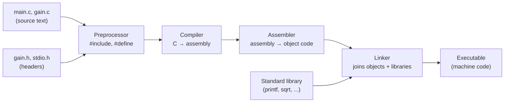

<!-- status: verified -->
# 05-05 · C Fundamentals

| | |
|---|---|
| **Course** | [05 · Programming for Engineers](../README.md) |
| **University equivalent** | The C half of an introductory programming course for EE/CE majors (Kernighan and Ritchie, *The C Programming Language*, 2nd ed., ch. 1–4; King, *C Programming: A Modern Approach*, ch. 1–10, 14–15) |
| **Prerequisites** | [05-01 Python Fundamentals](05-01-python-fundamentals.md), [05-04 Jupyter, Testing and Reproducible Workflows](05-04-reproducible-workflows.md); [08-01 Number Systems and Codes](../../08-digital-logic-design/chapters/08-01-number-systems-and-codes.md) is helpful but not required |
| **Estimated study hours** | 10 |
| **Last verified** | 2026-11-19 |

**Learning objectives.** After this chapter you can:

1. Trace a C program from source text to executable through the preprocessor, compiler, assembler and linker, and diagnose which stage an error comes from.
2. Choose C integer and floating types for a quantity, predict the result of integer division, modulo, promotion and signed/unsigned conversion, and print values with the right `printf` formats.
3. Write C functions with prototypes in header files, organize a program across several source files, and use `static` for internal linkage and persistent state.
4. Use the preprocessor safely (include guards, constants, conditional compilation) and recognize the classic macro pitfalls.
5. Explain undefined behavior, recognize common causes (signed overflow, uninitialized variables, bad shifts), and catch them with compiler warnings and sanitizers.

## 1. Big picture

C is the language closest to the hardware that is still portable. A C statement maps onto a handful of machine instructions; there is no interpreter, no garbage collector and no run-time checking unless you ask for it. That is why the software nearest the silicon is written in C: microcontroller firmware, operating-system kernels and device drivers, boot code, and the run-time libraries of other languages (the standard Python interpreter, CPython, is itself a C program). It is also why C programs fail in ways Python programs cannot: an arithmetic overflow or an out-of-range array index is not an error message but **undefined behavior**, which can silently produce wrong answers or open a security hole.

- **Wearables, IoT and automotive:** the firmware on the microcontrollers in these products is overwhelmingly C (with C++ second); it reads sensors, runs control loops and manages power ([18 · Embedded Systems](../../18-embedded-systems-and-microcontrollers/README.md)).
- **SoC bring-up:** the first code to run on new silicon (boot ROM, register tests, drivers) is C, often written by the chip company itself.
- **Datacenter infrastructure:** kernels, network stacks and accelerator drivers are C; performance-critical libraries (NumPy's core, many inference runtimes) are C or C++ under a Python surface.
- **Your diligence lens:** how a team manages C's risks (warnings, sanitizers, coding standards such as MISRA C, testing) says a great deal about its engineering maturity (Section 9).

## 2. Intuition first

**Python checks everything; C trusts you.** When Python runs `x = a + b`, it looks up what `a` and `b` are, picks the right addition, checks for overflow (Python integers simply grow) and creates a new object. C settles all of that *before* the program runs: the **compiler** reads the whole program, knows every variable's type, and emits the one machine instruction that adds two 32-bit registers. Nothing is checked at run time. If the true sum does not fit in 32 bits, the hardware does whatever it does, and the C standard says the program's behavior is undefined.

**A finance analogy, and its limits.** Python is a full-service broker that validates every order; C is direct market access: orders go straight to the exchange, fast and cheap, and a malformed order is executed exactly as sent. Firms using direct access add their own pre-trade risk controls. C programmers do the same with compiler warnings, sanitizers, static analysis and tests (Section 3.8). *Where the analogy breaks:* the C compiler is not a passive pipe. It checks types and many mistakes before the program ever runs, and it may *rewrite* code that contains undefined behavior on the assumption that it never happens, which has no exchange equivalent.

**Compiling is translation in stages.** You write text; four programs turn it into something the processor can execute:



Each stage has its own kind of error. A missing header is a preprocessor error; a type mismatch or syntax error is a compiler error; a function declared but never defined is a **linker** error ("undefined reference"). Knowing which stage complained is half of fixing it.

## 3. Theory

### 3.1 From source to executable

Here is a complete C program. Every C program starts at the function `main`; `#include <stdio.h>` pulls in the declaration of `printf`; `\n` is a newline; `return 0` tells the operating system that the program succeeded.

```c
#include <stdio.h>

int main(void)
{
    int r_ohms = 4700;                         /* every variable has a declared type */
    double c_farads = 100e-9;
    double tau = r_ohms * c_farads;            /* int * double: r_ohms is converted to double */
    printf("tau = %.3f ms\n", tau * 1e3);
    return 0;
}
```

```text
tau = 0.470 ms
```

To build and run it in a terminal (Linux, macOS or WSL), with the warning and safety flags used throughout this course:

```bash
cc -std=c17 -Wall -Wextra -Wpedantic -O1 -g -fsanitize=address,undefined -fno-sanitize-recover=all -o rc rc.c
./rc
```

`-std=c17` selects the language version; `-Wall -Wextra -Wpedantic` turn on warnings (add `-Werror` to make them errors); `-O1` optimizes lightly; `-g` keeps debugging information; `-fsanitize=...` adds run-time checks (Section 3.8), and `-fno-sanitize-recover=all` makes the program stop at the first problem they find (by default the undefined-behavior checks report and carry on). You can stop after each stage to see what it produces: `cc -E rc.c` prints the preprocessed text (several hundred lines, almost all from `stdio.h`); `cc -S rc.c` writes the assembly to `rc.s`; `cc -c rc.c` writes the object file `rc.o`.

**Translation units and the linker.** Each `.c` file, after preprocessing, is a **translation unit**, compiled separately into an object file. The compiler sees one unit at a time, so to call a function defined in another file it needs a **declaration** (also called a **prototype**): the function's name, return type and parameter types. The **definition**, with the body, exists in exactly one unit. Declarations go in a **header file** (`.h`) that every user includes; the linker then connects each call to the one definition. Section 3.6 builds such a program.

### 3.2 Types and their sizes

Every C variable has a fixed type, and the type fixes its size in bytes and how its bits are interpreted.

| Type | Typical size (64-bit Linux/macOS) | On a 32-bit Arm Cortex-M | Holds |
|---|---|---|---|
| `char` | 1 byte | 1 byte | a byte; a character code |
| `short` | 2 | 2 | integer, at least 16 bits |
| `int` | 4 | 4 | integer, at least 16 bits; the "natural" size |
| `long` | 8 | 4 | integer, at least 32 bits |
| `long long` | 8 | 8 | integer, at least 64 bits |
| `float` | 4 | 4 | IEEE 754 binary32, about 7 significant digits |
| `double` | 8 | 8 | IEEE 754 binary64, about 16 significant digits |
| pointer (05-06) | 8 | 4 | a memory address |

The standard fixes only *minimum* ranges; the rest is **implementation-defined**, meaning each compiler and platform chooses and documents it. `long` is the usual trap: 64 bits on Linux and macOS, 32 bits on Windows and on 32-bit microcontrollers. When the exact width matters, as it does for registers, file formats and network packets, use the **fixed-width types** from `<stdint.h>`: `int8_t`, `uint8_t`, `int16_t`, `uint16_t`, `int32_t`, `uint32_t`, `int64_t`, `uint64_t` (05-07 uses them heavily). The operator `sizeof` gives a type's size in bytes:

```c
#include <limits.h>
#include <stdint.h>
#include <stdio.h>

int main(void)
{
    printf("int %zu, long %zu, double %zu, int32_t %zu bytes\n",
           sizeof(int), sizeof(long), sizeof(double), sizeof(int32_t));
    printf("INT_MAX = %d, UINT32_MAX = %u\n", INT_MAX, (unsigned)UINT32_MAX);
    return 0;
}
```

```text
int 4, long 8, double 8, int32_t 4 bytes
INT_MAX = 2147483647, UINT32_MAX = 4294967295
```

(This output is for 64-bit Linux and macOS; on a Cortex-M, `long` would print 4.)

**Signed and unsigned.** Each integer type comes in a signed version (the default) and an `unsigned` version. An $n$-bit unsigned type holds $0$ to $2^n - 1$; an $n$-bit signed type holds $-2^{n-1}$ to $2^{n-1} - 1$ in **two's complement**, which C23 made mandatory and which every current processor uses (05-07 derives it). For 32 bits: unsigned 0 to 4,294,967,295; signed −2,147,483,648 to 2,147,483,647.

**Literals.** `42` is an `int`, `42u` unsigned, `42L` long; `0x2A` is hexadecimal; `3.3` is a `double` and `3.3f` a `float`; `'A'` is a character constant (an `int` with value 65); `"text"` is a string (05-06).

**`printf` formats** must match the argument's type: `%d` int, `%u` unsigned, `%ld` long, `%lld` long long, `%zu` the result of `sizeof`, `%x` hexadecimal, `%f`/`%e`/`%g` double (with precision, e.g. `%.3f`), `%c` character, `%s` string. A mismatch is undefined behavior; `-Wall` warns about it.

### 3.3 Integer arithmetic: the rules Python never taught you

**Integer division truncates toward zero.** In C, `7 / 2` is 3 and `-7 / 2` is −3; the remainder `%` takes the sign of the dividend, so `-7 % 2` is −1. Python's `//` rounds toward minus infinity (`-7 // 2` is −4 and `-7 % 2` is 1). Both languages keep the identity

$$
(a / b)\times b + a \,\%\, b = a,
$$

so they differ only for negative operands. Mixed integer and floating arithmetic converts the integer to floating point first, so `7 / 2.0` is 3.5, but `1 / 3 * 3.0` is 0.0: `1 / 3` is evaluated first, in integers, and is 0. The order of operations matters (Example 05-05.1).

**Unsigned arithmetic wraps; signed overflow is undefined.** Unsigned arithmetic is defined modulo $2^n$: for 32-bit `unsigned`, $0 - 1$ is 4,294,967,295. That is useful for counters and checksums. Signed overflow, such as `INT_MAX + 1`, is **undefined behavior**: the standard places no requirement on what happens (Section 3.8). C23's two's-complement rule fixed how signed values are *stored*, not what overflow does.

**Integer promotion.** Arithmetic is never done in types narrower than `int`. Operands of type `char`, `short`, `int8_t`, `uint8_t`, `int16_t` and `uint16_t` are first converted to `int`, on any platform where `int` is wider than 16 bits. (On 8- and 16-bit microcontrollers, where `int` is 16 bits, a `uint16_t` does not fit in `int` and is promoted to `unsigned int` instead: the same source can compute differently on two chips.) So with `uint8_t a = 200, b = 100`, the expression `a + b` is the `int` 300; only when you store it back into a `uint8_t` is it reduced modulo 256, to 44.

**The usual arithmetic conversions.** When an operator's operands have different types, both are converted to a common type: if either is floating, to floating; otherwise, roughly, to the larger type, and **if one operand is unsigned and the other signed of the same size, the signed one is converted to unsigned**. That last rule produces one of C's best-known bugs: `-1 < 1u` is *false*, because −1 becomes 4,294,967,295 (Example 05-05.3).

**Float to integer conversion truncates toward zero** (`(int)2.9` is 2, `(int)-2.9` is −2). If the value does not fit in the target type, the behavior is undefined. An out-of-range conversion of exactly this kind, a 64-bit floating value into a 16-bit signed integer, ended the first Ariane 5 flight in 1996: the software was written in Ada, where the conversion raised an "Operand Error" that had been left unprotected, and the inertial reference system shut down 37 seconds after ignition ([R-093](../../../reference/research-log.md#r-093--software-failures-from-numeric-conversions-and-counters)) **[Established]**.

> **Math refresher — modular arithmetic.** $a \bmod m$ is the remainder after removing whole multiples of $m$, taken in $[0, m)$. Arithmetic modulo $m$ "wraps": with $m = 256$, $200 + 100 = 300 \equiv 44$, and $0 - 1 \equiv 255$. An $n$-bit unsigned register computes exactly modulo $2^n$, which is why unsigned overflow in C is well defined. Mathematically, C's `%` is not the modulo operation for negative operands: `-1 % 8` is −1, while $-1 \bmod 8 = 7$.

### 3.4 Operators and expressions

C's arithmetic (`+ - * / %`), comparison (`== != < <= > >=`) and logical (`&& || !`) operators look like Python's (`&&` is `and`, `||` is `or`, `!` is `not`), and `&&`/`||` short-circuit as in Python. The differences that bite:

- **Comparisons and logic produce `int`**, 1 for true and 0 for false. Any nonzero value counts as true in a condition. (C23 makes `bool`, `true` and `false` keywords; in C17 include `<stdbool.h>`.)
- **`=` is assignment, `==` comparison.** `if (x = 0)` assigns 0 to `x` and is always false. With `-Wall`, compilers warn.
- **Increment and decrement:** `i++` and `++i` add 1 (the value of the expression is the old or new value respectively). Never modify a variable twice in one expression (`i = i++ + 1` is undefined).
- **Bitwise operators** `& | ^ ~ << >>` work on the bits of integers (05-07). Their precedence holds two traps. The binary `&`, `^` and `|` bind **less tightly than comparison**, so `x & 1 == 0` means `x & (1 == 0)`, which is always 0: write `(x & 1) == 0`. The shifts `<<` and `>>` bind more tightly than comparison but **less tightly than `+` and `-`**, so `1 << n - 1` means `1 << (n - 1)` and `x << 2 + 1` shifts by 3. (`~` is unary and binds tightly, like `-x`.) When bitwise and arithmetic operators mix, parenthesize.
- **The conditional operator** `c ? a : b` is Python's `a if c else b`.
- **Compound assignment** `x += 3` is `x = x + 3`, as in Python.

Compilers catch the precedence trap when warnings are on:

```c
// expect: warning -Wparentheses
int is_even(int x)
{
    return x & 1 == 0;                         /* intended (x & 1) == 0 */
}
```

GCC reports "suggest parentheses around comparison in operand of '&'" for this function (the exact words vary by compiler); with `-Werror` the build fails, which is why this course compiles everything with it.

### 3.5 Control flow

C has the familiar structures, with braces instead of indentation (indentation is for humans only):

- `if (cond) { ... } else if (cond) { ... } else { ... }`
- `while (cond) { ... }` and `do { ... } while (cond);` (the body runs at least once)
- `for (init; cond; step) { ... }`, e.g. `for (int i = 0; i < n; i++)`, which counts 0 to $n - 1$
- `break` leaves a loop or `switch`; `continue` jumps to the next iteration
- `switch (value) { case 1: ...; break; default: ...; }` selects by integer value. **Cases fall through** to the next one unless you write `break`, a classic source of bugs (GCC warns with `-Wimplicit-fallthrough`, which `-Wextra` enables; Clang has the same flag but `-Wextra` does not turn it on, so add it explicitly).

C has no exceptions. Functions report failure through their return value (often 0 for success and a negative code for errors, or a special value), and callers must check it. The following program uses most of these structures to classify ADC readings:

```c
#include <stdio.h>

/* Return 0 for a normal reading, 1 near either rail, -1 if the code is impossible. */
int classify(int code, int bits)
{
    int full_scale = (1 << bits) - 1;          /* 2^bits - 1, e.g. 4095 for 12 bits */
    if (code < 0 || code > full_scale) {
        return -1;
    } else if (code < 16 || code > full_scale - 16) {
        return 1;
    }
    return 0;
}

int main(void)
{
    const int readings[] = {2048, 4090, 7, 5000};
    int counts[3] = {0, 0, 0};                 /* index 0: bad, 1: normal, 2: near rail */
    for (int i = 0; i < 4; i++) {
        switch (classify(readings[i], 12)) {
        case -1: counts[0]++; break;
        case 0:  counts[1]++; break;
        default: counts[2]++; break;
        }
    }
    printf("bad %d, normal %d, near rail %d\n", counts[0], counts[1], counts[2]);
    return 0;
}
```

```text
bad 1, normal 1, near rail 2
```

### 3.6 Functions, headers and multi-file programs

A C function declares its return type and each parameter's type. **Arguments are passed by value**: the function receives copies, so assigning to a parameter does not change the caller's variable (a function that must change the caller's data receives its address, 05-06). A function that returns nothing has return type `void`; a function with no parameters is written `f(void)`.

**Headers and include guards.** A header declares what a module offers. Because a header may be included several times (directly and through other headers), it is wrapped in an **include guard**, so that its contents are processed only once per translation unit. Here is a small first-order filter module: an exponential moving average, the digital twin of an RC low-pass filter ([07-02](../../07-circuit-analysis-2-transient-and-ac/chapters/07-02-first-order-rc-rl-transients.md)).

```c
// file: ema.h
#ifndef EMA_H
#define EMA_H

/* Smoothing factor for sample period t_s and time constant tau (same units). */
double ema_alpha(double t_s, double tau);

/* One filter step: move y a fraction alpha of the way toward the new input x. */
double ema_step(double y, double x, double alpha);

#endif /* EMA_H */
```

```c
// file: ema.c
#include <math.h>
#include "ema.h"

double ema_alpha(double t_s, double tau)
{
    return 1.0 - exp(-t_s / tau);
}

double ema_step(double y, double x, double alpha)
{
    return y + alpha * (x - y);
}
```

```c
// with: ema.c
#include <stdio.h>
#include "ema.h"

int main(void)
{
    double alpha = ema_alpha(1e-3, 10e-3);     /* 1 ms samples, 10 ms time constant */
    double y = 0.0;
    for (int n = 1; n <= 10; n++) {
        y = ema_step(y, 1.0, alpha);           /* a unit step input */
    }
    printf("alpha = %.6f, after 10 samples y = %.6f\n", alpha, y);
    return 0;
}
```

```text
alpha = 0.095163, after 10 samples y = 0.632121
```

`#include "ema.h"` (quotes) searches the directory of the file being compiled first, then the folders given with `-I`, then the system's; `#include <stdio.h>` (angle brackets) skips the first of those. Note that `ema.c` includes its own header. C's linker matches functions by **name only**, not by parameter types, so if a definition drifted from its declaration (`float` parameters in one, `double` in the other), the program would still link and every call would be undefined behavior. Including the header in the defining file makes the compiler compare the two and reject any mismatch. The program is built from two translation units, `cc ... main.c ema.c -lm` (`-lm` links the math library on Linux). After 10 samples, one time constant, the output has reached $1 - e^{-1}$ = 63.2% of the step, exactly like the capacitor voltage in 07-02 (Example 05-05.4 derives why).

**`static` has two meanings.** On a function or a file-level variable, `static` means **internal linkage**: the name is private to its translation unit, invisible to the linker, which prevents clashes and documents intent. On a variable inside a function, `static` means the variable **persists** between calls (it is created once, initialized once, and lives for the whole program), which is how firmware keeps a filter's state or a call counter without global variables:

```c
#include <stdio.h>

static int next_sequence_number(void)          /* private to this file */
{
    static int count = 0;                      /* initialized once, keeps its value */
    return ++count;
}

int main(void)
{
    int a = next_sequence_number();
    int b = next_sequence_number();
    int c = next_sequence_number();
    printf("%d %d %d\n", a, b, c);
    return 0;
}
```

```text
1 2 3
```

**Scope.** A variable declared inside braces exists only inside them. A variable declared outside every function is **global** (file scope): visible to every function in the file and, unless `static`, to other files through an `extern` declaration. Globals make programs hard to test and reason about; firmware uses them sparingly and deliberately.

### 3.7 The preprocessor

Before compilation, the **preprocessor** rewrites the source text according to lines that begin with `#`. It knows nothing about C's types or scopes; it substitutes text.

- `#include <file>` pastes the file's text in place.
- `#define NAME replacement` substitutes text: `#define ADC_BITS 12`. By convention macro names are capitals.
- **Function-like macros** `#define SQUARE(x) ((x) * (x))` substitute their arguments textually. Without the parentheses, `SQUARE(1 + 2)` would become `1 + 2 * 1 + 2` = 5. Even with them, `SQUARE(i++)` increments `i` twice (undefined behavior), because the argument text appears twice.
- **Conditional compilation:** `#if`, `#ifdef NAME`, `#ifndef`, `#else`, `#endif` include or exclude code: debug-only logging, code for one microcontroller but not another, feature switches. `-DNAME=value` on the command line defines a macro for one build.
- `#error "message"` stops the build with a message, useful when a configuration is invalid.

Modern C offers safer alternatives for most macro uses: `static inline` functions (type-checked, arguments evaluated once), `enum` constants and `const` variables, and **compile-time assertions** with `_Static_assert` (C11; spelled `static_assert` in C23):

```c
#include <stdio.h>

#define SQUARE_BAD(x) x * x                    /* no parentheses: the textbook bug */
#define SQUARE(x) ((x) * (x))

static inline int square(int x) { return x * x; }

#define ADC_BITS 12
_Static_assert(ADC_BITS >= 8 && ADC_BITS <= 16, "unsupported ADC resolution");

int main(void)
{
    int i = 3;
    printf("%d %d %d\n", SQUARE_BAD(1 + 2), SQUARE(1 + 2), square(i + 1));
    printf("full scale %d\n", (1 << ADC_BITS) - 1);
    return 0;
}
```

```text
5 9 16
full scale 4095
```

The limits encode an assumption made elsewhere in the code: codes are stored in `uint16_t`, so a converter wider than 16 bits would be silently truncated. If someone later sets `ADC_BITS` to 24, the build fails with the assertion's message instead of producing a firmware image that silently loses the top bits.

### 3.8 Undefined behavior and how to catch it

The C standard classifies programs whose behavior it does not define. Three levels matter:

- **Implementation-defined:** the compiler must choose and document a behavior (the size of `long`, whether `char` is signed).
- **Unspecified:** one of several behaviors, not documented (the order in which a function's arguments are evaluated).
- **Undefined behavior (UB):** the standard imposes *no requirements at all*. The program may crash, print garbage, appear to work, or work until the compiler version changes.

UB is not merely "the hardware does something odd". Optimizing compilers assume UB never happens and transform code on that basis. A classic case: given `int x`, a test written as `if (x + 1 < x)` to detect overflow can be compiled to nothing, because if signed overflow cannot happen, $x + 1$ is always greater than $x$. The overflow check is deleted; the overflow remains.

Common causes of UB, most of which this course meets again:

| Cause | Example | Where |
|---|---|---|
| Signed integer overflow | `INT_MAX + 1` | this chapter |
| Reading an uninitialized variable | `int x; printf("%d", x);` | this chapter |
| Shifting by the width or more, or a negative amount | `1 << 32` for 32-bit `int` | 05-07 |
| Division by zero | `n / 0` | this chapter |
| Out-of-range float-to-integer conversion | `(int16_t)1e9` from a `double` | this chapter |
| Out-of-bounds array access, use after free | `a[10]` for `int a[10]` | 05-06 |
| Mismatched `printf` format | `printf("%d", 3.0)` | this chapter |

**Defense in depth.** No single tool catches everything, so professionals layer them:

1. **Warnings as errors** (`-Wall -Wextra -Wpedantic -Werror`): catch many mistakes at compile time, free.
2. **Sanitizers** (`-fsanitize=undefined,address`, with `-fno-sanitize-recover=all` to stop at the first error): the compiler inserts run-time checks that report UB and memory errors with the file and line. They cost speed (Clang's documentation gives a typical 2× slowdown for AddressSanitizer) and memory (more for programs with many small allocations), so they are used in testing, not in shipped firmware.
3. **Static analysis** tools examine code without running it.
4. **Coding standards** such as MISRA C (automotive and safety-critical) and SEI CERT C restrict the language to safer subsets (Section 9).
5. **Tests**, run under sanitizers, in CI (05-04).

This course's C labs use layers 1, 2 and 5 on every test ([`tools/run_c.py`](../../../tools/run_c.py)). Here is UBSan catching a signed overflow that would otherwise pass unnoticed:

```c
// expect: sanitizer
#include <limits.h>
#include <stdio.h>

int main(void)
{
    volatile int counter = INT_MAX;            /* volatile: stop the compiler folding it away */
    counter = counter + 1;
    printf("%d\n", counter);
    return 0;
}
```

```text
runtime error: signed integer overflow: 2147483647 + 1 cannot be represented in type 'int'
```

Without the sanitizer, this program prints −2147483648 on typical hardware and exits normally: a wrong answer with no warning. With it, the run reports the offending line and, because this course adds `-fno-sanitize-recover=all`, stops there; without that flag UBSan prints the report and lets the program continue.

> **Going deeper — why C has undefined behavior at all.** C was standardized (1989) to run efficiently on machines with different integer representations and trap behaviors. Leaving overflow undefined let each compiler emit the single native add instruction, and later let optimizers assume loop counters never wrap, which enables vectorization. The price is that correctness depends on the programmer. Newer systems languages never make overflow undefined. Rust, for example, stops a debug build with an error on overflow, wraps by default in a release build, and offers `checked_add` and `wrapping_add` to state the intent explicitly; it also forbids most memory errors at compile time; 05-06 discusses why that matters for security.

## 4. Worked examples

### Example 05-05.1 · Converting an ADC code to millivolts

**Setup.** A 12-bit ADC with a 3.3 V reference reports a code $k$ from 0 to 4095; the voltage is $V = k \times 3300\text{ mV}/4096$. Firmware must compute millivolts in integer arithmetic (many small microcontrollers have no floating-point hardware). Compare three expressions for $k$ = 1000: (a) `k / 4096 * 3300`, (b) `k * 3300 / 4096`, (c) `(k * 3300 + 2048) / 4096`.

**Solution.** The exact value is $1000 \times 3300/4096$ = 805.66 mV.

```c
#include <stdio.h>

int main(void)
{
    int k = 1000;
    printf("(a) %d mV\n", k / 4096 * 3300);           /* divide first */
    printf("(b) %d mV\n", k * 3300 / 4096);           /* multiply first, truncate */
    printf("(c) %d mV\n", (k * 3300 + 2048) / 4096);  /* add half the divisor: round */
    return 0;
}
```

```text
(a) 0 mV
(b) 805 mV
(c) 806 mV
```

(a) **0 mV**: `1000 / 4096` is 0 in integer division, and $0 \times 3300 = 0$. Dividing first throws away everything. (b) **805 mV**: multiplying first keeps the precision, and the final division truncates 805.66 toward zero. (c) **806 mV**: adding half the divisor before dividing rounds to nearest, because $\lfloor (a + b/2)/b \rfloor$ rounds $a/b$ to the nearest integer for non-negative values.

**Overflow check.** Multiplying first needs a large enough type: the largest product is $4095 \times 3300 + 2048$ = 13,515,548, far below `INT_MAX` (2,147,483,647) for a 32-bit `int`, but far above the 32,767 of a 16-bit `int`, which some 8- and 16-bit microcontrollers use. Portable firmware writes `(int32_t)k * 3300`.

**Units check.** code × mV / code = mV ✓.

**Sanity check.** Mid-scale, $k$ = 2048, gives exactly 1650 mV, half the reference ✓.

### Example 05-05.2 · Division and remainder: C versus Python

**Setup.** (a) Evaluate `-7 / 2` and `-7 % 2` in C and `-7 // 2` and `-7 % 2` in Python. (b) A circular buffer of 8 entries steps backward with `(i - 1) % 8`. What index does C produce from `i = 0`, and how should the expression be written?

**Solution.**

```c
#include <stdio.h>

int main(void)
{
    printf("%d %d\n", -7 / 2, -7 % 2);
    int i = 0, n = 8;
    printf("%d %d\n", (i - 1) % n, ((i - 1) % n + n) % n);
    return 0;
}
```

```text
-3 -1
-1 7
```

```python
print(-7 // 2, -7 % 2, (0 - 1) % 8)
```

```text
-4 1 7
```

(a) C gives **−3** and **−1** (truncation toward zero); Python gives **−4** and **1** (floor). Both satisfy $(a/b)b + a\%b = a$: in C, $(-3)(2) + (-1) = -7$; in Python, $(-4)(2) + 1 = -7$ ✓.

(b) In C, `(0 - 1) % 8` is **−1**, and using it as an array index reads memory before the buffer (undefined behavior, 05-06). Adding `n` before a second `%` maps it into $[0, n)$: the result is **7**, the correct "previous" slot. Python's `%` already returns 7. Code translated from Python to C (or the reverse) breaks exactly here; when $n$ is a power of two, firmware often uses `(i - 1) & (n - 1)` instead (05-07).

**Sanity check.** For non-negative operands the languages agree: `7 / 2` is 3 and `7 % 2` is 1 in both ✓.

### Example 05-05.3 · A comparison that lies: signed versus unsigned

**Setup.** A function receives a temperature offset `int delta = -1` and compares it with a threshold stored as `unsigned limit = 10`. The test `delta < limit` evaluates to false. Explain, and fix.

**Solution.** By the usual arithmetic conversions (Section 3.3), an `int` compared with an `unsigned int` is converted to `unsigned`. The bit pattern of −1 in 32-bit two's complement is all ones, which as an unsigned number is $2^{32} - 1$ = **4,294,967,295**. So the comparison actually performed is $4{,}294{,}967{,}295 < 10$: false.

```c
#include <stdio.h>

int main(void)
{
    int delta = -1;
    unsigned limit = 10;
    printf("%u\n", (unsigned)delta);
    printf("%d %d\n", (unsigned)delta < limit, delta < (int)limit);
    return 0;
}
```

```text
4294967295
0 1
```

Casting the unsigned operand to `int` (safe here, because 10 fits) gives the intended answer, 1 (true). The compiler can warn about the original comparison:

```c
// expect: warning -Wsign-compare
int below_limit(int delta, unsigned limit)
{
    return delta < limit;
}
```

GCC's `-Wextra` enables `-Wsign-compare`, which flags this comparison of integers of different signedness. The robust habit: keep quantities that can be negative in signed types, and convert deliberately at the boundary.

**Sanity check.** $2^{32} - 1$ = 4,294,967,295 is `UINT32_MAX`, printed in Section 3.2 ✓.

### Example 05-05.4 · How many samples does a digital filter need to settle?

**Setup.** The filter of Section 3.6 runs with sample period $T_s$ = 1 ms and time constant τ = 10 ms. (a) Derive the response to a unit step. (b) Find $\alpha$ and the output after 10 samples. (c) How many samples until the output is within 1% of its final value?

**Solution.** (a) The update $y_n = y_{n-1} + \alpha(x_n - y_{n-1})$ with $x_n = 1$ can be rewritten in terms of the error $e_n = 1 - y_n$:

$$
e_n = 1 - y_{n-1} - \alpha(1 - y_{n-1}) = (1 - \alpha)\,e_{n-1}.
$$

Starting from $y_0 = 0$ ($e_0 = 1$), the error shrinks geometrically: $e_n = (1 - \alpha)^n$, so $y_n = 1 - (1-\alpha)^n$. With $\alpha = 1 - e^{-T_s/\tau}$, $(1 - \alpha)^n = e^{-nT_s/\tau}$, and the filter reproduces the RC step response $1 - e^{-t/\tau}$ exactly at the sample times $t = nT_s$.

(b) $\alpha = 1 - e^{-0.1}$ = **0.095163**; after 10 samples ($t$ = τ), $y_{10} = 1 - e^{-1}$ = **0.632121**, as the program in Section 3.6 printed.

(c) Require $(1 - \alpha)^n \le 0.01$: $n \ge \ln(0.01)/\ln(1-\alpha) = 4.605/0.1 = 46.05$, so **47 samples** (47 ms, 4.7 time constants: the continuous-time answer, $\ln 100$ = 4.6 time constants, rounded up to a whole sample).

```c
// with: ema.c
#include <stdio.h>
#include "ema.h"

int main(void)
{
    double alpha = ema_alpha(1e-3, 10e-3), y = 0.0;
    int n = 0;
    while (1.0 - y > 0.01) {                   /* simulate until within 1% */
        y = ema_step(y, 1.0, alpha);
        n++;
    }
    printf("%d samples, y = %.4f\n", n, y);
    return 0;
}
```

```text
47 samples, y = 0.9909
```

The simulation agrees with the formula.

**Units check.** $T_s/\tau$ is s/s, dimensionless, as an exponent must be ✓.

**Sanity check.** Settling to 1% takes $\ln 100 \approx 4.6$ time constants for any first-order system (07-02) ✓.

### Example 05-05.5 · Sizing an accumulator for signal energy

**Setup.** A 16-bit audio ADC produces two's-complement samples from −32,768 to +32,767. Firmware sums the squares of the samples to estimate signal power. (a) How many worst-case squared samples fit in an `int32_t` accumulator? (b) In an `int64_t`? (c) Show what goes wrong with `int`.

**Solution.** (a) The largest square comes from the most negative sample: $(-32{,}768)^2 = 2^{30}$ = 1,073,741,824. The `int32_t` maximum is $2^{31} - 1$ = 2,147,483,647, so $\lfloor (2^{31} - 1)/2^{30} \rfloor$ = **1** sample: two worst-case squares make exactly $2^{31}$, one more than the type holds. (Had the samples been limited to ±32,767, two would fit, a reminder that two's-complement ranges are asymmetric and the worst case is the negative end.) (b) For `int64_t`, $\lfloor (2^{63}-1)/2^{30} \rfloor = 2^{33} - 1$ = **8.59×10⁹** samples: at 48,000 samples per second, about **49.7 hours** of continuous worst-case signal. (c) The second worst-case square overflows `int`:

```c
// expect: sanitizer
#include <stdint.h>
#include <stdio.h>

int main(void)
{
    volatile int16_t s = -32768;
    int energy = 0;
    for (int n = 0; n < 2; n++) {
        energy += s * s;                       /* int arithmetic: overflows on the second pass */
    }
    printf("%d\n", energy);
    return 0;
}
```

```text
runtime error: signed integer overflow
```

The fix is to accumulate in a wide type and convert *before* multiplying: `int64_t energy = 0; energy += (int64_t)s * s;`. Writing `energy += s * s` with an `int64_t` accumulator is not enough: `s * s` is still computed in `int` (each operand is promoted only to `int`), and only its result is widened. For a 16-bit sample that product fits (it is at most $2^{30}$); for a 32-bit sample it would not.

**Units check.** Squared counts accumulate in counts²; the bound is a dimensionless sample count ✓.

**Sanity check.** $2^{63}/2^{30} = 2^{33} \approx 8.6\times10^9$, and $8.6\times10^9/(48{,}000 \times 3600) \approx 50$ h ✓. The `int32_t` answer, 1, is a reminder to design accumulators from the worst case, with margin: a power meter that integrates for one second at 48,000 samples per second needs $30 + \log_2 48{,}000 \approx 45.6$ bits of magnitude plus a sign bit, so **47** bits, and `int64_t` leaves about 17 bits of margin.

### Answer key

<!-- answer-key -->
| ID | Quantity | Value | Unit |
|---|---|---|---|
| T 05-05.a | τ for 4.7 kΩ and 100 nF | 0.470 | ms |
| T 05-05.b | INT_MAX | 2147483647 | — |
| T 05-05.c | UINT32_MAX | 4294967295 | — |
| T 05-05.d | SQUARE_BAD(1 + 2) | 5 | — |
| Ex 05-05.1a | divide first | 0 | mV |
| Ex 05-05.1b | multiply first, truncated | 805 | mV |
| Ex 05-05.1c | rounded | 806 | mV |
| Ex 05-05.1d | largest intermediate product | 13515548 | — |
| Ex 05-05.2a | C: −7 / 2 | −3 | — |
| Ex 05-05.2b | C: −7 % 2 | −1 | — |
| Ex 05-05.2c | Python: −7 // 2 | −4 | — |
| Ex 05-05.2d | Python: −7 % 2 | 1 | — |
| Ex 05-05.2e | corrected previous index from 0 | 7 | — |
| Ex 05-05.3a | −1 converted to 32-bit unsigned | 4294967295 | — |
| Ex 05-05.4a | α | 0.095163 | — |
| Ex 05-05.4b | output after 10 samples | 0.632121 | — |
| Ex 05-05.4c | samples to settle within 1% | 47 | — |
| Ex 05-05.5a | worst-case squares in int32_t | 1 | — |
| Ex 05-05.5b | worst-case squares in int64_t | 8.59×10^9 | — |
| Ex 05-05.5c | hours of 48 kS/s worst-case audio | 49.7 | h |
| Ex 05-05.5d | signed accumulator width for one second at 48 kS/s | 47 | bits |

## 5. Simulate it

Open [labs/05-05-lab/](../labs/05-05-lab/README.md). There is no notebook this time: the lab is a small C module with a self-checking test, built and run by [`tools/run_c.py`](../../../tools/run_c.py) (or by hand with the commands in the handout). It contains:

1. **The four stages, by hand:** run the preprocessor, compiler, assembler and linker one at a time on the lab's sources and inspect each output. *Predict first:* how many lines will `cc -E` produce for a 50-line file?
2. **A sensor module with tests:** ADC-to-millivolt conversion and the moving-average filter of Section 3.6, checked by `adc_test.c`. *Predict first:* which of the provided test cases fails if the rounding term is removed?
3. **Warnings and sanitizers:** compile `ub_demo.c` with and without `-fsanitize=undefined` and compare.
4. **A linker error on purpose:** remove a source file from the build and read the message.

## 6. Engineering tradeoffs

| Knob | Improves | Costs | Typical decision owner |
|---|---|---|---|
| C versus a higher-level language (Python, C++, Rust) | C: smallest code, predictable timing, every MCU toolchain supports it | Manual memory and overflow safety; more code per feature | Firmware architect |
| Integer (fixed-point) versus floating-point math | Integer: speed and determinism on MCUs without an FPU, less energy | Range and rounding must be managed by hand (Example 05-05.1) | Firmware engineer, by hardware |
| `int` versus fixed-width `int32_t` | Fixed width: portable, explicit | Verbosity; promotion rules still apply | Coding standard |
| Macros versus `static inline` functions | Macros: work with any type, compile-time tricks | Textual pitfalls, no type checking, hard to debug | Team convention (MISRA discourages function-like macros) |
| Optimization level (`-O0` … `-O3`, `-Os`) | Higher: speed; `-Os`: size | Harder debugging; latent UB can appear when optimization changes | Build/release engineer |
| Sanitizers and warnings-as-errors in CI | Bugs caught before shipping | Build time; sanitized runs typically about 2× slower and use more memory | Engineering management |

## 7. Numbers to know

| Quantity | Value | Note |
|---|---|---|
| `int` on desktop and 32-bit MCUs | 32 bits: −2,147,483,648 to 2,147,483,647 | at least 16 bits by the standard |
| `long` | 64 bits on Linux/macOS; 32 bits on Windows and Cortex-M | the portability trap |
| 32-bit unsigned maximum | 4,294,967,295 ($2^{32} - 1$) | |
| 16-bit signed range | −32,768 to 32,767 | audio and many ADCs |
| `float` / `double` precision | about 7 / 16 significant digits | 05-02 |
| C standard revisions | C89/C90, C99, C11, C17, C23 (published Oct 2024) | [R-092](../../../reference/research-log.md#r-092--c-language-standards-coding-standards-and-embedded-usage) |
| C share among embedded/IoT developers (constrained devices) | 55% (C++ 36%), 2024 survey | [R-092](../../../reference/research-log.md#r-092--c-language-standards-coding-standards-and-embedded-usage) |
| AddressSanitizer slowdown | typically about 2× (Clang documentation); memory overhead varies | testing only |

## 8. Common mistakes

1. **Integer division where you meant real division:** `1 / 3` is 0; `k / 4096 * 3300` is 0 for every 12-bit code. Multiply first, or use a floating constant (`1.0 / 3`).
2. **Assuming C's `%` is mathematical modulo.** It is negative for negative dividends; wrap indices with `((i % n) + n) % n`.
3. **Mixing signed and unsigned in comparisons** (`-1 < 1u` is false). Enable `-Wextra` and keep signedness consistent.
4. **Relying on signed overflow wrapping.** It is undefined; use unsigned types for wrapping counters, or a wider type.
5. **Widening after the overflow:** `int64_t e = a * b;` multiplies in `int` first. Cast an operand: `(int64_t)a * b`.
6. **Unparenthesized macros, and macro arguments with side effects** (`SQUARE(i++)`). Prefer `static inline` functions.
7. **`switch` without `break`,** and `if (x = 0)`. Compile with warnings as errors.
8. **Ignoring compiler warnings.** Each one is a potential bug the compiler found for free.

## 9. Practitioner lens

### State of the art (as of Nov 2026)

- **The language standard.** The current standard is ISO/IEC 9899:2024, known as **C23** (published October 2024; it calls itself the 2023 revision, `__STDC_VERSION__` 202311L). It makes two's complement mandatory, makes `bool`, `true`, `false`, `static_assert` and others keywords, and adds `nullptr`, `constexpr` objects, `typeof`, binary literals, `#embed` and bit-precise integers `_BitInt(N)`. GCC 15 (April 2025) made C23 its default dialect ([R-092](../../../reference/research-log.md#r-092--c-language-standards-coding-standards-and-embedded-usage)) **[Established]**. In practice, embedded toolchains and safety standards lag: firmware commonly targets C99 or C11/C17.
- **Coding standards.** MISRA C, born in the automotive industry in the 1990s, is the dominant safety-critical subset; the current edition, **MISRA C:2025** (March 2025), still targets C11/C18 rather than C23, and MISRA has published an addendum assessing how its guidelines apply to Rust. The SEI CERT C Coding Standard (2016 edition, with a living wiki) focuses on security ([R-092](../../../reference/research-log.md#r-092--c-language-standards-coding-standards-and-embedded-usage)) **[Established]**.
- **Usage.** C remains the first language of constrained devices: 55% of respondents to the Eclipse Foundation's 2024 IoT and embedded survey (about 750 developers) used C for constrained devices, against 36% for C++ and 32% for Python. Across all developers, C is far smaller: about 22% of Stack Overflow's 2025 and 2026 respondents used it, against 58% for Python ([R-092](../../../reference/research-log.md#r-092--c-language-standards-coding-standards-and-embedded-usage), [R-087](../../../reference/research-log.md#r-087--python-releases-floating-point-and-developer-usage)) **[Industry estimate]**: self-selected samples.

### Why it matters commercially

For an MCU or SoC vendor, the C software stack (drivers, hardware abstraction layers, middleware, example code, the compiler support itself) is part of the product: a chip whose SDK is buggy or hard to use loses design wins to a slightly worse chip with better software. In acquisitions, firmware is often the least-documented asset and the costliest to integrate; its quality (warnings policy, test coverage, static analysis, coding-standard compliance, how undefined behavior is managed) is a diligence item, and safety-certified code (automotive ISO 26262, industrial IEC 61508) carries real value because re-certification is slow and expensive. Memory-safety pressure on C, and the rise of Rust in kernels and firmware, is a strategic trend in its own right (05-06).

### Marketing vs Reality

- **"Our firmware is MISRA-compliant."** *Reality:* compliance permits documented deviations, and the claim may cover only part of the code or only the mandatory rules. Ask for the compliance matrix, the number of deviations and which tool checked it.
- **"Written in highly optimized C."** *Reality:* speed comes from algorithms and data layout more than from language; heavily hand-optimized C is often the hardest to maintain and the most likely to hide undefined behavior. Ask how they verify it.
- **"Zero compiler warnings."** *Reality:* meaningful only with the warning level stated; zero warnings at the default level means little. Ask for the flags.
- **"Portable across architectures."** *Reality:* code that assumes `long` is 64 bits, or a particular byte order (05-07), breaks quietly on a new MCU. Ask which platforms CI actually builds and tests.

### Questions for engineering leaders

1. **"What compiler warning flags do you build with, and are warnings errors?"** *Strong:* specific flags (`-Wall -Wextra -Werror` or a vendor equivalent) and a policy for exceptions. *Evasive:* "We fix warnings when we have time."
2. **"How do you find undefined behavior and memory errors before shipping?"** *Strong:* sanitizers in host-side tests, static analysis, fuzzing, with results tracked. *Evasive:* "Our engineers are experienced."
3. **"Which C standard and coding standard do you follow, and how many deviations do you carry?"** *Strong:* a named standard (C11, MISRA C:2023 or 2025) with a tracked deviation list. *Evasive:* "Industry best practice."
4. **"How much of your firmware can be tested on a PC, without hardware?"** *Strong:* hardware abstraction with host-run unit tests in CI. *Evasive:* "Everything needs the board."
5. **"What is your position on Rust or C++ for new firmware?"** *Strong:* a reasoned answer about toolchain support, certification, team skills and memory safety. *Evasive:* dismissal or enthusiasm without a plan.

## 10. Concept check

1. A build fails with "undefined reference to `ema_step`". Which stage produced the error, and what are the likely causes?

   <details><summary>Answer</summary>

   The linker. The compiler accepted the call because a declaration (from `ema.h`) was visible, but no object file given to the linker defines a function of that name: usually `ema.c` was left out of the build command, or the definition's name is spelled differently, or the definition is `static` (private to its file). A mismatch in *parameter types* does not cause this error: C's linker matches names only, so a definition whose parameters differ from the declaration links silently and the calls are undefined behavior. The defense is for `ema.c` to include `ema.h`, so that the compiler compares declaration and definition (and also rejects a `static` definition that contradicts the header).

   </details>

2. What are `7 / 2`, `-7 / 2` and `-7 % 2` in C, and why might code ported from Python break?

   <details><summary>Answer</summary>

   3, −3 and −1. C truncates toward zero; Python's `//` floors (−4) and its `%` follows the divisor's sign (1). Index arithmetic such as `(i - 1) % n` gives −1 in C where Python gives n − 1.

   </details>

3. Why is `uint8_t a = 200, b = 100; int s = a + b;` equal to 300, while `uint8_t t = a + b;` is 44?

   <details><summary>Answer</summary>

   Integer promotion converts both `uint8_t` operands to `int` before adding, so the sum is the `int` 300. Storing 300 into a `uint8_t` reduces it modulo 256, giving 44.

   </details>

4. What is the difference between implementation-defined and undefined behavior? Give one example of each.

   <details><summary>Answer</summary>

   Implementation-defined behavior must be chosen and documented by each implementation (the size of `long`; whether plain `char` is signed). Undefined behavior has no requirements at all, and compilers may assume it never happens (signed overflow, reading an uninitialized variable, shifting by the type's width).

   </details>

5. Why does `#define SQUARE(x) x * x` give 5 for `SQUARE(1 + 2)`, and what is the better alternative?

   <details><summary>Answer</summary>

   The preprocessor substitutes text, producing `1 + 2 * 1 + 2` = 5. Parenthesizing (`((x) * (x))`) fixes precedence but still evaluates the argument twice; a `static inline` function is type-checked and evaluates its argument once.

   </details>

6. What do the two meanings of `static` do?

   <details><summary>Answer</summary>

   At file level (on a function or variable), `static` gives internal linkage: the name is private to that translation unit. Inside a function, `static` makes a local variable persist for the whole program, initialized once and keeping its value between calls.

   </details>

7. Why does `int64_t e = s * s;` with `int` operands not protect against overflow, and what does?

   <details><summary>Answer</summary>

   The multiplication is done in `int` (the operands' type) and only the result is converted to `int64_t`, after any overflow has occurred. Converting an operand first, `(int64_t)s * s`, makes the multiplication itself 64-bit.

   </details>

8. Name the layers of defense against undefined behavior used in professional C development.

   <details><summary>Answer</summary>

   Compiler warnings treated as errors; sanitizers (UBSan, ASan) in testing; static analysis; coding standards such as MISRA C or CERT C; and unit tests run automatically in CI, under sanitizers.

   </details>

Now work the [problem set](../problems/05-05-problems.md).

## 11. Key terms

[Compiler](../../../reference/glossary.md#compiler) ·
[Linker](../../../reference/glossary.md#linker) ·
[Preprocessor](../../../reference/glossary.md#preprocessor) ·
[Translation unit](../../../reference/glossary.md#translation-unit) ·
[Function prototype](../../../reference/glossary.md#function-prototype) ·
[Header file](../../../reference/glossary.md#header-file) ·
[Integer promotion](../../../reference/glossary.md#integer-promotion) ·
[Undefined behavior](../../../reference/glossary.md#undefined-behavior) ·
[Sanitizer](../../../reference/glossary.md#sanitizer) ·
[MISRA C](../../../reference/glossary.md#misra-c) ·
[Integer overflow](../../../reference/glossary.md#integer-overflow) ·
[Two's complement](../../../reference/glossary.md#twos-complement)

## 12. Connections

- **Builds on:** [05-01](05-01-python-fundamentals.md) (variables, functions, control flow in Python), [05-02](05-02-numpy-and-vectorization.md) (dtypes, wrap-around, IEEE 754) and [05-04](05-04-reproducible-workflows.md) (testing, CI).
- **Next:** [05-06 C Pointers, Arrays and Memory](05-06-c-pointers-and-memory.md): addresses, arrays, strings, structs and the heap, where most of C's security problems live.
- **Used later:** [05-07](05-07-bit-manipulation.md) (fixed-width types, bit operations, register access), [08-01](../../08-digital-logic-design/chapters/08-01-number-systems-and-codes.md) (number systems), [14 · Computer Organization and Architecture](../../14-computer-organization-and-architecture/README.md) (what the compiled instructions do) and [18 · Embedded Systems](../../18-embedded-systems-and-microcontrollers/README.md) (C on microcontrollers).

## 13. Further study

- Kernighan, B. W. and Ritchie, D. M., *The C Programming Language*, 2nd ed., chapters 1–4: the classic, compact introduction (it predates C99, so supplement it on types and `//` comments).
- King, K. N., *C Programming: A Modern Approach*, 2nd ed., chapters 1–10, 14 (the preprocessor) and 15 (multi-file programs): the most thorough textbook treatment.
- Regehr, J., "A Guide to Undefined Behavior in C and C++" (blog series, 2010): readable explanations of why UB exists and how compilers exploit it.
- The GCC and Clang documentation on warning options and sanitizers (`-fsanitize=undefined`, `-fsanitize=address`).

## 14. Sources

1. ISO/IEC 9899:2024, *Programming languages — C* (C23), and the GCC "C Standards Support" and Clang "C Support" status pages. [R-092]
2. Kernighan and Ritchie, *The C Programming Language*, 2nd ed., Prentice Hall, 1988; King, *C Programming: A Modern Approach*, 2nd ed., Norton, 2008.
3. MISRA, "MISRA C" (misra.org.uk); SEI, *SEI CERT C Coding Standard*, 2016 edition. [R-092]
4. Eclipse Foundation, 2024 IoT and Embedded Developer Survey (via I Programmer, Dec 2024); Stack Overflow Developer Surveys 2025 and 2026. [R-092], [R-087]
5. GCC manual, "Options to Request or Suppress Warnings" and "Program Instrumentation Options" (sanitizers).
