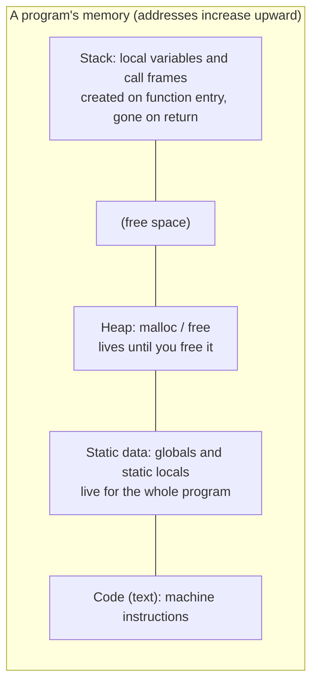

<!-- status: reviewed -->
# 05-06 · C Pointers, Arrays and Memory

| | |
|---|---|
| **Course** | [05 · Programming for Engineers](../README.md) |
| **University equivalent** | The pointers-and-memory half of an introductory C course for EE/CE (Kernighan and Ritchie, *The C Programming Language*, 2nd ed., ch. 5–6; King, *C Programming: A Modern Approach*, ch. 11–13, 16–17; the memory chapters of Bryant and O'Hallaron, *Computer Systems: A Programmer's Perspective*) |
| **Prerequisites** | [05-05 C Fundamentals](05-05-c-fundamentals.md) |
| **Estimated study hours** | 10 |
| **Last verified** | 2026-11-19 |

**Learning objectives.** After this chapter you can:

1. Explain memory as an array of addressed bytes, and use pointers (`&`, `*`, `NULL`, `const`, and pointers to functions) to pass data and behavior into and out of functions.
2. Relate arrays and pointers (`a[i]` is `*(a + i)`), compute with pointer arithmetic, and pass one- and two-dimensional arrays with their lengths.
3. Handle C strings safely: the terminating zero, buffer sizes, and bounded functions such as `snprintf`.
4. Define structs, access them through pointers, and predict their size and layout including padding.
5. Describe the stack, static storage and the heap; allocate and free memory correctly; and recognize, reproduce and detect the common memory bugs (overflow, use after free, double free, leak, dangling pointer).

## 1. Big picture

To a processor, memory is one long array of bytes, each with a numeric **address**. C lets you hold an address in a variable, a **pointer**, and use it to read or write whatever is stored there. That single feature is why C runs operating systems and firmware: a driver writes to a peripheral by storing a value at the peripheral's address; a network stack hands a packet buffer from layer to layer by passing one pointer instead of copying kilobytes; data structures (lists, trees, queues, 05-08) are built from pointers linking blocks of memory. It is also why C is the source of most serious security vulnerabilities: nothing stops a pointer from pointing at the wrong bytes.

- **Memory-mapped hardware:** registers of timers, ADCs and radios appear at fixed addresses; firmware reaches them through pointers (05-07 shows how).
- **Zero-copy data paths:** DMA engines, network cards and accelerators exchange buffers by address; the efficiency of AI and networking stacks depends on not copying data.
- **Security:** roughly 70% of the serious vulnerabilities reported by Microsoft and Chromium are memory-safety bugs in C and C++ (Section 9), which is driving governments, Google, Microsoft and the Linux kernel toward memory-safe languages and chip vendors toward hardware memory tagging.
- **Embedded discipline:** small systems have kilobytes of RAM and no memory protection; many safety standards forbid dynamic allocation after start-up for exactly the reasons in Section 3.7.

## 2. Intuition first

**Memory is a street of numbered mailboxes.** Each mailbox holds one byte; its number is its address. An `int` occupies four neighboring mailboxes. A **pointer** is a slip of paper with a mailbox number written on it. Copying the slip is cheap and gives a second person access to the same mailbox; **dereferencing** the pointer means walking to that mailbox and opening it. An **array** is a run of consecutive mailboxes, so the address of element $i$ is the start address plus $i$ times the element size.

**A finance analogy, and its limits.** A pointer is like an account number. Giving a function your account number (not the money) lets it deposit or withdraw: that is how a C function changes its caller's data. The risks map well too. A number that is off by one debits someone else's account: a **buffer overflow**. A number for an account that has been closed is a **dangling pointer**, and using it is a **use after free**. Two people both closing the same account is a **double free**. Money parked in an account nobody holds the number to any more is a **memory leak**. *Where the analogy breaks:* account numbers are labels, while addresses are numbers you can do arithmetic on; and a bank checks every transaction against its records, while C checks nothing at run time.

**Three places data can live.** Every variable lives somewhere, for some duration:



Most memory bugs are mistakes about *lifetime* (using memory after it is gone) or *extent* (reading or writing past its end). Keep those two words in mind throughout.

## 3. Theory

### 3.1 Addresses and pointers

For any variable `x`, the expression `&x` is its address. A pointer variable holds an address and has a type that says what is stored there: `int *p` is "a pointer to `int`". The **dereference** operator `*p` means "the object at the address in `p`", and can be read or assigned.

```c
#include <stdio.h>

int main(void)
{
    int gain = 10;
    int *p = &gain;                            /* p holds the address of gain */
    *p = 25;                                   /* write through the pointer */
    printf("gain = %d, *p = %d, same object: %d\n", gain, *p, p == &gain);
    printf("sizeof(int) = %zu, sizeof(int *) = %zu\n", sizeof(int), sizeof(int *));
    return 0;
}
```

```text
gain = 25, *p = 25, same object: 1
sizeof(int) = 4, sizeof(int *) = 8
```

Writing through `p` changed `gain`, because both name the same bytes. A pointer is 8 bytes on a 64-bit computer and 4 bytes on a 32-bit microcontroller, whatever it points to. (Actual addresses can be printed with `%p`, but they change from run to run because operating systems randomize memory layout as a security measure, so this course never prints them.)

**`NULL`** is a pointer value that points nowhere; functions return it to mean "no object" and callers must check before dereferencing. Dereferencing `NULL` is undefined behavior; on a desktop it usually crashes, on a microcontroller without memory protection it may silently read address 0.

**`const` and pointers.** `const int *p` is a pointer through which the `int` cannot be modified ("pointer to const"): a promise that a function only reads the data. `int *const p` is a pointer that cannot be re-pointed. Functions that take arrays they only read should take `const` pointers; it documents intent and lets the compiler catch accidental writes.

### 3.2 Pointers as function parameters

C passes arguments by value (05-05), so a function that must change its caller's variables receives their addresses. The textbook case:

```c
#include <stdio.h>

static void swap(int *a, int *b)
{
    int t = *a;
    *a = *b;
    *b = t;
}

int main(void)
{
    int lo = 9, hi = 3;
    if (lo > hi) {
        swap(&lo, &hi);
    }
    printf("lo = %d, hi = %d\n", lo, hi);
    return 0;
}
```

```text
lo = 3, hi = 9
```

The same mechanism gives a function several results: **output parameters**. Firmware functions conventionally *return* a status code (0 for success, negative for an error) and deliver their data through pointer parameters, as Example 05-06.1 does.

**Function pointers.** A function's machine code also has an address. `double (*f)(double)` declares `f` as a pointer to a function that takes a `double` and returns one; the parentheses matter, because `double *f(double)` would declare a function returning `double *`. A `typedef` makes such types readable, and calling `f(x)` calls whichever function `f` currently points to:

```c
#include <stdio.h>

typedef double (*filter_fn)(double x);          /* pointer to a function: double in, double out */

static double halve(double x) { return x / 2; }
static double clip(double x) { return x > 1.0 ? 1.0 : x; }

static void apply(double *data, size_t n, filter_fn f)
{
    for (size_t i = 0; i < n; i++) {
        data[i] = f(data[i]);
    }
}

int main(void)
{
    double v[3] = {0.4, 1.6, 3.0};
    filter_fn chain[] = {halve, clip};          /* a table of functions, chosen at run time */
    for (size_t k = 0; k < sizeof chain / sizeof chain[0]; k++) {
        apply(v, 3, chain[k]);
    }
    printf("%.2f %.2f %.2f\n", v[0], v[1], v[2]);
    return 0;
}
```

```text
0.20 0.80 1.00
```

`apply` does not know or care which processing it performs; the caller passes the behavior in. This is how C expresses **callbacks** (the library sort `qsort` takes a comparison function, 05-08), **driver tables** (a struct of function pointers, one implementation per chip, so the same application code runs on several microcontrollers), state machines, and the **interrupt vector table**, which on many microcontrollers is literally an array of function addresses at a fixed location in memory. A function pointer that is `NULL` or points at the wrong thing jumps into arbitrary code, which is why attackers prize the ability to overwrite one.

### 3.3 Arrays and pointer arithmetic

`int a[8];` reserves 8 consecutive `int`s, indexed 0 to 7. In almost every expression the array's name **decays** into a pointer to its first element, and indexing is defined through pointer arithmetic:

$$
\texttt{a[i]} \equiv \texttt{*(a + i)}.
$$

**Pointer arithmetic is scaled.** Adding 1 to a pointer advances it by one *element*, that is by `sizeof(*p)` bytes, not by one byte. So for `int32_t *p`, `p + 3` is 12 bytes further on. Subtracting two pointers into the same array gives the number of elements between them.

**Arrays do not know their length.** When an array is passed to a function, only the pointer to its first element is passed. Inside the function, `sizeof` gives the size of the *pointer*, not of the array (Example 05-06.2), so every C function that takes an array must also take its length, conventionally as a `size_t` (the unsigned type of `sizeof`). The idiom for the number of elements of an array *in the scope where it is declared* is `sizeof a / sizeof a[0]`.

**Two-dimensional arrays.** `int img[2][3]` is 2 rows of 3 elements stored row after row in one contiguous block of 6 (**row-major** order), so `img[r][c]` lies $r \times 3 + c$ elements from the start. To pass it to a function, the row length must be part of the parameter's type, `int img[][3]`, so the compiler can compute that offset; only the number of rows is passed separately:

```c
#include <stdio.h>

static long sum_column(size_t rows, int img[][3], size_t c)
{
    long s = 0;
    for (size_t r = 0; r < rows; r++) {
        s += img[r][c];
    }
    return s;
}

int main(void)
{
    int img[2][3] = {{1, 2, 3}, {4, 5, 6}};
    size_t offset = (size_t)((char *)&img[1][2] - (char *)img) / sizeof(int);
    printf("img[1][2] = %d, %zu elements from the start; column 1 sums to %ld\n", img[1][2], offset, sum_column(2, img, 1));
    return 0;
}
```

```text
img[1][2] = 6, 5 elements from the start; column 1 sums to 7
```

An array of pointers to separately allocated rows (`int *rows[2]`) is indexed with the same `rows[r][c]` syntax but is a different structure, a table of addresses; the two types are not interchangeable, and passing `img` where an `int **` is expected is a compile error. Row-major order also explains a performance rule: visiting an image row by row walks memory in order, which caches reward ([14-09](../../14-computer-organization-and-architecture/chapters/14-09-memory-hierarchy-and-caches.md)).

**Bounds are not checked.** `a[8]` for an 8-element array compiles and runs; it reads or writes whatever lies after the array. This is undefined behavior and the classic **buffer overflow**. On the stack it can overwrite other variables or a function's return address; that is how many historical exploits took control of programs.

### 3.4 Strings

C has no string type. A **string** is an array of `char` terminated by a zero byte, written `'\0'`. The literal `"ADC"` occupies 4 bytes: `'A'`, `'D'`, `'C'`, `'\0'`. Library functions in `<string.h>` find the end by scanning for the zero:

- `strlen(s)` counts characters before the terminator (3 for `"ADC"`), so a buffer must hold `strlen + 1` bytes;
- `strcpy(dst, src)` copies until the terminator **without knowing how big `dst` is**; if `src` is longer, it overflows `dst`;
- `snprintf(dst, size, format, ...)` formats like `printf` into `dst`, writing at most `size` bytes including the terminator. It *always* terminates the string (for `size > 0`) and returns the length the full result *would* have had, so `return value >= size` means the output was truncated.

**`strncpy` is not a safe `strcpy`.** Its name suggests a bounded copy, but `strncpy(dst, src, n)` always writes exactly `n` bytes: if `src` is shorter it pads the rest with zeros, and if `src` has `n` or more characters it writes **no terminator at all**, leaving `dst` an unterminated array that the next `strlen` or `printf` reads past. It was designed for fixed-width fields in old file formats. To copy a string into a buffer, use `snprintf(dst, sizeof dst, "%s", src)`, which always terminates, and check its return value for truncation.

Prefer `snprintf` for building strings, and treat any copy into a fixed buffer as a place to check sizes. String literals are stored in read-only memory on most systems: `char *s = "abc"; s[0] = 'x';` is undefined behavior, while `char s[] = "abc";` makes a modifiable copy.

### 3.5 Structs, layout and padding

A **struct** groups named fields of different types into one object, the C counterpart of a record:

```c
// fragment
typedef struct {
    uint32_t timestamp_ms;
    int16_t  temperature_centi_c;
    uint8_t  sensor_id;
    uint8_t  status;
} reading_t;
```

`r.sensor_id` accesses a field of a struct `r`; through a pointer `p`, `p->sensor_id` is shorthand for `(*p).sensor_id`. Large structs are passed to functions by pointer (`const reading_t *r` if read-only) to avoid copying.

**Alignment and padding.** Processors read data fastest, and some only, at addresses that are multiples of the data's size: a 4-byte `uint32_t` at a multiple of 4. To keep every field aligned, the compiler inserts unused **padding** bytes between fields and at the end, so that arrays of the struct stay aligned too. Field order therefore changes a struct's size (Example 05-06.4). `offsetof(type, field)` from `<stddef.h>` gives a field's byte offset. Layout matters whenever bytes cross a boundary: a struct describing a hardware register block or a network packet must match the hardware's or protocol's layout exactly, which is why such code uses fixed-width types, checks sizes with `_Static_assert`, and serializes field by field rather than copying whole structs (05-07 adds byte order).

### 3.6 Where data lives: stack, static storage and heap

- **Automatic (stack) storage.** A function's local variables and parameters live in that function's **stack frame**, created on entry and discarded on return. Allocation is essentially free (moving one register), but the stack is small: commonly 8 MB for a desktop thread and a few kilobytes on a microcontroller, where deep recursion or a large local array can overflow it silently. A pointer to a local variable becomes **dangling** the moment the function returns.
- **Static storage.** Globals and `static` locals (05-05) exist for the whole program. Initialized ones live in the `.data` section, zero-initialized ones in `.bss`. Firmware puts most long-lived buffers here, because their size is known at build time and the linker can report total RAM use.
- **Dynamic (heap) storage.** `malloc(n)` returns a pointer to `n` bytes that live until `free` is called, or `NULL` if no memory is available. Size can be decided at run time. The cost is bookkeeping: allocation takes time that varies, memory can **fragment** into unusable gaps, and every block must be freed exactly once.

### 3.7 Dynamic allocation

The `<stdlib.h>` functions:

| Function | Does | Notes |
|---|---|---|
| `malloc(n)` | allocate `n` bytes, uninitialized | returns `NULL` on failure: check it |
| `calloc(count, size)` | allocate `count × size` bytes, zeroed | checks the multiplication for overflow |
| `realloc(p, n)` | resize a block to `n` bytes | **may move the block**: the old pointer becomes invalid |
| `free(p)` | release a block | `free(NULL)` is allowed and does nothing |

The rule that prevents most heap bugs is **ownership**: for every block, exactly one part of the program is responsible for freeing it, and after `free(p)` nothing uses `p` again. Setting `p = NULL` after freeing helps: a second `free(p)` becomes a harmless no-op, and a later dereference crashes at once on desktop systems instead of silently reading recycled memory (on microcontrollers, where address 0 may be ordinary readable memory, it gives no such guarantee). The idiom for `malloc` sizes is `p = malloc(n * sizeof *p)`, which stays correct if `p`'s type changes.

**Why embedded systems avoid the heap.** Allocation time is unpredictable, fragmentation can make a long-running device fail after days, and a failed `malloc` deep in a control loop has no good recovery. Safety guidelines therefore forbid it: MISRA C's Directive 4.12 ("dynamic memory allocation shall not be used") and Rule 21.3, which bans the `<stdlib.h>` allocation functions, are both Required in the 2012 and 2023 editions ([R-092](../../../reference/research-log.md#r-092--c-language-standards-coding-standards-and-embedded-usage)). Firmware allocates its memory statically, or from fixed-size pools, at start-up.

### 3.8 The common memory bugs and how to catch them

| Bug | What happens | Typical cause |
|---|---|---|
| Buffer overflow (out-of-bounds write or read) | corrupts or leaks neighboring data | off-by-one loop bound, unchecked copy |
| Use after free | reads or writes memory now owned by something else | keeping a pointer past `free` or `realloc` |
| Double free | corrupts the allocator's records | two owners both freeing |
| Memory leak | memory never returned; long-running programs grow | lost last pointer to a block |
| Dangling stack pointer | pointer to a dead stack frame | returning `&local` |
| Uninitialized read | garbage values, nondeterminism | `malloc` without initializing |
| Null dereference | crash, or silent read of address 0 on MCUs | unchecked `NULL` return |

None of these is reported by C itself. **AddressSanitizer** (ASan, `-fsanitize=address`) catches most of them in testing: it surrounds every allocation with "poisoned" guard bytes and quarantines freed memory, and stops the program at the first bad access with the location of the access, the allocation and the free. The undefined-behavior sanitizer adds a cheaper check for indexing arrays whose size it knows. Here the two face an off-by-one loop that writes one element past a stack array:

```c
// expect: sanitizer
#include <stdio.h>

int main(void)
{
    int samples[4] = {0};
    for (int i = 0; i <= 4; i++) {             /* <= : one iteration too many */
        samples[i] = i * 100;
    }
    printf("%d\n", samples[0]);
    return 0;
}
```

```text
runtime error: index 4 out of bounds for type 'int [4]'
```

UBSan's bounds check, which knows the array's declared size, reports the write first (and stops the program, because this course builds with `-fno-sanitize-recover=all`; without that flag UBSan reports and continues, and ASan then stops it); with that check off, ASan reports the same write as a `stack-buffer-overflow`. Without either, this program usually prints 0 and exits normally, having overwritten whatever happened to follow the array. Other tools complete the picture: **Valgrind** (memory checking without recompiling, slower), static analyzers, **fuzzers** that generate unexpected inputs to drive code into its bugs, and, increasingly, hardware: Arm's Memory Tagging Extension and the CHERI capability architecture check pointer validity in the processor itself (Section 9).

## 4. Worked examples

### Example 05-06.1 · Statistics through output parameters

**Setup.** Write `int adc_stats(const uint16_t *samples, size_t n, uint16_t *min, uint16_t *max, uint32_t *mean)` that returns 0 and fills in the minimum, maximum and mean (rounded down) of `n` samples, or returns −1 if `n` is 0 or any pointer is `NULL`. Apply it to the samples 2040, 2052, 2047, 2061, 2035, 2049.

**Solution.**

```c
#include <stdint.h>
#include <stdio.h>

int adc_stats(const uint16_t *samples, size_t n, uint16_t *min, uint16_t *max, uint32_t *mean)
{
    if (samples == NULL || min == NULL || max == NULL || mean == NULL || n == 0) {
        return -1;                             /* report the error, touch nothing */
    }
    uint16_t lo = samples[0], hi = samples[0];
    uint32_t sum = 0;                          /* 32 bits: up to 65,537 full-scale 16-bit samples */
    for (size_t i = 0; i < n; i++) {
        if (samples[i] < lo) lo = samples[i];
        if (samples[i] > hi) hi = samples[i];
        sum += samples[i];
    }
    *min = lo;
    *max = hi;
    *mean = sum / (uint32_t)n;
    return 0;
}

int main(void)
{
    const uint16_t s[] = {2040, 2052, 2047, 2061, 2035, 2049};
    uint16_t lo, hi;
    uint32_t mean;
    int status = adc_stats(s, sizeof s / sizeof s[0], &lo, &hi, &mean);
    printf("status %d: min %u, max %u, mean %u\n", status, (unsigned)lo, (unsigned)hi, (unsigned)mean);
    printf("empty input: status %d\n", adc_stats(s, 0, &lo, &hi, &mean));
    return 0;
}
```

```text
status 0: min 2035, max 2061, mean 2047
empty input: status -1
```

The minimum is **2035**, the maximum **2061**, and the mean $12{,}284/6 = 2047.33$, rounded down to **2047**. The `const` on `samples` promises the function will not modify the caller's data; the three output pointers let it return three values while the return value carries the status.

**Units check.** All results are ADC codes, the samples' unit ✓.

**Sanity check.** The mean lies between the minimum and the maximum, and near the 2048 mid-scale code these samples cluster around ✓.

### Example 05-06.2 · The array that forgot its size

**Setup.** `int32_t buf[8]` is declared in `main` and passed to `void f(int32_t *p)`. What do `sizeof buf`, `sizeof buf / sizeof buf[0]` and, inside `f`, `sizeof p` give on a 64-bit system? How many bytes apart are `p + 3` and `p`?

**Solution.**

```c
#include <stdint.h>
#include <stdio.h>

static void f(int32_t *p)
{
    printf("inside f: sizeof p = %zu\n", sizeof p);
    printf("(p + 3) - p = %td elements = %td bytes\n", (p + 3) - p, (char *)(p + 3) - (char *)p);
}

int main(void)
{
    int32_t buf[8] = {0};
    printf("in main: sizeof buf = %zu, elements = %zu\n", sizeof buf, sizeof buf / sizeof buf[0]);
    f(buf);
    return 0;
}
```

```text
in main: sizeof buf = 32, elements = 8
inside f: sizeof p = 8
(p + 3) - p = 3 elements = 12 bytes
```

In `main`, `buf` is an array: **32 bytes**, **8 elements**. Passed to `f`, it decays to a pointer, and `sizeof p` is the pointer's size, **8 bytes**, on a 64-bit machine (4 on a 32-bit MCU). A function that computed "the number of elements" as `sizeof p / sizeof p[0]` would get 2 and process only part of the buffer. (GCC even warns about this pattern.) Pointer arithmetic counts elements: `(p + 3) - p` is 3, which is **12 bytes**, because each `int32_t` is 4 bytes. Converting to `char *` (1-byte elements) exposes the byte distance. (`%td` prints the `ptrdiff_t` that pointer subtraction yields.)

**Sanity check.** $8 \times 4 = 32$ ✓, and $3 \times 4 = 12$ ✓.

### Example 05-06.3 · Building a status string without overflowing

**Setup.** A sensor node builds a status line `"T=23.5C RH=41%"` in a buffer. (a) How many bytes does the buffer need? (b) What do `snprintf` and the buffer contain if the buffer has only 10 bytes? (c) What happens with `strcpy` into a too-small buffer?

**Solution.** A function that formats into a caller's buffer must receive the buffer's size:

```c
#include <stdio.h>
#include <string.h>

/* Format a status line into dst (size bytes); return the length the full line needs. */
int format_status(char *dst, size_t size, double temp_c, int rh_percent)
{
    return snprintf(dst, size, "T=%.1fC RH=%d%%", temp_c, rh_percent);
}

int main(void)
{
    char line[32], small[10];
    int needed = format_status(line, sizeof line, 23.5, 41);
    int wanted = format_status(small, sizeof small, 23.5, 41);
    printf("\"%s\": strlen %zu, snprintf returned %d\n", line, strlen(line), needed);
    printf("\"%s\": strlen %zu, snprintf returned %d, truncated %d\n",
           small, strlen(small), wanted, wanted >= (int)sizeof small);
    return 0;
}
```

```text
"T=23.5C RH=41%": strlen 14, snprintf returned 14
"T=23.5C R": strlen 9, snprintf returned 14, truncated 1
```

(a) The text has **14 characters** (`%%` prints one `%`), so the buffer needs **15 bytes** including the terminator. (b) With 10 bytes, `snprintf` writes the first 9 characters and the terminator, `"T=23.5C R"`, and still returns 14, the length it *wanted*: comparing that with the buffer size detects truncation. The result is a shortened but valid string, never an overflow. (c) `strcpy` has no size parameter, and a helper that copies into a buffer it did not allocate cannot know the buffer's size:

```c
// expect: sanitizer
#include <stdio.h>
#include <string.h>

/* Copy a label into dst. The bug: the function cannot know how big dst is. */
void copy_label(char *dst, const char *src)
{
    strcpy(dst, src);
}

int main(void)
{
    char small[10];
    copy_label(small, "T=23.5C RH=41%");       /* 15 bytes into a 10-byte buffer */
    printf("%s\n", small);
    return 0;
}
```

```text
ERROR: AddressSanitizer: stack-buffer-overflow
```

It writes all 15 bytes, five past the end of `small`, and ASan stops it. Without ASan the outcome depends on the system: Linux distributions that build with a stack protector abort when `main` returns ("stack smashing detected"); elsewhere the program may appear to work, having corrupted its stack, which is exactly the kind of bug attackers exploit by supplying a long string. (Had the copy been written directly in `main`, GCC would have warned at compile time, because there it can see both sizes (`-Wstringop-overflow` is on by default, and `_FORTIFY_SOURCE` adds its own check); this course's `-Werror` turns that warning into a refusal to compile. Compile-time checks, run-time hardening and sanitizers are complementary layers.)

**Sanity check.** "T=23.5C" is 7 characters, " RH=41%" is 7 more: 14 ✓.

### Example 05-06.4 · Field order and the size of a struct

**Setup.** A log record has a 1-byte `id`, a 4-byte `value` and a 2-byte `flags`. Compare `sizeof` and the field offsets for the order `id, value, flags` and for `value, flags, id`, assuming the usual alignment rules (each type aligned to its own size). How much memory does an array of 1000 records waste in the first layout?

**Solution.** In the first order, `id` sits at offset 0; `value` must start at a multiple of 4, so 3 padding bytes follow `id` and `value` occupies offsets 4–7; `flags` occupies 8–9; the struct's size is rounded up to a multiple of its strictest alignment (4), so 2 more padding bytes give **12 bytes**. In the second order, `value` (0–3), `flags` (4–5), `id` (6) and 1 byte of padding give **8 bytes**.

```c
#include <stddef.h>
#include <stdint.h>
#include <stdio.h>

struct loose { uint8_t id; uint32_t value; uint16_t flags; };
struct tight { uint32_t value; uint16_t flags; uint8_t id; };

int main(void)
{
    printf("loose: size %zu, offsets %zu %zu %zu\n", sizeof(struct loose),
           offsetof(struct loose, id), offsetof(struct loose, value), offsetof(struct loose, flags));
    printf("tight: size %zu, offsets %zu %zu %zu\n", sizeof(struct tight),
           offsetof(struct tight, value), offsetof(struct tight, flags), offsetof(struct tight, id));
    printf("1000 records: %zu vs %zu bytes\n", 1000 * sizeof(struct loose), 1000 * sizeof(struct tight));
    return 0;
}
```

```text
loose: size 12, offsets 0 4 8
tight: size 8, offsets 0 4 6
1000 records: 12000 vs 8000 bytes
```

Both layouts hold 7 bytes of data. The loose order wastes 5 bytes per record, **5000 bytes** for 1000 records; the tight order wastes 1, and saves **4000 bytes** overall: a third of the array. On a microcontroller with 32 KB of RAM, that is an eighth of the memory. Rule of thumb: order fields from largest to smallest alignment.

**Sanity check.** 12 and 8 are multiples of 4, as the alignment of `uint32_t` requires ✓.

### Example 05-06.5 · A growable buffer, and the pointer that `realloc` invalidated

**Setup.** A logger stores an unknown number of samples in a heap buffer that starts with capacity 4 and doubles whenever it is full. (a) How many reallocations occur while storing 1000 samples, and how many element copies do they cause in the worst case (every `realloc` moving the block)? (b) A caller saved a pointer to the first sample before the buffer grew. What is wrong with using it afterward?

**Solution.** (a) Capacity runs 4, 8, 16, …, 1024: the buffer doubles when it holds 4, 8, …, 512 elements, which is **8 reallocations** ($4 \times 2^8 = 1024 \ge 1000$). If each moves the block, it copies the elements present: $4 + 8 + \cdots + 512 = 1020$ copies in total, about one per element stored. That is close to the best case for doubling; the worst comes just after a doubling, when 1025 elements have cost $4 + \cdots + 1024 = 2044$ copies. In general the total is less than twice the number of elements stored. Doubling makes the *average* cost of an append constant (the copies form a geometric series bounded by the final size), while growing by a fixed step of 4 would copy $4 + 8 + \cdots + 996 = 4 \times (1 + 2 + \cdots + 249)$ = 124,500 elements, about $n^2/8$: the cost per append grows with the buffer's size.

```c
#include <stdio.h>
#include <stdlib.h>

typedef struct {
    int *data;
    size_t len, cap;
} intbuf_t;

static int intbuf_push(intbuf_t *b, int value, int *reallocs, size_t *copies)
{
    if (b->len == b->cap) {
        size_t new_cap = b->cap ? 2 * b->cap : 4;
        int *p = realloc(b->data, new_cap * sizeof *p);
        if (p == NULL) {
            return -1;                         /* the old block is still valid and still ours */
        }
        if (b->cap) {
            (*reallocs)++;
            *copies += b->len;
        }
        b->data = p;
        b->cap = new_cap;
    }
    b->data[b->len++] = value;
    return 0;
}

int main(void)
{
    intbuf_t b = {NULL, 0, 0};
    int reallocs = 0;
    size_t copies = 0;
    for (int i = 0; i < 1000; i++) {
        if (intbuf_push(&b, i, &reallocs, &copies) != 0) {
            free(b.data);
            return 1;
        }
    }
    printf("len %zu, cap %zu, reallocs %d, worst-case copies %zu\n", b.len, b.cap, reallocs, copies);
    free(b.data);
    return 0;
}
```

```text
len 1000, cap 1024, reallocs 8, worst-case copies 1020
```

Note the `realloc` idiom: the result goes into a temporary, because on failure `realloc` returns `NULL` *and leaves the old block allocated*; writing `b->data = realloc(b->data, ...)` would lose the only pointer to it, a leak.

(b) `realloc` may move the block, after which the old address belongs to the allocator. A pointer saved earlier is dangling. In real code the growth happens inside a helper function, out of the caller's sight:

```c
// expect: sanitizer
#include <stdio.h>
#include <stdlib.h>

static int grow(int **data, size_t n)
{
    int *p = realloc(*data, n * sizeof *p);
    if (p == NULL) return -1;
    *data = p;
    return 0;
}

int main(void)
{
    int *data = malloc(4 * sizeof *data);
    if (data == NULL) return 1;
    data[0] = 42;
    int *first = &data[0];
    if (grow(&data, 4096) != 0) { free(data); return 1; }
    printf("%d\n", *first);
    free(data);
    return 0;
}
```

```text
ERROR: AddressSanitizer: heap-use-after-free
```

ASan reports a **heap-use-after-free**: the read goes to the old block, which `realloc` released. (When the `realloc` and the later use are in the same function, GCC 12 and later warn at compile time with `-Wuse-after-free`, part of `-Wall`; across functions only run-time tools see it.) Without ASan, what happens depends on the allocator. With glibc, this program prints 42: nothing else has been allocated after the small block, so `realloc` grows it in place, the address does not change, and the bug is invisible. Allocate one more small block right after `data` and the same program prints garbage (a large number that changes from run to run), because `realloc` must now move the block and the allocator immediately reuses the old block's first bytes for its own bookkeeping. ASan's `realloc` always moves the block, precisely so that this bug shows up in testing rather than surviving into the field. The fix is to keep indices, not pointers, into a buffer that can move, or to re-derive pointers after every operation that can grow it.

**Sanity check.** $\sum_{k=2}^{9} 2^k = 2^{10} - 4 = 1020$ ✓, and $1000 \le 1024$ ✓.

### Answer key

<!-- answer-key -->
| ID | Quantity | Value | Unit |
|---|---|---|---|
| T 05-06.a | sizeof(int *) on 64-bit systems | 8 | bytes |
| T 05-06.b | bytes in the literal "ADC" | 4 | bytes |
| Ex 05-06.1a | minimum | 2035 | — |
| Ex 05-06.1b | maximum | 2061 | — |
| Ex 05-06.1c | mean, rounded down | 2047 | — |
| Ex 05-06.2a | sizeof buf | 32 | bytes |
| Ex 05-06.2b | sizeof p inside f (64-bit) | 8 | bytes |
| Ex 05-06.2c | byte distance from p to p + 3 | 12 | bytes |
| Ex 05-06.3a | characters in the status line | 14 | — |
| Ex 05-06.3b | buffer bytes needed | 15 | bytes |
| Ex 05-06.3c | characters kept in a 10-byte buffer | 9 | — |
| Ex 05-06.4a | size, order id-value-flags | 12 | bytes |
| Ex 05-06.4b | size, order value-flags-id | 8 | bytes |
| Ex 05-06.4c | memory saved for 1000 records | 4000 | bytes |
| Ex 05-06.5a | reallocations to store 1000 samples | 8 | — |
| Ex 05-06.5b | worst-case element copies | 1020 | — |
| Ex 05-06.5c | copies when growing by 4 each time | 124500 | — |

## 5. Simulate it

Open [labs/05-06-lab/](../labs/05-06-lab/README.md). Like 05-05's, this lab is C code with a self-checking test, run by [`tools/run_c.py`](../../../tools/run_c.py) under AddressSanitizer and UndefinedBehaviorSanitizer. It contains:

1. **A sample-log module** (`samplelog.c`): a heap-backed growable buffer with statistics and a bounded string formatter, checked by `samplelog_test.c`. *Predict first:* how many reallocations does the test's 1000-sample run cause?
2. **Five planted bugs** in `membugs_demo.c`, one per function: an off-by-one write, a use after free, a double free, a leak and a dangling stack pointer. Run each under ASan and match the report to the bug. *Predict first:* which one does ASan report only when the program exits?
3. **Struct layout:** print `sizeof` and `offsetof` for the lab's record type, reorder its fields, and measure the saving.

## 6. Engineering tradeoffs

| Knob | Improves | Costs | Typical decision owner |
|---|---|---|---|
| Static allocation versus heap | Static: predictable timing, no fragmentation, RAM use known at link time | Fixed capacity chosen at build time; wasted memory for worst case | Firmware architect (safety standards often decide) |
| Pass by pointer versus by value | Pointer: no copying of large data, can modify caller's data | Aliasing and lifetime must be reasoned about; `NULL` checks | Engineer, by data size |
| Doubling versus fixed-step growth | Doubling: constant amortized cost per append | Up to 2× memory overhead; large reallocation spikes | Library designer |
| Packed versus naturally aligned structs | Packed: smallest memory and exact wire layout | Slower or illegal unaligned access on some processors | Firmware / protocol engineer |
| C versus a memory-safe language for new code | Safe language: most memory bugs impossible | Toolchain maturity, certification, team skills, interop with existing C | Engineering leadership |
| ASan/Valgrind in testing | Memory bugs found before release | About 2× (ASan) to 10–50× (Valgrind) slower test runs | Verification lead |

## 7. Numbers to know

| Quantity | Value | Note |
|---|---|---|
| Pointer size | 8 bytes (64-bit), 4 bytes (32-bit MCU) | |
| Typical stack size | about 8 MB per desktop thread (Linux default); KB on MCUs | configurable |
| Struct padding rule | each field at a multiple of its alignment (its size, for basic types on common ABIs); total rounded up to the largest alignment | Example 05-06.4 |
| Geometric (doubling) growth | fewer than 2 copies per element on average | Example 05-06.5 |
| Memory-safety share of serious vulnerabilities | about 70% (Microsoft CVEs 2006–2018; Chromium high-severity bugs) | [R-094](../../../reference/research-log.md#r-094--memory-safety-vulnerability-data-and-policy) |
| Android memory-safety share | 76% (2019) → under 20% (2025) | [R-095](../../../reference/research-log.md#r-095--rust-adoption-in-android-and-the-linux-kernel) |
| ASan slowdown | typically about 2× (Clang documentation) | testing only |

## 8. Common mistakes

1. **Off-by-one loop bounds** (`i <= n` for an `n`-element array) and forgetting the string terminator (`strlen + 1` bytes).
2. **Using `sizeof` on an array parameter,** which gives the pointer size. Pass lengths explicitly.
3. **Returning the address of a local variable.** It dangles as soon as the function returns.
4. **Keeping pointers into a buffer that `realloc` may move,** and `p = realloc(p, n)`, which leaks on failure.
5. **Not checking `malloc`'s result, and forgetting `free`, or freeing twice.** Assign one owner to every block; set pointers to `NULL` after freeing.
6. **`strcpy`, `strcat` and `sprintf` into fixed buffers, and `strncpy` as a supposed fix** (it can leave the result unterminated). Use `snprintf` and check its return value.
7. **Copying a struct byte-for-byte to a file, network or register** and assuming the layout matches. Padding, alignment and byte order (05-07) differ between compilers and machines.
8. **Testing without sanitizers.** Memory bugs often produce correct-looking output until the memory is reused.

## 9. Practitioner lens

### State of the art (as of Nov 2026)

- **Memory safety is the dominant source of serious vulnerabilities in C and C++ code.** Microsoft reported that about 70% of the vulnerabilities it assigned CVEs to each year (2006–2018) were memory-safety issues; the Chromium project reports about 70% of its high-severity security bugs are memory-safety problems, half of them use-after-free (from an analysis of 912 high- or critical-severity bugs since 2015); Google's Project Zero counted 67% of 2021's zero-day vulnerabilities as memory-safety bugs. In December 2023, CISA, the NSA, the FBI and partner agencies of four other countries urged software makers to publish "memory safe roadmaps", and a February 2024 White House technical report made the same case, noting that hardware approaches such as memory tagging and CHERI capabilities are part of the answer ([R-094](../../../reference/research-log.md#r-094--memory-safety-vulnerability-data-and-policy)) **[Industry estimate]** for the vendor-reported shares, **[Established]** for the policy documents.
- **Rust is becoming part of the systems stack.** Linux 6.1 (December 2022) added initial Rust support, and in December 2025 the kernel's maintainers declared the Rust "experiment" over: Rust is a permanent part of the kernel (with architecture support limited by its LLVM-based compiler). Google reports that memory-safety bugs fell from 76% of Android's vulnerabilities in 2019 to under 20% in 2025 as new code moved to memory-safe languages, and estimates Rust code's memory-safety vulnerability density at about 1000× lower than its C and C++ ([R-095](../../../reference/research-log.md#r-095--rust-adoption-in-android-and-the-linux-kernel)) **[Established]** for the kernel status, **[Industry estimate]** for Google's figures.

### Why it matters commercially

For a semiconductor company this trend cuts three ways. **Hardware:** memory tagging (Arm's MTE) and capability architectures (CHERI) move pointer checking into the processor, a feature that SoC vendors must implement, verify and market. **Software:** vendors' SDKs, drivers and firmware are C; customers in automotive, industrial and government markets increasingly ask how memory-safety risk is managed, and a credible Rust or memory-safety roadmap becomes a selling point. **Diligence:** a target's C codebase carries security debt proportional to its size and age; Google's data suggest vulnerabilities concentrate in new and recently changed code, so the age profile and the development practices (sanitizers, fuzzing, review) matter as much as raw size.

### Marketing vs Reality

- **"Rust code has 1000× fewer memory-safety vulnerabilities."** *Reality:* Google's estimate for Android rests on roughly 5 million lines of Rust and *one* potential vulnerability found; Google itself calls it conservative. The direction is credible and supported by other data; the exact ratio is a small-sample estimate ([R-095](../../../reference/research-log.md#r-095--rust-adoption-in-android-and-the-linux-kernel)).
- **"Our product is memory safe because it's written in Rust."** *Reality:* `unsafe` Rust, C libraries called through foreign-function interfaces, and the C firmware underneath are not. Ask what fraction is safe code and how the boundaries are tested.
- **"We've never had a buffer overflow."** *Reality:* without sanitizers, fuzzing and a vulnerability-tracking process, "never found" is not evidence. Ask how they would know.
- **"Hardware memory tagging solves memory safety."** *Reality:* MTE detects many bugs probabilistically (a tag mismatch is likely, not certain) and needs operating-system and compiler support; it is a strong mitigation, not a proof. CHERI gives stronger guarantees but requires new hardware and recompiled software.

### Questions for engineering leaders

1. **"What fraction of your vulnerabilities over the last three years were memory-safety bugs?"** *Strong:* a number from their tracking, with trend. *Evasive:* "We don't classify them."
2. **"Do you run AddressSanitizer and fuzzing in CI, and on what code?"** *Strong:* yes, with coverage of parsers and external interfaces and numbers of bugs found. *Evasive:* "We do code review."
3. **"Is dynamic allocation allowed in your firmware, and where?"** *Strong:* forbidden after initialization in safety-relevant code, with pools where needed. *Evasive:* "We use malloc where convenient."
4. **"What is your plan for memory safety in new code?"** *Strong:* a roadmap (Rust or C++ with safety profiles for new components, hardening of legacy C), with toolchain and certification considered. *Evasive:* none, or "rewrite everything in Rust" without a plan.
5. **"Does your next SoC support memory tagging or similar, and does your software use it?"** *Strong:* specific features, OS and toolchain enablement, and a validation plan. *Evasive:* "It's on the roadmap."

## 10. Concept check

1. What do `&x` and `*p` mean, and what is the difference between `const int *p` and `int *const p`?

   <details><summary>Answer</summary>

   `&x` is the address of `x`; `*p` is the object at the address held in `p` (read or written through `p`). `const int *p` points to an `int` that may not be modified through `p` (but `p` can be re-pointed); `int *const p` cannot be re-pointed, but the `int` can be modified.

   </details>

2. Why does a C function that modifies its caller's variable need a pointer parameter?

   <details><summary>Answer</summary>

   C passes arguments by value: the function receives a copy. Passing the variable's address lets the function write to the original through the pointer.

   </details>

3. For `int32_t a[10]` and `int32_t *p = a`, what are `sizeof a`, `sizeof p` (64-bit) and the byte distance from `p` to `p + 5`?

   <details><summary>Answer</summary>

   40 bytes (10 × 4), 8 bytes (a pointer), and 20 bytes: pointer arithmetic advances by whole elements of 4 bytes.

   </details>

4. How many bytes does the string `"RH=41%"` occupy, why is `strcpy` dangerous where `snprintf` is not, and why is `strncpy` not the fix?

   <details><summary>Answer</summary>

   7 bytes: 6 characters and the terminating zero. `strcpy` copies until the source's terminator regardless of the destination's size; `snprintf` takes the destination size, never writes past it, always terminates, and returns the length it needed so truncation can be detected. `strncpy(dst, src, n)` stops at `n` bytes but writes no terminator when the source is that long, so the result may not be a string at all.

   </details>

5. Why is a struct of a `uint8_t`, a `uint32_t` and a `uint16_t` 12 bytes in that order but 8 bytes in the order `uint32_t`, `uint16_t`, `uint8_t`?

   <details><summary>Answer</summary>

   Each field must sit at an address that is a multiple of its alignment (for these basic types, its size), and the struct's size is rounded up to a multiple of its largest alignment. In the first order, 3 padding bytes precede the `uint32_t` and 2 follow the `uint16_t`; in the second, only 1 byte of padding is needed at the end.

   </details>

6. What is wrong with `p = realloc(p, n);`, and with keeping a pointer into a buffer across a `realloc`?

   <details><summary>Answer</summary>

   If `realloc` fails it returns `NULL` and leaves the old block allocated; assigning to `p` loses the only pointer to it (a leak). If it succeeds it may move the block, so pointers into the old block dangle; using them is a use after free.

   </details>

7. Why do many embedded and safety-critical systems forbid `malloc` after start-up?

   <details><summary>Answer</summary>

   Allocation time is unpredictable, fragmentation can make a long-running device fail, and an allocation failure in the middle of a control loop has no safe recovery. Static or pool allocation makes memory use fixed and known at build time.

   </details>

8. Name four memory bugs AddressSanitizer catches, and one reason it is not used in shipped firmware.

   <details><summary>Answer</summary>

   Any four of: stack or heap buffer overflow, use after free, double free, memory leaks (via LeakSanitizer), use after return. It roughly doubles run time and increases memory use substantially, and it needs run-time support that small microcontrollers lack, so it is used in testing (often on a PC build of the firmware).

   </details>

Now work the [problem set](../problems/05-06-problems.md).

## 11. Key terms

[Pointer](../../../reference/glossary.md#pointer) ·
[Dereference](../../../reference/glossary.md#dereference) ·
[Null pointer](../../../reference/glossary.md#null-pointer) ·
[Pointer arithmetic](../../../reference/glossary.md#pointer-arithmetic) ·
[C string](../../../reference/glossary.md#c-string) ·
[Struct padding](../../../reference/glossary.md#struct-padding) ·
[Stack (memory)](../../../reference/glossary.md#stack-memory) ·
[Heap (memory)](../../../reference/glossary.md#heap-memory) ·
[Buffer overflow](../../../reference/glossary.md#buffer-overflow) ·
[Use after free](../../../reference/glossary.md#use-after-free) ·
[Memory leak](../../../reference/glossary.md#memory-leak) ·
[Memory safety](../../../reference/glossary.md#memory-safety)

## 12. Connections

- **Builds on:** [05-05 C Fundamentals](05-05-c-fundamentals.md) (types, functions, undefined behavior, sanitizers) and [05-01](05-01-python-fundamentals.md) (Python's references and aliasing, which are pointers in disguise).
- **Next:** [05-07 Bit Manipulation and Fixed-Width Integers](05-07-bit-manipulation.md): register access through pointers, byte order, and fixed-point arithmetic.
- **Used later:** [05-08](05-08-data-structures-and-algorithms.md) builds linked lists, ring buffers and hash tables from pointers and structs; [14 · Computer Organization and Architecture](../../14-computer-organization-and-architecture/README.md) explains the memory hierarchy beneath these addresses; [18 · Embedded Systems](../../18-embedded-systems-and-microcontrollers/README.md) uses memory-mapped I/O and static allocation throughout.

## 13. Further study

- Kernighan and Ritchie, *The C Programming Language*, 2nd ed., chapters 5 (pointers and arrays) and 6 (structures).
- King, *C Programming: A Modern Approach*, 2nd ed., chapters 11–13 (pointers, arrays, strings) and 16–17 (structures, advanced pointers and dynamic storage).
- Bryant and O'Hallaron, *Computer Systems: A Programmer's Perspective*, 3rd ed., sections 3.8–3.10 (arrays, structures, alignment and buffer overflows in machine code) and 9.9 (dynamic memory allocation).
- The AddressSanitizer documentation (Clang and GCC) for what each report means.

## 14. Sources

1. Kernighan and Ritchie, 2nd ed., 1988; King, 2nd ed., 2008; Bryant and O'Hallaron, 3rd ed., Pearson, 2016.
2. ISO/IEC 9899:2024 (C23) on pointer arithmetic, object lifetimes and the allocation functions. [R-092]
3. Microsoft Security Response Center (2019); The Chromium Projects, "Memory safety"; CISA et al., "The Case for Memory Safe Roadmaps" (Dec 2023); White House ONCD, "Back to the Building Blocks" (Feb 2024). [R-094]
4. Google Security Blog (Sep 2024; Nov 2025) on Android memory safety and Rust; KernelNewbies, Linux 6.1; LWN.net, "The (successful) end of the kernel Rust experiment" (Dec 2025). [R-095]
5. MISRA C:2012 and C:2023, Directive 4.12 and Rule 21.3 (dynamic memory allocation), as summarized in tool vendors' rule documentation. [R-092]
