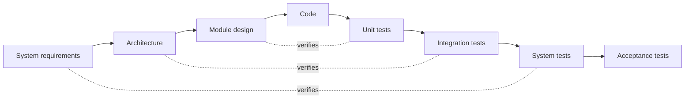

<!-- status: verified -->
# 05-09 · Software Engineering Practices

| | |
|---|---|
| **Course** | [05 · Programming for Engineers](../README.md) |
| **University equivalent** | An introductory software-engineering course for engineers (Sommerville, *Software Engineering*, 10th ed., ch. 2–4, 7–8, 24–25; the FE Electrical and Computer "Software Engineering" knowledge area) |
| **Prerequisites** | [05-04 Jupyter, Testing and Reproducible Workflows](05-04-reproducible-workflows.md), [05-08 Data Structures and Algorithms](05-08-data-structures-and-algorithms.md) |
| **Estimated study hours** | 6 |
| **Last verified** | 2026-11-19 |

**Learning objectives.** After this chapter you can:

1. Write requirements that are specific and testable, and trace them to design elements and tests.
2. Compare waterfall, V-model, iterative/agile and continuous-delivery processes, and say which fits a given product and risk level.
3. Apply the principles of modular design (abstraction, information hiding, low coupling, high cohesion) and judge a design against them.
4. Design tests at each level (unit, integration, system, acceptance), derive test cases by equivalence partitioning and boundary-value analysis, and measure structural coverage (statement, branch, MC/DC) and cyclomatic complexity.
5. Explain how version control, code review, static analysis and release practices fit together, and estimate how a chain of defect filters determines the defects that reach customers.

## 1. Big picture

Programming is what one person does to make a computer behave; software engineering is what a team does to make that behavior correct, maintainable and dependable for years, as requirements, people and hardware change. Most of the failures in this course's practitioner sections (Ariane 501, the Patriot clock, Knight Capital, the Boeing 787 counter) were not caused by anyone's inability to code: they came from requirements carried over from another context, reused code whose assumptions no longer held, missing tests of the cases that mattered, or uncontrolled deployment. This chapter covers the practices that catch such problems, at the depth of the FE exam and of a technically literate executive.

- **Firmware and SDKs** for MCUs and SoCs are long-lived products in their own right, maintained across many chip variants and customers.
- **Safety-critical systems** (automotive, avionics, industrial, medical) must follow certified processes with defined requirements, traceability and coverage evidence.
- **Hardware design** borrows the same practices: RTL is code, verification is testing, and tape-out is a release with no patches (19-13).
- **Diligence:** an engineering organization's process maturity predicts its schedule reliability and integration cost better than its demo does.

## 2. Intuition first

**Building software is like building a facility, with one difference.** A semiconductor fab is specified (capacity, process nodes), designed (layout, tool sets), built, qualified and then operated and upgraded for decades. Software follows the same arc: requirements, design, implementation, verification, release, maintenance. The difference is that software is infinitely malleable: changing it costs keystrokes, not concrete. That tempts teams to skip the specification and design steps, and it is why discipline, rather than physics, keeps software projects on track.

**Defects are caught by a series of filters.** Picture defects entering the product as it is written. Each practice (requirements review, design review, code review, static analysis, unit tests, integration tests, system tests) is a filter that catches a fraction of the defects passing through it. No single filter is perfect, but in series they multiply: if each lets through half, four filters let through one in sixteen (Example 05-09.4). *Where the picture breaks:* filters are not independent (the bugs that one review misses are often the subtle ones the next also misses), and some defects, such as a wrong requirement, pass every filter because every filter checks against the same wrong specification.

**A finance analogy.** A software process resembles internal controls over financial reporting: segregation of duties (the author does not approve their own change: code review), reconciliations (tests comparing results with expectations), audit trails (version history) and change management (release control). As in finance, controls cost effort, and their strength should match the risk: a prototype dashboard needs fewer controls than braking firmware.

## 3. Theory

### 3.1 Requirements

A **requirement** states what the system must do (a **functional** requirement) or how well it must do it (a **non-functional** requirement: performance, power, reliability, security, safety, maintainability). Good requirements are:

- **Specific and measurable:** "The monitor shall assert LOW_BATT within 20 ms when the cell voltage falls below 3.30 V" rather than "the monitor shall detect low battery quickly".
- **Testable:** for each requirement there is a test that can pass or fail.
- **Unambiguous, complete and consistent:** one reading, no gaps (what happens at exactly 3.30 V? during start-up?), no contradictions with other requirements.
- **Free of design:** they state *what*, not *how*, unless the how is itself a constraint.

**Traceability** links each requirement to the design elements that implement it and the tests that verify it, in both directions. Forward traces show that every requirement is implemented and tested; backward traces show that every piece of code exists for a reason. Safety standards demand this matrix; outside them, it is still the cheapest way to answer "what breaks if we change this requirement?".

Many projects fail at requirements rather than at code: the system does what was specified, and the specification was wrong, incomplete or misunderstood. Ariane 501's inertial software was correct for Ariane 4's trajectory; the requirement that let it run after lift-off, and the assumption about how large one variable could get, were carried over without being re-examined for the new rocket (05-05, [R-093](../../../reference/research-log.md#r-093--software-failures-from-numeric-conversions-and-counters)).

### 3.2 Process models

| Model | Shape | Strengths | Weaknesses | Typical use |
|---|---|---|---|---|
| **Waterfall** | Sequential phases: requirements → design → implementation → verification → maintenance | Clear milestones, documentation, suits fixed contracts | Late feedback; requirement changes are expensive | Rarely in pure form; regulated deliverables |
| **V-model** | Waterfall in which each development level has a matching test level | Every requirement level has a planned verification; required in spirit by safety standards | Still sequential; heavy | Automotive, avionics, medical, industrial |
| **Iterative / agile** (Scrum, Kanban) | Short cycles (sprints of 1–4 weeks) that each deliver working software | Early feedback, adapts to changing needs | Needs an engaged customer and discipline; documentation can lag | Applications, cloud services, SDK tooling |
| **Continuous delivery / DevOps** | Every change built, tested and deployable automatically; small, frequent releases | Fast, low-risk releases; quick recovery | Requires heavy automation and good tests | Web services, internal tools |

The **V-model** deserves a picture, because hardware verification and safety standards follow it:



Each level on the left is verified by the matching level on the right: module design by unit tests, architecture by integration tests, system requirements by system tests. Agile teams in safety-relevant fields typically run short iterations *inside* a V-model framework: the documents and traces are still produced, incrementally.

The agile approach was crystallized in the 2001 *Manifesto for Agile Software Development*, which values "individuals and interactions over processes and tools, working software over comprehensive documentation, customer collaboration over contract negotiation, and responding to change over following a plan", while noting that the items on the right still have value. Process choice is a risk decision: the cost of a late discovery, the stability of requirements, and the regulatory evidence required.

### 3.3 Design principles

Good designs divide a system into **modules** that can be understood, built, tested and changed independently. The principles:

- **Abstraction:** expose what a module does, hide how. A sensor driver offers `read_temperature()`, not register sequences.
- **Information hiding** (Parnas, 1972): put each design decision that is likely to change (a chip's register map, a file format, an algorithm) inside one module, so a change touches one place.
- **High cohesion:** each module does one well-defined job.
- **Low coupling:** modules depend on each other through few, narrow, stable interfaces. Global variables and shared mutable state are the main sources of hidden coupling.
- **Interfaces as contracts:** a function's preconditions, postconditions and error behavior are documented and tested (05-04's assertions and exceptions are this idea in code).

In embedded systems, a **hardware abstraction layer** (HAL) applies these principles to silicon: application code calls `gpio_write(pin, level)`, and only the HAL knows the registers (05-07). The same application then runs on several chip variants, and most of it can be tested on a PC without hardware.

**Complexity is the enemy of correctness.** McCabe's **cyclomatic complexity** counts the linearly independent paths through a function's control-flow graph:

$$
M = E - N + 2P,
$$

where $E$ is the number of edges, $N$ the number of nodes and $P$ the number of connected components (1 for a single function). For structured code it equals the number of **decision points** (each `if`, `elif`, loop condition and boolean `and`/`or` operator) plus one. $M$ is also the minimum number of test cases needed to exercise a set of independent paths (basis-path testing). Many coding standards flag functions with $M$ above 10 to 15 for splitting (Example 05-09.2).

### 3.4 Testing levels and test design

| Level | Tests | Typical author | Environment |
|---|---|---|---|
| Unit | one function or module in isolation | developer | PC, with hardware stubbed out |
| Integration | modules working together, interfaces | developer / integration team | PC or target |
| System | the whole product against its requirements | test team | target hardware |
| Acceptance | fitness for the customer's use | customer or product owner | customer environment |
| Regression | everything again after each change | automated (CI, 05-04) | all of the above |

**Black-box** test design derives tests from the requirements without looking at the code:

- **Equivalence partitioning:** divide inputs into classes the system should treat alike (below threshold, in range, above range, invalid) and test one representative per class.
- **Boundary-value analysis:** most bugs live at edges (`<` versus `<=`), so test just below, at and just above each boundary (Example 05-09.1).

**White-box** testing measures how much of the code the tests exercise. Common **coverage** criteria, from weaker to stronger:

- **Statement coverage:** every statement executed at least once.
- **Branch (decision) coverage:** every decision has evaluated both true and false.
- **MC/DC (modified condition/decision coverage):** every condition within a decision has been shown to *independently* affect the decision's outcome: for each condition there is a pair of tests that differ only in that condition and produce different outcomes. A decision with $N$ conditions needs at least $N + 1$ tests for MC/DC, instead of $2^N$ for all combinations (Example 05-09.3).

Aviation's DO-178C requires MC/DC for the most critical (Level A) software, and the automotive standard ISO 26262 rates it "highly recommended" for the highest integrity level, ASIL D ([R-097](../../../reference/research-log.md#r-097--safety-standard-coverage-requirements-and-the-defect-cost-curve)) **[Established]**. Coverage measures what the tests *executed*, not what they *checked*: 100% coverage with weak assertions finds little (05-04's Marketing vs Reality).

### 3.5 Version control, review and release

The supporting practices tie the life cycle together:

- **Version control** (05-04) records every change; a **branching strategy** decides how work is integrated. Trunk-based development merges small changes to the main branch frequently, behind automated tests; long-lived feature branches defer integration, and integration pain grows with branch age.
- **Code review:** a second engineer reads every change before it merges. Reviews catch defects that tests miss (unclear logic, missing error handling, security issues), spread knowledge, and enforce standards.
- **Static analysis:** tools that inspect code without running it (compiler warnings, MISRA checkers, analyzers for null dereferences and overflows, 05-05).
- **Continuous integration:** every change built and tested on a clean machine (05-04).
- **Configuration and release management:** knowing exactly which source, tools and settings produced each binary, and **semantic versioning** (MAJOR.MINOR.PATCH: increment MAJOR for incompatible API changes, MINOR for compatible additions, PATCH for compatible fixes) so that users know what an upgrade risks.
- **Maintenance:** most of a software system's lifetime cost comes after first release: fixes, ports to new hardware, new features and security updates. Designs are judged by how cheaply they can be changed.

**Firmware has extra constraints.** Field updates must be robust to power loss (two image slots and a bootloader that falls back), authenticated (signed images, so attackers cannot install their own), and compatible with every hardware revision in the field. A device that cannot be updated turns every escaped defect into a recall.

### 3.6 Defects, filters and metrics

Let a release inject $D$ defects, and let a sequence of independent activities each catch a fraction $p_i$ of the defects that reach them. The fraction that escapes all of them is

$$
f_{\text{escape}} = \prod_i (1 - p_i),
$$

so the expected escaped defects are $D\,f_{\text{escape}}$, and the **defect removal efficiency** is $1 - f_{\text{escape}}$. The product shows why layered practices work and why removing one layer (say, code review) multiplies escapes by $1/(1 - p_i)$. The independence assumption is optimistic: activities tend to miss the same subtle defects, so real escape rates are higher than the product predicts (Example 05-09.4).

**Metrics** make processes manageable, with care: defect density (defects per thousand lines), escaped-defect rate, test coverage, change failure rate and lead time from commit to release. Each can be gamed when it becomes a target: lines of code reward verbosity, coverage rewards assertion-free tests, and closed-ticket counts reward splitting tickets. Use metrics to ask questions, not to grade people.

## 4. Worked examples

### Example 05-09.1 · From a vague requirement to boundary tests

**Setup.** "The monitor shall warn when the battery is low" is untestable. Rewrite it with hysteresis (so the warning does not flicker when the voltage hovers near the threshold), then derive boundary-value tests and run them against an implementation.

**Solution.** A testable version: *"The monitor shall assert LOW_BATT when the cell voltage is below 3.30 V, and shall deassert it only when the voltage is at or above 3.40 V. Between 3.30 V and 3.40 V the state shall not change."* The hysteresis band is $3.40 - 3.30$ = **100 mV**. Boundary-value analysis gives test points just below, at and just above each threshold (with a 10 mV step), from both directions:

```python
def low_batt(v, state):
    """Next LOW_BATT state for cell voltage v (volts), given the current state."""
    if v < 3.30:
        return True
    if v >= 3.40:
        return False
    return state                               # inside the hysteresis band: hold

cases = [  # (voltage, state before, expected state after)
    (3.29, False, True), (3.30, False, False), (3.31, False, False),   # falling through 3.30
    (3.39, True, True), (3.40, True, False), (3.41, True, False),      # rising through 3.40
    (3.35, True, True), (3.35, False, False),                          # inside the band: hold either way
]
failures = [c for c in cases if low_batt(c[0], c[1]) != c[2]]
print(f"{len(cases)} boundary tests, {len(failures)} failures")
```

```text
8 boundary tests, 0 failures
```

The **8** tests cover each boundary from both sides plus the hold behavior inside the band. Notice what writing the tests forced: deciding the behavior *at exactly* 3.30 V and 3.40 V, which the vague requirement left open. A common implementation slip, writing `v <= 3.30`, would fail the test at 3.30 V, which is precisely the case partitioning alone (one value per class) would miss.

**Units check.** Thresholds and band are in volts ✓.

**Sanity check.** A 100 mV band is several times the noise of a typical battery-voltage measurement, so the warning will not chatter ✓.

### Example 05-09.2 · Cyclomatic complexity, by hand and by machine

**Setup.** Compute the cyclomatic complexity of the following function by counting decision points, check it with a program that parses the code, and state how many tests basis-path testing needs.

```python
SOURCE = '''
def classify(samples, limit):
    if not samples:
        return "empty"
    bad = 0
    for s in samples:
        if s < 0 or s > limit:
            bad += 1
    if bad == 0:
        return "ok"
    elif bad < len(samples) // 2:
        return "some bad"
    return "mostly bad"
'''
```

**Solution.** Decision points: the first `if` (1), the `for` loop (2), the inner `if` (3) and its `or` (4), the `if bad == 0` (5) and the `elif` (6). So $M = 6 + 1$ = **7**. A small program can count the same constructs in Python's own syntax tree:

```python
import ast

def cyclomatic(source):
    decisions = 0
    for node in ast.walk(ast.parse(source)):
        if isinstance(node, (ast.If, ast.For, ast.While, ast.IfExp)):
            decisions += 1
        elif isinstance(node, ast.BoolOp):
            decisions += len(node.values) - 1    # "a or b or c" adds two decisions
    return decisions + 1

print(cyclomatic(SOURCE))
```

```text
7
```

(The `elif` appears in the syntax tree as an `if` nested in the `else` of the previous one, so it is counted.) Basis-path testing needs **7** test cases, each exercising a path that differs from the others in at least one decision: for example, an empty list; all good samples; one negative sample among several good ones; one sample above the limit; mostly bad samples; and so on. At $M = 7$ the function is comfortably below the 10–15 threshold at which many standards ask for a split.

**Sanity check.** For a single function, $M = E - N + 2$; a straight-line function with no decisions has $M = 1$, one path ✓.

### Example 05-09.3 · How many tests does MC/DC need?

**Setup.** A heater is allowed to run when `power_ok and (temp_ok or override)`. (a) How many tests does exhaustive testing need? (b) Branch coverage? (c) Find a minimal MC/DC test set.

**Solution.** (a) Three conditions give $2^3$ = **8** combinations. (b) Branch coverage needs the decision to be true once and false once: **2** tests. (c) MC/DC needs, for each condition, a pair of tests differing only in that condition with different outcomes. A brute-force search over subsets finds the smallest set:

```python
from itertools import combinations, product

def decision(p, t, o):
    return p and (t or o)

def mcdc_ok(tests):
    for k in range(3):                         # each condition must independently flip the outcome
        if not any(all(a[i] == b[i] for i in range(3) if i != k) and a[k] != b[k] and decision(*a) != decision(*b)
                   for a, b in combinations(tests, 2)):
            return False
    return True

all_cases = list(product([False, True], repeat=3))
for size in range(1, 9):
    found = [s for s in combinations(all_cases, size) if mcdc_ok(s)]
    if found:
        print(size, "tests, e.g.", [tuple(int(x) for x in case) for case in found[0]])
        break
```

```text
4 tests, e.g. [(0, 0, 1), (1, 0, 0), (1, 0, 1), (1, 1, 0)]
```

**4** tests suffice ($N + 1$ for $N = 3$ conditions). In the set found, (0, 0, 1) and (1, 0, 1) differ only in `power_ok` and give different results (false, true), showing that condition matters on its own; (1, 0, 0) and (1, 1, 0) do the same for `temp_ok`; and (1, 0, 0) and (1, 0, 1) for `override`. For a decision with 10 conditions, MC/DC needs at least 11 tests instead of 1024: the reason the criterion exists. It ensures every condition is tested for its own effect, which branch coverage (2 tests) does not: a branch-coverage set could leave `override` untested entirely.

**Sanity check.** Fewer than $N + 1$ tests cannot work: think of tests as points and independence pairs as links, each changing a different single condition. A closed loop of links would have to change every condition it uses an even number of times, so links that each change a different condition form no loops; and a loop-free network of $k$ points has at most $k - 1$ links. Three conditions need three links, hence at least 4 tests ✓.

### Example 05-09.4 · How many defects reach the customer?

**Setup.** A firmware release injects 50 defects. Code review catches 60% of the defects it sees, unit tests 50% of what remains, integration tests 40%, and system tests 30%. (a) Assuming independence, how many defects are expected to escape, and what is the overall removal efficiency? (b) What if code review is skipped? (c) What if the filters are correlated?

**Solution.** (a) $f_{\text{escape}} = 0.4 \times 0.5 \times 0.6 \times 0.7$ = **0.084**, so $50 \times 0.084$ = **4.2** defects are expected to escape: a removal efficiency of **91.6%**. (b) Without review, $f = 0.5 \times 0.6 \times 0.7 = 0.21$: **10.5** escapes, 2.5 times as many, because review removed $1/(1 - 0.6) = 2.5$ times as many defects as are left without it. (c) Real filters are correlated: a defect subtle enough to pass review is more likely than average to pass unit tests too. A Monte Carlo model in which each defect has a hidden "difficulty" makes the point:

```python
import random

rng = random.Random(7)
p = [0.6, 0.5, 0.4, 0.3]
def escapes(correlated, trials=20_000, defects=50):
    total = 0
    for _ in range(trials):
        for _ in range(defects):
            hard = rng.random() < 0.3 if correlated else False
            caught = any(rng.random() < (pi * 0.4 if hard else pi) for pi in p)
            total += not caught
    return total / trials

print(f"independent: {escapes(False):.2f} escapes; correlated (30% hard defects, each filter 60% weaker on them): {escapes(True):.2f}")
```

```text
independent: 4.18 escapes; correlated (30% hard defects, each filter 60% weaker on them): 9.70
```

With independent filters the simulation reproduces about 4.2 escapes; when 30% of defects are "hard" and every filter is 60% less effective on them, escapes more than double (9.7), although each filter's *average* catch rate falls by only 18% ($0.7 + 0.3 \times 0.4 = 0.82$ of its nominal value): the hard defects slip through all four filters together. Layered defenses work, but the layers should be *different in kind* (reviews, static analysis, tests at several levels, fuzzing, field telemetry), so that their blind spots differ.

**Units check.** Probabilities are dimensionless; defects × fraction = defects ✓.

**Sanity check.** Each added filter multiplies escapes by $(1 - p_i) < 1$, so escapes can only fall as filters are added ✓.

### Answer key

<!-- answer-key -->
| ID | Quantity | Value | Unit |
|---|---|---|---|
| Ex 05-09.1a | hysteresis band | 100 | mV |
| Ex 05-09.1b | boundary tests | 8 | — |
| Ex 05-09.2a | cyclomatic complexity | 7 | — |
| Ex 05-09.3a | exhaustive tests, 3 conditions | 8 | — |
| Ex 05-09.3b | branch-coverage tests | 2 | — |
| Ex 05-09.3c | minimal MC/DC tests | 4 | — |
| Ex 05-09.3d | MC/DC minimum for 10 conditions | 11 | — |
| Ex 05-09.4a | escape fraction | 0.084 | — |
| Ex 05-09.4b | expected escaped defects | 4.2 | — |
| Ex 05-09.4c | removal efficiency | 91.6 | % |
| Ex 05-09.4d | escapes without code review | 10.5 | — |

## 5. Simulate it

Open [labs/05-09-lab/](../labs/05-09-lab/README.md) and run [05-09-practices.ipynb](../labs/05-09-lab/05-09-practices.ipynb). It contains:

1. **Requirements to tests:** a debounced, hysteretic battery monitor, its requirements, and boundary tests that find a planted bug. *Predict first:* which test catches `<=` in place of `<`?
2. **Measuring coverage yourself:** a small line-coverage tracer built on Python's `sys.settrace`, applied to the monitor's tests; then add tests until every line runs. *Predict first:* which lines does the first test set miss?
3. **MC/DC by search:** the minimal MC/DC set for a four-condition interlock.
4. **Defect filters:** the escape model of Example 05-09.4, with your own detection rates, and the effect of removing each filter in turn.

## 6. Engineering tradeoffs

| Knob | Improves | Costs | Typical decision owner |
|---|---|---|---|
| Up-front requirements and design (waterfall, V-model) versus iteration (agile) | Up-front: predictability, evidence for certification | Slow response to change; late feedback | Program management, by risk and regulation |
| Coverage target (statement → branch → MC/DC) | Stronger evidence that every condition was exercised | Test effort grows; diminishing returns outside safety domains | Quality / safety lead |
| Code review depth | Fewer escaped defects, shared knowledge | Engineer time; latency before merge | Engineering manager |
| Release frequency | Smaller, lower-risk changes; faster feedback | Automation investment; more release overhead for firmware | Product / release management |
| Abstraction layers (HAL, interfaces) | Portability across chips, testability on a PC | Some code size and performance; design effort | Firmware architect |
| Process formality | Auditability, repeatability | Overhead, slower changes | Organization, often set by the market (automotive, medical) |

## 7. Numbers to know

| Quantity | Value | Note |
|---|---|---|
| Cyclomatic complexity | decisions + 1; flag above ~10–15 | basis-path test count |
| MC/DC minimum tests | $N + 1$ for $N$ conditions (versus $2^N$ exhaustive) | required for DO-178C Level A ([R-097](../../../reference/research-log.md#r-097--safety-standard-coverage-requirements-and-the-defect-cost-curve)) |
| Escape fraction of a filter chain | $\prod (1 - p_i)$ (independent filters; optimistic) | Example 05-09.4 |
| Sprint length (Scrum) | 1–4 weeks | |
| Semantic version | MAJOR.MINOR.PATCH | breaking / compatible feature / fix |
| FE Software Engineering | 4–6 of 110 questions | [R-001](../../../reference/research-log.md#r-001--ncees-fe-electrical-and-computer-specification) |

## 8. Common mistakes

1. **Untestable requirements** ("fast", "robust", "user-friendly") and undefined edge behavior (what happens *at* the threshold?).
2. **Testing only the happy path:** no boundary, invalid-input or error-path tests.
3. **Treating coverage as correctness:** coverage shows what ran, not what was checked.
4. **Reusing code without re-validating its assumptions** in the new context (Ariane 501).
5. **Long-lived branches and big-bang integration:** merge small changes often, behind automated tests.
6. **Skipping review for "trivial" changes:** many serious incidents began as one-line changes.
7. **Hidden coupling through globals and shared state,** which makes modules impossible to test in isolation.
8. **Firmware without a safe update path:** an escaped defect then requires a recall or a truck roll.

## 9. Practitioner lens

### State of the art (as of Nov 2026)

- **Safety standards set the floor in regulated markets.** DO-178C (avionics) ties required structural coverage to software level, up to MC/DC for Level A; ISO 26262-6 (automotive) lists statement, branch and MC/DC coverage with "highly recommended" ratings rising with the ASIL, MC/DC being highly recommended at ASIL D; IEC 61508 (industrial) and IEC 62304 (medical) play similar roles. These standards, together with coding standards such as MISRA C (05-05), shape how firmware for cars, aircraft, factories and medical devices is written and tested ([R-097](../../../reference/research-log.md#r-097--safety-standard-coverage-requirements-and-the-defect-cost-curve)) **[Established]**, though the exact table entries should be read in the standards themselves.
- **Agile and continuous delivery dominate outside the regulated core,** and are increasingly combined with V-model evidence inside it, with traceability generated from tools rather than written by hand **[Established]** for the general practice.
- **The "cost of late defects grows exponentially" curve is weaker evidence than its fame suggests.** The claim that a defect costs 10× to 100× more to fix in each later phase traces back to studies from the 1970s and 1980s; Bossavit's critique (*The Leprechauns of Software Engineering*) found the underlying data thin and often mis-cited ([R-097](../../../reference/research-log.md#r-097--safety-standard-coverage-requirements-and-the-defect-cost-curve)) **[Contested]**. The direction is plausible where late fixes require recalls or re-certification (hardware, firmware in the field, safety systems); the specific multipliers are not reliable.

### Why it matters commercially

For a chip company, software increasingly decides design wins: customers choose the MCU or SoC whose SDK, drivers, documentation and safety-certification package get their product to market fastest. A vendor whose firmware follows a certified process can sell into automotive and industrial sockets that others cannot. In M&A, the target's software process determines integration cost: a team with requirements traceability, CI, code review and measured escape rates can be merged into a larger organization's process; a team without them carries hidden technical debt whose size is unknown until after closing. "Tape-out" discipline (verification sign-off before an irreversible release) is the hardware analogue, and organizations good at one are often good at the other.

### Marketing vs Reality

- **"We're agile."** *Reality:* stand-ups and sprints are rituals; the substance is working software every iteration, automated tests and a customer in the loop. Ask for the last few release dates and what each delivered.
- **"ISO 26262 compliant."** *Reality:* compliance is per product and per ASIL, assessed for a specific item and process; a chip or library can be "developed according to" the standard with a safety manual, which is not the same as a certified end product. Ask for the safety case, the ASIL, and the assessor.
- **"100% test coverage."** *Reality:* which coverage (statement, branch, MC/DC), and what do the tests assert? (05-04.)
- **"Fixing bugs in the field costs 100× more, so we test everything up front."** *Reality:* the multiplier is contested; the honest argument is about *this* product's cost of field defects (recall, re-certification, reputation).

### Questions for engineering leaders

1. **"How do you trace a requirement to its tests, and how do you know nothing is untested?"** *Strong:* a tool-generated traceability matrix with coverage gaps tracked. *Evasive:* "Our engineers know the product."
2. **"What reaches customers: your escaped-defect rate and its trend?"** *Strong:* a number per release, with root-cause categories. *Evasive:* "We fix bugs quickly."
3. **"What happens between a commit and a release?"** *Strong:* review, CI, static analysis, test levels, sign-off, signed images, staged rollout. *Evasive:* "We test before release."
4. **"How do you update firmware in the field, and what happens if power fails mid-update?"** *Strong:* dual-bank images, signed and verified, automatic rollback. *Evasive:* "Updates are rare."
5. **"Which safety or security standards do you develop to, and who assessed you?"** *Strong:* named standards, levels and assessor, with a safety manual for customers. *Evasive:* "We follow best practices."

## 10. Concept check

1. Rewrite "the charger shall stop charging when the battery is full" as a testable requirement.

   <details><summary>Answer</summary>

   For example: "The charger shall terminate constant-voltage charging within 1 s after the charge current falls below 50 mA while the cell voltage is at least 4.15 V." It names measurable quantities, thresholds and a time limit, so a test can pass or fail. (The exact numbers come from the cell's datasheet.)

   </details>

2. What does the V-model add to the waterfall model?

   <details><summary>Answer</summary>

   A test level matched to each development level (unit tests for module design, integration tests for architecture, system tests for system requirements, acceptance tests for user needs), planned when that development level is defined, so every requirement has a corresponding verification.

   </details>

3. What are coupling and cohesion, and which direction is good for each?

   <details><summary>Answer</summary>

   Coupling is how much modules depend on each other; cohesion is how closely a module's parts belong to one purpose. Aim for low coupling (narrow, stable interfaces; no shared mutable state) and high cohesion (each module does one job).

   </details>

4. Why do boundary-value tests find bugs that equivalence partitioning alone misses?

   <details><summary>Answer</summary>

   Partitioning tests one representative per class, typically in the middle; many bugs are off-by-one errors in the boundary comparisons themselves (`<` versus `<=`), which only inputs at and next to the boundary reveal.

   </details>

5. What is the cyclomatic complexity of a function with two `if` statements, one `while` loop and one `and` in a condition?

   <details><summary>Answer</summary>

   Decisions: 2 + 1 + 1 = 4, so $M = 5$.

   </details>

6. State the MC/DC criterion. How many tests does a decision with 4 conditions need at minimum?

   <details><summary>Answer</summary>

   Every condition must be shown to independently affect the decision: a pair of tests differing only in that condition gives different outcomes. At least $N + 1 = 5$ tests for 4 conditions (versus 16 combinations).

   </details>

7. Three independent filters catch 50%, 40% and 30% of the defects reaching them. What fraction escapes, and why is this estimate optimistic?

   <details><summary>Answer</summary>

   $0.5 \times 0.6 \times 0.7 = 0.21$. Real filters are correlated: defects hard for one tend to be hard for the others, so more escape than the product of independent misses predicts.

   </details>

8. What does a MAJOR version increment promise under semantic versioning?

   <details><summary>Answer</summary>

   That the release contains incompatible (breaking) changes to the public interface; users must check their code before upgrading. MINOR adds compatible functionality; PATCH makes compatible fixes.

   </details>

Now work the [problem set](../problems/05-09-problems.md).

## 11. Key terms

[Requirement](../../../reference/glossary.md#requirement) ·
[Traceability](../../../reference/glossary.md#traceability) ·
[V-model](../../../reference/glossary.md#v-model) ·
[Agile development](../../../reference/glossary.md#agile-development) ·
[Coupling and cohesion](../../../reference/glossary.md#coupling-and-cohesion) ·
[Cyclomatic complexity](../../../reference/glossary.md#cyclomatic-complexity) ·
[Boundary-value analysis](../../../reference/glossary.md#boundary-value-analysis) ·
[Code coverage](../../../reference/glossary.md#code-coverage) ·
[MC/DC](../../../reference/glossary.md#mc-dc) ·
[Code review](../../../reference/glossary.md#code-review) ·
[Semantic versioning](../../../reference/glossary.md#semantic-versioning) ·
[Unit test](../../../reference/glossary.md#unit-test)

## 12. Connections

- **Builds on:** [05-04](05-04-reproducible-workflows.md) (version control, unit tests, CI), [05-05](05-05-c-fundamentals.md) (MISRA C, static analysis, undefined behavior), [05-07](05-07-bit-manipulation.md) (hardware abstraction) and [05-08](05-08-data-structures-and-algorithms.md) (the algorithms half of the FE Software Engineering area).
- **Next:** the [Course 05 exam](../exam/README.md) and the Term 1 checkpoint.
- **Used later:** [08-05](../../08-digital-logic-design/chapters/08-05-verilog-and-testbenches.md) and [19-13](../../19-digital-vlsi-design/chapters/19-13-verification-methods.md) apply testing and coverage to hardware; [18 · Embedded Systems](../../18-embedded-systems-and-microcontrollers/README.md) builds firmware with HALs and update mechanisms; [26-01](../../26-engineering-design-and-professional-practice/chapters/26-01-requirements-and-specifications.md) and [26-02](../../26-engineering-design-and-professional-practice/chapters/26-02-design-reviews-and-standards.md) treat requirements and reviews for whole products; [28-07](../../28-technical-diligence-and-leadership-fluency/chapters/28-07-evaluating-engineering-teams.md) evaluates engineering organizations.

## 13. Further study

- Sommerville, I., *Software Engineering*, 10th ed., chapters 2 (processes), 3 (agile), 4 (requirements), 7 (design), 8 (testing) and 25 (configuration management).
- Parnas, D. L., "On the Criteria To Be Used in Decomposing Systems into Modules", *Communications of the ACM* 15(12), 1972: the classic statement of information hiding, short and still relevant.
- Hayhurst, K. J. et al., *A Practical Tutorial on Modified Condition/Decision Coverage*, NASA/TM-2001-210876: a clear, free introduction to MC/DC.
- Bossavit, L., *The Leprechauns of Software Engineering* (Leanpub): a skeptical look at widely repeated software-engineering "facts".
- The Agile Manifesto (agilemanifesto.org) and the Semantic Versioning 2.0.0 specification (semver.org): each is one page.

## 14. Sources

1. Sommerville, *Software Engineering*, 10th ed., Pearson, 2016; Parnas (1972); McCabe, T. J., "A Complexity Measure", *IEEE Transactions on Software Engineering* SE-2(4), 1976.
2. RTCA DO-178C (2011) and ISO 26262-6:2018 coverage requirements, as summarized by tool vendors; Hayhurst et al., NASA/TM-2001-210876. [R-097]
3. Bossavit, *The Leprechauns of Software Engineering*. [R-097]
4. Beck, K. et al., *Manifesto for Agile Software Development*, 2001; Preston-Werner, T., *Semantic Versioning 2.0.0*.
5. Ariane 501 Inquiry Board report (1996). [R-093]
6. NCEES FE Electrical and Computer specification (2020). [R-001]
