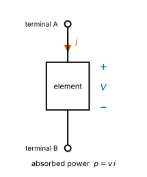
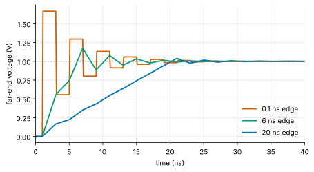
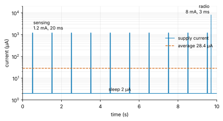

<!-- status: verified -->
# 06-01 · Charge, Current, Voltage, Power and the Lumped Circuit Abstraction

| | |
|---|---|
| **Course** | [06 · Circuit Analysis I (DC)](../README.md) |
| **University equivalent** | The opening chapter of a sophomore Circuits course (Nilsson & Riedel, *Circuit Variables*; Alexander & Sadiku, *Basic Concepts*) and the first lecture of MIT 6.002 with Agarwal & Lang's chapter 1 (the lumped matter discipline) |
| **Prerequisites** | [00-02 The Abstraction Stack](../../00-orientation/chapters/00-02-the-abstraction-stack.md) (the lumped condition), [04-04 Potential, Capacitance and Dielectrics](../../04-physics-for-ee/chapters/04-04-potential-capacitance-and-dielectrics.md) (voltage as potential difference), [04-05 Current, Resistance and Conduction](../../04-physics-for-ee/chapters/04-05-current-resistance-and-conduction.md) (current and charge conservation), [04-07 Faraday, Lenz and Inductance](../../04-physics-for-ee/chapters/04-07-faraday-lenz-and-inductance.md) (why changing flux spoils voltage), [01-05 Integrals](../../01-calculus-for-engineers/chapters/01-05-integrals.md). Each fact used is restated in a *Recap* box. |
| **Estimated study hours** | 6 |
| **Last verified** | 2026-11-19 |

**Learning objectives.** After this chapter you can:

1. Define charge, current, voltage, power and energy with their SI units, and convert among C, A, V, W, J, Wh and mAh.
2. State the three conditions of the lumped matter discipline, derive Kirchhoff's current and voltage laws from them, and decide with a calculation whether a given circuit satisfies them.
3. Assign reference directions and polarities, interpret negative values, and use the passive sign convention to find the power each element absorbs or delivers.
4. Prove that the powers in any lumped circuit sum to zero (Tellegen's theorem) and use the power balance to check a solution.
5. Compute energy from a power or current profile, average power and battery life, conversion efficiency and distribution ($I^2R$) losses, and explain why power is moved at high voltage and converted near the load.

## 1. Big picture

Circuit theory is a deliberate simplification: it replaces the electric and magnetic fields filling space with a voltage across each element and a current through it, connected by a few rules. It gives up radiation and reflections, and in return makes a billion-transistor chip, a phone charger and a power grid analyzable with algebra. This chapter defines the quantities everything else is built on (charge, current, voltage, power and energy), states exactly when the simplification is valid, and sets up the sign bookkeeping that keeps every later calculation honest.

- **Every chip has a power budget.** Power is voltage times current, so a processor that dissipates 1 kW at a core voltage below 1 V draws more than a thousand amperes. Delivering that current is a large part of package and board design (§3.7, Example 06-01.5).
- **Every battery-powered product has an energy budget.** Battery life is stored energy divided by average power, and average power is dominated by how long each block is awake (Example 06-01.4). This arithmetic decides whether a wearable lasts a day or a year.
- **Every power system chooses a voltage.** Losses in wires grow as the square of the current, so power is moved at high voltage and converted down close to the load: hundreds of kilovolts on the grid, tens or hundreds of volts in a data-center rack, under one volt at the transistor (§3.7).
- **Every datasheet and simulator uses a sign convention.** "Current into the pin is positive" and SPICE's habit of reporting a negative current for a battery that is delivering power both follow from the passive sign convention (§3.4).
- **Every high-speed design checks the lumped condition.** When edges are fast compared with the time a signal takes to cross a wire, Kirchhoff's laws stop working and the wire must be treated as a transmission line (§3.3, Example 06-01.3).

## 2. Intuition first

### Water in pipes, and where the picture leaks

The classic picture is plumbing. **Charge** is water. **Current** is the flow rate: liters per second past a point, coulombs per second through a wire. **Voltage** is a pressure difference, or a difference in height: it is what pushes the flow, and it exists only *between* two points. A pump raises water's pressure (a battery or a power supply raises charge's potential energy); a narrow pipe drops pressure and turns the flow's energy into heat (a resistor). **Power**, the rate at which energy is delivered, is pressure difference times flow rate, exactly as $p = vi$ in a circuit.

The picture gets the two circuit laws right: flows at a junction add up (Kirchhoff's current law, §3.3), and pressure drops around any closed loop of pipe sum to zero (Kirchhoff's voltage law).

*Where it breaks.* Charge is not "used up" by a load: the current leaving a light bulb equals the current entering it; what the bulb consumes is *energy*. Electrons drift through copper at a fraction of a millimeter per second (04-05), yet a light comes on as soon as the switch closes, because the *signal* travels as an electromagnetic wave along the wires at a large fraction of the speed of light; there is no plumbing equivalent. And voltage is not a property of a point: "the voltage at node A" always means "relative to some reference", which plumbing hides by taking atmospheric pressure for granted.

### A finance analogy: price times volume

Power is revenue per second. Voltage plays the role of **price**: joules of energy per coulomb of charge, as a price is dollars per unit. Current plays the role of **volume**: coulombs per second, as sales volume is units per second. Their product is joules per second, watts, as price times volume is dollars per second. A supplier can deliver the same power at high price and low volume (high voltage, low current) or low price and high volume (low voltage, high current). The wires charge a "transaction fee" proportional to the square of the volume ($I^2R$, §3.7), which is why the grid trades at high voltage.

*Where it breaks.* A price is set by a market and can be negotiated; a voltage is set by physics (the electric field) and the circuit's elements. And the sign conventions of §3.4 have no clean financial counterpart: in a circuit, every element's "revenue" and "expense" must sum to exactly zero at every instant (§3.5), with no inventory to absorb a difference.

*Figure 1. The passive sign convention. The voltage $v$ is measured from the − terminal to the + terminal; the current $i$ is referenced entering the + terminal. With these choices $p = vi$ is the power the element absorbs.*

## 3. Theory

### 3.1 Charge and current

> **Recap from 04-02 and 04-05.** Charge comes in integer multiples of the elementary charge $e$, which since the 2019 revision of the SI is *exactly* $1.602\,176\,634\times10^{-19}$ C; an electron carries $-e$. (Device chapters write the elementary charge as $q$.) Charge is conserved: it can move but is never created or destroyed.

**Current** is the rate at which charge crosses a surface, such as the cross-section of a wire:

$$
i(t) = \frac{dq}{dt},
$$

where $q$ is the net charge (C) that has crossed the surface in the reference direction and $t$ is time (s). Its unit, the **ampere**, is one coulomb per second: $1\ \text{A} = 1\ \text{C/s}$. Since 2019 the SI defines the ampere through the fixed value of $e$: one ampere is the current of $1/(1.602\,176\,634\times10^{-19}) \approx 6.24\times10^{18}$ elementary charges per second.

Running the definition backwards gives the charge moved between times $t_0$ and $t$, the area under the current curve:

$$
q(t) - q(t_0) = \int_{t_0}^{t} i(\lambda)\, d\lambda .
$$

> **Math refresher — the integral as accumulated area.** If a quantity changes at rate $i(t)$, the total change over an interval is the area under the graph of $i(t)$ ([01-05](../../01-calculus-for-engineers/chapters/01-05-integrals.md)). For a constant current the area is a rectangle, $I\,\Delta t$; for a current ramping linearly from $I$ to 0 over $\Delta t$ it is a triangle, $\tfrac12 I\,\Delta t$. The dummy variable $\lambda$ only names the time inside the integral, so that $t$ can be the upper limit.

**Direction and sign.** A current needs a direction. In a circuit diagram you draw a **reference arrow** on each branch before you know which way charge actually flows; the arrow is bookkeeping, chosen freely. If the computed current is positive, positive charge flows in the arrow's direction (equivalently, electrons flow against it); if it is negative, the flow is opposite to the arrow. A result of $i = -2$ A is not an error: it says "2 A flowing the other way". By convention ("conventional current"), the direction of current is the direction positive charge would move, even though in metals the moving carriers are electrons. Nothing in circuit theory depends on which carriers move, only on the net charge per second.

**DC and time-varying.** A **direct current** (DC) is constant in time. Constant values are written in capitals ($I$, $V$, $P$) and time-varying ones in lowercase ($i(t)$, $v(t)$, $p(t)$), as in [notation.md](../../../reference/notation.md). Course 06 uses DC sources so that the methods are learned before time and frequency enter in Course 07; this chapter's definitions hold at every instant either way.

### 3.2 Voltage

> **Recap from 04-04.** In electrostatics the electric field is conservative: the work done per unit charge in moving between two points does not depend on the path. That work defines the **potential difference** between the points.

The **voltage** from point B to point A is the work per unit charge done *by an external agent* to move a small positive test charge from B to A against the electric field, equivalently the potential energy gained per unit charge:

$$
v_{AB} = v_A - v_B = \frac{dw}{dq},
$$

with $w$ the energy (J) and $q$ the charge moved (C). Its unit, the **volt**, is one joule per coulomb: $1\ \text{V} = 1\ \text{J/C}$. A 1.5 V cell gives every coulomb it pushes through its terminals 1.5 J of energy.

Three consequences of the definition are worth fixing now.

- **A voltage always has two ends.** "The voltage across a resistor" is the voltage between its two terminals. In a diagram you mark a **reference polarity** with + and − signs; $v$ is then the potential of the + terminal minus that of the − terminal. As with current, the marks are chosen freely, and a negative result means the actual polarity is opposite.
- **Node voltages need a reference.** Circuits pick one node as the **reference node**, or **ground**, and quote every other node's voltage relative to it: $v_A$ means $v_{AG}$. Ground is a choice of zero, like sea level for heights; it need not be connected to the earth, and choosing a different node changes every node voltage by the same constant without changing any element voltage.
- **Order matters.** $v_{AB} = -v_{BA}$. Write the subscripts in the order "+ terminal, − terminal".

### 3.3 The lumped matter discipline

A real circuit is a collection of objects in space with fields around and between them. Circuit theory replaces each object by an **element** with a few **terminals**, describes it entirely by the voltages between its terminals and the currents into them, and connects elements by ideal wires that have no resistance, capacitance or inductance. For that replacement to be valid, three conditions must hold. Agarwal and Lang call them the **lumped matter discipline**:

1. **No changing magnetic flux links any closed path outside the elements:** $\partial\Phi_B/\partial t = 0$ through every loop drawn through the wires and terminals.
2. **No net charge accumulates inside an element:** $\partial q_{\text{inside}}/\partial t = 0$, so the current entering one terminal of a two-terminal element equals the current leaving the other.
3. **Signals change slowly compared with the time electromagnetic waves take to cross the circuit**, so that the fields can be treated as quasi-static (the size condition of 00-02).

The first condition is what makes a terminal voltage well defined. By Faraday's law (04-07), the line integral of the electric field around a closed path equals $-d\Phi_B/dt$. If the flux through every path outside the elements is constant, the integral is zero, the field there is conservative, and "the voltage between terminal A and terminal B" has one value whichever route through the wiring you take to measure it. The second condition makes a terminal current well defined: if charge could pile up inside an element, the currents at its two terminals could differ, and "the current through the element" would be ambiguous. The third condition lets the first two hold at every instant: if a signal changes in a time comparable to the time a wave takes to cross a wire, the two ends of the wire carry different values at the same instant, and no single "voltage of the wire" exists.

What the discipline does *not* forbid is inductors and capacitors. A real inductor is precisely a place where changing flux is concentrated, and a capacitor is a place where charge separates. The discipline says: confine those effects inside elements, where they appear as the elements' laws ($v = L\,di/dt$, $i = C\,dv/dt$, Course 07), and keep them out of the wiring between elements. When a wire's own inductance or a node's own capacitance matters, the fix is to *add* an inductor or a capacitor to the model, which restores the discipline. That is how parasitics are handled throughout engineering.

**Nodes, branches and loops.** A **node** is a point where two or more elements connect, together with the ideal wire joining them; a **branch** is a single element (or a path through it) between two nodes; a **loop** is any closed path through branches that visits no node twice. Chapter 06-03 develops these ideas; here they are needed only to state the two laws that follow.

**Kirchhoff's current law (KCL) from condition 2.** Consider a node. Its ideal wire is a conductor of zero size that, by the discipline extended to nodes, stores no charge: $dq_{\text{node}}/dt = 0$. Charge conservation says the rate of change of the charge inside any closed surface equals the net current flowing in. Surround the node with such a surface; the currents flowing in through the surface are the branch currents entering the node, so

$$
\sum_{k \text{ entering}} i_k \;=\; \frac{dq_{\text{node}}}{dt} \;=\; 0 .
$$

**The algebraic sum of the currents entering a node is zero** at every instant. Equivalently, the currents entering equal the currents leaving. (04-05 derived the same law from the continuity equation; here it appears as a consequence of declaring that nodes store no charge.)

**Kirchhoff's voltage law (KVL) from condition 1.** Take any loop through the circuit, passing through elements and wires. The voltage across each branch is the line integral of $-\vec E$ from its − to its + terminal. Adding the branch voltages around the loop, with a plus sign for each branch traversed from − to + and a minus sign for each traversed from + to −, gives the line integral of $-\vec E$ around the closed path. By condition 1 and Faraday's law that integral is zero:

$$
\sum_{k \text{ around a loop}} \pm v_k \;=\; -\oint \vec E\cdot d\vec l \;=\; \frac{d\Phi_B}{dt} \;=\; 0 .
$$

**The algebraic sum of the voltages around any loop is zero** at every instant. Equivalently, the voltage between two nodes is the same along every path joining them, which is just the statement that node voltages exist.

> **Going deeper — what fails when the discipline fails.** If a loop of wire encloses a changing magnetic field (a transformer's core, the field of a nearby switching converter), the sum of the voltages around it equals the induced emf, not zero, and a voltmeter's reading depends on how its leads are routed: two meters connected to the *same two points* can read different values. This is not a paradox; it means the question "what is the voltage between those points?" has no single answer. Courses 13 (electromagnetics) and 22 (power electronics) return to it, and 04-07 showed the physics.

**When is a circuit lumped?** Condition 3 is the one engineers check numerically. A signal travels along a wire at the speed $c/\sqrt{\varepsilon_{\text{eff}}}$, where $c$ = 299 792 458 m/s and $\varepsilon_{\text{eff}}$ is the effective relative permittivity around the wire; the one-way **propagation delay** of a wire of length $\ell$ is therefore

$$
t_d = \frac{\ell\sqrt{\varepsilon_{\text{eff}}}}{c} .
$$

For a sinusoid of frequency $f$, the comparison is with the wavelength $\lambda = c/(f\sqrt{\varepsilon_{\text{eff}}})$: the circuit is lumped when its largest dimension is a small fraction of $\lambda$ (a common rule is $\ell < \lambda/10$, which keeps the phase shift across the circuit below 36°). For digital edges, 00-02 introduced the signal-integrity rule of thumb: treat a wire as lumped only if its one-way delay is less than about one-sixth of the signal's rise time,

$$
t_d < \frac{t_r}{6} .
$$

The reasoning behind the rule: a reflection from the far end returns after $2t_d$; if that is well under the rise time, the reflections ride on the rising edge and smear into it, and the wire behaves as an ideal node with some capacitance. If not, the reflections arrive after the edge has finished and appear as overshoot and ringing (Figure 2, and the lab).

*Figure 2. The same wire, three edge rates. With a 0.1 ns edge the far end overshoots to 1.67 V and rings, which no lumped model of a wire can produce. With a 20 ns edge (20 times the delay) the overshoot is 3.9% and the wire is, for practical purposes, a node. The 6 ns edge, at the rule-of-thumb boundary, still overshoots by 17% with this badly matched 10 Ω driver: the rule is a guide to when reflections start to matter, not a guarantee that they are negligible.*

### 3.4 Reference directions and the passive sign convention

Every two-terminal element now has two numbers, $v$ and $i$, each with a reference you chose. Two choices are possible for the current arrow relative to the + mark. The **passive sign convention** fixes one: **the current reference arrow enters the terminal marked +** (Figure 1). With that choice,

$$
p = v\,i
$$

is the power **absorbed** by the element. If $p$ comes out negative, the element absorbs negative power, which is to say it **delivers** $|p|$ to the rest of the circuit.

Why that product is the absorbed power follows from the definitions. In a short time $dt$, a charge $dq = i\,dt$ enters the + terminal and leaves the − terminal. Moving from + to − it falls through a potential difference $v$, losing energy $dw = v\,dq$ (04-04: potential energy per charge is potential). That energy has gone into the element. So the element absorbs energy at the rate

$$
p = \frac{dw}{dt} = \frac{dw}{dq}\,\frac{dq}{dt} = v\,i, \qquad [\text{J/C}]\times[\text{C/s}] = [\text{J/s}] = [\text{W}] .
$$

If the current reference instead *leaves* the + terminal (the **active** convention, natural for sources), the same product $vi$ is the power the element *delivers*, and the absorbed power is $-vi$. The four combinations reduce to one rule:

| Current arrow | $vi > 0$ means | $vi < 0$ means |
|---|---|---|
| enters + terminal (passive convention) | element absorbs $vi$ | element delivers $\lvert vi\rvert$ |
| leaves + terminal | element delivers $vi$ | element absorbs $\lvert vi\rvert$ |

Resistors always absorb power ($p = i^2R \ge 0$, Chapter 06-02). Sources usually deliver, but not always: a battery being charged absorbs power, and so does a power supply that is being "back-driven" by a stronger source. The sign convention tells you which is happening without any guessing.

**SPICE uses the passive convention for sources.** A SPICE voltage source reports its current as positive when it flows *into* its + terminal through the source to its − terminal. A battery that is delivering power therefore shows a *negative* current, and ngspice's power for it, `@V1[p]`, is negative too. Every engineer meets this once; the lab makes sure it is now, not in front of a customer.

Datasheets often follow the same habit for pins: current *into* a pin is positive, so an output sourcing 4 mA is specified as −4 mA.

### 3.5 Power balance: Tellegen's theorem

In a closed circuit, energy has nowhere to go but into the elements, so the power delivered by some elements must equal the power absorbed by the others at every instant. With the passive convention on every element, that statement is

$$
\sum_{k=1}^{b} v_k\, i_k = 0 ,
$$

summed over all $b$ branches. It is called **Tellegen's theorem**, and it is stronger than it looks: it follows from KCL and KVL alone, without using any element law, so it holds for every lumped circuit, linear or not.

**Proof.** Pick a reference node and let $e_n$ be the voltage of node $n$ relative to it (with $e = 0$ at the reference). Every branch $k$ runs from some node $a$ (its + terminal) to some node $b$ (its − terminal), so by KVL its voltage is the difference of node voltages, $v_k = e_a - e_b$. Its current $i_k$ enters at $a$ (passive convention) and so *leaves node $a$* into the element, then *enters node $b$*. Substitute:

$$
\sum_{k} v_k i_k \;=\; \sum_{k} (e_{a(k)} - e_{b(k)})\, i_k \;=\; \sum_{n} e_n \Big(\sum_{k \text{ leaving } n} i_k \;-\; \sum_{k \text{ entering } n} i_k\Big),
$$

where the last step collects, for each node $n$, every term in which $e_n$ appears: with a plus sign for each branch current that leaves $n$ and a minus sign for each that enters it. By KCL the bracket is zero at every node. So the whole sum is zero. ∎

**Use it as a check.** After solving a circuit, compute every element's absorbed power with the passive convention and add them up. A nonzero total means a sign error or an arithmetic slip somewhere. It costs a minute and catches most mistakes in this course (Example 06-01.2).

> **Going deeper — a stranger and more useful form.** The proof never used the fact that the voltages and currents belong to the *same* circuit. If $v_k$ satisfy KVL in one circuit and $i'_k$ satisfy KCL in any other circuit with the same graph (same nodes and branches, any elements), then $\sum_k v_k i'_k = 0$ as well. This "different circuits" form underlies reciprocity theorems, the sensitivity analysis used by circuit optimizers, and the adjoint-network method that computes the sensitivity of one output to every element in a single extra simulation (Problem 06-01.13).

### 3.6 Energy, average power and the units of a budget

Power is the rate of energy transfer, so the energy absorbed between $t_0$ and $t$ is the area under the power curve:

$$
w(t) - w(t_0) = \int_{t_0}^{t} p(\lambda)\, d\lambda, \qquad 1\ \text{J} = 1\ \text{W}\cdot\text{s}.
$$

The **average power** over an interval of length $T$ is the energy divided by the time,

$$
P_{\text{avg}} = \frac{1}{T}\int_{t_0}^{t_0+T} p(t)\,dt .
$$

For a periodic signal, $T$ is one period. A caution that matters from Course 07 onward: the average of a product is *not* the product of the averages. If $v(t)$ and $i(t)$ both vary, $P_{\text{avg}} \ne V_{\text{avg}} I_{\text{avg}}$ in general (Problem 06-01.8); you must average $v(t)\,i(t)$ itself. At DC, with constant $V$ and $I$, the distinction disappears.

**Practical energy units.** Engineers quote energy in units chosen for the scale at hand:

| Unit | In SI | Where you meet it |
|---|---|---|
| watt-hour (Wh) | 3600 J | batteries, data-center energy |
| kilowatt-hour (kWh) | $3.6\times10^6$ J | electricity bills |
| milliampere-hour (mAh) | 3.6 C of **charge**, not energy | battery capacity |
| electron-volt (eV) | $1.602\times10^{-19}$ J | device physics |
| picojoule per operation (pJ/op) | $10^{-12}$ J | compute efficiency |

The milliampere-hour deserves care: it measures *charge*, $1\ \text{mAh} = 10^{-3}\ \text{A}\times 3600\ \text{s} = 3.6$ C. It becomes energy only when multiplied by a voltage: a 225 mAh cell at a nominal 3.0 V stores about $0.225\ \text{Ah}\times 3.0\ \text{V} = 0.675$ Wh $= 2430$ J. Comparing batteries of different chemistries by mAh alone is like comparing salaries by the number of payments.

**Duty cycling.** Low-power products save energy by being off most of the time. If a block draws current $I_k$ for a fraction $D_k$ of the time (its **duty cycle**), the average current is the weighted sum $I_{\text{avg}} = \sum_k D_k I_k$, and with a constant supply voltage $V$ the average power is $V I_{\text{avg}}$. Battery life is then capacity divided by average current. A block drawing a thousand times the sleep current can still be a minority of the energy if it runs rarely enough (Example 06-01.4).

### 3.7 Moving power: efficiency and $I^2R$ loss

**Efficiency.** A converter or a distribution path delivers output power $P_{\text{out}}$ from input power $P_{\text{in}}$; its **efficiency** is

$$
\eta = \frac{P_{\text{out}}}{P_{\text{in}}}, \qquad P_{\text{loss}} = P_{\text{in}} - P_{\text{out}} = P_{\text{out}}\left(\frac{1}{\eta} - 1\right).
$$

Efficiencies in a chain multiply: two stages at 97% and 90% give $0.97\times0.90 = 87.3\%$ overall. Lost power becomes heat that must be removed, so a point of efficiency at high power is worth a great deal.

**Why high voltage.** A wire of resistance $R$ carrying current $I$ dissipates $I^2R$ (Joule heating, 04-05). To deliver power $P$ at voltage $V$ the current must be $I = P/V$, so

$$
P_{\text{loss}} = I^2R = \frac{P^2 R}{V^2}, \qquad \frac{P_{\text{loss}}}{P} = \frac{P R}{V^2}, \qquad \frac{\Delta V}{V} = \frac{IR}{V} = \frac{P R}{V^2}.
$$

For a fixed path resistance, the fraction of the power lost, and the fractional voltage drop, fall as the *square* of the distribution voltage. Doubling the voltage quarters the loss; equivalently, for the same loss you can use a quarter of the copper. This single relation explains why the grid transmits at hundreds of kilovolts, why data-center racks moved from 12 V to 48 V distribution and are moving higher, why USB raised its voltage to deliver more power through the same thin cable, and why a processor's regulator sits as close to the die as possible: the last few millimeters carry the largest current (Example 06-01.5).

The voltage is not raised for free. Higher voltages need more insulation and clearance, raise shock and arc hazards, and require more conversion stages, each with its own efficiency. Every system picks a distribution voltage by trading these costs (§6).

> **Going deeper — where the energy actually flows.** Circuit theory says a battery delivers power "through the wires" to a resistor. Field theory says something more surprising: the energy travels through the space *around* the wires, carried by the Poynting vector $\vec S = \vec E\times\vec H$ (04-08), and enters the resistor through its surface. For a straight resistive wire of length $L$ and radius $a$ carrying current $I$ with voltage $V$ across it, the field along the surface is $E = V/L$ and the magnetic field is $H = I/(2\pi a)$; the inward flux through the surface is $S\times(2\pi a L) = (V/L)\,(I/2\pi a)\,(2\pi a L) = VI$, exactly the power $p = vi$ of circuit theory (Problem 06-01.14). The lumped abstraction gets the bookkeeping right while hiding the mechanism, which is all an abstraction promises.

## 4. Worked examples

### Example 06-01.1 · Counting charge (tier A)

**Setup.** A sensor's supply current is 2.0 mA for 3.0 ms, then falls linearly to zero over the next 2.0 ms. (a) How much charge does the sensor draw? (b) How many electrons is that? (c) What is the average current over the 5.0 ms?

**Solution.** (a) Charge is the area under the current curve (§3.1): a rectangle plus a triangle,

$$
q = (2.0\ \text{mA})(3.0\ \text{ms}) + \tfrac12(2.0\ \text{mA})(2.0\ \text{ms}) = 6.0\ \mu\text{C} + 2.0\ \mu\text{C} = 8.0\ \mu\text{C}.
$$

(b) Each electron carries $e = 1.602\,176\,634\times10^{-19}$ C, so $N = q/e = 8.0\times10^{-6}/1.602\,176\,634\times10^{-19} = 4.99\times10^{13}$ electrons.

(c) $I_{\text{avg}} = q/T = 8.0\ \mu\text{C}/5.0\ \text{ms} = 1.6$ mA.

**Units check.** mA × ms = $10^{-3}$ A × $10^{-3}$ s = $10^{-6}$ C = µC ✓; µC/ms = $10^{-3}$ A = mA ✓.

**Sanity check.** The average must lie between 0 and the 2.0 mA peak, and it is closer to the peak because the current spends 3 of the 5 ms there ✓. Fifty trillion electrons sounds like a lot, but a coulomb is $6.24\times10^{18}$ of them; 8 µC is a tiny charge.

### Example 06-01.2 · Who delivers power, and who absorbs it? (tier A/B)

**Setup.** A 12 V supply $V_1$ with a 2 Ω series resistance $R_1$ and a 6 V battery $V_2$ with a 3 Ω series resistance $R_2$ both connect to node A, which feeds a 6 Ω load $R_3$ to ground (Figure 3). Find the node voltage, every branch current, and the power absorbed by each of the five elements. Which source delivers power, and which absorbs it? Check the power balance.

*Figure 3. The circuit of Example 06-01.2. Reference arrows: $i_1$ and $i_2$ point into node A through $R_1$ and $R_2$; $i_3$ points out of A through $R_3$.*

**Solution.** Let $v_A$ be the voltage of node A relative to ground. Each resistor current follows from the voltage across it (Ohm's law, $i = v/R$, which 06-02 develops):

$$
i_1 = \frac{12 - v_A}{2}, \qquad i_2 = \frac{6 - v_A}{3}, \qquad i_3 = \frac{v_A}{6}.
$$

KCL at node A, currents in = currents out: $i_1 + i_2 = i_3$. Multiply by 6 to clear fractions:

$$
3(12 - v_A) + 2(6 - v_A) = v_A \;\Rightarrow\; 36 + 12 = 6 v_A \;\Rightarrow\; v_A = 8\ \text{V}.
$$

So $i_1 = (12 - 8)/2 = 2$ A, $i_2 = (6 - 8)/3 = -0.667$ A and $i_3 = 8/6 = 1.333$ A. The negative $i_2$ means current actually flows from node A *into* the battery's + terminal.

Now the powers, each with the passive convention (current entering the + terminal):

| Element | Voltage (+ to −) | Current entering + | Absorbed power $p = vi$ |
|---|---|---|---|
| $V_1$ | 12 V | $-i_1 = -2$ A | **−24 W** (delivers 24 W) |
| $R_1$ | $12 - 8 = 4$ V | $i_1 = 2$ A | **8 W** |
| $V_2$ | 6 V | $-i_2 = +0.667$ A | **+4 W** (absorbs: it is being charged) |
| $R_2$ | $6 - 8 = -2$ V | $i_2 = -0.667$ A | **1.333 W** |
| $R_3$ | 8 V | $i_3 = 1.333$ A | **10.667 W** |

The 12 V supply delivers 24 W. The battery *absorbs* 4 W: the stronger supply is charging it. **Power balance:** $-24 + 8 + 4 + 1.333 + 10.667 = 0$ ✓ (Tellegen).

**Units check.** V/Ω = A ✓; V × A = W ✓.

**Sanity check.** $v_A$ = 8 V lies between the two source voltages, as it must for a node fed through resistors from both. Both resistor powers are positive, as resistors' must be. And in ngspice (lab Part 1), `i(V1)` reads −2 A and `@V1[p]` reads −24 W: SPICE's passive convention for sources, confirmed.

### Example 06-01.3 · Lumped or not? (tier B)

**Setup.** Decide whether each of the following can be analyzed with Kirchhoff's laws. (a) A 1 kHz audio signal on a 2 m cable whose signals travel at 0.66$c$. (b) A clock on a 150 mm stripline on an FR-4 board ($\varepsilon_r$ = 4.6), first with 0.5 ns edges and then with 10 ns edges. (c) A 60 Hz power line 400 km long (signals travel at very nearly $c$).

**Solution.** (a) Delay $t_d = 2\ \text{m}/(0.66\times 299\,792\,458\ \text{m/s}) = 10.1$ ns, against a period of 1 ms: the signal changes $10^5$ times more slowly than it crosses the cable. **Lumped**, overwhelmingly.

(b) For a stripline the field is entirely in the dielectric, so $\varepsilon_{\text{eff}} = \varepsilon_r$ and the delay per unit length is $\sqrt{4.6}/c = 7.154$ ps/mm (the value tabulated in TI's layout guide, [R-083](../../../reference/research-log.md#r-083--board-dielectrics-propagation-5g-bands-and-rf-exposure)). So $t_d = 150 \times 7.154$ ps $= 1.073$ ns, and the rule $t_d < t_r/6$ requires $t_r > 6.44$ ns. With **0.5 ns edges the trace is not lumped**: it must be designed as a transmission line (controlled impedance, termination) or it will ring. With **10 ns edges it is lumped** (barely: $10 > 6.44$).

(c) The wavelength at 60 Hz is $\lambda = c/f = 299\,792\,458/60 = 4997$ km, so the line is $400/4997 = 0.080\lambda$ long, under the $\lambda/10$ rule. But that is a phase shift of $0.080 \times 360° = 28.8°$ from end to end, which power engineers do not ignore: textbook power-systems practice treats lines up to about 80 km as short (a series impedance), up to about 250 km as medium (lumped π models), and longer lines with distributed (transmission-line) equations. **Lumped only approximately**; a 400 km line is modeled as distributed.

**Units check.** m/(m/s) = s ✓; (m/s)/Hz = m ✓.

**Sanity check.** Size alone does not decide: a 400 km line at 60 Hz and a 15 cm trace at gigahertz edge rates are both "electrically long" because what matters is size compared with wavelength (or delay compared with rise time) ✓.

### Example 06-01.4 · A wearable's energy budget (tier B)

**Setup.** A sensor tag runs from a coin cell rated 225 mAh at a nominal 3.0 V. Its microcontroller sleeps at 2.0 µA; once per second it wakes for 20 ms to sample a sensor, drawing 1.2 mA; once every 10 s it transmits a radio packet, drawing 8.0 mA for 3.0 ms. (These are illustrative values of the kind found in current low-power parts; §9 gives sourced figures.) Treat the supply voltage as constant and the currents as additive with the sleep current always present. (a) Find the average current and the average power. (b) Estimate the battery life. (c) Which activity dominates the energy, and what does that suggest?

**Solution.** (a) Duty cycles: sensing $D_s = 20\ \text{ms}/1\ \text{s} = 0.020$; radio $D_r = 3.0\ \text{ms}/10\ \text{s} = 3.0\times10^{-4}$. Weighted sum (§3.6):

$$
I_{\text{avg}} = 2.0\ \mu\text{A} + 0.020\times 1.2\ \text{mA} + 3.0\times10^{-4}\times 8.0\ \text{mA} = 2.0 + 24.0 + 2.4\ \mu\text{A} = 28.4\ \mu\text{A}.
$$

Average power $P_{\text{avg}} = 3.0\ \text{V}\times 28.4\ \mu\text{A} = 85.2\ \mu\text{W}$.

(b) Life $= 225\ \text{mAh}/0.0284\ \text{mA} = 7923$ h $= 330$ days. The cell's energy is $0.225\ \text{Ah}\times 3.0\ \text{V}\times 3600$ s/h $= 2430$ J, and $2430\ \text{J}/85.2\ \mu\text{W} = 2.85\times10^{7}$ s = 330 days, the same answer by the energy route ✓.

(c) Shares of the average current: sleep 7.0%, sensing 84.5%, radio 8.5%. The radio draws the largest current but runs so rarely that it is a small part of the budget; the 20 ms sensing window dominates. Halving the sensing time (a faster sensor, or a lower clock with less work per sample) would extend life far more than a better radio. Profile the duty cycle before optimizing the biggest number on the datasheet.

**Units check.** mAh/mA = h ✓; Ah × V = Wh, × 3600 s/h = J ✓.

**Sanity check.** Real cells deliver less than their rating at high pulse currents and low temperature, and self-discharge over a year, so a careful designer would derate the 330 days by 10–30%; the method is unchanged ✓.

*Figure 4. The duty-cycled current of Example 06-01.4 on a logarithmic axis. The tall radio burst is visually dominant but contributes only 8.5% of the charge; the 20 ms sensing windows contribute 84.5%.*

### Example 06-01.5 · A kilowatt at 0.8 volts (tier C)

**Setup.** An AI accelerator dissipates about 1 kW (accelerators of this class are rated at roughly 1,000 W, [R-026](../../../reference/research-log.md#r-026--ai-accelerator-power-ratings)). Assume a core supply of 0.80 V. (a) What current does it draw? (b) Suppose the power had to cross a distribution path of 0.10 mΩ (a few centimeters of heavy copper planes and connectors; illustrative) at 0.8 V, 12 V or 48 V. For each, find the current, the voltage drop as a fraction of the supply, and the power lost. (c) The board receives 48 V and converts it in two stages, 48 V to 12 V at 97% efficiency and 12 V to 0.8 V at 90%. How much power must the board draw, and how much heat do the converters make? (d) If the final 0.8 V path may drop at most 2% of the supply at full current, what is the largest resistance it may have?

**Solution.** (a) $I = P/V = 1000\ \text{W}/0.80\ \text{V} = 1250$ A.

(b) With $I = P/V$, the drop is $IR$ and the loss is $I^2R$:

| Distribution voltage | Current | Drop $IR$ | Drop / supply | Loss $I^2R$ |
|---|---|---|---|---|
| 0.8 V | 1250 A | 125 mV | **15.6%** | **156 W** |
| 12 V | 83.3 A | 8.33 mV | 0.069% | 0.694 W |
| 48 V | 20.8 A | 2.08 mV | 0.0043% | 0.0434 W |

At 0.8 V the same 0.1 mΩ path would waste 156 W and leave the chip with 0.675 V, below any sensible operating voltage. At 48 V the loss is 43 mW. The ratio of losses between 0.8 V and 48 V is $(48/0.8)^2 = 3600$, the square law of §3.7.

(c) Chain efficiency $\eta = 0.97\times0.90 = 0.873$, so $P_{\text{in}} = 1000/0.873 = 1145.5$ W; the converters turn **145.5 W** into heat, about a seventh of the chip's own power, and that heat must be removed too.

(d) Allowed drop $0.02\times 0.80\ \text{V} = 16$ mV at 1250 A: $R_{\max} = 16\ \text{mV}/1250\ \text{A} = 12.8\ \mu\Omega$. That is a few millimeters of thick copper, which is why the last conversion stage sits directly beside, under, or (with integrated regulators, [R-058](../../../reference/research-log.md#r-058--integrated-voltage-regulators-and-backside-power-delivery)) inside the package, and why power-delivery networks are designed as carefully as the logic (Course 19).

**Units check.** W/V = A ✓; A × Ω = V ✓; A² × Ω = W ✓; V/A = Ω ✓.

**Sanity check.** Loss fraction $PR/V^2$ at 0.8 V: $1000\times10^{-4}/0.64 = 0.156$ ✓, matching the table. Halving the resistance halves every loss; doubling the voltage quarters it.

### Answer key

<!-- answer-key -->
| ID | Quantity | Value | Unit |
|---|---|---|---|
| T 06-01.a | elementary charges per second in 1 A | 6.24×10^18 | — |
| T 06-01.b | charge of 1 mAh | 3.6 | C |
| T 06-01.c | energy of 225 mAh at 3.0 V | 2430 | J |
| T 06-01.d | two-stage efficiency, 97% × 90% | 87.3 | % |
| Ex 06-01.1a | charge drawn | 8.0 | µC |
| Ex 06-01.1b | electrons | 4.99×10^13 | — |
| Ex 06-01.1c | average current | 1.6 | mA |
| Ex 06-01.2a | node voltage v_A | 8 | V |
| Ex 06-01.2b | i_1 | 2 | A |
| Ex 06-01.2c | i_2 | −0.667 | A |
| Ex 06-01.2d | i_3 | 1.333 | A |
| Ex 06-01.2e | power absorbed by V_1 | −24 | W |
| Ex 06-01.2f | power absorbed by R_1 | 8 | W |
| Ex 06-01.2g | power absorbed by V_2 | 4 | W |
| Ex 06-01.2h | power absorbed by R_2 | 1.333 | W |
| Ex 06-01.2i | power absorbed by R_3 | 10.667 | W |
| Ex 06-01.3a | delay of the 2 m cable | 10.1 | ns |
| Ex 06-01.3b | delay of the 150 mm stripline | 1.073 | ns |
| Ex 06-01.3c | minimum rise time for lumped behavior | 6.44 | ns |
| Ex 06-01.3d | 60 Hz wavelength | 4997 | km |
| Ex 06-01.3e | 400 km line in wavelengths | 0.080 | — |
| Ex 06-01.3f | phase shift along the line | 28.8 | ° |
| Ex 06-01.4a | average current | 28.4 | µA |
| Ex 06-01.4b | average power | 85.2 | µW |
| Ex 06-01.4c | battery life | 7923 | h |
| Ex 06-01.4d | battery life | 330 | days |
| Ex 06-01.4e | cell energy | 2430 | J |
| Ex 06-01.4f | sensing share of the charge | 84.5 | % |
| Ex 06-01.4g | radio share of the charge | 8.5 | % |
| Ex 06-01.4h | sleep share of the charge | 7.0 | % |
| Ex 06-01.5a | core current | 1250 | A |
| Ex 06-01.5b | drop at 0.8 V | 125 | mV |
| Ex 06-01.5c | drop fraction at 0.8 V | 15.6 | % |
| Ex 06-01.5d | loss at 0.8 V | 156 | W |
| Ex 06-01.5e | current at 12 V | 83.3 | A |
| Ex 06-01.5f | loss at 12 V | 0.694 | W |
| Ex 06-01.5g | current at 48 V | 20.8 | A |
| Ex 06-01.5h | loss at 48 V | 0.0434 | W |
| Ex 06-01.5i | board input power | 1145.5 | W |
| Ex 06-01.5j | converter heat | 145.5 | W |
| Ex 06-01.5k | largest allowed path resistance | 12.8 | µΩ |

## 5. Simulate it

Open [labs/06-01-lab/](../labs/06-01-lab/README.md): a notebook and two ngspice netlists.

1. **Signs in SPICE.** Run the operating point of Example 06-01.2. *Predict first:* what sign will ngspice report for the current of the 12 V source, and for its power? Then confirm Tellegen's theorem from the simulator's own numbers.
2. **A battery that becomes a load.** Sweep the 6 V battery's voltage from 0 to 12 V and find the voltage at which it stops absorbing power and starts delivering it. *Predict first* from Example 06-01.2.
3. **Energy budget.** Integrate the sensor tag's current profile numerically, reproduce Example 06-01.4, and see how battery life changes with the sensing time and the radio interval.
4. **When Kirchhoff fails.** Simulate a 1 ns transmission line driven by edges of 0.1, 2, 6 and 20 ns and compare with a bounce-diagram calculation in Python. *Predict first:* for which edge rates does the far end overshoot by more than 10%?

## 6. Engineering tradeoffs

| Knob | Improves | Costs | Typical decision owner |
|---|---|---|---|
| Higher distribution voltage (12 → 48 → 800 V) | $I^2R$ loss and copper fall as $1/V^2$; thinner cables and busbars | Insulation, clearance and safety rules; more conversion stages; arcing on disconnect | System power architect |
| Converting close to the load (point-of-load, in-package regulators) | Short high-current path: less drop and loss, faster transient response | Board or package area, heat at the hot spot, complexity, cost | Power-delivery and package engineers |
| Duty cycling (sleep most of the time) | Average power and battery life | Wake-up latency, wake-up energy, firmware complexity | Firmware and system architects |
| Lumped versus distributed model | Lumped: simple algebra, fast simulation | Wrong (no reflections, no delay) once $t_d$ approaches $t_r/6$ | Signal-integrity engineer |
| Measuring current with a series shunt resistor | Simple, accurate, wide bandwidth | Burns $I^2R$ and drops voltage in the measured path | Hardware engineer |

## 7. Numbers to know

| Quantity | Value | Note |
|---|---|---|
| Elementary charge $e$ | $1.602\,176\,634\times10^{-19}$ C (exact since 2019) | [R-073](../../../reference/research-log.md#r-073--codata-2022-fundamental-constants) |
| Charges per second in 1 A | $6.24\times10^{18}$ | $1/e$ |
| 1 mAh | 3.6 C (charge, not energy) | × voltage for energy |
| 1 Wh | 3600 J | 1 kWh = 3.6 MJ |
| Signal delay in FR-4 stripline ($\varepsilon_r$ = 4.6) | 7.15 ps/mm (≈ 14 cm/ns) | [R-083](../../../reference/research-log.md#r-083--board-dielectrics-propagation-5g-bands-and-rf-exposure) |
| Lumped rule for digital edges | $t_d < t_r/6$ | rule of thumb (00-02) |
| Lumped rule for sinusoids | size $< \lambda/10$ | 60 Hz: $\lambda$ ≈ 5000 km |
| Distribution loss scaling | $P_{\text{loss}}/P = PR/V^2$ | double $V$, quarter the loss |
| AI accelerator power | about 1 kW per device | [R-026](../../../reference/research-log.md#r-026--ai-accelerator-power-ratings) |
| AI rack power (72-GPU class) | about 120 to 140 kW (definitions differ) | [R-098](../../../reference/research-log.md#r-098--usb-power-delivery-rack-power-distribution-and-ai-rack-power) |
| Rack DC bus today; announced next step | 48 V class (≈ 50–54 V); 800 V DC from 2027 | [R-098](../../../reference/research-log.md#r-098--usb-power-delivery-rack-power-distribution-and-ai-rack-power) |
| USB-C power ceiling | 240 W = 48 V × 5 A (100 W = 20 V × 5 A before 2021) | [R-098](../../../reference/research-log.md#r-098--usb-power-delivery-rack-power-distribution-and-ai-rack-power) |
| Data centers' share of world electricity | ≈ 1.5% (2024), ≈ 3% projected for 2030 | [R-099](../../../reference/research-log.md#r-099--data-centre-electricity-use-iea) |
| Low-power MCU | active ≈ 4–75 µA/MHz; sleep ≈ 0.1–3 µA | [R-100](../../../reference/research-log.md#r-100--low-power-mcu-currents-coin-cells-and-cpu-core-voltage-ranges) |
| CR2032 coin cell | 3 V, ≈ 225–254 mAh (load-dependent) | [R-100](../../../reference/research-log.md#r-100--low-power-mcu-currents-coin-cells-and-cpu-core-voltage-ranges) |

## 8. Common mistakes

1. **Drawing the current arrow out of the + terminal and still using $p = vi$ as absorbed power.** Check the convention on every element; for sources it is easy to get backwards.
2. **Reading a negative current as an error.** It means the flow is opposite to the reference arrow; keep the sign and carry on.
3. **"The voltage at a point."** Voltage is always between two points; a node voltage is relative to the reference node.
4. **Thinking current is consumed by a load.** Current in equals current out; *energy* is consumed.
5. **Treating mAh as energy.** It is charge; multiply by voltage to get Wh, and compare batteries in Wh.
6. **Averaging voltage and current separately.** $P_{\text{avg}} = \overline{v i}$, which equals $\overline{v}\;\overline{i}$ only at DC or in special cases (Problem 06-01.8).
7. **Prefix slips.** mW versus MW, µA versus mA: carry units through every line and check orders of magnitude.
8. **Applying Kirchhoff's laws where the discipline fails:** around loops threaded by changing flux, or along wires whose delay is comparable to the signal's rise time.

## 9. Practitioner lens

### State of the art (as of Nov 2026)

- **Power per rack.** NVIDIA's documentation describes a GB200 NVL72 rack (72 GPUs) as drawing about 120 kW; OEM specification sheets give 132 kW nominal and recommend provisioning the rack's busways for up to 192 kW peak; GB300 NVL72 documents give 132 to 142 kW ([R-098](../../../reference/research-log.md#r-098--usb-power-delivery-rack-power-distribution-and-ai-rack-power)) **[Contested]**: the figures differ because they measure different things (typical, nominal, provisioned peak), which is exactly the distinction to ask about. Individual accelerators are rated around 1 kW ([R-026](../../../reference/research-log.md#r-026--ai-accelerator-power-ratings)).
- **Distribution voltage is rising.** The Open Compute Project's Open Rack V3 distributes a 48 V-class DC bus (about 50 to 54 V, depending on revision and option), fed by power shelves of 3 kW rectifier modules. In May 2025 NVIDIA announced an 800 V DC architecture for 1 MW racks from 2027, arguing that feeding a 1 MW rack at 54 V would take up to 200 kg of copper busbar, and in 2026 Google, Microsoft and NVIDIA were standardizing ±400 V and 800 V DC distribution through OCP ([R-098](../../../reference/research-log.md#r-098--usb-power-delivery-rack-power-distribution-and-ai-rack-power)) **[Industry estimate]**: vendor and consortium announcements, read from search excerpts. The argument is §3.7's square law: going from 54 V to 800 V cuts the current 14.8-fold and the $I^2R$ loss in the same conductor about 219-fold (Problem 06-01.12).
- **USB-C power.** USB Power Delivery revision 3.1 (May 2021) raised the ceiling from 100 W (20 V at 5 A) to 240 W (48 V at 5 A) by adding fixed 28, 36 and 48 V levels at the same 5 A cable current ([R-098](../../../reference/research-log.md#r-098--usb-power-delivery-rack-power-distribution-and-ai-rack-power)) **[Established]** in substance (a published specification, read here from the USB-IF's announcement as quoted in search excerpts). Problem 06-01.11 shows why the voltage, not the current, went up.
- **Data-center energy.** The International Energy Agency estimated data-center electricity use at about 415 TWh in 2024, about 1.5% of world consumption, and projected about 945 TWh by 2030; its April 2026 update reported growth of 17% in 2025, to about 485 TWh, and about 950 TWh by 2030 ([R-099](../../../reference/research-log.md#r-099--data-centre-electricity-use-iea)) **[Industry estimate]**: modeled estimates with wide uncertainty bands.
- **The other end of the scale.** Current low-power microcontrollers advertise active currents of a few to tens of microamperes per megahertz and sleep currents from about a hundred nanoamperes to a few microamperes. ST's STM32U0 headline is 52 µA/MHz with 160 nA standby (RTC running), although its CoreMark table at 3.0 V shows 73 µA/MHz; Nordic's nRF54L15 is about 20 µA/MHz at 128 MHz with 0.8 µA in system-off at 3.0 V; Ambiq's Apollo4 Plus quotes 4 µA/MHz ([R-100](../../../reference/research-log.md#r-100--low-power-mcu-currents-coin-cells-and-cpu-core-voltage-ranges)) **[Industry estimate]**: vendor figures under differing conditions. A CR2032 coin cell is rated 225 mAh at a 0.2 mA drain (Panasonic) or 254 mAh to 2.0 V on a 15 kΩ load (Energizer): even a battery's rating depends on the load and the cut-off voltage.

### Why it matters commercially

Power is now the binding constraint on computing, from the coin cell in a wearable to the grid connection of an AI data center. The arithmetic of this chapter ($P = VI$, $I^2R$, efficiency chains, duty-cycle averages) decides how long a product runs, how much heat a rack must reject, how much copper a building needs and how many conversion stages sit between the grid and a transistor. Each stage is a market: voltage-regulator modules and power ICs, power semiconductors, busbars and connectors, batteries and fuel gauges. In diligence, power claims are among the easiest to inflate and the easiest to check with this chapter's tools.

### Marketing vs Reality

- **"Up to two weeks of battery life."** *Reality:* battery life is capacity divided by *average* current, which depends on a usage profile the vendor chose. Ask for the profile (screen-on time, radio interval, sensing rate) and recompute it for yours (Example 06-01.4).
- **"Only X µA/MHz."** *Reality:* active-current-per-MHz figures usually cover the CPU core running a benchmark from a specified memory at a specified voltage, not peripherals, radio or leakage, and say nothing about sleep current or wake-up energy. A part with a better µA/MHz can have a worse battery life.
- **"98% efficient."** *Reality:* converter efficiency varies with load; a peak figure at one load point can hide much lower efficiency at the light loads where a device spends most of its time. Ask for the efficiency curve and the load profile.
- **"Rated at 1,000 W."** *Reality:* a rating may be a thermal design target, a sustained board limit or a peak; transient current steps can be far larger than the average and are what the power-delivery network must survive. Ask which, and what the transient specification is.

### Questions for engineering leaders

1. **"What is the power budget, block by block, in each operating mode?"** *Strong:* a table of currents and duty cycles per mode, measured on silicon, with the average that drives battery life or thermal design. *Evasive:* a single "typical" number.
2. **"How was that current measured, and at what voltage and temperature?"** *Strong:* instrument, shunt or source-measure unit, bandwidth, supply voltage and temperature stated. *Evasive:* "from the datasheet".
3. **"Where does the power go between the wall (or the battery) and the transistors?"** *Strong:* an efficiency chain with losses per stage and how they vary with load. *Evasive:* only the final stage's efficiency.
4. **"What is the worst-case current step, and what voltage droop does the delivery network allow?"** *Strong:* a step in amperes per nanosecond and a droop budget in millivolts, with simulation and measurement. *Evasive:* "we follow the reference design".
5. **"Which of your interfaces are electrically long, and how are they terminated?"** *Strong:* a list of nets treated as transmission lines, with impedance targets and simulations. *Evasive:* "the board works in the lab".

## 10. Concept check

1. A wire carries $-3$ A in the direction of its reference arrow. What is actually happening?

   

Answer

   Positive charge flows at 3 C/s *against* the arrow (equivalently, electrons flow along it). The negative sign only reports that the arrow, chosen before solving, points the other way.

   

2. Why does "the voltage between two terminals" need condition 1 of the lumped matter discipline?

   

Answer

   Voltage is a line integral of the electric field. If a changing magnetic flux threads the region where the wiring runs, Faraday's law makes the integral depend on the path, so there is no single voltage between the terminals. With no changing flux outside the elements, the field there is conservative and the voltage is path independent.

   

3. An element has $v = 5$ V (+ at terminal A) and a current of 2 A flowing *out of* terminal A. Does it absorb or deliver power, and how much?

   

Answer

   The current entering the + terminal is −2 A, so the absorbed power is $5 \times (-2) = -10$ W: the element delivers 10 W. It behaves as a source.

   

4. State Tellegen's theorem and the only two facts its proof uses.

   

Answer

   With the passive sign convention on every branch, $\sum_k v_k i_k = 0$. The proof uses only KVL (branch voltages are differences of node voltages) and KCL (the currents at each node sum to zero); no element law is needed, so it holds for nonlinear circuits too.

   

5. A phone battery is labeled 3.85 V, 5000 mAh. How much energy does it store, in Wh and in kJ?

   

Answer

   $5.000\ \text{Ah} \times 3.85\ \text{V} = 19.25$ Wh $= 19.25 \times 3600$ J $= 69.3$ kJ.

   

6. Why does doubling the distribution voltage cut wire losses by a factor of four rather than two?

   

Answer

   For a fixed delivered power the current halves, and the loss is $I^2R$, so it falls by $2^2 = 4$.

   

7. A 10 cm trace on FR-4 has a delay of about 0.7 ns. Is it lumped for a signal with 1 ns edges? With 10 ns edges?

   

Answer

   The rule $t_d < t_r/6$ needs $t_r > 4.2$ ns. With 1 ns edges, no: it must be treated as a transmission line. With 10 ns edges, yes.

   

8. A block draws 10 mA for 1 ms every second and 1 µA otherwise. What is its average current?

   

Answer

   $10\ \text{mA}\times 0.001 + 1\ \mu\text{A} \approx 10\ \mu\text{A} + 1\ \mu\text{A} = 11\ \mu\text{A}$ (counting the sleep current during the active millisecond too, as Example 06-01.4 does).

   

Problem set: [06-01 problems](../problems/06-01-problems.md) · [solutions](../solutions/06-01-solutions.md).

## 11. Key terms

[Electric charge](../../../reference/glossary.md#electric-charge) ·
[Elementary charge](../../../reference/glossary.md#elementary-charge) ·
[Electric current](../../../reference/glossary.md#electric-current) ·
[Voltage](../../../reference/glossary.md#voltage) ·
[Reference direction](../../../reference/glossary.md#reference-direction) ·
[Reference node (ground)](../../../reference/glossary.md#reference-node-ground) ·
[Passive sign convention](../../../reference/glossary.md#passive-sign-convention) ·
[Electric power](../../../reference/glossary.md#electric-power) ·
[Lumped-matter discipline](../../../reference/glossary.md#lumped-matter-discipline) ·
[Node](../../../reference/glossary.md#node) ·
[Branch](../../../reference/glossary.md#branch) ·
[Loop](../../../reference/glossary.md#loop) ·
[Kirchhoff's current law (KCL)](../../../reference/glossary.md#kirchhoffs-current-law-kcl) ·
[Kirchhoff's voltage law (KVL)](../../../reference/glossary.md#kirchhoffs-voltage-law-kvl) ·
[Tellegen's theorem](../../../reference/glossary.md#tellegens-theorem) ·
[Average power](../../../reference/glossary.md#average-power) ·
[Duty cycle](../../../reference/glossary.md#duty-cycle) ·
[Efficiency](../../../reference/glossary.md#efficiency) ·
[Ampere-hour](../../../reference/glossary.md#ampere-hour) ·
[Watt-hour](../../../reference/glossary.md#watt-hour) ·
[Propagation delay](../../../reference/glossary.md#propagation-delay) ·
[Transmission line](../../../reference/glossary.md#transmission-line) ·
[Joule heating](../../../reference/glossary.md#joule-heating) ·
[Poynting vector](../../../reference/glossary.md#poynting-vector)

## 12. Connections

- **Previous:** [00-02](../../00-orientation/chapters/00-02-the-abstraction-stack.md) introduced the lumped abstraction and the $t_r/6$ rule; [04-04](../../04-physics-for-ee/chapters/04-04-potential-capacitance-and-dielectrics.md) defined potential; [04-05](../../04-physics-for-ee/chapters/04-05-current-resistance-and-conduction.md) defined current and derived KCL from charge conservation; [04-07](../../04-physics-for-ee/chapters/04-07-faraday-lenz-and-inductance.md) showed why changing flux spoils voltage; [04-08](../../04-physics-for-ee/chapters/04-08-maxwell-preview.md) introduced the Poynting vector.
- **Next:** [06-02 Circuit Elements and Ohm's Law](06-02-circuit-elements-and-ohms-law.md) supplies the element laws that, with KCL and KVL, determine every voltage and current; [06-03](06-03-kirchhoffs-laws.md) puts Kirchhoff's laws to work.
- **Used later:** power balance checks every solution in Courses 06 and 07; average power and RMS values return in AC power ([07-06](../../07-circuit-analysis-2-transient-and-ac/chapters/07-06-ac-power-and-power-factor.md)); efficiency and distribution voltage in power electronics ([Course 22](../../22-power-electronics-and-energy-conversion/README.md)); duty-cycled energy budgets in embedded systems ([18-09](../../18-embedded-systems-and-microcontrollers/chapters/18-09-ultra-low-power-design.md)); the breakdown of the lumped model in transmission lines ([Course 13](../../13-electromagnetics/README.md), [24-01](../../24-high-speed-io-signal-integrity-and-photonics/chapters/24-01-signal-integrity-fundamentals.md)) and power delivery ([19-06](../../19-digital-vlsi-design/chapters/19-06-power-and-low-power-design.md)).

## 13. Further study

- Agarwal, A. and Lang, J. H., *Foundations of Analog and Digital Electronic Circuits*, Morgan Kaufmann, 2005, chapter 1 (the lumped matter discipline) and appendix on Maxwell's equations.
- Nilsson, J. W. and Riedel, S. A., *Electric Circuits*, chapter 1, "Circuit Variables" (SI units, voltage and current, the passive sign convention, power and energy).
- *Video:* MIT OpenCourseWare 6.002, *Circuits and Electronics* (Spring 2007, A. Agarwal), Lecture 1, "Introduction and lumped abstraction".
- Penfield, P., Spence, R. and Duinker, S., *Tellegen's Theorem and Electrical Networks*, MIT Press, 1970, for the general theorem and its applications.

## 14. Sources

1. Agarwal and Lang (2005), ch. 1; Nilsson and Riedel, ch. 1; Alexander and Sadiku, *Fundamentals of Electric Circuits*, ch. 1.
2. B. D. H. Tellegen, "A general network theorem, with applications", *Philips Research Reports* 7, 259–269 (1952); Penfield, Spence and Duinker (1970).
3. BIPM, *The International System of Units (SI)*, 9th edition (2019), for the exact value of $e$ and the definition of the ampere. [R-073]
4. Power-systems line-length classification: J. D. Glover, T. J. Overbye and M. S. Sarma, *Power System Analysis and Design* (Cengage), chapter on transmission-line models.
5. FR-4 propagation delay: Texas Instruments, *High-Speed Layout Guidelines*, SCAA082A (2017). [R-083]
6. AI accelerator power ratings. [R-026]
7. Integrated voltage regulators and backside power delivery. [R-058]
8. USB Power Delivery 3.1; OCP Open Rack V3; NVIDIA 800 V DC architecture; GB200/GB300 NVL72 rack power. [R-098]
9. International Energy Agency, *Energy and AI* (2025) and *Key Questions on Energy and AI* (2026). [R-099]
10. STMicroelectronics STM32U0, Nordic nRF54L15 and Ambiq Apollo4 Plus product documentation; Panasonic and Energizer CR2032 datasheets. [R-100]
