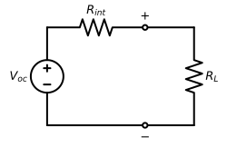
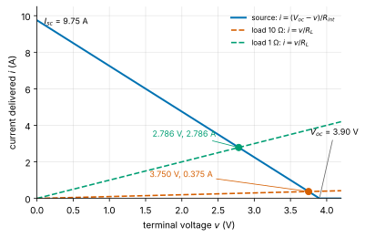
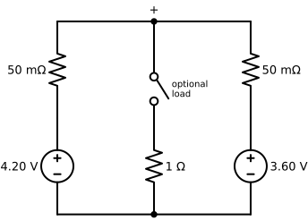

<!-- status: reviewed -->
# 06-02 · Circuit Elements and Ohm's Law

| | |
|---|---|
| **Course** | [06 · Circuit Analysis I (DC)](../README.md) |
| **University equivalent** | The circuit-elements chapter of a sophomore Circuits course (Nilsson & Riedel, *Circuit Elements*; Alexander & Sadiku, *Basic Laws*, the Ohm's-law and source sections) and MIT 6.002's element laws (Agarwal & Lang, ch. 1–2) |
| **Prerequisites** | [06-01 Charge, Current, Voltage and Power](06-01-charge-current-voltage-power.md) (reference directions, passive sign convention, power balance), [04-05 Current, Resistance and Conduction](../../04-physics-for-ee/chapters/04-05-current-resistance-and-conduction.md) (resistivity, sheet resistance, temperature coefficient). Each fact used is restated in a *Recap* box. |
| **Estimated study hours** | 6 |
| **Last verified** | 2026-11-19 |

**Learning objectives.** After this chapter you can:

1. State the element laws of the resistor, the ideal voltage and current sources, the short circuit, the open circuit and the ideal switch, and read each from its i–v characteristic.
2. Apply Ohm's law in resistance and conductance form with correct signs, and compute the power a resistor absorbs ($i^2R$, $v^2/R$) and check it against a rating.
3. Compute resistance from resistivity, geometry and temperature, including sheet resistance in squares.
4. Model a real source as an ideal source with internal resistance, extract the model from measurements, and explain which ideal-source connections are impossible and what real sources do instead.
5. Choose a real resistor: preferred values (E-series), tolerance, temperature coefficient, power rating and technology, and bound a design's worst case.

## 1. Big picture

Kirchhoff's laws (06-01) say how the elements of a circuit are *connected*; they say nothing about what the elements *are*. Each element contributes one more equation, its **element law**, relating the voltage across it to the current through it. KCL, KVL and the element laws together determine every voltage and current in a circuit, which is all of circuit analysis. This chapter introduces the elements of DC circuits (resistors, sources, shorts, opens and switches), shows where resistance comes from physically, and then confronts the ideal models with the parts an engineer can actually buy.

- **Resistors are everywhere.** A modern phone contains hundreds of them: pull-ups on digital lines, dividers that scale voltages for converters, current-limiting resistors for LEDs, termination resistors on fast links, and milliohm shunts that measure battery current.
- **Every wire is a resistor.** Board traces, package bumps and on-chip interconnect all have resistance, and the voltage they drop and the heat they make set limits on power delivery (06-01) and on-chip speed (04-05).
- **Every source is imperfect.** Batteries, regulators and USB ports all sag under load; the internal-resistance model of §3.6 explains why and how much, and leads directly to the Thevenin equivalent of 06-08.
- **Precision is a choice with a price.** A ±5% resistor and a ±0.1% resistor of the same value differ in cost, and in drift with temperature; worst-case design (§3.7) is how engineers decide which one a circuit needs.

## 2. Intuition first

### Friction, pressure and pumps

In the plumbing picture of 06-01, a **resistor** is a narrow section of pipe: the more flow you force through it, the larger the pressure drop across it, and for a given pipe the two are proportional. That proportionality is **Ohm's law**, $v = iR$. A wider or shorter pipe (lower resistance) passes more flow for the same pressure; a longer or narrower one passes less, which is $R = \rho L/A$ (§3.3).

An **ideal voltage source** is a pump that holds a fixed pressure difference no matter how much water flows; an **ideal current source** is a pump that forces a fixed flow no matter what pressure that requires. A **short circuit** is a pipe so wide it has no pressure drop at all; an **open circuit** is a closed valve.

*Where it breaks.* The friction in a real pipe grows faster than linearly with flow once the flow becomes turbulent; the resistance of a metal stays constant over an enormous range of currents, until heating changes it (§3.3). And no real pump holds its pressure at any flow: real sources have a maximum current and an internal resistance (§3.6).

### An analogy from markets: price taker and quantity setter

An ideal voltage source behaves like a market that sets a *price* and lets you buy any *quantity* at it: the voltage is fixed, and the current is whatever the rest of the circuit demands. An ideal current source is the opposite: it fixes the *quantity* and lets the circuit set the price (the voltage). A resistor is a rule linking price and quantity in fixed proportion. *Where it breaks.* Markets adjust over time and by negotiation; a circuit settles to the unique solution of its equations instantly (in the lumped model) and has no memory at DC.

*Figure 1. Each element is a curve in the i–v plane: the set of (voltage, current) pairs it permits. The circuit's solution is the point where all the curves and Kirchhoff's laws are satisfied at once.*

## 3. Theory

### 3.1 What an element is

> **Recap from 06-01.** Every two-terminal element has a voltage $v$ across it and a current $i$ through it. With the **passive sign convention** (current referenced into the + terminal), $p = vi$ is the power the element absorbs.

A two-terminal **element** is defined by its **element law** (or constitutive relation): the set of $(v, i)$ pairs it allows. Plotting that set on axes of voltage and current gives the element's **i–v characteristic**. Two classifications matter throughout the course.

- **Linear or nonlinear.** An element is **linear** if its i–v characteristic is a straight line through the origin, $v = Ri$ for some constant $R$. Everything else is nonlinear: a diode's exponential curve, a lamp whose resistance rises as it heats, a source (whose line misses the origin). Courses 06 and 07 build their methods on linear resistors and sources; Courses 09 and 10 add the nonlinear devices.
- **Passive or active.** An element is **passive** if it can never deliver net energy to the rest of the circuit: its absorbed energy $\int p\,dt$ is never negative. Resistors are passive (their power is never negative, §3.2). Sources are **active**: they can deliver energy.

### 3.2 The resistor and Ohm's law

A **resistor** is the element whose voltage is proportional to its current. With the passive sign convention,

$$
v = R\,i, \qquad i = G\,v, \qquad G = \frac{1}{R},
$$

where $R$ is the **resistance** in ohms (Ω = V/A) and $G$ the **conductance** in siemens (S = A/V). This is **Ohm's law**. The sign matters: if the current reference is drawn *out of* the + terminal instead, the same physical resistor obeys $v = -Ri$. Ohm's law in the form $v = Ri$ is a statement about a resistor *with the passive sign convention*, which is one more reason to use it everywhere.

Conductance is the natural variable when elements are in parallel or when currents are summed (nodal analysis, 06-04): a conductance of 10 mS passes 10 mA per volt. Very large resistances are easier to read as conductances near zero, and a short circuit (below) is the limit $G \to \infty$.

**Power.** Combining $p = vi$ with Ohm's law gives three equivalent forms:

$$
p = v\,i = i^2 R = \frac{v^2}{R} = G v^2 .
$$

For a positive resistance every form is non-negative, whatever the signs of $v$ and $i$: **a resistor always absorbs power**, converting electrical energy into heat (Joule heating, 04-05). The form to use depends on what is fixed: with a fixed current (series elements), the larger resistor dissipates more ($i^2R$); with a fixed voltage (parallel elements), the *smaller* resistor dissipates more ($v^2/R$). Students are regularly surprised by the second.

> **Going deeper — negative resistance.** Some devices have regions of their i–v curve where current *decreases* as voltage increases (tunnel diodes, certain discharge lamps), a negative *incremental* resistance $dv/di < 0$. They still absorb power overall (their $vi$ is positive), but a negative slope can cancel the losses of a resonant circuit and make it oscillate, which is how some microwave oscillators work. Feedback circuits can also synthesize an apparent negative resistance from an amplifier and a power supply (Course 12).

### 3.3 Where resistance comes from

> **Recap from 04-05.** A conductor of resistivity $\rho$ (Ω·m), length $L$ and uniform cross-section $A$ has resistance $R = \rho L/A$. Resistivity rises with temperature, approximately linearly near room temperature: $\rho(T) = \rho_0[1 + \alpha(T - T_0)]$, where $\alpha$ is the **temperature coefficient of resistance**.

**Geometry.** Resistance grows with length and falls with cross-section, exactly as the pipe picture suggests. For copper, the international annealed-copper standard (IACS) fixes $\rho$ = 1.7241 µΩ·cm at 20 °C with $\alpha$ = 0.00393 /°C ([R-080](../../../reference/research-log.md#r-080--conduction-interconnect-metals-electromigration-and-backside-power), [R-101](../../../reference/research-log.md#r-101--resistors-preferred-values-film-technologies-copper-and-shunts)). A 1 mm² copper wire therefore has 17.2 mΩ per meter.

**Sheet resistance and squares.** Thin films (a board's copper foil, a chip's metal and polysilicon layers, a thin-film resistor) have a fixed thickness $t$, so it is convenient to absorb it into a **sheet resistance**

$$
R_\square = \frac{\rho}{t} \quad (\Omega \text{ per square}), \qquad R = R_\square\,\frac{L}{W},
$$

for a strip of length $L$ and width $W$. The ratio $L/W$ is the number of **squares**: a square of any size has resistance $R_\square$, because doubling its side doubles both the length and the width. One-ounce PCB copper (35 µm thick) has $R_\square$ ≈ 0.49 mΩ/□ at 20 °C (Example 06-02.2). Chip designers draw resistors by counting squares of a resistive layer.

**Temperature.** Metals' resistance rises with temperature. Copper's 0.393 %/°C means a trace that heats by 65 °C gains a quarter of its resistance (Example 06-02.2), and a motor winding's temperature can be measured from its resistance (Problem 06-02.6). Resistor materials are engineered to do the opposite, to hardly change at all: the **temperature coefficient of resistance** (TCR) of a precision resistor is quoted in parts per million per kelvin, ppm/K, so that

$$
R(T) \approx R(T_0)\,[1 + \text{TCR}\times(T - T_0)].
$$

A ±100 ppm/K resistor can drift by ±1% over a 100 K rise; a ±25 ppm/K one by ±0.25% (Problem 06-02.9).

### 3.4 Short circuits, open circuits and switches

Two limiting "resistors" are so common they get their own names.

- A **short circuit** has $v = 0$ whatever the current: $R = 0$, $G = \infty$. Its i–v characteristic is the current axis. An ideal wire is a short circuit.
- An **open circuit** has $i = 0$ whatever the voltage: $R = \infty$, $G = 0$. Its i–v characteristic is the voltage axis. A broken wire, an unconnected terminal and an ideal open switch are open circuits.

Neither absorbs power ($v = 0$ or $i = 0$). An **ideal switch** is an element that is a short circuit when closed and an open circuit when open. Real switches (relay contacts, transistors) have a small "on" resistance and a large "off" resistance, and the gap between them is a figure of merit: a power MOSFET may switch between milliohms and megohms.

### 3.5 Independent sources

An **ideal independent voltage source** maintains a specified voltage $v_s$ between its terminals *regardless of the current through it*. Its i–v characteristic is a vertical line at $v = v_s$ (Figure 1): any current is allowed, and the rest of the circuit decides which. An **ideal independent current source** maintains a specified current $i_s$ *regardless of the voltage across it*: a horizontal line at $i = i_s$. "Independent" distinguishes them from the dependent sources of 06-06, whose values are set by another voltage or current in the circuit.

Because an ideal source accepts any current (or any voltage), its power $p = vi$ can be positive or negative: the same 6 V battery delivered power in one circuit of 06-01 and absorbed it in another. A voltage source of 0 V is a short circuit, and a current source of 0 A is an open circuit; this identity becomes a tool in superposition (06-07).

**Connections that are not allowed.** Ideal sources can be connected in ways that contradict Kirchhoff's laws, and then the circuit has no solution:

- two voltage sources **in parallel** with different voltages (KVL around the loop they form fails), or a voltage source **shorted** (a voltage source of $v_s \ne 0$ in parallel with a 0 V "source");
- two current sources **in series** with different currents (KCL at the node between them fails), or a current source **left open** (its current has nowhere to go).

Equal sources in parallel (or in series, for current sources) are consistent but leave the split of current (or voltage) between them undetermined. Real sources never produce a contradiction, because they are not ideal: their internal resistance turns the contradiction into a large, often damaging, current (Example 06-02.5).

### 3.6 Real sources: internal resistance

Measure a battery's terminal voltage while drawing more and more current from it and the voltage falls, approximately linearly. The simplest model that reproduces the line is an ideal voltage source $V_{oc}$ in series with an **internal resistance** $R_{int}$ (Figure 2):

$$
v = V_{oc} - R_{int}\, i ,
$$

with $i$ the current delivered from the + terminal. Two points on the line have names. With no load ($i = 0$) the terminal shows the **open-circuit voltage** $V_{oc}$. With the terminals shorted ($v = 0$) the current is the **short-circuit current** $I_{sc} = V_{oc}/R_{int}$. Two measurements at different loads determine both parameters (Example 06-02.3).

*Figure 2. A practical source (top) and its load lines (bottom), drawn for the cell of Example 06-02.3. The operating point is where the source's line, from $V_{oc}$ = 3.90 V to $I_{sc}$ = 9.75 A, meets the load's line $i = v/R_L$: 3.750 V and 0.375 A for a 10 Ω load, 2.786 V and 2.786 A for 1 Ω.*

The same terminal line can be produced by an ideal *current* source $I_{sc}$ in parallel with $R_{int}$: its terminal current is $i = I_{sc} - v/R_{int}$, which rearranges to the same $v = V_{oc} - R_{int}i$. The two models are indistinguishable from outside. This **source transformation**, and its generalization to any linear network (the Thevenin and Norton equivalents), is the subject of 06-08. Which form is natural depends on the source: a battery or a regulator, whose terminal voltage changes little with load ($R_{int}$ small), is a nearly ideal voltage source; a photodiode, whose current changes little with voltage ($R_{int}$ large), is a nearly ideal current source.

The internal resistance has costs. It wastes power, $i^2R_{int}$, inside the source; it makes the terminal voltage depend on the load; and it limits the deliverable current. A lithium cell's internal resistance rises as it ages and as it gets cold, which is why a phone with a worn battery shuts down under a sudden load although the battery reads "20% charged": the voltage under load, $V_{oc} - R_{int}i$, falls below the shutdown threshold.

### 3.7 Real resistors

A resistor in a parts catalog is specified by much more than its nominal value.

**Preferred values: the E-series.** Resistors are made in **preferred values** whose spacing matches their tolerance, standardized in IEC 60063 as the E-series ([R-101](../../../reference/research-log.md#r-101--resistors-preferred-values-film-technologies-copper-and-shunts)). Series E$n$ has $n$ values per decade, spaced approximately geometrically, by a factor of $10^{1/n}$: E12 steps by about 21%, E24 by about 10%, E96 by about 2.4%. The customary pairing is E12 with ±10% tolerance, E24 with ±5%, E96 with ±1% (a convention; the 2015 edition of the standard revised how series and tolerance are related). The point of the spacing is that the tolerance bands of neighbouring values roughly touch, so every resistance in the decade is covered by some part. The E3 to E24 values are rounded to two significant figures and E48 to E192 to three; for historical reasons several of the E12 and E24 values (2.7, 3.3, 3.9, 4.7, 8.2 among them) differ from a pure geometric rounding (lab Part 4).

| Series | Values per decade | Step $10^{1/n}$ | Customary tolerance |
|---|---|---|---|
| E6 | 6 | 1.468 | ±20% |
| E12 | 12 | 1.212 | ±10% |
| E24 | 24 | 1.101 | ±5% |
| E48 | 48 | 1.049 | ±2% |
| E96 | 96 | 1.024 | ±1% |
| E192 | 192 | 1.012 | ±0.5% and tighter |

**Tolerance and worst case.** A 1 kΩ ±5% resistor may be anywhere from 950 to 1050 Ω when it leaves the factory. A design must work at every combination of extremes that can occur, so **worst-case analysis** evaluates each quantity at the combination of tolerances that pushes it furthest (Example 06-02.4). It is pessimistic, since all parts are rarely at their limits together, which is why designers also run statistical (Monte Carlo) analyses (lab Part 5; 03-04 for why sums of independent errors grow only as $\sqrt N$).

**Temperature coefficient and drift.** On top of the initial tolerance, a resistor's value changes with temperature (TCR, §3.3), with time at temperature and power (load-life stability), and with soldering and humidity. Datasheets specify each.

**Power rating.** A resistor's **power rating** is the power it can dissipate continuously at a stated ambient temperature without exceeding its maximum internal temperature; above that ambient the rating is **derated** along a curve given in the datasheet. Designers add margin, commonly running parts at no more than about half their rating, because heat ages every part and a resistor at its rating is hot enough to affect its neighbours.

**Technologies.** The main families trade cost, precision, power and size:

| Technology | Typical tolerance | Typical TCR | Used for |
|---|---|---|---|
| Thick-film chip | ±1% to ±5% | ±100 to ±200 ppm/K | general purpose, the vast majority of resistors |
| Thin-film chip | ±0.1% to ±1% | ±10 to ±50 ppm/K | precision dividers, gain-setting, references |
| Metal-strip / metal-element shunt | ±0.1% to ±1% | element below about ±20 ppm/K, part ±35 to ±350 ppm/K | current sensing (milliohms) |
| Wirewound | ±0.1% to ±5% | low | high power, high pulse energy |

(Figures are for representative product families as of Nov 2026, [R-101](../../../reference/research-log.md#r-101--resistors-preferred-values-film-technologies-copper-and-shunts); individual parts vary.) Thin film is roughly ten times better than thick film on both tolerance and TCR, at a price premium. The smallest mainstream chip-resistor size is the 01005 (0.4 mm × 0.2 mm, rated about 1/32 W), and smaller parts have been offered.

> **Going deeper — nonlinear "resistors" and incremental resistance.** For a nonlinear element such as a diode, $i = I_s(e^{v/V_T} - 1)$, the ratio $v/i$ (the **static** resistance) and the slope $dv/di$ (the **incremental** or small-signal resistance) are different numbers. At 1 mA, a diode with $I_s = 10^{-14}$ A and $V_T$ = 25.852 mV has $v$ = 0.6548 V, so its static resistance is 654.8 Ω, but its incremental resistance is $V_T/(I + I_s) \approx 25.85$ Ω (Problem 06-02.13). The incremental resistance is what a small signal riding on the 1 mA sees, and it is the idea behind every small-signal model of Course 10.

## 4. Worked examples

### Example 06-02.1 · Ohm's law, signs and power (tier A)

**Setup.** A 4.7 kΩ resistor has 12 V across it, + at terminal A. (a) Find its current, referenced into terminal A, and its conductance. (b) Find the power it absorbs. (c) A second engineer draws the current arrow out of terminal A. What current do they write, and what form does Ohm's law take for them?

**Solution.** (a) With the passive convention, $i = v/R = 12\ \text{V}/4.7\ \text{kΩ} = $ **2.553 mA**; $G = 1/R = $ **212.8 µS**.

(b) \$p = v^2/R = 144/4700 = \$ **30.64 mW**, absorbed (check: $i^2R = (2.553\times10^{-3})^2\times4700$ = 30.64 mW ✓).

(c) Their current is \$i' = -i = \$ **−2.553 mA**, and for them Ohm's law reads $v = -R\,i'$; their power formula is $p = -v\,i'$ = 30.64 mW, the same physical power. Nothing changes but the bookkeeping.

**Units check.** V/Ω = A; 1/Ω = S; V²/Ω = W ✓.

**Sanity check.** 12 V across a few kilohms gives a few milliamperes: the "volts per kilohm = milliamperes" shortcut ✓.

### Example 06-02.2 · A board trace as a resistor (tier B)

**Setup.** A trace in 1 oz copper (35 µm thick) is 0.25 mm wide and 50 mm long. Use the IACS values $\rho_{20}$ = 1.7241 µΩ·cm and $\alpha$ = 0.00393 /°C. (a) Find the copper's sheet resistance and the trace's number of squares. (b) Find its resistance at 20 °C and at 85 °C. (c) At 85 °C it carries 2 A. Find the voltage drop and the power it dissipates.

**Solution.** (a) $R_\square = \rho/t = 1.7241\times10^{-8}\ \Omega\cdot\text{m}/35\times10^{-6}\ \text{m} = 4.926\times10^{-4}$ Ω $=$ **0.4926 mΩ/□**. Squares: \$L/W = 50/0.25 = \$ **200**.

(b) $R_{20} = 200\times0.4926\ \text{mΩ} = $ **98.52 mΩ**. At 85 °C: $R_{85} = 98.52\times[1 + 0.00393\times(85 - 20)] = 98.52\times1.2555 = $ **123.7 mΩ**.

(c) Drop $= 2\ \text{A}\times123.7\ \text{mΩ} = $ **247.4 mV**; power $= 2^2\times0.1237 = $ **0.495 W**.

**Units check.** (Ω·m)/m = Ω per square; squares are dimensionless ✓.

**Sanity check.** A quarter of a volt lost on a 5 cm trace is far too much for a 1 V or 3.3 V rail, and half a watt in a thin trace makes it hot, which raises its resistance further. Power traces are made wide or replaced by planes; industry design charts (the IPC-2152 standard) size traces for current from exactly this physics.

### Example 06-02.3 · A battery's internal resistance from two measurements (tier B)

**Setup.** A lithium cell reads 3.90 V with no load and 3.75 V with a 10 Ω resistor connected. (a) Find its internal resistance and short-circuit current. (b) With the 10 Ω load, find the load power, the power lost inside the cell and the efficiency. (c) What is the terminal voltage when the cell delivers 2 A? (d) Give the equivalent current-source model.

**Solution.** (a) No load: $V_{oc}$ = 3.90 V. With 10 Ω the load current is $3.75/10 = 0.375$ A, and the internal resistance drops the difference: \$R_{int} = (3.90 - 3.75)/0.375 = \$ **0.40 Ω**. Then \$I_{sc} = 3.90/0.40 = \$ **9.75 A**.

(b) Load power $3.75\times0.375 = $ **1.406 W**; internal loss $0.375^2\times0.40 = $ **0.0563 W**; efficiency $= P_L/(P_L + P_{int}) = 3.75/3.90 = $ **96.2%** (for a series circuit the efficiency is the ratio of load voltage to source voltage, since the current is common).

(c) $v = 3.90 - 2\times0.40 = $ **3.10 V**: a 20% sag.

(d) A current source $I_{sc}$ = 9.75 A in parallel with 0.40 Ω. Check at 0.375 A: $v = (9.75 - 0.375)\times0.40 = 3.75$ V ✓.

**Units check.** V/A = Ω; V/Ω = A ✓.

**Sanity check.** The 9.75 A "short-circuit current" is a model parameter, not a safe operating point: shorting the cell would dissipate $3.9^2/0.4 = 38$ W inside it. The linear model holds only near the measured points ✓. The lab confirms (b) and (c) in ngspice.

### Example 06-02.4 · Choosing an LED resistor, with worst case (tier B)

**Setup.** An LED must run at about 10 mA from a 5.0 V ±5% supply; take its forward voltage as a fixed 2.1 V (illustrative). (a) Find the ideal series resistance and the nearest E24 value. (b) With a ±5% resistor, find the worst-case minimum and maximum currents. (c) Find the worst-case resistor power. If design rules require running resistors at no more than half their rating, which of two parts suits, one rated 63 mW and one rated 100 mW (illustrative ratings for small thick-film chips)?

**Solution.** (a) KVL around the loop: $V_s = V_{LED} + iR$, so $R = (5.0 - 2.1)/10\ \text{mA} = 290$ Ω. The nearest E24 value is **300 Ω** (E24 includes 3.0), giving \$(5.0 - 2.1)/300 = \$ **9.667 mA**.

(b) The current is largest with the highest supply and the lowest resistance: $(5.25 - 2.1)/(300\times0.95) = 3.15/285 = $ **11.05 mA**; smallest with the lowest supply and highest resistance: $(4.75 - 2.1)/315 = $ **8.413 mA**.

(c) Worst-case resistor power: $v_R^2/R$ is largest at the highest voltage across the resistor and the lowest resistance: \$3.15^2/285 = \$ **34.82 mW**. At half-rating, the part must be rated at least **69.6 mW**: the 63 mW part fails the rule (it would run at 55% of rating); the **100 mW** part passes (35%).

**Units check.** V/mA = kΩ; V²/Ω = W ✓.

**Sanity check.** The current spread, 8.4 to 11.1 mA, is about ±14% around nominal, larger than either the ±5% resistor or the ±5% supply, because the supply's variation acts on the *difference* $V_s - V_{LED}$, which is only 2.9 V: a 0.25 V supply change is 8.6% of it. Driving LEDs from a current source avoids this sensitivity.

### Example 06-02.5 · Two cells in parallel (tier C)

**Setup.** A charged lithium cell (4.20 V) and a discharged one (3.60 V), each with 50 mΩ internal resistance, are connected in parallel, + to + and − to −. (a) What would the ideal-source model predict? (b) With internal resistances, find the circulating current and the common terminal voltage. (c) Find each cell's power and the heat, and check the power balance. (d) Now a 1 Ω load is connected across the pair. Find the terminal voltage and each cell's current.

**Solution.** (a) Two ideal voltage sources of different value in parallel violate KVL (§3.5): the model has **no solution**. Physically, that means "a current limited only by what the model leaves out", which is the internal resistance.

(b) Around the loop the net voltage is $4.20 - 3.60 = 0.60$ V across the two internal resistances in series: \$i = 0.60/(0.050 + 0.050) = \$ **6.0 A**, flowing out of the 4.2 V cell's + terminal and into the 3.6 V cell's. Terminal voltage: \$4.20 - 6.0\times0.050 = \$ **3.90 V** (and $3.60 + 6.0\times0.050$ = 3.90 V ✓).

(c) The 4.2 V source delivers \$4.20\times6.0 = \$ **25.2 W**; the 3.6 V source absorbs \$3.60\times6.0 = \$ **21.6 W** (it is being charged); the internal resistances turn \$2\times6.0^2\times0.050 = \$ **3.6 W** into heat. Balance: $-25.2 + 21.6 + 3.6 = 0$ ✓.

(d) KCL at the common + terminal $v$: $(4.20 - v)/0.050 + (3.60 - v)/0.050 = v/1$, so $v(20 + 20 + 1) = 84 + 72$ and \$v = 156/41 = \$ **3.805 V**. The charged cell delivers \$(4.20 - 3.805)/0.050 = \$ **7.902 A**; the discharged one's current out of its + terminal is \$(3.60 - 3.805)/0.050 = \$ **−4.098 A**: even with a load, it is still being *charged* by its neighbour, and the load gets only 3.805 A.

**Units check.** V/Ω = A; V × A = W ✓.

**Sanity check.** A 6 A surge between two small cells is a real hazard: battery packs connect only cells at matched states of charge, or isolate them with diodes or switches, for exactly this reason ✓.

*Figure 3. The circuit of Example 06-02.5.*

### Answer key

<!-- answer-key -->
| ID | Quantity | Value | Unit |
|---|---|---|---|
| T 06-02.a | resistance of 1 m of 1 mm² copper at 20 °C | 17.2 | mΩ |
| T 06-02.b | static resistance of the diode at 1 mA | 654.8 | Ω |
| T 06-02.c | incremental resistance of the diode at 1 mA | 25.85 | Ω |
| T 06-02.d | terminal voltage of Example 06-02.3's cell with a 1 Ω load | 2.786 | V |
| Ex 06-02.1a | current | 2.553 | mA |
| Ex 06-02.1b | conductance | 212.8 | µS |
| Ex 06-02.1c | power | 30.64 | mW |
| Ex 06-02.2a | sheet resistance | 0.4926 | mΩ/□ |
| Ex 06-02.2b | squares | 200 | — |
| Ex 06-02.2c | resistance at 20 °C | 98.52 | mΩ |
| Ex 06-02.2d | resistance at 85 °C | 123.7 | mΩ |
| Ex 06-02.2e | drop at 2 A | 247.4 | mV |
| Ex 06-02.2f | power at 2 A | 0.495 | W |
| Ex 06-02.3a | internal resistance | 0.40 | Ω |
| Ex 06-02.3b | short-circuit current | 9.75 | A |
| Ex 06-02.3c | load power at 10 Ω | 1.406 | W |
| Ex 06-02.3d | internal loss at 10 Ω | 0.0563 | W |
| Ex 06-02.3e | efficiency at 10 Ω | 96.2 | % |
| Ex 06-02.3f | terminal voltage at 2 A | 3.10 | V |
| Ex 06-02.4a | nominal LED current with 300 Ω | 9.667 | mA |
| Ex 06-02.4b | worst-case maximum current | 11.05 | mA |
| Ex 06-02.4c | worst-case minimum current | 8.413 | mA |
| Ex 06-02.4d | worst-case resistor power | 34.82 | mW |
| Ex 06-02.4e | minimum rating at half-rating rule | 69.6 | mW |
| Ex 06-02.5a | circulating current | 6.0 | A |
| Ex 06-02.5b | terminal voltage | 3.90 | V |
| Ex 06-02.5c | power delivered by the charged cell | 25.2 | W |
| Ex 06-02.5d | power absorbed by the discharged cell | 21.6 | W |
| Ex 06-02.5e | heat in the internal resistances | 3.6 | W |
| Ex 06-02.5f | terminal voltage with a 1 Ω load | 3.805 | V |
| Ex 06-02.5g | charged cell's current with the load | 7.902 | A |
| Ex 06-02.5h | discharged cell's current with the load | −4.098 | A |

## 5. Simulate it

Open [labs/06-02-lab/](../labs/06-02-lab/README.md): a notebook and two ngspice netlists.

1. **i–v characteristics.** Sweep a resistor, a practical voltage source, a practical current source and a diode, and plot each element's i–v curve. *Predict first:* which curves pass through the origin, and what is the diode's slope at 1 mA?
2. **A battery under load.** Sweep the load on Example 06-02.3's cell model and recover $V_{oc}$ and $R_{int}$ from the simulated line.
3. **Cells in parallel.** Simulate Example 06-02.5, then vary the second cell's voltage. *Predict first:* how large is the circulating current if the cells differ by only 0.1 V?
4. **Where the E-series comes from.** Generate $10^{k/n}$ rounded values for E12 and E24 and compare them with the standard values. *Predict first:* do they all match?
5. **Tolerance, statistically.** Run a Monte Carlo of Example 06-02.4 and compare the spread of LED current with the worst-case bounds.

## 6. Engineering tradeoffs

| Knob | Improves | Costs | Typical decision owner |
|---|---|---|---|
| Tighter tolerance (±5% → ±1% → ±0.1%) | Accuracy without trimming or calibration | Part cost (thin film), sometimes size and availability | Circuit designer, with purchasing |
| Lower TCR | Stability over temperature | Cost; thin-film or metal-foil technology | Precision-analog designer |
| Larger package / higher power rating | Margin, lower temperature, longer life | Board area, cost | Hardware engineer |
| Lower shunt resistance for current sensing | Less $I^2R$ loss and voltage drop | Smaller signal (needs a better amplifier); worse TCR at the lowest values | Power-electronics designer |
| Wider traces, planes, heavier copper | Lower resistance, less drop and heating | Board area, layer count, cost | PCB layout and power-integrity engineers |
| Matched or isolated parallel sources (cells, supplies) | Safe sharing, no circulating current | Balancing circuits, diodes or switches, cost | Battery-pack and power-system designers |

## 7. Numbers to know

| Quantity | Value | Note |
|---|---|---|
| Copper resistivity (IACS, 20 °C) | 1.7241 µΩ·cm; 17.2 mΩ per meter for 1 mm² | [R-101](../../../reference/research-log.md#r-101--resistors-preferred-values-film-technologies-copper-and-shunts) |
| Copper temperature coefficient | 0.00393 /°C (+0.39%/°C) | [R-080](../../../reference/research-log.md#r-080--conduction-interconnect-metals-electromigration-and-backside-power) |
| 1 oz PCB copper | ≈ 35 µm; ≈ 0.5 mΩ/□ | ±7–15% with plating and etch |
| E-series steps | E12 ≈ 21%, E24 ≈ 10%, E96 ≈ 2.4% per value | IEC 60063 ([R-101](../../../reference/research-log.md#r-101--resistors-preferred-values-film-technologies-copper-and-shunts)) |
| Thick-film chip resistor | ±1–5%, ±100–200 ppm/K | general purpose |
| Thin-film chip resistor | ±0.1–1%, ±10–50 ppm/K | precision |
| Smallest mainstream chip resistor | 01005 (0.4 × 0.2 mm), about 1/32 W | [R-101](../../../reference/research-log.md#r-101--resistors-preferred-values-film-technologies-copper-and-shunts) |
| "Volts per kilohm" | 1 V / 1 kΩ = 1 mA | mental arithmetic |

## 8. Common mistakes

1. **Using $v = iR$ with the current arrow drawn out of the + terminal.** Then $v = -iR$. Use the passive convention for resistors and the sign takes care of itself.
2. **Assuming the larger resistor always dissipates more.** True in series (same current, $i^2R$); false in parallel (same voltage, $v^2/R$).
3. **Connecting ideal sources in impossible ways** (unequal voltage sources in parallel, unequal current sources in series, a shorted voltage source, an open current source) and then trying to solve the circuit.
4. **Treating a battery as an ideal source under heavy load.** Its terminal voltage sags by $iR_{int}$, more when cold or old.
5. **Picking a resistor value without checking power,** or checking power at nominal values instead of worst case.
6. **Ignoring temperature:** copper's resistance rises 0.39%/°C; a trace that is fine at 25 °C may not be at 85 °C.
7. **Confusing static and incremental resistance** for nonlinear devices.
8. **Forgetting that "short-circuit current" is a model parameter,** not something to try on a lithium cell.

## 9. Practitioner lens

### State of the art (as of Nov 2026)

- **Preferred values.** IEC 60063, edition 3.0 (2015), defines the E3 to E192 series for resistors and capacitors; the customary pairing of series and tolerance (E24 with ±5%, E96 with ±1%) is a convention that the 2015 edition revised in wording ([R-101](../../../reference/research-log.md#r-101--resistors-preferred-values-film-technologies-copper-and-shunts)) **[Industry estimate]**: read from the IEC webstore summary in search excerpts.
- **Film technologies.** Representative datasheets show general-purpose thick-film chip resistors at ±1% or ±5% with ±100 or ±200 ppm/K, and thin-film families at ±0.1% to ±1% with ±10 to ±50 ppm/K, with ultra-precision thin-film variants down to ±0.02% and ±5 ppm/K ([R-101](../../../reference/research-log.md#r-101--resistors-preferred-values-film-technologies-copper-and-shunts)) **[Industry estimate]**: vendor datasheets read from search excerpts.
- **Miniaturization.** 01005 chip resistors (0.4 × 0.2 mm, about 1/32 W) are catalog parts; one manufacturer has offered a still smaller metric-03015 size, now at last-time-buy status, and announced a metric-0201 size in 2014 whose production status was not confirmed ([R-101](../../../reference/research-log.md#r-101--resistors-preferred-values-film-technologies-copper-and-shunts)) **[Contested]** for "smallest in production". Capacitors have gone smaller than resistors.
- **Current sensing.** Four-terminal metal-strip shunts reach 0.5 mΩ at ±1%; their TCR worsens at the lowest values (one family: ±35 ppm/°C from 5 mΩ up, ±350 ppm/°C at 0.5–0.99 mΩ), plausibly because the copper terminations, at about 3900 ppm/°C, become a larger share of the total ([R-101](../../../reference/research-log.md#r-101--resistors-preferred-values-film-technologies-copper-and-shunts)) **[Industry estimate]**; the explanation is an inference, not the datasheet's.

### Why it matters commercially

Passive components are high-volume, low-margin products, but their availability and qualification gate electronics production: a board cannot ship without every one of its hundreds of resistors, and automotive and industrial parts must be qualified to standards such as AEC-Q200. Component shortages have repeatedly stalled production lines. For a chip company the resistor is also a design input: an IC's datasheet specifies external resistors (feedback dividers, current-sense shunts, termination), and the accuracy a customer gets depends on the tolerance and TCR of parts the customer buys. Integrating precision resistors on chip (thin-film resistors on analog processes) is a selling point for precision analog products.

### Marketing vs Reality

- **"±1% accuracy."** *Reality:* usually the initial tolerance at 25 °C. Add TCR over the operating range, load-life drift and solder-heat shift; a ±1%, ±100 ppm/K part can be several percent off at the end of a hot life.
- **"Rated at 1 W."** *Reality:* at a specified ambient and mounting (often a defined board footprint), derated above it; in a hot, crowded enclosure the usable power can be a fraction of the headline.
- **"Low internal resistance battery."** *Reality:* internal resistance depends on state of charge, temperature, age and the measurement method (DC pulse versus 1 kHz AC); compare like with like.

### Questions for engineering leaders

1. **"Which resistors in this design set accuracy, and what are their tolerance and TCR?"** *Strong:* a short list of critical parts with their error budget. *Evasive:* "we use 1% parts".
2. **"Have you done a worst-case or Monte Carlo analysis on the critical paths?"** *Strong:* yes, with the results and the margin. *Evasive:* "the prototypes all worked".
3. **"How do you sense current, and what limits its accuracy over temperature?"** *Strong:* shunt value, TCR, Kelvin connections, amplifier offset, calibration. *Evasive:* only the ADC's resolution.
4. **"How many single-sourced passive components are on the bill of materials?"** *Strong:* a number, with second sources qualified. *Evasive:* "passives are commodities".

## 10. Concept check

1. Which of these are linear elements: a 1 kΩ resistor, a 5 V ideal voltage source, a short circuit, a diode?

   

Answer

   The resistor and the short circuit (a resistor with $R = 0$): their i–v lines pass through the origin. The source's line does not pass through the origin (it is affine, not linear), and the diode's curve is not a line.

   

2. A 100 Ω and a 1 kΩ resistor are connected in parallel across 10 V. Which dissipates more, and how much?

   

Answer

   The 100 Ω: $v^2/R = 100/100 = 1$ W versus $100/1000 = 0.1$ W. In parallel the smaller resistance takes more current and more power.

   

3. Why is a resistor's power never negative, while a source's can be?

   

Answer

   For a resistor $p = i^2R \ge 0$ for any current (with $R > 0$). A source's voltage is fixed independently of its current, so the current can flow either way and $vi$ can have either sign.

   

4. What is the resistance of a strip of 50 Ω/□ material, 2 µm wide and 40 µm long?

   

Answer

   $40/2 = 20$ squares × 50 Ω = 1 kΩ.

   

5. Why may two ideal current sources of 1 mA and 2 mA not be connected in series?

   

Answer

   The node between them would have 1 mA entering and 2 mA leaving, violating KCL; the circuit has no solution.

   

6. A source reads 12.0 V open-circuit and 11.4 V delivering 3 A. What is its internal resistance?

   

Answer

   $(12.0 - 11.4)/3 = 0.2$ Ω.

   

7. Why do E24 resistors come in a step of about 10% per value?

   

Answer

   With 24 values per decade spaced geometrically, the step is $10^{1/24} \approx 1.10$. Paired with ±5% tolerance, the bands of neighbouring values just about touch, so every resistance is covered.

   

Problem set: [06-02 problems](../problems/06-02-problems.md) · [solutions](../solutions/06-02-solutions.md).

## 11. Key terms

[Element law](../../../reference/glossary.md#element-law) ·
[i–v characteristic](../../../reference/glossary.md#i-v-characteristic) ·
[Linear element](../../../reference/glossary.md#linear-element) ·
[Passive element](../../../reference/glossary.md#passive-element) ·
[Ohm's law](../../../reference/glossary.md#ohms-law) ·
[Resistance](../../../reference/glossary.md#resistance) ·
[Conductance](../../../reference/glossary.md#conductance) ·
[Sheet resistance](../../../reference/glossary.md#sheet-resistance) ·
[Temperature coefficient of resistance](../../../reference/glossary.md#temperature-coefficient-of-resistance) ·
[Short circuit](../../../reference/glossary.md#short-circuit) ·
[Open circuit](../../../reference/glossary.md#open-circuit) ·
[Ideal voltage source](../../../reference/glossary.md#ideal-voltage-source) ·
[Ideal current source](../../../reference/glossary.md#ideal-current-source) ·
[Internal resistance](../../../reference/glossary.md#internal-resistance) ·
[Open-circuit voltage](../../../reference/glossary.md#open-circuit-voltage) ·
[Short-circuit current](../../../reference/glossary.md#short-circuit-current) ·
[E-series (preferred values)](../../../reference/glossary.md#e-series-preferred-values) ·
[Tolerance](../../../reference/glossary.md#tolerance) ·
[Worst-case analysis](../../../reference/glossary.md#worst-case-analysis) ·
[Power rating](../../../reference/glossary.md#power-rating) ·
[Incremental resistance](../../../reference/glossary.md#incremental-resistance)

## 12. Connections

- **Previous:** [06-01](06-01-charge-current-voltage-power.md) (KCL, KVL, the passive sign convention and power balance); [04-05](../../04-physics-for-ee/chapters/04-05-current-resistance-and-conduction.md) (resistivity, sheet resistance, temperature coefficient).
- **Next:** [06-03 Kirchhoff's Laws, Series/Parallel and Dividers](06-03-kirchhoffs-laws.md) combines these elements; [06-04](06-04-nodal-analysis.md) solves any circuit of them systematically.
- **Used later:** source transformation and Thevenin/Norton equivalents ([06-08](06-08-thevenin-and-norton.md)); maximum power transfer from a source with internal resistance ([06-09](06-09-maximum-power-transfer.md)); measurement, meter loading and Kelvin sensing ([06-11](06-11-practical-dc-circuits-and-measurement.md)); diode and transistor i–v curves and incremental resistance ([Course 09](../../09-semiconductor-devices/README.md), [Course 10](../../10-electronics-1/README.md)); battery models and fuel gauging ([02-09](../../02-complex-numbers-des-and-linear-algebra/chapters/02-09-systems-of-odes-and-matrix-exponential.md) introduced the state-space models used in fuel gauging).

## 13. Further study

- Nilsson, J. W. and Riedel, S. A., *Electric Circuits*, chapter 2, "Circuit Elements" (sources, resistors, Ohm's law, construction of circuit models).
- Agarwal, A. and Lang, J. H., *Foundations of Analog and Digital Electronic Circuits*, chapters 1–2 (element laws, i–v characteristics).
- Horowitz, P. and Hill, W., *The Art of Electronics*, 3rd ed., Cambridge University Press, 2015, chapter 1 and appendix on resistor types (a practitioner's view of real resistors).
- *Video:* MIT OpenCourseWare 6.002, *Circuits and Electronics* (Spring 2007, A. Agarwal), Lecture 2, "Basic circuit analysis method".

## 14. Sources

1. Nilsson and Riedel, ch. 2; Agarwal and Lang (2005), ch. 1–2; Alexander and Sadiku, ch. 2.
2. Copper resistivity and temperature coefficient (IACS; NBS Handbook 100). [R-080], [R-101]
3. IEC 60063:2015, *Preferred number series for resistors and capacitors*. [R-101]
4. Representative thick-film, thin-film and current-sense resistor datasheets (Vishay D/CRCW e3, TNPW e3, WSK2512; Panasonic ERJ-XGN; ROHM SMR series). [R-101]
5. PCB copper thickness and sheet resistance (TI and Analog Devices application notes). [R-101]
