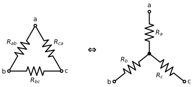

<!-- status: verified -->
# 06-03 · Kirchhoff's Laws, Series/Parallel and Dividers

| | |
|---|---|
| **Course** | [06 · Circuit Analysis I (DC)](../README.md) |
| **University equivalent** | The "simple resistive circuits" chapter of a sophomore Circuits course (Nilsson & Riedel, *Simple Resistive Circuits*; Alexander & Sadiku, *Basic Laws*: Kirchhoff's laws, series and parallel, dividers, wye–delta) and MIT 6.002's KVL/KCL method (Agarwal & Lang, ch. 2) |
| **Prerequisites** | [06-01](06-01-charge-current-voltage-power.md) (KCL and KVL from the lumped matter discipline, reference directions, power balance), [06-02](06-02-circuit-elements-and-ohms-law.md) (Ohm's law, sources, tolerance and worst case), [02-06](../../02-complex-numbers-des-and-linear-algebra/chapters/02-06-vectors-matrices-and-linear-systems.md) (linear systems). Each fact used is restated in a *Recap* box. |
| **Estimated study hours** | 8 |
| **Last verified** | 2026-11-19 |

**Learning objectives.** After this chapter you can:

1. Write KCL and KVL with consistent signs for any node and loop, count how many of them are independent, and solve a circuit by combining them with the element laws.
2. Derive and apply the series and parallel combination rules for resistors and for sources.
3. Derive and apply the voltage- and current-divider formulas, including a divider driving a load, and judge the loading error.
4. Analyze the Wheatstone bridge: its balance condition, its output for a small resistance change, and its use with strain gauges.
5. Convert between delta and wye networks and use the conversion to reduce networks that are neither series nor parallel.

## 1. Big picture

06-01 derived Kirchhoff's two laws and 06-02 supplied the element laws. This chapter puts them to work. Most of the circuits an engineer meets day to day are small: a divider that scales a battery voltage for a converter, a pair of resistors that set an amplifier's gain, a bridge that turns a tiny resistance change into a measurable voltage. They yield to two ideas, series and parallel combination, and to two formulas derived from them, the voltage and current dividers. When a network refuses to simplify that way, the delta–wye transformation or the systematic methods of 06-04 and 06-05 take over.

- **Scaling voltages for measurement.** Every battery monitor, power-supply feedback loop and sensor interface uses a divider to bring a voltage into an ADC's or a comparator's range (Example 06-03.3).
- **Setting references and gains.** Precision dividers set a regulator's output voltage and an amplifier's gain (06-10); their accuracy is the accuracy of the resistor *ratio*, not of the resistors themselves.
- **Sensing.** Strain gauges, pressure sensors, load cells and many thermal sensors are read out in Wheatstone bridges (Example 06-03.4).
- **Sharing current.** Parallel paths split current in inverse proportion to resistance: parallel power transistors, multiple vias and bonding wires, and current-sense paths all obey the current divider.

## 2. Intuition first

### Bookkeeping that cannot be fudged

KCL is double-entry bookkeeping for charge: at every node, what comes in equals what goes out, with no inventory account. KVL is the same for energy per charge: walk around any loop and you end where you began, so the rises and drops must cancel, the way the price changes of a round trip through several currencies must multiply back to one if no money is created. *Where the analogy breaks:* real books can carry inventory and real currency loops can show arbitrage; the lumped circuit cannot. That is exactly what the lumped matter discipline (06-01) guarantees.

### Series shares current, parallel shares voltage

Elements in **series** form a single path, so the same current flows through all of them, and their voltages add. Elements in **parallel** sit across the same two nodes, so they share the same voltage, and their currents add. A resistance in series is like a toll on a single road: tolls add. Resistances in parallel are like extra lanes: each lane adds capacity (conductance), and the total resistance falls below that of the best single lane.

*Figure 1. Series (left): one current, voltages add, $R_{eq} = R_1 + R_2$, and each resistor takes a share of the voltage in proportion to its resistance. Parallel (right): one voltage, currents add, $G_{eq} = G_1 + G_2$, and each resistor takes a share of the current in proportion to its conductance.*

## 3. Theory

### 3.1 How many equations: nodes, branches and loops

> **Recap from 06-01.** **KCL:** the algebraic sum of the currents entering any node is zero. **KVL:** the algebraic sum of the voltages around any loop is zero. Both follow from the lumped matter discipline, so they hold at every instant for any lumped circuit, whatever its elements.

A circuit with $b$ branches has $2b$ unknowns: a voltage and a current for each branch. Each branch contributes one element law, $b$ equations. Kirchhoff's laws must supply the other $b$. They do, exactly, once the dependent equations are discarded:

- **KCL gives $n - 1$ independent equations** for a circuit with $n$ nodes. The KCL equations of all $n$ nodes sum to zero identically, because every branch current leaves one node and enters another, so it appears once with each sign. Any $n - 1$ of them are independent; the last is implied. To see why, suppose some weighted sum of node equations vanished identically. A branch's current appears only in the equations of its two end nodes, with opposite signs, so it cancels only if those two nodes carry equal weights; because the circuit is connected, every node then carries the same weight, so the only vanishing combination is the sum of *all* $n$ equations, and no $n - 1$ of them can vanish together.
- **KVL gives $b - n + 1$ independent equations.** Pick a **spanning tree**: a set of branches that connects all $n$ nodes without forming any loop. A tree has exactly $n - 1$ branches (start from one node and add one branch per new node). Each of the remaining $b - (n - 1)$ branches, the **links**, closes exactly one loop with tree branches, and that loop contains a branch (the link) that no other such loop contains, so the $b - n + 1$ loop equations are independent. Every other loop's equation is implied by them: walking along the tree from a reference node assigns a voltage to every node, which makes every tree branch's voltage a difference of node voltages; each link's loop equation then makes the link's voltage a difference of node voltages too. With every branch voltage a difference of node voltages, the sum around *any* loop telescopes to zero.

Together: $(n - 1) + (b - n + 1) = b$ Kirchhoff equations, plus $b$ element laws, for $2b$ unknowns. For a **planar** circuit (one that can be drawn without crossing wires), the $b - n + 1$ independent loops can be taken as the **meshes**, the "window panes" of the drawing, which mesh analysis (06-05) exploits.

**Writing the equations without sign errors.** Choose and draw a reference direction for every branch current and a polarity for every branch voltage before writing anything (the passive convention, 06-01). Then:

- **KCL at a node:** sum the currents whose arrows point *into* the node and set the sum equal to the sum of those pointing *out* (or move them all to one side with signs).
- **KVL around a loop:** pick a direction of travel; add each branch voltage with a **plus** sign if you meet its + terminal first (you travel from + to −, a drop) and a **minus** sign if you meet its − terminal first. Set the sum to zero.

The convention for KVL (drops positive, or rises positive) does not matter as long as it is applied consistently around the loop.

### 3.2 Series combination and the voltage divider

Two-terminal elements are in **series** when they are connected end to end with nothing else attached at the nodes between them, so that KCL at each internal node forces the same current $i$ through all of them. For $N$ resistors in series across a voltage $v$, KVL around the loop gives $v = v_1 + v_2 + \cdots + v_N$, and Ohm's law gives $v_k = R_k i$:

$$
v = (R_1 + R_2 + \cdots + R_N)\,i \quad\Rightarrow\quad R_{eq} = \sum_{k=1}^{N} R_k .
$$

Resistors in series add. The share of the total voltage across resistor $k$ follows by substituting $i = v/R_{eq}$ back into $v_k = R_k i$:

$$
v_k = v\,\frac{R_k}{R_1 + R_2 + \cdots + R_N} \qquad \text{(voltage divider)} .
$$

For two resistors, the classic form is $v_2 = v\,R_2/(R_1 + R_2)$: the output of a divider is the input times the bottom resistor over the total. Each resistor takes a fraction of the voltage equal to its fraction of the total resistance, and the larger resistor takes the larger share.

**Sources in series.** Ideal voltage sources in series add algebraically (with their polarities): a 9 V battery is six 1.5 V cells. Current sources in series are allowed only if equal (06-02).

### 3.3 Parallel combination and the current divider

Two-terminal elements are in **parallel** when they connect between the same pair of nodes, so KVL forces the same voltage $v$ across all of them. For $N$ resistors in parallel, KCL at either node gives $i = i_1 + \cdots + i_N$, and $i_k = v/R_k = G_k v$:

$$
i = (G_1 + G_2 + \cdots + G_N)\,v \quad\Rightarrow\quad G_{eq} = \sum_k G_k, \qquad \frac{1}{R_{eq}} = \sum_k \frac{1}{R_k} .
$$

Conductances in parallel add. For two resistors, the notation $R_1 \parallel R_2$ (read "$R_1$ parallel $R_2$") means

$$
R_1 \parallel R_2 = \frac{R_1 R_2}{R_1 + R_2},
$$

the product over the sum. Three facts help with mental arithmetic: $R\parallel R = R/2$ ($N$ equal resistors give $R/N$); the parallel combination is always smaller than the smallest resistor; and a resistor ten times larger than another changes the parallel value by less than 10%.

The share of the total current through resistor $k$ follows from $i_k = G_k v$ with $v = i/G_{eq}$:

$$
i_k = i\,\frac{G_k}{G_1 + G_2 + \cdots + G_N} \qquad \text{(current divider)} .
$$

For two resistors, in resistances: $i_1 = i\,R_2/(R_1 + R_2)$. Note the crossover: the current through $R_1$ is proportional to the *other* resistance, so the smaller resistor takes the larger current. The current divider is the dual of the voltage divider, with conductance in place of resistance.

**Sources in parallel.** Ideal current sources in parallel add algebraically. Voltage sources in parallel are allowed only if equal (06-02).

### 3.4 Reducing series–parallel networks

Many networks can be reduced to a single equivalent resistance by repeatedly replacing a series pair by its sum and a parallel pair by its product over sum. Once the source's current is known, the reduction is run backward, with the dividers, to find every branch voltage and current (Example 06-03.2). Two cautions:

- **Series and parallel are about connections, not appearance.** Two resistors drawn side by side are in parallel only if both ends share nodes; two drawn in a line are in series only if no other branch connects at the junction between them. Redraw the circuit, labeling nodes, when in doubt.
- **Equivalence holds only at the terminals.** An equivalent resistance reproduces the voltage–current relation at the two terminals where it was computed. The internal voltages and currents of the original network are not visible in the equivalent and must be recovered from the original.

**A ladder that halves.** The R–2R ladder used in many digital-to-analog converters is a series–parallel network with a useful property: looking into each node from one side, the resistance to ground is $2R\parallel 2R = R$, so each rung of the ladder halves the current that reaches the next one, and binary-weighted currents come from only two resistor values (Problem 06-03.12).

### 3.5 The loaded divider

A divider is designed open-circuited and then connected to something: an ADC input, an amplifier, a meter. Let the divider $R_1$ (top) and $R_2$ (bottom) drive a load $R_L$ connected across $R_2$. The load is in parallel with $R_2$, so

$$
v_{out} = v_{in}\,\frac{R_2\parallel R_L}{R_1 + R_2\parallel R_L} .
$$

Since $R_2 \parallel R_L < R_2$, the loaded output is always lower than the unloaded one. How much lower is easiest to see from 06-08's Thevenin equivalent, previewed here: from its output, the unloaded divider looks like a source of voltage $v_{in}R_2/(R_1 + R_2)$ in series with a resistance $R_1\parallel R_2$. A load $R_L$ then sees a second divider, so the output falls by the fraction

$$
\frac{v_{out,\text{unloaded}} - v_{out}}{v_{out,\text{unloaded}}} = \frac{R_1\parallel R_2}{R_1\parallel R_2 + R_L} \approx \frac{R_1\parallel R_2}{R_L} \quad (R_L \gg R_1\parallel R_2).
$$

A load ten times the divider's source resistance costs about 9%; a hundred times, about 1%. Designers either make the divider's resistances small enough (which costs current, and battery life, 06-01), or buffer it with an amplifier (06-10), or include the load in the design (Example 06-03.3).

### 3.6 The Wheatstone bridge

A **Wheatstone bridge** is two dividers fed from the same source, with the output taken between their midpoints (Figure 2). With $R_1$ over $R_2$ on one side and $R_3$ over $R_4$ on the other, both from a source $V$:

$$
v_{out} = v_A - v_B = V\left(\frac{R_2}{R_1 + R_2} - \frac{R_4}{R_3 + R_4}\right) = V\,\frac{R_2R_3 - R_1R_4}{(R_1 + R_2)(R_3 + R_4)} .
$$

The bridge is **balanced**, $v_{out} = 0$, when

$$
R_1 R_4 = R_2 R_3, \qquad\text{equivalently}\qquad \frac{R_1}{R_2} = \frac{R_3}{R_4} .
$$

At balance the output does not depend on $V$ at all, which is why bridges were the classic way to measure an unknown resistance against a calibrated one: adjust a known arm until a sensitive meter across the output reads zero, and the supply's accuracy drops out. (05-03's lab checked the balance condition symbolically with SymPy.)

**Small changes.** The modern use is the opposite: start balanced, with all four arms equal to $R$, and let one arm change by a small $\Delta R$ (a **quarter bridge**). With $R_2 = R + \Delta R$:

$$
v_{out} = V\left(\frac{R + \Delta R}{2R + \Delta R} - \frac12\right) = \frac{V}{2}\cdot\frac{\Delta R}{2R + \Delta R} = \frac{V}{4}\cdot\frac{\Delta R/R}{1 + \Delta R/(2R)} \approx \frac{V}{4}\,\frac{\Delta R}{R} .
$$

The output is proportional to the *fractional* change, and the approximation's error is about $\Delta R/(2R)$ in relative terms (0.1% for a 0.2% change). Putting two active arms in the same divider, one gauge stretched and one compressed, $R(1 + x)$ below and $R(1 - x)$ above (a **half bridge**), gives $V\,R(1 + x)/(2R) - V/2 = V x/2 = V\Delta R/(2R)$: twice the output and *exactly* linear, because the divider's total stays $2R$. (Two same-sign gauges in opposite arms also double the output, but keep the nonlinear denominator.) Four active arms (a **full bridge**), with equal and opposite changes in each divider, give $V\Delta R/R$, also exactly linear. Bridges also reject effects common to all arms, such as a uniform temperature change, when every arm has the same temperature coefficient.

**Strain gauges.** A metal-foil strain gauge is a resistor bonded to a structure; stretching it by a strain $\varepsilon$ (fractional change in length, often quoted in microstrain, µε = $10^{-6}$) changes its resistance by $\Delta R/R = \text{GF}\cdot\varepsilon$, where the **gauge factor** GF is about 2 for common foil alloys ([R-102](../../../reference/research-log.md#r-102--strain-gauges-gauge-factor-and-bridge-excitation)). A strain of 1000 µε, large for a steel structure, changes the resistance by only 0.2%: the bridge turns that into about a millivolt (Example 06-03.4), which an instrumentation amplifier then amplifies.

*Figure 2. The Wheatstone bridge. $v_{out} = v_A - v_B$; it is zero when $R_1/R_2 = R_3/R_4$.*

### 3.7 Delta–wye transformation

Some networks are neither series nor parallel anywhere: the bridge of Figure 2 seen from its supply terminals, with a fifth resistor across the output, is the standard example. Three resistors connected in a triangle between three terminals (a **delta**, Δ, or π) can be replaced by three resistors meeting at a new internal node (a **wye**, Y, or T) that behaves identically at the three terminals, and vice versa (Figure 3). The replacement often turns a stubborn network into a series–parallel one.

*Figure 3. Delta (left) and wye (right) networks are equivalent at terminals a, b and c when their resistances satisfy the conversion formulas below.*

**Derivation.** The two networks must present the same resistance between every pair of terminals with the third terminal left open. Between a and b, the wye shows $R_a + R_b$; the delta shows $R_{ab}$ in parallel with the series pair $R_{bc} + R_{ca}$. Writing $S = R_{ab} + R_{bc} + R_{ca}$:

$$
\begin{aligned}
R_a + R_b &= \frac{R_{ab}(R_{bc} + R_{ca})}{S}, \\
R_b + R_c &= \frac{R_{bc}(R_{ca} + R_{ab})}{S}, \\
R_c + R_a &= \frac{R_{ca}(R_{ab} + R_{bc})}{S}.
\end{aligned}
$$

Add the first and third equations and subtract the second: $2R_a = (R_{ab}R_{bc} + R_{ab}R_{ca} + R_{ca}R_{ab} + R_{ca}R_{bc} - R_{bc}R_{ca} - R_{bc}R_{ab})/S = 2R_{ab}R_{ca}/S$. By symmetry:

$$
R_a = \frac{R_{ab}R_{ca}}{S}, \qquad R_b = \frac{R_{ab}R_{bc}}{S}, \qquad R_c = \frac{R_{bc}R_{ca}}{S} \qquad (\Delta \to \text{Y}).
$$

Each wye resistor is the product of the two delta resistors touching its terminal, divided by the sum of all three. Inverting the relations (multiply them in pairs and add: $R_aR_b + R_bR_c + R_cR_a = R_{ab}R_{bc}R_{ca}/S$, then divide by the wye resistor *opposite* each delta resistor) gives

$$
R_{ab} = \frac{R_aR_b + R_bR_c + R_cR_a}{R_c}, \quad R_{bc} = \frac{R_aR_b + R_bR_c + R_cR_a}{R_a}, \quad R_{ca} = \frac{R_aR_b + R_bR_c + R_cR_a}{R_b} \qquad (\text{Y} \to \Delta).
$$

For a balanced network with all three resistors equal, $R_Y = R_\Delta/3$. The same transformation, with impedances in place of resistances, is how balanced three-phase loads are converted in power engineering ([07-11](../../07-circuit-analysis-2-transient-and-ac/chapters/07-11-three-phase-circuits.md)).

> **Going deeper — when nothing simplifies.** Delta–wye conversions can reduce any *planar* network of resistors with two terminals of interest to a single resistance (Epifanov's theorem); some non-planar networks cannot be reduced by them at all, and the general reduction tool, the star–mesh transform, creates many new resistors. The bookkeeping grows quickly, and networks with several sources do not reduce this way at all. The general methods, nodal analysis (06-04) and mesh analysis (06-05), write the $b$ Kirchhoff equations of §3.1 in a compact matrix form and solve them in one step. Circuit simulators use nodal analysis for exactly this reason: it never needs to recognize series or parallel structure.

## 4. Worked examples

### Example 06-03.1 · Kirchhoff bookkeeping (tier A)

**Setup.** At node P, branch 1 carries 3 A into the node, branch 2 carries 1 A out of the node, branch 3 carries $i_3$ referenced out of the node, and branch 4 carries −0.5 A referenced into the node. Separately, a loop passes through three elements: a 12 V source traversed from − to +, a resistor whose voltage is 5 V traversed from + to −, and an element X traversed from + to −. Find $i_3$ and the voltage of X (with its + terminal met first).

**Solution.** KCL at P, in = out: $3 + (-0.5) = 1 + i_3$, so $i_3 = $ **1.5 A**. (Branch 4's −0.5 A "in" is really 0.5 A out.)

KVL, drops positive: traversing the source from − to + is a rise, $-12$; the resistor is a drop, $+5$; X is a drop, $+v_X$. So $-12 + 5 + v_X = 0$ and $v_X = $ **7 V**.

**Units check.** A and V throughout ✓.

**Sanity check.** Total out of P: $1 + 1.5 + 0.5 = 3$ A, equal to the 3 A in ✓. Around the loop the 12 V rise is shared as 5 V + 7 V of drops ✓.

### Example 06-03.2 · Reducing a series–parallel network (tier A/B)

**Setup.** A 24 V source drives $R_1$ = 4 Ω in series with a parallel combination: $R_2$ = 12 Ω on one branch, and $R_3$ = 2 Ω in series with $R_4$ = 4 Ω on the other (Figure 4). Find the equivalent resistance seen by the source, the source current, and the current and voltage of every resistor. Check the power balance.

*Figure 4. The network of Example 06-03.2.*

**Solution.** Reduce from the far end: $R_3 + R_4 = 6$ Ω (series); $12\parallel6 = 72/18 = 4$ Ω (parallel); $R_{eq} = 4 + 4 = $ **8 Ω**. Source current $I = 24/8 = $ **3 A**, all of it through $R_1$.

Now expand back. $R_1$ drops $3\times4 = 12$ V, leaving $v_p = $ **12 V** across the parallel part (check by divider: $24\times4/(4 + 4) = 12$ V ✓). The current divider splits the 3 A: $i_2 = 12/12 = $ **1 A** through $R_2$ and $i_{34} = 12/6 = $ **2 A** through $R_3$ and $R_4$ (the 6 Ω branch takes twice the current of the 12 Ω branch). Then $v_3 = 2\times2 = 4$ V and $v_4 = 2\times4 = $ **8 V**.

**Power balance.** Source: $24\times3 = 72$ W delivered. Resistors: $R_1$ $3^2\times4 = 36$ W; $R_2$ $1^2\times12 = 12$ W; $R_3$ $2^2\times2 = 8$ W; $R_4$ $2^2\times4 = 16$ W; total 72 W ✓.

**Units check.** Ω, A, V and W consistent ✓.

**Sanity check.** The parallel combination (4 Ω) is smaller than either branch (12 Ω and 6 Ω) ✓; KCL at the junction: $3 = 1 + 2$ ✓; KVL around the inner loop: $v_2 = v_3 + v_4 = 12$ V ✓.

### Example 06-03.3 · A battery-monitor divider and its loading (tier B)

**Setup.** A 12 V lead-acid battery (10.5 to 12.6 V over its discharge) is monitored by a 3.3 V ADC. A divider of $R_1$ = 100 kΩ (top) and $R_2$ = 33 kΩ (bottom) feeds the ADC. (a) Find the divider output at 12.6 V and at 10.5 V. (b) The divider is always connected. What current does it draw from the battery at 12.6 V? (c) The ADC input behaves like a 1 MΩ resistor to ground (illustrative). Find the loaded output at 12.6 V and the error. (d) What source resistance does the ADC see?

**Solution.** (a) $v_{out} = v_{in}\times33/(100 + 33) = 0.2481\,v_{in}$: **3.126 V** at 12.6 V and **2.605 V** at 10.5 V, within the ADC's range with margin.

(b) $i = 12.6\ \text{V}/133\ \text{kΩ} = $ **94.7 µA**. That is small but not negligible: it is three times the whole average current of the sensor tag of Example 06-01.4, drawn day and night. Battery products often switch the divider off between measurements, or use megohm resistors with a buffer.

(c) $R_2\parallel R_L = 33\times1000/1033 = 31.95$ kΩ, so $v_{out} = 12.6\times31.95/(100 + 31.95) = $ **3.051 V**, low by **2.42%**. Check with the Thevenin form: $R_1\parallel R_2 = 24.81$ kΩ, and $24.81/(24.81 + 1000) = 2.42\%$ ✓.

(d) **24.81 kΩ**, the parallel combination of the two divider resistors. (This source resistance also matters dynamically: the ADC's sampling capacitor must charge through it, 07-02.)

**Units check.** kΩ/kΩ is dimensionless; V/kΩ = mA ✓.

**Sanity check.** A load 40 times the source resistance costs about 1/40 = 2.5% ✓. The error could be removed by calibrating with the load in place, but the ADC's input resistance varies from part to part and with temperature, so a design with less sensitivity (smaller divider resistances or a buffer) is more robust.

### Example 06-03.4 · A strain-gauge quarter bridge (tier B)

**Setup.** A 350 Ω foil strain gauge (gauge factor 2.0) forms one arm of a bridge whose other three arms are fixed 350 Ω resistors, excited at 2.5 V. (a) Find the change in resistance at 1000 µε. (b) Find the exact bridge output and the linear approximation, and the approximation's error. (c) How much power does the gauge dissipate? (d) What would a full bridge with four active gauges (two in tension, two in compression) give?

**Solution.** (a) $\Delta R = R\cdot\text{GF}\cdot\varepsilon = 350\times2.0\times1000\times10^{-6} = $ **0.700 Ω**, a 0.2% change.

(b) Exact: $v_{out} = 2.5\left(\dfrac{350.7}{700.7} - \dfrac12\right) = 2.5\times\dfrac{0.7}{2\times700.7} = $ **1.2488 mV**. Linear approximation: $\dfrac{V}{4}\,\dfrac{\Delta R}{R} = \dfrac{2.5}{4}\times0.002 = $ **1.25 mV**, high by **0.10%** (the predicted $\Delta R/(2R)$).

(c) Each arm of a balanced bridge has half the excitation across it: $1.25^2/350 = $ **4.46 mW**, which warms the gauge slightly; excitation is limited partly by this self-heating.

(d) Four active arms give $V\,\text{GF}\,\varepsilon = 2.5\times2.0\times10^{-3} = $ **5.0 mV**, four times the quarter bridge, linear, and with temperature effects that cancel between arms.

**Units check.** Ω × (dimensionless) = Ω; V × (Ω/Ω) = V ✓.

**Sanity check.** About a millivolt for a large strain: bridge outputs are small, so they are amplified by instrumentation amplifiers with microvolt-level offsets (06-10) ✓.

### Example 06-03.5 · A network that is neither series nor parallel (tier C)

**Setup.** A 10 V source connects between node a and ground (node b). Resistors: $R_{ac}$ = 10 Ω, $R_{ad}$ = 20 Ω, $R_{cd}$ = 30 Ω (the "bridge" resistor), $R_{cb}$ = 40 Ω and $R_{db}$ = 50 Ω (Figure 5). Find the equivalent resistance seen by the source, the source current and the current in the 30 Ω resistor.

*Figure 5. The network of Example 06-03.5. The bridge is unbalanced ($10\times50 \ne 20\times40$), so the 30 Ω resistor carries current and no resistor is in series or parallel with another.*

**Solution.** Convert the delta a–c–d ($R_{ac}$ = 10, $R_{ad}$ = 20, $R_{cd}$ = 30 Ω; sum $S$ = 60 Ω) to a wye with central node n:

$$
R_{na} = \frac{10\times20}{60} = 3.333\ \Omega, \qquad R_{nc} = \frac{10\times30}{60} = 5\ \Omega, \qquad R_{nd} = \frac{20\times30}{60} = 10\ \Omega.
$$

Now $R_{nc}$ is in series with $R_{cb}$ (45 Ω), $R_{nd}$ with $R_{db}$ (60 Ω), those two are in parallel ($45\parallel60 = 25.71$ Ω), and the result is in series with $R_{na}$: $R_{eq} = 3.333 + 25.714 = $ **29.05 Ω**. Source current $I = 10/29.05 = $ **0.3443 A**.

For the bridge current, return to the original network. The wye's center sits at $v_n = 10 - 0.3443\times3.333 = 8.852$ V. The 45 Ω path carries $8.852/45 = 0.1967$ A, so $v_c = 0.1967\times40 = 7.869$ V; the 60 Ω path carries $8.852/60 = 0.1475$ A, so $v_d = 0.1475\times50 = 7.377$ V. (Nodes c and d exist in both networks, because the transformation preserves the terminal voltages.) The bridge current is $(7.869 - 7.377)/30 = $ **16.39 mA**, from c to d.

**Units check.** Ω, V and A consistent ✓.

**Sanity check.** KCL at c in the original network: in from a, $(10 - 7.869)/10 = 0.2131$ A; out to b, 0.1967 A; out to d, 0.0164 A; $0.1967 + 0.0164 = 0.2131$ ✓. The lab confirms all of it in ngspice, and 06-04 solves the same network by nodal analysis in two equations.

### Answer key

<!-- answer-key -->
| ID | Quantity | Value | Unit |
|---|---|---|---|
| T 06-03.a | 12 Ω parallel 6 Ω | 4 | Ω |
| T 06-03.b | wye resistor of an equal delta of 30 Ω | 10 | Ω |
| Ex 06-03.1a | i_3 | 1.5 | A |
| Ex 06-03.1b | v_X | 7 | V |
| Ex 06-03.2a | equivalent resistance | 8 | Ω |
| Ex 06-03.2b | source current | 3 | A |
| Ex 06-03.2c | voltage across the parallel part | 12 | V |
| Ex 06-03.2d | current in R_2 | 1 | A |
| Ex 06-03.2e | current in R_3 and R_4 | 2 | A |
| Ex 06-03.2f | voltage across R_4 | 8 | V |
| Ex 06-03.2g | source power | 72 | W |
| Ex 06-03.3a | divider output at 12.6 V | 3.126 | V |
| Ex 06-03.3b | divider output at 10.5 V | 2.605 | V |
| Ex 06-03.3c | divider current at 12.6 V | 94.7 | µA |
| Ex 06-03.3d | loaded output at 12.6 V | 3.051 | V |
| Ex 06-03.3e | loading error | 2.42 | % |
| Ex 06-03.3f | source resistance seen by the ADC | 24.81 | kΩ |
| Ex 06-03.4a | change in gauge resistance | 0.700 | Ω |
| Ex 06-03.4b | exact bridge output | 1.2488 | mV |
| Ex 06-03.4c | linear approximation | 1.25 | mV |
| Ex 06-03.4d | approximation error | 0.10 | % |
| Ex 06-03.4e | gauge dissipation | 4.46 | mW |
| Ex 06-03.4f | full-bridge output | 5.0 | mV |
| Ex 06-03.5a | equivalent wye resistor at a | 3.333 | Ω |
| Ex 06-03.5b | equivalent resistance | 29.05 | Ω |
| Ex 06-03.5c | source current | 0.3443 | A |
| Ex 06-03.5d | v_c | 7.869 | V |
| Ex 06-03.5e | v_d | 7.377 | V |
| Ex 06-03.5f | bridge current | 16.39 | mA |

## 5. Simulate it

Open [labs/06-03-lab/](../labs/06-03-lab/README.md): a notebook and an ngspice netlist.

1. **Kirchhoff by simulation.** Run Examples 06-03.2 and 06-03.5 in ngspice and check KCL at every node and KVL around every mesh from the simulator's numbers. *Predict first:* how many independent KCL and KVL equations does Example 06-03.5 have?
2. **Loading a divider.** Sweep the load on Example 06-03.3's divider from 10 kΩ to 100 MΩ and plot the output error. *Predict first:* at what load does the error fall below 0.1%?
3. **Bridge linearity.** Sweep the strain from −5000 to +5000 µε in quarter-, half- and full-bridge configurations and plot each output's deviation from a straight line. *Predict first:* which configuration is exactly linear?
4. **Delta–wye by numbers.** Convert random deltas to wyes and back, and check that the terminal resistances agree to rounding.

## 6. Engineering tradeoffs

| Knob | Improves | Costs | Typical decision owner |
|---|---|---|---|
| Lower divider resistances | Less loading error, lower source resistance for ADC sampling, less noise pickup | More quiescent current (battery life), more power in the resistors | Mixed-signal / system designer |
| Buffering a divider with an op-amp | Removes loading; allows megohm dividers | Amplifier cost, offset, power and bandwidth | Analog designer |
| Matched resistor networks (ratio tolerance, TCR tracking) | Divider ratio accuracy and stability far better than discrete parts | Cost; fixed ratios | Precision-analog designer |
| Full bridge instead of quarter bridge | Four times the output, linearity, temperature cancellation | Four gauges to bond and match; wiring | Sensor / mechanical designer |
| Higher bridge excitation | Larger output, better signal-to-noise | Self-heating, power | Sensor-interface designer |

## 7. Numbers to know

| Quantity | Value | Note |
|---|---|---|
| Independent equations | $n - 1$ KCL, $b - n + 1$ KVL | $b$ total |
| Parallel rules of thumb | $R\parallel R = R/2$; result < smallest resistor | $R_1\parallel R_2 = R_1R_2/(R_1 + R_2)$ |
| Loading error | ≈ $R_{source}/R_L$: 10× load ≈ 9%, 100× ≈ 1% | $R_{source} = R_1\parallel R_2$ for a divider |
| Quarter-bridge output | ≈ $(V/4)(\Delta R/R)$; nonlinearity ≈ $\Delta R/(2R)$ | half: $V\Delta R/(2R)$; full: $V\Delta R/R$ |
| Foil strain-gauge factor | ≈ 2 | [R-102](../../../reference/research-log.md#r-102--strain-gauges-gauge-factor-and-bridge-excitation) |
| Common gauge resistances | 120 Ω and 350 Ω | |
| Equal delta to wye | $R_Y = R_\Delta/3$ | three-phase loads too |

## 8. Common mistakes

1. **Calling resistors "in series" or "in parallel" by how they look** instead of by their node connections.
2. **Sign errors in KVL** from changing the traversal convention midway around a loop; write each term from the polarity marks, not from intuition.
3. **Writing KCL at every node** and expecting $n$ independent equations; one is always redundant.
4. **Using the unloaded divider formula with a load attached.**
5. **The current-divider crossover:** $i_1 = i\,R_2/(R_1 + R_2)$, not $R_1/(R_1 + R_2)$.
6. **Forgetting that an equivalent resistance hides internal currents;** return to the original network to find them.
7. **Assuming a balanced bridge's output is independent of everything:** only at balance; away from it, the output is proportional to the excitation, so its stability matters.

## 9. Practitioner lens

### State of the art (as of Nov 2026)

- **Strain sensing.** Metal-foil strain gauges have gauge factors of about 2.0 (constantan alloys) to 2.2 (some modified alloys); quarter bridges are commonly excited at about 2.5 V, with measurement electronics offering selectable excitations from 0.5 to 5 V; a manufacturer's example notes that a 120 Ω gauge in a 5 V bridge dissipates 52 mW ([R-102](../../../reference/research-log.md#r-102--strain-gauges-gauge-factor-and-bridge-excitation)) **[Industry estimate]**: manufacturers' technical notes, read from search excerpts.
- **Dividers inside chips.** Integrated regulators, battery chargers and fuel gauges contain on-chip dividers and bridges whose ratio accuracy comes from matched, laid-out-together resistors rather than from absolute values (06-02's width-error problem shows why); external feedback dividers set the output of many regulators, and their tolerance appears directly in the output voltage tolerance.

### Why it matters commercially

Dividers and bridges are where analog accuracy is won or lost cheaply. A regulator's output accuracy, a battery monitor's state-of-charge estimate and a load cell's calibration all rest on resistor ratios. Precision resistor networks, instrumentation amplifiers and bridge-sensor front ends (sensor signal conditioners) are distinct product categories for analog semiconductor companies, sold on ratio accuracy, drift and offset. In diligence, "accuracy" claims about sensing products resolve into exactly these error terms: ratio tolerance, ratio drift, loading, amplifier offset.

### Marketing vs Reality

- **"Uses 0.1% resistors, so it is accurate to 0.1%."** *Reality:* for a divider, what matters is the *ratio*, whose worst-case error is up to twice the individual tolerance, plus TCR mismatch over temperature, plus loading. A matched network specified by ratio tolerance can beat two independent 0.1% parts.
- **"Microvolt resolution."** *Reality:* a bridge's millivolt-level output is limited by amplifier offset and drift, thermocouple voltages at connections and excitation noise long before the converter's resolution.
- **"Zero standby current."** *Reality:* any always-connected sense divider draws $V/(R_1 + R_2)$ continuously (Example 06-03.3); ask whether it is switched.

### Questions for engineering leaders

1. **"Which resistor ratios set your key accuracy specification, and how are they specified?"** *Strong:* ratio tolerance and TCR tracking, matched networks, error budget. *Evasive:* "we use precision resistors".
2. **"How is the divider's loading accounted for?"** *Strong:* source resistance versus load, included in the error budget or buffered. *Evasive:* surprise at the question.
3. **"How much current do the always-on sense paths draw?"** *Strong:* a number per path, and whether it is switched. *Evasive:* "negligible".
4. **"For your bridge sensors, what limits accuracy: excitation, amplifier offset, or the sensor?"** *Strong:* a ranked error budget. *Evasive:* only the ADC's bit count.

## 10. Concept check

1. A circuit has 6 nodes and 9 branches. How many independent KCL and KVL equations does it have?

   

Answer

   $n - 1 = 5$ KCL and $b - n + 1 = 4$ KVL, 9 in all, one per branch, as needed to pair with the 9 element laws.

   

2. What is $3\ \text{kΩ}\parallel6\ \text{kΩ}$, and what is $1\ \text{kΩ}\parallel1\ \text{MΩ}$ to three figures?

   

Answer

   $18/9 = 2$ kΩ; and $1\times1000/1001 = 0.999$ kΩ: the large resistor barely matters.

   

3. A 6 mA current splits between 1 kΩ and 2 kΩ in parallel. How much goes through each?

   

Answer

   Through 1 kΩ: $6\times2/(1 + 2) = 4$ mA; through 2 kΩ: 2 mA. The smaller resistor takes the larger share.

   

4. A divider of two 10 kΩ resistors from 5 V drives a 10 kΩ load. What is the output?

   

Answer

   $10\parallel10 = 5$ kΩ, so $5\times5/(10 + 5) = 1.667$ V, not 2.5 V: a load equal to the divider's resistors is a heavy load.

   

5. State the balance condition of a Wheatstone bridge and why balance makes the measurement independent of the supply.

   

Answer

   $R_1R_4 = R_2R_3$ (equal divider ratios). At balance the output is zero for any supply voltage, so the supply's value and drift do not affect the reading of the unknown arm.

   

6. Why does a full bridge cancel a uniform temperature change while a quarter bridge with one active gauge may not?

   

Answer

   A uniform change that scales all four arms equally leaves both divider ratios, and so the output, unchanged. In a quarter bridge only the active gauge experiences the temperature of the structure; if the fixed resistors are elsewhere and drift differently, the change looks like strain. With four gauges on the structure, all arms change together.

   

7. Convert an equal delta of 90 Ω to a wye, and an equal wye of 10 Ω to a delta.

   

Answer

   $90/3 = 30$ Ω per wye arm; $3\times10 = 30$ Ω per delta arm.

   

Problem set: [06-03 problems](../problems/06-03-problems.md) · [solutions](../solutions/06-03-solutions.md).

## 11. Key terms

[Kirchhoff's current law (KCL)](../../../reference/glossary.md#kirchhoffs-current-law-kcl) ·
[Kirchhoff's voltage law (KVL)](../../../reference/glossary.md#kirchhoffs-voltage-law-kvl) ·
[Spanning tree](../../../reference/glossary.md#spanning-tree) ·
[Mesh](../../../reference/glossary.md#mesh) ·
[Series connection](../../../reference/glossary.md#series-connection) ·
[Parallel connection](../../../reference/glossary.md#parallel-connection) ·
[Equivalent resistance](../../../reference/glossary.md#equivalent-resistance) ·
[Voltage divider](../../../reference/glossary.md#voltage-divider) ·
[Current divider](../../../reference/glossary.md#current-divider) ·
[Loading effect](../../../reference/glossary.md#loading-effect) ·
[Wheatstone bridge](../../../reference/glossary.md#wheatstone-bridge) ·
[Gauge factor](../../../reference/glossary.md#gauge-factor) ·
[Delta–wye transformation](../../../reference/glossary.md#delta-wye-transformation) ·
[R–2R ladder](../../../reference/glossary.md#r-2r-ladder)

## 12. Connections

- **Previous:** [06-01](06-01-charge-current-voltage-power.md) (KCL, KVL, power balance) and [06-02](06-02-circuit-elements-and-ohms-law.md) (element laws, worst case).
- **Next:** [06-04 Nodal Analysis](06-04-nodal-analysis.md) writes the $n - 1$ KCL equations in matrix form and solves any circuit; [06-05](06-05-mesh-analysis.md) does the same with the $b - n + 1$ mesh equations.
- **Used later:** the loaded divider becomes the Thevenin equivalent ([06-08](06-08-thevenin-and-norton.md)); dividers set op-amp gains ([06-10](06-10-ideal-op-amp.md)); bridge sensors and their amplifiers ([Course 12](../../12-electronics-2/README.md)); R–2R and resistor-string data converters ([Course 20](../../20-analog-and-mixed-signal-ic-design/README.md)); wye–delta conversion of three-phase loads ([07-11](../../07-circuit-analysis-2-transient-and-ac/chapters/07-11-three-phase-circuits.md)).

## 13. Further study

- Nilsson, J. W. and Riedel, S. A., *Electric Circuits*, chapter 3, "Simple Resistive Circuits" (series, parallel, dividers, the Wheatstone bridge, delta-to-wye).
- Alexander, C. K. and Sadiku, M. N. O., *Fundamentals of Electric Circuits*, chapter 2 (nodes, branches and loops; wye–delta transformations).
- Agarwal, A. and Lang, J. H., *Foundations of Analog and Digital Electronic Circuits*, chapter 2, sections on the KVL/KCL method and on series–parallel simplification.
- *Video:* MIT OpenCourseWare 6.002, *Circuits and Electronics* (Spring 2007, A. Agarwal), Lecture 2, "Basic circuit analysis method", which covers element combination rules.

## 14. Sources

1. Nilsson and Riedel, ch. 3; Alexander and Sadiku, ch. 2; Agarwal and Lang (2005), ch. 2.
2. Graph-theoretic counting of independent equations: L. O. Chua, C. A. Desoer and E. S. Kuh, *Linear and Nonlinear Circuits*, McGraw-Hill, 1987, ch. 1–2.
3. Strain-gauge gauge factor and excitation (HBM/HBK and Micro-Measurements technical notes). [R-102]
