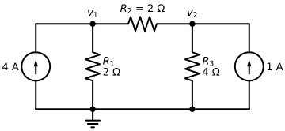
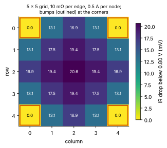

<!-- status: verified -->
# 06-04 · Nodal Analysis

| | |
|---|---|
| **Course** | [06 · Circuit Analysis I (DC)](../README.md) |
| **University equivalent** | The node-voltage method of a sophomore Circuits course (Nilsson & Riedel, *Techniques of Circuit Analysis*; Alexander & Sadiku, *Methods of Analysis*), MIT 6.002's node method (Agarwal & Lang, ch. 3), and the formulation chapter of a circuit-simulation course (Ho, Ruehli and Brennan's modified nodal analysis) |
| **Prerequisites** | [06-03](06-03-kirchhoffs-laws.md) (KCL, KVL, independent equations, the bridge network), [06-02](06-02-circuit-elements-and-ohms-law.md) (element laws, sources), [02-06](../../02-complex-numbers-des-and-linear-algebra/chapters/02-06-vectors-matrices-and-linear-systems.md) and [02-07](../../02-complex-numbers-des-and-linear-algebra/chapters/02-07-determinants-inverses-and-vector-spaces.md) (matrix equations, determinants, Cramer's rule). Each fact used is restated in a *Recap* or *Math refresher* box. |
| **Estimated study hours** | 10 |
| **Last verified** | 2026-11-19 |

**Learning objectives.** After this chapter you can:

1. Define node voltages relative to a reference node, explain why they satisfy KVL automatically, and write KCL at every other node in terms of them.
2. Write the nodal equations $\mathbf{G}\mathbf{v} = \mathbf{i}$ by inspection for circuits of resistors and current sources, and explain why $\mathbf{G}$ is symmetric, diagonally dominant and invertible.
3. Handle voltage sources: grounded sources that fix a node voltage, and floating sources with a supernode and a constraint equation.
4. Formulate modified nodal analysis with element "stamps", as a circuit simulator does, and relate it to sparse matrix solvers.
5. Solve nodal systems by hand for two or three unknowns and numerically for many, and check the results with power balance or a simulator.

## 1. Big picture

06-03 solved circuits by spotting structure: series pairs, parallel pairs, a delta to convert. That works for small circuits and fails for most real ones, which have several sources, no series–parallel structure and hundreds or billions of elements. **Nodal analysis** needs no insight at all. Pick a reference node, name the voltage of every other node, and write one KCL equation per node. The result is a square linear system, $\mathbf{G}\mathbf{v} = \mathbf{i}$, that a computer solves in one step. In its modified form it is the method behind SPICE-class simulators, from Berkeley's SPICE2 of 1975 to ngspice and today's commercial tools, and it is how a chip's power grid is checked.

- **SPICE is nodal analysis.** ngspice, used throughout this curriculum, builds a modified nodal matrix from the netlist line by line and solves it with sparse LU factorization ([R-054](../../../reference/research-log.md#r-054--spice-and-spice2-origins), [R-037](../../../reference/research-log.md#r-037--klu-and-sparse-solvers-in-circuit-simulation)).
- **Power-grid sign-off.** A chip's power grid is a huge resistor mesh with current drawn at every cell; its voltage drop ("IR drop") is computed by exactly the method of Example 06-04.5.
- **Nonlinear and dynamic circuits reuse it.** Transistors and diodes are linearized at each Newton iteration and capacitors are replaced by equivalent resistors and sources at each time step, so the same nodal matrix is solved over and over (§3.5).
- **It scales.** Each node connects to only a few others, so the matrix is sparse, and sparse solvers handle sizes far beyond hand analysis.

## 2. Intuition first

### Heights instead of drops

Describing a hilly walk by the height of every waypoint is more economical than listing the climb or descent of every path between them: the climbs follow from the heights by subtraction, and they automatically add up to zero around any closed tour. Node voltages are the heights. Once every node has a voltage, every branch voltage is a difference of two of them, and KVL around every loop is satisfied without being written down. Only KCL remains, one equation per node: currents in equal currents out.

### Balancing flows at each junction

Picture each node as a junction of pipes whose pressure you can set. For a trial set of pressures, the flows through all the pipes are determined (Ohm's law), and at each junction the flows either balance or leave a surplus. Nodal analysis finds the one set of pressures that balances every junction at once. Each equation says: the net flow out of this junction through its pipes equals what the sources pump in. *Where the analogy breaks:* water networks have nonlinear pipe friction and storage in tanks, which make their equations nonlinear and dynamic; for resistive circuits the balance is exactly linear, so one linear solve finds it.

*Figure 1. The circuit of Example 06-04.1. With node voltages $v_1$ and $v_2$, every resistor's current is known in terms of them, and KCL at the two nodes gives two equations in two unknowns.*

## 3. Theory

### 3.1 Node voltages satisfy KVL automatically

> **Recap from 06-03.** A circuit with $n$ nodes and $b$ branches has $2b$ unknown branch voltages and currents, determined by $b$ element laws, $n - 1$ independent KCL equations and $b - n + 1$ independent KVL equations.

Choose one node as the **reference** (ground) and define the **node voltage** $v_k$ of every other node as its voltage relative to the reference. A branch from node $a$ to node $b$ (+ at $a$) then has voltage

$$
v_{\text{branch}} = v_a - v_b .
$$

Around any loop, the branch voltages are differences of node voltages, and each node voltage appears once with a plus sign and once with a minus sign as the loop enters and leaves the node, so the sum is zero identically. **Node voltages satisfy KVL by construction.** That removes the $b - n + 1$ KVL equations and the $b$ branch voltages as separate unknowns. The element laws then express each branch current in terms of node voltages, which removes the $b$ currents too. What is left: $n - 1$ unknowns (the node voltages) and $n - 1$ KCL equations. A circuit with 50 nodes and 120 branches has 49 unknowns instead of 240.

### 3.2 KCL in terms of node voltages

For a resistor $R$ between nodes $k$ and $j$, the current *leaving* node $k$ through it is $(v_k - v_j)/R = G(v_k - v_j)$; for a resistor from node $k$ to ground it is $Gv_k$. KCL at node $k$, written as "current leaving through the resistors equals current entering from the current sources":

$$
\sum_{\text{resistors at } k} \frac{v_k - v_j}{R} = \sum_{\text{sources into } k} i_s ,
$$

where $v_j$ is the node voltage at the far end of each resistor, $R$ its resistance, and the sum includes resistors to ground (with $v_j = 0$). This is the whole method for circuits of resistors and current sources:

1. Choose the reference node (usually the node with the most connections, or the one marked ground).
2. Name the other $n - 1$ node voltages.
3. At each non-reference node, write KCL in the form above.
4. Solve the $n - 1$ linear equations.
5. Recover any branch current or power from the node voltages, and check the power balance.

The sign convention inside the equations does not depend on any reference arrows you might have drawn: "leaving through resistors equals entering from sources" fixes it. A node voltage that comes out negative simply lies below the reference.

### 3.3 The matrix form, written by inspection

Collect the coefficients of the KCL equations. At node $k$, $v_k$ is multiplied by the sum of all conductances connected to node $k$; each other $v_j$ is multiplied by minus the conductance between $k$ and $j$. So the $n - 1$ equations are

$$
\mathbf{G}\,\mathbf{v} = \mathbf{i}, \qquad
G_{kk} = \sum_{\text{all conductances at node } k}, \qquad
G_{kj} = -\!\!\sum_{\text{conductances between } k \text{ and } j}, \qquad
i_k = \sum_{\text{source currents into node } k} .
$$

This lets you write the matrix straight from the diagram, without writing the KCL equations first: diagonal entries are "everything touching the node", off-diagonal entries are "minus what connects the two nodes", and the right side is "source current pushed in". For Figure 1:

$$
\begin{bmatrix} \tfrac12 + \tfrac12 & -\tfrac12 \\ -\tfrac12 & \tfrac12 + \tfrac14 \end{bmatrix}
\begin{bmatrix} v_1 \\ v_2 \end{bmatrix} =
\begin{bmatrix} 4 \\ 1 \end{bmatrix} .
$$

> **Math refresher — solving a 2 × 2 system (02-06, 02-07).** For $\begin{bmatrix} a & b \\ c & d\end{bmatrix}\begin{bmatrix} x \\ y\end{bmatrix} = \begin{bmatrix} e \\ f\end{bmatrix}$, Cramer's rule gives $x = (ed - bf)/\Delta$ and $y = (af - ec)/\Delta$ with $\Delta = ad - bc$. For three unknowns, Gaussian elimination by hand is usually faster than Cramer's rule; for more, use a computer (`numpy.linalg.solve`).

**Properties of the nodal matrix.** For circuits of positive resistors and independent current sources, $\mathbf{G}$ has three properties, each with a physical reason:

- **Symmetric:** $G_{kj} = G_{jk}$, because a resistor between $k$ and $j$ appears in both nodes' equations with the same conductance. (Dependent sources, 06-06, break this.)
- **Diagonally dominant:** each diagonal entry is at least the sum of the magnitudes of the other entries in its row, with equality only at nodes with no conductance to ground, because the diagonal collects every conductance at the node and the off-diagonals only those to other non-reference nodes.
- **Positive definite, hence invertible, if every node has a resistive path to ground.** For any vector of node voltages, $\mathbf{v}^\mathsf{T}\mathbf{G}\mathbf{v} = \sum_{\text{resistors}} G\,(v_a - v_b)^2$, which is the total power the resistors would dissipate with those node voltages. It is positive unless every resistor sees zero voltage, which (if every node connects to ground through resistors) forces $\mathbf{v} = \mathbf{0}$ (Problem 06-04.9). So $\mathbf{G}$ is nonsingular and the circuit has exactly one solution.

The last property has a practical face: a node with no DC path to ground (a node connected only through capacitors, or a floating subcircuit) makes $\mathbf{G}$ singular, and SPICE stops with an error to that effect. The cure is to add the missing path, often a very large resistor.

### 3.4 Voltage sources: grounded and floating

A voltage source fixes the *difference* between two node voltages but says nothing about its own current, which can be anything (06-02). That breaks step 3, because KCL at a node with a voltage source attached needs the source's unknown current. Two cases arise.

**A grounded voltage source** (one terminal on the reference node) simply fixes a node voltage: $v_k = V_s$. That node's voltage is no longer an unknown, its KCL equation is dropped (it would only determine the source's current), and $V_s$ moves to the right-hand side of its neighbors' equations as a known term. Example 06-04.2 solves 06-03's bridge network this way with two unknowns.

**A floating voltage source** (neither terminal on the reference) connects two unknown node voltages $v_a$ (+) and $v_b$ (−). Draw a closed surface around the source and both of its nodes: a **supernode**. Charge conservation applies to any closed surface that stores no charge (06-01), so KCL holds for the supernode as a whole, and the source's unknown current, which flows entirely inside the surface, cancels out. The two equations for the two unknowns are then

$$
\text{KCL for the supernode (all currents leaving through its boundary)} = 0 \qquad\text{and}\qquad v_a - v_b = V_s .
$$

After solving, the source's current follows from KCL at either of its nodes alone (Example 06-04.3). A supernode may enclose several floating sources; each adds one constraint equation.

### 3.5 Modified nodal analysis: how a simulator does it

Supernodes are convenient by hand but awkward for a program, which would have to find them. **Modified nodal analysis** (MNA), published by Ho, Ruehli and Brennan of IBM in June 1975 and used by Nagel's SPICE2, completed at Berkeley the same year ([R-054](../../../reference/research-log.md#r-054--spice-and-spice2-origins), [R-103](../../../reference/research-log.md#r-103--modified-nodal-analysis-and-simulator-capacity)), treats every voltage source's current as an extra unknown. For a circuit with node voltages $\mathbf{v}$ and voltage-source currents $\mathbf{j}$:

$$
\begin{bmatrix} \mathbf{G} & \mathbf{B} \\ \mathbf{B}^\mathsf{T} & \mathbf{0} \end{bmatrix}
\begin{bmatrix} \mathbf{v} \\ \mathbf{j} \end{bmatrix} =
\begin{bmatrix} \mathbf{i} \\ \mathbf{e} \end{bmatrix} ,
$$

where the upper rows are KCL at every node (now including each source's current $j$ as an ordinary branch current), the lower rows are the sources' constraints $v_a - v_b = V_s$, $\mathbf{B}$ has a +1 in row $a$ and a −1 in row $b$ of each source's column, and $\mathbf{e}$ lists the source voltages.

**Stamps.** A program assembles this matrix element by element, each element adding a fixed pattern of entries, its **stamp**, without regard to the rest of the circuit (the 1975 paper's Table I calls them "element rubber stamps"):

| Element | Adds to the matrix | Adds to the right side |
|---|---|---|
| Resistor $G$ between nodes $a$, $b$ | $+G$ at $(a,a)$ and $(b,b)$; $-G$ at $(a,b)$ and $(b,a)$ | — |
| Current source $I$ flowing from $b$ to $a$ (into node $a$) | — | $+I$ at row $a$; $-I$ at row $b$ |
| Voltage source $V$, + at $a$, − at $b$, new unknown $j$ (row/column $m$) | $+1$ at $(a,m)$ and $(m,a)$; $-1$ at $(b,m)$ and $(m,b)$ | $V$ at row $m$ |

Rows and columns belonging to the reference node are simply never created. The stamp for the voltage source makes $j$ the current flowing *into* its + terminal through the source, which is why SPICE reports a negative current for a source that delivers power (06-01). The assembled MNA matrix is symmetric for resistors and independent sources but no longer positive definite (its lower-right block is zero), so simulators use LU factorization with pivoting rather than Cholesky.

**Nonlinear and dynamic elements reuse the same matrix.** A diode $i = f(v)$ is linearized at the current Newton iterate $v^{(k)}$ as a conductance $g = f'(v^{(k)})$ in parallel with a current source $f(v^{(k)}) - g v^{(k)}$, its **companion model**, and stamped like any resistor and current source; the linear solve gives the next iterate ([02-10](../../02-complex-numbers-des-and-linear-algebra/chapters/02-10-numerical-methods.md), Problem 06-04.13). A capacitor in a transient simulation is replaced, at each time step, by a conductance and a current source that encode the integration formula (Course 07). So a simulation is a long sequence of sparse linear solves of the same structure, and a fast sparse LU factorization is central to a simulator's speed (the other large cost is evaluating the device models).

> **Going deeper — why sparse.** In an $n$-node circuit where each node connects to only a handful of others, $\mathbf{G}$ has about $n$ times a handful of nonzero entries instead of $n^2$. A dense solver costs about $n^3/3$ operations; sparse LU with a good ordering keeps the "fill-in" (new nonzeros created during elimination) small, and its cost grows much more slowly. Circuit matrices are especially friendly: KLU, the solver now available in ngspice, exploits the fact that they can be permuted into block-triangular form with mostly tiny blocks ([R-037](../../../reference/research-log.md#r-037--klu-and-sparse-solvers-in-circuit-simulation)). A 100 × 100 grid of nodes has 10,000 unknowns but under 50,000 nonzeros in its matrix, 0.05% of the dense count (Problem 06-04.12).

### 3.6 Solving and checking

For two unknowns, Cramer's rule; for three, elimination; beyond that, a computer. Whatever the method, check the answer:

- **Substitute back** into one or two KCL equations.
- **Power balance:** the sources' delivered power must equal the resistors' total ($\sum G\,(v_a - v_b)^2$).
- **Bounds:** in a circuit of resistors with a single source, every node voltage lies between the source's terminal voltages; a node voltage outside that range signals an error.
- **Simulator:** for anything that matters, run it in SPICE (every example here has a netlist in the lab).

## 4. Worked examples

### Example 06-04.1 · Two nodes by inspection (tier A)

**Setup.** In Figure 1, a 4 A source pushes current into node 1 and a 1 A source into node 2 (both returning through ground). $R_1$ = 2 Ω from node 1 to ground, $R_2$ = 2 Ω between nodes 1 and 2, $R_3$ = 4 Ω from node 2 to ground. Find the node voltages, every resistor current, and check the power balance.

**Solution.** By inspection (§3.3):

$$
\begin{bmatrix} 1 & -0.5 \\ -0.5 & 0.75 \end{bmatrix}
\begin{bmatrix} v_1 \\ v_2 \end{bmatrix} =
\begin{bmatrix} 4 \\ 1 \end{bmatrix}.
$$

$\Delta = 1\times0.75 - (-0.5)(-0.5) = 0.5$; $v_1 = (4\times0.75 - (-0.5)\times1)/0.5 = 3.5/0.5 = $ **7 V**; $v_2 = (1\times1 - (-0.5)\times4)/0.5 = 3/0.5 = $ **6 V**.

Currents: $R_1$: $7/2 = $ **3.5 A** to ground; $R_2$: $(7 - 6)/2 = $ **0.5 A** from node 1 to node 2; $R_3$: $6/4 = $ **1.5 A** to ground. KCL: node 1, $4 = 3.5 + 0.5$ ✓; node 2, $1 + 0.5 = 1.5$ ✓.

**Power balance.** Sources deliver $4\times7 + 1\times6 = 34$ W (each current source pushes its current into a node at that node's voltage). Resistors: $3.5^2\times2 + 0.5^2\times2 + 1.5^2\times4 = 24.5 + 0.5 + 9 = 34$ W ✓.

**Units check.** S × V = A ✓.

**Sanity check.** Node 1, fed the larger current, sits higher ✓.

### Example 06-04.2 · The bridge network again, by nodal analysis (tier B)

**Setup.** Solve Example 06-03.5's network (10 V from node a to ground; $R_{ac}$ = 10, $R_{ad}$ = 20, $R_{cd}$ = 30, $R_{cb}$ = 40, $R_{db}$ = 50 Ω, with b the ground) by nodal analysis, and compare with the delta–wye result.

**Solution.** The source is grounded, so $v_a = 10$ V is known, leaving $v_c$ and $v_d$. KCL at c (leaving through resistors = 0): $(v_c - 10)/10 + v_c/40 + (v_c - v_d)/30 = 0$. At d: $(v_d - 10)/20 + v_d/50 + (v_d - v_c)/30 = 0$. Moving the known terms to the right:

$$
\begin{bmatrix} \tfrac1{10} + \tfrac1{40} + \tfrac1{30} & -\tfrac1{30} \\ -\tfrac1{30} & \tfrac1{20} + \tfrac1{50} + \tfrac1{30} \end{bmatrix}
\begin{bmatrix} v_c \\ v_d \end{bmatrix} =
\begin{bmatrix} 10/10 \\ 10/20 \end{bmatrix}
\;\Rightarrow\;
\begin{bmatrix} 0.15833 & -0.03333 \\ -0.03333 & 0.10333 \end{bmatrix}
\begin{bmatrix} v_c \\ v_d \end{bmatrix} =
\begin{bmatrix} 1 \\ 0.5 \end{bmatrix}.
$$

$\Delta = 0.15833\times0.10333 - 0.03333^2 = 0.015250$; $v_c = (1\times0.10333 + 0.03333\times0.5)/\Delta = $ **7.869 V**; $v_d = (0.15833\times0.5 + 0.03333\times1)/\Delta = $ **7.377 V**. Bridge current $(7.869 - 7.377)/30 = $ **16.39 mA**, and the source current is $(10 - 7.869)/10 + (10 - 7.377)/20 = $ **0.3443 A**, exactly as in 06-03.

**Units check.** S × V = A on both sides ✓.

**Sanity check.** Two equations, no network recognition, same answer as the delta–wye route ✓. For larger networks the advantage grows quickly.

### Example 06-04.3 · A floating voltage source and a supernode (tier B)

**Setup.** A 12 V source fixes node 1 at 12 V. A 5 V source floats between node 2 (+) and node 3 (−). Resistors: 2 Ω from node 1 to node 2, 3 Ω from node 1 to node 3, 4 Ω from node 2 to ground and 6 Ω from node 3 to ground (Figure 2). Find $v_2$ and $v_3$, the current delivered by each source, and check the power balance.

*Figure 2. The circuit of Example 06-04.3. The dashed supernode encloses the floating 5 V source and its two nodes.*

**Solution.** Supernode KCL, all currents leaving through its boundary:

$$
\frac{v_2 - 12}{2} + \frac{v_2}{4} + \frac{v_3}{6} + \frac{v_3 - 12}{3} = 0, \qquad v_2 - v_3 = 5 .
$$

Substitute $v_2 = v_3 + 5$ and multiply by 12: $6(v_3 - 7) + 3(v_3 + 5) + 2v_3 + 4(v_3 - 12) = 0$, so $15v_3 = 75$: $v_3 = $ **5 V** and $v_2 = $ **10 V**.

The 5 V source's current from KCL at node 2 alone: the resistors carry $(10 - 12)/2 = -1$ A and $10/4 = 2.5$ A away from node 2, a net 1.5 A, which must come from the source: it delivers **1.5 A** out of its + terminal, $5\times1.5 = $ **7.5 W**. The 12 V source feeds $(12 - 10)/2 + (12 - 5)/3 = 1 + 2.333 = $ **3.333 A** into node 1: **40 W**.

**Power balance.** Resistors: 2 Ω, $2^2/2 = 2$ W; 3 Ω, $7^2/3 = 16.33$ W; 4 Ω, $10^2/4 = 25$ W; 6 Ω, $5^2/6 = 4.167$ W; total 47.5 W $= 40 + 7.5$ ✓.

**Units check.** V/Ω = A; V × A = W ✓.

**Sanity check.** Both node voltages lie between 0 and 12 V, as they must when the only other source is a 5 V difference between them ✓.

### Example 06-04.4 · The same circuit as a simulator sees it (tier B)

**Setup.** Assemble the modified nodal matrix of Example 06-04.3 from stamps, with unknowns $v_1, v_2, v_3$ and the two source currents $j_1$ (12 V source) and $j_2$ (5 V source), each defined as SPICE does, into the source's + terminal. Solve it and interpret the signs.

**Solution.** Resistor stamps (rows and columns $v_1, v_2, v_3$): the 2 Ω between 1 and 2 adds $\pm0.5$; the 3 Ω between 1 and 3 adds $\pm0.333$; the 4 Ω to ground adds 0.25 at (2,2); the 6 Ω adds 0.1667 at (3,3). The 12 V source (+ at node 1, − at ground) adds a column and row with +1 at node 1; the 5 V source (+ at 2, − at 3) adds +1 at node 2 and −1 at node 3. So

$$
\begin{bmatrix}
0.8333 & -0.5 & -0.3333 & 1 & 0 \\
-0.5 & 0.75 & 0 & 0 & 1 \\
-0.3333 & 0 & 0.5 & 0 & -1 \\
1 & 0 & 0 & 0 & 0 \\
0 & 1 & -1 & 0 & 0
\end{bmatrix}
\begin{bmatrix} v_1 \\ v_2 \\ v_3 \\ j_1 \\ j_2 \end{bmatrix} =
\begin{bmatrix} 0 \\ 0 \\ 0 \\ 12 \\ 5 \end{bmatrix} .
$$

Solving (by computer, or by noting row 4 gives $v_1 = 12$ and proceeding as in Example 06-04.3) gives $v_1$ = 12, $v_2$ = 10, $v_3$ = 5 V, $j_1$ = **−3.333 A** and $j_2$ = **−1.5 A**. The negative signs mean the currents flow *out of* the + terminals: both sources deliver power, as Example 06-04.3 found.

**Units check.** Upper rows: S × V + A = A; lower rows: V ✓.

**Sanity check.** The matrix is symmetric, and the zero block in the lower right is why it is not positive definite ✓. The lab's mini-simulator builds exactly this matrix from a netlist and ngspice reports the same $j$ values.

### Example 06-04.5 · IR drop in a power grid (tier C)

**Setup.** A small model of a chip's power grid: a 5 × 5 array of nodes, each joined to its horizontal and vertical neighbors by 10 mΩ of metal. The four corner nodes are connected to the supply through bumps held at exactly 0.80 V. Every node draws 0.5 A from the grid (the circuits beneath it). Find the worst voltage at any node and where it occurs.

**Solution.** There are 25 nodes, 4 of them fixed at 0.80 V: 21 unknowns. Each unknown node's KCL equation, written by inspection, has the sum of its neighbors' conductances (100 S per neighbor; 2, 3 or 4 neighbors) on the diagonal, −100 S for each unknown neighbor off the diagonal, and on the right side $-0.5$ A (current drawn out of the node) plus 100 S × 0.80 V for each neighbor that is a fixed corner. This 21 × 21 system has only 85 nonzero entries out of 441. Solving it numerically (the lab does it with a sparse solver, and confirms in ngspice) gives a minimum voltage of **0.7794 V** at the **center** node: an IR drop of **20.6 mV**, 2.6% of the supply. The 21 interior and edge nodes together draw 10.5 A through the grid; the corner nodes' own loads are fed directly by the bumps.

*Figure 3. IR drop of Example 06-04.5, in millivolts below 0.80 V. The worst node is the one farthest from every bump.*

**Units check.** S × V = A; mΩ × A = mV ✓.

**Sanity check.** The worst drop is at the point farthest from every bump, and the voltages are symmetric under the grid's rotations and reflections ✓. A real chip has millions of grid nodes and many bumps, which is why power-grid analysis is done with sparse nodal solvers; the remedies the model suggests (more bumps, wider or thicker metal, backside power delivery, 06-01) are the ones designers use.

### Answer key

<!-- answer-key -->
| ID | Quantity | Value | Unit |
|---|---|---|---|
| T 06-04.a | nodal unknowns for 50 nodes | 49 | — |
| T 06-04.b | branch unknowns for 120 branches | 240 | — |
| T 06-04.c | unknowns, 100 × 100 grid | 10000 | — |
| T 06-04.d | nonzero fraction, 100 × 100 grid | 0.05 | % |
| Ex 06-04.1a | v_1 | 7 | V |
| Ex 06-04.1b | v_2 | 6 | V |
| Ex 06-04.1c | determinant | 0.5 | S² |
| Ex 06-04.1d | current in R_1 | 3.5 | A |
| Ex 06-04.1e | current in R_2 | 0.5 | A |
| Ex 06-04.1f | current in R_3 | 1.5 | A |
| Ex 06-04.1g | source power | 34 | W |
| Ex 06-04.1h | power in R_1 | 24.5 | W |
| Ex 06-04.1i | power in R_2 | 0.5 | W |
| Ex 06-04.1j | power in R_3 | 9 | W |
| Ex 06-04.2a | G_cc | 0.15833 | S |
| Ex 06-04.2b | G_dd | 0.10333 | S |
| Ex 06-04.2c | v_c | 7.869 | V |
| Ex 06-04.2d | v_d | 7.377 | V |
| Ex 06-04.2e | bridge current | 16.39 | mA |
| Ex 06-04.2f | source current | 0.3443 | A |
| Ex 06-04.2g | determinant | 0.015250 | S² |
| Ex 06-04.3a | v_2 | 10 | V |
| Ex 06-04.3b | v_3 | 5 | V |
| Ex 06-04.3c | current delivered by the 5 V source | 1.5 | A |
| Ex 06-04.3d | power delivered by the 5 V source | 7.5 | W |
| Ex 06-04.3e | current delivered by the 12 V source | 3.333 | A |
| Ex 06-04.3f | power delivered by the 12 V source | 40 | W |
| Ex 06-04.3g | total resistor power | 47.5 | W |
| Ex 06-04.3h | power in the 2 Ω | 2 | W |
| Ex 06-04.3i | power in the 3 Ω | 16.33 | W |
| Ex 06-04.3j | power in the 4 Ω | 25 | W |
| Ex 06-04.3k | power in the 6 Ω | 4.167 | W |
| Ex 06-04.4a | j_1 | −3.333 | A |
| Ex 06-04.4b | j_2 | −1.5 | A |
| Ex 06-04.5a | unknowns | 21 | — |
| Ex 06-04.5b | nonzero matrix entries | 85 | — |
| Ex 06-04.5c | minimum node voltage | 0.7794 | V |
| Ex 06-04.5d | worst IR drop | 20.6 | mV |
| Ex 06-04.5e | current through the grid | 10.5 | A |
| Ex 06-04.5f | worst drop as a fraction of the supply | 2.6 | % |

## 5. Simulate it

Open [labs/06-04-lab/](../labs/06-04-lab/README.md): a notebook and two ngspice netlists.

1. **A mini-SPICE.** Read and run a 40-line program that reads a netlist of resistors, current sources and voltage sources, stamps the MNA matrix and solves it. Run it on Examples 06-04.1 to 06-04.4 and Problem 06-04.7. *Predict first:* what size is the MNA matrix of Example 06-04.3, and which entries are zero?
2. **Agree with ngspice.** Run the same circuits in ngspice and compare node voltages and source currents to the six significant digits ngspice prints.
3. **IR drop.** Build the 5 × 5 grid of Example 06-04.5 with a sparse matrix, plot the voltage map, then add a fifth bump at the center. *Predict first:* how much does the worst drop improve?
4. **Sparse versus dense.** Time dense and sparse solves of N × N grids for N up to 150 (dense only up to 50). *Predict first:* how does each scale with the number of nodes?

## 6. Engineering tradeoffs

| Knob | Improves | Costs | Typical decision owner |
|---|---|---|---|
| Nodal (MNA) versus mesh formulation | Nodal: works for any circuit, nonplanar too; easy to automate; few unknowns when there are many parallel branches | Floating voltage sources need supernodes or extra unknowns | Simulator architect (nodal won) |
| Sparse versus dense solver | Sparse: memory grows only with the nonzeros, and time far more slowly than the dense $n^3$ | Ordering and bookkeeping overhead; worse for small or dense problems | Simulator developer |
| Full SPICE versus FastSPICE | SPICE: accuracy, every device modeled | FastSPICE: partitioning and simplified models trade accuracy for capacity and speed | Verification lead |
| More bumps or thicker grid metal | Lower IR drop, more timing margin | Package cost, routing resources, area | Power-integrity and physical-design engineers |
| Larger simulation time step or looser tolerance | Faster simulations | Accuracy, possible convergence trouble | Circuit designer |

## 7. Numbers to know

| Quantity | Value | Note |
|---|---|---|
| Unknowns, nodal versus branch method | $n - 1$ versus $2b$ | 50 nodes, 120 branches: 49 versus 240 |
| Nodal matrix entries | diagonal: sum at node; off-diagonal: −(conductance between) | symmetric for R and independent sources |
| MNA size | nodes − 1 + number of voltage sources | |
| Nonzeros in an N × N grid's matrix | about $5N^2$ | out of $N^4$ |
| Dense solve cost | about $n^3/3$ operations | sparse: far less for circuits |
| SPICE origin | SPICE (1973), SPICE2 with MNA (1975), UC Berkeley | [R-054](../../../reference/research-log.md#r-054--spice-and-spice2-origins) |

## 8. Common mistakes

1. **Inconsistent signs within one KCL equation.** Write every resistor current as *leaving* the node, $(v_k - v_j)/R$, and every source current entering, and the signs take care of themselves.
2. **Forgetting resistors to ground on the diagonal** when writing $\mathbf{G}$ by inspection.
3. **Writing KCL at a node attached to a voltage source** without including the source's unknown current; use a supernode or MNA instead.
4. **Forgetting the constraint equation** of a supernode.
5. **Putting a known node voltage's term on the wrong side,** or keeping it as an unknown.
6. **Leaving a node without a DC path to ground,** which makes the matrix singular (SPICE refuses to solve).
7. **Misreading SPICE's source currents:** they are into the + terminal (06-01).

## 9. Practitioner lens

### State of the art (as of Nov 2026)

- **The formulation is fifty years old and still at the core.** Modified nodal analysis was published by Ho, Ruehli and Brennan of IBM's Watson Research Center in June 1975, as a method that "retains the simplicity and other advantages of nodal analysis while removing its limitations" (voltage sources and current-dependent elements). Nagel's SPICE2 thesis the same year reported that it required "substantially less computational effort" than the alternatives tested, and SPICE-class simulators since build on it ([R-054](../../../reference/research-log.md#r-054--spice-and-spice2-origins), [R-103](../../../reference/research-log.md#r-103--modified-nodal-analysis-and-simulator-capacity)) **[Established]**.
- **Solvers keep improving.** ngspice added the KLU sparse solver, designed for circuit matrices, as an option in 2023 ([R-037](../../../reference/research-log.md#r-037--klu-and-sparse-solvers-in-circuit-simulation)) **[Established]**.
- **Capacity claims are marketing.** Commercial vendors describe their simulators as handling "millions of transistors and billions of parasitics" (Cadence, for Spectre X, with "up to 10X" speed over its previous simulator) or "billions of elements" (Synopsys, for PrimeSim FastSPICE on a 3D stacked memory design) ([R-103](../../../reference/research-log.md#r-103--modified-nodal-analysis-and-simulator-capacity)) **[Contested]**: vendor claims, read from search excerpts, with no independent benchmark and no published element-count specification. The largest capacities come from FastSPICE tools, which partition the circuit and simplify device models, trading accuracy for size (vendor blogs and patents, [R-103](../../../reference/research-log.md#r-103--modified-nodal-analysis-and-simulator-capacity)) **[Industry estimate]**.

### Why it matters commercially

Circuit simulation is a core product of the EDA industry, sold to every chip company, and simulation capacity and speed are what limit how much of a design can be verified at transistor level before tape-out. Power-grid (IR-drop and electromigration) sign-off, built on the nodal analysis of Example 06-04.5 at enormous scale, is a mandatory step for every advanced chip. For an acquirer, a team's simulation methodology (what is simulated at full SPICE accuracy, what with FastSPICE, what only statistically) is a direct indicator of first-silicon risk (00-05).

### Marketing vs Reality

- **"Billion-element simulation."** *Reality:* at that scale the tool is a FastSPICE simulator using partitioned, simplified models; accuracy is specified loosely, and full SPICE accuracy applies to far smaller blocks. Ask what accuracy was achieved against SPICE on the same block.
- **"10× faster."** *Reality:* on which circuits, at what accuracy settings, on how many cores, compared with which version? Speed-ups are usually best-case and design-dependent.
- **"IR drop is within budget."** *Reality:* static IR drop (average currents, as in Example 06-04.5) is the easy part; dynamic drop from simultaneous switching, which needs transient analysis with the package and on-die capacitance, is usually worse.

### Questions for engineering leaders

1. **"Which blocks are signed off with full SPICE, which with FastSPICE, and how do you correlate the two?"** *Strong:* a clear partition and correlation data. *Evasive:* "the tool handles it".
2. **"What is your worst static and dynamic IR drop, and how much margin does it leave?"** *Strong:* numbers by region and mode, with silicon correlation. *Evasive:* only a static number.
3. **"How long does a full-chip power-grid analysis take, and how often do you run it?"** *Strong:* run time and cadence that fit the design schedule. *Evasive:* "at tape-out".
4. **"Have you seen convergence failures or singular-matrix errors, and how do you handle them?"** *Strong:* a process for diagnosing them (floating nodes, unrealistic models). *Evasive:* "we loosen the tolerances".

## 10. Concept check

1. Why do node voltages satisfy KVL automatically?

   

Answer

   Every branch voltage is the difference of its two node voltages. Around a loop, each node voltage is added once and subtracted once, so the sum is identically zero.

   

2. Write by inspection the nodal matrix of a circuit with 1 kΩ from node 1 to ground, 2 kΩ between nodes 1 and 2, and 2 kΩ from node 2 to ground (in mS).

   

Answer

   $\begin{bmatrix} 1 + 0.5 & -0.5 \\ -0.5 & 0.5 + 0.5 \end{bmatrix} = \begin{bmatrix} 1.5 & -0.5 \\ -0.5 & 1 \end{bmatrix}$ mS.

   

3. Why can you not write ordinary KCL at a node attached to a floating voltage source, and what replaces it?

   

Answer

   The source's current is unknown and is not given by any element law. Enclose the source and both its nodes in a supernode, whose KCL does not involve that current, and add the constraint $v_a - v_b = V_s$; or, as SPICE does, make the source's current an extra unknown (MNA).

   

4. What physical quantity does $\mathbf{v}^\mathsf{T}\mathbf{G}\mathbf{v}$ represent, and why does that make $\mathbf{G}$ invertible?

   

Answer

   The total power the resistors dissipate with node voltages $\mathbf{v}$, $\sum G(v_a - v_b)^2$. It is positive for any nonzero $\mathbf{v}$ when every node has a resistive path to ground, so $\mathbf{G}$ is positive definite and therefore nonsingular.

   

5. How big is the MNA matrix for a circuit with 8 nodes (including ground) and 3 voltage sources?

   

Answer

   $7 + 3 = 10$ unknowns: a 10 × 10 matrix.

   

6. A SPICE run fails with a singular-matrix error. Name a likely cause.

   

Answer

   A node with no DC path to ground (connected only through capacitors, or a floating subcircuit), or a loop of ideal voltage sources (which also makes the MNA matrix singular).

   

7. How does a simulator handle a diode inside a nodal formulation?

   

Answer

   At each Newton iteration it replaces the diode by its companion model, a conductance equal to the slope at the present estimate in parallel with a current source, stamps them into the matrix, solves, and repeats until the estimates converge.

   

Problem set: [06-04 problems](../problems/06-04-problems.md) · [solutions](../solutions/06-04-solutions.md).

## 11. Key terms

[Nodal analysis](../../../reference/glossary.md#nodal-analysis) ·
[Node voltage](../../../reference/glossary.md#node-voltage) ·
[Reference node (ground)](../../../reference/glossary.md#reference-node-ground) ·
[Conductance matrix](../../../reference/glossary.md#conductance-matrix) ·
[Supernode](../../../reference/glossary.md#supernode) ·
[Modified nodal analysis](../../../reference/glossary.md#modified-nodal-analysis) ·
[Stamp](../../../reference/glossary.md#stamp) ·
[Companion model](../../../reference/glossary.md#companion-model) ·
[Sparse matrix](../../../reference/glossary.md#sparse-matrix) ·
[IR drop](../../../reference/glossary.md#ir-drop) ·
[Positive definite matrix](../../../reference/glossary.md#positive-definite-matrix) ·
[Diagonally dominant matrix](../../../reference/glossary.md#diagonally-dominant-matrix) ·
[FastSPICE](../../../reference/glossary.md#fastspice)

## 12. Connections

- **Previous:** [06-03](06-03-kirchhoffs-laws.md) (KCL, KVL, independent equations, the bridge network solved by delta–wye); [02-06](../../02-complex-numbers-des-and-linear-algebra/chapters/02-06-vectors-matrices-and-linear-systems.md) (the nodal matrix of a resistive network was introduced there as a linear-algebra example).
- **Next:** [06-05 Mesh Analysis](06-05-mesh-analysis.md), the dual method with loop currents; [06-06](06-06-dependent-sources.md) adds dependent sources, which make $\mathbf{G}$ unsymmetric.
- **Used later:** every circuit in Courses 06 and 07 can be solved this way; phasor nodal analysis ([07-05](../../07-circuit-analysis-2-transient-and-ac/chapters/07-05-sinusoidal-steady-state-and-impedance.md)); Newton's method on nodal equations for nonlinear circuits ([02-10](../../02-complex-numbers-des-and-linear-algebra/chapters/02-10-numerical-methods.md), Course 10); power-grid analysis ([19-06](../../19-digital-vlsi-design/chapters/19-06-power-and-low-power-design.md)).

## 13. Further study

- Nilsson, J. W. and Riedel, S. A., *Electric Circuits*, chapter 4, "Techniques of Circuit Analysis" (node-voltage method, supernodes).
- Agarwal, A. and Lang, J. H., *Foundations of Analog and Digital Electronic Circuits*, chapter 3, the node method.
- Ho, C.-W., Ruehli, A. E. and Brennan, P. A., "The modified nodal approach to network analysis", *IEEE Transactions on Circuits and Systems* 22(6), 504–509 (1975): the original MNA paper, short and readable.
- *Video:* MIT OpenCourseWare 6.002, *Circuits and Electronics* (Spring 2007, A. Agarwal), Lecture 3, "Superposition, Thévenin and Norton" (its first half develops the node method).

## 14. Sources

1. Nilsson and Riedel, ch. 4; Alexander and Sadiku, ch. 3; Agarwal and Lang (2005), ch. 3.
2. C.-W. Ho, A. E. Ruehli and P. A. Brennan, "The modified nodal approach to network analysis", *IEEE Trans. Circuits and Systems* CAS-22(6), 504–509, June 1975, DOI 10.1109/TCS.1975.1084079. [R-103]
3. L. W. Nagel, SPICE2, ERL-M520 (1975); Nagel and Pederson, SPICE, ERL-M382 (1973). [R-054]
4. T. A. Davis and E. Palamadai Natarajan, KLU (2010); ngspice NEWS. [R-037]
5. Cadence and Synopsys simulator product pages and blogs (capacity claims). [R-103]
